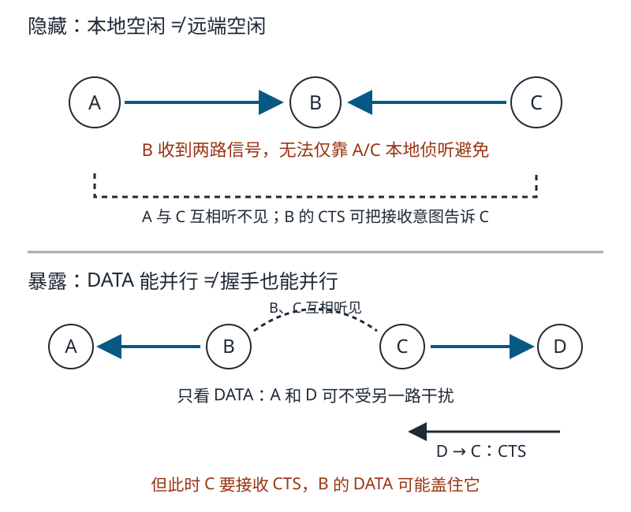

# 第 26 讲：无线链路

## 1. 核心问题：为什么不能把无线当作“没有线的以太网”？

一条导线把传播约束在特定介质内，而无线发射会影响空间中的多个位置。结果不只是“传得不够远”，还包括三种不同问题：

- **接收质量：** 到接收者处，信号相对干扰和噪声是否足够强？
- **接入决策：** 某发送者现在发送，会不会破坏别的接收者？
- **竞争公平：** 即使每次发送不冲突，是否总是同一设备抢到下一次机会？

这三件事分别需要物理模型、媒体访问协议和竞争状态设计。把它们都叫作“信号不好”，就很容易选错解决办法。

本讲的学习顺序是：先建立功率预算，再用接收位置推导隐藏/暴露终端，最后分析 MACA/MACAW 为什么逐步加入 CTS、ACK、DS、RRTS。**这些协议是本教材所选的研究与教学模型，不是所有 Wi-Fi 的逐项标准说明，更不是蜂窝、卫星等全部无线技术的共同接入规则。**

## 2. 把比特、频率、功率和数据率分开

调制是把数据映射到载波的某些特征上：幅度、频率、相位等。载波频率回答“信号在哪个频段”；带宽回答“占用多宽的频率范围”；数据率回答“每秒承载多少比特”。三者不能互换。

接收端质量先用线性功率比描述：

$$
S=\frac{P_{\mathrm{signal}}}{P_{\mathrm{interference}}+P_{\mathrm{noise}}}
$$

其中背景噪声在没有其他发送者时仍然存在；干扰来自其他发送信号。把发射功率抬高可能改善自己的 $S$，却也可能增加其他接收者分母中的干扰，因此不是无代价的办法。

分贝形式为：

$$
S_{\mathrm{dB}}=10\log_{10}S
$$

再代入容量模型时，要先还原成线性比值：

$$
C=B\log_2(1+S)
$$

### 算例：20 dB 不等于把 20 直接塞进对数

教材的电话例子给出 300–3300 Hz，故 $B=3000$ Hz；20 dB 对应 $S=100$。

$$
C=3000\log_2(101)\approx19.98\ \mathrm{kbps}
$$

这只是模型中的理论上限，不是应用一定能得到的吞吐率。教材原式把 3000 写成 4000，但仍保留约 20 kbps 的结果；[完整译文](#/c/berkeley-cs168-2025/lec/lec26?v=materials)保留并勘正了这个错误。

**自拟对照：** 带宽不变时，SINR 从 20 dB 提到 30 dB，即比值从 100 提到 1000，容量约从 20 kbps 提到 29.9 kbps，而非十倍。原因是容量只随 SINR 的对数增加。提高信号与增加带宽的作用不一样。

## 3. 一条无线链路能否成立？先算余量，再谈“有信号”

自由空间中，同样的发射功率分散到面积为 $4\pi d^2$ 的球面上，因此接收功率随距离平方下降。含天线增益的模型是：

$$
P_r=P_tG_tG_r\left(\frac{\lambda}{4\pi d}\right)^2
$$

在天线、波长都不变时，距离翻倍使功率下降到四分之一，也就是约损失 6 dB。

真正的接收链路还包括电缆损耗、天线增益及传播损耗。把各项转为 dB 后相加减即可：

$$
\begin{aligned}
P_r[\mathrm{dBm}]={}&P_t[\mathrm{dBm}]\\
&+\sum G[\mathrm{dB}]-\sum L[\mathrm{dB}]\\
M[\mathrm{dB}]={}&P_r[\mathrm{dBm}]-P_{\min}[\mathrm{dBm}]
\end{aligned}
$$

教材实例的收端功率为 −65.5 dBm，灵敏度为 −80 dBm，所以余量 $M=14.5$ dB。**接收功率为负 dBm 并不等于不可用；要与灵敏度比较。**

若在这个实例上额外引入 8 dB 损耗，余量就变为 6.5 dB；若额外损耗 16 dB，余量变为 −1.5 dB，在该门槛模型中就不可用。这是基于教材数值的自拟预算练习，不是对某种设备的实测。

### 为什么走一小步，信号可能变化很大？

自由空间路径损耗决定缓慢的趋势；建筑物遮挡决定较大尺度的起伏；多条路径的相位差产生细粒度的衰落。移动时不只是距离变了，还可能改变多径叠加关系。

双径模型加入地面反射，在相应远距离近似下得到 $1/d^4$，比自由空间的 $1/d^2$ 衰减更快。更一般的经验式可写作：

$$
P_r=\frac{P_tK}{d^\gamma},\qquad \gamma>0
$$

教材给出的 $\gamma$ 范围是 2–8，但其原公式漏写衰减指数的负号。不要从错误排版推导出“距离越远接收越强”。这些模型的适用条件也不同，不能在同一算例中不加说明地替换指数。

## 4. 关键推导：发送处空闲，不代表接收处空闲



图为编者根据教材 CSMA 例子重绘。线和圆只表示理想化可达关系，不是现实的硬覆盖边界。

### 隐藏终端：少阻止了一次不该发生的发送

A、C 互相听不见，但都能影响 B。A 向 B 发送时，C 仍可能判定空闲，并向 B 发。A 和 C 的本地判断都“合理”，B 却收不清。

要修复它，需要让 **B 的接收意图**传到 C，而不是仅增加 A 的本地侦听次数。

### 暴露终端：多阻止了一次本来可行的发送

B 向 A 发，C 向 D 发；B、C 彼此听得见，但 B 不影响 D、C 不影响 A。在只传单向数据的理想图中，两者可以并行。CSMA 却因为 C 听到 B 而让 C 等待。

这里的目标不是“任何地方都没有波叠加”，而是**每个需要解码的接收者都能完成接收**。

### 一旦加入握手，谁是接收者会随时间变化

C→D 的数据可能不影响 A，但 C 在发送数据前需要接收 D 的 CTS。此刻 C 是接收者，B 的数据可能干扰 C。于是“两个 DATA 接收者不冲突”仍不足以证明整个协议可并行。

这是本讲最重要的分析方法：**对每一个 RTS、CTS、DATA、ACK 阶段，重新标出谁在接收，再判断干扰。**

## 5. MACA：让接收者参与预约

基本交换为：

```text
A → B：RTS（请求发送及长度）
B → A：CTS（允许发送及长度）
A → B：DATA
```

邻居的规则也分两层：

- 听到 RTS：先短暂安静，让发送者有机会接收 CTS。
- 听到 CTS：在相应 DATA 时间保持安静，保护真正的接收者。

因此 C 即使听不见 A，也可能听见 B 的 CTS，从而避免隐藏终端碰撞。RTS 仍可能碰撞；没有收到 CTS 就不能发 DATA，应退避后重试。

教材 MACA 的窗口模型是：$CW$ 最小 2、最大 64；失败翻倍，成功重置为 2；在 0 到 CW 之间随机等待。**这是避免长期同步冲突的随机化机制，不是保证任意一次请求必成功。**

还要注意，“未收到 CTS”是失败观测，不是精确故障诊断。协议需要对这个观测安全响应，却不能据此断言现实中的唯一原因一定是碰撞。

## 6. MACAW 的四项改进分别修补什么？

| 改进 | 所修补的信息或性能缺口 | 不能据此声称什么 |
| --- | --- | --- |
| ACK | 发送者不知道数据是否到达；链路内重传降低恢复成本 | 不能取代端到端可靠性 |
| 共享 CW 与 MILD | 成功者窗口小、失败者窗口大，容易形成持续优势 | 不保证任意拓扑下绝对公平 |
| DS | 听见发送者但听不见 CTS 的节点，不知道数据期是否获准及何时结束 | 并未让暴露终端必然并行 |
| RRTS | 远处发送者不知道何时重新争用，由接收者通知它 | 接收者没听见 RTS 时无从代为请求 |

### ACK：正确性的位置与性能优化的位置可以不同

没有链路 ACK 时，端到端 TCP 仍需要恢复丢包。链路 ACK 的意义是更快局部修复，减少无线错误在传输层造成的性能损失，而不是让最终主机从此不再负责正确性。

若 DATA 成功但 ACK 丢失，接收者可对后来的 RTS 直接回复 ACK，避免重新传送已收到的数据。理解这一步时要记住：接收者必须能够认出先前的成功，而非把任何 RTS 都当成已完成。

### 公平：随机窗口的数值也会携带历史优势

假设 A、B 最初窗口都为 2；A 成功后仍为 2，B 失败变为 4；若再失败则变为 8。B 不仅“运气差”，还被窗口机制推到更迟的竞争时刻。因此 MACAW 在分组中传播 CW，使互相可达的设备共享竞争尺度。

教材 MILD 规则：RTS 失败时乘 1.5，完整成功时减 1；窗口限制在 2–64。若 RTS/CTS 已成功而 ACK 失败，CW 不变。不要把链路数据恢复失败与争用失败完全混成同一种窗口更新。

### DS：同步是公平性的资源

加入 DS 后：

```text
RTS → CTS → DS → DATA → ACK
```

RTS 只说明“请求”，DS 才说明“获准并开始”。知道 DATA 长度，周围节点就能知道何时有机会进入下一轮。否则当前赢家精确知道自身结束时刻，其他人只能盲目重试；即使大家 CW 一样，信息不对称仍会带来不公平。

### RRTS：把“谁知道机会到来”与“谁想发数据”连接起来

A→B 占用介质，C 听见 B 的 CTS 而必须安静；D 想向 C 发，却听不见 A 的 DS。C 如果听到了 D 的 RTS，可以等可竞争时发 RRTS，让 D 及时重发 RTS。其他听见 RRTS 的设备安静两个时隙，保护随后的 RTS/CTS。

但若 C 的数据盖住了 A→B 的 RTS，B 根本不知道 A 在等，就不会替 A 发 RRTS。这是教材保留的未解决反例。**修复一个缺失信息的路径，不等于修复所有拓扑下的信息缺失。**

## 7. 易错点清单

1. 把 dB 当作绝对功率，或把 dBm 与 dB 不加区分地相加。
2. 把 SINR 的 dB 值直接代入香农公式。
3. 以发送处听到空闲，证明接收处一定无碰撞。
4. 只检查 DATA 阶段，不检查 CTS/ACK 接收者。
5. 把“DS 保护暴露终端情形”误读为“DS 解决暴露终端并发问题”。
6. 把局部重传理解成取消端到端可靠性。
7. 看到 MACA/MACAW 就补入教材未给出的 Wi-Fi 标准参数，或把本讲随机接入模型套到[蜂窝基站调度](#/c/berkeley-cs168-2025/lec/lec27?v=notes)。

## 8. 自测

<details>
<summary>20 dB 的 SINR 对应什么线性比值？若距离在自由空间中翻倍，原接收功率变化多少？</summary>

20 dB 对应 100。天线、波长、发射功率固定时，距离翻倍使接收功率变成四分之一，约降低 6.02 dB。不能因此直接说应用吞吐率也降为四分之一。
</details>

<details>
<summary>接收功率为 −70 dBm、灵敏度为 −82 dBm，余量多少？新增 15 dB 损耗后怎样？</summary>

余量 12 dB；新增损耗后接收功率 −85 dBm，余量 −3 dB，在此门槛模型中不可用。负 dBm 本身不是失败条件。
</details>

<details>
<summary>A、C 互相听不到却都能到达 B。为什么“再监听久一点”不能根治？</summary>

C 的观测位置决定它听不到 A；延长本地监听不能让不存在于 C 位置的可检测信号出现。需要让 B 的接收意图通过 CTS 等方式告知 C。
</details>

<details>
<summary>B→A 与 C→D 的 DATA 都不会破坏对方接收者，为什么 MACA 仍可能不能并行？</summary>

C 发送前要接收 D 的 CTS。B 的 DATA 可能到达 C 并盖住 CTS。并发安全必须覆盖整个握手过程，而不只是两段 DATA。
</details>

<details>
<summary>为什么 RTS 不能替代 DS？为什么 DS 不能替代 RRTS？</summary>

RTS 可能未获批准，不能证明 DATA 将开始；DS 明确宣布已获准的发送及其持续时间。DS 只能通知发射者附近的节点；若等待发送者在范围外、只有接收者知道下一轮机会，就需要 RRTS 把这个时机传过去。
</details>

<details>
<summary>“加入 RRTS 后每个等待者都能公平参与竞争”错在哪里？</summary>

RRTS 要求接收者先知道对方想发。如果 RTS 本身持续被干扰淹没，接收者没有这个信息，便不会发 RRTS。教材明确给出此未解决情形。
</details>

## 引用与来源

- 本页是基于固定教材 [Wireless Links](https://github.com/berkeley-cs168/textbook/blob/0b8208742d31df7fc3d53a0cd94fdd4e04f8d47e/wireless/wireless-links.md)全部正文小节的独立问题式学习笔记；[唯一完整译文](#/c/berkeley-cs168-2025/lec/lec26?v=materials)含所有 28 幅原图、实例和勘误。原作者 Peyrin Kao，基于 Sylvia Ratnasamy、Rob Shakir 等讲授；教材改编内容按 [CC BY-SA 4.0](https://creativecommons.org/licenses/by-sa/4.0/)共享。原创 SVG 是概念重绘，不是课堂截图。
- 教材固定提交日期 **2026-10-01**，不是 2025 历史教材；本页不声称完整反映实际课堂。
- [Spring 2025 官方课表](https://sp25.cs168.io/)把本讲列为 4 月 30 日。个体视频元数据核实：ID `kfJdwlNJIa4`，标题 **[CS168 SP25] Lecture 26 - Collectives (continued) and Wireless Links**，频道 **CS 168 (Internet Architecture) at UC Berkeley**，上传日 **2025-05-01**，时长 **4913 秒（81:53）**。上传日不是课表日期；标题证实含集体通信续讲，可关联[第 25 讲](#/c/berkeley-cs168-2025/lec/lec25?v=notes)，但不能由标题确定其比例或时点。
- 人工字幕列表为空，存在英语自动字幕入口；默认 visionos 路径和一次不同的官方 timedtext 路径均返回 HTTP 429。**未取得字幕，未观看音画，课堂、片头、片尾、问答及主题切换时刻均未核验；不提供猜测时间表，不建立占位课堂稿。** 元数据许可为空，视频许可记为 unknown，不套用教材许可。官方课件仅登记入口，本页未据其内容作课堂覆盖断言。
- [官方 Spring 2025 公告](https://sp25.cs168.io/announcements/)明确期末范围排除 wireless 和 cellular；这是考试范围说明，不是课程删减。这两讲仍属于 27 个主讲次。
