# 蜂窝网络

## 为什么学习蜂窝网络？

无线移动连接已经成为现代生活的常态：即使坐在移动的汽车里，手机也能连接互联网。

传统互联网网络本身不能直接提供这种能力。你从卧室走到厨房时或许仍能联网，那是因为一直处在家用无线路由器的覆盖范围内，而路由器再通过有线网络连接互联网。但传统互联网并没有天然提供跨越很大范围、例如乘车移动时的无缝连接。

无线移动连接有多种实现方式，蜂窝网络是当前占主导地位的接入技术。原文称，超过一半的 Web 流量来自蜂窝设备。卫星、自由空间光通信也能提供移动无线连接，但并不改变蜂窝接入的主导地位。

未来，自动驾驶、虚拟现实等依赖移动无线连接的高性能应用，可能推动更多创新。若试图把现有蜂窝网络扩展到支撑这些应用，成本可能过高；AT&T、Verizon 等运营商也并不以快速创新著称。原文据此认为，这个领域有很大的变革机会，是活跃研究方向。


> 编者范围说明：“今天”“未来”及流量占比均是教材原文的时态和判断，未附统计出处；“来自蜂窝设备”也不自动等于“经蜂窝接入承载”。这里不将其改称为 2026 年实测统计。

## 蜂窝网络简史

蜂窝技术起源于传统电话系统，最初是为了让人们不用有线座机也能打电话。原文称第一款移动电话在 1983 年以 4000 美元出售，考虑通胀后相当于今天更高的金额。

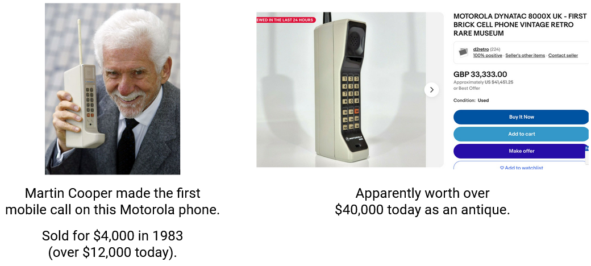

图中文字补充：Martin Cooper 使用这种摩托罗拉电话完成了第一通移动电话呼叫；4000 美元按图中当时的通胀口径折合超过 12000 美元。右侧截图显示其古董报价折合超过 40000 美元。后两项只是原图保留的当时说明和挂牌价格，不是本译者核验的当前成交价。

由于蜂窝技术源自电话网而非互联网，许多设计选择与传统互联网不同。很长一段时间里，用于语音的智能手机之前的蜂窝系统，与互联网各自沿着不同架构并行发展。

例如，蜂窝网络使用资源预留，现代互联网使用分组交换；蜂窝网络往往围绕单个用户组织，互联网则更多围绕流或分组组织；蜂窝按通话分钟收费等商业模式，也不同于通常较少逐项跟踪用量的互联网。

近年来，蜂窝网络逐渐变得与互联网兼容。今天可把它理解为一种专门化的第 2 层本地网络，能够与其余 TCP/IP 互联网交互。

> 编者边界：这里“像第 2 层本地网络”是对外服务的抽象，不表示蜂窝内部没有 IP、路由器、隧道或控制协议。“资源预留”和“分组交换”也不是互斥概念；下文明确说明 4G 起蜂窝采用分组交换，同时仍调度无线资源。

## 蜂窝标准

互联网通过标准组织统一 TCP、IP 等协议，蜂窝网络同样有多个标准组织协作。

蜂窝标准涉及更多现实政治复杂性。为了互操作，所有手机制造商、建设基站的网络运营商都需要一直到物理层为止对协议达成一致。

关键组织是 **3GPP（3rd Generation Partnership Project，第三代合作伙伴计划）**，主要设备商和电信公司都参与其中。原文把流程概括为 3GPP 提出标准，再送交 **ITU（International Telecommunication Union，国际电信联盟）**。ITU 属于联合国体系，各国有投票权，因此也有政治因素。原文举例说，各国一票，美国可能被欧盟成员国的票数超过。

通常约每十年推出新一代技术；2G、3G、4G、5G 中的数字就是蜂窝技术的“代”。原文将 5G 的形成概括在 2020 年前后，并说运营商仍在部署，未来几年、即 2020 年代后期将开始规划 6G。

> 编者勘注：以上是教材的年代叙述与标准流程简化，不是实时产业进度表；不能据固定快照中的“将开始”判断现实中的 6G 工作尚未开展。本页也不把原文简化流程当作全部标准机构的正式程序说明。

每一代会沿多个维度改进：理论峰值数据率、用户实际体验的数据率、高速移动时维持连接的能力、单位面积连接密度等。原文概括为每代在这些维度上通常提高约十倍。

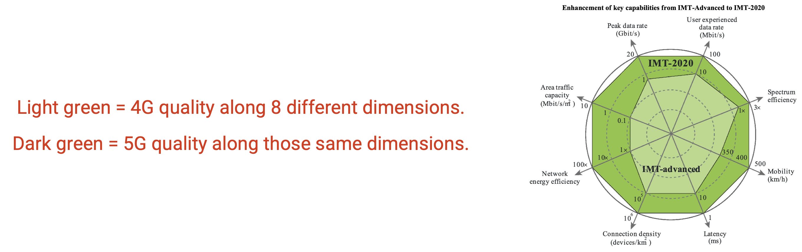

图中浅绿内区代表 IMT-Advanced，深绿扩展区代表 IMT-2020。八项标值分别对照：峰值数据率 1→20 Gbit/s；体验数据率 10→100 Mbit/s；频谱效率 1×→3×；移动性 350→500 km/h；时延 10→1 ms；连接密度 $10^5\to10^6$ 台/km²；网络能效 1×→100×；单位面积流量容量 0.1→10 Mbit/s/m²。这也说明原文“所有维度十倍”的话只是粗略概括，图中各维度并非都恰好十倍，且时延是越小越好。

除了性能，架构也从电话网逐渐向互联网靠近。1G 是纯模拟、以语音为目的；2G/3G 仍主要围绕电路交换和语音，附带短信，互联网流量很少；4G 起转向分组交换，语音成为网络上诸多应用之一。

蜂窝规范包含数百份文档、数千页内容，几乎没人通读全部。另一个麻烦是每换一代就改名。例如基站可被称为 base station、NodeB、eNodeB、gNB。教材为便于理解采用自定义的直观术语；若读规范或其他教材，名称可能不同，但概念可以对应。这里不把这些泛化名称强行等同于某一代标准的具体网元。

## 核心挑战：移动性

蜂窝最难的关键是移动性。想象乘车在高速公路上移动时，手机仍在播放视频；当然，不要在驾驶时看视频。需要解决四项问题：

1. **发现：** 移动中怎样知道该连接哪座基站？
2. **认证：** AT&T 的基站可能只为自己的客户提供服务，怎样确认客户身份？
3. **无缝通信：** 离开一座基站、进入另一座的范围时，怎样不中断连接？
4. **用量管理与计费责任：** 如果只购买了 6 GB 流量，用完后网络需要停止或降低服务。这个要求继承了按语音分钟收费的传统，也与蜂窝资源稀缺有关。

## 基础设施：无线基站

蜂窝网络首先有无线基站。基站配有天线，内部的无线收发机把数字比特转换成在空中接口传送的模拟信号。还有无线控制器，负责分配无线资源。

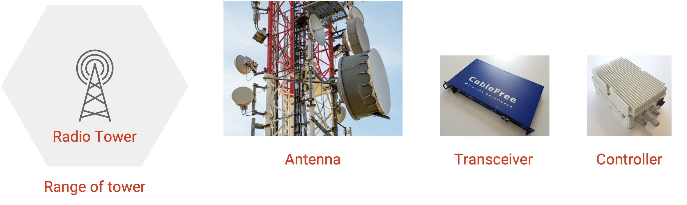

可把控制器想象成运行调度器的 CPU。它按需求及商业策略，例如用户支付的费用，给不同用户分配不同时间和频率片段。这其实是困难的调度问题，本章不深入讨论算法。

下面是简化的时频资源图，每种颜色代表一个用户，每个矩形代表该用户可以在指定时间使用指定频率。

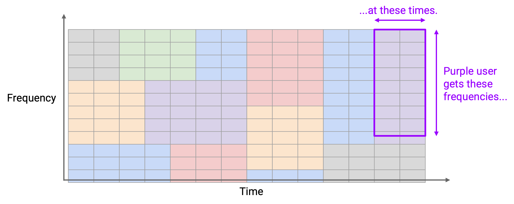

沿竖直方向截取，就是一个时隙中的频率分配。例如第一个时隙，蓝色用户得到 3 个频率格，橙色用户 5 个，灰色用户 4 个。沿水平方向截取，就是某个频率随时间分给谁；例如顶行依次分给灰色、绿色、蓝色、红色等用户。图右侧的紫色框还展示紫色用户在指定多个时刻占用指定频率范围。

这里依靠**预留**而非尽力而为共享资源：用户只能在控制器分配的时间和频率上传送。

传统上控制器装在基站内或附近；现在也有人尝试将其迁入云端，便于维护管理。

每个运营商在全国部署许多基站，使用户在不同地点都能连接。这些基站构成 **RAN（Radio Access Network，无线接入网）**。

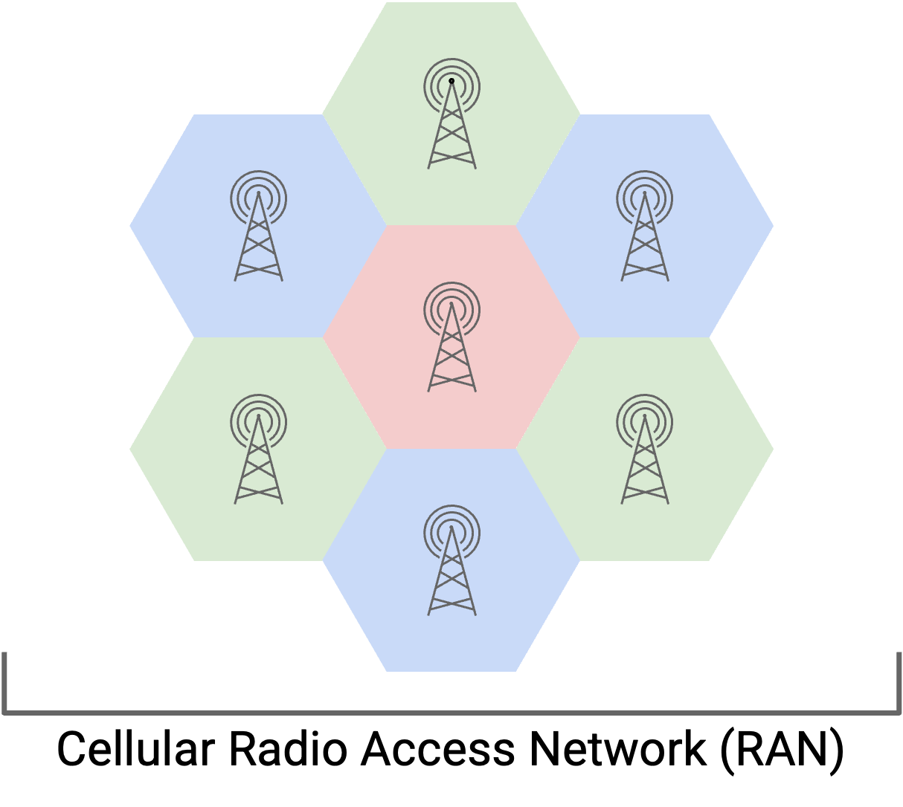

教材采用的模型给每座基站分配一组频率，让相邻基站使用不同频率范围，以免相互干扰。图中每种颜色代表一组频率：两个不相邻的基站可复用蓝色频率组，相邻基站的频率不重叠。频率资源还会按需求分配，例如旧金山市中心的基站可能比偏远地区基站得到更多频率。

> 编者边界：相邻小区使用互不重叠频率是这里用于解释频率复用的简化模型，不能当成所有现代蜂窝部署都遵守的普遍规定。本章也未给出具体无线标准中的资源块规格。

## 基础设施：蜂窝核心网

用户能把数据发到基站后，基站还要把数据送往互联网。

每座基站通过有线连接接入蜂窝核心网，可把核心网理解为用户不直接面对的后端基础设施。

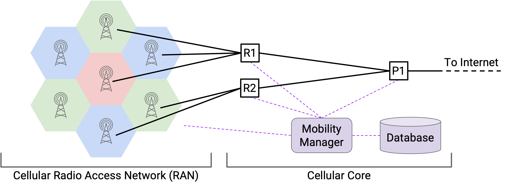

核心网包含**数据平面组件**，类似常见路由器和交换机，负责在用户、基站和其余网络之间转发分组。本章关注两类网关：

- **无线网关（radio gateway）：** RAN 与核心网的边界；基站把数据转给某个无线网关。
- **分组网关（packet gateway）：** 蜂窝网与互联网的边界；用户数据最终到达此处，并作为标准 TCP/IP 分组送出。

核心网还有**控制平面组件**。用户业务流量不经过这些组件。本章聚焦：

- **数据库：** 记录客户信息，包括拥有的设备、套餐，以及设备当前在哪里，例如连着哪座基站。
- **移动性管理器（mobility manager）：** 类似运行控制逻辑的 CPU，帮助认证用户身份，例如确认是否真是 Verizon 客户；还在用户移动时更新配置。

总之，数据沿“用户设备→RAN 中的基站→无线网关→分组网关→互联网”转发；管理器和数据库则存储、管理用户信息。

> 编者勘注：原文说传统互联网“没有这些控制平面组件”，应理解为没有本章这种按蜂窝订户维护的管理器、订户数据库组合；互联网并非没有控制平面。这里的名称是教学抽象，不是逐一指定某代蜂窝标准网元。

## 蜂窝操作的总体步骤

**步骤 0：注册。** 用户购买服务，例如进 Verizon 门店购买套餐、签订合同；运营商把用户和套餐信息存入数据库。

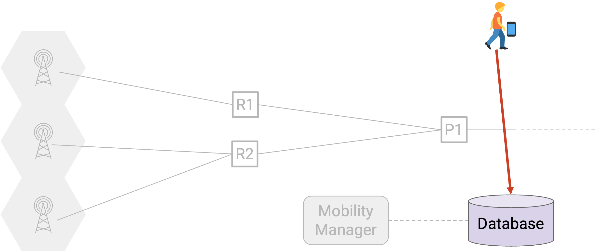

**步骤 1：发现。** 用户在某地打开手机，设备需要发现附近可用的基站，并选定一座。

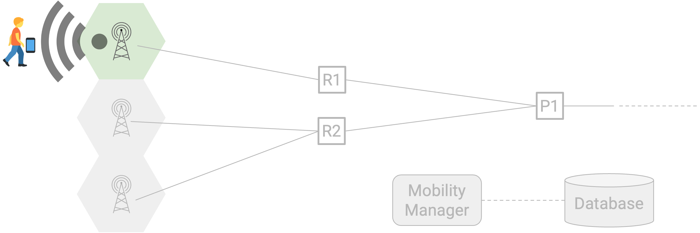

**步骤 2：附着。** 设备告诉选定基站自己希望连接；基站请求移动性管理器判断是否允许，例如核查是否超额。

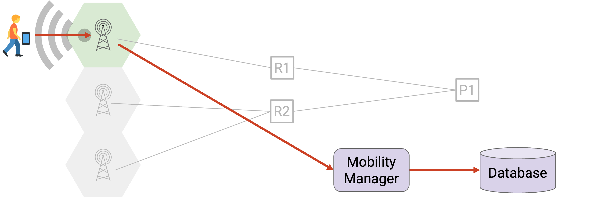

认证通过后，管理器配置基站和路由器，建立从用户经这些设备通往互联网的路径。

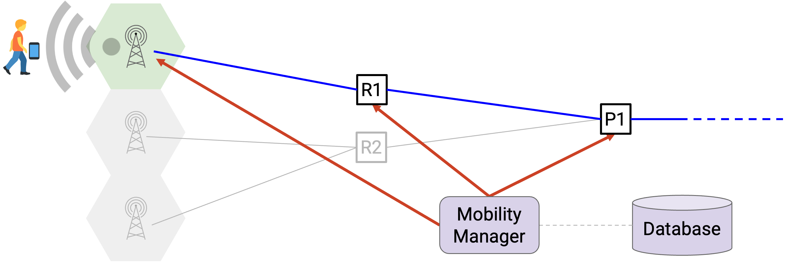

**步骤 3：数据交换。** 用户沿配置好的路径收发数据。

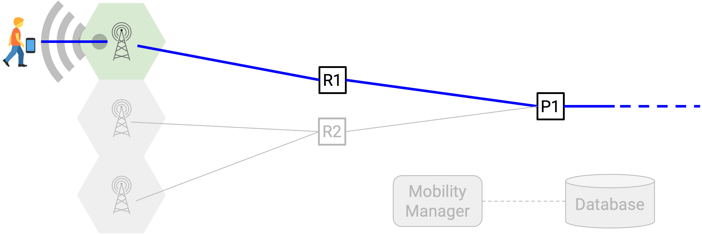

**步骤 4：切换。** 用户移动后可能远离原基站，靠近同一运营商 RAN 中另一座基站；旧基站、新基站和设备协作决定是否切换。

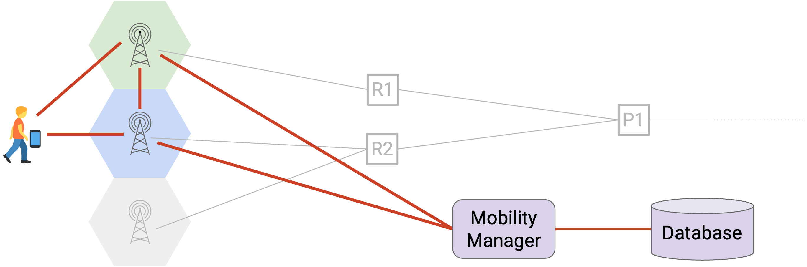

若决定切换，通知管理器；管理器重新配置基站和路由器，通过新基站建立路径，必要时也换用其他网关。切换必须对用户尽量无缝：过程中用户仍可能发送和接收，通信不应中断。这要求网络持续跟踪和照管设备。

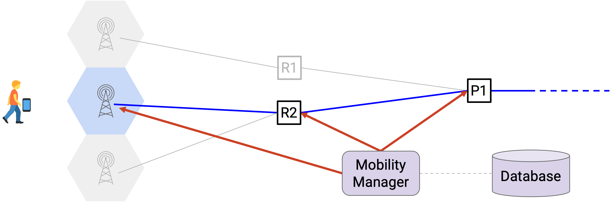

用户持续移动时，步骤 3、4 可以不断重复，合适的接入点也不断变化。

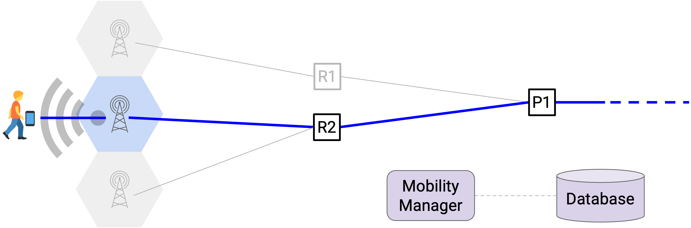

还需要**漫游（roaming）**。例如美国 Verizon 用户到德国，而 Verizon 没有当地覆盖；若它与德国 Deutsche Telekom 签约，Verizon 用户就能使用对方基础设施。因此被访问网络不仅服务自身客户，还可能服务其他运营商客户。

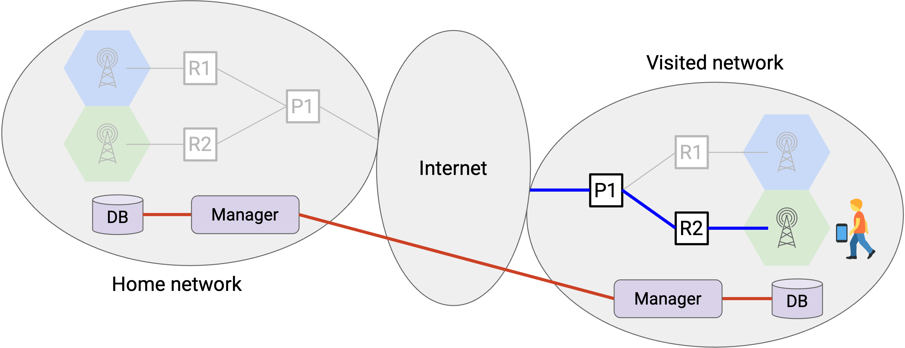

在访问网络中连接的步骤基本相似，只是两边的移动性管理器需要协调，例如 Deutsche Telekom 向 Verizon 核查用户是否购买了漫游服务。

## 步骤 0：注册

注册套餐后，用户得到 **IMSI（International Mobile Subscriber Identity，国际移动用户识别码）**，它是与订阅关系关联的唯一标识，安全地存放在 SIM 卡硬件中。

这解释了为什么运营商会给用户 SIM 卡：若换手机但保持同一订阅，把 SIM 换到新手机，新手机便关联原 IMSI；原文还举例说，若保留手机但换套餐，可以换新 SIM，使手机关联新 IMSI。

> 编者勘注：这里的“换套餐”例子应理解为换订阅/SIM 身份的情形，而非声称任何资费档位变更都会更换 IMSI。

IMSI 的前三位是 **MCC（Mobile Country Code，移动国家码）**；后两到三位是 **MNC（Mobile Network Code，移动网络码）**，标识运营商；剩下是 **MSIN（Mobile Subscriber Identification Number，移动用户识别号）**，标识运营商内部的订户。IMSI 总长不超过 15 位。

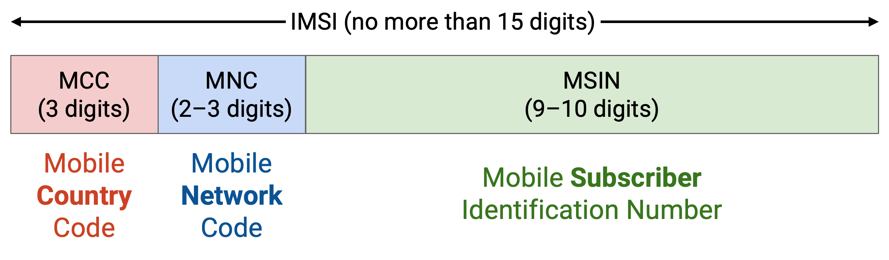

图中在 15 位示例下把 MSIN 标成 9–10 位。**IMSI 不等于 IP 地址**：若购买一年套餐，可能全年保持同一 IMSI；每次重新附着联网，却可能分到不同 IP。

还有两个不同的标识。**IMEI（International Mobile Equipment Identity，国际移动设备识别码）** 标识物理设备，包含制造商和型号相关信息，例如“这是 iPhone 13”；换订阅后设备 IMEI 不变。原文另外举例说，同一个套餐覆盖两台手机时，可以有两个 IMEI 但只有一个 IMSI。

> **原文概念勘注：**“同套餐的两部手机只有一个 IMSI”不能作为一般规则。商业账单套餐、SIM/订阅身份、物理设备是不同对象，共享套餐并不自动等于共享一个 IMSI。本章真正需要保持的区别是：IMEI 标识设备，IMSI 标识订户身份，不由套餐名称推导二者数量。

另一个标识是**电话号码**，也不同于 IMSI 和 IMEI，其各段数字可能表示区号等含义。电话系统需要把号码关联到特定 IMSI，识别用户对应的订阅。

注册并获得 IMSI 后，运营商把 IMSI 和套餐信息存入数据库。

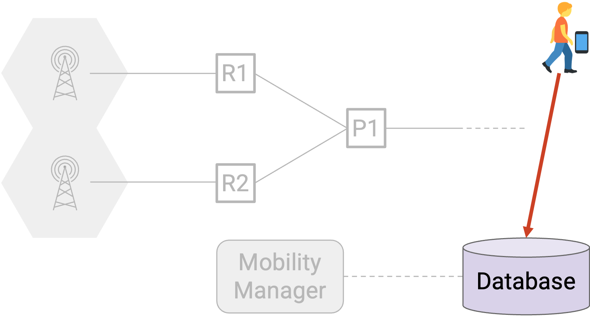

注册时，设备的 SIM 与运营商数据库还约定一个共享秘密密钥，附着时将用它进行认证。

## 步骤 1：发现

设备如何发现范围内且属于自己运营商的基站？

每座基站周期性发送信标，即 hello 消息，向覆盖范围内设备宣告自己的存在。信标还标识运营商，教材用两到三位 MNC 说明。SIM 中的 IMSI 也包含 MNC，因此设备可以比较：“SIM 说我属于网络 220，基站也说它属于网络 220，那么可考虑使用它。”

> 编者边界：MNC 是国家范围内的网络码，跨国家识别运营商不能只看 MNC；本章前面已经定义了 MCC。比较广播标识是发现和选择步骤，也不等于完成密码学认证。

信标使用特定频率的**控制信道**发送，以免与数据传输混在一起。本章模型中每组频率范围有相应控制信道，相邻基站使用不重叠频率，因此控制信道也不同。

设备可能听到多座基站的信标。它测量信号强度，从属于自己运营商的基站中选择信号最好的。

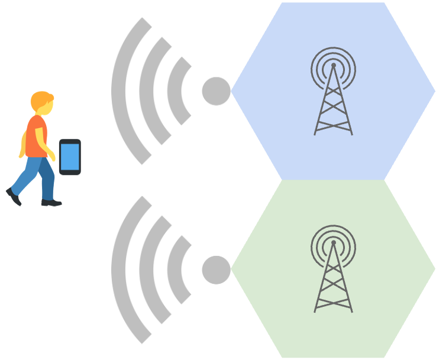

但这里有自举问题：要收到信标，先得调到控制信道；设备又怎样预先知道控制信道在哪？

几种办法是：扫描许多频率，虽然慢但有时只能这样；运营商在注册时预配控制信道列表；设备缓存先前用过的信道。

完成初始发现后，切换时不必再从头盲目扫描所有频率，因为旧基站会提供新基站所用频率。原文给出的量级对比是：切换约 0.01–0.1 秒，发现扫描约 10–100 秒。后文的切换过程仍包括按旧基站提供的候选列表测量，故这里“不必扫描”指不必重新进行初始盲扫，而不是无需测量。

## 步骤 2：附着

1. 用户发现基站后发送附着请求，并在请求中包含 IMSI。
2. 基站把请求转交真正处理它的移动性管理器。
3. 管理器按 IMSI 查询数据库，了解服务计划，并使用设备与运营商已共享的秘密密钥进行认证；原文省略密码学细节。

认证成功说明用户确实拥有所声称的身份；数据库查询还需确认有资格获得服务，两个条件满足后才批准附着。

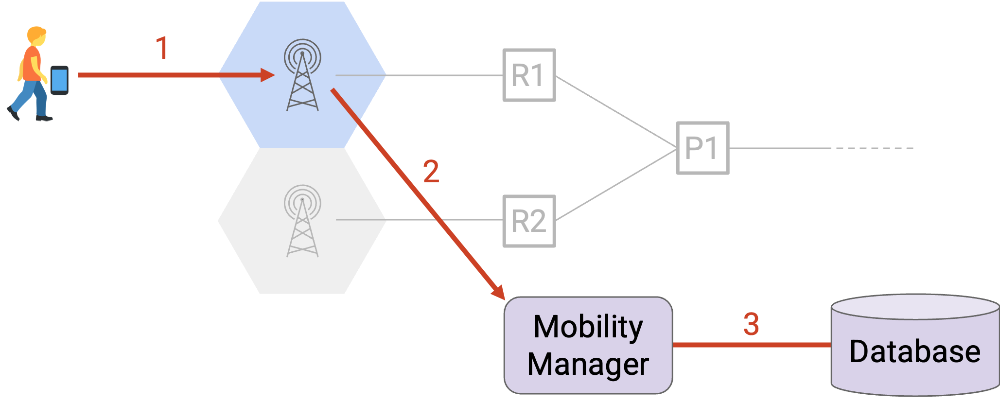

4. 获批后，管理器配置数据平面：给设备分配 IP；告诉基站无线控制器为用户分配多少资源；配置基站及网关，建立设备到互联网的路径；初始化计数器和整形器，跟踪并约束用量。

连接配置完成后，还将位置记入数据库，具体把 IMSI 映射到 IP 和正在使用的路径，即哪座基站、哪些网关。

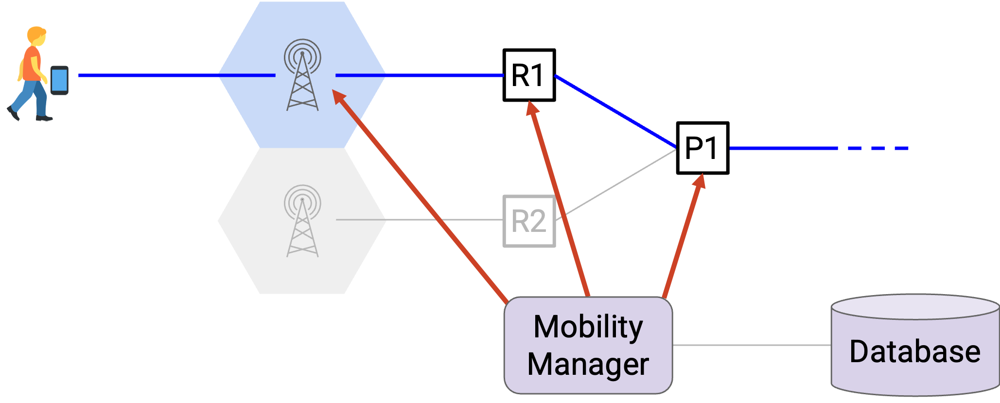

附着控制消息在控制信道上进行，因为在流程开始时还没有给用户分配数据频率，不能先假定业务数据链路已经可用。

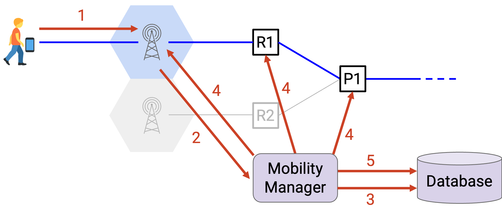

## 步骤 3：数据交换

到这里，网络已经配置好，设备可用其 IP 地址发送和接收消息。

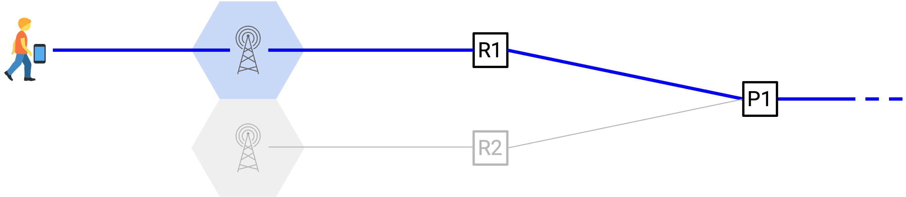

基站、无线网关和分组网关怎样知道该怎么转发？用户不断移动，原文指出若为每次移动运行传统距离向量之类的路由算法，路由可能来不及收敛。

于是管理器用**隧道**创建用户到互联网的路径：设备→基站→无线网关→分组网关。

概念上，可以告诉基站：“收到这个用户的包，就送入这条隧道。”包经过有线链路，到无线网关出隧道；再告诉无线网关：“从这条隧道出来的包，要进入下一条隧道。”最终到达分组网关，再发往互联网。

原文正文用“蓝隧道到无线网关、绿隧道到分组网关”的颜色比喻；原图的颜色安排则如下，不应把颜色差异当成额外协议字段。

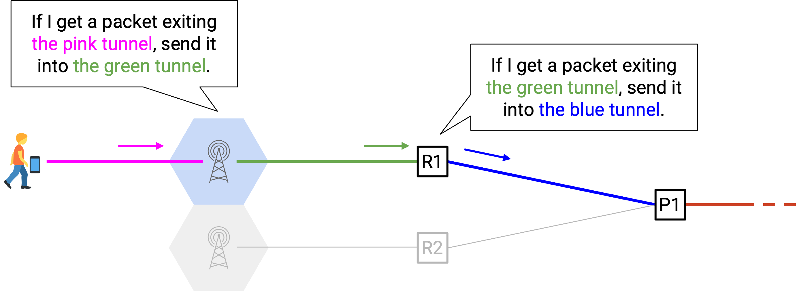

下行分组也走隧道。告诉分组网关：“给用户 A 的包进入通往无线网关的隧道。”再告诉无线网关：“从这条隧道出来的包进入通往基站的隧道。”

这里不是由每个组件运行一个面向用户移动的路由协议自行找路，而是由管理器告诉它们如何转发。每个用户需要自己的隧道集合，网络因此维护**逐用户状态**，例如每个已连接用户对应的表项。

怎样实现“识别这条隧道”的规则？可用**封装**。进入隧道时加一个新首部，标识所走隧道；离开时，网关读取附加首部，知道包来自哪条隧道，再决定下一步转发。

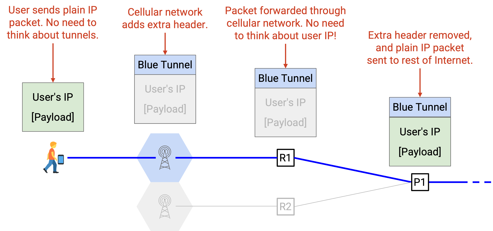

图中的用户 IP 与载荷保留在内层，外层增加隧道标识；出口右侧仍画着即将移除的蓝色首部，用来说明剥离过程，不表示互联网必须接收该蜂窝隧道首部。

通过隧道和封装，中间转发不需要把用户 IP 直接解释为当前所处基站的位置。用户一直在移动，位置由管理器配置的隧道关系体现。

> 编者勘注：原文“没有组件运行路由协议”“从不按用户 IP 转发”应限定在此逐用户隧道的抽象内；承载隧道的底层网络仍需把包送到隧道端点，入口也需识别目标用户。不能由此得出蜂窝核心网不需要底层路由。

## 步骤 4：切换

用户从旧基站移到新基站时，教材给出一个略作简化的协议：

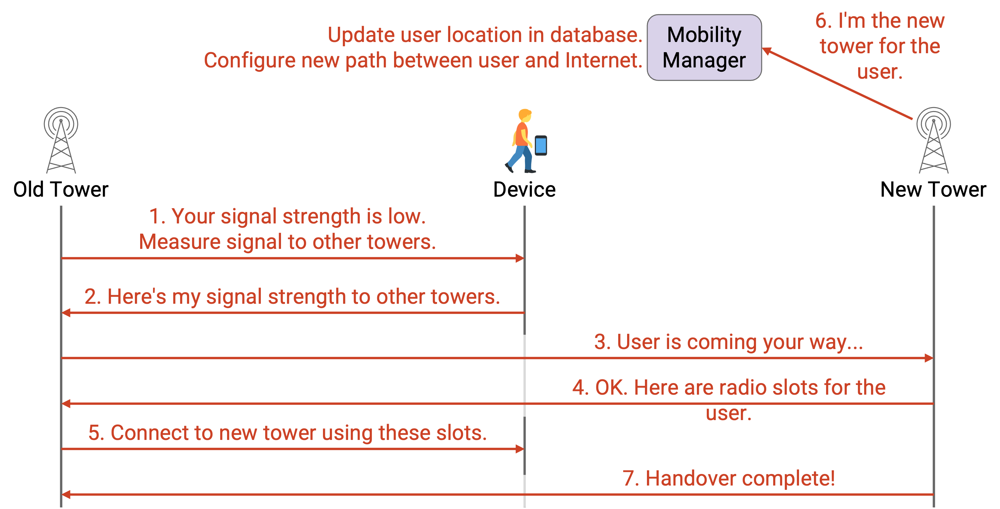

1. 设备持续测量到旧基站的信号强度并报告。强度下降到一定程度后，旧基站提供同运营商附近基站及其控制信道频率，要求设备测量。
2. 设备测量这些候选基站并报告给旧基站。旧基站按运营商策略选择新基站。
3. 旧基站通知新基站“用户将到你那里”，新基站为其分配频率资源。
4. 新基站告诉旧基站已分配哪些频率资源。
5. 旧基站通知设备用这些频率连接新基站。
6. 新基站向移动性管理器报告自己现在是用户的新基站。管理器更新数据库位置及隧道，建立经新基站的新路径，必要时也更换无线网关和分组网关。
7. 新基站最后告诉旧基站切换完成。

为什么这么复杂？因为目标是不打断用户通信，需要设备、两座基站、管理器和网关共同协作。

困难在于切换**不是原子操作**。用户仍在收发数据，远端服务器可能已经把一些下行包发往旧基站。切换过程中，旧基站继续缓存收到的该用户数据；切换后，把缓存交给新基站，由新基站送给用户。原文强调，这是为移动中的无缝切换专门增加的缓存功能。

> 编者勘注：传统路由器当然也有排队缓存。这里新增的是“为某用户切换保留并转交旧路径在途数据”的职责，不是声称传统 TCP/IP 网络从来不缓冲分组。

教材中的切换决策由运营商作出，设备并不自行选择下一座基站。好处是运营商有控制权：某基站过载时可做负载均衡，也可按客户优先级分配更好或更差的接入点。代价是更多往返、更多复杂性，速度可能较慢。

**切换时用户 IP 地址不变**，只是更新隧道，让发给该 IP 的包走新路径。

切换需要更新逐用户状态；用户数量很大或移动很快时会带来扩展性挑战。现代蜂窝网络仍能较好地运行，是因为相关协议经过大量优化，这也是标准文档动辄数千页的原因之一。

## 漫游

用户去其他国家，或本运营商无覆盖的地区时，可以漫游接入另一家网络。

访问网络中的发现、附着、切换等过程与归属网络大体相似。主要区别在于访问网络的移动性管理器必须联系归属网络管理器。例如请归属网协助认证、确认是否购买漫游；还要把跟踪数据传回，让归属网知道用户所在位置。

访问网怎样知道归属网是谁？设备附着时提交 IMSI，其中的运营商标识提供线索；如前所述，完整国家/网络识别不能仅凭 MNC 而忽略 MCC。

用户与互联网之间可用两种隧道安排。

**归属路由（home routing）：** 流量经过归属网的分组网关。所有包先从访问网回到归属网，再进入互联网。这便于归属网网关跟踪用户，但路径可能绕远：美国用户在德国访问德国网站，包却先回美国网关，再回德国。

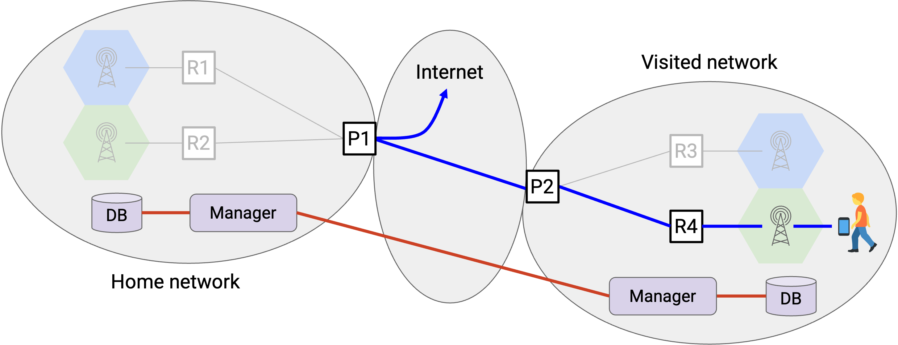

**本地疏导（local breakout）：** 流量经过访问网的分组网关进入互联网，不必先回归属网，路径因此可能更短。但用量统计更复杂，需要访问网计量，再把记录交回归属网。

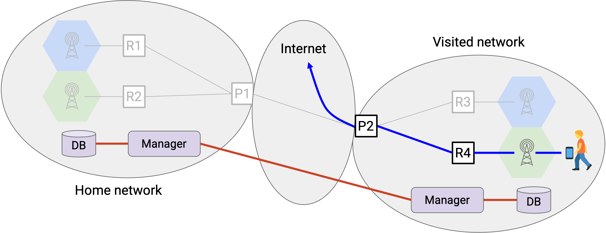

## 其他操作

除了上述关键操作，蜂窝网还有其他功能。

**合法监听（lawful intercept）** 是原文提出的法律要求：政府在具备搜查令等法律授权时，可要求监听用户发送的分组。此处只是教材对制度需求的概括，并非对各司法辖区法律的独立说明。

**被盗手机登记**允许用户上报失窃设备。若盗窃者试图接入，运营商的管理器和数据库可以识别被盗设备，并尝试跟踪。这里使用设备固有的 **IMEI**，而不是订户身份 IMSI；设备连接时报告 IMEI，运营商据此检查是否已登记为失窃。

这些操作之所以可行，与运营商集中管理、跟踪用户及其位置的架构有关。

## 对蜂窝网络设计的反思

蜂窝网络的基本目标和设计选择与传统互联网不同。认证和计费在蜂窝网中是核心目标；无线资源基于预留；网络维护持续动态变化的逐用户状态。

有状态、基于预留的设计增加了复杂性：用户移动时，各组件需要不断重新配置隧道。

可以设想另一种设计。切换之所以复杂，一个原因是希望用户保持相同 IP。如果每次切换都改变用户 IP，让地址反映位置，就可能重新使用传统按位置路由的思路。但建立在稳定端点地址上的上层连接会出问题。教材提到 TCP 和 HTTP，并强调传统 TCP 连接依赖两端 IP 保持不变。

> 编者勘注：更精确地说，地址变化可能破坏现有传统 TCP 连接，从而影响其上承载的 HTTP 通信；不是 HTTP 的所有版本、所有重新连接方式都不允许地址变化。

保持 IP 增加网络复杂性，改变 IP 又会破坏传统 TCP 连接。一种思路是采用支持地址变化的传输协议，例如 Google 发起的 QUIC。原文最后进一步建议，可借 IPv6 首部的 Flow Label 标记同一流的包，使地址改变后仍可标识流。

> **重要原文勘注：** 最后这句话不能当作 QUIC 的实际连接迁移机制。支持迁移的 QUIC 使用其自身连接标识等协议机制，IPv6 Flow Label 本身并不能替代传输层连接身份或安全验证；不能从“采用 QUIC”推导出“必须依靠 IPv6 Flow Label”。已定点阅读 [RFC 9000 §5.1、§9 开头与 §9.7](https://www.rfc-editor.org/rfc/rfc9000.html#section-9.7)：连接 ID 允许连接在端点地址改变后延续，而流标签生成反而要求尽量避免跨路径的可关联性。本页保留并界定原文设想，不把它写成标准实现说明，也不补写教材未提供的握手、密钥算法、蜂窝 AKA 或具体 5G 网元流程。RFC 为编者勘误参考，并非视频指定阅读；未通读整份 RFC。

## 引用与来源

- 完整翻译固定提交的 [Cellular](https://github.com/berkeley-cs168/textbook/blob/0b8208742d31df7fc3d53a0cd94fdd4e04f8d47e/wireless/cellular.md)，覆盖全部现存正文、28 幅图、注册到漫游的全部步骤、图中字段与实例。课表旧路径 [special-topics/cellular](https://textbook.cs168.io/special-topics/cellular.html) 在固定提交只写“本页已迁移”，指向 [wireless/cellular](https://textbook.cs168.io/wireless/cellular.html)，故本页翻译真实迁移目标。
- 提交日期 **2026-10-01**，不是 Spring 2025 历史教材版本；固定标识：

```text
0b8208742d31df7fc3d53a0cd94fdd4e04f8d47e
```

- 作者 **Peyrin Kao**，基于 **Sylvia Ratnasamy、Rob Shakir 等**的讲授。根据[教材首页](https://textbook.cs168.io/)的许可，原教材及本中文改编按 [CC BY-SA 4.0](https://creativecommons.org/licenses/by-sa/4.0/) 发布。修改为中文翻译、图注、排版和显式勘注；教材内嵌原图字节不改，仅加白底改善深色主题显示。照片、图表仅作为该固定教材中已内嵌的插图使用，不据此宣称获得所示外部商品网站或设备照片集合的额外许可；不单独再发布那些外站的内容。教材许可不覆盖课程视频或课件。
- 本译文仅依据实际阅读的教材正文和插图；未声称阅读 3GPP 全部规范、进行运营商实测或独立核实图中商品报价。[独立学习笔记](#/c/berkeley-cs168-2025/lec/lec27?v=notes)提供另外的问题组织与自测。
