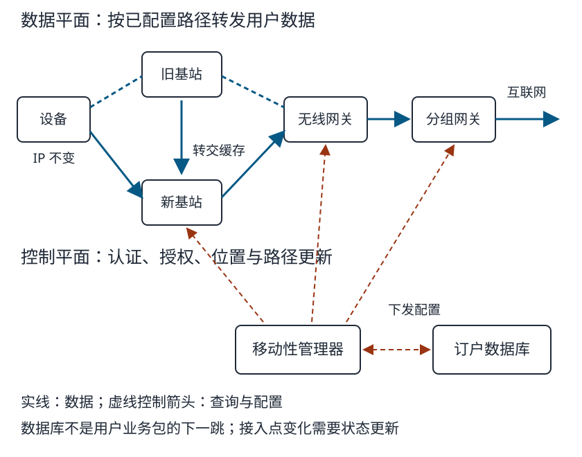

# 第 27 讲：蜂窝网络

## 1. 核心问题：无线连接与移动连接，是同一件事吗？

不是。无线接入解决“比特如何越过空中接口”；移动性管理解决“设备改变接入位置时，已有通信怎样继续”。

手机在同一个家庭接入点覆盖范围内从卧室走到厨房，不等于已经解决高速移动、跨基站的连续服务。即使新的无线链路已可用，旧 IP 对应的数据仍可能到达旧基站；即使数据能到达新基站，新基站也未必已为该用户预留资源或确认服务资格。

因此，本讲用三个不同对象组织问题：

| 对象 | 回答的问题 | 教材中的实现线索 |
| --- | --- | --- |
| 无线资源 | 现在谁能在何时、哪个频段传输？ | 基站无线控制器的时频调度 |
| 订户身份 | 你是谁，是否有权获得服务？ | IMSI、SIM 共享秘密、订户数据库 |
| 可达位置 | 给这个用户的数据现在该送到哪里？ | 基站、网关、隧道与移动性管理器 |

**不要用 Wi-Fi 的随机竞争模型替代蜂窝基站调度，也不要把移动性管理简化成“无线信号切换一下就好了”。**

## 2. 先画两张网：数据经过哪里，谁决定它经过哪里？



图由编者根据教材的核心网、附着与切换过程重绘。名称沿用教材的概念模型，不是某一代 3GPP 网元逐一对照表。

### 用户数据路径

```text
设备 ↔ 基站 ↔ 无线网关 ↔ 分组网关 ↔ 互联网
```

基站属于 RAN；无线网关是 RAN 与核心网的边界；分组网关是蜂窝网与互联网的边界。

### 控制路径

管理器查询数据库，判断身份、套餐和位置，再配置基站及网关。**用户业务分组不必穿过订户数据库；管理器也不是每个数据包都要实时问一次的中央转发器。**

可以把核心关系写成一个概念映射，而不把它当作实际数据库表定义：

```text
订户身份 → 服务资格、分配的 IP、当前基站、当前隧道路径
```

这样，一次位置变化就能改变转发位置，而不必把订户身份与用户 IP 全部重建。

## 3. 资源预留为什么没有让 4G“变回电路交换”？

教材把蜂窝的历史根源放在电话网中，强调其逐用户管理、认证、计费和资源预留。另一方面，它明确说明 4G 起采用分组交换，语音只是其上一个应用。

两者不矛盾：

- **分组交换**描述数据如何组织和转发。
- **资源预留/调度**描述某用户何时可占用某段无线资源。

时频图的每个格子代表某用户在指定时间使用指定频率。第一时隙分给蓝色 3 格、橙色 5 格、灰色 4 格，并不意味着这些用户只能使用电路交换语音；这些格子也可以承载分组。

同样，教材以“相邻小区使用不同频率组”解释频率复用，只是本章简化模型。不要据此断言所有现代蜂窝系统都完全禁止相邻小区同频，也不要补入本章没有给出的资源块尺寸、调度算法或具体标准定时。

## 4. 四种身份不能混用

| 标识 | 对象 | 能否直接当当前位置？ |
| --- | --- | --- |
| IMSI | 订户/SIM 对应的订阅身份 | 不能；还要查询其当前附着位置 |
| IMEI | 物理设备 | 不能；换 SIM 不等于换设备 |
| 电话号码 | 电话服务中的可拨号标识 | 不能；需关联订户身份 |
| IP 地址 | 当前网络连接中的地址 | 本章切换期间保持不变，不能直接等同于当前基站 |

IMSI 总长不超过 15 位，由 3 位 MCC、2–3 位 MNC 和剩余 MSIN 组成。跨国家识别运营商时要保留国家码上下文，不能只看 MNC。

**自拟身份变更练习：** 把同一张 SIM 从手机甲移到手机乙，教材模型下订户 IMSI 可以不变，IMEI 却随物理设备变化。反过来，更换订阅/SIM 而不换手机，IMEI 可以不变，IMSI 可能变化。重新附着可能另获 IP；已经进行中的同网切换则按本章目标保持 IP。

原文“同一套餐下两台手机只有一个 IMSI”过度概括了套餐与身份的关系；共享账单或资费套餐不自动推导出共享 IMSI。[完整译文](#/c/berkeley-cs168-2025/lec/lec27?v=materials)保留原文并给出勘注。

## 5. 从开机到能传数据：五个不同的判断

### 注册：长期关系先于临时连接

用户购买服务后，运营商保存订户信息。SIM 与运营商还共享秘密密钥，为以后认证准备条件。注册不是“每次发一个数据包就去门店建立一次账户”。

### 发现：知道“谁在那里”

基站周期性发信标，设备测量信号并识别网络。自举难点在于：不知道控制信道，怎样听到告诉你基站存在的信标？教材给出扫描、预配列表、缓存旧信道三条路线。

发现强信号只说明候选基站存在，不说明对方已经为你建立合法数据通道。

### 认证：证明“我确实是这个订户”

附着请求携带 IMSI，基站交给管理器，管理器查数据库，并利用共享秘密完成认证。**报出一个 IMSI 与证明拥有相应秘密，不是一回事。**

教材明确省略密码学细节，因此这里也不臆造 challenge、消息编号、AKA 算法或某一代蜂窝认证报文。

### 授权：身份正确还不够

就算认证成功，套餐、配额或漫游资格仍可能不满足。认证回答“是谁”，授权回答“是否允许这项服务”，二者不能合并成“数据库里有这串号码就能上网”。

### 配置：获准也还没有数据路径

管理器需要分配 IP、配置无线资源、设置隧道路径、初始化计数器与整形器，并保存位置。附着控制消息不能依赖一个尚未建立的数据通道，因此教材把它们放在控制信道上。

这五项共同解释：**发现、身份认证、服务授权、资源分配和数据转发是不同职责。**

## 6. 移动设备的地址不变，路由器怎样找到它？

直接让用户地址表示当前基站位置，会在移动时引发地址变化；若保持用户地址不变，就需要额外的位置映射。

教材采用逐用户隧道。上行时基站识别该用户的流量并封装，按隧道配置转发到无线网关，再到分组网关；出口解封装，把普通 IP 包交给互联网。下行则由入口识别目标用户，再沿相应隧道送往当前基站。

```text
内层：用户 IP 包（通信身份保持）
外层：隧道相关首部（指向当前配置的路径）
```

**封装增加的是位置间接层，不是把用户原 IP 地址删除。** 核心网的承载网络仍要把外层包送到隧道端点；“管理器指定路径”也不等于底层从此不需要路由。

由此推导状态成本：如果每个活跃用户都要有路径关联，网络就有逐用户状态；如果用户不断移动，状态也需要不断更新。这里的集中控制不是免费的，它换来的是身份和接入位置的分离。

## 7. 切换的真正难点：旧路径还没有停止，新的位置已经生效

按教材顺序，一次切换需要：

1. 旧基站要求设备测量候选基站。
2. 设备报告测量值，旧基站按运营商策略选择新基站。
3. 旧基站通知新基站准备用户资源。
4. 新基站返回资源信息。
5. 旧基站指示设备按该信息接入新基站。
6. 新基站通知管理器更新数据库和隧道。
7. 新基站通知旧基站切换完成。

这不是一条原子指令。考察一个切换窗口：

- 包 P 在隧道更新前已经朝旧基站出发。
- 设备此时已转向新基站。
- 若只更新新路径并丢弃旧侧状态，P 可能到达旧基站却无人接收。

教材的应对是：旧基站在切换过程中缓存收到的该用户数据，之后转给新基站，再送给设备。这里讨论的是**为切换保留在途数据的缓存**，不是说传统路由器没有队列。

### 保持哪些不变量？

- 用户仍对应同一订户身份。
- 在本章切换模型中，用户 IP 保持不变。
- 新基站必须先具备服务该用户的无线资源。
- 数据库中的位置和用于转发的隧道，需要随着接入点改变而更新。
- 旧路径上尚未交付的数据需要显式处理，而不是假定更新瞬间所有包同时转向。

这些是不变量与职责，不是教材未给出的“零丢包、零乱序”形式保证。缓存和转发解释了如何减少中断，但原文没有完整规定所有竞态、超时和故障恢复。

### 为什么不是手机完全自己决定？

教材让运营商控制切换，因此能兼顾负载均衡、优先级和资源策略，而不只是选瞬时最强信号。代价是更多消息和协调。设备提供测量，网络作决策：**测量权不自动等于决策权。**

## 8. 漫游：归属身份不变，服务网络可以变

同一运营商内切换，主要改变基站和路径。漫游则引入另一个运营商：访问网需要向归属网确认用户身份和服务资格，并回传位置、用量等信息。

数据面存在两种安排：

| 方式 | 用户数据出口 | 主要收益 | 主要代价 |
| --- | --- | --- | --- |
| 归属路由 | 归属网分组网关 | 归属网较容易统一跟踪与计量 | 可能绕远 |
| 本地疏导 | 访问网分组网关 | 路径可能更短 | 访问网需要计量并交回记录 |

教材例子是美国用户在德国访问德国网站。归属路由可能让数据先回美国再去德国；本地疏导则不要求这次绕行。但本地疏导**不等于取消归属网认证**：控制面协作与数据面走向是两个不同选择。

## 9. 更高层能不能承担一部分移动性？

本章最后的设计反思是：保持 IP，网络承担隧道和切换复杂性；每次改变 IP，则传统 TCP 连接可能失效。如果传输协议允许端点地址改变，网络设计就可能拥有另一组选择。

这里须纠正教材末段的一个混淆：QUIC 的连接迁移依靠自身连接标识和相关协议机制，不能说靠一个稳定的 IPv6 Flow Label 就实现了。编者定点阅读的 RFC 9000 §5.1 和 §9 开头明确连接 ID 的作用；§9.7 还要求生成流标签时尽量减少跨路径可关联性。

这只是界定教材的设计反思，不把它扩写为 QUIC 教程，也不承诺换用 QUIC 后就不需要无线切换、认证、调度或路径验证。

## 10. 自测

<details>
<summary>手机已听见信号最强的本运营商基站，为什么还不能立刻发用户数据？</summary>

还需要附着：证明身份、核查服务资格、分配 IP 和无线资源、配置隧道，并建立用量状态。发现并不完成这些步骤。
</details>

<details>
<summary>为什么订户数据库不必成为每个用户业务包的下一跳？</summary>

数据库服务于控制面。管理器查询并下发配置后，数据平面可按已安装的路径转发；逐包业务流量走基站和网关，不需要绕过数据库。
</details>

<details>
<summary>“4G 是分组交换，所以无线资源不能预留”错在哪里？</summary>

把数据组织方式与介质资源分配方式混为一谈。分组仍可以在控制器分配的时频资源上发送，两个机制并不互斥。
</details>

<details>
<summary>切换时 IP 不变，是否意味着什么状态都不需要更新？</summary>

恰好相反。为了让稳定 IP 对应新的物理接入位置，必须更新位置记录、无线资源和隧道关联，并处理旧路径在途数据。稳定地址把复杂性转移到网络内。
</details>

<details>
<summary>为什么新基站已能收发，不足以证明切换已完成？</summary>

核心网下行路径可能仍指向旧基站，旧基站还可能持有缓存和在途数据。无线接入、核心网转发和旧状态处理必须协作。
</details>

<details>
<summary>德国访问网采用本地疏导，能否因此省去与美国归属网的全部联系？</summary>

不能。省去的是用户数据必须回归属网绕行的路径约束；认证、服务资格和计费记录仍可能需要两网协调。
</details>

<details>
<summary>手机被盗后换了 SIM，教材中的哪个标识能帮助运营商识别同一台物理设备？</summary>

IMEI。IMSI 对应订户/SIM 身份，不等于设备身份；教材以被盗设备登记说明区分二者的用途。
</details>

<details>
<summary>QUIC 能应对地址改变，就等于“手机移到新小区无需任何网络操作”吗？</summary>

不等于。传输层连接身份与无线资源、用户授权、当前可达路径属于不同职责。允许地址变化不自动建立新无线接入，也不取消移动网络的资源管理。
</details>

## 引用与来源

- 主依据为完整阅读的固定教材 [Cellular](https://github.com/berkeley-cs168/textbook/blob/0b8208742d31df7fc3d53a0cd94fdd4e04f8d47e/wireless/cellular.md)，包括全部 28 幅插图；[唯一完整译文](#/c/berkeley-cs168-2025/lec/lec27?v=materials)保留全部操作步骤、历史说明、图表信息与显式勘注。原作者 Peyrin Kao，基于 Sylvia Ratnasamy、Rob Shakir 等讲授；教材改编内容依 [CC BY-SA 4.0](https://creativecommons.org/licenses/by-sa/4.0/)共享。原创图为概念重绘，不是录像画面。
- 固定教材提交日期为 **2026-10-01**，非 Spring 2025 历史版。这里使用基站、无线网关、分组网关、移动性管理器等教材术语，不补写未提供的标准细节。
- 编者勘误参考：Jana Iyengar、Martin Thomson，[*QUIC: A UDP-Based Multiplexed and Secure Transport*，RFC 9000，2021](https://www.rfc-editor.org/rfc/rfc9000.html)。实际阅读范围为 §5.1、§9 开头的迁移条件及 §9.7，未通读全 RFC；不是视频指定阅读。
- [Spring 2025 官方课表](https://sp25.cs168.io/)日期为 **5 月 5 日**。个体视频元数据核实：ID `4LjEmcvVVGY`，标题 **[CS168 SP25] Lecture 27 - Cellular**，频道 **CS 168 (Internet Architecture) at UC Berkeley**，上传日 **2025-05-06**，时长 **4437 秒（73:57）**。上传日与课表日分开记录。
- 人工字幕列表为空，有英语自动字幕入口；默认 visionos 路径与一次不同官方 timedtext 路径均返回 HTTP 429。**未获得字幕，也未观看音画；课堂覆盖、开头结尾、问答和时序分段均未核验，因此不提供伪时间轴、不建立占位课堂稿。** 视频许可为空，记 unknown；教材许可不延伸至视频、课件。官方课件仅登记入口，未用其内容作覆盖断言。
- [官方 Spring 2025 公告](https://sp25.cs168.io/announcements/)把 wireless、cellular 排除在 final 范围外，但它们仍是 27 个主讲次中的必备内容；本页不因不考而省略。
