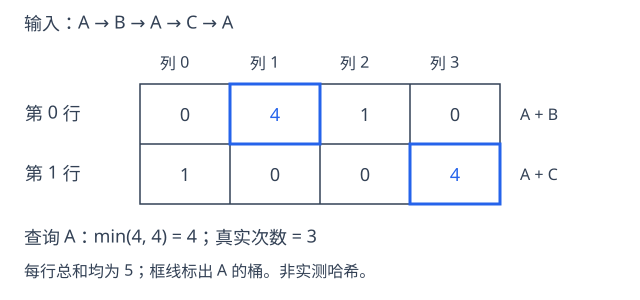

# Project 0 指导：先守住计数，再讨论并行

导航：[完整要求](#/c/cmu-15-445-2025/lab/project0?v=zh) · [HW1 指导](#/c/cmu-15-445-2025/lab/hw01?v=guide) · [公共准备路线](#/c/cmu-15-445-2025)。

本页集中讲本项目需要的哈希／基础概率，不扩写 Bloom Filter、HyperLogLog 或整个概率论课程。它提供推演、不变量、反例与调试问题，不给可以提交的方法实现。先读要求页的固定版本、并发边界和评分限制，再在自己的私有仓库工作。

## 1. 为什么订单热度不一定要一张精确字典

假设持续收到 `Stock` 中商品的查询事件，键是商品编号。精确字典必须为每个不同商品保留计数；若键的种类不断增长，状态也随之增长。Count–Min Sketch 用预先决定大小的桶矩阵保存汇总：牺牲一部分精度，换取不随不同键数线性增长的计数空间。

它适合问“这个商品大约被查询多少次”，不直接回答“有哪些商品出现过”。矩阵不保存可逆的键目录。`TopK` 的候选来自外部，正是这条信息边界的体现。

### 哈希需要掌握的四件事

1. **确定性**：同一对象状态下，同一个键、同一行种子必须得到相同的列。否则插入和查询找不到同一份贡献。
2. **范围**：桶下标在 `[0, width)`；宽度为 0 不能先做取模再报错。
3. **碰撞**：两个不同键可以落入同一桶。扩大宽度降低碰撞机会，但不能保证消灭碰撞。
4. **行间差异**：多行使用不同种子，使某一行的碰撞不必在每一行重现。把同一个哈希列复制 d 遍，相当于重复存同一证据。

固定代码使用 `std::hash<KeyType>` 与 `HashUtil::CombineHashes`，再对 `width_` 取模；`HashFunction(i)` 负责生成第 i 行函数。项目要求保留此方案，**不是让你自行实现概率论中的理想哈希族**。标准库、字节表示和平台的影响也意味着不能把下面手工桶位置当固定代码输出。

## 2. 纸面推演：两个商品怎样互相污染

原创例子取宽 4、深 2，假设散列位置如下（仅为讲解，不是实测）：

| 键 | 第 0 行的列 | 第 1 行的列 |
|---|---:|---:|
| 商品 A | 1 | 3 |
| 商品 B | 1 | 0 |
| 商品 C | 2 | 3 |

输入流为 `A, B, A, C, A`。逐次画出矩阵，比直接写代码更容易发现“只更新一行”的错误。

最后两行分别是 `[0,4,1,0]` 与 `[1,0,0,4]`。A 的真实计数为 3，但查询得到 `min(4,4)=4`：B 污染了第一行，C 污染了第二行。**取最小值也可能仍然高估**，并不要求同一个竞争键在所有行都与 A 碰撞。

B 的查询是 `min(4,1)=1`；C 的查询是 `min(1,4)=1`。同一矩阵里，有些键准确、有些键不准确，不能由三个示例中的两个准确推出数据结构是精确计数器。

### 两条基本不变量

对只包含单位正增量、无溢出、已完成的更新：

- 每一行计数总和都等于已插入事件数 N；这对排查漏更新或重复更新很有帮助。
- 查询键 x 所落的每个桶都包含 x 的全部贡献，外加非负的碰撞贡献。因此取最小值仍不低估。

这些陈述是数学模型的不变量，不是在插入进行到一半时承诺多行原子快照。本项目没有要求并发 `Count` 观察一致的整次插入。

## 3. 必要的概率直觉：宽度管误差，深度管失败机会

以下是编者对理想模型的基础推演，不是对固定 `HashUtil` 独立性作出的证明，也不是读取失败论文的译文。

令真实频率为 f(x)，第 r 行的碰撞噪声为 Zᵣ。查询对应桶可写成：

$$
C_r(x)=f(x)+Z_r,\qquad Z_r\ge 0.
$$

如果任意两个不同键在一行碰撞的概率不超过 `1/w`，线性期望给出：

$$
\mathbb{E}[Z_r]\le (N-f(x))/w\le N/w.
$$

注意：线性期望不要求流中每次出现互相独立；重复出现的同一个键会一起贡献碰撞噪声。接下来利用非负随机变量的简单事实：若噪声经常大于阈值，它的平均值就不可能很小。取阈值 `eN/w`，Markov 界给出单行坏估计的概率至多 `1/e`。

若各行选择独立，那么取最小值仍超过这个阈值，必须所有行都坏，概率至多 `e⁻ᵈ`。所以理想分析中可以选择：

$$
w=\lceil e/\varepsilon\rceil,\qquad
 d=\lceil\ln(1/\delta)\rceil.
$$

对预先固定的一个查询键，便得到以至少 `1−δ` 的概率，估计不超过 `f(x)+εN`。这里是**加性误差 εN**，不是对每个稀有键都只错 ε 百分比；也不是一次保证全部候选都满足同样失败概率。要对 m 个固定候选同时声明保证，至少还要考虑联合失败事件，例如用 union bound 得到上界 `mδ`。

用这一小段分析理解调参就够了：加宽减少碰撞噪声量级；加深降低所有行都严重碰撞的机会。不要把“换一个 seed”本身当成已经证明独立，也不要修改项目散列函数来追求课外定理。

## 4. 把数学状态映射到 C++ 对象

先在纸上写清楚：谁拥有矩阵？对象移动后谁释放它？散列函数借用了哪个对象？然后再选容器。

| 状态 | 应保持的关系 | 排错观察 |
|---|---|---|
| 尺寸 | 矩阵分配、下标计算、哈希取模使用同一宽／深 | 维度换序会让正方形例子偶然通过，长方形例子失败 |
| 计数 | 初始为零；插入一项在每行贡献一次 | 检查一个键连续两次插入，不先追逐大规模随机结果 |
| 哈希函数 | 行数与 depth 一致，种子稳定，引用活着的正确对象 | 不要把闭包容器内容非空等同捕获对象正确 |
| 所有权 | 每份资源只由合法 owner 管理 | 移动赋值覆盖已有对象后不能泄漏、重复释放或留下旧计数 |
| 异常／生命周期 | 非法构造拒绝；移动声明仍为 noexcept | 为修哈希捕获而引入可能抛出的分配时，要认真分析失败路径 |

原子计数对象不是普通可复制整数。若选择带原子元素的容器，不要假设所有 `vector` 的复制、扩容和移动操作都具有与 `vector<uint32_t>` 相同的要求。先读编译错误里具体失败的构造操作，再决定存储所有权；不要靠删掉原子类型让编译通过。

### 移动最容易忽视的不是计数，而是 `this`

固定 `HashFunction` 返回的 lambda 捕获 `[seed, this]`，调用时读取 `width_`。把 `hash_functions_` 容器搬到目标，**并不会自动把 lambda 捕获的指针重绑定为目标对象**。

反例场景：

1. 对象 A 创建宽度 w 的 sketch，闭包指向 A。
2. 将 A 移到 B；B 的计数看起来正确。
3. A 离开作用域，或者被重新赋值为另一种宽度。
4. B 再调用旧闭包，可能读取失效对象或错误宽度。

公开 `MoveTest` 主要在源对象还活着时检查目标计数，不能据此证明所有生命周期都正确。你应能画出“目标状态—闭包—被捕获对象”的箭头，解释移动后箭头是否仍合法；同时保持受保护的散列生成器不变，处理移动赋值、原目标状态和 `noexcept` 约束。这是设计问题，不是把 `std::move` 加到每个成员前就结束。

## 5. 并发插入：一次加一为什么会消失

设同一桶起初为 7，两线程都执行普通的“读、加一、写”：

| 时刻 | 线程 A | 线程 B |
|---|---|---|
| 1 | 读到 7 | |
| 2 | | 读到 7 |
| 3 | 写入 8 | |
| 4 | | 写入 8 |

最终应为 9，却只剩 8。实际 C++ 无同步的冲突访问还是数据竞争，不能仅把它看成可预测的“少一”：语言层面没有可靠行为保证。

设计应回答三层问题：

- **正确性单位是什么？** 一次桶增量不能丢失；每次插入必须最终更新每一行。
- **同步域是什么？** 每个桶／分片的竞争，不应让无关对象都争抢一个全局状态。原子操作可用于独立计数更新；细粒度锁则要说明其保护范围和锁顺序。
- **什么时候读？** 公开测试等待插入线程结束后再查询和合并；不要无意中承诺并发清空或跨行一致快照。

若采用 compare-exchange 思路，应先理解失败时预期值如何变化、为什么可能要重试；不要把一次失败的 CAS 直接视为“此项插入完成”。若使用原子递增，仍要考虑资源初始化和生命周期，不能把“某字段是 atomic”当成整个对象所有操作线程安全。

性能问题在正确性之后讨论。即使不同桶之间没有逻辑竞争，相邻计数共享缓存行也可能带来流量；这是优化观察方向，不是要求先写复杂缓存行填充框架。先记录 Release 构建、平台、线程数、负载和计时单位，再判断瓶颈。本站没有跑性能测试，也不提供某架构保证超过 1.2 的结论。

## 6. Clear 与 Merge：操作的是摘要，不是丢失的原流

`Clear` 应让同一个对象能开始下一段流：尺寸与散列规则保留，计数归零。若你额外缓存查询结果，它们也必须失效。最小的反例是“插入 A → 清空 → 插入 B”，而不是只检查清空后一次查询为零。

`Merge` 的理由很简单：同样的键在两个兼容 sketch 中落入相同位置，逐桶相加等价于处理两段流的串接。兼容不仅是数学上的尺寸相同，也需要相同散列方案；固定版本由统一种子与生成器提供这一约定。不要更换某个对象的种子后仍称其可合并。

**不能把两份查询估计相加代替矩阵相加。** 原创反例：某键在第一份的两行读数为 `(2,5)`，第二份为 `(5,2)`；先分别取 min 再加为 4，真正合并后取 min 是 `min(7,7)=7`。它们不是同一操作。

检查接口是 `void Merge(const ... &other)`：结果在接收者中，源对象不动；维度不匹配要在修改接收者前拒绝。自合并在数学上对应把流重复一遍，但公开测试未覆盖，不能把这个讨论写成已经验证的评分条款。

## 7. TopK：先确定候选宇宙，再确定排名

外部给出候选集合，例如 `[A,B,C]`，sketch 只负责估计这些候选，再选排名。没有列在候选中的商品，即便非常热门，也不可能出现在返回值中。

原创新例：实际次数 `A=8, B=5`，但碰撞让 B 的估计为 9、A 为 8。`TopK(1, [A,B])` 按**估计**选择 B 不违背定义；不能拿真实次数对照表去“修正”结果，偷偷把 sketch 改成精确频次 map。

实现前比较两种高层路线的代价即可：

- 对 m 个候选各估计一次，再排序：估计成本 `O(md)`，排序 `O(m log m)`。
- 保留大小 k 的选择结构：通常可将选择部分降到 `O(m log k)`，最后仍需按要求输出降序。

这是算法选型提示，不是完整实现。不要在排序比较器中反复计算同一候选的 d 行查询；不要为每次 `Insert` 维护未被接口要求的全键字典。

检查 `k=0`、空候选、k 大于候选数量，以及重复候选／并列计数；前几项对应“至多 k 个候选”的基本边界，后两项在公开题面没有完整排序／去重契约。保持自己的约定清晰，正式评分有疑义时问官方，不从某次样例顺序推断普适 tie-break。`TopKDynamicTest` 每轮没有清空，必须按**累计**次数理解其预期次序。

## 8. 建议的调试路线：失败定位到不变量

以下是学习者将来可做的自测，不是本轮执行记录：

| 观察到的失败 | 先问什么 | 最小化方向 |
|---|---|---|
| 一插入就越界 | 宽／深是否互换？矩阵尺寸与取模是否一致？ | 宽 2 深 5，而不是只测正方形 |
| 单线程也低估 | 是否有行没有加？查询是否用了另一种 seed？ | 一个键，两次插入，逐行看桶 |
| 多线程低估 | 增量是否是受同步保护的完整读改写？ | 两线程反复同键，等 join 后检查 |
| 清空后旧值回来 | 是否有独立缓存未清？是否与插入并发清空？ | 串行清空和重用，先排除范围外并发 |
| 移动后偶发崩溃 | 闭包是否还指向源对象？ | 源对象离开作用域后操作目标 |
| 合并不一致 | 是否逐桶合并？源是否被误改？ | 两行噪声分布相反的小例子 |
| TopK 第二轮错误 | 是否把累计流误当新一轮？是否缓存旧计数？ | 不清空地重复查询和插入 |
| 计数正确、速度失败 | 整体串行化、分配、反复散列或缓存竞争在哪？ | 保持官方负载，记录环境，不改断言 |

完成小例子后再运行固定公开测试，随后检查 Release、格式与 sanitizer。ASAN 不替代数据竞争检查，测试通过也不替代生命周期推理。别先跑所有未实现的骨架再把成片失败当平台故障。

## 9. 自测：能解释才算掌握

宽度为 1，插入 A 三次、B 两次，查询从未插入的 C 是多少？

是 5：每一行都只有一个桶，所有事件都会进入它。这不是“查询不存在键的 bug”，而是允许碰撞的摘要语义。只在无溢出、插入已完成的前提下使用此推演。

把所有计数都设为 atomic，就可以让 Clear 与 Insert 并发了吗？

不能据此得出一致语义。对单个计数的原子写入不等于跨所有桶的“清空一个流”原子发生；更新可能与清空交错。项目只要求并发 Insert，不必自行扩张到这种操作组合。

为什么“移动后目标的矩阵正确”还不足以证明移动正确？

对象还持有行为与引用关系。固定散列闭包捕获源对象的 this；它们被搬走后可能仍借用源。必须同时分析资源所有权、被借用对象生命周期、宽度取值以及 noexcept，而不只看矩阵数字。

如果频率估计总是不低估，TopK 是否一定找出真正最热的键？

不一定。候选之外的键根本不参加；候选之间受到的碰撞噪声也不同，可能颠倒真实次序。不低估是单个估计的方向，不是排序正确性的保证。

## 来源、未读材料与实际完成边界

- 项目规范、固定代码、公开测试、环境和政策来源统一见[要求页](#/c/cmu-15-445-2025/lab/project0?v=zh)页底；上述源码与全部 13 个公开测试只做静态阅读。
- 项目链接的 Cormode／Muthukrishnan 论文 PDF 在 2026-11-15 获取时连接被重置；作者目录候选地址返回 404。已读 [DIMACS 2003-20 摘要页](https://archive.dimacs.rutgers.edu/TechnicalReports/abstracts/2003/2003-20.html)，但**没有读到论文正文**，不列为已读论文、不冒充其中文翻译。恢复条件是取得官方／作者可达正文并独立核对定理和假设；上面的基础推演是明确给出前提的原创补充，不依赖声称读过该论文。
- 没有创建学生实现，没有运行构建、测试、性能实验或提交。指导完成、环境就绪、学习者实验通过是三个独立状态；本页后两者不宣称完成。
