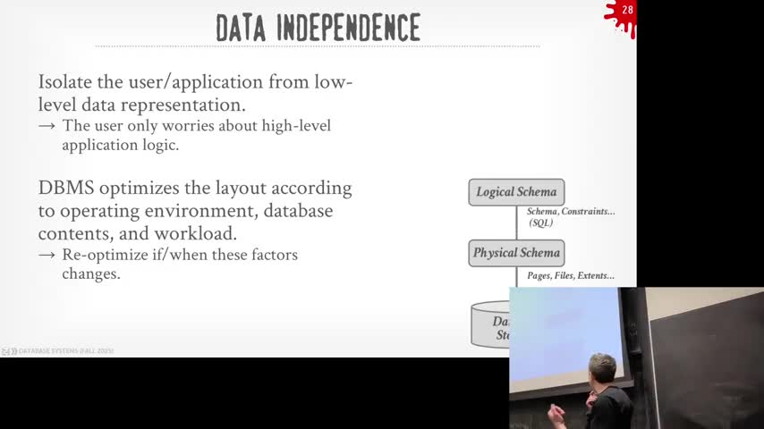

# L1 逐段整理译稿：关系模型与关系代数

## 00:00–00:28｜开场音乐

录像以音乐开场。自动字幕只给出零散歌词，无法可靠还原，不据此翻译歌词。00:00–00:00.100 没有字幕覆盖。

## 00:28–02:22｜开场致意与 DJ 演示

Andy Pavlo 为开课稍晚致歉：设备原先已经设置好，却在最后一刻出了问题。他向帮助课程制作的朋友致意，又提到往届参与课程的几位 DJ。字幕中的部分昵称及人名无法确认，这里不把它们当作已经核实的个人信息。老师介绍本学期的 DJ Cash，并请他展示制作音乐的能力。

演示后，两人聊到采样音乐的使用，以及彼此近况。DJ 开玩笑说自己需要更多 cash、是来挣钱的；老师回应这个说法有些突然，之后会想办法。这里包含表演、音乐和课堂玩笑，并非数据库技术内容；无法确认的歌曲和个人近况不作事实扩写。

## 02:22–04:19｜候补名单与课程定位

今天先快速介绍课程安排，再进入技术内容。如果还在候补名单上，老师早晨看到的数字大约是 28 人，总人数约 130 或 140 人，都是课堂中的近似数。候补名单已经不由授课组直接管理：过去申请人数太多，现在由计算机学院行政人员处理，有名额时会补入学生。老师不能保证某位候补者能进入课程；候补也不一定严格按列表位置处理，涉及不同项目之间的安排。

这门课每学期都开，今年秋季没进来还可以考虑春季。为了在转正后跟上进度，应继续听课，并完成接下来介绍的 Project 0；即使已经选上课，这个项目也会影响你是否适合继续修读。

课程研究的是**数据库管理系统如何设计和实现**，即软件内部发生了什么。它不是教你如何使用或管理 Oracle、MySQL、PostgreSQL 的产品培训。若只想学数据库应用或管理，其他学院也有相应课程；这里关注计算机科学层面的系统原理。

## 04:19–05:25｜网站、讨论区与校外参与

教学大纲和课表已经上线，请阅读其中对学生的要求。课程讨论与公告通过 Piazza 发布；正式选课者应已加入，老师会为新加入的学生更新名单。Gradescope 与 Canvas 名单同步，总成绩也通过 Canvas 管理。

材料公开，因此非 CMU 学习者也可以跟课；课堂介绍了专门的校外 Gradescope 入口，要求正确填写所在学校。校外入口不等于正式班级讨论区权限。老师请校外学习者不要向在校学生、助教或教师发送求助邮件，也不要在 GitHub 公开项目答案。正式注册学生应自动进入正式班级，而不是加入校外入口。

## 05:25–06:36｜课堂提问规则

老师说自己一讲数据库就很兴奋，可能语速过快，尤其给国际学生带来困难。听不懂时请直接举手，请他放慢、重述或解释当前幻灯片。不需要等到下课：一个人的疑问很可能也是其他人的疑问，课堂应有来回讨论。

为鼓励当场提问，他不接受刚下课才拿本节某张幻灯片来问同一个概念；下课可以聊其他事情，但本节内容的问题应在讲解时提出。

## 06:36–08:22｜BusTub 与 Project 0

本学期所有项目围绕 CMU 多年来开发的教学数据库 BusTub 展开。老师口头称其使用 C++20，并说熟悉 C++17 的人应能应付主要内容。重点是必须已经具备 C++ 能力；校内没有一门课程专门替这门课教会 C++，往往要自行学习。

不要轻率地认为“我会 C 或 Java，边学数据库边补 C++ 就行”。尤其在调试复杂的多线程数据结构时，同时学习语言和数据库非常困难。

Project 0 是用于判断基础是否足够的小项目：实现一个需要支持多线程的数据结构。它不贡献普通的项目分数，而是入门门槛。课堂要求两周内做到 100%，否则会被要求退课；目的不是为难学生，而是尽早发现基础不足，避免在更复杂的项目中陷入困境。它也迫使大家尽早配置开发环境。老师说发布前还在处理新版 Clang 的问题，代码与说明会在当天稍后放出。

> 编者注（版本差异）：以上忠实保留课堂的 C++20 说法。本站固定 BusTub 版本的工具链以公共资料中的代码核对为准，不能用这句口头介绍覆盖 CMake 的 C++17 设置。此处不是当下课程注册承诺。

## 08:22–09:52｜独立完成与生成式 AI

老师希望大家在加退选截止前判断是否适合继续修课。作业和项目必须是自己的工作，不可从互联网或同学那里复制答案。

本学期允许使用生成式 AI 帮助编程。老师认为工具已经成为现实，简单禁止并不合理；什么行为算抄袭若有疑问，应咨询教学组并审慎判断。允许工具并不等于可以不理解原理：如果模型生成了一大段代码，而你不懂数据库和系统基础，就无法判断它是否正确。

之后 Project 1 会介绍性能排行榜和额外加分。老师根据个人使用经验说，模型输出有时正确，但通常还不能自动得到最好的性能；理解系统和实现细节仍有价值。这是课堂经验判断，不是对所有模型的正式基准结论。

## 09:52–11:01｜业界闪电演讲与招聘

每周三会通过 Zoom 邀请数据库业界朋友在课堂做简短演讲，快速介绍真实系统或项目，帮助学生把本课概念与实际产品联系起来。

9 月 15、16 日安排公司招聘交流，讨论实习和全职职位，主要面向本课、往届数据库课及同期高级数据库课学生，而非全校大型招聘会。相关安排以及公司提供的职位信息会通过课程渠道发布。

## 11:01–13:30｜数据湖研讨会与课堂问答

想学更多的学生可以参加九月开始的可选研讨会。本学期主题是数据湖系统：大致是在 Amazon S3 等云存储的文件上运行 SQL。老师提到 Iceberg，询问学生是否知道相关公司的收购方和金额，并说明这是一个资金投入很大的方向。研讨会在周一课后 16:30 举行，也会通过 Zoom、YouTube 提供。

学生问：“为什么幻灯片上没有 Databricks？”老师回答，相关项目其实出现了不止一次，学生指出 Delta Lake。他继续提到 Delta Lake、Iceberg、Polaris、Hudi 和 Onehouse，以及这些项目与公司之间的关系。

老师借此强调：数据库领域不断有人创建新系统，试图解决现有系统没有解决的问题；其中有好的想法，也有不好的想法。本课希望学生能根据基本原理判断，而不是因为老师说某个系统不好就接受结论。

> ASR／事实边界：这一段的收购对象被口语称为“Iceberg 的人”，字幕又把金额识别得前后不一（million/billion 混乱）。这里不把“买下开源 Iceberg 项目”或具体金额写成核实事实；它们不是本讲推导所需的信息。资料仅保留课堂讨论的主题和问答。

## 13:30–15:21｜向狱中学习者提供材料

老师介绍一位通过课程录像学习数据库、并参与数据库开发的狱中学习者，提到相关博客报道和寻求法律帮助的事情。自动字幕对姓名、网站及个人经历有明显误识别，本稿不扩写这些未经核验的细节。

从本学期开始，如果学习者本人或认识的人在狱中，可以联系课程组获取打包课程材料：依据可使用的设备提供打印材料或装有视频的存储设备。由于当前学期尚未讲完，提供的会是之前学期的材料。老师感谢数据库公司 Convex 对此提供支持。

最后他询问大家对课程安排是否还有疑问，并提醒：成绩构成、项目发布时间和截止时间在大纲与课表中，问题可通过课程讨论渠道提出。

## 15:21–16:48｜今天的路线

老师用个人生活和玩笑说明自己对数据库的热情：家人最重要，数据库排第二。他希望学生不仅知道数据库重要，还能理解为什么这个领域值得长期投入。

今天先区分数据库与数据库系统，介绍背景，再讲关系模型及操作数据的基本构件——关系代数，原计划最后还讨论其他数据模型。老师表达了对关系模型的强烈偏好；这是讲者立场，不应理解为每种工作负载都只有一个最佳实现。

## 16:48–19:37｜数据库不是数据库管理系统

老师请大家喊出一个数据库的名字。学生回答 PostgreSQL、SQL Server、SQLite、MySQL、ClickHouse 等产品名称。老师故意说：“都不对。”这些是**数据库管理系统**，不是这里严格定义的数据库。

数据库是一组有相互联系、用于描述现实世界某个方面的数据。例如本班学生的姓名、邮箱、生日等记录，是对现实中选课学生的数字化表示；DBMS 则负责托管、存储、查询这些记录。日常交流把产品叫作“数据库”并无大碍，但研究内部实现时需要区分对象与管理它的软件。

即使毕业后不开发 DBMS，也几乎一定会使用它。当查询很慢、返回结果奇怪或行为不符合预期时，这门课能帮助理解原因。老师进一步用夸张说法把编译器、游戏、机器学习模型等都看成“输入—处理—输出”的数据问题，强调数据库思维的广泛用途；这不是给所有软件下严格的 DBMS 定义。

## 19:37–22:20｜用 CSV 做一个音乐数据库

假设要做 Spotify 或 iTunes 的简化版，需要记录艺人、专辑、发行年份，以及哪些艺人参与了哪些专辑。这些数据对应现实唱片店里的唱片、磁带与音乐人。

学生建议每行放一个艺人。老师把它具体化为两个 CSV 文本文件：一个文件记录艺人，另一个记录专辑；换行分隔记录，逗号分隔字段。查询时编写程序打开文件，逐行读取，再按逗号拆分。

例如问“GZA 是哪一年开始单飞的？”程序扫描艺人文件，知道第一个字段是艺人名，找到 GZA 后读取第二个字段。CSV 中读到的全是字符串；若要把年份当整数使用，还需要显式转换。这种方案已经是一个数据库加管理程序，只是管理程序非常简陋。

## 22:20–23:48｜学生指出文件方案的问题

老师问这是不是好办法。学生依次指出：每次找一个实体都要线性扫描；不知道下一条记录在哪里，必须依次解析；没有数据类型；字段名称和位置被硬编码进程序；没有一致性保证。

老师追问最后一点，学生提到 ACID。老师说这要等大约十周后才详细学习，现在先用更直接的问题理解：插入的数据是否正确？写入后是否安全？两个文件之间是否一致？例如专辑引用的艺人，可能根本不在艺人文件里。

## 23:48–25:13｜完整性与建模漏洞

我们试图描述真实世界，因此数据库不应轻易进入现实中不成立的状态。新增专辑时，引用的艺人应确实存在。对同一个 Wu-Tang Clan，有时带连字符、有时不带，位模式不同却指向同一对象，会造成重复和无法匹配的问题。

最初专辑里只有一个艺人字段，隐含了过强的假设：一张专辑只能关联一个艺人。现实中有混音合辑、合作专辑，多个艺人会共同出现，原表示方法就不够用了。再如删除艺人而没有处理其专辑关联，就会留下类似“悬空指针”的引用。

## 25:13–26:03｜重复实现与并发写入

实现查询仍然需要扫描、解析和硬编码字段偏移。若第二个应用使用 Python，第三个使用 Rust，就得在不同语言里重复实现同样的解析和访问逻辑，并保证它们保持一致。

如果两个线程同时打开文件并追加记录，该发生什么？最后一个写入者覆盖前一个，还是第二个应该失败？单个文件格式并没有回答这些问题。并发访问所需的语义必须另行实现，之后会详细讨论。

## 26:03–27:22｜崩溃恢复与副本

丢数据会让用户非常不满，银行存款是直观例子。音乐应用丢失一张专辑虽然没那么严重，仍然违背用户期待。

如果写入记录到一半机器崩溃或断电，恢复后应该看见什么？如果单机故障会让服务不可用，想复制数据到另一台机器，又怎样确保副本同步？这些不是在 CSV 后面加一个写入调用就能解决的。

因此不应把完整 DBMS 的职责临时散落在应用程序里。成熟系统投入大量工作处理可靠存储，让应用开发者不必同时重新解决这些底层问题。

## 27:22–28:40｜有 DBMS 名字不等于有可靠性

数据库系统是现代应用的基础，但选择一个标为 DBMS 的产品，并不自动保证它正确实现了安全性。老师提到上课前两天看到的一篇文章，以 SurrealDB 的持久化默认设置为例，批评用不安全写入换取漂亮的速度数字；他也提及 MongoDB 的历史争议。

这一段的核心要求是：理解产品声称的保证，检查配置与实现是否真的提供它，而不是等丢数据之后才发现文档里藏着一个需要开启的选项。

> 编者注：这里译述的是 2025 年课堂的评论，未独立阅读相关报告或复现故障，不能据此断言这些产品所有版本都存在相同行为。

## 28:40–30:08｜通用 DBMS 的职责

DBMS 是一类帮助应用存储、组织、分析和查询数据的软件。通用 DBMS 允许不同应用按某种数据模型定义 schema，再由系统负责保存和访问，不必为每种应用重新写一个存储系统。

老师建议新应用通常先考虑 PostgreSQL，简单场景也可以考虑 SQLite。有人说“没有产品满足需求，所以必须自己做数据库”，但老师认为多数情况下还没有充分利用已有产品。他也表达了对 PostgreSQL 前端与后端的不同评价，并表示后面会解释。

## 30:08–31:49｜数据模型、模式与实例

**数据模型（data model）**是一套高层规则，规定能怎样表示数据、有哪些对象以及它们之间能有什么关系。关系模型是一种，文档模型也是一种。

类比建筑设计：建筑语言允许出现房间、门、窗，规定如何描述它们；这相当于数据模型。**模式（schema）**则是某一栋具体建筑的蓝图，说明房间大小、门的位置等。依据同一张蓝图可以建出不同房屋实例；同样，数据库模式规定某个具体数据库应有什么结构，而实际记录是该结构下的数据实例。

## 31:49–35:17｜其他数据模型及 NoSQL 问答

关系模型不是最早的数据模型，但今天许多主流系统都采用它。键值模型可以看成关联数组或哈希映射：给一个键，存取一块值，缓存系统中很常见。

老师谈到 NoSQL，并询问学生熟悉程度。他自称早期就批评这一潮流，并认为不少系统后来又加入了关系式能力。常见的相关分类包括图、文档、JSON、XML 等。

学生问：“键值数据库不算 NoSQL 吗？”老师回答，NoSQL 并没有严格统一的学术定义，也可以把键值系统算进去，例如 Redis；他只是按常见讨论方式分组。

数组数据库处理向量、矩阵、张量，在科学计算和机器学习中常见。向量检索也用于 RAG 与语义搜索。还有层次、网络等历史模型；IBM IMS 被用来解释早期系统与登月工程的联系。老师指出旧系统仍在使用，但本课不围绕它们展开。

整个课程主要采用关系模型。老师把它比作数据库的基础算术，同时承认矩阵等工作负载虽然能用关系表示，却不一定适合这样做。开头预告的更多模型细节并未在本片结尾完整展开。

## 35:17–38:01｜早期系统与“程序员作为导航者”

老师回到 1960 年代，介绍通用电气及 IBM 的早期数据库系统。那时程序常用汇编或 COBOL，操作数据库时要十分明确地规定访问步骤。

他引用 Charles Bachman 的图灵奖演讲《The Programmer as Navigator》，说明当时流行的观念：程序员像航海者一样，在数据库中的记录和连接之间导航，访问需要的数据。他也评论了原文使用男性代词的写法。

老师反对的关键不在比喻，而在职责划分：若应用必须理解数据组织与访问路径，并对其写导航程序，数据库结构变化就会影响应用。接下来以 CODASYL 风格说明这种耦合。

> ASR 校订：此段的历史系统缩写、年份和机构细节识别混乱，正文不把不确定细节拼成历史年表。Bachman、COBOL、CODASYL 是依据技术语境恢复的术语；未独立阅读所引演讲原文。

## 38:01–40:17｜导航查询与声明式查询

假设想找出参与某张致敬专辑的所有艺人。导航式程序要写多层循环，依次遍历艺人、专辑以及它们的联系，明确告诉系统如何到达答案。

老师问这样做哪里不好。学生回答依赖底层数据结构。老师进一步区分：接口可能已经隐藏具体结构，但程序仍必须知道要遍历哪些集合，并固定遍历次序。

应先遍历艺人还是先遍历专辑？今天根据记录数量作出的选择，明天或一年后可能就不合适。然而循环已经把执行计划硬编码进程序。

对应的 SQL 则表达要连接哪些数据、筛选什么条件，不要求应用规定每一步如何寻找结果。应用说明**要什么答案**，数据库系统负责决定**怎样得到答案**。

## 40:17–42:52｜关系模型之争

老师介绍 1974 年安娜堡的一次数据库讨论会：导航式模型支持者与关系模型支持者辩论。关系模型的提出者 Ted Codd、Charles Bachman、Jim Gray、Michael Stonebraker 都出现在这一段历史叙述中；他也介绍 System R、Ingres 和后来 Postgres 的关联，解释 Postgres 名称来自“post-Ingres”。

当时反对者认为关系模型太复杂、难以构建实用系统；支持者则指出显式导航使应用脆弱，将查询的执行方式写死。老师以今天学生首先想到的都是关系系统、而非 CODASYL 系统，说明关系模型的长期影响。旧系统没有完全消失，但不再是大多数新应用的起点。

## 42:52–45:24｜关系模型的三个核心点

第一，使用称为**关系**的高层数据集合表示数据，实体之间通过值关联。例如用艺人标识符表示专辑与艺人的联系，而不是暴露某个内存地址或磁盘偏移。

第二，可以声明约束，规定什么数据是合法的。随意用文本编辑器把年份改成邮箱会破坏 CSV 程序；关系模型允许指定属性的数据类型及其他限制。老师也提醒模型与具体实现不是一回事，有些产品在类型执行上较宽松。

第三，通过高层接口查询和操作数据，声明所需结果，把实际存储与执行方法交给 DBMS。随着数据变化，系统可以采用不同的执行计划或存储方式，而不要求应用改写查询。这种逻辑层与物理层的独立性给实现留下了优化空间。

## 45:24–48:37｜物理与逻辑数据独立性

图：约 46:51 的原视频关键帧；从 46:50–46:52 视频轨片段提取，已实际查看，确认显示 “Data Independence”、Logical Schema、Physical Schema 及讲者画中画。图中文字强调：把用户／应用与底层数据表示隔离，由 DBMS 依据环境、数据与负载优化布局。这是视频截图，不是另行导出的 PDF 页面；切片未强制关键帧重编码，时间为约值。

老师用早期 IMS 接口作反例：如果选择树结构或哈希结构后拿到不同的 API，那么后来改变组织方式就得重写访问代码。哈希结构不适合直接完成有序范围访问，这也会影响暴露给用户的能力。

关系接口把“我要访问哪个表、哪些值”与具体结构隔开。最下面是数据库存储；物理模式描述文件、页、区段及位的布局；逻辑模式描述表、列、名称、类型；再上面还可以有**外部模式**，给不同应用呈现不同视图。

例如学生表中有某个敏感字段，应用不一定都应该看到它。视图可以只暴露允许的部分，再由应用通过 SQL 访问。逻辑模式不变而底层存储改变，是物理数据独立性；在外部接口与逻辑模式之间维持隔离，则涉及逻辑数据独立性，本课程不会在后者上展开很多。

## 48:37–50:26｜关系的含义与 DBMS 边界问答

关系首先是无序集合。这里“关系”不仅指两张表之间有联系，更是指同一条记录中各属性之间的联系：一个学生有姓名、邮箱等，这些值共同描述一个实体。

学生回到上一张层次图，问 DBMS 到底覆盖哪一部分。老师回答，在这张抽象图里，应用以下的各层都属于它管理的范围。底部会与操作系统交互，但操作系统的通用策略常与数据库需求冲突，后面会讲怎样处理这些问题。

老师补充，某些系统甚至能把应用逻辑放进数据库，不过不总是好主意。本课程主要仍采用应用在上、DBMS 在下的划分。

## 50:26–52:05｜元组、域和 NULL

关系是无序的元组集合；**元组（tuple）**是一条记录中的属性值组合。每个属性有**域（domain）**，限定允许的类型或值范围。例如无符号 32 位整数的范围是 0 到 $2^{32}-1$，姓名则可能是字符串。

若允许，NULL 表示未知或缺失的信息。不能把它当成一个已经知道的普通值来比较、推理；下一讲会具体展示其行为。老师用 C 中的 null 做直观类比，但这里讨论的是逻辑层的未知值。

日常经常把 relation、tuple、attribute 分别叫作表、行、列。本阶段可这样理解；后面讨论不同存储模型时，逻辑上的行列未必就是物理上排列的样子。

## 52:05–54:13｜主键与自然键问答

**主键（primary key）**用来唯一标识关系中的一个元组。其他列也可能有唯一性要求，但被选作主要标识的那一组属性才是主键。

艺人名称不一定合适：不同艺人可能同名，也可能刻意改变拼写。因此可以引入人工生成的 ID，也称合成键或 identity column。网站上的订单号常是类似的标识，概念上可以由序列逐次产生。

学生问老师是否更偏好自然标识符。老师解释，自然键来自业务已有属性，例如在特定机构中唯一的邮箱；艺人名在这个例子里并不好。ORM 常自动生成标识列，他个人通常采用这种做法。示例于是使用 ID 作为艺人表主键。

## 54:13–55:46｜外键与多对多关系

若每张专辑只有一位艺人，可以在专辑记录里保存该艺人的 ID，以值建立关联。但合作专辑会有多位艺人，因此这不是通用模型。

解决方法是增加一张关联表 ArtistAlbum，保存 artist_id 与 album_id。每当某位艺人参与某张专辑，就增加一条对应记录。一位艺人可以出现于多张专辑，一张专辑也可以对应多位艺人。这样就不必继续在专辑里放唯一的 artist_id 字段。

## 55:46–56:41｜约束略讲

时间有限，老师略过约束的详细展开，但说明它们可以超越数据类型：例如名字不能为 NULL，对年份规定允许范围，或要求某种邮箱格式。约束可在定义表时声明。

他还提到全局断言，可以表达更复杂、跨数据的限制，检查成本也更高。字幕在“实际系统支持及开销”处不完整，本稿不据此补写具体支持列表。

## 56:41–58:19｜外键与复合主键问答

学生问：“什么是外键？”老师回到 ArtistAlbum：其中的 album_id 必须对应 Album 中已有的标识，artist_id 同理。这样，删除被引用对象时，系统知道还有其他记录依赖它，不能悄悄留下不存在对象的引用。

另一位学生问关联表的主键是什么。老师说明幻灯片用下划线表示主键；此处是 **artist_id 与 album_id 两列的组合**。学生追问 SQL 是否能定义多列主键，老师回答当然可以，下一讲会看到。

> 技术补充：外键删除行为由约束声明决定，可拒绝删除或执行规定动作；“不能留下悬空引用”不等于所有系统一律自动删除关联行。

## 58:19–01:00:28｜DML、过程式与声明式

前面是在定义关系及其结构；现在转向如何查询它们。**数据操纵语言（DML）**也包含只读 SELECT，并不只有修改操作。

老师区分过程式与非过程式／声明式表达。关系代数通过算子组合写出操作步骤和次序，因此在这一分类下是过程式的。学生可能注意到，这似乎与前面“不应写死怎么执行”的主张冲突；老师将进一步说明，代数是建立高层语言和执行引擎的基础。

关系演算是声明式方向的数学表达，SQL 与之有关。本课不会详细教关系演算，而关系代数是必须掌握的构件。

## 01:00:28–01:01:22｜算子可组合

老师列出本讲要介绍的七种算子。它们的输入输出都是关系，因此一个算子的输出可以接到下一个算子的输入，形成复杂查询。

这里的基本算子没有排序，也没有平均值等聚合；实际查询语言需要后来加入的扩展。接下来会同时展示每种运算与 SQL 的对应关系，为下一讲铺垫。

## 01:01:22–01:02:39｜选择：筛掉不需要的元组

**选择（selection，$\sigma$）**根据谓词保留元组。例如关系 R 有 a_id 与 b_id，要求 a_id 等于 a2，就只输出满足条件的记录。还可以用合取与析取组合条件，例如 a_id 满足指定值，同时 b_id 大于 102。

这里决定的是哪些元组通过，不是输出哪些列。SQL 中相应的是 WHERE 条件；表达式中的布尔逻辑决定每条记录是否匹配。

## 01:02:39–01:03:57｜投影：决定输出属性

**投影（projection，$\pi$）**决定输出哪些属性、如何排列，也可在扩展形式中计算派生值。比如不向应用暴露密码字段，可以只投影需要的列。

示例先选择 a_id 满足条件的记录，然后输出 b_id 减去 100 的结果和 a_id。对应 SQL 中 SELECT 后面的表达式列表，而不是 WHERE 子句。

## 01:03:57–01:06:02｜选择与 SQL SELECT 的两轮问答

学生指出：上一页标题叫 select，实际却对应 WHERE；现在讲 projection，反而对应 SQL SELECT。老师解释，关系代数的选择算子和 SQL 的 SELECT 语句不是同一层次。代数是搭建完整语言的积木：选择提供过滤，投影提供输出表达式，连接参与组织 FROM 的输入。

学生又问，能不能把示例中的 $\pi$ 换成 $\sigma$、仍使用相同表达式？老师回答不行：投影中逗号分隔的表达式列表不是判定元组真假的谓词。即便某种语言把一个数转换成布尔值，它也不是“把这个数作为结果输出”。过滤与计算输出的语义不能互换。

> ASR 校订：01:05:45 左右字幕出现大量重复字母 B，为识别异常，未翻译为课堂内容。关于“非零即真”的说法是讲者举的语言类比，不能当作标准关系代数对任意数值的定义。

## 01:06:02–01:08:49｜为什么还学代数：连续问答

有学生追问：前面强调 SQL 的声明式，为什么这里又规定执行步骤？远处学生的原问句没有被完整转录，老师复述的意思可以辨认。他请大家再看几页，并解释执行引擎里会有投影等算子，形状很像关系代数。关系代数是构造查询语言和执行引擎的基础；直接照给定过程执行，与让 SQL 优化器决定如何执行，是不同层次。

另一位学生问算子是否都可交换。老师回答不是总可以，并以投影可能提前丢掉后续需要的属性为例；只有符合条件的改写才成立。

学生再问屏幕中的 SQL 是什么。老师说它是一条包含投影列表的 SELECT 语句，列表中的表达式对应上方的 $\pi$。

还有学生确认输出类型。老师回答，每个关系算子输出的仍是一个关系，因此可把输出继续传给下一个算子。这就是组合查询的基础。

> 技术补充：不能把课堂的口语“通常能交换”推广成通用定律。差集不交换，选择与投影的交换也有属性依赖条件；笔记给出反例。

## 01:08:49–01:09:48｜并、交、差

并集将两个关系的元组合并，并去掉重复结果。并、交、差要求输入具有相容的结构：列数及对应属性必须匹配，才能形成同一种结果关系。

交集保留双方都有的元组；差集保留左侧有、右侧没有的元组。老师因时间有限快速讲过，说明这些与基础集合论相同，也能写成对应 SQL。

## 01:09:48–01:11:08｜笛卡尔积

前面的单输入算子处理一个关系，并、交、差组合两个关系，但还没有利用不同实体之间的匹配关系。现在转到积与连接。老师中途短暂提到设备电量问题，然后继续讲解。

**笛卡尔积**把两个关系中每一条记录与另一边每一条记录配对，结果带有双方的属性。SQL 可以用 CROSS JOIN 表达。

但如果要找某张专辑的参与艺人，我们并不想得到所有艺人与所有专辑的组合；那些不匹配组合只是噪声。需要进一步规定哪些配对才符合要求。

## 01:11:08–01:12:31｜连接与自然连接

连接可以理解为在笛卡尔积的候选配对上施加条件，只保留两侧值满足条件的元组。

老师以自然连接说明：它按两边同名、相容的属性匹配，并在输出中合并对应的公共属性，保留双方其他属性。虽然 SQL 支持 NATURAL JOIN，老师不建议依赖隐式匹配；最好明确写出要连接的属性，尤其是明确的连接谓词。

学生问这里是不是内连接，老师回答是，并表示之后还会讲其他连接形式。

## 01:12:31–01:14:12｜同样答案，不同工作量

快下课了，老师提到还有其他扩展算子，转而用最后一个例子解释查询优化的动机。假设连接 R 和 S，同时要求 b_id 等于 102：先连接再过滤，与先过滤 S 再连接，可能得到同样结果，却花费完全不同的工作量。

思考时应看极端情况，不要只想五条记录的小表。若两边各有一万亿条记录，而筛选条件最终只留下两条，先做大量无用连接再筛掉，显然可能浪费很多工作。先筛选再连接可能更好。

SQL 让用户表达需要什么结果，把执行路径的选择交给数据库。下一讲会从过程式代码转向实际 SQL。

## 01:14:12–01:14:49｜收尾音乐与未知尾部

讲课结束后有简短说话和音乐。自动字幕给出少量破碎歌词，无法可靠完整翻译。最后一个文本事件结束于 01:14:47.080，至录像结束的 1.920 秒没有字幕，内容未知，不能标为静音。

---

## 来源、阅读范围与校订约定

- 讲者：Andy Pavlo；发布者：CMU Database Group；CMU 15-445/645，Fall 2025，第 1 讲，视频 ID `7NPIENPr-zk`，时长 01:14:49。原视频地址及获取记录保存在本地来源元数据，正文不放视频跳转链接。
- 许可：该视频页面标注 **Creative Commons Attribution license (reuse allowed)**；许可说明见 [YouTube CC 说明](https://support.google.com/youtube/answer/2797468?hl=en) 与 [CC BY 3.0](https://creativecommons.org/licenses/by/3.0/)。此范围不扩展到独立教材、幻灯片 PDF 或视频中的第三方音乐素材。
- 本稿是依据英文自动字幕制作的**逐段整理译稿**：合并赘词、口头重复，中文改写；不是逐字听译。已依次全文阅读规范化存档的 2019 条字幕事件，未以关键词抽样代替全文阅读。
- 时间标题按字幕话题转折取整，误差约数秒；连续标题是整理区间，不意味着每秒都有字幕。字幕区间并集覆盖 4394.555 秒；46 个内部间隙共 92.425 秒，另有首部 0.100 秒和尾部 1.920 秒未覆盖，均未推定为静音。精确间隙与分块见仓库 `source-manifest.json` 的 `lecture01Coverage`；完整本地映射保存在 `sources/lec01/coverage.json`。
- 原始 ASR 保持不改。正文中 GZA、Wu-Tang Clan、PostgreSQL、BusTub、Piazza、Gradescope、Canvas、CODASYL、COBOL、Codd、Bachman、Stonebraker、tuple 等按技术上下文校订；模糊人名、歌词、收购金额、远处学生原话不猜补。
- 技术补充都显式标注，不伪装成课堂原话。尚未逐句听音核验，字幕可能遗漏板书、幻灯片细节与未被麦克风收录的问答。
- 音画核验仅限上方一张截图的视觉内容，未获取或听核全片音轨。常规媒体下载一次因无合适音视频合并格式失败，一次视频轨下载在约 2.1% 时读超时；改为借助本机已有 imageio_ffmpeg 获取必要的两秒视频片段后成功取帧。未绕过登录或访问限制，也不以一帧证明全片音画已核验。
