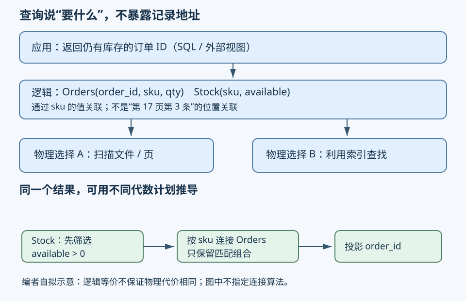

# L1 学习笔记：把“记录在哪里”从业务问题中拿走

读完本讲，应能回答三个问题：文件已经能保存数据，为什么还需要 DBMS？关系模型的关键为何不是“画成表格”？关系代数怎样既表达结果，又为优化留下推导空间？

本页不是另一份译稿。下面的订单／库存数据、反例与成本估算均为**编者原创推演**；课堂本身主要用音乐艺人和专辑举例。完整课堂说明、行政安排与问答见译稿。原讲概念依据为已顺序全文阅读的英文自动字幕，未逐句听音复核。

## 1. 文件缺的不是逗号，而是统一的责任边界

设业务有两组数据：

**Orders**

| order_id | sku | qty |
|---|---|---:|
| 101 | A | 2 |
| 102 | B | 1 |
| 103 | A | 1 |

**Stock**

| sku | available |
|---|---:|
| A | 3 |
| B | 0 |
| C | 7 |

把它们存成两个 CSV 并不错误：数据库首先是有组织的数据，而不是某个软件品牌。问题是，每增加一个需求，应用就得承担一项原本不存在的保证。

| 需求 | 只保存文件还没回答的问题 | 需要明确的不变量／职责 |
|---|---|---|
| 查订单 103 | 是否扫描全部记录？字段是否固定在第三列？ | 访问方法与格式解析 |
| 新增 sku=D 的订单 | D 不在库存表里也能写入吗？ | 参照完整性 |
| 写入 qty=-1 | 字符串能解析为整数就算合法？ | 类型以外的业务约束 |
| 两人同时买 A | 双方都读到 3 后会不会都成功扣 2？ | 并发语义 |
| 更新两个文件时断电 | 订单存在、库存却没扣算成功吗？ | 原子性与恢复 |
| 换 Python 服务 | 是否重写并同步所有解析和规则？ | 跨应用共享管理逻辑 |

**反例：加一个哈希表还不是补齐 DBMS。** 内存哈希表能加快按订单号定位，却没有说明掉电后如何重建、并发更新如何互斥、多个记录如何共同提交、外键如何检查。因此“查询快”只是其中一项责任。反过来，也不能从这一点推出 DBMS 不使用文件：文件、页和索引正是其内部实现素材。

原讲定位：19:37–28:40。并发、恢复在此只是问题动机；本讲没有教会完整事务算法。使用成熟产品也不能代替核查其默认配置与持久化承诺。

## 2. 模型、模式、实例：先把三个层次分开

- **模型**规定允许怎样描述数据：这里用关系、属性、域、约束与基于值的关联。
- **模式**是具体结构，例如 `Orders(order_id, sku, qty)`，以及键、类型和约束。
- **实例**是此刻实际存在的三条订单记录；增加一条订单是改变实例，不一定改变模式。

关系不是因为“表与表有关系”才叫 relation。一条元组把多个域中的值联系起来；整个关系是这些元组的集合。逻辑关系无行序，也不要求相邻业务记录放在相邻磁盘位置。

### 用值关联，不用地址关联

订单中的 `sku=A` 不意味着“去库存文件第 0 行”。即使 Stock 重排、压缩、迁移到另一页，只要 A 仍代表同一产品，业务关联就没变。

这里 `order_id` 是 Orders 主键，`sku` 是 Stock 主键，Orders.sku 可以声明为引用 Stock.sku 的外键。主键唯一标识记录；外键限制引用必须有合法目标。**相同列名不自动创建外键；外键也不自动让查询执行连接。**

如果一张订单包含多种产品，就应拆出 `OrderLine(order_id, sku, qty)`。若业务保证每个 sku 在每张订单最多出现一次，可以用 `(order_id, sku)` 作复合主键；若允许同一产品分多个明细行，该组合就不再唯一，需要重新定义明细标识。键来自业务不变量，而不是画表的习惯。

### NULL 不是“库存为零”

`available=0` 表示知道没有库存；`available=NULL` 表示相应信息未知／缺失，两者不等价。若业务必须知道可售数量，应明确不允许 NULL。SQL 的三值逻辑留到下一讲，不能用 C 指针或普通整数 0 的行为替代。

原讲定位：30:08–31:49、42:52–45:24、48:37–58:19。

## 3. 物理数据独立性：允许换实现，不允许偷换答案



图：编者按本讲分层思想自绘，数据与算子计划为原创订单／库存例子，不是课堂截图。

应用请求“有库存的产品对应哪些订单”，不应写成“从某个文件偏移开始沿指针找下一条”。DBMS 可以扫描，也可以使用索引；查询所要求的结果不变。

**物理数据独立性**：改变存储布局或访问方法，不要求改变逻辑模式和应用查询。它不保证延迟永远一样，也不保证任意物理变化都免费。

**逻辑数据独立性**：通过外部模式等边界，尽可能隔离逻辑结构变化对应用接口的影响。例如把敏感客户信息拆到另一张表，再用适当视图保留旧应用需要的结构。该例为补充；不是说随意删一列仍可让旧查询正常运行。

**视图不等于完整安全机制。** 课堂用隐藏密码列解释外部模式。实际系统还必须限制底表权限；也不应把这个教学例子理解为推荐明文存储密码。

原讲定位：38:01–40:17、45:24–50:26。

## 4. 一条查询怎样变成可推导的关系表达式

目标：返回“产品当前有库存”的订单号。注意它不等于“库存足以满足每张订单”或“所有订单都能同时履约”。先把问题说准，再写查询。

记 Orders 为 $O$，Stock 为 $S$。

### 第一步：选择缩小元组集合

$$
S_+ = \sigma_{available>0}(S)
$$

本例得到 `(A,3)` 和 `(C,7)`。选择改变哪些元组留下，不负责删列。

### 第二步：连接建立有意义的配对

$$
J = O\bowtie_{O.sku=S.sku} S_+
$$

结果只有订单 101 与 103 对应的两条记录。C 虽有库存，却没有订单；连接不会凭空生成订单。

连接可按语义定义为“笛卡尔积再选择”：

$$
O\bowtie_\theta S_+ = \sigma_\theta(O\times S_+)
$$

这不是要求引擎真的先物化所有配对。笛卡尔积有 $|O|\,|S_+|$ 个候选组合；实际可用别的算法直接查找匹配项。

### 第三步：投影决定输出结构

$$
Q = \pi_{order\_id}(J)=\{(101),(103)\}
$$

对应的 SQL 说明语义，而非指定循环顺序：

```sql
SELECT DISTINCT o.order_id
FROM Orders AS o
JOIN Stock AS s ON o.sku = s.sku
WHERE s.available > 0;
```

这里使用 `DISTINCT` 是为了显式对应经典关系代数的集合语义。本例因主键与连接唯一性，本来不会重复订单号；但若投影 `sku`，两个 A 在经典投影结果里合成一个 A，普通 SQL `SELECT sku` 却可能返回两行。**逻辑上的集合与 SQL 默认多重集不能默默混用。**

选择 $\sigma$ 对应 SQL WHERE；投影 $\pi$ 对应 SELECT 后的表达式列表。SQL SELECT 是整条查询语句，不是名为 selection 的单个代数算子。

原讲定位：58:19–01:08:49、01:09:48–01:12:31。集合／多重集对比是编者为避免误读而补充的边界。

## 5. 同一个答案为何可以少做大量工作

令 $p \equiv S.available>0$，$\theta \equiv O.sku=S.sku$。对于内连接，且谓词 $p$ 只依赖 S 的属性时：

$$
\sigma_p(O\bowtie_\theta S)=O\bowtie_\theta\sigma_p(S)
$$

**逐元组证明**：左边保留一对 $(o,s)$ 当且仅当两件事都真：`o.sku=s.sku`，且 `s.available>0`。右边先要求第二件事，再要求第一件事；这两个条件的合取没有改变。所以保留的配对相同。

**原创成本例**：假设 O 有一百万条订单，S 有十万条产品，而正库存只有一百种。若为了理解差异，暂用朴素的逐对比较模型：

- 先对全部 O、S 配对再筛选：最多 $10^6\times10^5=10^{11}$ 次候选比较。
- 先扫描 S 过滤，再对筛后的 S 配对：约 $10^5+10^6\times100$，约 $10^8$ 次工作量级。

这是两种**朴素方案的示意估算**，不是 DBMS 性能预测。索引、哈希连接、统计信息、缓存等都会影响真实代价。等价规则告诉优化器“允许哪些改写”，代价模型才帮助选择。

### 不成立的交换：删掉谓词需要的列

如果先做 $\pi_{sku}(S)$，就丢掉了 available；随后 $\sigma_{available>0}$ 无法在其输入上求值。所以不能把任何选择和任何投影随意交换。能下推投影时，必须保留连接键和后续条件所需的属性。

### 不成立的推广：外连接

上面的证明针对内连接。外连接可能补 NULL 行，移动谓词可能改变哪些补行被保留。本讲没有展开外连接重写；不要把内连接等式直接贴到所有 JOIN 上。

原讲定位：01:06:02–01:08:49、01:12:31–01:14:12。

## 6. 集合算子和自然连接的两个陷阱

若已售产品集合为 A、补货产品集合为 B，且两者均只有同一域的 `sku` 列：并集是“已售或补货”，交集是“既已售又补货”，差集 $A-B$ 是“已售但未补货”。

差集不交换。设 $A=\{A,B\}$、$B=\{B,C\}$，则 $A-B=\{A\}$，$B-A=\{C\}$。不能从“部分算子可交换”推出所有关系代数都可交换。

并相容与行数无关：两边必须有相容的属性结构和域。三列订单不能直接与两列库存做并集。列名不一致时还可能需要重命名，对应位置与含义也必须明确。

**自然连接的演化陷阱**：如果 Orders 和 Stock 原先只有 `sku` 同名，NATURAL JOIN 按 sku 连接；后来两边都新增 `status`，它就还会要求 status 相等。查询文本没变，业务含义却悄悄改变。因此用 `JOIN ... ON o.sku=s.sku` 把依赖显式写出来。

原讲定位：01:08:49–01:12:31；具体反例由编者自拟。

## 7. 全片分块时间索引

此表用于回看，不代替逐段译稿。边界依据自动字幕话题变化，按秒取整，约有数秒误差；表格覆盖整片，不代表字幕在区间内没有缺口。

| 时间 | 核心问题／内容 | 阅读提示 |
|---|---|---|
| 00:00–02:22 | 音乐、致意、DJ 演示 | 歌词及部分人名不确定 |
| 02:22–06:36 | 课程定位、平台、候补、提问 | 区分内核课程与产品培训 |
| 06:36–09:52 | C++、Project 0、独立完成与 AI | 口头工具链与固定代码版本分开 |
| 09:52–15:21 | 业界活动、数据湖研讨会、材料公益计划 | 当年行政信息，不作当前承诺 |
| 15:21–19:37 | 路线、数据库与 DBMS | 数据集合不等于管理软件 |
| 19:37–23:48 | CSV 查询与学生质疑 | 定位、类型、硬编码、完整性 |
| 23:48–28:40 | 建模、并发、崩溃、副本、可靠性评论 | 为什么仅快还不够 |
| 28:40–31:49 | 通用 DBMS、模型与 schema | 规则、蓝图、实例 |
| 31:49–35:17 | 其他模型与 NoSQL 问答 | 不把分类标签当性能保证 |
| 35:17–40:17 | 早期系统、导航式查询 | 谁固定了访问路径？ |
| 40:17–45:24 | 历史争论、关系模型三要点 | 值、约束、高层操作 |
| 45:24–50:26 | 分层、独立性、DBMS 边界问答 | 改实现而不改查询含义 |
| 50:26–54:13 | tuple、domain、NULL、主键问答 | 主键必须符合唯一性事实 |
| 54:13–58:19 | 外键、多对多、约束、复合主键问答 | 不把外键误当物理地址 |
| 58:19–01:01:22 | DML、代数与可组合性 | 关系输入、关系输出 |
| 01:01:22–01:03:57 | 选择与投影 | 筛行与输出属性分工 |
| 01:03:57–01:08:49 | SELECT 命名、算子交换等问答 | 交换必须有前提 |
| 01:08:49–01:12:31 | 并交差、积与连接 | 匹配条件必须明确 |
| 01:12:31–01:14:12 | 筛选下推与 SQL | 同样结果可以不同代价 |
| 01:14:12–01:14:49 | 收尾说话与音乐 | 末尾 1.920 秒字幕未知 |

## 8. 自测：先回答，再展开

<details>
<summary>CSV 外挂内存哈希表，是否已经解决了课堂提出的问题？</summary>

只改善了一类定位成本。并发、约束、跨记录原子性、崩溃恢复和副本同步仍没有定义；也要考虑索引如何和文件保持一致。

</details>

<details>
<summary>库存表物理排序反转后，订单中的 sku 是否应该修改？</summary>

不应修改。sku 表达业务值而非记录位置。若必须跟着重排改所有订单引用，说明业务标识与物理布局耦合了。

</details>

<details>
<summary>投影 sku 后得到两个 A，对经典代数和普通 SQL 分别意味着什么？</summary>

经典关系是集合，投影结果中的重复元组只保留一份；普通 SQL 默认保留重复，需明确 DISTINCT 才对应去重语义。

</details>

<details>
<summary>为什么先过滤 Stock 再内连接 Orders，与连接后过滤等价？</summary>

对每对候选元组，留下的条件仍是“sku 相等且库存大于零”。前提是过滤仅依赖 Stock，且讨论这里的内连接语义；不是所有连接与谓词都可任意移动。

</details>

<details>
<summary>查询返回 101、103，就证明两张订单都能成交了吗？</summary>

没有。查询只判断当前对应产品库存是否大于零；未判断 qty，未解决并发销售，也未执行原子扣减。即使加上 available ≥ qty，分别满足也不保证所有订单总需求可同时满足。

</details>

<details>
<summary>新增同名 status 列为何可能改变 NATURAL JOIN？</summary>

自然连接把所有适用的同名属性纳入隐式匹配。新增列会改变条件；显式 ON 条件能让查询依赖更可见。

</details>

## 来源与延伸边界

- **已全文阅读的课堂来源**：Andy Pavlo / CMU Database Group，*#01 – Relational Model & Algebra*，Fall 2025；[官方视频](https://www.youtube.com/watch?v=7NPIENPr-zk)，01:14:49。英文自动字幕已规范化并顺序全文阅读；没有把字幕阅读冒充全片音画核验。
- **许可与修改**：该视频标注 Creative Commons Attribution reuse allowed；[许可说明](https://support.google.com/youtube/answer/2797468?hl=en)、[CC BY 3.0](https://creativecommons.org/licenses/by/3.0/)。本页为中文原创整理与推演，例子和 SVG 为编者新作。许可不外推到教材、独立 PDF 或第三方音乐。
- **指定教材导航**：*Database System Concepts* 第七版的章节定位和公共阅读入口见课程公共资料；编者本批没有阅读完整教材正文，不生成教材译文，也不生成重复课堂的 materials 文件。
- **课堂提及、未独立阅读的历史文献**：Charles W. Bachman，*The Programmer as Navigator*（1973）；E. F. Codd，关系模型相关工作。这里只解释课堂已讲的观念，不冒充对原论文的独立精读，不添加未经核对的节号或引文。
