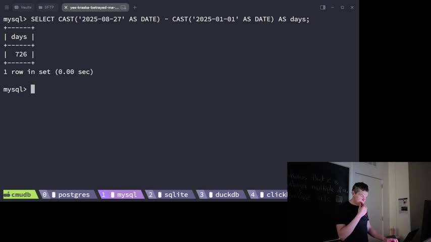
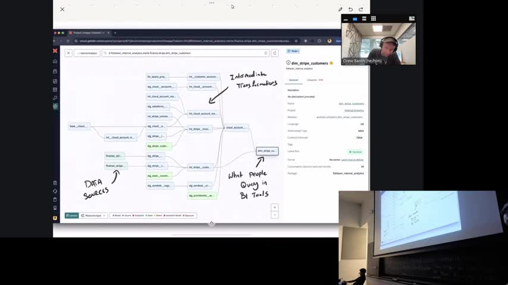

# L2 逐段整理译稿：现代 SQL 与 dbt

## 00:00–00:32｜音乐与开场

开场为音乐，自动字幕只有零散词语，不足以可靠辨认歌词。00:25 左右老师请大家开始上课，并再次感谢现场 DJ。开头 0.100 秒没有字幕覆盖；不据此推断有没有声音。

## 00:32–02:03｜下周安排、Project 0 与上讲回顾

老师提醒，下周自己要去伦敦，因此不会在教室现场授课，会在外地录制并把录像放到 YouTube。开场还与 DJ 开玩笑说会问候他的朋友；昵称没有可靠核验，不作姓名扩写。

Project 0 已在周一发布，截止日是 9 月 7 日；Homework 1 当天稍后发布，也是同一天截止。Project 0 要证明大家已经会 C++，能够调试多线程代码。应尽早开始，因为首先要把开发环境配置好，确认所有东西能工作，而不是到最后才发现环境问题。

上一讲时间有些紧，介绍了关系模型，以及用关系代数操作关系数据的基本方法。今天讨论更高层的查询语言 SQL。以后进入系统实现和查询执行时，会再次回到关系代数：那时就会看到这些操作如何成为数据库内部的构件。

> 编者注：这里是 2025 年课堂安排，不是当前开放报名、截止日期或评分服务的承诺。制作批次 P1 与官方 Project 1 无关。

## 02:03–05:06｜从早期关系查询语言到 SQL

老师把时间拉回 20 世纪 70 年代。Codd 提出关系模型与关系代数时，并没有详细规定关系数据库应如何实现，也没有给出后来成为 SQL 的查询语言。IBM 其他研究人员看到了这个方向的价值，尽管 IBM 当时已经靠非关系系统 IMS 做生意，仍开始探索关系系统原型。

早期有一种叫 SQUARE 的语言，用比较特别的、纵向排布的符号来写查询。课堂以求部门雇员平均薪资一类的表达式说明它的样子。老师说，这种形式很难用普通键盘和应用程序输入，没有成为大家实际使用的语言。

随后讲到 IBM San Jose 的 System R。它是很有影响力的关系数据库研究原型，本学期会多次遇到它留下的思想：看上去属于现代系统的新点子，往往在 70 年代就已有研究。Chamberlin 与 Boyce 参与设计了 SEQUEL，名字来自 Structured English Query Language；后来因名称冲突等原因改称 SQL，所以今天有人念字母 S-Q-L，有人仍念 sequel。

System R 本身不是后来直接发布的商品名。IBM 后来推出 System/38、SQL/DS 等产品，而 1983 年推出的 DB2 影响尤其大，今天仍有金融等应用使用。老师又提到 Oracle 与 Larry Ellison，用数据库商业上的成功开玩笑强调本课的重要性。

> ASR／史实边界：字幕把 SQUARE、SEQUEL、SQL 及人名多处混写，这里统一常见技术拼写。课堂对原型所在地、年份和商业化先后是口头概述，本稿未独立研究早期史料，不把这段当作精确数据库史年表；富豪排名也是当时的随口举例。

## 05:06–08:26｜标准不断演进，SQL 不等于某个产品方言

SQL 最初来自 IBM 的研究，而 IBM 当年的行业地位很大。其他系统逐步采用这一语言；Berkeley 的 Ingres 曾有自己的 QUEL，但 SQL 后来成为事实标准，并在 1986 年成为美国标准、1987 年成为国际标准。

SQL 虽然很老，却不是死语言。老师说当时最新的是 2023 年版，加入了属性图查询等新特性；当应用需求变化，SQL 也会吸收相应的数据表示与查询能力。课堂同时提到多维数组，意在强调标准仍在扩展，而不是逐项讲解这些功能。

难点是：标准写一种形式，并不意味着每个系统都完整、准确地照做。某些实现先增加自己的扩展，再推动它进入标准；另一些在标准推出后才实现，并保留自己的习惯。今天的演示会不断遇到这种差异。

老师把 SQL-92 作为基本 SQL 能力的历史基线，举出 SELECT、INSERT、UPDATE、DELETE、建表以及事务相关操作。今天会略过最基础的语句，讨论更现代的构造。但“支持 SQL”不能理解为通过了某个统一、完整的兼容性认证。

每隔一段时间就有人说 SQL 很糟，应该被替换；眼下又有人认为大语言模型和自然语言接口能让 SQL 消失。老师不排除未来变化，但认为它很难很快消失。使用者不一定每次亲手从零写 SQL，工具却可能仍生成 SQL 交给数据库。

## 08:26–11:26｜问答：什么可能替代 SQL，为什么它能持续存在

学生问，什么语言可能替代 SQL？老师回答，自己不知道；上一学期曾组织研讨会请尝试替代 SQL 的人介绍方案。他认为 Google 的 Pipe SQL 是值得注意的方向，但更像增强 SQL，而不是完全取代它。现场有人表示自己参与过相关工作，老师回应，这恰好说明它仍以 SQL 为基础。

另一个问题是，什么让 SQL 一直延续？老师回答，是它能演进。例如过去 JSON 随 Web 应用变得流行，SQL 就增加 JSON 支持；更早的 XML 也被纳入。它提供基本构件，可以继续增加高级能力。

SQL 当然有令人不满的地方，例如 SELECT 写在 FROM 前面，读者还不知道表来自哪里就先看列。老师讲了早期设计与用户研究的故事，说明某些语法习惯一旦被采用就会延续很久。后面也会看到有些系统允许改变表达方式，但通常仍沿用传统顺序。

老师再次强调，做数据库实现或只是使用数据库，都很可能长期遇到 SQL。模型可以生成查询草稿，也许将来 SQL 会像汇编一样成为某些高级表达的目标语言，但人仍需理解它。随后播放一个家中孩子写 SQL 的短视频，设备没有按预期播放声音；老师用“写完 SQL 才能吃早餐”开玩笑。这是非技术插曲，不从残缺字幕还原孩子的具体话语。

## 11:26–14:11｜SQL 的组成、多重集，以及今天的示例

SQL 可以粗分为 DML、DDL、DCL。DML 是数据操作，如查询、插入、更新、删除；DDL 定义表、索引、视图等对象；DCL 控制账户与数据访问权限。事务的 BEGIN、ROLLBACK 等会在后面的课程再讨论。

还要分清集合、多重集和列表。集合是无序、不含重复的数据；多重集（bag）无序，但可以保留重复；列表则有顺序。关系模型建立在集合思想上，SQL 查询却通常保留重复。去重需要额外工作，如果确实需要，应明确用 DISTINCT 等方式表达，而不是假定结果自动无重复。

本讲是一次快速的 SQL 进阶介绍，不再从基本增删改查开始。稍后 dbt 会作本学期第一次行业闪电演讲。老师把它介绍为分析工作中广泛使用的工具，核心与 SQL 和模板有关，还提到公司将参与后面的招聘活动。

课堂使用一个小型大学数据库：Student 存学生，Course 存课程，Enrolled 记录学生选了哪些课和取得什么成绩。接下来的聚合、嵌套查询等例子围绕这几张表展开。

## 14:11–16:02｜聚合与 COUNT

聚合从已经保存的数据中提炼新信息：输入多个元组中的值，输出一个标量。例如平均值、最小值、最大值、计数；有的系统还支持标准差、几何平均数等。此处先从 SELECT 输出列表中的聚合开始理解。

第一个例子是数出登录名符合 CS 条件的学生。WHERE 先筛出符合条件的行，然后 COUNT 计算数量。老师问，写 COUNT(login) 到底是什么意思？在这个例子中，COUNT(login)、COUNT(*)、COUNT(1)，甚至把参数换成一个非空常量表达式，都得到相同结果：它们在这里统计被筛选出来的记录。

> 技术补充：这不是无条件恒等式。COUNT(*) 数行，COUNT(expr) 数 expr 非 NULL 的行。此例的登录名匹配条件已排除 login 为 NULL 的行，所以结果相同；若直接对允许 NULL 的列计数，则可能不同。老师说“聚合放在输出列表”是当前例子的简化，后面的 HAVING 本身也使用聚合。

## 16:02–18:26｜为什么聚合旁边不能随便放课程编号

接着要计算每门课中学生的平均 GPA，还希望输出课程编号。若把所有符合条件的学生合起来计算一个平均值，却同时要求输出某个课程编号，那该选哪一个？学生说缺少 GROUP BY；老师追问原因，得到的回答是：这里没有一个唯一、自然应该输出的课程编号。

大多数系统会拒绝这种不明确的查询；课堂说 SQLite 允许某些这样的写法，旧版 MySQL 也曾允许。另一种写法是显式使用 ANY_VALUE，让系统挑一个值。不过数据库按要求返回了一个值，并不表示这个值和所求平均数之间存在正确的业务关系。

正确表达“每门课的平均 GPA”，是按课程编号 GROUP BY。逻辑上先把行分成各个课程的组，再在每组里算平均值，每组得到自己的输出。

老师强调，这里没有要求用户实现分组。系统可以建哈希表，也可以先排序再聚合，具体实现以后再学；现在要理解的是声明式查询如何告诉系统“按什么维度分组，计算什么”。

## 18:26–20:42｜GROUPING SETS：一次声明多个汇总层级

如果希望同时得到多种分组结果，可以分别写查询再用集合运算把结果接起来，但 SQL 也提供 GROUPING SETS。课堂还提到 ROLLUP、CUBE，不过本次不展开。

例子想统计：每门课中每种成绩有多少学生、每门课总共有多少学生，以及全部选课记录的总数。GROUPING SETS 中分别写“课程、成绩”“课程”和空分组，就表达这三个汇总层级。结果在一张输出表中出现，某个汇总层级没有使用的维度列会填 NULL。

图中用不同颜色标出课程内的小组与更高层汇总。老师说，把这些工作一起交给数据库，有机会让系统共享扫描与计算，而不是应用程序发出很多独立请求，再自己合并结果。减少客户端与数据库之间的来回，是本讲反复强调的思路。

> 技术补充：一次扫描是可能的实现策略，不是 GROUPING SETS 的语义保证。多个分组结果的多重集对应物更接近 UNION ALL；若用会去重的 UNION，重复行语义可能变化。汇总产生的 NULL 也不一定等于源数据本来的 NULL，实际区分时需采用目标系统的分组标识能力。

## 20:42–24:10｜HAVING、别名与两次出现的 AVG

现在想筛选平均 GPA 达到指定门槛的课程。不能在本层 WHERE 直接使用尚未形成的组平均值：从逻辑上看，WHERE 判断的是输入行，而这个平均值是在聚合后才得到的。要过滤聚合结果，应使用 HAVING。

课堂以 3.9 为门槛说明这个区别。字幕在“大于还是小于”的口头表述上有来回修正，核心是依据组平均值保留或删除课程，本稿不把那一瞬间的比较方向补成精确抄屏代码。

老师给平均值起了别名 avg_gpa，但有的系统不允许在 HAVING 中直接引用 SELECT 列表里的这个别名。于是要在 HAVING 再写一次 AVG 表达式。PostgreSQL 是课堂举出的例子。虽然 SQL 强调声明式，理解名称在哪个作用域可见，仍然离不开对逻辑层次的认识。

学生问，FROM 里把 Enrolled 和 Student 用逗号列出来，再在 WHERE 写学生编号相等，是否就是 JOIN？老师承认这是旧式写法，建议大家明确写 JOIN。优化器通常能识别两张表之间的等值连接条件，并用连接算法处理，而不是先真的生成完整笛卡尔积。

另一个问题是：SELECT 和 HAVING 都写 AVG，系统会不会重复计算两遍？老师说，希望不会；多数系统会识别并复用相同计算，但不在这里给出所有实现的保证。语法上重复写表达式，不必然意味着执行两次。

## 24:10–25:46｜为什么作业用 DuckDB，但不是只学 DuckDB

接下来从字符串开始讲类型操作，再进入最容易暴露方言差异的日期与时间。HW1 用 DuckDB，主要因为它易于在大家的电脑和课程机器上运行，SQLite 也有相似的便携性。

这不是要求大家只学会某个产品独有的语法，而是理解 SQL 能表达什么。以后换数据库，会遇到引号、函数、类型、语义的小差异。把查询从一个系统迁移到另一个系统绝不总是搜索替换就能完成，企业甚至会为迁移投入大量资源；但有了 SQL 基础，学习另一种 SQL 方言通常比从一种编程语言完全转到另一种语言更容易。

## 25:46–29:26｜字符串大小写与单、双引号演示

老师先介绍字符串常量通常用单引号，然后用不同系统演示大小写和引号带来的差别。投影较暗、远程连接较慢，他调整显示，并发现后台上传上一讲视频影响了连接，暂停上传后继续。

在 PostgreSQL 中查 Student 的姓名时，字母大小写不对，查询没有匹配到预期记录；更正后才得到结果。在课堂 MySQL 配置中，改变姓名大小写仍能匹配，双引号也能包住字符串。把相同的双引号查询交给 PostgreSQL 则失败：它把双引号内容解释为标识符，也就是列名或表名，而不是字符串值。

双引号标识符还有实际用途，例如对象名称含空格时，必须把名称作为整体引用。课堂 SQLite 配置对大小写的行为与 MySQL 不同，但仍接受了演示中的双引号字符串。DuckDB 则把双引号内容当作列名，报找不到列；改用单引号才能查询字符串，并表现出大小写敏感的匹配行为。

老师的重点是，连最基本的字符串查询也不能假定所有系统完全相同。

> 技术补充：原讲用“某产品大小写敏感／不敏感”作快速概括，不能当作所有版本和配置的恒定属性。实际比较还受 collation、类型与 SQL 模式影响；MySQL 的双引号语义同样受模式影响，SQLite 的兼容行为也不应作为可移植写法。请区分“字符串值的比较”和“标识符的解析”。

## 29:26–31:44｜LIKE 与标识符大小写问答

字符串模式匹配可用 LIKE。它不是常见正则表达式里的星号和点号体系：`%` 匹配任意长度子串，包括空串；`_` 匹配一个字符。要找课程编号以 15 开头的选课记录，可以写以 `15` 开头再接 `%` 的模式。老师也提到 ILIKE，用于支持它的系统中的不区分大小写匹配。

学生问，字段名和表名是否总是区分大小写？老师说，这取决于实现；PostgreSQL 对未加引号的名称会折叠为小写，而自己此刻并不确定标准中的全部规定。

另一名学生进一步问，如果 PostgreSQL 建表时用双引号包住名称，会不会保留原来的大小写？老师现场创建一个带引号名称的测试表，再尝试查询，确认双引号会影响名称的保留与后续引用。字幕没有稳定保留大小写字形，因而这里不伪造完整终端输入。结论是：未加引号的名字会经过规范化，加了双引号的名字需要按相应的精确形式引用。

## 31:44–35:29｜正则、拼接与“支持 SQL 标准”到底意味着什么

SQL 标准中有 SIMILAR TO 这样的模式匹配形式，课堂提到 PostgreSQL、DuckDB 支持相应操作，很多其他系统却提供自己的正则函数或运算符。substring、大小写转换等常用字符串函数较容易找到对应物，但也要注意具体语法与语义。

即使是字符串拼接也有差异：课堂对比标准常见的 `||`、SQL Server 的 `+`、MySQL 的 CONCAT 函数。老师承认自己还应重新检查较新版本的某些行为。差异令人烦恼，但掌握概念后通常仍能处理，不必因此认为 SQL 完全不可迁移。

学生问，既然 SQL-92 是基线，为什么这些早已有的东西还会不兼容？老师回答，据他所知，没有哪个系统在所有地方都与标准一模一样；实现总会有偏差。他认为 MySQL 过去偏差较多，近十年已有改进。

又有人问，SQL:2023 发布后谁真正支持全部新功能？老师说没有哪个产品因此立刻完整实现所有内容。他以属性图查询为例，提到 Oracle 推动这类功能，其他一些系统当时还没有相同支持。这里是课堂时点的产品观察，不是对未来版本的承诺。

老师讲起向 MySQL 设计者询问历史语法选择的经历：很多决定只是早年有人先那样做了，就一直沿用。类似地，SQL Server 的 CROSS APPLY 与标准 LATERAL 有相近用途，却使用不同名称。接下来会再解释横向连接。

## 35:29–38:59｜日期时间：连“现在”也有不同写法

日期与时间类型看似基本，却有很多边界。老师提醒时区会影响时间值的解释，不要默认部署环境一直是 UTC，也不要默认所有系统以相同方式保存、返回或显示带时区的时间。

演示的问题很简单：计算课堂当天 **2025-08-27** 距离 **2025-01-01** 有多少天。首先要取得当前时间。老师在 PostgreSQL、MySQL、SQLite、DuckDB、ClickHouse、Firebolt、SQL Server 之间切换：有的接受 NOW()，有的没有这个函数。DuckDB 采用与 PostgreSQL 有关联的解析语法，因此许多写法相似，但不能推导出所有行为一样。

SQL Server 的当前客户端还要求输入 GO 来提交一个批次；老师特别指出这是所用客户端的习惯，其他客户端未必这样操作。它没有接受这里的 NOW()，于是又尝试 CURRENT_TIMESTAMP。

随后分别比较 `CURRENT_TIMESTAMP()` 与不带括号的 `CURRENT_TIMESTAMP`。课堂演示中，PostgreSQL、SQLite、DuckDB 和 SQL Server 接受关键字形式，却不接受这一次的空参数函数形式；MySQL 两者都接受；ClickHouse 和 Firebolt 接受当时输入的函数形式，而关键字形式失败。这些是当时演示环境的记录，不是本稿实测的最新产品兼容矩阵。

> 技术补充：CURRENT_TIMESTAMP 是标准化写法的重要例子，不能把原讲随口说的“标准 NOW 函数”当作标准文本的准确引用。带时区时间类型也不一定保存最初输入的时区名称；比较行为时要分别核对类型、会话时区、返回值类型和客户端显示。

## 38:59–41:46｜日期相减为什么会得到 726

课堂真实截图，约 40:29。终端中的两个 DATE 转换结果相减，返回 726；它说明“写了 DATE”也不能不检查运算符的实际语义。取自约 40:28–40:30 的有限视频片段，非重新生成画面；截帧时间只精确到秒附近。

PostgreSQL 中，把两个日期字符串显式 CAST 为 DATE 后相减，得到 **238**。老师解释 CAST 的作用：把当前字面量转换为指定类型。投影有一部分没有显示出来，他重新调整窗口，请学生下次及时指出看不清的问题。

他还展示 PostgreSQL 的简便类型转换写法：在表达式后接两个冒号和类型名，例如把字符串转成 date。这是他喜欢的方言习惯，不是所有数据库通用语法。

同样的日期相减到了课堂 MySQL 环境，结果却是 **726**。这显然不是年初到八月底的天数。老师说，是视频评论里的观众曾帮助解释这个现象：在这种算术上下文中，日期被按年月日拼接的数值形式处理，实际得到的是类似 `20250827 - 20250101` 的差，而不是日历天数之差。

MySQL 有 DATEDIFF，可以得到希望的 238；但把同名函数调用拿回 PostgreSQL，又不能直接使用。于是一个简单任务已经出现不同类型转换和不同函数接口。

> ASR 校订：字幕中有一次把 238 连写成“2338”；上下文和日期问题明确是 238。这里不是四位数天数。

## 41:46–43:58｜SQL Server、DuckDB、Firebolt 与 ClickHouse 演示

在 SQL Server 中，日期可以显式转换，DATEDIFF 也能算出 238，但语法中又出现 GETDATE()。把 GETDATE() 原样拿到其他系统，并不都能运行。因此函数名相同或功能相似，仍要核对参数和类型。

DuckDB 与 Firebolt 在这次演示里接受了 PostgreSQL 式的日期相减，并给出正确结果。ClickHouse 也有能得到正确答案的写法，但老师另试了模型建议的表达式，其中 TODAY 的大小写导致错误。

文档里有 today 函数，为什么仍不行？把名称改为小写 `today()` 后成功。老师再对比 NOW，演示里 NOW 的大小写变化可被接受，today 却不行。学生指出这种不一致，老师借此再次强调：不要由一个函数的命名规则，推导整个系统的所有函数都相同。

## 43:58–45:51｜SQLite：Julian day 与 Unix epoch

最后到 SQLite。这里没有演示前面用的 DATEDIFF；照搬 PostgreSQL 式的类型转换后相减，得到 0，而不是预期天数。

另一条路线是把日期转成 Julian day 数值再相减。老师和模型想到类似方案；相减得到 238，但输出是小数形式。如果题目需要整数，可以再显式转换。他随口解释了 Julian 历法的背景，具体起始年份说得并不确定，这不是此例必需的历史知识。

还可以把时间转为 Unix epoch，即相对 1970-01-01 的秒数；求秒数差，再除以一天的秒数 `60 × 60 × 24`。学生追问为什么某次结果是整数，老师回应这涉及表达式中的隐式类型转换，今天不深入展开。

这组演示的结论不是记住七套命令，而是看到：很小的日期计算，也可能因为函数、类型转换、运算符定义和时区产生不同结果。

> 技术补充：Julian day 的计数纪元与“凯撒哪一年推广儒略历”不是同一个概念。用秒差除以 86400 表示的是固定秒长的天，不能不加区分地代替所有时区、夏令时情况下的本地日历日期差。整型转换也不能自动修复错误的时间语义。

## 45:51–47:22｜输出排序、截取与保存中间结果

SQL 默认不保证输出顺序。如果关心次序，要写 ORDER BY。若只需要前几行，可以用相应系统支持的 FETCH、OFFSET 等语法，或常见的 LIMIT；还应明确并列值怎样处理。老师提到 SQL Server 常见的 TOP 写法与其他系统不同。

也可以把查询输出保存成表或临时表，再对它继续查询。课堂展示带 INTO 的形式，目标表名以课程编号结果表为例。PostgreSQL 还可使用临时表；这类对象会按临时对象的生命周期清理，而不是永远保存。

> 技术补充：这一段介绍的是常见表达思路，不应把 SELECT INTO 的各种含义、临时表清理时机或 TOP/LIMIT 当作跨产品一致的标准。只写 LIMIT 而没有充分确定的排序，也不定义“哪几行”。

## 47:22–50:57｜嵌套查询与优化问答

有些任务不容易用一个平铺的 SELECT 表达，可以在一个查询内部嵌入另一个 SELECT。外面是 outer query，里面是 inner query。课堂先把子查询放在 WHERE 中，也提到可以放在投影列表、FROM 等位置；某些系统还接受更特别的位置，但并不鼓励为了复杂而复杂。

现在先理解表达能力，不深入执行方法。最直观却可能很差的实现，是把它当成两个嵌套循环：外层每看到一个学生，就完整重跑一遍内层查询。如果内层根本不依赖这个学生，这显然做了重复工作。

数据库可能将嵌套查询改写成连接，因为系统对连接有成熟的实现。老师说以后会讲这些优化，但不同系统的改写能力有很大差异。他对某些产品的评价是在这次课堂语境中的经验判断。

学生指出，有时子查询可能更快。老师同意：例如计算一次最大编号，把结果缓存后重复使用，就很高效；问题主要是不必要地反复运行同一个内层计算，而不是“出现子查询就一定慢”。

另一名学生问，哪些系统擅长做这种改写？老师提到德国的 Umbra，以及与它相关的 CedarDB，还说 DuckDB 使用了较早的相关研究思想。他举出研究生找到的某种嵌套查询，会让部分实现产生膨胀的中间结果，直到内存耗尽；更先进的改写能处理它。课堂没有给出论文题名或完整反例，本稿不替他补写未经阅读的论文引用。

## 50:57–54:15｜从所求输出倒推 IN 与最大编号查询

第一个练习是找选了 15-445 的学生姓名。老师建议先想外层最终要输出什么：从 Student 选出 name；再用自然语言写出缺少的条件：“这些人的学生编号，属于选了 445 的学生编号集合。”内层从 Enrolled 找出相应编号，再用 IN 把两部分连起来。

这里内层的学生编号绑定到 Enrolled，外层学生编号绑定到 Student。它们的名字可能相同，作用域却不同。这个内层结果不依赖外层的某一个学生，可以一次求出，再重复做成员判断；并不是每个学生都需要重新扫描完整内层。

匹配形式不只 IN。老师介绍 IN 与 `= ANY` 的联系，并提到 ALL、ANY、存在性等不同条件，可以表达“全部满足”“至少一个满足”或“没有匹配”等需求。

接下来要找至少选了一门课、且编号最大的学生记录。先确定外层需要编号和姓名，再求 Enrolled 中最大的学生编号，把它与外层匹配。也可以通过排序后取第一条、把最大值查询放在连接中等方式表达。

老师没有说某一种写法永远最好。理论上等价表达应产生同样答案，实际性能还取决于优化器、数据与系统支持。HW1 在本地 DuckDB 上运行，课堂预期这些合理改写不会造成特别巨大的性能差异，但这不是对任意数据规模的性能保证。

## 54:15–55:26｜没有学生选的课程与相关子查询

再找所有没有学生选的课程。外层扫描 Course，内层到 Enrolled 查找课程编号相同的记录；外层只保留内层不存在匹配的那些课程。

此时内层比较用到了当前外层课程的编号，它的结果会随外层行改变，这叫 correlated subquery，即相关子查询。关键不是“里面还有 SELECT”，而是内层是否引用了外层当前行。

老师说，某些系统对相关子查询的去相关能力有限，另一些系统能将这类表达改写成适当的连接。字幕结尾把 can/can't 识别得不稳定；结合前面的正向比较，只保留“系统能力不同”这一可辨认的意旨，不把具体版本能力绝对化。

做作业时，有些情况自然想到 CTE，有些自然想到嵌套查询；在表达清楚且语义正确的前提下，也有个人偏好的空间。

## 55:26–58:51｜LATERAL：同一 FROM 层中的依赖

LATERAL 允许 FROM 中后面的子查询引用前面输入项提供的数据。老师把它类比为有依赖的嵌套循环：后面的计算需要前面那一项产生的值，所以此处不能完全忽视依赖关系。

第一个玩具例子先产生一个只有一行、一列的派生表：值为 1，列名 x。后面的 LATERAL 子查询就可以引用这个 x。课堂把其结果与一小段 Python 风格的循环作比较，帮助理解值从哪里来，而不是要求数据库必须按 Python 循环执行。

接着用更实际的课程例子：列出每门课、选课人数和这些学生的平均 GPA，并按人数排序。外层先给出课程；第一个 LATERAL 子查询为当前课程数选课记录；第二个计算该课程学生的平均 GPA。相同课程编号沿着这些依赖传递，后面的子查询可以引用前面可见的对应值。

老师解释，有些系统要更显式地写连接形式，在课堂 PostgreSQL 写法里用 LATERAL 标记相应派生查询即可。DuckDB、MySQL、PostgreSQL、Firebolt 在展示的例子中给出相同结果。

学生问，这个例子能不能用普通 JOIN 表达？老师回答，可以；但嘉宾已在等候，先把 CTE 讲完，不能在课堂剩余时间把所有改写逐一演示。

> ASR／技术边界：此例开头说按人数降序，结尾口头又说升序；本稿保留“按人数排序”，不伪造投影上的 ASC/DESC。LATERAL 描述名称可见性与数据依赖，不保证物理执行必然逐行循环。

## 58:51–61:42｜CTE 与参数化问答

CTE 是 Common Table Expression，公共表表达式。可以把它理解为在当前语句里给一个查询结果命名，而不必先发送一条语句建立临时表，再发送另一条语句读取它。

WITH 后写 CTE 名称，可以给输出列起名，通常不必手写列类型，因为类型从定义中的表达式推导。主查询随后像引用表一样引用这个名字。老师也把它比作宏：将一段查询单独声明，再在后面使用，代码通常比很深的内嵌 SELECT 好读。

学生问能否把它参数化，传入一个值影响计算。老师追问具体含义，现场没有给出确定的通用语法答案，建议课后进一步讨论。他提到有研究会把过程式程序或存储过程转换为 CTE，通过状态表表达输入与执行状态，但这不是本课此时要求掌握的内容。

接着再次使用“至少选了一门课且编号最大的学生”例子：先在 CTE 里计算最大编号，再与学生表连接。系统可以识别能一次算完的结果，避免重复计算。CTE 的组织优势在于先声明中间关系，再从下面引用，而不是把所有子查询都塞在表达式中。

末尾有一段关于内嵌引用的短问答，自动字幕没有完整收录学生的具体条件，只能辨认老师表示同意并作限定；不据此扩写为关于所有子查询的规则。

> 技术补充：课堂同时用“临时表”“物化”“宏”作直觉类比。CTE 不是承诺一定物化的存储对象，也不是可任意传参的函数；内联、共享与物化策略取决于系统和查询。先理解语句内命名和作用域，再讨论执行计划。

## 61:42–64:33｜窗口函数：保留明细行，再加上分区计算

普通聚合会把一组行压成一个结果，但某些任务还需要保留每一行，并考虑顺序。例如一天内持续记录温度，想对每个时间点计算移动平均；股票价格也有类似需求。

窗口函数可以在逻辑上沿数据计算，为每一行附加聚合值，而不是只输出每组的一行。语法在函数后加 OVER，说明如何划分数据、如何排序，以及相应的窗口规则。函数可以是 AVG、MIN、MAX、COUNT，也可以是窗口专用的 ROW_NUMBER、RANK 等。

课堂先从 Enrolled 输出原有字段，再添加 ROW_NUMBER。没有分区时，示意结果为整个窗口内的行编号。接着用 `PARTITION BY` 按课程编号分区，行号就在每个课程分区内从 1 重新开始。它和 GROUP BY 都有“分组”的直觉，但窗口计算仍保留明细行。

OVER 内还可以写 ORDER BY，指定分区内部的计算顺序。老师因为时间不足，略过进一步复杂的窗口示例，转入结语。本稿不把跳过的幻灯片内容补写成实际讲过的内容。

> 技术补充：没有确定的窗口排序，ROW_NUMBER 与哪一行对应并不稳定；窗口内排序也不保证最终结果显示顺序。ROW_NUMBER 与 RANK 对并列值的处理不同。移动平均的窗口框架未在此处完整展开，本站笔记里的 ROWS 示例是编者补充。

## 64:33–65:54｜SQL 结语、HW1 与下周录像

老师再次强调 SQL 的重要性，提到有关编程语言价值的年度调查；字幕没有可靠给出机构完整名称，本稿不补写排名来源。大家未来很可能反复遇到 SQL，本讲与 HW1 提供的是继续学习的基础。

HW1 做基础数据分析，可以在本地运行、检查输出，再提交到 Gradescope，输出需要与要求一致。是否可以尝试 LLM？老师回答可以尝试，但必须理解它产生的查询；考试可能要求自己回答基础 SQL 问题。

下周一是节假日，不上课；周三老师在伦敦，会把录像放到 YouTube，而不是在教室现场讲授。随后转到嘉宾演讲。

## 65:54–66:53｜介绍 Drew Banin：dbt 不是数据库

Andy 介绍来自 dbt 的 Drew，并为延迟和技术问题致歉，将话筒交给他。

Drew 自我介绍为 dbt Labs 联合创始人。他首先澄清：dbt **不是数据库，也不是数据仓库**，而是帮助公司使用自己的数据仓库、理解库中数据的工具。接下来的约十分钟是从新员工入职介绍改编来的简短版本，会用手绘方式解释 dbt 在整个数据生态里的位置。

> ASR 校订：字幕的 Drew Bannon、DUT、DBT 等按官方课表与视频说明校订为 Drew Banin、dbt；不把识别错误当作不同产品。

## 66:53–68:50｜没有统一转换层时，分析平台怎样变成一团乱麻

很多公司有大量数据来源：PostgreSQL、MySQL 这样的事务数据库，以及广告、支付、财务、遥测、销售、客户支持等系统。它们希望把数据抽取并加载到一个集中位置，也就是数据仓库或数据湖。

实际结果往往是，多个团队、多个部门各自运行抽取加载流程，在仓库里创建几百甚至几千张表；有些重复，有些过期，最后只是堆出很多表。

另一侧是数据消费者：BI 仪表盘、数据科学 notebook、脚本，以及机器学习和 AI 应用。运营流程也会读这些数据，例如电商网站给把商品留在购物车里的用户发送邮件。于是不同消费者直接查询不同原始表，依赖交织在一起。

问题不只是图难看。没有数据血缘，便看不出某张报表究竟由哪些来源支撑；缺少文档，不容易发现已有数据资产，也难以复用别人的成果；没有部署流程，大家直接在生产环境改表和仪表盘，只能希望不破坏别人；缺少质量检查，错误经常到最后才被发现。

更根本的是业务逻辑重复。假如“什么算一个客户”被几十个、上百个仪表盘分别计算，定义很容易不一致。每个团队都重建一遍逻辑，最终很难说哪个数字才正确。

## 68:50–70:27｜dbt 的转换层与软件工程流程

Drew 在仓库中间画了一条想象中的分界线：左边仍是抽取、加载后的原始数据；右边是经过处理的派生数据。蓝色流水线代表 dbt 所做的转换：把原始数据丰富、整理，并应用业务规则，形成更高层次的数据集。

对业务人员暴露的表，应使用他们理解的概念，而不是要求他们理解 Salesforce 或某个事务库里原始表的所有细节。这里的作用是翻译与转换，不是替换底层仓库。

dbt 的好处是，业务逻辑可以作为 SQL 代码进入版本控制；可以看见原始表经过模型到达仪表盘的数据血缘；可以建立真正的 CI 流程，在开发环境而非生产环境里改代码；可以在负责人听说报表出错之前，先用检查发现问题。

团队还可以复用已经转换好的数据资产：一个同事把某个概念整理成表，其他人就在它上面继续构建，而不是重新实现一次相同逻辑。

## 70:27–71:53｜模型示例：SQL、窗口去重与 Jinja 依赖

嘉宾展示一个 GitHub stars 的 staging 模型。模型文件放在 GitHub 中作版本控制；staging 是从原始数据走向第一层整理的步骤，可以重命名列、过滤无效记录或软删除记录，让后续使用更清楚。

模型代码基本就是 SQL：从源数据中选取需要的内容，再用窗口函数按所需的记录顺序去重。自动字幕对具体时间列的名称识别不清，因此不把它补成一段可运行、精确抄屏的模型代码。

与纯 SQL 相比，这里加入了 Jinja 模板。模板能表达节点间的依赖：这个 staging 模型依赖一个原始 GitHub 数据源。课堂提到加载工具，字幕拼写不稳定；这里只保留“由外部加载过程得到的原始数据源”，不凭误识别补产品事实。

模板还可以循环遍历多个表，生成把它们合并的 SQL，处理需要重复展开的表达。但最重要的不是模板有多少花样，而是业务逻辑以 SQL 代码的形式被保存和版本管理。

> ASR 校订：Ginga 校订为 Jinja；stage GitHub stars 作为示例模型的语义称呼，不从 ASR 推造文件名、全部列名或精确去重规则。

## 71:53–73:33｜依赖图、数据断言与业务模型

课堂真实截图，约 72:01。左侧标注 Data Sources，中间标注 Intermediate Transformations，右侧指向给 BI 工具查询的结果；画面可见 `dim_stripe_customers`。取自约 72:00–72:02 的有限视频片段，不以这一帧代替全片观看。

接下来展示 dbt 依赖图中的一部分。节点有的代表数据源，有的代表中间转换。把大的业务逻辑拆成许多小块，类似在其他语言里把代码拆成函数；此处每一块对应一个关系型数据结果。

这些节点还可以附带测试和文档。例如声明某张表的 invoice ID 应该唯一且非空。当实际数据不再满足假设，就有机会在下游业务发现错误之前得到反馈。测试并不使数据天然正确，而是把团队依赖的假设变成可以检查的要求。

最后输出面向业务的维度模型。嘉宾以客户相关的维度表说明：分析人员直接查询已经整合好的结果，比自己每次去理解并连接几十张源表更容易。中间各层已经做了把原始表示转换成业务术语的工作。

Drew 总结：dbt 是在数据仓库中转换数据，并用软件工程师组织代码的方式来完成这件事。字幕对示例维度表名称中的 Stripe 多处误识别，本文不依赖精确对象名来解释依赖图。

## 73:33–74:53｜问答：dbt 自己有高效执行引擎吗

学生问，这些流水线用 SQL 描述后，dbt 是否有执行引擎，可以高效处理大量数据？Andy 重述问题：用户定义的这些依赖图，究竟由谁执行？

Drew 回答，执行引擎就是 Snowflake、Databricks、BigQuery、Redshift 等客户已经采用的数据仓库。dbt 本身不是数据仓库，它连接客户的仓库账户或项目，在数据所在的位置运行查询。

这很重要，因为客户已经花了很多精力把数据集中到仓库，希望那里成为可信的数据来源，也希望数据留在那里。dbt 不要求为运行这些转换，把所有数据先搬到另一个自己管理的引擎中。

嘉宾说，这些主流仓库中相当多查询来自 dbt，Andy 也强调规模很大。课堂没有提供可核验比例，本稿不补写具体市场占有率。

## 74:53–76:17｜问答：只是血缘工具吗，模型如何变成表

接下来有人把 dbt 理解成血缘或数据目录一类工具。Drew 澄清，图可能让人误会，但 dbt 的主要工作是**实际创建这些数据集**，而不只是画图。

图中的节点可以被实现为表，也可以是视图。dbt 根据项目中受版本控制的定义，以依赖顺序构建它们；可视化则帮助调试、发现资产，以及追溯某个最终结果来自哪些原始数据。绘制血缘图是有用的功能，但不是它的全部职责。

他进一步展示，一个典型模型中用户提供的是 SELECT：业务逻辑是什么，由用户写清楚。dbt 可以给它包上 `CREATE TABLE AS ...` 这样的语句，把逻辑物化成表；也可以处理视图、增量更新等构建方式。具体查询执行仍交给底层仓库。

这就连接起前面的两点：SQL 定义转换含义，dbt 管理模型依赖与构建方式，仓库运行查询。

## 76:17–77:02｜为什么这与可维护性有关

Andy 说，现在有些同学可能还没有大量数据，未必立刻体会这个工具的重要性。但以后如果维护过一堆 Python 脚本，把不同来源的数据拼在一起，就会发现很难知道它们如何依赖、如何修改、如何保持正确。

dbt 解决的正是这种组织问题：声明数据项目的流水线，而不只是把一堆互相缠绕的脚本放进 GitHub。老师再次感谢 Drew，现场有掌声。

最后提醒，下周一是假日，周三提供远程录像；请尽早开始 Project 0 和 Homework 1。课程实质内容到这里结束。

## 77:02–77:41｜片尾音乐与覆盖边界

片尾转为音乐。自动字幕中的零散歌词无法可靠还原，不译写歌曲全文。最后一条字幕结束于 77:38.920，剩余 2.080 秒没有字幕覆盖，不据此断言静音或内容为空。

---

## 来源、许可与修改说明

- 原讲：Andy Pavlo；dbt 嘉宾：Drew Banin；发布者：CMU Database Group；Fall 2025，第 2 讲。原站定位见[官方课表](https://15445.courses.cs.cmu.edu/fall2025/schedule.html)，视频 ID 为 `O5gU9NQjCAs`；直接视频 URL 与逐视频证据保存在公开课程来源清单及本地元数据，不在译稿正文重复嵌入。
- 该视频单独核实的标签为 Creative Commons Attribution license (reuse allowed)，按 [CC BY 3.0](https://creativecommons.org/licenses/by/3.0/) 署名。此证据不外推到独立教材、讲义 PDF 或第三方音乐。本稿不翻译无法确认的歌词。
- 修改：中文逐段整理、去除赘词、统一技术名词、标出 ASR 不确定性；技术纠错与补充单列。不是讲者审订稿，也不是对其观点的背书。
- 阅读范围：顺序全文阅读全部 2042 条规范化字幕，包括完整 dbt 演讲和问答。没有听核全片音轨；字幕间隙可能包含未被转写的声音，不能称为静音。课堂终端与幻灯片中没有被字幕可靠描述的字面代码，不用猜测补齐。
- 课表日期 2025-08-27，录像时长 1:17:41。时间边界按字幕取整到秒，合并口头重复但保留实质例子与问答；不声称逐句、逐字或全片听译。ASR 校订与技术补充已单独标注。
- 音画核验仅限约 40:29 与 72:01 两张真实截图的视觉内容：日期差终端结果、dbt 依赖图。每处仅取得约两秒视频轨，未下载或听核音轨；画面不证明字幕空隙中没有内容。
