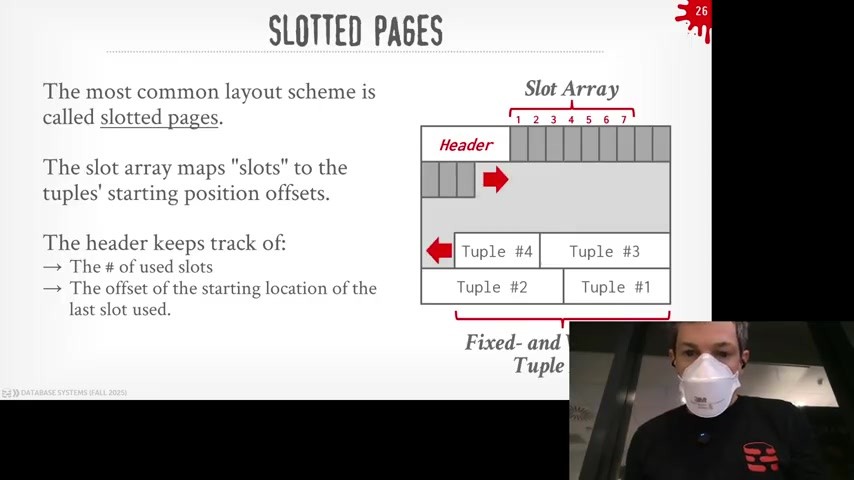

# L3 逐段整理译稿：数据库存储 I——文件、页与元组

## 00:00–00:25｜片头音乐

字幕标记音乐并带少量不完整歌词。没有可靠歌词依据，不翻译或补造。00:00–00:00.090 无字幕覆盖。

## 00:25–01:31｜录制情境与作业提醒

老师说自己本周不在校园，而在伦敦，随后以医院候诊室和同行者受伤的故事引入录制情境：等待时也要继续讲数据库。字幕包含昵称、药物和受伤经过，本稿将其保留为录像中的叙事／玩笑背景，不据此认定现实人物经历。

上一讲谈 SQL，这一讲开始讨论如何真正构建执行查询的系统。老师提醒 Project 0 和 Homework 1 都在即将到来的星期日截止，Project 0 是进入课程必须通过的门槛。这是录像当时的安排，不是面向今天学习者的新截止日期。

## 01:31–02:46｜从使用数据库转向实现数据库

我们已经从逻辑层面认识如何定义表、写 SQL，以及关系代数和关系模型怎样联系。接下来大部分学期不再停留在应用接口，而要回答：什么软件把这些查询跑起来？数据究竟存在哪里？

课程会逐层搭建组件并让它们协作，先理解单节点数据库，再在学期末讨论怎样扩展到多个节点。单独背会一个数据结构不够，要知道它在整个系统中负责什么。

## 02:46–04:25｜数据库是一组有接口的层

可以把数据库看成由多个层次组成的软件，各层通过定义清楚的 API 向上提供操作与保证。最底层的 disk manager 读写磁盘文件；上面的 buffer manager 把磁盘页带进内存，并把它们正确交给其他组件。访问方法帮助执行算子找到数据，执行算子运行查询；再上面是查询规划器和优化器，把 SQL 变成可执行的物理计划。

应用位于顶端，前两讲主要讨论这一端的关系模型和 SQL。现在反过来从栈底向上走。本讲先讲存储；下一讲讨论页进入内存后由谁管理，之后再回到存储层讨论替代布局。因此课程顺序不是把某一层所有问题一次讲完，而是配合项目需要来回连接。

> ASR 校订：`Buffalo manager`、`buffer bulb` 等按上下文统一为 buffer manager／buffer pool；不是另一个组件。

## 04:25–05:13｜今天的假设：行式、经典架构

今天先了解数据库面对的硬件，再看文件怎样分成页、页怎样分成元组。暂时采用 row-oriented 的视角：一条记录的属性作为一行组织在一起。

这是理解经典数据库架构的起点，之后会介绍更现代或面向不同工作负载的组织方式，包括换个方向存放数据。先掌握这一种，不代表所有数据库都只能这样实现。

## 05:13–06:22｜面向磁盘的架构究竟指什么

本课的基本架构是 disk-oriented：数据库的主要存放位置在非易失性存储上，例如 SSD 或网络存储。CPU 不能直接把磁盘上的字节当普通内存对象操作；必须先把相应数据读入 DRAM，执行读写，再由数据库在适当时机把修改写回非易失性存储。

后面讨论的组件和算法都建立在这个假设上。这里说“磁盘”并不只指旋转硬盘，也不表示每次修改都立即写盘。

> ASR 校订：字幕在这一段把 nonvolatile／volatile 混用，并将 von Neumann 识别为近似音。根据前后“掉电保留”和“DRAM 中操作”的明确说明分别译为非易失性／易失性存储，不把误识别当技术结论。

## 06:22–07:49｜存储层次与易失性边界

从 CPU 寄存器、缓存，到 DRAM，再到 SSD、硬盘和远程存储，越靠上通常越快、容量越小、单位容量价格越高；越靠下通常容量更大、访问更慢、单位容量更便宜。

老师在 DRAM 和 SSD 之间画出边界。上方的易失性存储在掉电后会失去内容，程序可按字节地址访问。实际 CPU 又以 cache line 搬运数据，因此“只取一个字节而完全不带入其他数据”不是硬件的完整描述；本课暂时把缓存细节抽象掉。

> ASR 校订：06:40 附近字幕一度说顶部“更便宜”，紧接着明确说寄存器昂贵且容量有限。本稿按完整语境整理为单位容量成本更高。

## 07:49–09:31｜非易失性不等于任意字节可直接访问

边界下方包括 SSD、旋转硬盘和 S3 一类网络存储。讲授以“写入并请求刷新后，断电回来还能看到数据”解释非易失性；机器烧毁等设备毁坏则是另一类问题，要依靠以后讨论的机制。

这一层按块访问。即使只需要某一个字节，也往往要读入包含它的整个块，课堂用 4 KB 作常见量级示例。想读的数据很小，并不意味着 I/O 也同样小。这种粒度差异会直接影响存储布局和算法。

磁带也在更慢的层次，主要用于归档；课堂提到 Amazon Glacier 作为归档场景。之后把这一类持久存储统称为 disk，重点不是具体介质品牌。

> 编者注：网络对象存储并非都暴露传统块设备接口；这里是课程的成本模型归类。持久性也须服从设备、系统调用和服务的真实契约，不能由“SSD”三个字推出每次写调用已经安全落盘。

## 09:31–10:21｜本课先关注内存与磁盘之间的移动

DRAM 在后文简称 memory；更靠近 CPU 的寄存器和缓存另作一层。本课会偶尔提及更高效的内存布局，但不会深入 cache locality 等高级课内容。当前核心问题是：数据是否在内存？如果不在，怎样在内存和磁盘之间搬运？

## 10:21–12:41｜把纳秒换成秒，看清延迟差距

传统算法课常假设一次内存访问的代价近似统一。数据库却必须关心不同存储层的访问时间。老师展示一张延迟量级表，提到 Jeff Dean 的版本及更早 Jim Gray 的相关讲解。

课堂给出 DRAM 大约 100 ns、SSD 高出几个数量级的示意数字；SSD 数值在字幕里有口头修正，不能当成精确基准。关键不是背数字，而是意识到一次磁盘读取可能远比内存运算昂贵。

老师用一种尺度变换帮助理解：把表中“纳秒”想成“秒”。缓存访问像走到旁边椅子上翻一页书，而最慢层次的等待可以被放大到几十年；课堂用去冥王星往返的夸张比喻说明这种差距。现实数据库通常不会让每条在线查询去读磁带，但 SSD、硬盘与网络存储的等待仍值得认真优化，不能让系统所有工作都停在那里等 I/O。

## 12:41–15:10｜随机 I/O、顺序 I/O 与写入批次

随机访问是在不同位置间跳跃；顺序访问则连续读取相邻区域，一次定位后带回更多数据。两者在真实硬件上的代价可能相差很大，尤其在旋转硬盘上；不能照搬算法课中“读取任何对象都一样快”的假设。

老师列出消费级 SSD 的粗略随机读取量级，并强调实际结果依赖读取量、线程数量等条件。顺序读取数值的 ASR 单位不清楚，本稿不复原一个看似精确的吞吐／延迟对比。设计目标是尽可能利用连续访问，减少零散读写；有些看似多做了一步的策略，放在 I/O 成本模型下才合理。

以 MySQL 为例，老师描述先把待刷出的脏页连续写入 doublewrite buffer，再在后台写到各自目的位置的方式，用它说明批量顺序写和随机写的安排可以分离。

> 编者注：这段是课堂的成本动机，不应推导为“doublewrite 只是提速”或“数据库提交只需写这个缓冲区”。本讲未展开其完整恢复协议，本文也未独立核对指定版本的 MySQL 实现。

## 15:10–16:52｜内存装不下整个数据库怎么办

目标是让系统管理比可用内存更大的数据库。例如只有 8 GB 内存，仍希望处理 16 GB、32 GB 或更大的数据。字幕先把后两个单位说成 KB，随即改回 GB；这里保留有意义的比较。

困难在于数据必须往返于磁盘和内存。我们希望重用已经读入的数据，审慎决定什么时候写回，允许多个查询交错执行，避免一次 I/O 让整个系统停顿。很多后续算法的选择都围绕降低这个代价。

但这种“好像有足够内存”的效果不是无限的：若同时运行的查询所需工作集远大于可用内存，系统仍会承受严重压力，不能凭一个抽象层消除物理容量限制。

## 16:52–18:47｜文件、页、目录与内存帧

把图具体化：数据库是磁盘上的文件。老师提到 SQLite、DuckDB 以单文件形式便于携带，多数系统可能使用多个文件。操作系统只把它们视作普通文件，真正赋予其中字节含义的是 DBMS。

文件被分成定长页。页目录记录有哪些页、去哪里找到它们，像数据库内部再维护一个小数据库。在内存中则有 buffer pool，也可能叫 buffer cache 或其他类似名称；其中可容纳磁盘页的位置称为 frame（帧）。

系统管理的不是把所有数据永久复制进内存，而是根据查询需要，把页装入帧并适时移出、写回。页是数据库的数据单位，帧是内存中承载页的位置，两者不可混为一谈。

## 18:47–20:14｜示例：执行器请求第 2 页

字幕出现候诊叫号“157”，老师回应不是在叫自己，然后继续。这里没有数据库问题或学生发言。

假设执行器要 page 2，而它尚未在内存。先取得页目录，确定该页所在文件及偏移，再把页读到内存。课堂先用单文件和可计算偏移简化；多个文件、目录乃至机器上的数据也需要某种定位信息。

读入后，buffer pool 返回指向内存页的指针，并保证调用者尚未结束使用时，不把这块内存替换成另一页。此层不必理解页中是哪些属性或元组；上层才负责解释字节内容。

## 20:14–21:29｜示例继续：更新页不等于立刻写盘

执行器解释布局并修改 page 2，然后表示使用结束。之后 buffer pool 在适当时候把这张 dirty page 写回磁盘，并需要与系统的安全恢复机制配合。

老师没有在本讲给出“安全写回”的完整算法。下一讲先讲 buffer pool manager，满足官方 Project 1 的基础需要；事务安全和故障恢复要到期中以后，执行引擎则在更后面的讲次。不要因为流程图画了一个回写箭头，就认为原子性和持久性已经实现。

## 21:29–22:01｜两个问题，今天先解决表示

第一个问题：数据库如何表示成磁盘文件？第二个问题：这些页怎样往返于磁盘和内存，并交给其他组件使用？本讲集中于前者，下一讲再进入后者。

## 22:01–24:38｜数据库文件格式和文件系统不是同一层

数据库文件对操作系统并不特殊，但其内部格式通常由对应数据库定义。不能拿 PostgreSQL 的数据文件直接交给 MySQL 或 Oracle，就指望对方理解其中字节。Parquet 一类公开规范的可移植格式是另一条路线，之后讨论列式存储时再讲。

多数数据库运行在现成的文件系统之上，无需自己实现文件系统。老师回顾早年部分系统直接管理裸块设备的做法，并以 Oracle ASM、Teradata 一类企业系统说明定制存储管理的可能性：通过数据库更了解的数据布局来替代或接管通用层的一部分工作。

这样做需要很大的工程投入。老师提到过去研究中约 15% 的性能收益，但没有在字幕中给出可核实的论文定位或测试条件；它是课堂历史举例，不是任何工作负载上的保证。

> ASR 校订：文件系统名称中 `WinfS` 无法仅凭字幕确认，不据此补成特定产品；POSIX 等可由上下文确认的术语采用标准拼写。这里不把课堂对 ASM 的高层比喻写成完整产品接口说明。

## 24:38–26:07｜storage manager 负责什么

底层组件常称 storage manager 或 disk manager，负责磁盘读写、页的追踪和空间管理。系统可以借助操作系统，但更高性能的实现通常希望自行决定 I/O 调度和放置策略，而不是把全部决策交给通用 OS。

文件通常切成固定大小的页。有的系统允许不同表使用不同页大小；老师举 IBM Db2 为例，但对同一个相关文件集合仍需一致解释其页布局。字幕又出现一次候诊叫号，之后继续讲解。

上层提出“我要存这么多字节”的请求时，storage manager 需要知道哪里还有空间，可以把新数据安置在哪里。

## 26:07–27:14｜复制不是本图中 storage manager 的职责

在当前单节点、单副本的简化模型中，storage manager 不是每写一个页就负责生成多个物理副本。相同逻辑内容可能既出现在数据文件中又出现在日志中，但那不等于此层对每个页做副本复制。

冗余可以发生在更低层，如 RAID、存储设备或对象存储服务；也可以发生在更高层，由数据库的复制逻辑把数据传播到多个节点。先明确层次职责，再谈容灾，不要在这张基础图里混入所有机制。

## 27:14–29:10｜页里可以放什么，page ID 又代表什么

页是定长数据块，既可容纳表中的元组，也可容纳索引、目录、catalog 等元数据。页目录本身也要存储，因而也可以由页组成。不同系统组织文件的方法不同；课堂强调通常不会任意把互不相关的表／索引内容混杂起来。

有的系统要求页包含足够自描述的信息，帮助故障后辨认它属于什么对象。老师以 Oracle 的恢复需求说明这一取舍：多放元数据要花空间，但可能减少恢复时的依赖。

每页有 page ID。其唯一性范围可能是数据库实例、某个数据库或某张表，取决于实现。ID 可以直接对应文件偏移，也可以是逻辑编号，再经页目录映射到物理位置；“有编号”不意味着“编号就是绝对字节地址”。

## 29:10–31:15｜三个不同的“页”与部分写入

老师区分硬件写入单位、操作系统页和数据库页。课堂用 4 KB 作为硬件原子写单位的假设：如果数据库想写 8 KB，而硬件只能保证每个 4 KB 单位原子写，那么不能推出两个单位会一起成功或一起失败。

OS 也有自己的页大小，Linux 常见基页为 4 KB，还可能使用更大的 huge pages。数据库则可以再定义自己的页大小。设计必须考虑这些粒度之间的映射；要写出大于底层原子保证的范围时，需要额外步骤才能安全地向外界报告完成。

> 编者注：字幕中“硬件页总是 4 KB”是过强表述，不能作为所有设备的事实。硬件扇区、写入原子性、虚拟内存页与 DB page 是不同契约；扇区大小也不自动证明断电原子写保证。本段保存的是教学假设下的部分写入问题，不是设备选型指南。

## 31:15–33:54｜选择页大小是在选择读写代价

老师列举多种系统的页大小：SQLite 常见 4 KB，可配置更小；SQL Server、PostgreSQL 常见 8 KB，MySQL／InnoDB 的典型例子是 16 KB。字幕还涉及 Oracle、Db2、RocksDB 和 WiredTiger 的数字；这些系统配置、块类型和版本不同，不能把口头列表当成统一规格表。

真正的选择取决于硬件、表宽、字段类型和工作负载。经常做大范围扫描时，较大的页能在一次读取中带入更多有用数据；若每次只更新小字段，页过大可能意味着修改一个字节也要付出较大的页写回代价。

本课先使用大约 4–16 KB 的经典页量级讨论行存；后面再看读密集、列式场景。ASR 把这一范围识别成了 `46`、`40 16`，此处依据前后多次对照整理，不解释为 46 KB。

## 33:54–35:16｜文件组织方式不止堆文件

页可以按不同结构组织。今天采用 heap file：没有依赖键顺序的页集合。也可以用树结构，沿树寻找所需页；还可以用哈希组织。老师简要提到较早的顺序／ISAM 组织，但不在此展开。

接下来先讨论怎样找到页，不必立刻知道页内所有元组的格式。页的组织和页内的数据组织是两个可分开的设计问题。

> ASR 校订：反复出现的 `heat file` 指 heap file（堆文件），不是“热文件”，也不是程序内存分配器里的 heap。

## 35:16–37:48｜heap file 的接口与偏移计算

堆文件是一组无指定逻辑顺序的页。关系模型不要求数据按某种物理行序保存，因此有空间的地方就可以放元组。底层必须能创建页、按 ID 取得页，并枚举某张表或某个索引的全部页，支持扫描和之后的索引访问。

还需要空间元数据：页里可能有空隙，不能因为单个元组不到一页就为它单独占满一个页。系统要尽量复用空闲空间，避免文件无谓膨胀。

对于一个文件、固定页大小的简化布局，知道起点、页号和页大小，就能算出 page 2 的偏移。若数据库跨多个文件，找 page 23 时先通过目录确定文件，再计算文件内偏移。不同实现的目录不一样，但“先定位容器，再定位页”是这里的高层模型。

## 37:48–40:07｜页目录也是需要恢复的数据

目录可按数据库、表、索引等对象组织，记录文件、目录或网络位置以及页定位信息。它是“数据库里面的数据库”，不能假设自己天然不会损坏。

分配新页时，目录要反映新的状态。内存中的目录必须与运行中的数据结构保持一致；磁盘上的持久状态还涉及崩溃恢复。有些系统能利用数据页里足够的元数据重建损坏的目录，但恢复会更慢。因此是否立即持久化某些可重建信息，是运行期开销和恢复时间之间的取舍，不是可以任意丢失元数据。

目录还可维护空闲容量、完全空页，以及页装的是表元数据、索引还是用户元组等信息，帮助快速定位合适空间。

## 40:07–42:20｜页头不是装饰，而是解释与安全信息

从文件层转入页内部，首先看到 header。可能记录页大小、checksum、写入它的软件／布局版本等。升级软件并改变页格式时，需要知道眼前页应按哪种格式解释。

页头还可能包含事务可见性、压缩编码、对象或模式信息。老师继续用自描述页说明恢复时识别表和内容的价值。页上也可以带摘要或 sketch：例如记录本页是否可能包含名字 Andy；若摘要能确定计数为零，就不用扫描本页所有元组。

checksum 的作用是帮助发现读回的页是否已经损坏，不仅崩溃恢复才有用，普通读取也可能遇到损坏。不同系统的保护能力不同。本讲先认识这些字段存在，不提前讲完整事务协议或摘要算法。

> 编者注：检测损坏不等于能够修复；“页头带 schema”也不是每种数据库的必备布局，很多系统通过 catalog 与对象标识取得解释所需信息。

## 42:20–44:11｜当前只讨论一条元组在一页内的行存

先不处理索引页，假设每条元组的属性连续放在一起，并且整条元组可以放进一个页。过大的属性稍后再处理。

老师区分 tuple-oriented、log-structured 和 index-organized 等组织思路。日志结构可以保存修改产生的新内容／增量及多个版本；索引组织把数据放入树形组织。它们将在后续讲次展开。这里暂时只看一份完整元组如何放在页里，不把这个假设推广成所有事务系统都只有单一行版本。

## 44:11–45:48｜为什么“顺着数组追加”不够

先设所有元组等长，在页头记元组数量，然后连续追加。查第几个元组时可以做简单偏移计算，看起来很方便。

但删除中间的 tuple 2 后，剩下两条不等于下一个空位置就在“数量 × 长度”的地方，否则可能覆盖 tuple 3。逐次扫描找空位又增加工作。如果把 tuple 3 搬过来填洞，保存其原物理地址的索引或其他结构也需要更新。

变长元组进一步破坏定长算术：总空闲空间即使足够，也可能被分成几个放不下新元组的小洞。为了整理空间而搬动数据，若每次都要通知全系统，代价就太高。

## 45:48–47:33｜slotted page：给位置再加一层间接寻址

常见解决方法是 slotted page。页头后面放 slot array，每个槽项保存某条元组在页内的起点偏移；实际的定长或变长元组字节从页的另一端开始存放。槽项的具体字段、在页首还是页尾，各系统可不同，但间接寻址的思路相同。

插入新元组时，槽数组向一个方向增长，元组区向反方向增长，中间是可用空间。两边接近到无法容纳下一条元组及必要元数据时，这一页对该次插入就满了。不保证每个字节恰好被用完：变长数据可能不能刚好填满剩余区域。

真实录像截帧，约 **47:11**，来自仅获取的 47:10–47:12 视频轨片段。画面可见页头、编号槽数组、相向增长的箭头与 Tuple #1–#4；右下角是授课者画面。截图仅用于本译稿，未以幻灯片原件或生成图片替代。文字说明按可见画面和该段字幕核对；并未听核音轨。

## 47:33–49:29｜删除与压缩只改变页内映射

若删除 tuple 3，可以先保留空洞，期待之后有合适的新元组填进去；也可以把 tuple 4 移动过去，让数据区重新紧凑。关键是 tuple 4 对外仍由同一个槽号识别，只需修改对应槽项中的偏移。

这样，页内搬动的影响限制在当前页，不需要逐一改写指向它的外部索引。字幕中又插入候诊叫号，之后老师回到同一个论点：磁盘 I/O 相比内存内搬字节很贵，既然已经把页读进内存，就有空间考虑整理布局。

各系统何时压缩、是否每次更新时压缩并不相同。老师口头以 PostgreSQL 和 SQL Server 对照，但未展开具体版本和触发条件；重点是这个间接层给了实现选择，而不是所有数据库都执行同一套整理策略。

> 编者注：这里稳定的是**页内槽身份**，不是“任何跨页搬迁都保持地址不变”。页内移动也必须服从并发和版本管理规则，不能把“相对 I/O 便宜”理解为可以随意移动活跃读者引用的字节。

## 49:29–51:34｜RID：一条记录怎样被内部结构定位

接下来需要用 record ID、tuple ID 或 row ID 标识记录的位置。老师先口误提到 page ID，随即纠正；页的编号不是记录的完整编号。

一个例子是 `(file ID, page ID, slot number)`。索引等内部组件保存这种定位信息，就能找到页，再经槽定位元组。很多实现不在元组本体里额外重复存储自己的完整位置，而是在读取时根据所在位置构造这个标识。

老师列举 Ingres 的 TID 和 PostgreSQL 的 `ctid`，后者可理解为页号与页内项号组成的位置标识；随后谈 SQLite 的 `rowid`：它是存储结构用来找记录的整数键，即使用户没有显式声明业务主键，也能识别记录。

> 编者注（独立文档核对）：SQLite 的 rowid 不是 PostgreSQL `ctid` 那样的页／槽物理地址。这里的说法只适用于 rowid table；`WITHOUT ROWID` 是明确例外，`INTEGER PRIMARY KEY` 可以成为 rowid 的别名。也不能把普通自动分配说成永不复用的严格单调序列。详见资料页，而非用同一个术语抹去产品差异。

## 51:34–52:32｜能在 SQL 中看到，不代表可以当业务主键

老师说这些内部标识有时通过 SQL 接口暴露，提到可能稍后补一个演示；当前字幕没有提供可辨认的实际演示步骤，因此本稿不补造查询或输出。

应用不应依赖会随物理重组而变化的记录位置。关系模型不要求行保持物理顺序，系统为了整理空间可以移动数据，逻辑结果依然正确。内部地址改变与业务实体身份改变是两件事。

> 编者注：PostgreSQL 17 文档具体指出 `ctid` 标识行版本，更新或 `VACUUM FULL` 搬迁都可使其变化；应用应使用逻辑主键。这并不否定上一段 slotted page 对**页内移动**的局部稳定性。

## 52:32–54:48｜元组也是带头部的字节数组

现在进入页内的元组。它首先是一串字节，也有自己的 header，记录 NULL 位图、事务可见性等信息。通常不会在每一行重新存一份完整 schema；系统通过 catalog、所属表及页的相关元数据知道如何解释各字段。

元组头后面是属性数据。常见做法按建表时的属性顺序存放；为了满足对齐要求可能插入 padding。老师先用一张包含整数、double、float 等字段的表说明：逻辑列必须对应到某段物理字节，不能仅凭字节本身知道它是什么类型。53:50 附近字幕标记短音乐，本稿不据此补出内容。

## 54:48–56:00｜从页号一路找到属性

课堂给出一个易于计算的例子：32 位元组头、32 位 ID 和 64 位大整数，合计 128 位。找到该元组时先用槽数组获得页内偏移，再越过头部和前面的字段，定位所需属性。

之后按预定类型解释那些字节，老师用 C++ 的 `reinterpret_cast` 作直观类比，说明这不是把每个字段重新解析成文本再读取。类型信息指导后续操作如何理解这段值。

> 编者注：这是布局教学，不是允许对任意文件字节直接做 C++ 强制转换的代码规范。真实实现仍要处理对齐、对象生命周期、别名规则、字节序和格式校验；一个 cast 本身不会替系统解决这些问题。

## 56:00–58:31｜对齐、填充与物理列重排

麻烦在于字段宽度不总是刚好配合机器字边界。课堂暂按 64 位字讨论：32 位整数之后紧接 64 位时间戳，时间戳可能跨越边界；再加较短的字符字段和邮编，布局更复杂。某些架构访问未对齐数据会更贵，某些情况下甚至不能按预想方式访问。

最直接的办法是 padding：在 32 位整数后补 32 位空位，让下一个 64 位字段从合适边界开始。读取整数只解释其自己的 32 位，不把填充也当数据。这样浪费空间，但使布局简单可靠。

另一种办法是重排物理属性，把能拼合的字段放在一起，逻辑上仍按建表定义暴露。系统只需保存逻辑属性到物理位置的映射。老师说自己主要在研究文献里见过这种方案，没有在此确认具体产品；即使重排，元组末尾也可能要补齐，保证下一条元组的起点满足要求。

## 58:31–1:00:44｜整数、浮点、字符串的物理表示

整数常用与 C／C++ 原生类型相近的二进制表示，具体位宽由类型决定；跨硬件还要关心 endianness（字节序）。课堂先以 x86 的环境简化，不深入迁移文件时的转换。

浮点一般采用 IEEE 754；`NUMERIC`／`DECIMAL` 则可能使用数据库特定表示。变长字符串、文本和 BLOB 可以在元组内放“长度＋内容”，也可以放指向其他位置的引用：较小值倾向内联，大值转到溢出存储。

> ASR 校订：`NDNS`、`Indian` 按语境为 endianness／endian；`I 754`、`I74` 为 IEEE 754。
>
> 编者注（明确纠错）：58:31–59:48 的字幕把 SQLite 描述为“全都存字符串以避免字节序问题”，这不能当作准确实现。SQLite 官方文档列出 NULL、INTEGER、REAL、TEXT、BLOB 五类存储值，整数和浮点有二进制编码。此处不是自动替换成老师说了正确的话，而是将字幕中的说法与独立核对的事实分开。

## 1:00:44–1:02:22｜文本排序与时间戳也有语义

字符串并非只是一串英语 ASCII 字符。不同语言有不同的排序规则，系统可能涉及 UTF-8、UTF-16 等编码；字节如何存储和字符串如何比较是不同层面的问题。课堂在这里提醒注意 collation，将具体排序问题留到之后。

日期和时间戳常以某个 epoch 起的毫秒／微秒等整数计数表示，也有系统自己的内部格式；时区是否保存、怎样解释都依系统而定。接下来老师重点比较近似浮点和精确十进制，说明数据库有时必须用额外软件工作来获得所需语义，而不能只追求硬件计算速度。

## 1:02:22–1:04:09｜0.1＋0.2 的显示值和存储值

`float`、`double` 使用硬件支持的浮点格式，有快速指令可以操作，但不能精确表示所有十进制数。课堂以 C 代码中 `x=0.1`、`y=0.2` 为例，比较 `x+y` 和直接写出的 `0.3`。

打印较少小数位时，两者看起来都是 0.3；提高输出位数后，就能看到不完全相同的近似值，而且不能简单说这些位恰好等于数学上的十进制 0.3。把这样的值写盘再读回，并不会自动消除它原本的近似误差。若应用对数值语义有明确要求，单靠显示格式隐藏尾数差异不是解决办法。

> 编者注：打印更多位是暴露已存在的表示差异，不是打印操作把存储值变坏；课堂所称 variable precision 是其对浮点的对照用语，不表示一个固定 `double` 对象能任意增加有效位数。

## 1:04:09–1:05:23｜精确十进制需要额外元数据和算法

数据库可以为数值保存十进制数字及小数位置、scale 等元数据，在软件层解释和运算，从而满足声明的精度语义。这类类型常称 fixed-point decimal，SQL 中常见名字为 `NUMERIC` 或 `DECIMAL`。

老师用银行利息和对误差敏感的计算说明动机：不能因为硬件加法快，就忽略数据所需的精度。正确实现这些数值类型并不轻松，需要考虑边界情况。

> 编者注：十进制类型也有精度、scale、溢出和舍入规则，不意味着所有运算永远精确；例如有限位数不能无损表示所有除法结果。科学计算也不因此一律禁止浮点，要由误差模型决定。

## 1:05:23–1:06:57｜PostgreSQL NUMERIC 的代码示例

老师展示 PostgreSQL 数值实现中的结构体：元数据描述数值，数字内容放在一个数组中，再由代码解释。这里不是只保存一个能交给 CPU 单条加法指令的普通寄存器值。

两个 NUMERIC 相加时，代码还要处理正负、特殊值等情况。课堂展示多处分支，说明“加两个数”的软件路径可以明显多于原生浮点加法；额外工作换来的是类型承诺的语义。字幕没有足够可靠的逐行源码，本稿不伪造结构体字段或把它当成已独立精读的当前源码。

## 1:06:57–1:09:41｜NULL 的三种表示方法

第一种是在元组头里放 NULL bitmap，用位标记各属性是否为 NULL。课堂把它作为行存中最常见、易于解释的办法，并讨论为列保留相应位置以简化访问。具体是否省略不需要的位图依产品而定。

第二种是在类型的取值域中保留特殊值。例如把某个最小有符号整数值当 NULL，就不再允许用户把它作为普通数据插入。好处是不必单独加相同的元数据，代价是损失一个合法取值；老师说列存和一些内存数据库会考虑这类办法。

第三种是在每个字段前放一个 NULL 标志。逻辑上只需一位，但若逐字段按字节安排，32 位整数再加一个字节就占 40 位，还会引出对齐问题。老师把它列出来是为了展示可能方案，而非推荐；他认为应优先考虑前两类。最后提到研究组关于列存 NULL 表示的论文及高级课会进一步阅读，但此处未提供论文全文或完整论证。

> 编者注：课堂的“行存选第一、列存选第二”是概括性建议，不是所有系统的定理。NULL 的物理编码也不能改变 SQL 中未知值的逻辑语义，更不能擅自把库存 0 当 NULL。

## 1:09:41–1:11:17｜大属性与 overflow pages

前面假设元组能放进一个页，现在考虑属性本身就超过页大小的情况。可以把大值放到另外的 overflow pages，在原元组里只留下长度和定位信息。扫描元组时识别这种引用，需要完整值再去取对应内容。

课堂例子是表里的 `contents` 字段很大，原元组保留数据大小以及页号／偏移一类引用。不同数据库触发溢出的阈值不同，老师提到 PostgreSQL 的约 2 KB 与其他产品按页大小比例处理的例子，但不应把这些口头阈值视为每个字段的无条件规则。

> 编者注（PostgreSQL 17 核对）：TOAST 通常在**待存行**超过约 2 KB 阈值时尝试压缩和／或移出字段，目标也受存储策略影响；并非“任何超过 2 KB 的字段立即原样放一个溢出页”。这是概念图与具体产品之间的重要差别。

## 1:11:17–1:12:32｜压缩、前缀与大值链

为了减少读取溢出数据的代价，可以对大值压缩，老师提到 Snappy、gzip，具体压缩技术留到后续。

另一种思路是 German strings：除长度和引用外，在原元组中保留字符串前缀。若查询只想判断 `contents` 是否以 Andy 开头，先检查前缀就可能排除不匹配记录，不必追随引用去读完整大值。用少量额外元组空间，换取某些查询避免一次额外 I/O。

如果大值连一个溢出页也放不下，可以再保存指向后续页的引用，把多个页串起来恢复完整值。这里画的是通用概念链；不是说所有产品都用相同链表格式。

## 1:12:32–1:14:28｜外部大值与责任边界

还可以把很大的对象放在数据库管理范围之外，例如一部 20 GB 电影。表中保存 URI 或引用，需要时读取外部内容并交给查询。这样对象仍可被业务记录关联，却不一定由数据库承担其所有维护职责。

老师举 Oracle BFILE 和 Microsoft FILESTREAM 作为相关产品名，并讨论外部内容的持久性、事务安全不能笼统从普通数据页的承诺推过去。本稿保留这种责任边界提醒，但不把这些产品视为拥有完全相同的事务能力；此处未独立核对两者的具体接口。

老师又提到 Jim Gray 等人二十多年前关于大对象应放在数据库内还是外部的研究，凭记忆说出约 128 KB 的分界，同时明确表示不确定今天是否仍成立。这里只保留研究问题和当时的保留态度，不把记忆中的数字当论文结论。大对象放到更便宜的外部存储，可能降低成本，但需要有人负责额外的一致性问题。

## 1:14:28–1:15:48｜回顾：把布局细节留在合适的层

老师回到录制情境，说要去查看同行者的情况，随后回顾：数据库由持久存储上的页构成，页可以分布在一个或多个文件中；目录帮助找页，页内又有元组布局。字幕有一次候诊叫号，老师简单回应后继续。

分层架构的目标是让上层不必处处知道底下是否采用某种 slotted page 布局。只要接口承诺保持，就有机会替换、扩展或改进实现而不破坏整个系统。这个目标不是永远自动成立：抽象也可能带来开销，有时需要放宽限制或让层次协作，之后会继续讨论。

## 1:15:48–1:16:25｜下一讲：谁管理内存中的页

今天回答文件和磁盘上的表示。下一讲讨论页进入内存后怎样追踪、怎样交给其他组件，以及何时写回。之后再回到其他磁盘组织方式。先讲 buffer manager，是因为学习者要用这些知识完成随后发布的官方 Project 1；这不是当前制作批次 P1 的同义词。

## 1:16:25–1:17:02｜片尾音乐与字幕结束

技术讲授结束，字幕包含零散歌词和音乐标记，不补造或翻译无法可靠辨认的歌词。最后字幕事件覆盖至 **1:16:57.619**，距离元数据片长还有 **4.381 秒**；该段没有字幕不能据此称为静音，也未做听音核对。

## 来源、许可与核验范围

本讲对应 Fall 2025 课表 **2025-09-03，No In-Class Lecture（无现场授课）**。官方录像上传于 2025-09-04，时长 **1:17:02**；本稿不将其称为 9 月 3 日校园现场课。

依据完整顺序阅读的 2108 条英文自动字幕整理，合并口头重复，不声称逐字译文或逐句听音核对。本稿时间块连续覆盖全片；块内字幕缺口不等于静音。课堂含候诊广播和录制情境玩笑，不是学生问答；可辨认的技术设问、例子和回答均随原顺序保留。**ASR 校订**只处理可由上下文辨识的术语；**编者注**是额外技术限定，不冒充原话。

**来源、署名与修改**：Andy Pavlo／CMU Database Group，*#03 — Database Storage: Files, Pages, Tuples*，CMU 15-445/645 Fall 2025。原片入口由本页课程头信息提供；本讲单视频元数据明确标记 Creative Commons Attribution（reuse allowed），按 [CC BY 3.0](https://creativecommons.org/licenses/by/3.0/) 署名使用。制作修改包括中文逐段整理、合并口头重复、ASR 术语校订、明确标识的技术纠错与一张有限片段截帧。许可不外推到教材、独立 PDF 或第三方音乐，未再利用歌词。

**覆盖与核验边界**：已完整顺序阅读 2108 条规范化字幕。字幕区间并集为 **4600.357 秒**；首段缺口 0.090 秒、末段 4.381 秒，另有 13 个内部缺口合计 17.172 秒。时间标题是按话题整理的近似边界，并不证明每个时间点都有字幕。原始 ASR 保持独立存档，缺口与区间记录在本地 coverage.json。音画仅核对约 47:11 的截图；没有听核全片或该片段音轨。独立产品纠错依据见资料页，本稿没有把未读教材或未读源码冒充精读来源。
