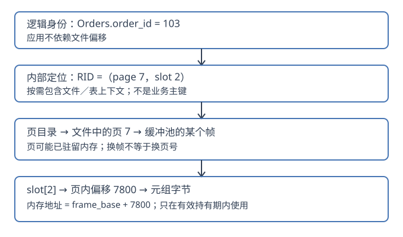
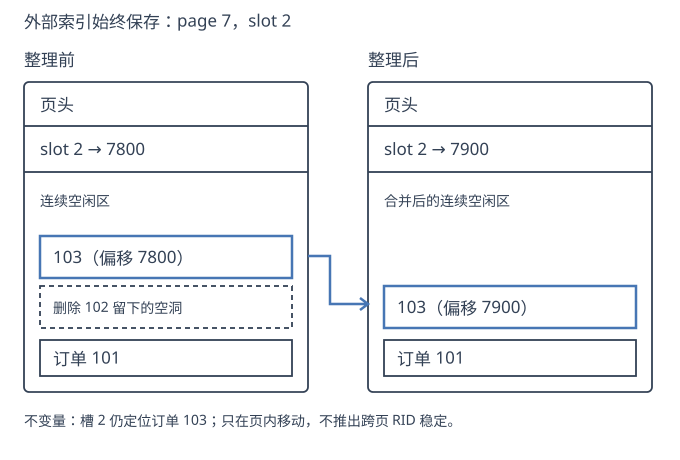

# L3 学习笔记：让数据搬家，而不让每个引用跟着搬家

本讲的主线不是“数据库有文件、页、元组”这张名词表，而是三个设计问题：**一次访问究竟搬多少数据？谁负责把逻辑对象映射到字节？整理空间时，哪些身份必须保持不变？**

## 1. 为什么“只改一个整数”仍可能很贵

假设 `Stock(sku, available)` 中 A 的库存从 3 改成 1。业务层只改变一个值；存储层却面对三种粒度：

| 层次 | 我们操作的是什么 | 不能擅自推导的保证 |
|---|---|---|
| 属性／元组 | 一个库存值、一条 Stock 行 | 一个字段大小不等于一次 I/O 大小 |
| 数据库页 | 装有多条记录和元数据的定长块 | DB 页大小不等于硬件原子写大小 |
| 内存帧 | buffer pool 中承载某页的空间 | 获得指针不等于可以无限期保存它 |

### 从请求走到字节

若相关页不在内存，需要先定位文件和页，把页读入帧，再通过槽和属性布局找到库存值。更新后该页变脏，但何时写回、怎样在故障后恢复，是另一组协议。

课堂假设的页式读写模型下，若 4 字节的库存更新最终造成一张 8192 字节页写回，单看页的写回量，放大倍数是：

$$
8192 / 4 = 2048
$$

这是**隔离一个因素的纸面模型**，不是实测，也不包括日志、设备内部写放大、合并多次修改和缓存命中。反过来，一次读页若能为很多订单／库存操作复用，平均代价就会降低。

**反例：更大页永远更好。** 大范围顺序扫描可能让大页的额外数据都派上用场；只更新一个短字段却可能被迫搬更多无关字节。页大小要配合访问模式，不能只看吞吐量或“页数变少”。

**再一个反例：8 KB 页调用了一次 write，所以必定全有或全无。** 系统调用次数不等于断电原子单位。若底层仅对更小单位给出保证，崩溃可能留下部分新、部分旧的数据。checksum 可帮助发现问题，但不自己提供修复来源。

原讲定位：05:13–16:52、29:10–33:54。课堂的“硬件页 4 KB”是教学假设，不是所有 SSD／硬盘的普适契约；S3 也不能简单当成普通块设备。

## 2. 一条订单的四种“位置”不能互相替代

设业务记录为 `Orders(103, 'A', 1)`，这里 `103` 是订单号。

图：编者原创，展示课堂的间接寻址思想。箭头表示一种可能的定位路径，不意味着每次访问都一定先查索引或先读磁盘。

1. **业务主键** `order_id=103`：应用识别订单的逻辑身份。
2. **RID**，例如 `(page=7, slot=2)`：当前布局中定位记录的内部引用；若页号只在某文件／表内唯一，还要包含对应上下文。
3. **页内偏移**，例如 `slot[2].offset=7800`：元组字节在当前页的开始位置。
4. **内存地址** `frame_base+7800`：这一页此刻在某个 buffer frame 内的地址。

只要页被换到另一个帧，第 4 项就可能改变，而持久化文件中的 RID 并不会因此改变。若在同一页内整理元组，偏移可改变而槽号不变。若跨页迁移或产生新行版本，RID 又可能改变，但订单仍是 103。

**不变量**：每一层暴露的标识必须在自己的有效范围内仍能解析到约定对象。稳定范围不是越长越好，而是必须写清楚：一次持有期间、页内整理期间，还是业务实体整个生命周期？

### 产品差异：名字类似不意味着语义相同

- 本讲通用 RID 例子是页／槽定位；并非所有系统都用同一字节宽度和元组格式。
- PostgreSQL 17 的 `ctid` 是**行版本在表内的物理位置**，更新或 `VACUUM FULL` 可改变它。不要把它拿去做订单外键。
- SQLite rowid table 的 `rowid` 是底层 B-tree 的整数访问键，不是 `(page, slot)`。`INTEGER PRIMARY KEY` 可以是其别名；`WITHOUT ROWID` 表不采用该机制。没有对应别名时，`VACUUM` 可能改变 rowid。

产品差异来自独立核对的官方文档，不是用字幕中的一句“row ID”替所有系统下定义。原讲定位：18:47–21:29、49:29–52:32。

## 3. 为什么槽数组值得占用额外空间

### 从一个坏方案开始

用一个数组顺序摆放三条 Orders 记录，仅在页头记录 `count=3`。删掉中间一条后，计数变成 2，但第二个空位和末尾位置已经不是一回事。

你有两个不理想的选择：

- 留洞：之后查找可用空间可能要扫描，变长记录又不一定放得下。
- 搬移末尾记录填洞：所有记录着旧字节地址的索引或内部结构都可能需要改。

问题不只是“删除难”，而是**外界观察到了本应属于页内部的布局细节**。

### 加一层间接寻址

槽数组把外部稳定引用变成 `slot number`，槽项再指向实际字节。删除或压缩时，只要保持活跃槽的身份，就能局部更新偏移。

图：原创示意，不按字节比例，也不是某数据库的真实页格式。删除 102 后，103 的槽号保持 2；其偏移由 7800 改为 7900。空槽能否立即复用还受并发、版本与引用生命周期约束。

### 写下足够精确的不变量

在一个没有并发、没有旧版本、没有溢出指针的简化页模型中：

- 每个活跃槽都对应合法的元组范围；范围位于页边界以内。
- 活跃元组的存储区不能互相重叠，也不能覆盖页头和槽目录。
- 页内压缩不能随意改变外界正在使用的活跃槽编号。
- 更新槽偏移后，读取同一个槽应得到同一条逻辑记录的字节。
- 删除槽、空槽和活跃槽必须能区分；“元组计数”本身不足以描述这些状态。

**边界**：这组不变量不解决并发同步、MVCC、崩溃原子性；它们是后续层的必要问题，而不是让本讲偷偷实现一个完整存储引擎。

### 一次插入需要多少空间

设页大小为 $P$，固定页头为 $H$，新建槽项占 $s$，已有 $n$ 个槽，所有元组和必要填充总计 $T$。连续空闲空间的简化上界为：

$$
F = P-H-ns-T
$$

若新元组占 $t$ 字节且需要新槽，要求 $F\ge t+s$；若允许复用空槽，条件可能只需 $F\ge t$。存在离散空洞时，**总空闲量**和**可立即使用的连续空闲量**还不一样，需要先整理或另找位置。

原创算例：$P=8192$、$H=32$、$s=4$，每条元组连填充占 100 字节。忽略其他开销，页最多容纳：

$$
\left\lfloor\frac{8192-32}{100+4}\right\rfloor=78
$$

第 79 条并非“只差一点就能塞”，因为槽项也要空间。实际产品的头部、事务元数据、对齐及保留空间都可能使容量不同。原讲定位：44:11–49:29。

## 4. 页目录、槽目录、NULL 位图回答三个不同问题

| 结构 | 回答的问题 | 不能代替什么 |
|---|---|---|
| 页目录／空间元数据 | 页在哪里？哪里还有可用空间？ | 不自动解释每个字段 |
| 页内槽数组 | 给定槽号，元组字节从哪里开始？ | 不等于业务主键索引 |
| 元组头／NULL 位图 | 哪些属性不存在普通值？如何解释本行元数据？ | 不负责查找整张表有哪些页 |
| catalog／schema | 这张表有哪些列、每列如何解释？ | 不是每个元组都复制一份建表语句 |

索引也可能保存页号、槽号，但“槽数组”不是 SQL 意义上的业务索引。页目录也不保证是一个文件开头永远单页大小的数组；课堂用简单图说明职责，不规定所有产品的数据结构。

**恢复反例**：新页已经分配，页目录却仍指向旧集合。如果系统没有恢复协议或足够的重建元数据，就可能无法找到新页。可重建并不等于随时可以忽略一致性；它通常意味着把一部分运行期开销换成恢复扫描时间。

原讲定位：24:38–29:10、35:16–42:20、52:32–54:48。

## 5. 元组布局必须同时服务逻辑解释与机器访问

为 Orders 增加 `created_at`，把 32 位订单号后面直接跟 64 位时间戳，不保证时间戳满足目标架构的对齐要求。可以插入 padding，也可以在物理层重新安排字段并保留映射。

**关键区分**：逻辑列顺序由模式暴露；物理字节顺序由存储格式定义。物理顺序不必永久等于建表文本顺序，但任何访问路径都必须使用同一解释规则。

不要把课堂的 `reinterpret_cast` 类比当作可提交代码。一个类型转换不负责建立合法的对象生命周期、修复未对齐地址、处理跨平台字节序或检查损坏的长度字段。持久化格式也不应未经约定就直接等同某编译器生成的结构体内存布局。

### NULL 不能偷用一个仍有业务意义的值

对于 `Stock.available`，0 代表“知道没有库存”，NULL 代表“数量未知／缺失”。如果把 0 用作 NULL 哨兵，就失去了表达正常零库存的能力。

位图额外占元数据，但能保留完整取值域；保留一个特殊值可减少部分元数据，却必须明确禁止该值作为普通数据。逐字段添加一字节标志又可能增加对齐和空间开销。不能先决定“省一个位图”，再让业务语义迁就错误编码。

### “能显示 0.30”不证明存的是精确 0.30

为 Orders 增加金额字段时，应先决定金额单位、精度和舍入政策，再选类型。二进制浮点中的 `0.1+0.2` 可能与字面 `0.3` 的近似值不同，显示少量小数会掩盖差别。精确十进制类型则需要额外元数据和运算代码，但也有声明精度和舍入边界。

SQLite 需要特别小心：它不是把所有值都存成字符串，`DECIMAL` 之类声明在普通表中也不能直接套用 PostgreSQL NUMERIC 的语义。资料页给出经过阅读的文档定位。

原讲定位：54:48–1:09:41。

## 6. 大字段不应强迫每次小查询读取大对象

设 `Orders` 中保存发票正文 `invoice_text`。查询只需要 `order_id` 和 `qty` 时，如果每条元组都塞入很长正文，内存页容纳的订单数就下降，扫描和缓存利用都会受影响。

**溢出存储**把大值移到 DBMS 管理的其他页／结构，主元组只留下小引用。优势不只是“终于能存下”，也包括无需读取正文的查询可以保持主行紧凑。代价是获取正文时的额外定位、I/O 和解压工作。

**前缀优化的正确用法**：主元组保留前几个字符。若查询要求以 `INV-` 开头，而前缀已明确不同，就能排除。若前缀相同，不能据此认定完整字符串相同；仍要按谓词需要比较后续内容。短摘要应只在逻辑上足够时提前作答。

**外部对象存储是另一个边界**。表里保存发票文件 URI，不代表数据库事务会自动原子地更新远端文件。要问：对象丢失谁发现？删除订单后何时删文件？数据库备份是否包含对象？这些问题不能由一个 URI 字段解决。

PostgreSQL 的 TOAST 是数据库内部的大值机制，不等同“应用自己存一个外部 URL”；其 `EXTERNAL` 存储策略名称也不是“交给数据库外的文件”。具体区别见资料页。原讲定位：1:09:41–1:14:28。

## 7. 全片时间索引

边界按自动字幕话题转换近似划分，不是逐帧测量；字幕内部缺口不推定静音。此表覆盖 00:00–1:17:02，细粒度连续分段见译稿。

| 时间 | 回看片段时应回答的问题 |
|---|---|
| 00:00–01:31 | 音乐、异地录制情境与历史作业提醒，为什么不能当校园现场课？ |
| 01:31–04:25 | SQL 下方有哪些层，各层承诺什么？ |
| 04:25–06:22 | 行存、disk-oriented 两个假设分别约束什么？ |
| 06:22–10:21 | 易失性、字节寻址、块访问是同一维度吗？ |
| 10:21–12:41 | 延迟尺度为什么会改变算法成本模型？ |
| 12:41–16:52 | 顺序访问、批量写和工作集容量怎样影响系统？ |
| 16:52–21:29 | 请求 page 2 到更新、归还、写回有哪些步骤？ |
| 21:29–24:38 | 文件格式与文件系统分别由谁解释？ |
| 24:38–29:10 | storage manager、页和 page ID 的职责是什么？ |
| 29:10–33:54 | 三种页与不同页大小为什么不能互相替代？ |
| 33:54–37:48 | heap file 怎样定位和枚举页？ |
| 37:48–40:07 | 页目录能重建为何仍需要一致性协议？ |
| 40:07–44:11 | 页头与行存假设有哪些边界？ |
| 44:11–45:48 | 删除怎样破坏只记录数量的数组方案？ |
| 45:48–49:29 | 槽如何把页内压缩影响限制在本页？ |
| 49:29–52:32 | RID、ctid、rowid 和业务主键哪里不同？ |
| 52:32–58:31 | 元组头、偏移、padding 与物理重排如何配合？ |
| 58:31–1:02:22 | 类型、字节序、编码、collation、时间戳分别是什么问题？ |
| 1:02:22–1:06:57 | 浮点和十进制为什么有不同表示及运算代价？ |
| 1:06:57–1:09:41 | 三种 NULL 表示分别付出什么代价？ |
| 1:09:41–1:12:32 | 大值、前缀和溢出链怎样减少不必要 I/O？ |
| 1:12:32–1:14:28 | 外部大值有哪些不能自动继承的保证？ |
| 1:14:28–1:16:25 | 抽象层为什么既有价值又有成本？下一讲解决什么？ |
| 1:16:25–1:17:02 | 片尾音乐；最后 4.381 秒无字幕，音画未听核。 |

## 8. 自测：先说被破坏的不变量，再说修复方法

### 题 1：总空闲量足够，为什么插不进去？

一个页有三个不相邻的 40 字节空洞，要插入 100 字节元组。忽略槽开销，为什么 `120 ≥ 100` 仍不足以证明可立即插入？

答案

若格式要求元组连续，现有最大连续空洞只有 40 字节。可以在允许移动的前提下压缩，再更新槽偏移；也可选另一页。还必须确认槽项、对齐和其他元数据空间。总空闲量不是连续可用量。

### 题 2：移动记录后为什么索引没有变？

索引存 `(page=7,slot=2)`，压缩把对应元组从偏移 7800 搬到 7900。什么必须更新，什么可以不更新？

答案

要更新槽 2 的页内偏移，并保持范围、内容与并发访问一致。若仍在 page 7 且槽 2 身份未变，索引可不变。若搬到 page 8，原 RID 已不足以直接定位，必须有额外迁移／转发／索引维护机制；不能沿用“页内整理免费”的结论。

### 题 3：库存 0 为什么不宜充当 NULL？

答案

0 本来就是合法业务值。拿它当哨兵会把“确知售罄”和“库存未知”混淆。可以用 NULL 位图，或在确有未使用值且格式明确约定时用哨兵；不能未经业务允许缩小取值域。

### 题 4：检查页 checksum 成功，事务就提交了吗？

答案

不是。checksum 只为特定损坏检测提供依据，不表示这个页包含事务应该可见的版本，也不证明跨页更新原子完成。持久化、恢复和事务可见性有独立协议。

### 题 5：为什么不能把 ctid 发给客户当订单号？

答案

它是 PostgreSQL 表内行版本的位置，更新和某些重组会改变。客户要的是逻辑订单身份，应使用稳定的业务键。并且只给 ctid 缺少表上下文，不能跨所有表解释为全局唯一。

### 题 6：SQLite 的 DECIMAL 声明能直接替代精确金额设计吗？

答案

不能仅凭名字判断。普通 SQLite 表中 DECIMAL 具有 NUMERIC affinity，值可能按整数或浮点存储，不等同 PostgreSQL 的精确 NUMERIC 运算。先规定业务金额语义，再核查所选系统的实际类型规则。

### 题 7：一个 3 KB 文本在 PostgreSQL 中必定占一个独立 8 KB 溢出页吗？

答案

不能这样推断。TOAST 考察行宽并受列策略影响，可先压缩；移出的值又被组织成 TOAST 表的块行，而非每个属性独占一整页。约 2 KB 是通常触发阈值的量级，不是上述结论。

### 题 8：一次查询没用正文列，是否还必须追随它的溢出引用？

答案

设计得当时，不必为了没有使用的大值取回完整正文，这正是将主元组与大值分离的好处之一。若谓词、排序、输出或类型处理实际需要正文，则仍可能要访问。不能仅看到引用就认为所有查询都多一次 I/O。

## 来源与阅读边界

Fall 2025 课表把 L3 列在 2025-09-03，并明确标注 **No In-Class Lecture**；配套录像长 **1:17:02**，不是这一日期的校园现场课。课堂事实依据已完整顺序阅读的 2108 条自动字幕，未逐句听音复核；本文 Orders／Stock 算例、图和推导均为**编者原创**。完整原顺序讲解及录制情境见译稿，独立产品文档和教材定位见资料页。

- **原讲**：Andy Pavlo／CMU Database Group，[*#03 — Database Storage: Files, Pages, Tuples*](https://www.youtube.com/watch?v=PRLXdIMJhOg)，Fall 2025，1:17:02；完整字幕已顺序阅读，截图仅用于译稿，音轨未听核。
- **指定教材**：Silberschatz、Korth、Sudarshan，*Database System Concepts*，第七版（2019），§12.1–12.4、§13.2–13.3。本批核对了官方目录和开放章节索引，**未取得／阅读这些指定章节正文**，不声称教材精读或翻译完成。
- **编者补充**：PostgreSQL 17 官方文档 §5.6 System Columns、§65.2 TOAST 已全文阅读；SQLite *Rowid Tables* 已全文阅读，*Datatypes In SQLite* 已读存储类别及 affinity 相关部分。准确 URL、阅读范围和原创阅读任务集中在资料页。
- 课堂提到的 Jim Gray 大对象论文、NUMERIC 源码和列存 NULL 论文没有独立精读，不引用未经核对的题名、节号或精确实验结论。

**署名、许可与修改**：原视频单独标记 Creative Commons Attribution（reuse allowed），相关改编按 [CC BY 3.0](https://creativecommons.org/licenses/by/3.0/) 署名。本文以课堂为概念来源，原创 Orders／Stock 推演、图、反例与自测，并对产品差异明确加注；不是教材或产品文档全文译文，视频许可不外推至这些独立来源。本文制作完成不代表学习者已完成学习或实验。
