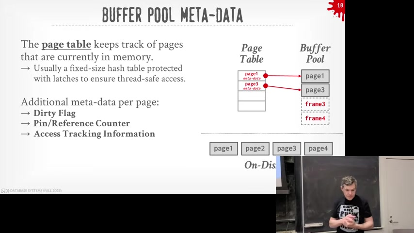

# L4 逐段整理译稿：内存管理与缓冲池

## 00:00–01:06

片头字幕标有音乐，夹有无法可靠辨认的歌词碎片；这里不据碎片补译歌词。约 00:27 开始，教师为上周外出道歉，说自己去了伦敦，上次录像的情境很古怪。他与学生围绕一位朋友、欠款和伦敦的一次意外开了几句玩笑：本来答应替人要回钱，结果没有拿到；对方似乎在城里遭遇了一群孩子。人名、学生插话及个别措辞的自动字幕不可靠，不把这段闲谈当作已核实的事实报道。教师再次致歉，然后转入课程安排。

## 01:06–04:17

Project 0 和 Homework 1 昨晚截止。教师说会在当天稍晚与助教检查成绩；按当时课程规则，Project 0 必须达到 100% 才能继续选课。Project 1 希望当天发布，月底截止，内容与今天的课直接相关。当时新源码尚未推送，学生需要把主分支更新合入自己的代码。

下周一、周二是数据库行业来访日。第一天有研究报告、公司介绍；周二上午每家公司有大约一小时介绍系统、正在开发的东西，以及实习和全职岗位。由于时间有限，会有两家公司在不同房间同时演讲，学生需要在 Piazza 帖子里填写偏好，教师打趣说可以让 ChatGPT 生成稳定婚姻算法来安排时间。想找数据库岗位的学生还可以填写另一张表，写明岗位类型和可入职时间，课程组会在来访前发给数据库行业的朋友，也发给未到场的其他公司。通常收件人不是普通招聘人员，而是创始人、工程副总裁或实际招聘经理；他们知道这门课程，与在大公司网页上投入公共申请池不同。

学生说：“我们还没学多少数据库呢。”教师回答：“别这么说。”他讲了在伦敦听到的例子：有人坦言不懂数据库，公司让他先看这门课准备面试，最后他拿到了工作。有些公司把本课用于新员工入职培训。另有公司把高级课 15-721 的项目内容变成招聘编程挑战，所以修过课可能有帮助。有关活动的问题可以在 Piazza 上问，也欢迎下周参加。

> 编者注：这是 2025 年课堂安排，不是今天的选课、招聘或截止日期通知。本站实验固定历史版本，不执行录像中“直接更新当前 main”的旧时操作。

## 04:17–07:52

上节课讨论数据库在磁盘上的最低层形态：从操作系统角度看，它们就是文件，与编辑器创建的文件没有神秘区别。数据库是在这些字节上逐层建立结构，才获得更复杂的能力。今天向上走一层：文件里的内容必须进入内存，CPU 才能处理它、执行查询。因此本课关心磁盘到内存、再从内存回到磁盘的数据移动。今天会介绍脏数据写回，而怎样安全写回、怎样与事务和恢复配合，期中考试后再深入。下一讲又会回到存储设计，研究其他文件组织方式，但今天的内存管理仍然适用。

有两类控制值得区分。**空间控制（spatial control）**关心把相关数据放在哪里：经常一起访问的数据应尽量靠近，从而增加顺序 I/O、减少随机 I/O。旋转硬盘上的差别尤其大；现代 SSD 上差距缩小，但组织方式仍然重要。

**时间控制（temporal control）**关心一次把数据搬进内存以后，能在释放它之前做多少工作。假设页 A 要用两次，页 B 要用一次，坏的顺序是读 A、做一点工作、扔掉 A，读 B、扔掉 B，再重新读 A。磁盘读取昂贵，所以应尽量在每次读入的页上完成更多工作。后面介绍的存储模型还能避免读取查询根本不需要的内容，今天先不展开。

## 07:52–10:37

回到系统架构图。底层是非易失性磁盘，数据库文件分成页。在文件开头或另一个已知位置，有一个 **page directory（页目录）**，记录哪些页存在、应到文件的哪个偏移去找。图上数据库只有一个文件，教师以 SQLite、DuckDB 为例；现实中也可以有多个文件、目录，甚至跨机器，当前先不考虑这些差异。

上层是易失性内存。其中划出一块数据库进程自己的地址空间，作为 **buffer pool（缓冲池）**，容纳从磁盘取来的页。缓冲池里可以放置一个页的内存位置叫 **frame（帧）**。对于这里固定大小的页，每个帧大小相同，可以根据偏移定位和复用。教师笑称“page、block、buffer、cache 都已经用掉了，所以叫 frame”。

执行引擎需要页 2 时，不必知道页 2 在磁盘或内存的什么位置，只需调用缓冲池管理器的接口。管理器先利用页目录找到磁盘位置，再选择空闲帧，把页复制进来，最后返回指向该帧中页面的指针。示意图把加载页目录画成独立步骤；实际系统通常在启动时很早就把必要目录载入，因为之后要靠它定位数据。

## 10:37–13:41

管理器向调用方提供一个重要承诺：**返回的页面指针，在调用方明确表示“我用完了”之前必须有效。** 用完以后，管理器可以驱逐该页。再次请求页 2 时，它可能被读入另一个帧，返回另一个地址，这完全没问题；调用方不能假定某个页永远占据同一个地址。

学生问旧指针怎么办。教师重申接口契约：给出指针时，调用方必须在结束后通知管理器；正因为已经结束，管理器才有权驱逐。另一位学生说这像引用计数，教师认可，但表示还需要别的机制。

学生问如果执行引擎需要的帧超过内存容量怎么办。回答是必须淘汰一些内容；这正是要提供“可处理的数据比实际内存大”的抽象。关于怎样选帧、是否随机，教师说稍后讲策略；执行引擎应当不关心这种内部选择。即使管理器随机选择空位，只要返回的内容和生命周期正确，上层也应该能工作。

学生问页与帧的大小是否一一对应。此处答案是对应的：从某种固定页大小的数据库文件读取内容，容纳它的帧应具有相应大小。IBM Db2 等系统可以让不同表、索引使用不同页大小，并配置多个缓冲池，甚至分别指定替换策略，但这不是把任意大小页随便塞进一个不匹配的帧。

## 13:41–15:40

缓冲池并不只用于表数据。理想情况下，数据库启动时就为需要的内存做出预算并申请，之后在自己管理的区域内分配，而不是查询执行到一半才向操作系统申请临时空间，突然发现没有内存。并非所有系统都这样实现，但越早知道容量约束越好。

排序、连接等算子的临时缓冲，以及日志缓冲，也需要内存管理。有些内存区域有磁盘作为后备，可以在容量不足时 spill；有些区域不能这样做，内存不足就得终止查询。后面讲连接和排序时会解释具体做法。当前重点仍是记录和索引页。

今天依次讲缓冲池管理器的基本结构、为什么不想把职责交给操作系统、页面替换策略、写回，以及其他优化。buffer pool manager、buffer cache manager、buffer manager 在这里指的是相近的职责：管理数据库执行工作所需的内存。

## 15:40–17:42

缓冲池可以想成一大块已分配的内存，被划为固定大小的帧。请求一个页时，如果已经驻留，管理器直接给出它的地址；如果不在，就找地方装入；没有空闲位置时，再执行替换策略。

读入内存的是文件接口返回的页面字节。存储设备可能在更低层透明压缩，但读取文件时已经返回相应的逻辑字节；数据库页内部也可能采用数据库理解的压缩格式，那是之后要讲的事。这里的模型是把文件页复制到帧，并由上层解释其中内容。

例子中磁盘有四页，先请求页 1，把它复制进第一个帧；再请求页 3，复制进另一个帧。实际页面字节在缓冲池里，前面还需要一个 **page table（页表）**，用于判断某个 page ID 是否在内存以及在哪个帧。可以用哈希表实现：按 page ID 查到条目，再取出 frame 位置。不要把这个页表和磁盘上的页目录混为一谈。

## 17:42–19:45

除了映射，还要记录页面被交给外部使用了多少次，即 **pin count（固定计数）**。一个页处于 pinned 状态，表示系统中还有使用者持有它的指针，因此不能把对应帧拿去装另一个页。否则调用方原本在解释某一页的内容，执行到一半，内存却被换成另一个页，读到的就会是错误数据。pin count 用来阻止这种替换。

学生问页表条目多大。教师回答，单个条目通常远小于真正的数据页，课堂举例说小于一 KB；其中可能有 dirty 标志、引用计数和访问跟踪信息，例如哪些工作线程持有它。哈希表条目数量可能很多，但每个条目并不是再复制一整页。

页表自身也需要 **latch** 保护。比如我要把页 2 装进一个帧，在修改映射、安排读入的过程中，不能让另一个线程同时占用同一个位置或看到不一致状态。教师用“保护该位置，完成后释放 latch”的图示说明临界区；具体实现怎样避免在长 I/O 期间阻塞所有线程，需要单独设计。

*约 17:41 的真实课堂帧。用于对照页表和装载页面的帧这两个不同层次；不是编者生成的示意图。截图为局部画面核验，不代表已经观看整片。*

## 19:45–21:56

教师问大家是否知道 latch 是什么。学生答 mutex，教师认可：在操作系统课程中通常会把这类东西叫 lock；数据库课程把内部数据结构的短时互斥称为 latch，是为了与事务层的 lock 区分。

事务锁保护的是页、记录、索引等逻辑对象的事务访问。外部用户可以开启事务然后去喝咖啡，数据库必须处理长时间占锁、死锁等问题，必要时中止事务并回滚。Latch 则保护数据库实现自身的内部临界区，防止多个线程或工作者并发破坏结构。实现者必须自己保证锁顺序和正确性，不能指望上层事务锁管理器发现 latch 死锁，再自动清理所有内部改动。

可以使用操作系统或 pthread 的 mutex；教师认为专用实现有机会更好，也提到其他低层锁实现，留待之后讲并发控制。他的核心强调不是某个具体库名，而是：内部 latch 的正确性由实现者负责，事务回滚并不会自动修复你错误修改的内部数据结构。

## 21:56–23:21

再次区分两个名字：**page directory 把页 ID 对应到磁盘位置；page table 把当前驻留的页 ID 对应到内存帧。** 页表一般不需要持久化。崩溃后内存内容已经丢失，重启时可以按访问重新建立映射。

有些系统会保存以前缓存了哪些页，以便重启、实例恢复时预取这些页，避免完全冷启动；教师提到 serverless 系统会采用类似办法。但这是一种预热信息，不表示恢复数据库正确性必须依赖原来的内存页表。

教师问：“数据库比内存大，但我们提供可以访问它的抽象，这像什么？”学生先说交换，再说虚拟内存。操作系统的确提供类似能力，接下来就看能否直接让它帮我们管理数据库文件。

## 23:21–25:59

操作系统提供 memory-mapped files。把文件映射进进程地址空间以后，可以通过一个起始地址加偏移访问文件内容。映射通常是按需的，不会在调用时立刻把整个文件读入内存。

图中有四个文件页。线程访问其中一个尚未驻留的页，触发需要磁盘 I/O 的 major page fault。操作系统暂停这个线程，去磁盘取页，放入物理内存，建立虚拟地址到物理内存的映射，再让线程继续。请求另一个未驻留页，重复同样过程。

如果物理内存已经没有空位呢？操作系统还是暂停访问者，选择一个页驱逐。未修改的页可以丢弃；修改过的 dirty page 需要写回，然后把新页装入，再恢复线程。从表面上看，这不正是数据库需要的缓冲管理吗？问题在于操作系统并不知道 SQL、查询、事务，也不知道文件中有哪些结构，因而缺少做合适决策的信息。

## 25:59–28:20

第一个问题是写入控制。操作系统后台写线程可以在它认为合适的时候把脏页写回，让之后的驱逐更便宜。数据库却可能要求一个页面的写入先于另一个页面。例如，修改数据页后，需要先确保描述修改的日志记录已经落盘，再把数据页写出去。操作系统不知道 WAL，也不知道文件之间的依赖，不能凭自己的脏页列表决定正确顺序。

`mlock` 能帮助阻止某些页被逐出内存，但“保持驻留”不等于“禁止内核写回”。这不能解决数据库想控制写回时机的问题。

第二个问题是停顿。数据库不知道映射页是否仍然在物理内存中，访问时可能突然阻塞执行查询的线程。如果数据库自己发起异步 I/O，可以让工作者等待期间去做其他事。也可以另起一个线程预先触碰映射页，让它承担缺页阻塞，但这样又增加一层工程复杂性，削弱了最初“用 mmap 让实现简单”的吸引力。

## 28:20–30:53

第三个问题是错误处理。通过映射访问文件，失败可能在任何一次相关内存访问时暴露；例如文件、底层设备出现故障。教师把这种异步暴露方式称为中断式错误，和在一个明确的 `read` 调用处检查返回值作对照。若自己管理读取，可以把磁盘错误集中在 I/O 边界处理；若每个指针访问都可能触发文件读取，异常情况就分散到了更多执行路径。

学生追问，普通缺页不是操作系统会替你处理吗？教师澄清：这里不是正常 page fault，而是磁盘损坏、文件被破坏等无法正常完成读取的情况。随后围绕“拔掉硬盘”的例子继续讨论：如果数据已经被数据库复制进自己的内存，它可以继续使用那份内容，之后显式读取失败时再处理；映射方式让新的 I/O 隐藏在普通内存访问背后，错误出现的位置就更难预料。学生把它概括为不确定性，教师同意。

最后还有性能开销：操作系统也要维护虚拟内存元数据，并用它自己的 latch 保护它们。教师认为数据库在了解工作负载的情况下有机会以更适合自身的方式管理，而不是叠加通用路径。

## 30:53–34:05

可以不断给 mmap 增加补丁和外围机制，让它越来越接近所需的数据库缓冲管理器；但这样工作量并不会消失，而且哪些页进入内存、哪些页何时写回，控制权仍然部分在操作系统手中。

教师以 MongoDB 的历史为例：早期依赖 mmap，后来转向收购的 WiredTiger。按课堂说法，WiredTiger 只在很有限的场景中使用 mmap，常规数据管理仍然有自己的缓冲体系。SQLite 也提供 mmap 路径，但并非这里所说的默认主要路径。教师用这些经历强调：有钱、有优秀工程师并不能自动解决这种架构取舍。

贯穿本学期的观点是，数据库知道数据组织、已执行和即将执行的查询，以及依赖关系，因此可以利用这些信息改善预取、替换和调度，而通用操作系统没有这些上下文。教师还用 Linus 对数据库开发者的邮件言论开玩笑，强调双方优化目标不同。

他提到自己团队专门写过一篇讨论 mmap 的论文，因为一些公司最初认为 mmap 很方便，几年后却又承认遇到了问题。近期也有人在 Hacker News 讲述类似经历。课堂给出的强烈建议是不要把数据库的关键缓冲管理简单交给 mmap；这些论文、帖子在本译稿中只作为课堂提及，不冒充本次独立阅读。

## 34:05–36:44

学生提出一个关键反问：数据库自己的内存不也仍然受虚拟内存管理吗，怎么能绕开它？教师认可这个区别：`malloc` 获得的内存仍可能通过匿名映射等方式由操作系统管理。这里反对的是让操作系统决定**数据库文件页**的写回和替换，而不是宣称数据库可以完全绕开虚拟内存。

教师建议启动时就规划内存容量。比如机器有 100 GB，可以给数据库约 80 GB，留出余量。如果同机另一个程序又申请大量内存，会不会仍然发生换页抖动？会，所以生产关键数据库通常应避免与大量争用资源的其他工作负载混跑。他用“不要同时运行比特币矿工”作例子；简单 WordPress 网站的取舍可以不同。

学生继续问，如果机器足够大且没有其他程序，操作系统为什么还会把页换出去？教师回答，在这个假设下可以没有容量导致的换页，但文件映射的脏页仍可能被写回，前面讨论的顺序控制等问题仍存在。还有内存使用统计：数据库进程的内存、内核页缓存以及映射相关的使用量并不总能用一个简单进程数字表达。

> 编者注：80% 是课堂容量示例，不是对任意系统“永不换页”的保证；匿名内存的交换和数据库文件的写回不是同一件事。

## 36:44–38:24

回到我们自己管理的固定大小缓冲池。帧用完时，需要 **buffer replacement policy（缓冲替换策略）**选择一个页，把它腾出来装新页。理想目标是淘汰未来最不可能用到的页，但实际并不知道未来，只能根据观测和提示估计。

这是缓存领域的老问题：容量大的存储更慢，速度快的 DRAM 更稀缺。策略不仅要提高命中率，还要足够快。假如一次磁盘 I/O 只需 1 ms，而替换算法却要算 10 ms，那为了省一次读取花更大代价就不划算。

维护访问历史也占内存。元数据越大，可用来真正缓存数据的内存就越少。因此要同时考虑选择质量、运行开销和空间开销，不能只优化其中一个数字。

## 38:24–40:33

**LRU，least recently used**，选择最长时间没有被访问的页面。每次访问更新最近访问时间；需要驱逐时，选择最旧的一个。课堂把这种思路追溯到 1965 年。

可以维护按访问新旧排序的链表：访问页 1 时，先在缓冲池页表中查到它，然后把对应 LRU 项移到链表前端，再交回页面指针。也可以维护时间戳表，选择最旧的项。学生问时间戳存在哪里，教师回答属于元数据、页表这类结构。另一位问既然有链表，为什么还需要时间戳？教师解释这是两种表达方式，不要求两套信息都保存；图只是帮助说明访问顺序。

要装一个当前不在内存中的页，便从链表最旧的一端挑选候选，释放对应帧，再放入新页。这维护了精确的近期访问次序。但是否真的需要如此精确？接下来给出一种近似方式。

## 40:33–44:14

**Clock** 可以看作近似 LRU。每个缓存项只有一个 reference bit，表示自上次检查后是否被访问过，而不保存完整时间戳。访问时把位设成 1。需要找替换对象时，时钟指针循环扫描：遇到 1 就改成 0，继续往前；遇到 0，就找到一个最近没有得到第二次机会的候选。圆形图只是表示循环，实际可以是数组或列表加游标。

学生指出教师一直说 page，但画的是不是 frame？教师回答：这里说的是已经放在帧中的页；帧是容纳页面的内存位置。再追问到底遍历页 ID 还是帧位置，教师说示意图没有规定实现布局，通常还有独立的元数据结构供策略遍历，并不是逐字节扫描页面内容。

随后的问答重新厘清页表：它**不是所有磁盘页的清单**，只记录当前驻留页面的 `page ID → frame` 映射。驱逐页 2 时，要移除页表中的页 2 条目；之后有人查它就会得到 cache miss。后面介绍的 ghost list 可以记住不再驻留的页面，但那不是同一张驻留页表。

学生又纠正“reference counter”这个称呼：这里明明只是一个 bit。教师认可，最多只能表示 0 和 1；它并不是“有多少使用者持有这个页”的 pin count。更清楚的叫法是 reference bit 或 access bit：自上次检查后访问过没有？

## 44:14–47:28

教师继续用时钟图演示：装入新页，扫描期间把见到的访问位清零；等再次转回某项，如果它仍是 0，就可以把它作为替换候选。课堂提到 Linux 有更复杂的多指针形式，基本直觉相近；并未在这里展开具体内核版本实现。

学生问每次从头开始还是从上次停下的地方继续。答案是继续上次的位置，否则会一直偏向淘汰列表前面的页面。又问时钟是否一直自动转，教师明确：这个示例中的 sweep 只有需要空闲帧而找不到时才启动；普通页面访问只负责把位设成 1。

为什么比 LRU 快？教师强调每次记录访问只需要修改一个 bit。学生反驳，链表末端删除也是常数时间，用哈希定位后移动节点也可以很快。教师认可复杂度并不能完整比较真实开销，关键是元数据更新、指针操作等的常数成本，以及实际墙钟时间。即使都是常数时间，1 ms 与 10 ms 仍差一个数量级。

最后再次确认游标从上次停止处恢复；图上后续几个页被访问后设成 1，再次需要驱逐时才沿着之前的位置继续扫描。

## 47:28–50:14

基础 LRU 和 Clock 都容易遭遇 **sequential flooding（顺序扫描污染）**。一个查询从头到尾扫描一张大表，会把大量只用一次的页放进缓冲池，冲走原先积累的热点和近期访问信息。

某些分析工作负载反复扫描，而不是按单个键点查；这时可能要考虑 MRU 等不同策略，或者让下一次扫描从刚结束的一端反向开始，先利用仍在缓存中的尾部页面。教师是在说明访问模式会改变合理策略，并不是给所有分析查询规定统一算法。

图例中，点查询寻找 `ID = 1`，它位于页 0，于是页 0 进入缓冲池。随后一个求某列平均值的扫描读完整张表。读到页 3 时没有空闲帧，LRU 发现页 0 最久未被访问，就把它驱逐。但点查询可能非常频繁，访问分布高度倾斜；教师拿 Taylor Swift 的 Instagram 页面和某个普通猫咪账号比较，说明真正的热点不一定是“刚才最近访问”的对象。

扫描在短时间内让冷页显得很新；简单 LRU 只看最近一次访问，无法知道页 0 的长期重要性，于是扫描后再次点查又要读盘。

## 50:14–53:00

一个自然改进是 **LFU，least frequently used**：为页记录被访问的次数，淘汰次数最少的页。课堂提到 1971 年的相关工作。但计数也有问题：维护按频率选择的数据结构有开销；更重要的是它没有时间维度。

假如某人在半夜把那个猫咪账号访问十亿次，以后再也没人访问，计数依然非常大。没有老化机制的策略可能一直保留这页，尽管它早就不再有用。我们既想识别重复访问，又不想让古老的热度永久占住缓存。

教师随后介绍 **LRU-K**：保存多次最近访问的信息，比较当前时刻与倒数第 K 次访问之间的距离，而不是只看最近一次。课堂以 SQL Server 以及 PostgreSQL 的历史实现说明它的影响，并提到 Tom Lane 的背景。

还有 **ghost cache / ghost list**：即使页面字节已经被驱逐，仍然保存它的一点访问历史。这样页面再次回来时，不需要从“完全陌生的冷页”重新学习。Ghost 保存的是元数据，而不是一份躲在别处的完整页面。

## 53:00–56:03

LRU-K 演示用一个表保存时间戳，选择 K = 2。初始缓冲池内有页 0、1、2，各自最近访问时间为 1、2、3，还没有第二次访问。时间用递增的逻辑计数器表示。

查询中的 `IN` 条件要找位于四个不同页上的记录。教师强调，SQL 的 `IN` 列表并不规定物理读取顺序；真正系统可以先找出记录所在页，再按更好的 I/O 顺序访问。为了演示，这里故意按条件所列顺序跳着访问，字幕中可辨认的 ID 为 1、31、11、41。

先在时刻 4 再访问页 0。它原来的最近时间 1 移到“倒数第二次访问”列，最近时间改为 4。接着在时刻 5 要访问不在缓存中的页 3，需要替换。页 0 的 backward-2 distance 为 `5 − 1 = 4`；页 1、2 不足两次访问，距离视为无穷大。在无穷大并列项中，选择已有访问更早的页：页 1 的时间 2 早于页 2 的 3，因此淘汰页 1，把页 3 装入，记录时间 5。

教师说 K 可以大于 2，某些系统会取到 6；这里只用两个历史位置说明原理。字幕末句把“页”和“时间戳 5”混在一起，按前后步骤应理解为新页的访问时间为 5，不是这里突然请求了页 5。

## 56:03–58:07

下一步在时刻 6 请求刚刚被驱逐的页 1。当前页 2 和页 3 仍然各只有一次访问，因此按更早的时间选择页 2（3 早于 5）驱逐，把页 1 读回。

如果保留了 ghost 历史，就能恢复页 1 原来的访问时间 2，把这次访问记为 6，于是它已经有两次访问证据，不会立刻再次成为“仅一次访问”的冷页。最后再请求页 4，页 3 仍不足两次访问，所以被选中驱逐。这就是用保留历史抵抗一次性访问的示例。

字幕在约 57:04 标了一个短音乐事件；其具体音源未听辨。学生问 ghost hash 是页表的一部分还是另一种结构，教师说通常是独立数据结构，元数据量并不大。

另一位学生问实际系统用逻辑计数器还是硬件时钟、墙钟时间。教师说通常用逻辑计数，因为墙钟可能调整，时间甚至可能倒退；他举夏令时等作为直观例子，说这在事务部分还会带来更多问题。这里只需要一个可靠的访问先后顺序，而不是民用日期时间。

## 58:07–59:35

接着看课堂称作“近似 LRU-K”的 MySQL 做法。仍然使用一条链表，但分成 young 和 old 两个区域，各有一个入口，能定位两段的起点。

新请求页 1 不在缓存，需要装入时，先从 old 区域尾部淘汰页 8，再把页 1 插入 old 区域的开头，而不是整个 young 区域的最前方。如果页 1 以后再没被访问，它会随着其他新页到来逐渐滑到尾部并离开，不会挤占太多真正热点的位置。

如果之后再次访问页 1，就把它提升到 young 区域前端，因为重复访问说明它更可能值得保留。教师说明这不是精确的 LRU-K，但用简单结构获得相近的抗扫描收益。本段是教学简化，没有给出某个 MySQL 版本的全部参数和提升条件。

## 59:35–1:02:24

虽然时间紧，教师仍然介绍 **ARC（Adaptive Replacement Cache）**，因为 **2025 年的 Project 1 要实现它**。他提到今年允许利用 LLM 帮助编码，项目相应比往年更难；不要因网上旧版项目出现 LRU-K，就把旧要求套到本期。

按课堂介绍，ARC 起源于 IBM Research 的存储系统研究，也见于 ZFS，历史上曾进入 PostgreSQL。教师还谈到 IBM 专利及 PostgreSQL 因顾虑而调整算法的经历，并给出关于专利期限的口头估计；本译稿不把这当作独立核验的法律结论。

核心目标是兼顾近期访问和重复访问的收益，而且不要求管理员手动决定该给两种历史各分多少空间。算法维护多个列表以及 ghost 历史，用参数 `p` 调节偏向 recent 还是 frequent。如果访问模式表现出重复热点，就增大相应保留空间，减少另一侧的预算；工作负载改变时，又能动态调整。

教师明确表示本节来不及逐步讲完整算法，计划通过线上材料或单独 recitation 继续。这里讲到了列表、ghost 和可调参数的思想，**没有现场推演本期 ARC 全部转移规则**。项目的完整要求应读本站 [Project 1 原创要求导读](#/c/cmu-15-445-2025/lab/project1?v=zh)，不能把本段概要当作完整实现规格。

## 1:02:24–1:03:25

另一类优化是利用查询语义。假如知道一个查询正在顺序扫描，且其他查询大概不会复用这些页面，可以为它使用一小块独立缓存或缓冲池分区，而不是让扫描污染全局缓存。

这仍然属于系统总内存的一部分，并不是额外无上限的内存。教师以 PostgreSQL 的环形缓冲策略为例：新页不断进入一个有限的循环区域，用完后绕回来复用。这样实现很便宜，也限制了大扫描对其他热点页的冲击。

## 1:03:25–1:06:06

还可以给替换器提供 **priority hints（优先级提示）**。例如 B+ 树索引的根页，几乎每一次索引访问都要经过它，通常比许多叶页更值得留在内存里。

图上用递增键插入作为例子；教师说明展示的写法并不是合法 SQL。叶子按从小到大排列，持续插入更大的键，就会反复经过根和最右侧路径。虽然频率统计本来也可能观察到这种热点，但执行引擎可以直接告诉缓冲管理器某些页特别重要，避免仅靠重新学习。同样道理适用于索引查找。

还有一种提示是识别相关访问。一个事务先读某条记录，紧接着更新同一条记录，不一定代表两个独立用户都偏爱这页。可以把它们视为一次相关访问，避免访问次数被同一事务的内部操作虚高。教师说 SQL Server 能利用类似信息。

他认为企业数据库在这些细节上往往投入更多，比如 Oracle、Db2、Teradata，会在公开算法之上加入更多启发式和工程优化；有些产品内部细节并不公开。本段是课堂比较与经验判断，不是本次针对商业系统做的实验结论。

## 1:06:06–1:08:30

如果选中的页是 dirty，就不能直接丢弃。必须先把修改写回，再复用其帧。有些系统还必须先写对应日志，再写数据页；同步等待这些操作会拉长获取一个空闲帧的延迟。干净页则不需要保存当前内存副本，驱逐便宜得多。

因此希望尽量提前制造足够的干净候选。数据库可以运行自己的后台写线程，扫描脏页并写回，这叫 **page cleaning / buffer flushing**。等后来真正需要腾帧时，修改已保存，就无需把整个写入等待压在前台请求上。成功完成相应写回后，可以更新 dirty 状态。

但后台写也不是越多越好：它占用 I/O 带宽，可能挤压查询读取；过早写一个马上又会被修改的页，也可能重复工作。系统可按时间、脏页数量、比例等触发，并用阈值限制积极程度。教师举 PostgreSQL 的一个阈值说法，字幕中的数字和单位不够可靠，这里不把它恢复成配置默认值。商业系统可能提供更复杂的控制。

> 编者注：clean 不等于“没人用”，dirty 也不等于“绝不能驱逐”。仍须满足 pin 和并发访问条件；后台写入期间若又有新修改，不能无条件把最新状态标成 clean。

## 1:08:30–1:11:42

时间不够，其他缓冲池优化留到下一讲；现在先讲磁盘 I/O。目标是尽量利用设备吞吐量，在给定时间内搬运更多数据。现代存储变快了，磁盘路径依然可能是主要瓶颈。

操作系统和 NVMe 等设备会利用并行性、重排请求、增加顺序性，但它们通常不知道哪个请求对数据库业务更重要。例如同一数据库里，一个请求属于关键查询，另一个只是后台任务，不应该仅因为都来自同一进程就被当成等价请求。教师用 Linux I/O 优先级接口的限制说明这一点，并建议让数据库承担更多调度策略。

典型设计是在缓冲管理器下面维护自己的 I/O 请求队列。来自多个线程的随机读取，可以按磁盘位置组织，增加顺序性；关键事务的请求可以优先；日志写入可能因持久性依赖而优先于其他脏页。这里真正重要的是系统知道请求的语义和依赖，而不只是它们的字节地址。

教师反复用 application 一词，特意澄清：从操作系统角度看，数据库进程也只是一个应用程序；不是在说数据库之外的 Node.js 业务程序。我们设计的数据库内部有操作系统看不到的知识，应善加利用。

## 1:11:42–1:13:08

普通文件读取还涉及 **OS page cache（操作系统页缓存）**。通过文件接口读数据时，内核先查看页缓存；未命中就从设备读取到内核缓存，再复制给用户态缓冲区。如果数据库同时维护自己的 buffer pool，同一磁盘页就可能在内核和数据库内存中各存一份，既占空间，又多一次复制。

**Direct I/O** 的意图是绕过文件系统页缓存，把请求的数据直接交给数据库的缓冲区，避免这份双重缓存。教师还提到更进一步的用户态直接设备访问路线，字幕将工具名称识别得不稳定；本段只保留“可进一步减少内核/文件系统路径”的概念，不把它变成可直接执行的 API 指南。

> 编者注：Direct I/O 不等于自动获得同步持久化，也不等于不经过任何内核代码；其对齐、接口和平台限制要另查具体系统。本课此处讨论的是缓存路径。

## 1:13:08–1:15:22

教师问哪个常见数据库没有采用他所倡导的 direct I/O 路线。学生猜 SQLite，教师表示不确定其默认设置，随后指出主要想说 PostgreSQL。

他介绍 PostgreSQL 传统上同时使用自己的 shared buffers 和 OS page cache，因此内存建议与“把大部分内存给数据库缓冲池”的其他配置不同，课堂比较了 25% 与 80% 的例子。这些是历史产品讨论，不是对所有部署一刀切的调优公式。

教师展示前一年有关 direct I/O 补丁的帖子，又说预计两周后发布的 PostgreSQL 18 将有异步 I/O。他特意区分：异步读允许后台工作者取数据，减少前台等待，但仍然可能使用 OS page cache；这不代表 direct I/O 已经默认启用。他把异步化描述为转向 direct I/O 的重要工程准备，因为绕过内核缓存后，等待真正的设备读取更值得重叠处理。

学生问 direct I/O 是否需要修改内核。教师答不需要，可以通过现有文件打开相关选项请求，如 `O_DIRECT`。他认为 PostgreSQL 将逐步减少对 OS page cache 的依赖，然后转入最后一个操作系统写入语义的例子。

## 1:15:22–1:16:46

假设缓冲池里有一个脏页，要把它写出去。教师问：“调用 `fwrite` 以后发生什么？”学生的回答在字幕里有几处听写混乱，教师也反复请其重复；可辨认的讨论最终落到“写进文件”和“是否真的到了磁盘”之间的差别。

写操作返回，并不自动说明数据已持久化在介质上。它可能仍留在缓冲层。要请求相应的持久化同步，教师介绍阻塞式 `fsync`：等待系统报告该文件的写回同步结果。

硬件也可能有自己的缓存和电池保护机制。即使尚未写到最终介质，如果缓存受可靠的掉电保护支持，设备可能在断电后完成剩余写入；但这取决于整个存储栈兑现的保证。课堂的关注点是：应用必须知道自己拿到的完成通知究竟意味着什么。

## 1:16:46–1:19:20

那么，`fsync` 失败以后怎么办？教师讲述历史上的 **fsyncgate**。按课堂描述，旧时某些 Linux 写回失败路径会返回错误，但相关缓存页已经不再保留原来的待写脏状态。数据库如果简单写成“只要 `fsync` 失败就循环重试”，第二次调用可能看到没有待写脏页而返回成功；这并不能证明第一次没有写出去的数据终于写出去了。

教师问为什么会有这种设计，用被拔走的 U 盘说明操作系统的另一种目标：原设备可能永远不会回来，内核仍需要最终回收相关缓存，不能永久保留所有脏页。这个回收目标和数据库对持久性确认的理解发生了冲突。

他回忆 PostgreSQL 邮件列表在大约 2017 或 2018 年讨论过无明显崩溃却丢数据的报告，进一步调查发现并非只有 PostgreSQL 受影响，MySQL 以及 MongoDB/WiredTiger 等也涉及类似问题。教师说相关系统后来进行了修复，但没有在本课列出具体版本和补丁。

核心告诫是：**不要把重试得到成功，当作前一次失败留下的持久性缺口已经修复。** 存储系统必须认真定义错误后的状态、恢复动作和上报方式，而不是假设所有层都会按最乐观的理解工作。即使文档看起来清楚，也要防御真正可能出现的故障。

## 1:19:20–1:20:10

教师为超时致歉，下次继续剩余内容；请大家到 Piazza 讨论，并再次说当天会发布 Project 1。约 1:19:30 后转入结束音乐，字幕只有零散歌词，不足以可靠重建或翻译歌曲。

自动字幕最后一个文本事件结束于 **1:20:07.719**；直到视频标定结尾 **1:20:10** 的 **2.281 秒没有字幕覆盖**。这只是字幕未知区间，不推定为静音，也不补造结束语。开头 0.090 秒以及片内其他字幕时间间隙同样没有被音频核验；精确并集和间隙见本讲来源记录。

## 术语校订与技术边界

- ASR 中的 buffer hole / bufferable、tupil、MAPAP、Malo、Wire Tiger、Postgress、fright、F-Sync 分别按上下文规范为 buffer pool、tuple、mmap、malloc、WiredTiger、PostgreSQL、fwrite、fsync。原始英文字幕未改写，中文校订不冒充原音复核。
- 18 分钟附近“计数器可能一字节”只是口头大小示意，不是实现要求；pin count 的范围、溢出和并发更新不能据此省略。页表保护与数据页保护也不是同一把锁的同义词。
- 42 分钟问答有一句把 directory 中的对象叫 frames；按前后明确定义，应是磁盘页。Clock 的 reference bit 与 pin count 完全不同；“访问位为 0”仍不单独赋予驱逐权。
- LRU-K 演示保留课堂算法；ARC 只讲概念并明确留待补充，二者不可互换。时间戳是逻辑先后编号；墙钟调整、民用时区变化和单调时钟是不同机制。
- “数据库总比 OS 更好”“不要用 mmap”等是本课强调控制权的强烈教学立场，不是对所有工作负载、只读映射或产品的性能定理。LFU 的维护复杂度依赖具体结构；Clock 也可能扫描多项，不能由一个 bit 推出每次替换严格常数时间。
- 课堂把映射 I/O 故障泛称为 interrupt；实际应用所见可能是信号等平台机制，不等于正常缺页。`malloc` 不保证每次都使用匿名 mmap，提前分配也不保证物理内存永不被回收。
- `O_DIRECT` 不是可在所有 POSIX 系统、`fopen` 模式中通用的标准开关；同步与异步 I/O 是另一维度。课堂对 Linux 优先级粒度、用户态设备工具名称以及 PostgreSQL 未来功能的说法不作为现行接口手册。
- `fwrite` 还可能先留在 C 标准库用户态缓冲，不能省略 `fflush` 与 `fsync` 所在层次的区别；direct I/O、write 返回、后台清脏、事务提交也都不是同一完成事件。
- 课堂提到的产品历史、论文、专利到期、Linux/数据库修复状态未做独立文献审计，不给出未经核对的默认参数、法律结论或安全修复版本。

## 来源、许可与阅读范围

本页为 Andy Pavlo / CMU Database Group，Fall 2025，视频 **8-2yv4z0VZc**（4810 秒）的中文逐段整理译稿。逐视频元数据标注 **Creative Commons Attribution license (reuse allowed)**；依据与原始视频入口见课程 [来源清单](https://github.com/socoo123/course_web/blob/main/content/cmu-15-445-2025/source-manifest.json)。许可说明参见 [YouTube Creative Commons 说明](https://support.google.com/youtube/answer/2797468?hl=en)。本页作中文翻译、去除口头重复、分段和明确标记的技术校订；署名及许可不外推到教材、独立 PDF 或片头片尾第三方音乐，歌曲不译。

本次按顺序全文阅读全部 **2310 条**规范化英文自动字幕，而非根据 slides 或关键词推演时间轴；并没有完整听音或观看录像。字幕缺词、学生原问题不完整、部分专名和数据无法核实之处均保留边界。真实课堂图片只作局部视觉核验，不取代音频校订。标题覆盖全片，不表示字幕时间并集覆盖每一毫秒。

指定教材为 *Database System Concepts* 第七版 **§13.2–13.5**；本次未取得或阅读这些章节正文，也未确认其全文翻译授权。未制作伪装为教材译文的 materials 页；学习推导见 [本讲笔记](#/c/cmu-15-445-2025/lec/lec04?v=notes)。
