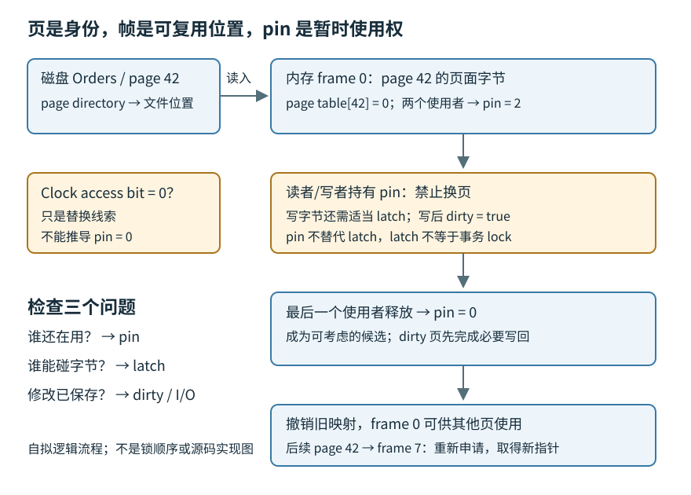
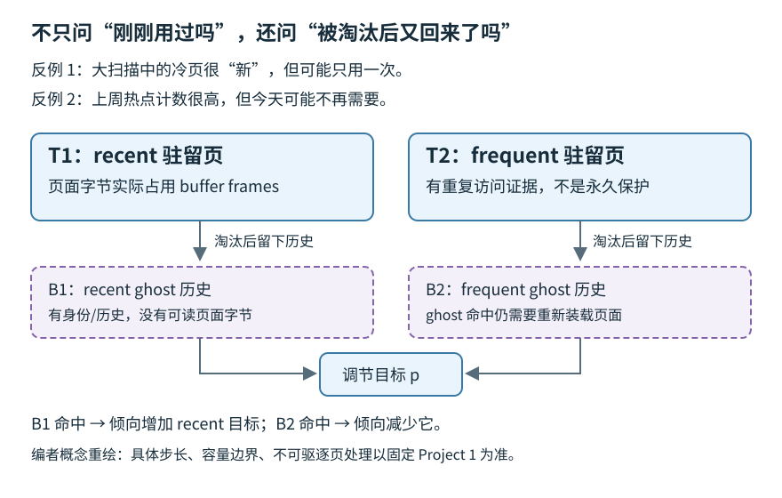

# L4 学习笔记：一块内存，何时才真正可以交给别人？

## 1. 从一个危险指针开始

假设查询 A 正在读取 `Orders` 的页 42，缓冲池把它放在 frame 0，返回指针 `p`。查询 B 随后要读 `Stock` 的另一页，管理器把 frame 0 改装成那一页。A 的指针数值没变，访问也可能不崩溃，却把库存字节解释成订单。

**这比空指针更危险：地址仍有效，身份已经错了。** 因此缓冲池的第一职责不是“缓存越多越好”，而是提供一个受约束的使用期：使用者持有页面时，不能偷偷更换其身份。对应原讲 **07:52–13:41、17:42–21:56**。

| 名字 | 回答的问题 | 不保证什么 |
|---|---|---|
| page ID | 这是数据库中的哪一页？ | 不固定某个内存地址 |
| frame ID | 页面现在占据哪个内存槽？ | 不代表槽内永远是同一页 |
| page directory | 磁盘页去哪里找？ | 不表示页已驻留 |
| page table | 驻留页目前在哪个 frame？ | 不应把 ghost 当成已驻留页 |
| pin count | 还有多少有效使用权没有归还？ | 不互斥页面字节的读写 |
| dirty | 当前内容是否有尚需保存的修改？ | 不表示事务已经提交或未提交 |
| latch | 谁可以在此刻操作受保护的内存结构？ | 不等于事务隔离和回滚 |

*编者原创，Orders 页 42 为自拟例子。图展示逻辑依赖，不规定某份源码的锁获取顺序。*

### 推导出三个不可混淆的不变量

1. **身份不变量**：已发布的驻留映射必须与帧中实际页身份一致。一个仍被使用的页，不能把帧偷偷借给别的页。
2. **使用权不变量**：`pin_count > 0` 的帧不可作为正常驱逐对象；`pin_count = 0` 只打开候选资格，并不自动表示已经完成脏页写回或其他在途工作。
3. **字节一致性不变量**：pin 只保护驻留期。两个写者同时持有 pin 仍会互相破坏字节，因此还需要适当的页面 latch；页表等全局元数据也有自己的并发保护需求。

**反例**：把 `pin_count` 设为原子变量，不能自动使“查页表 → 找到帧 → 增加 pin”这个组合动作安全。如果查表后、加 pin 前，另一个线程已替换帧，原子加法依然加在错误身份上。需要保护的是整个协议，不是只挑一个字段改成 atomic。

## 2. 页被释放，不代表页必须立刻消失

原讲 **10:37–13:41、1:06:06–1:08:30**。

最后一个使用者归还 pin 后，页面可以继续留在缓存里。如果下一次请求命中它，就避免 I/O。**unpin 是归还使用权；evict 是撤销驻留；flush 是保存修改。三者不是同一个动作。**

| 情况 | 能直接复用 frame 吗？ | 原因 |
|---|---|---|
| pin > 0，clean | 不行 | 使用者可能正在读 |
| pin > 0，dirty | 不行 | 使用权和修改都要处理 |
| pin = 0，clean，无在途依赖 | 可由策略选中 | 磁盘副本能重建页面 |
| pin = 0，dirty | 不能立即覆盖 | 先完成必要的安全写回 |
| write 已提交，完成通知未到 | 不能仅凭“提交了”判断 | 设备或工作线程可能仍在读取该缓冲区 |

### 为什么 PageGuard 是资源协议，不只是漂亮语法？

以下是编者对本课生命周期的工程推导，**不是课堂展示过的代码，也不是项目完整实现**。

- 获得一个页面使用权后，所有返回路径都必须正确归还，包括异常、提前退出和移动赋值。
- 读守卫和写守卫表达不同的访问能力；它们还需要保持页面驻留，并在结束时释放相应资源。
- move-only 的含义是**转移责任**。移动后源对象不能再次释放同一份 pin/latch；目标对象结束时仍然必须释放。复制同一个释放责任会导致重复释放。
- `Drop` 后保存的原始指针不再有守卫保证。即使它暂时还能读，也不能据此认为可继续使用。
- 替换器的 evictable 状态必须与生命周期协调。忘记把重新 pin 的页移出可驱逐集合，会把正确的淘汰算法变成数据损坏器。

本期相关接口、析构和异步队列规则应以 [Project 1 指导](#/c/cmu-15-445-2025/lab/project1?v=guide) 为准；不要照旧版裸指针调用模式替代固定版本的 PageGuards。

## 3. 如果 OS 已经有虚拟内存，为什么还要再造一层？

原讲 **21:56–36:44**。问题不是“操作系统笨”，而是**信息和责任边界不同**。

| 数据库需要控制的事 | 通用映射/缓存路径缺少的上下文 |
|---|---|
| 日志先于相应数据页持久化 | 不知道 WAL 和事务依赖 |
| 关键查询优先于后台清理 | 不知道请求的业务意义 |
| 等待 I/O 时执行别的工作 | 缺页可能在普通指针访问处阻塞 |
| 集中处理读取失败 | 映射 I/O 故障可在触碰地址时暴露 |
| 扫描不要冲掉热点 | 不知道算子将只用一遍或重复使用 |
| 精确预算内存 | 用户态缓存与内核缓存可能重复占用 |

### 两个容易答错的反问

**“用 malloc 后不是仍然有虚拟内存吗？”** 是。自己做 buffer pool 不是取消虚拟地址，而是把数据库文件页的装载、替换和写回协议放回数据库控制。匿名内存交换、文件映射写回、数据库驱逐是三个不同层次。

**“调用 mlock 不就解决了吗？”** 不够。保持驻留并不等于控制文件页写回顺序，也不解决访问语义、错误处理和调度的全部问题。

教师反对 mmap 的立场针对本课这种需要精细控制的数据库存储设计。不能进一步推出“任何只读映射都错”或“显式 I/O 必然在每个基准上更快”。本次未独立阅读课堂提到的 mmap 论文，不把课堂经验当作跨系统性能证明。

## 4. 替换器不是预测神谕：它用什么证据猜未来？

原讲 **36:44–1:02:24**。

先区分两步：**生命周期决定谁有资格被驱逐，策略才在候选中决定驱逐谁。** ARC、LRU-K、LRU 或 Clock 都不能合法地把仍被使用的 frame 选走。

### 4.1 最近一次访问：LRU

LRU 假设近期使用的页更可能很快再用。哈希定位加双向链表可以快速把页移到最近端；时间戳表是另一种表示。链表顺序本身已经编码新旧，不一定还要为同一目的再存一份墙钟时间。

**自拟 Orders 例子**：三个帧原本保留热点订单页 H。一次报表扫描依次读 S1、S2、S3，H 在此期间未被访问，变成最旧项而遭淘汰。扫描结束后再查 H，又发生 I/O。S1–S3 都很“新”，却不一定会再次使用。这就是顺序扫描污染，不能仅靠“把 LRU 写得更快”消除。

### 4.2 一次第二机会：Clock

访问页时设 access bit 为 1；需要找候选时，指针从上次位置继续，见 1 清 0 后跳过，见 0 才进一步考虑。这个位记录的是“自检查后是否访问过”，**不是 pin count**。

Clock 减少每次命中的元数据维护，但一次驱逐可能扫描多个项，并非严格只做一次操作。它仍然会受到扫描污染。保留游标是为了避免每次都从头惩罚同一批位置。

**反例**：页 H 的 Clock bit 已被扫成 0，但某个查询仍持有它的 pin。接下来仍不能驱逐 H。访问热度证据与安全使用权完全独立。

### 4.3 只有次数：LFU

累计计数能识别热点，却可能留住“过去的明星”。如果一个页昨天被访问百万次，今天再没人需要，不带老化的计数仍会很高。维护开销也依具体选择结构而异，课堂提到的对数复杂度不是 LFU 思想不可改变的数学下界。

### 4.4 既有时间，又有重复：LRU-K

设当前逻辑时间为 $t$，页最近第 $K$ 次访问时刻为 $t_K$，则 backward K-distance 为

$$
d_K = t - t_K.
$$

少于 K 次访问时视为 $+\infty$；对符合驱逐条件的页，优先选择距离最大的。课堂 K=2 示例的关键步骤为：

| 逻辑时刻 | 请求 | 有效证据与结果 |
|---|---|---|
| 1、2、3 | 页 0、1、2 | 各只有一次访问 |
| 4 | 页 0 | 历史变成 4、1，有重复证据 |
| 5 | 页 3 | 页 1、2 都不足两次；按更旧历史淘汰页 1 |
| 6 | 页 1 | 淘汰页 2；若 ghost 保存历史 2，可恢复成 6、2 |
| 7 | 页 4 | 页 3 仍只有一次访问，成为被淘汰对象 |

这是课堂演示，不是本期项目的替换器规格。逻辑时间用于比较先后，不需要知道“今天几点”；实现仍需处理计数器范围等工程边界。

### 4.5 被淘汰后再次出现，也是一条信息：ARC

*编者原创概念图，使用常见 T1/T2/B1/B2 名字说明驻留与 ghost 的边界；不是完整伪代码，不替代固定项目的转移规则。课堂 59:35–1:02:24 只讲总体思想。*

ARC 在近期与频繁使用之间自适应调节。Ghost 命中表示“之前被淘汰的这个页又回来了”，是一种反馈：我们可能给对应类别的保留空间太少。`p` 表示 recent 侧的目标，而不是每个时刻强制填满的实际列表长度。Recent ghost 命中倾向增加这个目标，frequent ghost 命中倾向减少；具体调整步长、容量边界和不可驱逐页的处理由本期要求定义。

**Ghost 命中不是数据命中**：历史还在，页面字节不在。必须重新取得帧并加载数据，不能从 ghost 返回一个页面指针。Ghost 的“历史持续”也不是崩溃后的持久性保证。

**版本红线**：Fall 2025 Project 1 是 **ARC 变体**，不是 LRU-K。固定版本为 `v20251119-2025fall`，commit `d49b823f829a4bf311a2c80b239ab5a9864c9c41`。课堂完整讲 LRU-K、略讲 ARC，是讲授时间分配，不是实验任务的比例。读 [本期要求](#/c/cmu-15-445-2025/lab/project1?v=zh) 后再动手。

## 5. 准确率再高，维护开销也可能吃掉收益

原讲 **36:44–38:24、45:43–47:28、1:02:24–1:06:06**。

一个用于思考的近似代价模型是：

$$
T \approx N\,c_{\text{track}} + M\,c_{\text{miss}} + E\,c_{\text{choose}},
$$

其中 N 是访问次数，M 是未命中次数，E 是需要替换的次数。它不是基准测试结果；作用是提醒我们，降低 M 的同时可能增大每一次访问都支付的跟踪成本。还要计入并发争用和元数据占用，实际 I/O 也可能重叠，不能机械相加预测墙钟时间。

若总内存预算 B，frame 的页面大小为 P，每帧管理开销近似 m，忽略其他内存后最多可容纳约

$$
F \le \left\lfloor\frac{B}{P+m}\right\rfloor
$$

个帧。访问历史越丰富，m 可能越大；为了更聪明而保留过多历史，可能反过来减少可缓存页面。真实系统还有哈希表、分配器、ghost 和执行算子的额外空间，不应把这条简式当容量配置器。

### 不只优化算法，还能改变输入

- **扫描隔离**：给一次性报表使用有限环形区域，限制它污染全局缓存的程度。
- **结构提示**：Orders 索引根页是很多访问的公共入口，比只出现一次的叶页更值得保留。
- **相关访问合并**：事务“先读 Stock，再写 Stock”不一定是两个独立热点证据；不要无意夸大同一次业务操作的热度。
- **调度利用空间局部性**：合并来自多个工作者的读取请求，有机会把随机位置整理得更顺序。但 page ID 是否对应磁盘顺序取决于存储布局，不能无条件只按 ID 排序。

## 6. 异步 I/O 让等待消失了吗？没有，它转移了责任

原讲 **1:06:06–1:11:42**，以下将课堂概念连接到本期工程问题。

同步调用时，调用栈通常帮助约束缓冲区使用期；异步提交后，任务还在队列里，提交函数却已经返回。于是必须明确：

1. **谁拥有请求对象与完成通知？** 请求的完成应准确通知等待者，不能重复完成，也不能在正常关闭时留下永远没有结果的等待。
2. **谁保证数据缓冲区还活着？** 请求对象进入队列不代表 `data` 指向的字节自动被复制。写请求尚未读取完时，原帧不能改装成别的页；读请求尚未完成时，也不能把半页内容作为成功页面发布。
3. **何时允许取消、关闭或析构？** 必须遵循本期 scheduler 的关闭协议，让工作线程有明确退出路径，并处理已接受工作的生命周期。
4. **完成代表什么层次？** 教学项目中的 disk request 完成、操作系统接受写入、设备持久化和事务提交不是同一保证。

固定 Project 1 的 `DiskScheduler::Schedule` 接收 **`vector<DiskRequest>`**，不是历史教程里的单个请求接口；完整任务在项目页展开。本讲笔记不提供可提交实现，也不把“加一个线程”当作已经解决生命周期。

## 7. flush、direct、async、durable：四个词不要互相替代

原讲 **1:11:42–1:19:20**。

| 维度 | 它主要讨论什么 | 常见误推 |
|---|---|---|
| buffered / direct I/O | 是否经过文件系统页缓存 | direct 就一定持久化 |
| synchronous / asynchronous | 调用方如何等待完成 | async 就不经过页缓存 |
| page cleaning | 把脏内容写出，减少前台等待 | 写出后必然可以驱逐 |
| durable / not durable | 哪种故障下仍能保住数据 | write 返回就等于提交安全 |

### 为什么“重试成功”不能抹掉过去失败？

设第一次 `fsync` 返回错误，表示一次持久化操作没有达到预期。第二次调用可能只观察**当前**内核知道的待写状态，并不自动重新构造第一次已经遗失的字节或错误上下文。于是第二次返回成功，不能单独证明第一次的目标已经完成。

课堂 fsyncgate 故事的可迁移结论不是“所有 Linux 现在都这样”，而是：**恢复动作必须以失败后仍保留了哪些数据、哪些状态为前提。** 不能把循环调用当成恢复证明。本次没有独立核对相关内核补丁和各产品版本，因此不发布现行修复状态表。

同理，后台 flush 捕获了某页的一版内容，写入期间又发生新修改，完成后不能盲目清除当前 dirty 标记。要有协议保证“标成 clean 的版本，确实已被保存”；具体如何锁住内容或跟踪版本，需要结合实现设计。

## 全片时间索引

边界按已顺序阅读的字幕主题切分，精度为教学检索用的秒级；不声称每个边界是音频逐帧对齐点。音乐、通知和未覆盖结尾也保留在表内。

| 时间 | 核心问题或活动 |
|---|---|
| 00:00–01:06 | 片头音乐、伦敦闲谈，专名不确定 |
| 01:06–04:17 | P0/HW1 截止、P1 预告、行业来访与招聘问答 |
| 04:17–07:52 | 文件为何要进内存？空间与时间控制 |
| 07:52–10:37 | 页目录、页、帧和执行引擎的请求路径 |
| 10:37–13:41 | 指针有效期、容量不足、页/帧大小问答 |
| 13:41–15:40 | 临时与日志内存，预分配的动机 |
| 15:40–17:42 | 装页过程与 page table |
| 17:42–19:45 | pin、dirty、元数据与页表保护 |
| 19:45–21:56 | latch 为何不是事务 lock？ |
| 21:56–23:21 | 目录/页表、重启预热、虚拟内存引入 |
| 23:21–25:59 | mmap、major page fault、缺帧 |
| 25:59–28:20 | 写回顺序与执行线程停顿 |
| 28:20–30:53 | 故障暴露位置、拔盘问答、元数据开销 |
| 30:53–34:05 | 产品历史与 mmap 论文的课堂提及 |
| 34:05–36:44 | 匿名内存、资源争用、容量与写回的区别 |
| 36:44–38:24 | 替换策略的准确率/时间/空间三重目标 |
| 38:24–40:33 | LRU 时间戳和链表表示问答 |
| 40:33–44:14 | Clock、驻留映射、access bit 与 pin 的区别 |
| 44:14–47:28 | 时钟游标、触发条件、常数开销问答 |
| 47:28–50:14 | 顺序扫描污染与热点点查 |
| 50:14–53:00 | LFU 老热点问题、LRU-K 与 ghost |
| 53:00–56:03 | K=2 演示前半；IN 不指定物理访问顺序 |
| 56:03–58:07 | ghost 恢复历史；逻辑时钟问答与短音乐标记 |
| 58:07–59:35 | young/old 近似方案 |
| 59:35–1:02:24 | 本期 ARC；参数 p；完整规则未在课堂展开 |
| 1:02:24–1:03:25 | 扫描隔离与环形区域 |
| 1:03:25–1:06:06 | 根页优先级、相关访问与产品经验 |
| 1:06:06–1:08:30 | 脏页驱逐、后台清脏与带宽竞争 |
| 1:08:30–1:11:42 | I/O 队列、优先级、重排与依赖 |
| 1:11:42–1:13:08 | 双重缓存与 direct I/O |
| 1:13:08–1:15:22 | PostgreSQL 18 的当时展望；异步不等于 direct |
| 1:15:22–1:16:46 | fwrite 与 fsync、硬件缓存 |
| 1:16:46–1:19:20 | fsyncgate 与失败恢复语义 |
| 1:19:20–1:20:10 | 下课、结束音乐、末尾 2.281 秒无字幕 |

## 自测：先推演，再展开答案

1. 一个 clean 页的 pin count 为 2，Clock bit 为 0。能替换吗？

不能。clean 只说明没有待保存修改，bit=0 只是策略证据；两个有效使用权仍然禁止替换。访问位和 pin count 不是同一个计数器。

2. page 42 被逐出又读回，frame ID 从 0 变成 7。违反接口吗？

不违反，只要之前使用者已结束其使用权，新请求取得的是新地址。page ID 是数据库身份，frame ID 是可复用位置。旧使用期的裸指针不能沿用。

3. 为什么 ghost 命中仍可能必须读盘？

Ghost 保存页身份和替换历史，不保存页面字节。它帮助策略判断，但不是驻留 page table 的数据命中。仍需要帧、I/O 和正确发布过程。

4. 三帧缓存里有热点 H，大扫描 S1、S2、S3 为什么可能让 LRU 变差？

扫描让每个冷页都成为最近访问者；H 暂时不被访问就变成最旧候选。再次点查 H 时未命中。可考虑抗扫描策略或查询局部环形区域，不是只换成更快的链表。

5. LRU-2 中当前时间 10，A 历史为 9、2，B 只有 8；二者均可驱逐。选谁？这是本期项目算法吗？

A 的 backward-2 distance 为 8，B 不足两次为无穷大，所以该课堂规则选 B。不是本期项目算法；Fall 2025 P1 要求 ARC 变体。

6. 写请求进队列以后，提交函数返回了。能马上把 data 指向的 frame 填成另一页吗？

不能仅凭提交返回这样做。异步消费者可能尚未读走字节，必须维持缓冲区内容与生命周期直到协议允许复用。请求对象被移动进队列不等于页面数据也被复制。

7. 把 PageGuard 复制一份，两个析构都 unpin，有什么危险？

如果只是复制同一释放责任，会对一次使用权释放两次，导致错误 pin 状态，甚至让正在使用的页面被逐出。move-only 应转移责任，使移动源不再释放该资源；移动目标原有责任也需要正确处理。

8. 数据库不用文件 mmap，是不是就不需要担心 OS 换页？

不是。数据库仍运行在虚拟内存上，匿名内存仍受资源压力影响。需要预算、预留和部署隔离；区别是数据库文件页的逻辑缓存协议由自身控制。

9. Direct I/O、异步 I/O、fsync 成功是否可以互相替代？

不能。它们分别涉及缓存路径、等待方式、同步写回完成语义。Direct 可以同步，异步可以 buffered；成功还必须按实际存储栈与错误历史解释，不能抹去前次失败。

10. 背景 flush 写的是版本 v，期间页又变成 v+1。完成后为什么不能直接 clean？

写出的 v 并没有保存 v+1 的修改。需要阻止并发修改或记录足够状态，让 dirty 清除只对应确已写出的版本。单独看一次 I/O 成功不足以证明当前页已干净。

## 来源、指定阅读与边界

- 课堂依据：Andy Pavlo，CMU Database Group，*#04 – Memory Management & Buffer Pools*，Fall 2025，视频 ID `8-2yv4z0VZc`，全长 1:20:10。[官方课表](https://15445.courses.cs.cmu.edu/fall2025/schedule.html#sep-08-2025)登记本讲与指定阅读；视频入口、逐视频许可和获取证据见 [课程来源清单](https://github.com/socoo123/course_web/blob/main/content/cmu-15-445-2025/source-manifest.json)。视频元数据标注 CC Attribution reuse allowed；不外推到教材或独立材料。
- 已顺序全文阅读 2310 条自动字幕，原讲顺序译述见 [逐段整理译稿](#/c/cmu-15-445-2025/lec/lec04?v=draft)。本页是原创问题驱动重组，Orders/Stock 反例、代价模型、守卫/异步生命周期推导、SVG 和自测均为编者补充，不伪装成课堂逐字讲述。
- 仅检查一个真实课堂帧，未听音、未完整观看。字幕首尾和内部间隙不是静音证明；产品数据、专利和修复版本等未独立核实。课堂提到的 LRU-K、ARC、mmap 论文未独立阅读全文，不生成虚假的论文精读引用。
- 指定教材：*Database System Concepts* 第七版 **§13.2–13.5**。本次未取得、未读章节正文，也未确认全文翻译授权；因此没有 materials 全译或“教材已读”声明。建议持有合法教材的学习者对照思考：哪些元数据描述磁盘组织，哪些只描述内存驻留？一次页面请求何时允许复用缓冲区？这是原创阅读问题，不是章节内容的替代。
- 项目边界：固定 BusTub 版本、ARC 及 `vector<DiskRequest>` 由本批共同版本契约锁定，完整源码/公开测试对照集中在 [Project 1 指导](#/c/cmu-15-445-2025/lab/project1?v=guide)。本讲不宣称自己运行过学生实验或证明学习者已经完成项目。公共工具链与版本约定见 [课程资料](#/c/cmu-15-445-2025)。
