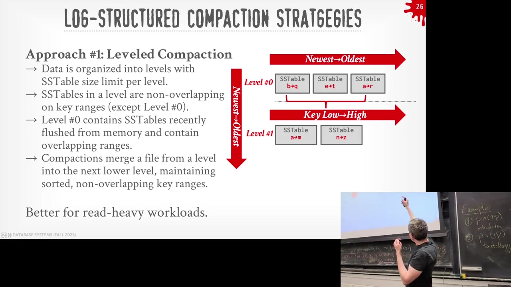
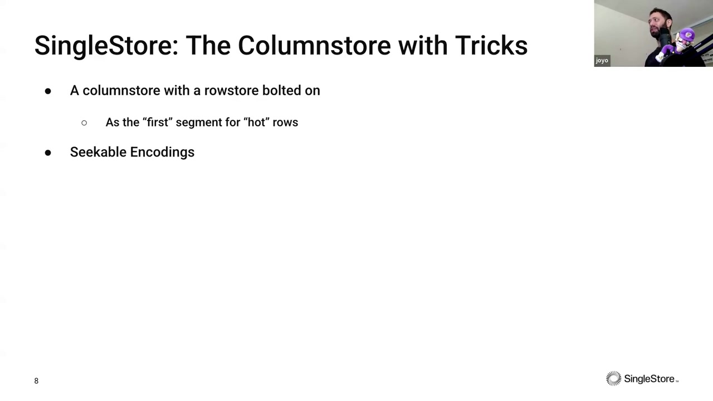

# L5 逐段整理译稿：数据库存储 II 与 SingleStore 嘉宾短讲

## 00:00–01:10 开场音乐与电台节目

开头字幕标有音乐，并夹杂不能可靠辨认的歌词；这里不把它们补成可确定的句子。约 00:25，Andy 请大家为 DJ Cash 鼓掌，注意到他今天的穿着。Cash 回答说自己刚从法庭回来，正在追讨版税；Andy 问是否胜诉，他说还不确定，下周再告诉大家。

Andy 接着请 Cash 宣传本周开始的电台节目。Cash 说，这个星期日 13:00–14:00，他会在 WRCT 做节目，欢迎大家收听。Andy 问有没有报酬，Cash 说没有；Andy 打趣说，这件事还得争取一下。

## 01:10–02:46 作业、项目和产业访问日

**Andy：** Homework 2 今天发布，21 日截止。Project 1 昨天已经发布，9 月 29 日截止。有人看过了吗？有什么问题？我们会公布下周的习题讨论课安排。文件应该都已经在 GitHub 上，要拉取更新，确保使用正确的代码库。

下周会有产业合作伙伴来访，很多数据库公司的朋友会来校园做报告，也会和大家交流。研究报告、学生和其他研究者的海报展示是一部分；公司报告是另一部分，上午会有几组不同公司的分享。你们可以询问实习和全职职位；如果填写 Piazza 上发布的表格，我们会把简历交给他们。

**提问：** 有没有研究报告的名单和具体时间？

**Andy：** 幻灯片中的链接会带你到活动页面。最终日程还没完全确定，大概明天公布。公司场次也要等明天大家填完表，再安排合适的顺序。还有其他问题吗？

> **编者注：** 这里是 2025 年课堂通知，不是当前报名或截止信息。字幕先说“下周一、周二 16、17 日”，后面又说“15 日研究活动、16 日公司场次”，存在日期自相矛盾，不能据此静默修出一份活动日历。本课程实验另行固定 BusTub 历史版本，不能把课堂“拉最新代码”理解成今天使用 `master`。

## 02:46–04:36 数据库行业的课间趣谈

**Andy：** 今天有一条非常大的数据库新闻，差不多两小时前刚发生。有人知道吗？他用夸张的语气把它称为大家一生中最大的新闻：Oracle 创始人 Larry Ellison 成为了世界首富，超过 Elon Musk。现场有简短插话，但名字没有被字幕可靠保留；Andy 回应说：“那个人不做数据库吧？这位做。”

Andy 继续拿数据库行业的财富开玩笑：Ellison 拥有夏威夷岛屿、给儿子买电影公司，还有婚姻和年龄方面的新闻。他说自己发了邮件祝贺，“这就是我们做数据库的原因”，还故作激动地回顾财富榜名次上升。他最后收住笑话：我们现在还没到 Larry 的程度，先继续上课。

> **编者注：** 这一段保留课堂语境，不作为财富排名、私人生活或商业交易的独立事实核查。字幕中个别插话无法可靠辨认。

## 04:36–06:34 从 buffer manager 回到磁盘布局

**Andy：** 上节课讲的是 buffer manager。如果不使用 `mmap`，而是由数据库管理自己的内存，就需要这个组件把磁盘上的数据库页放进内存，向其他模块提供指针，跟踪引用、脏页以及相关状态。整套机制让数据库即使装不进内存，也能像数据随时可用那样工作。

今天先补上上次没来得及讲的三个优化，再回到磁盘层面，复习 tuple-oriented storage，然后讲两种替代设计：index-organized storage 和 log-structured storage。最后有 SingleStore 的朋友做短讲。SingleStore 最初以以内存为主要数据存放位置的数据库起家，后来发生了变化。Andy 还提到它与 Neon 创业者的渊源和收购新闻，再开了一次“数据库可以赚很多钱”的玩笑。

为什么数据库可以做这些优化？因为它知道正在运行的查询、知道执行计划要做什么，又控制着内存和磁盘读写。操作系统通常没有 SQL 与数据结构层面的这些信息。SQL 的声明性让系统能先理解要完成的工作，再安排访问，而不是只被动接收单次读写。

> **校订：** ASR 的 `MAPAP` 是 `mmap`，`disculer` 是 disk scheduler，`discordant` 在这里指 disk-oriented。商业新闻的具体金额和相对年份仅是课堂说法，未独立核实。

## 06:34–09:36 多个 buffer pool：分开策略，也分散竞争

**Andy：** buffer pool 不必是一整块逻辑上统一管理的内存。可以拆成多个区域，每个区域维护自己的 page table，也可以采用不同策略。比如按数据库、表，或页类型划分：索引页放一个池，表数据页放另一个池。

这样有两个好处。第一，针对数据实际用途选择更合适的淘汰策略和时机；第二，多个工作线程不必都争同一组内部数据结构，可以减少 latch contention。高端企业数据库经常提供这类配置。课堂举 DB2 为例，说它允许按表、索引或大对象等进行很细的管理；MySQL 的例子则简单一些。

一种实现是利用对象标识。假设上层给出 record ID 或 object ID，系统从中识别表或索引，再查映射，决定到哪个池里找页。幻灯片里的“取记录”是示意命令，不是 SQL。

这里有一个关键约束：同一个物理页，在这套多池设计中只能由一个池拥有。若两个池各保留可修改副本，一个写成这样、另一个写成那样，就又要解决同步问题；我们不想引入它。

另一种简单方式是哈希分片。对目标页的身份计算哈希，再对池数取模，就知道到哪个池找。课堂把这描述为 MySQL 的做法。图上只有两个池，实际可以有很多个；下面还可以有统一的 disk scheduler，看到所有池提交的请求后，排序或组织读写，避免大家各自制造杂乱的随机 I/O。

> **编者注：** ASR 把 modulo 识别成 `modify`，这里按“取模”校订。路由必须以能唯一确定物理页的身份为依据：不能把同页不同 tuple 的 RID 任意散列到不同可写池。上述产品例子是课堂层面的说明，不是已核对具体版本的配置手册。

## 09:36–12:18 预取：知道将来要读什么，比只看偏移更有用

**Andy：** 另一个优化是 prefetching。现在先把 query plan 看作运行查询的程序；后面才会细讲它的结构。如果计划正在顺序扫描页，读了 0，再读 1，系统可以在处理页 1 时提前把 2、3 读进来。仍然按需要运行淘汰策略，为预取页找空间。等查询真正请求页 2 时，数据已在内存，不必停下来等磁盘。

操作系统也能做预读，使用 `mmap` 时也可以给它访问提示。但是操作系统看到的是文件访问，通常不了解页中数据之间的逻辑关系。

看一个范围查询。假设我们用树形索引，最常见的是 B+ 树，但不要求一定是它。叶子节点按键排序。查询先读根页 0，再沿内部节点向下；这一段碰巧可能与文件顺序一致。到叶子层后，我们知道后续扫描要读页 3 和页 5，它们在文件中不连续。只根据顺序访问来猜测的 OS 可能预读 3、4；数据库理解叶子之间的关系，可以跳过 4，提前取 5。

我们以后会讲怎样从索引里向前看。这里想说明的是，数据库知道查询要做什么、知道页的内容，因此有机会作出更合适的 I/O 决策。

> **编者注：** 课堂“OS 只能顺序预取”是为了对比信息层次的简化表述，不是断言所有 OS 接口都不能指定非连续范围。数据库也并非预先知道每个运行时键值；它可以依据计划与已读索引结构逐步获得预取目标。

## 12:18–15:40 扫描共享：共享页的旅程，不共享计算答案

**Andy：** 最后一个优化是 scan sharing，也叫 synchronized scans。一个查询已经在扫描表，另一个也要扫描同一张表时，不一定让第二个从头开始。它可以搭上第一个查询的扫描进度，使用相同的页，随后再补读之前错过的部分。

这发生在系统底层，是游标遍历页面或表时的共享。它不等于 result caching：结果缓存是运行查询后保存结果，下次同样查询直接复用输出；扫描共享仍然执行各个查询，只共享读取数据的工作。课堂举 DB2、SQL Server、Teradata 和 PostgreSQL 等为例。Andy 说 Oracle 有看起来接近的机制，但有要求查询文本一致的限制：大小写或多余空格变化都可能让字符串匹配失效。他用它说明“语义相同”和“按文本识别相同”并不是一回事。

图上 Q1 要对 A 做一个求和，顺序扫描。buffer pool 只有三个 frame，当它读页 3 时，页 0 已被淘汰。这时 Q2 到达，也要扫描 A，但计算的是另一种聚合。若让 Q2 从页 0 开始，就要立即把刚淘汰的页再取回来。

更好的办法是让 Q2 从 Q1 当前的位置开始同行。游标读到的页可以分别交给两个查询做各自的计算。到表尾时，Q1 已看完整张表，可以结束；Q2 记得自己半路加入，回到表头，把尚未见到的前半段补完。

这延续了上次课的原则：一页已经从磁盘搬进内存，就尽量多做有用工作。一次取页若能满足两个查询，就可能比各自读取划算。

> **编者注：** 产品支持范围和 Oracle 对比未独立阅读对应版本文档；这里不是产品功能承诺。共享物理读取也不意味着两个查询可以共享事务可见性判断。

## 15:40–17:16 扫描共享的三个追问

**提问：** 在图中这个时刻，页 1、页 2 不是还在内存里吗？第二个查询能不能先利用它们？

**Andy：** 可以。你是在说，Q2 可以查看 buffer pool，先读自己需要、而且仍在内存中的页 1、2，再搭上正在运行的扫描。这个 PowerPoint 示例没有画得那么复杂，但算法上可以这么做。我不认为 PostgreSQL 做了这一步；闭源企业系统具体怎样做，我也不知道。

**提问：** 怎么知道哪些页属于哪张表？

**Andy：** page directory 告诉我们。它相当于目录：想读表 A，就能找到有关文件及文件中的页。系统当然必须有这种对应关系。

**提问／补充：** 这说的是顺序扫描；如果走索引，两个查询可能并不读取相同的页。

**Andy：** 是的。有 `WHERE` 谓词，而且有可用索引时，可能根本不需要读全部页。我们这里先保留简单的顺序扫描例子。

## 17:16–20:23 复习 slotted page：移动字节，不改外部槽引用

**Andy：** 补充完三个 buffer pool 优化，现在回到磁盘存储。本课主要采用 disk-oriented architecture：数据库静止时的主要位置是非易失存储。我们把数据库切成页，并介绍过把 tuple 放进 slotted page 的方式。

page layout 说的是页内部放什么、怎么放。tuple-oriented layout 的中心是元组：一条记录尽量完整地存放在页里，页内有一层间接寻址，允许移动元组。

最常见的行式数据库布局之一就是 slotted page。页头保存 checksum、版本号等元数据；一端是 slot array，另一端是 tuple 数据。槽里记着页内偏移，告诉我们每条 tuple 从哪里开始。槽数组从页首向后增长，tuple 区从页尾向前增长。这是课堂采用的方向；也可以反过来画，重要的是两边朝中间增长，并有间接寻址。

删掉一条 tuple 后，可以把另一条移过来填洞。只要它还在同一页内，就只需更新对应槽中的偏移，不用把外部所有引用都改一遍。跨页移动可能有必要，但不属于当前这张示意图解决的问题。

## 20:23–24:22 Record ID、标识空间与很宽的记录

**Andy：** record ID 是在数据库里物理定位 tuple 的方式，通常组合文件名或 file ID、page ID，以及页内 slot number。page directory 记录对象对应的文件；页号可能映射成文件内偏移，也可能体现在文件名中，取决于系统的寻址方案。

**提问：** 如果行数超过 ID 能表示的范围怎么办？

**Andy：** 标识通常很大，比如 64 位，Oracle 的例子是 10 字节，PostgreSQL 的例子是 6 字节。理论上当然可能耗尽，但那已经是很大的表，而且系统还有其他限制。现场提到 Ingres，Andy 说明它是很早的系统。ID 是覆盖一张表还是整个数据库，也取决于方案：可能已经知道目标表，然后只需表内的页号。

Andy 继续说，数据库还有列数等限制，有些来自实现中很早的固定值。表也可以分区：逻辑上看成一张父表，内部拆成多个子表，分别拥有自己的标识空间，从而绕开一些单个对象的规模限制。

**提问：** 行存数据库真的会有一千列的表吗？

**Andy：** 会。企业应用很复杂。想象一个 ERP 系统已经运行三十年，每隔两年就有人要加十列，积累下来很容易变得很宽。多数表可能只有二三十列，但长尾里确实存在非常宽的表。

**提问／补充：** 那一行不就可能跨多张页了吗？

**Andy：** 要看每列是什么。数据库能够处理。这里暂时假设一条记录装得进一页；前面讲过大属性，页里可以放指针，指向另外的页，运行时再把逻辑记录拼回来。

> **校订与边界：** 字幕中的具体产品列数并不可靠。课堂把 PostgreSQL 上限说成 $2^{16}$、把 Oracle 说成固定一千列；这里不把它们写成产品规格，也不据此计算容量。RID 位数也不代表所有位都用于行编号。六字节物理定位符不是跨所有表的全局业务主键。

## 24:22–27:46 为什么把 tuple 直接放在索引叶子里

**Andy：** tuple-oriented storage 的读取很直接。先拿到目标的 RID——暂时假设有索引，把“学生的 email 地址”这类逻辑键映射到 RID。然后查页面目录，定位页；不在内存就从磁盘取来；再利用 RID 中的槽号找到槽项，沿槽内偏移读取 tuple。

这样会经过两段查找：逻辑键到 RID，再从 RID 到 heap 中的记录。能不能把这两段合在一起？这就是 index-organized storage：索引本身就是表的存储。

普通索引像一个键到值的映射。tuple-oriented 表的索引值通常是 RID；索引组织表则在叶子里直接存 tuple，而不是再存一个指向 heap 的 RID。数据结构通常是 B+ 树，但概念上也可以考虑 skip list、trie 等结构。

叶子页内部仍然很像 slotted page：有一个 key-to-offset 数组，按 key 排序；offset 指向页内 tuple。根据 email 向下查树，到叶子后在这个有序数组中二分查找，就能找到 tuple，不必再去独立的 heap 查一遍。注意，这不是说树节点不需要定位和读取，而是省掉了另一处表记录的访问。

课堂举 SQLite、使用 InnoDB 的 MySQL 为常见例子；Oracle 和 SQL Server 也提供索引组织或相近的组织选项。key-offset 数组与 tuple 区仍然可以相向增长。

> **编者注：** 产品默认布局以及“按哪个键组织”不能一概而论。尤其 SQLite 普通 rowid 表的存储键不一定是 SQL 声明的业务主键；这里只保留“数据可直接位于索引叶子”这一结构性结论。产品具体配置未在本讲独立核验。

## 27:46–30:31 插入容易，变长更新会发生什么

**Andy：** 索引组织解决了一类读取问题，但仍然需要处理写入。先忽略树分裂和重新平衡，把注意力放在页内。

插入时，先查页目录，找一张有足够空闲空间的页。我们知道要插入什么，可以计算所需空间。页不在内存就读入，找到空槽，写入记录。如果现有页都没有空间，就分配新页。

更新要先按 RID 找到旧 tuple 所在的页。这里暂时假设覆盖原值；实际系统并不总这样做。如果新 tuple 比旧的更大，要检查当前页能否容纳。slotted page 允许移动元组，整理碎片后也许能腾出足够空间，这样就还可以留在原页。

若怎么整理都放不下，就可能要把旧 tuple 删掉，再把新 tuple 插到别处。这样比简单覆盖昂贵。tuple-oriented storage 读取方便，插入也常常不错，但更新并不总便宜。

> **编者注：** 这里“找任意有空间的页”描述 heap 的直观过程；索引组织表还必须遵守键范围和树结构，不能把 tuple 任意塞进另一叶页而不调整索引。

## 30:31–32:34 页式更新的代价与不能原地修改的介质

**Andy：** 首先会有 fragmentation。槽数组与 tuple 数据相向增长，不可能每次恰好填满整页，中间可能剩下一点放不下新记录的空间。

其次，为了更新一条很短的记录，可能得把整页读进内存。例如只想改五个或八个字节，页却有 16 KB；具体浪费程度取决于页大小、缓存和工作负载。再者，一批要更新的 tuple 可能分散在许多页里。如果十条 tuple 分属十张页，就要访问那些页，不能把它们当成一次紧凑写入。

还有一个更根本的问题：如果持久化存储根本不提供原地修改怎么办？不能读进一个页、改其中一个偏移，再覆写那个位置。课堂举 Hadoop 文件系统、Google Colossus 和 S3 一类对象存储作为思考背景：某些接口更偏向追加或创建新数据，要替换旧内容就形成新对象或新版本，而不是任意字节原地写。

> **编者注：** 这些系统的 API 并不完全一样。S3 通常是对象级替换，不应由课堂类比推出“所有对象存储都提供字节流 append”，也不应理解为“同名对象永远不能替换”。重点是数据库不能假设随意原地改写持久化字节。

## 32:34–35:24 Log-structured storage 的两个部件

**Andy：** 另一种方式是 log-structured storage，经常会用到 log-structured merge tree，也就是 LSM。与把 tuple 放进页后原地更新不同，我们让磁盘上的变化以新记录、新文件的形式出现。

后面会讲 multiversion concurrency control。今天的设计看起来也有多个版本，但不能直接等同于那种并发控制协议。这里的核心是把随机更新转化为更顺序的写入：insert 和 update 的前台路径可以很快，但读可能变复杂，也要处理删除。

LSM 是老思想，论文发表于 1996 年；Andy 说其作者与上节课 LRU-K 的研究有关。更早还有日志结构文件系统的工作。这里只介绍概念，不展开论文。

两个主要部件是 **memtable** 和 **SSTable**。memtable 在内存中接收写入，因此它可以原地修改。长到一定大小后，把内容写成不可变的 SSTable。SSTable 通常称 sorted string table；课堂口头提到几种近似展开，重要的是它按 key 排序、持久保存一批状态。

在这张简化接口图中，只有 `Put` 与 `Delete` 两类修改。`Put` 是物理上写一个新条目，逻辑上既可能插入，也可能更新；“没有 Update 操作”不是说用户不能执行 SQL `UPDATE`，而是底层把它表达成 `Put`。

## 35:24–38:48 从 memtable 更新到不可变 SSTable

**Andy：** 图中的横线分隔内存与磁盘。memtable 是一种内存数据结构，可以是 B+ 树、skip list 或其他合适结构，这里不限定。

先执行 `Put(101, A1)`，在 memtable 加条目；再执行 `Put(102, B1)`。key 从哪里来暂时不重要，可以想象系统维护递增 ID。现在再做 `Put(101, A2)`：因为 memtable 在内存中，可以直接把 101 的值改为 A2，不必在这张简化 memtable 中保留 A1。

如果内存丢失怎么办？有另外一份日志。今天不展开它，但写入操作会追加到单独文件，在宣布事务提交之前完成所需的持久化。这是为什么不能把“memtable 在内存”理解成“已提交数据随断电消失”。

继续插入 103，memtable 最终会满，可以想象它有几百 MB。此时遍历它的有序内容，把各 key 的状态写成 SSTable。101 在内存里改过几次，这次输出只包含当前的 A2。SSTable 内按 key 从小到大排列；完成落盘后，再用新的 memtable 接收写入，不断重复。

因此有两种顺序：**一个文件内部按 key 排序；多个刚刷出的文件之间按新旧顺序组织。** 可以在文件名或其他元数据里记录不断增加的时间／序号。不要把它们混为同一种排序。

> **编者注：** 课堂把 SSTable 类比为记录变更的日志，并没有说它就是 WAL。WAL 负责恢复所需记录及持久性顺序；SSTable 是可被检索和归并的数据文件。课堂允许 memtable 只保留最新值是本讲简化模型，真实 MVCC 系统可能必须保留可见版本。

## 38:48–40:39 为什么开始出现多个层级

**Andy：** 后面会详细讲 compaction。先看一种常见的分层方案：memtable 刷出的 SSTable 进入 level 0，积累到某个程度后，把若干 SSTable 合并成新的文件，再删除不再需要的旧文件。向下的层级承载更多数据；合并时丢弃不需要的旧状态，为同一 key 保留有意义的最新状态。

**提问：** 为什么要有多个 level？为什么不一直在同一个地方合并？

**Andy：** 再给我两张幻灯片。两种方案分别偏向读和写；目前图里还没展示 key range，所以容易困惑。

**提问：** 合并是不是在丢弃已不需要的操作？

**Andy：** 是。若同一个 key 做了许多次 `Put`，最后又删掉，那么不必保留此前所有 `Put`；至少要知道它被删了。图最终呈现上面较小、下面较大的结构。

这一段字幕在约 39:58 标有短暂音乐，问话的一部分不完整；以上保留了老师明确复述并回答的内容。

## 40:39–43:02 读取为什么需要 summary 与 filter

**Andy：** 读取 101 时，先查 memtable，因为这里保存最新变化；找到就返回值。这个值一般是序列化的 tuple，但到现在还没有严格限定其表示。

如果 memtable 没有，就要查磁盘上的 SSTable。若盲目读取所有文件，会像大海捞针一样昂贵。于是可以在内存中保存 summary table，记录文件的附加元数据，帮助判断某个 key 是否可能位于某个层级或文件中，避免不必要的读取。

在当前示意顺序中，先找较新的位置。如果底层和上层都有这个 key，就选更新的那一份。我们用额外数据结构缓解读取代价，但写快与读慢之间的取舍仍然存在。

**提问：** 这里的 key filter 是 Bloom filter 吗？究竟过滤什么？

**Andy：** 可以是针对范围的过滤器，用来排除某个区间；也可以是判断单个 key 是否可能存在的 Bloom filter。后面会讲 Bloom filter。它可能有 false positive：告诉你“也许有”，然后你仍要实际读取确认。

> **编者注：** “summary”不等于保存每个 key 的精确全局位置。键范围、文件索引和概率过滤器的能力不同。filter 说“可能存在”不是存在证明；层号也不是能脱离系统版本规则单独判断新旧的万能时间戳。

## 43:02–45:09 只改一个属性，还要读取旧 tuple 吗

**提问：** 比如只更新某个 ID 的一个字段。新条目里只有这个字段，其他字段怎么办？完整记录会不会分散在多个 SSTable？

**Andy：** 这正是我此前没有把 value 定义得太细的原因。如果是 blind write，不必关心原来的值，可以直接 `Put`。如果操作是“把 Andy 的年龄改成当前年龄加一”，就必须先读取原来的年龄，算出新值，再写入。在这里讲的模型中，写入 value 的通常是完整 tuple。

**追问：** 我可以不关心旧年龄，直接指定新年龄；但以后读取整条记录时，不还是要找其他字段吗？

**Andy：** 这里不是把一条记录的各属性散放在不同 SSTable 中。一个 memtable 或 SSTable 条目的 value 包含完整 tuple 的全部属性。因此只改部分属性时，为了保留其余属性，可能还是要 read-modify-write。具体取决于查询：若把全部属性的新值都指定了，就不用读取原值。

Andy 随即纠正自己的说法：不是“原地更新磁盘”，而是“无需先读旧值就完成这次逻辑更新”。

> **编者注：** 这不是所有 LSM 产品的强制格式。key-value 引擎的 value 可以是上层自行编码的字节；列拆分、增量记录或 merge operator 都属于另外的设计。本讲的推导明确以“value 是完整 tuple”作为假设，不能把老师提到 RocksDB 时的犹疑语气变成产品契约。

## 45:09–47:35 Delete 与后台 compaction

**Andy：** 删除也很有意思。tuple-oriented 架构通常要找出目标页，再标记记录删除。这里若已知 key，只需在 memtable 中写一个 `Delete(key)`，不必立即把所有旧数据找出来擦掉。

之后的读取必须看到这个删除记录，知道该 key 在逻辑上已不存在。旧 tuple 可能仍在很多 SSTable 里，但不能把它们重新返回。这类删除标记常称 tombstone。

**提问：** 那到底什么时候合并？

**Andy：** 下一张就讲。假设一个 tuple 更新了一千次，最后又删掉，磁盘上可能有一千零一个与它有关的条目；最新状态才是我们现在需要的。因此有后台 compaction，根据文件大小、重叠 key range 的数量或其他策略触发。

这和 buffer pool 的 background writer／page cleaner 很像：后台提前把 dirty page 写干净，有助于后续淘汰，但若后台占满资源，前台查询就会慢。compaction 也不能越勤越好；把所有时间都用来整理文件，会挤占真正执行查询的资源。没有适合所有负载的统一触发规则，像 RocksDB 这样的系统提供多种策略。

## 47:35–50:12 两个有序文件怎样合并

**Andy：** 先看最简单的两个 SSTable。明确知道哪个更新、哪个更旧；每个文件内部按 key 排序。用两个游标，从两个文件的开头开始，这就是类似 sort-merge 的过程。实际可以一次合并多个文件，这里为了画图只用两个。

第一步，一边是 `Delete(100)`，另一边是 `Put(101, …)`。100 小于 101，所以后一个文件当前及其后面的 key 都不会是 100；把删除 100 的条目复制到输出，只移动第一个游标。

第二步，两边都是 101 的 `Put`。既然知道第一个文件更新，就保留其 101，忽略旧文件的 101，两个游标都前进。102 也是这样，只输出更新的版本。

接着 103 一边是 `Put`、另一边是 `Delete`，仍然按新旧决定，而不是认为删除天生优先。在图中较新的 `Put(103, …)` 胜出。第一个游标到文件末尾后，把另一文件剩下的条目，例如 104，依次复制到输出。

这就是 compaction 的基本工作。更难的问题是怎么组织许多 SSTable、选择哪些文件合并，以及何时触发。

> **编者注：** 示例保留 `Delete(100)` 很重要：合并了眼前两个文件，不代表别处没有更老的 100。若贸然连 tombstone 一起删掉，旧数据可能“复活”。真实系统还要考虑快照和并发读者；课堂此处没有完整展开安全回收协议。

## 50:12–53:49 Leveled compaction：每层的范围不重叠

课堂帧，约 **51:31**：L0 的文件按新旧排列，L1 的输出按 key range 排列；画面同时显示 Andy 的现场讲解。来自原片有限视频片段，不是用 PDF 或生成图替代的截图。截帧时间为近似定位，不声称帧级对齐。

**Andy：** 前面画的是 leveled compaction。它维护多个层级，目标是让同一层的 SSTable key range 不重叠，**level 0 除外**。L0 是 memtable 刷盘的入口，不同批次的 key 自然可能重复或交错。

例如依次刷出 `[A,R]`、`[E,T]`、`[B,Q]` 三个范围。L0 达到触发条件后，把它们合并到 L1，按前面的规则去掉不再需要的旧版本，输出两个较大的文件，并让这两个输出的 key range 不重叠。

如果找 Q，在 L0 最坏可能检查三份文件，因为三者都可能包含 Q。到了不重叠的 L1，只可能在其中一个文件里；还可以用 filter 判断是否值得查。它依然可能不存在，但至少不用检查本层全部文件。

**提问：** 为什么到下面就画成多个 SSTable？不能只放一个吗？

**Andy：** 可以画一个巨大的文件。这里画两个，一方面表示累积数据可能超过单个输出文件的目标大小，另一方面是为了展示“不重叠范围”。不是规定这一层必须恰好两个文件。

完成后，可以移除被替代的 L0 文件，继续接收新的 flush。下一轮 L0 中又是重叠范围；若要并入 L1，就必须维持 L1 的范围约束，所以可能连同已有的相关文件读入、重建、写出。如果新来的 key 分布很广，重写量可能很大。

> **编者注：** 课堂把更深层画得更大，不等于所有实现都要求“每个 SSTable 文件都逐层变大”；层容量、文件数量、目标文件大小是不同参数。“读入再写出”也不要求一次把全层装进 RAM，可以流式归并。

## 53:49–56:06 层数、容量以及读优化究竟在哪里

**Andy：** 假设 L1 有 10 GB 数据，一轮范围很广的 compaction 可能需要读 10 GB，再写出大约 10 GB。这是需要认真考虑的成本。

**提问：** level 的数量是固定的吗？

**Andy：** 抽象图可以继续向下增长。实际会有配置；我不记得 RocksDB 的默认值。底部会承载很大的数据量。

**追问：** 如果配置十个 level，是不是一开始就总有十个？

**Andy：** 不必。可以允许最多十层，但刚开始时只有两层有数据；它随着数据增长。如果不再增加层数，最底层就会承载更多、更大的文件。

**提问：** 为什么这个方案更适合 read-heavy workload？

**Andy：** 因为较低层内部范围不重叠。找一个 key，只需查范围对应的那份 SSTable。相比之下，L0 的三份文件都可能含 Q。即使文件按新旧排列，最坏仍要检查三份；若第一份就找到更新值，则可以停，但不是每次都有这种好运。

> **编者注：** 这里“更适合读”是相对于下面更宽松的合并策略，不是说 LSM 的每次读都比其他布局快，也不是说层数可以在任何产品里无限增长。

## 56:06–59:07 更多 compaction 问答：顺序并没有消除未命中成本

**提问：** 同一个 key 能同时存在于 L0 和 L1 吗？

**Andy：** 能。

**提问：** L0 已经按新到旧排列了，为什么查找速度还会受影响？

**Andy：** 想找 Q，第一份没有，就查第二份；第二份也没有，再查第三份。每一次实际查找都有代价。summary table 能帮忙排除一些文件，但最坏仍可能检查很多。下层做 compaction 后，在本层可以保证 Q 只属于一个 SSTable 的范围；不做整理、只不断刷新的文件，就没有这个约束。

继续向下 compaction 后，也同样维护本层范围不重叠；但不同层之间仍可以存在同一个 key 或重叠的范围。

**提问：** 什么触发 compaction？

**Andy：** 取决于系统和配置。例如某一层的所有文件累计大小超过设定上限，就触发整理。

**追问：** 图里这次为什么只把 L1 的两个 SSTable 合到 L2，而不是更多？

**Andy：** 这只是例子，我要让它能在 PowerPoint 里画清楚。实际可以合并更多。你当然可以非常激进地合并一切，但那样时间都用来 compaction，而不是执行查询。

## 59:07–1:01:03 Universal compaction：让合并更偏向写入

**Andy：** 快速看另一种策略：universal compaction。图里不维护前面那种严格的多个 leveled 层级，而是保留按新旧组织的有序文件／run，选择其中一些进行合并。

这样不必为了维持下层的范围约束，每次都把很多已有数据读入再重写。比如选三份合成一份更大的，再选另外两份合成一份，去除重复旧状态，回收空间。

这适合很快地插入数据、做很多更新的负载，也可能适合主要读取刚写入数据的场景。例如持续记录教室温度，只看最近五到十分钟，不关心一年前的数据，那么在最新文件里就可能找到所需内容。

这仍然是经典取舍：花更多写入维护成本，可以减少读取时的搜索；尽量让写入快，则可能要接受读取更慢。universal 在这里代表偏向减少写入维护的方向，但具体查询慢多少取决于要找什么。

> **校订：** ASR 的 `universe compaction` 校订为 universal compaction。字幕在本段一度说文件范围“non-overlapping”，与比较逻辑不一致；这里不据此建立范围不重叠保证。课堂“只有一层”是简化示意，不是所有 RocksDB 版本内部层号和 run 表示的精确描述。

## 1:01:03–1:04:04 RocksDB、写放大和下一讲

**Andy：** 过去十多年，log-structured storage 很普遍，部分原因是 RocksDB。它是 LSM key-value store，支持前面两类 compaction 策略，很多新系统把它当作存储引擎的起点。

RocksDB 来自 Facebook／Meta 对 Google LevelDB 的分支，Andy 提到 Jeff Dean 与 Bigtable 团队的关联。课堂互动问：“他们分支后最先做的技术修改是什么？”有人猜版权、许可证，Andy 说不是法律层面的事，接着回答：去掉 `mmap`，改成自己管理 buffer pool。他以此再次强调上节课的设计立场。CockroachDB 等系统最初也使用过 RocksDB，后来可能重写或更换内部实现。

问题还是 compaction 的成本。即使一条 tuple 只被逻辑更新一次，后来不再变，也可能在不同 compaction 中被反复读进来、写出去。这就是 write amplification。相比之下，在简单 tuple-oriented 例子里，写到页上后若不再访问、不再变更，就不需要仅因这种归并过程而反复重写。

**提问：** 那这些系统都不适合读多的负载吗？

**Andy：** 不是。例如 ClickHouse 就很擅长分析读取，还有许多办法能减轻这些问题。下一讲会讲。

接下来我们会打破“记录总是按整行连续放置”的直觉，讨论 column store：按列，而不是按行存放数据。

> **编者注：** “最先改掉 mmap”是老师的历史叙述，本文没有独立审查提交历史；许可证的现场猜测也不作为许可事实。LSM、列存、分析查询是不同设计维度，不能由某个产品名字直接推出完整存储算法。

## 1:04:04–1:07:21 Project 1 的课堂说明

**Andy：** 切到嘉宾之前，简要说 Project 1。说明已发到 Piazza，代码在 GitHub。你们要为 BusTub 构建 buffer pool manager：先做基于 ARC 的替换策略，再做 disk scheduler，再把 buffer pool 组合起来，截止日期是 9 月 29 日。下周的习题讨论课会进一步解释 ARC。

替换器负责在需要空间时决定淘汰谁。可以使用 STL 容器来实现 ghost list，以及近期／频繁访问列表，不需要自己重新实现 C++ 的 vector 或 list。它们是内存中的管理状态，崩溃后不要求原样保留。

disk scheduler 通过 `std::promise` 等机制提供异步 I/O 完成通知。系统其他模块说“我要这个页”，调度器组织读请求，把数据读进内存，再通知请求者。最后把 frame 存储、page table 和替换器接起来：请求页，不在内存就安排读取；没空间就用 ARC 决定如何腾出 frame。

尤其注意，只修改题面允许修改的文件。Gradescope 会用官方版本替换其他文件，如果你依赖那些额外修改，评分环境就可能无法运行。后续 Project 2、3、4 都依赖这里的实现；不要拖到两个月后还在修 buffer manager，否则后面的项目会很难做。

有问题可以去 Piazza 或 office hours，但助教不会坐在旁边替你逐步使用 GDB 调试；Project 0 之后，应能自己使用 C++ 调试工具。和前一个项目一样，也要检查代码质量。

今年还有性能 leaderboard，排名靠前可以得到额外分数；Andy 还设想做一个类似奖杯的长期纪念物，把每年优秀成绩者名字刻上去。他最后提醒不要抄袭，有问题就提问，然后交给嘉宾。

> **编者注：** 这是课堂概览，不替代固定版本完整题面。老师口述截止日期为 **9 月 29 日**，但本批主审核对的官方 Project 1 网页写 **9 月 28 日**；这里保留口述，执行要求以正式题面为准。实验采用 Fall 2025 的 ARC 变体，不是旧版 LRU-K；实现范围还包含题面要求的 Page Guards 等内容。请转到 [Project 1 原创导读](#/c/cmu-15-445-2025/lab/project1?v=zh) 和 [实现指导](#/c/cmu-15-445-2025/lab/project1?v=guide)。本文未运行学生骨架、未验证 Gradescope 登录，也不代表学习者已完成实验。

## 1:07:21–1:10:30 Joseph Victor：OLTP 要优化什么

Andy 介绍 Joseph Victor：他在 SingleStore 工作，也会参加下周的校园活动。Joseph 确认下周还会来，随后开始短讲。

**Joseph：** 我想快速介绍 SingleStore。我认为它是业界很独特的数据库。先讲两类数据库负载，以及 SingleStore 怎样提供一种混合选择；原计划还要转到现代云系统，谈云环境带来的好处。

第一类是 **OLTP，online transaction processing**。它通常有大量事务、高并发、很小的读写。任何一行都可能随时被读或更新，所以系统围绕快速定位、索引和事务修改来优化。

通常有很多短查询同时到达，响应 SLA 很短，希望在毫秒级返回。你在意 ACID：事务必须原子，不希望隔离问题产生奇怪副作用，也不希望已经完成的写入丢失。

典型例子是应用后端、银行交易，或者网站上点击购买：用户付钱，商家承诺交付商品。这样的系统通常采用 row-oriented 数据结构，因为需要快速找到和更新一整行；B 树、skip list 等帮助快速定位记录。

Joseph 列举 PostgreSQL、Oracle、SQL Server，以及 CockroachDB、Spanner 等事务数据库，并将后两者作为现代大规模事务系统的例子。

> **编者注：** 从这里开始是嘉宾对 2025 年产品与行业的描述。OLTP/OLAP 是负载分类，不是禁止某个产品运行另一类 SQL 的边界；“PostgreSQL 几乎等于 OLTP”等是讲话中的概括，不是正式功能定义。

## 1:10:30–1:13:21 OLAP 与“为什么不能用一种结构擅长两者”

**Joseph：** 第二类是 OLAP，也就是分析型数据库。它做大型批量查询，报告可能运行几分钟、几小时，过去甚至几天——现在未必还能接受那么久。数据规模常达到 TB、PB。

典型工作是报表、分析、dashboard，以及定期的大批量加载，而不是只更新一行。它们采用很不同的数据结构，尤其是 column-oriented storage，擅长非常快地扫描大量数据。你们课程会讲列存，我非常喜欢这个主题。

例子有 Snowflake、ClickHouse、Redshift、BigQuery、Vertica。虽然具体路线不同，这些例子都体现了大型分析与列式处理的方向。

为什么同时做好两类工作很难？可以说行存会有随机 I/O、扫描带宽和写放大等问题；但在我看来，关键是列存扫描实在太快了。要扫描巨量数据，列存很有吸引力；代价是更新通常不够快。

Joseph 用很强烈的措辞说：“列存的点查询不会和行存一样快”，因此很多系统往往偏向列存分析，或偏向行存事务，而不是两者都擅长。SingleStore 想处理的正是这个结合问题。

> **编者注：** “永远不可能一样快”是嘉宾用于强调取舍的修辞，不是经过这里证明的普适下界。是否快取决于缓存、索引、编码、行宽、并发、数据分布和实现。本文不把产品分类或性能比较扩展成无版本、无工作负载的定理。

## 1:13:21–1:15:21 SingleStore 的回答：以列存为主，加上点查和热行机制

课堂帧，约 **1:14:21**：Joseph 的幻灯片已经列出热行使用 rowstore 和 seekable encodings，右上角为嘉宾画面。图片记录本次讲话的实际显示内容，不是对当前产品规格的独立证明。

**Joseph：** 说 SingleStore 是一个拼装出来的混合体，也不太准确。我更愿意说：它是“加了一些技巧的列存”。我们在列存旁边加了行存，可以把它理解成列存最前面的一个 segment，用于保存 hot rows。

然后优化列存，让它在保留扫描能力的同时，也能比较合理地执行事务负载。它不是声称点操作和专用行存一样好，而是要让这些操作不至于很差。

第一步是让列存编码 **seekable**，能够定位访问；只有这一步还不够，所以再加 secondary hash index，记录 offsets。知道偏移后，就能更快地跳到相关位置。行存部分还参与管理列存数据对应的锁状态，Joseph 在这里用了 virtual locks 的说法。

每个机制都足够讲一小时，这个短讲没有时间展开。总体目标是：保持一个列存，但它在高并发修改与事务操作下也能正常工作。

对于确实需要更偏事务型行为的场景，我们仍提供专门的 in-memory row-store tables。公司以前叫 MemSQL，主要聚焦内存行存；后来重点发生变化，因此改名，但这些行存能力仍然保留。

> **编者注：** 本段忠实保留嘉宾给出的机制和限制，没有凭短讲补造编码格式、锁算法、默认表类型或事务隔离级别。产品版本号在演讲中未给出；这些是 2025 年课堂陈述，不是对当前 SingleStore 的独立测试结论。

## 1:15:21–1:17:28 基准与混合负载：嘉宾的产品主张

**Joseph：** 这些设计让我们能做什么？分析数据库喜欢 TPC-H、TPC-DS 一类基准。有很多查询，不同系统各自在一些查询上更好：一个优化器规则、执行技巧或列存优化都可能改变排名。SingleStore 在这些分析基准上可以和优秀的数据仓库竞争。

Joseph 进一步说，普通 OLTP 系统不适合完成这类大规模列式分析；而 SingleStore 还可以运行 TPC-C 和其他点访问、事务型负载。他拿 Snowflake 作比较，强调自己的卖点不只是某个查询更快，而是能够覆盖这几类工作。他说，至少在自己知道的商业系统里，这是很独特的组合；学术系统可能也有类似能力。

至于该不该称作 hybrid database，营销可能会使用 HTAP 这样的词。Joseph 更愿意把它理解成：一个在高并发和点访问下也不会“撑不住”的分析数据库。dashboard、物流、制造、流式数据、AI 等混合场景，通常以分析为主，但又包含不能忽略的事务处理。

> **编者注：** “能完成全部三类基准”“其他系统不能完成”“不损害扫描性能”等均属于 Joseph 的现场产品主张，**没有附带可复现配置、数据规模、产品版本或经审计结果**。本文没有验证，也不据此给产品排名；能运行某类查询、满足相同一致性要求、达到某个吞吐或延迟，是不同命题。

## 1:17:28–1:18:43 嘉宾问答与结束通知

**Joseph：** 原本还有几张关于现代云系统的幻灯片，但已经超时了，可能应该在这里停下来，留时间给问题。

**Andy：** 大家有什么问题问 Joe？

**提问，由 Andy 复述：** 如果采用压缩效果差一点的 encoding，是不是意味着需要更多存储空间？

**Joseph：** 是。后面有一句未完成的回答，字幕不足以可靠恢复其完整含义。

**Andy：** 这个问题是关于编码的。先留到下一讲：Joe 的介绍正好是下一节课的开场。有些东西现在还不清楚，到周一会讲明白；而且他还会来校园，大家可以再和他交流。

Andy 请大家感谢 Joe，再提醒 DJ Cash 的节目是星期日 13:00，也期待在周一的访问日见到大家，随后示意播放音乐。

> **范围说明：** 嘉宾在开头预告的“现代云系统”部分，最后明确选择不讲。本文没有把未讲的幻灯片内容补成演讲，也没有按课程标题省略嘉宾段落。可辨认的嘉宾问答已完整保留。

## 1:18:43–1:19:18 结束音乐与字幕尾部未知

字幕约从 1:18:42.950 起标记音乐，中间夹杂不能可靠组成完整句子的词片段。最后一条文字事件在 **1:19:07.320** 结束，视频元数据时长为 **1:19:18**，所以最后 **10.680 秒**没有字幕覆盖。本文没有核听这段音轨，不能把它认定为静音，也不能补出对白或歌词。

## 来源、阅读与校订边界

- 课堂：CMU 15-445/645 **Fall 2025**，L5，官方课表题名 *Database Storage II*；视频题名 *#05 - Log-Structured Database Storage / SingleStore Database Talk*。讲者 Andy Pavlo；嘉宾 Joseph Victor（SingleStore）；发布者 CMU Database Group。课表日期 2025-09-10，上传日期 2025-09-11，两者分开记录。
- 基础是 `en-orig` 英文自动字幕，全部 **2125 个文本事件**已按时间顺序阅读全文。本文是**逐段整理译稿**，合并口头重复，不声称逐字或经全片听校。原 ASR 在本地来源区保留，中文专名校订和技术注释另行标记；不确定插话不补造。
- 原片 ID `2_sTdS4h-bY`，来源入口由课程页和公开 `source-manifest.json` 保存；本译稿不嵌入视频或生成跳转片段。逐视频元数据明确标记 Creative Commons Attribution（reuse allowed）；据该标签对本视频的中文改编保留署名，许可说明为 [CC BY 3.0](https://creativecommons.org/licenses/by/3.0/)。此标签不扩展到教材、独立 PDF、产品文档或第三方音乐；音乐歌词没有整段转译。
- 时间块覆盖 00:00–1:19:18，但这不是每毫秒都有文字的声明。首部、内部字幕间隙、末尾 10.680 秒均按“文本未覆盖、音频未核验”记录，不推定为静音。毫秒级区间及每块 cue 对应见本地 `sources/lec05/coverage.json`，公开摘要由来源清单归并。
- 指定教材为 *Database System Concepts*, 7th ed.，§14.8.1、§24.2：本讲仅复用课表章节登记，**未取得、未读教材正文，也未取得全文翻译许可**。没有另外生成伪装成独立阅读的 materials；官方 slides／notes 也没有在此重复全文翻译。论文与产品史仅按讲者提及处理，不冒称已读论文或代码历史。
