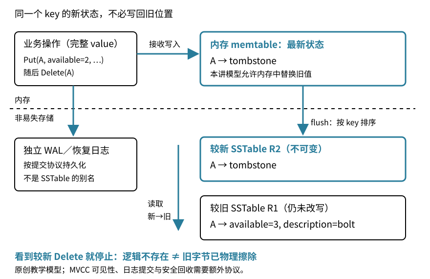
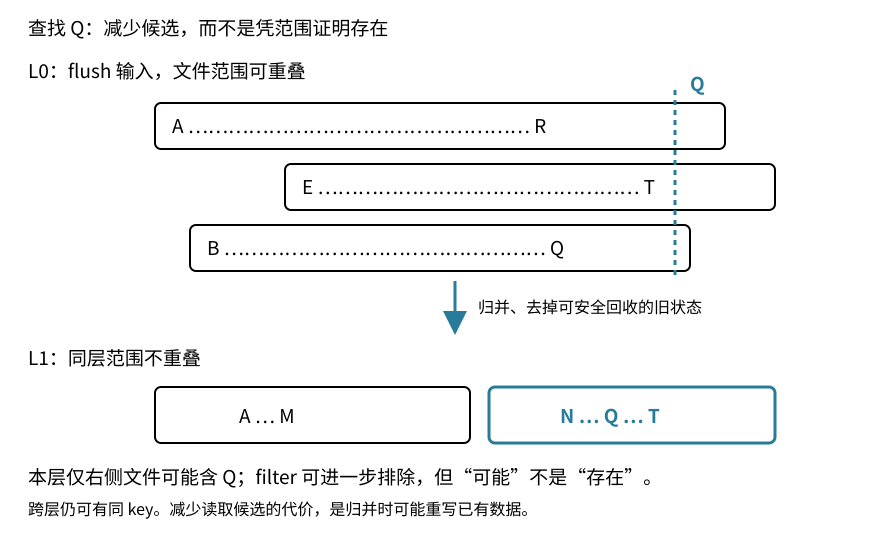

# L5 学习笔记：把更新成本搬到哪里

数据库存储设计的关键，不是“哪个结构名字更新”，而是：**现在省掉的工作，之后由谁、在什么时候、以什么代价补上？**

本讲从 buffer pool 的工作共享出发，比较 heap、索引组织表与 LSM，最后用 SingleStore 嘉宾短讲提出下一个问题：如果既要大量扫描，又要短小的事务访问，该怎样组合数据布局？

## 1. 已经读进来的页，怎样多用一次

设 `Orders(order_id, customer_id, total, state)` 跨很多页。两个查询分别求订单总额与订单数量，计算不同，却都要扫描同一份物理数据。

### 三个优化回答三个不同问题

| 优化 | 优先解决的问题 | 必须维护的约束 | 不能保证什么 |
|---|---|---|---|
| 多 buffer pool | 单一元数据热点；不同数据需要不同策略 | 页身份到池的路由一致；不制造互不协调的可写副本 | 哈希分片不自动均衡热点，也不自动共享空闲容量 |
| 预取 | 等真正要用页时才开始 I/O，CPU 被迫等待 | 目标来自可信计划／结构；尊重资源预算 | 预取也会占带宽和 frame，猜错可能污染缓存 |
| 扫描共享 | 多个扫描反复读相同页 | 各查询都覆盖其所需范围；保留各自语义与可见性 | 共享物理读取不等于共享聚合结果或事务快照 |

这三个优化的共同点是：利用数据库掌握的结构和查询信息，而非只把字节偏移交给 OS。

### 顺序预读不等于逻辑预取

假设 B+ 树叶子链按逻辑键顺序连接页 `2 → 3 → 5`。页 4 在文件里挨着 3，并不表示范围查询需要它。读取当前叶子后，数据库能利用相邻叶指针得知接下来应取 5。

**反例：** “SQL 是声明性的，所以数据库一开始就知道所有要读的页。”带有参数、选择性和运行时数据依赖的访问，仍可能只能逐步确定目标。这里的优势是知道更多上下文，不是预知未来。

### 扫描共享的完整性不变量

设表有页 $0,1,\ldots,N-1$，Q2 在 Q1 访问页 $k$ 时加入。Q2 可以先读 $[k,N)$，再绕回读 $[0,k)$。忽略并发变化，正确性来自：

$$
\begin{aligned}
[k,N)\cup[0,k)&=[0,N),\\
[k,N)\cap[0,k)&=\varnothing.
\end{aligned}
$$

两段应覆盖完整目标，而且不重复。若 Q2 还提前消费了 buffer pool 中的页 1、2，就必须把这些额外已读页计入进度，否则绕回时可能重复求和。真正的并发扫描还需各自的可见性规则，不是把 Q1 看见的 tuple 无条件当成 Q2 的答案。

假设页 $k$ 已要为 Q1 读取，Q2 同行时可以复用这次读取；这是一种避免重复 I/O 的机会，不是所有时序下都必定减半。为了等第二个查询而长期拖住第一个，也可能得不偿失。

原讲：06:34–17:16；其中 15:40–17:16 的问答明确提出“先消费仍在内存中的页”这一扩展，并承认没有核实各产品实现。

## 2. 从逻辑键到 tuple，到底跳了几次

继续看订单 `order_id=101`。

### Heap 与索引组织表不是“有没有索引”的区别

- **heap + 二级定位：** 索引把 `101` 映射到 RID，再用 RID 找 heap 页及槽，得到 tuple。
- **index-organized table：** 组织索引的叶子直接携带 tuple。按组织键查到叶子，就到达数据，不再跳到独立 heap。
- **页内 slotted layout：** 两种组织都可能采用槽／偏移间接层。这是页内字节布局，不与“索引组织”互斥。

所以“索引组织表没有 page directory”“有 slotted page 就不是索引组织表”都不成立。需要分清对象定位、树查找、页定位、页内偏移四个层次。

**为什么叶子里仍要 key-to-offset 数组？** tuple 可变长，不能简单按固定步长跳转。有序 key 数组帮助查找；offset 则允许 tuple 在页内搬动。移动的是字节，不一定改变外部逻辑键。

**反例：** “直接把整行放进叶子，所以所有查询一定更快。”按组织键点查可能少一次 heap 访问，但叶子放整行会影响页容量；按其他属性查找仍需要适当索引；更新键、分裂页和维护其他索引也有成本。本讲只说明一种读取路径的简化，没有建立普适性能结论。

原讲：17:16–27:46；RID 讨论还说明了 ID 作用域取决于系统。RID 不是业务主键，也不能只用位数推算整个数据库的可用行数。

## 3. 只把库存减一，为何可能搬动几万字节

设 `Stock(sku, available, description)` 中一个 SKU 的库存只改 8 字节，而其页大小是 16 KiB。若页不在内存、必须整页读取，单看读入量：

$$
\text{读入字节／修改字节}=16384/8=2048.
$$

若还要整页写回，读与写的字节总量可能更高。但这只是**隔离单个因素的纸面模型**：缓存命中、一次页写合并多次修改、WAL、设备内部行为都未计入，不能称为实际测得的放大倍数。

更新还有两类不同困难：

1. **原页放不下。** `description` 变长。即使移动页内 tuple、消除碎片后仍不够，就可能必须跨页迁移。槽间接寻址只解决页内搬动，不能自动保证跨页 RID 不变。
2. **接口不允许原地字节更新。** 对象式或不可变文件式存储不一定提供数据库想象中的“覆写这个偏移”。新状态需要写到新对象或新文件。

这些问题把我们引向同一个选择：**前台不去追着旧位置修改，先把新状态放在容易写的位置。**

原讲：27:46–35:24。S3、HDFS 和 Colossus 只是课堂讨论背景，不能把它们的精确 API 混成一种“都只允许 append”的接口。

## 4. LSM 把“当前值”从一个位置变成一个判定过程



图：原创 `Stock` 例子。上层的 sequence 表示本例新旧顺序，不是课堂给出的产品内部格式；文件不因逻辑更新而原地改变。图中的 WAL 是独立的持久化路径，不是 SSTable 的别名。

### 先明确本讲使用的简化模型

- memtable 在内存中，接收 `Put(key,value)` 与 `Delete(key)`。
- `value` 在课堂主例中表示完整 tuple；不是只保存被修改的一个字段。
- memtable 中同 key 可保留最新状态；刷盘形成按 key 排序、不可变的 SSTable。
- 不同新旧位置可能同时有同一个 key；读取必须按系统的新旧／可见性规则选择。
- 已提交更新的持久性来自另外的日志及提交协议，不能靠尚在内存的 memtable 保证。
- 这不是完整 MVCC：快照、未提交写和历史版本保留尚未展开。

### 手推一次库存变化

设旧 SSTable 中有 `Put(A, {available:3, description:"bolt"})`。

| 步骤 | 新写入状态 | 旧文件是否改变 | 此刻逻辑读取 A |
|---|---|---|---|
| 1 | 无 | 否 | 库存 3 |
| 2 | memtable：`Put(A,{available:2,description:"bolt"})` | 否 | 库存 2 |
| 3 | memtable 刷为新 SSTable | 否 | 从更新文件取库存 2 |
| 4 | 新 memtable：`Delete(A)` | 否 | 不存在 |
| 5 | tombstone 刷盘 | 否 | 仍不存在，不能返回旧库存 |

读取“当前 A”不再等于“到某个固定槽拿字节”。它是：检查候选位置、确定最新有效状态，如果是 tombstone 则报告不存在。

### Blind write 不是“只改一列就不用读”

若提交完整替代值，旧值确实可能不必读取。但 `available = available - 1` 依赖旧值；即使改成常数 `available=2`，在“value 是完整 tuple”的模型下，也可能需要取出原 `description` 才能构造完整新值。

**反例：** 只写 `{available:2}`，后来把它当成完整 tuple 返回，`description` 就凭空消失了。要支持真正的字段增量，必须明确设计表示与重建规则；不能一边假设完整 value，一边又偷换成增量日志。

原讲：35:24–45:09，尤其 43:02–45:09 的学生连续追问，是本讲最值得反复检查假设的段落。

## 5. 为什么 Delete 有时比 Put 更不能急着扔

假设我们有：

```text
较新文件 R2: Delete(A), Put(C, 7)
较旧文件 R1: Put(A, 3), Put(B, 4)
更旧文件 R0: Put(A, 1)            ← 本轮不参加合并
```

合并 R2、R1 时，`Delete(A)` 遮蔽了 `Put(A,3)`。若输出只剩 B、C，并把删除标记也去掉，下一次查 A 就可能一路查到 R0，返回 1——**被删除的数据复活了**。

所以不能把 compaction 简化成“相同 key 全部去重后，删除记录都丢掉”。安全回收需要证明被遮蔽的旧数据不会再被读到，还需考虑保留中的快照、并发读者以及真实系统的其他约束。本讲主线只讲最新状态，不展开完整回收算法。

### 双游标归并的不变量

每个输入按 key 排序，两个游标都指向尚未处理的最小 key：

1. key 较小者可以输出并前进，因为另一个有序输入后面不会再出现更小 key。
2. key 相同则依据新旧规则选定保留状态，两个输入都前进。
3. 一个输入结束后，可继续处理另一个的剩余条目，但仍遵守版本与 tombstone 规则。

对包含 $n,m$ 个条目的两个输入，简单归并扫描的条目比较／推进量为 $O(n+m)$，不需要为每个输出从头搜索。输出字节数不一定等于输入总字节数，因为有些旧状态被删除；也不一定只有一个文件，输出可以按范围切成多个文件。

**第二个反例：** “遇到 Delete 就比 Put 新。”删除也有顺序。如果先删除 A，后来重新插入 A，那么较新的 Put 必须胜出。课堂 103 的例子正是在提醒：操作类型不是时间戳。

原讲：45:09–50:12。后台整理与前台查询争用 CPU、带宽和缓存，选择触发时机也是性能设计的一部分。

## 6. Leveled 与 universal 的差别，不是“一个有序一个无序”

两者的 SSTable 内部都可以按 key 排序。核心区别在于：**多个有序 run 之间允许怎样重叠，以及花多少维护工作来减少读取候选。**



图：原创范围例子，字母表示键序，不是实际磁盘偏移。L1 不重叠的保证只在这一层内成立，不能扩大成“所有层之间不重叠”。

### Leveled：花重写代价，减少每层候选

- L0 接收 flush，范围可重叠。
- 在本讲示意中，L1 及更深层内部范围不重叠。
- 找 Q，在有序范围元数据中定位后，一层最多只需考虑一份包含该范围的 SSTable。
- 新数据与已有范围重叠时，compaction 要重写相应范围，可能反复搬动很少更新的冷数据。

设 L0 有 $r$ 个候选文件，下面有 $L$ 个非空层，每层范围不重叠。不计 filter 排除与缓存，一个很粗的**点查候选文件数上界模型**是：

$$
C_{\text{leveled}}\le r+L.
$$

这是“最多要考虑多少候选文件”，不是磁盘 I/O 精确公式。一次文件查找可能访问索引块、数据块；过滤器和缓存也可能让它不需要实际磁盘读取。

### Universal：合并部分 run，放松跨 run 的范围约束

课堂把它画成一层、按时间组织的若干 run。选择若干 run 合并，不像 leveled 那样为了维持各下层的范围划分而频繁重写已有数据。

若仍有 $R$ 个范围可能重叠的 run，一次缺失 key 的查找可能要考虑多个，粗模型可以到 $R$。热点数据若很新，可能很快命中较新的 run；不存在的 key 或较老数据更容易暴露搜索成本。

“只看最近十分钟”也不是自动命中新文件：查询的 key 设计、过滤条件和时间分布必须让系统能排除旧范围。时间序列是适配机会，不是 universal 的无条件性能保证。

### 什么时候维护成本开始压垮前台

定义一个便于思考的指标：

$$
\text{WA}=\frac{\text{选定存储层实际写出的字节}}{\text{用户逻辑写入字节}}.
$$

必须声明统计边界。例如只统计 SSTable flush 与 compaction，不含 WAL、复制和设备内部写放大，就不能拿来与包含这些项的测量直接比较。

纸面例子：本轮新写入 1 GiB，flush 写 1 GiB；后续归并还重写 9 GiB 冷数据，输出共 10 GiB。仅这两次输出相加为 11 GiB，此边界内 WA 为 11。若这部分冷数据继续下沉、再次重写，还会增加；这不是对任何产品的实测。

因此“append 很快”只描述前台路径的一部分。若持续写入产生的整理债务超过后台能处理的速率，系统最终仍需要限制前台、扩大资源或改变策略。把 compaction 放到后台不等于把成本消灭。

原讲：50:12–1:04:04。关于层数的问答区分“允许的配置层数”和“目前有数据的层数”；文件目标大小、层容量、层数也不能混为一个参数。

## 7. Filter 能证明什么，不能证明什么

读取 LSM 时，先用便宜的内存元数据筛选，再决定是否付出实际读取成本。

- **范围元数据：** key 不在文件的最小／最大键范围内，可以排除该文件；在范围内不代表真的存在。
- **Bloom filter：** 在其正确维护和适用假设下，否定可用来排除；肯定只表示“可能有”，仍需查证。
- **文件内部索引：** 帮助定位候选块；它不是版本选择规则。
- **新旧／序列规则：** 决定同 key 多份状态中哪份有效；它不是 Bloom filter 提供的能力。

**反例：** 过滤器对旧文件说“可能有 A”，不能推翻新文件中的 `Delete(A)`。你得到的是存在候选，不是逻辑可见值。

**另一个反例：** 把所有文件按最新到最旧排好，就说不存在的 key 可以快速找到。不命中时，时间顺序并不能告诉你何时安全停止；还得靠范围、过滤器和层级结构。

原讲：40:39–43:02、55:05–57:37。Bloom filter 的实现与误报率公式属于后续课程，本讲不把它展开成第二份算法教程。

## 8. 行存、列存、LSM 是同一个二选一问题吗

不是。至少要拆成四个轴：

| 轴 | 问的是什么 | 本讲联系 |
|---|---|---|
| 数据布局 | 同一行属性靠在一起，还是同一列值靠在一起？ | 嘉宾介绍行存／列存，下一讲展开 |
| 持久化更新 | 覆写原位置，还是写新状态后归并？ | tuple-oriented 例子与 LSM |
| 访问路径 | 按哪个 key 组织？如何定位？ | heap + index、index-organized、filter |
| 负载目标 | 少量行低延迟高并发，还是大量扫描聚合？ | OLTP、OLAP 与混合负载 |

### 用同一份业务数据提出两种问题

- OLTP：完成一张订单，检查 `Stock.available`，扣库存，设置 `Orders.state`。访问很少的行，但要求低延迟、正确的并发控制与持久性。
- OLAP：求过去一年每月、每类商品的销售总额。可能只需要几列，却读很多行，适合紧凑列扫描与批量处理。

扫描时连续读需要的列很划算，但点查一条完整订单可能要定位多个列片段；强压缩又可能让直接跳到某一行变困难。设计者要问：**能否加定位能力而不过度牺牲压缩与扫描效率？**

### SingleStore 嘉宾给出的机制与没有给出的证明

Joseph Victor 在 1:13:21–1:15:21 描述其 2025 年系统：以列存为主，热行由行存部分承接；采用可 seek 的列编码、secondary hash index 提供 offsets，并由行存部分辅助管理列存的锁状态；另外保留专门的内存行存表。

这个短讲足以提出设计问题，但不足以回答完整实现：怎样编码、怎样维护索引、如何使行列部分事务一致、具体隔离级别、恢复协议和成本是多少，都没有展开。不能自己补成“已经讲清楚”的算法。

1:15:21–1:17:28 中，他声称系统兼顾 TPC-H、TPC-DS、TPC-C，优于仅偏一端的选择。**归属必须写清：这是嘉宾产品陈述，不是本文测量。** 演讲没有给产品版本、数据规模、硬件、调优配置、隔离设置、端到端延迟分布或经审计的报告，因此不能推出“唯一能运行三类基准的商业数据库”这一普遍事实。

最后的问题恰好揭示代价：使用更容易随机访问、但压缩效果更差的编码，会不会占更多空间？嘉宾简短回答“是”，Andy 将详细讨论留到下一讲。预告的现代云系统部分因超时没有讲，不能从预告或产品网站补进本片内容。

原讲：1:07:21–1:18:43。产品评价固定在这次课堂语境，不用今天的版本替换，也不把强烈修辞当成性能下界。

## 9. 与本批作业、实验怎样接上

- [L4 内存管理](#/c/cmu-15-445-2025/lec/lec04?v=notes)：本讲前三个优化建立在 page/frame、pin、dirty、latch 等管理状态之上。优化之前，先保证页身份和生命周期正确。
- [HW2 Storage 原创导读](#/c/cmu-15-445-2025/lab/hw02?v=zh)：练习时分别声明页大小、记录大小、布局和访问假设，不把本讲简化图当成所有题目的隐含条件。
- [Project 1 导读](#/c/cmu-15-445-2025/lab/project1?v=zh) 与 [指导](#/c/cmu-15-445-2025/lab/project1?v=guide)：做的是 **ARC + disk scheduler + buffer pool + page guards**，不是实现本讲完整 LSM。课堂 1:04:04–1:07:21 是概览；正式要求以固定题面和代码为准。老师口述 9/29，与本批主审核对题面 9/28 不一致，不能静默合并。
- [L6 存储模型与压缩](#/c/cmu-15-445-2025/lec/lec06?v=notes)：把嘉宾提出的列布局、压缩与点访问冲突继续展开。

课程与代码固定为 Fall 2025，BusTub `v20251119-2025fall`，commit `d49b823f829a4bf311a2c80b239ab5a9864c9c41`。本页没有学生完整实现，也没有运行或完成实验的声明。

## 10. 全片时间索引

范围来自顺序全文阅读自动字幕；分界取整到秒，便于回看，不代表说话人或主题变化精确落在该帧。

| 时间 | 这一段应该带走的问题 |
|---|---|
| 00:00–01:10 | 音乐、开场与 DJ Cash 电台节目；哪些词没有可靠字幕？ |
| 01:10–02:46 | HW2、Project 1 和产业访问通知，历史日期如何保留？ |
| 02:46–04:36 | 行业趣谈；为什么不把课堂笑话当独立史料？ |
| 04:36–06:34 | buffer manager 到磁盘组织的课程路线 |
| 06:34–09:36 | 多池怎样分散竞争，又不制造同页副本？ |
| 09:36–12:18 | 为什么索引逻辑邻居不一定是物理相邻页？ |
| 12:18–15:40 | 扫描共享与结果缓存差在哪里？ |
| 15:40–17:16 | 已在内存的页能否先读？如何知道表页？索引扫描呢？ |
| 17:16–20:23 | slotted page 的间接层保护什么稳定性？ |
| 20:23–24:22 | RID 的作用域、容量与宽记录问答 |
| 24:22–27:46 | 把 tuple 放在索引叶子能省哪一跳？ |
| 27:46–30:31 | 新 tuple 比旧 tuple 大时，空间从哪里来？ |
| 30:31–32:34 | 更新小值为什么可能产生大 I/O？ |
| 32:34–35:24 | LSM 的 Put/Delete、memtable、SSTable 是什么？ |
| 35:24–38:48 | key 顺序、文件新旧与 WAL 为什么分开？ |
| 38:48–40:39 | 为什么分层？合并到底丢弃什么？ |
| 40:39–43:02 | summary 和 filter 如何减少候选，误报意味着什么？ |
| 43:02–45:09 | 单字段更新是否仍需读取完整旧行？ |
| 45:09–47:35 | tombstone 如何让未擦除的数据逻辑消失？ |
| 47:35–50:12 | 双游标合并怎样处理同 key 的 Put 与 Delete？ |
| 50:12–53:49 | 同层不重叠怎样减少读取候选？ |
| 53:49–56:06 | 层容量、层数、文件大小以及读优化问答 |
| 56:06–59:07 | 同 key 跨层、按新旧排列、触发策略的追问 |
| 59:07–1:01:03 | universal 如何减少维护，并接受更多读取候选？ |
| 1:01:03–1:04:04 | RocksDB、写放大与“读多一定不合适吗” |
| 1:04:04–1:07:21 | Project 1 概览、累积项目与学术诚信 |
| 1:07:21–1:10:30 | Joseph Victor：OLTP 的小访问、高并发、ACID |
| 1:10:30–1:13:21 | OLAP、列存扫描与点操作的张力 |
| 1:13:21–1:15:21 | SingleStore 的热行、seekable encoding、hash index |
| 1:15:21–1:17:28 | 三类基准的产品主张需要什么证据？ |
| 1:17:28–1:18:43 | 云系统部分未讲；编码空间代价的简短问答 |
| 1:18:43–1:19:18 | 音乐与字幕尾部未知；最后 10.680 秒没有字幕 |

## 11. 自测：先画状态，再看答案

<details>
<summary>1. 用 tuple 的完整 RID 哈希分池，而同一页的两个 slot 被分到不同池，会发生什么？</summary>

可能产生同一物理页的两个独立可写副本。路由粒度必须与页身份一致，或另有严密的一致性协议；本讲多池模型选择的是单一页归属。按不同槽号随意分池破坏该不变量。

</details>

<details>
<summary>2. Q2 在页 30 加入 100 页的共享扫描，后来绕回读 0–29。能直接复用 Q1 的 SUM 吗？</summary>

不能由扫描共享推出结果共享。两个查询可以有不同聚合、谓词和事务可见性；Q2 必须对自己应看到的 tuple 进行自己的计算。物理页的读取可复用，逻辑答案不能无条件复用。

</details>

<details>
<summary>3. value 保存完整 Stock 行。SQL 把 available 设成常数 8，是否一定不必读旧值？</summary>

不一定。虽然新 available 不依赖旧 available，其他没有更新的属性仍可能必须从旧行取回，才能形成完整替代 value。只有提供完整新值、旧信息已有可用副本，或系统明确定义了增量表示等情况下，才可能不走这次读取。

</details>

<details>
<summary>4. memtable 已经接受 Put，用户收到“提交成功”；突然断电，如何保证这次写不丢？</summary>

不能只凭 memtable 保证。需要提交协议确保相关日志等恢复信息已达到所要求的持久性条件，再确认提交。SSTable 还没生成并不必然丢失，但也不能把“后台稍后 flush”当作提交成功的充分条件。

</details>

<details>
<summary>5. 合并文件中最新状态是 Delete(A)，是否可以直接不输出 A？</summary>

只有证明别处更老的 A 不会重新变得可见，并满足快照等保留要求时才安全。否则保留 tombstone，以遮蔽未参加本轮合并的旧版本。操作类型不决定年龄；若最新是重新插入的 Put，就应保留 Put。

</details>

<details>
<summary>6. L0 有 8 个重叠候选，L1–L4 各自范围不重叠。为什么不能说一次点查精确等于 12 次磁盘 I/O？</summary>

12 只是本笔记简化模型里的候选文件上界。范围与 Bloom filter 可排除部分候选，缓存可消除磁盘 I/O；查一份文件也可能涉及索引块和数据块。存在命中、缺失查询、tombstone 和可见版本规则也会改变实际访问。

</details>

<details>
<summary>7. 为了让查询快，把 compaction 一直开到最激进，是否总更好？</summary>

不。它会占用带宽、CPU 和缓存；可能让前台排队，放大写入，甚至重写很少变化的数据。需要同时考虑整理债务与前台延迟，不是只优化文件数量。

</details>

<details>
<summary>8. 单个 SSTable 内按 key 排序，所以 universal 的不同 run 之间也不重叠，对吗？</summary>

不对。内部有序与跨文件范围不重叠是不同性质。L0 就是内部有序、文件间可重叠的直接反例。leveled 的约束也只在相应非 L0 层内部成立。

</details>

<details>
<summary>9. 嘉宾说“能完成三类基准”，能据此为你的订单系统选型吗？</summary>

不能。先固定版本、数据规模、硬件、调优、事务与持久性设置、并发和指标，还要考虑业务访问模式与运维约束。本片提供设计线索和产品主张，没有提供可复现的比较实验。

</details>

<details>
<summary>10. 视频末尾没有字幕，所以是静音；现代云系统是开头说要讲的，所以也应该补进笔记。哪一句成立？</summary>

都不成立。最后 10.680 秒仅能确认没有字幕覆盖，未核听不能判静音；嘉宾明确因超时结束，预告部分没有展开，不能把其他材料伪装成这一片里的讲授。

</details>

## 来源、指定阅读与原创补充边界

1. **课堂正文来源，已读：** CMU Database Group / Andy Pavlo，CMU 15-445/645 Fall 2025 L5；SingleStore 嘉宾 Joseph Victor。视频 ID `2_sTdS4h-bY`，课表日期 2025-09-10，时长 4758 秒。英文自动字幕全部 2125 个文本事件已顺序阅读全文；[官方课表](https://15445.courses.cs.cmu.edu/fall2025/schedule.html)登记该讲与指定阅读。视频入口和独立许可证据由课程页及公开来源清单保存。
2. **指定教材，正文未读：** Abraham Silberschatz、Henry F. Korth、S. Sudarshan，*Database System Concepts*, 7th ed.（2019），[教材官网](https://www.db-book.com/)，本讲课表指定 **§14.8.1、§24.2**。本批没有取得这些正文、没有完成独立教材阅读，也没有确认全文翻译授权；这里只登记章节，不提供假冒教材译文。因此没有 materials 标签内容。
3. **课堂提及但未独立阅读：** LSM 的 1996 年论文、日志结构文件系统研究、RocksDB／LevelDB 历史以及产品文档。未读原文，不补造精确论文节号、性能数字或许可证；本页也不把课堂 PDF 另译一遍。
4. **原创补充：** Orders／Stock 例子、扫描覆盖集合式、候选文件数模型、写放大纸面计算、tombstone 复活反例、两个 SVG 与自测均为编者推导；不是课堂逐字原例，不是产品基准。正文明确区分教学模型与真实 MVCC／产品实现。
5. **许可与音画边界：** 单独视频元数据标记 Creative Commons Attribution（reuse allowed）；本页作为有署名的改编，参考 [CC BY 3.0](https://creativecommons.org/licenses/by/3.0/)。不把视频许可外推到教材、独立 PDF、产品文档和音乐。全文阅读字幕不等于全片听校；局部真实课堂帧仅放译稿。所有字幕空隙保留“音频未知”，而不是“静音”。
