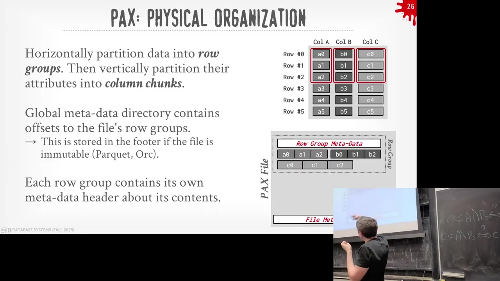

# L6 逐段整理译稿：存储模型与压缩

## 00:00–00:45

【开场音乐与寒暄】开头字幕标记音乐，并出现零散歌词；这里不转载歌词。教师请大家为 DJ Cash 鼓掌，打趣他迟到是在忙着赚钱，提醒他也要关注数据库与 DJ 技能。随后表示今天内容很多，开始课程。

## 00:45–02:20

【课程通知】Homework 2 与 Project 1 已发布，分别在接下来的两周截止。教师现场发现幻灯片上的日期与星期不一致，说以所指的周日为准。这是当时的口头通知，不是本页替课程发布的新截止日期；具体要求应查当年的官方作业与项目页面。

Project 1 的 recitation 将在次日晚通过 Zoom 进行，入口看 Piazza，之后会提供录像与幻灯片。建议先动手读题、开始项目，再带着 ARC、某个文件、组件或类的具体问题参加；这不是从“如何编译 C++”开始的入门课。助教会比课堂更详细地解释 ARC 和系统组成，现场参加可直接提问。

## 02:20–04:15

【行业活动与插话】教师介绍当天和次日的企业访问活动：次日上午从 9:30 起有三场，在 Gates 楼举行。之前填写企业偏好并不是预约合同，而是用来结合时间与偏好生成安排；他将所用方法描述为稳定婚姻匹配一类的优化。

教师问上周哪家参访企业被收购。有人猜 PingCAP，他说不是，而是上节课来演讲的 SingleStore，收购方是 Vector Capital；他回忆 SingleStore 原名 MemSQL，以及早期投资人 Ashton Kutcher、离开的创始人和 Neon 被 Databricks 收购等轶事。以上是课堂当时的新闻与个人回忆，本稿未把它们作为独立核实的公司史。

## 04:15–07:29

上节课讨论了不同于原地覆盖元组的存储方式。日志结构存储把新修改追加到日志／文件，再由后台使用分层或通用合并，去掉冗余信息。索引组织存储则沿树结构寻找记录，叶子里放的是记录本身，而不只是指向堆文件的指针；教师举 MySQL InnoDB、SQLite 为例。这些设计有各自的读写代价。

但实际查询里有大量读取；当一个查询要分析很多数据时，之前的面向元组布局可能很不合适。上节 SingleStore 演讲已经提到列存，今天解释为什么要这样做。先区分工作负载，再看存储模型，最后看压缩如何进一步提速。

关系模型的好处在于逻辑和物理分离：应用仍然 `CREATE TABLE`、提交 SQL，底层却可以换一种字节组织方式。变化可能不是快一点，而是数量级差异。教师转述一位 Vertica 朋友的案例：某电信公司的查询从几天降到几分钟。它是课堂动机案例，不是本课提供了可复现的性能测量。

## 07:29–11:13

大致可以把数据库工作负载分为 OLTP、OLAP 和 HTAP。

OLTP，即联机事务处理，通常是新应用的起点：系统不断接收外界的新数据，每个操作涉及的数据量不大，但操作很多、希望很快。例如在 Reddit 发一条评论，只要用户名、时间戳和正文；在 Amazon 把一件商品放入购物车，修改用户、商品、数量等少量信息。

OLAP，即联机分析处理，是在已有大量数据以后提出跨记录的问题。每个人买一件商品的操作很小，汇总所有人的订单却是很大的数据集。我们可能问：匹兹堡某个九月的日子、气温达到某个条件时，销量最高的商品是什么？这需要跨很多实体，可能连接多表，使用聚合、窗口函数和嵌套查询，类似 Homework 1 的练习。

HTAP 希望既快速接收新事务，又在同一系统里对新数据做分析，且不拖慢事务。教师称它为理想目标，同时指出折中并不总是满足双方：大公司中的事务团队和分析团队可能各自选择专门系统。他举 SingleStore、PingCAP TiDB 为推动这类目标的例子。

教师把当前 AI 场景粗略描述为从“发生了什么”进一步问“为什么”，例如某商品为何受特定人群欢迎，并说之后向量索引会涉及相关问题；就今天的存储讨论而言，它仍足够像分析负载，不另列第四类。这是课堂的工作负载类比，不是把普通分析或 AI 输出视为因果证明。

## 11:13–13:32

可以画一张粗略的二维图：一轴是偏读还是偏写，另一轴是查询简单还是复杂。“复杂”不是这里给出的精密度量，大致考虑连接多少表、有多少聚合或嵌套。

OLTP 位于相对简单、相对多写的一端，例如按用户名找一个人的记录，通常通过索引定位。注意“相对多写”不意味着写一定占多数；许多 OLTP 应用仍以读操作居多。OLAP 则通常更偏读，查询更复杂；HTAP 大致居中。这张图只是帮助理解，不是分类定理。

【历史插话】教师随后把 OLAP 术语、商业委托文章与 Jim Gray 的经历联系在一起，并讲到 Gray 获奖、失踪和搜寻的故事。

【编者注】这一段人名、术语起源及年代有明显混杂风险，本批未独立阅读相关历史原件，也未听音核对，因此不把课堂口述确立为历史事实；它不参与后续存储推导。

## 13:32–15:50

今天的示例取自简化的 Wikipedia 模式：用户表保存登录信息，页面表标识文章，修订表保存不同版本；表之间有外键关系。课堂图把正文放入修订表，教师说明真实模式还会把大正文拆到别处，避免直接塞在记录所在页内。系统曾使用 MySQL，教师也表示可能已换成 MariaDB；这里不是对当代 Wikipedia 部署的核实。

教师插话谈到曾有人替他写百科条目，把自我介绍中“来自巴尔的摩街头”的玩笑当真，随后条目被质疑，后来还不断收到付费代写条目的邮件。他澄清自己出生于巴尔的摩，并不是字面上的“出生在街上”。

【问答】学生问为什么此刻要区分 OLTP 与 OLAP。教师答：先区分负载，才能解释系统为何选不同设计；之后再讨论是采用两个系统并搬运数据，还是让一个系统同时处理两者。这里先立问题，片尾会因时间不足把后一部分留到下节。

## 15:50–19:16

关系模型只规定高层怎样表示数据，并未要求一个元组的全部属性必须相邻地放在磁盘或内存里。前面的大值存储已经违反了这种直觉：例如 PostgreSQL 的大文本可以放到另一处，记录保留引用，系统在需要时重组；应用仍看到同一条逻辑记录。

Wikipedia 的三个简单操作说明 OLTP 的访问形状：按页面 ID 找最新修订；用户登录后按用户 ID 更新时间与主机名；插入一条新修订。前两种可利用索引，涉及一条或少量记录，插入则要处理一整条新记录。

对照之下，分析查询会寻找主机名以 `.gov` 结尾的登录记录，并按时间聚合。它不是找某个人，而要遍历很多条目。教师用政府工作人员修改百科条目的历史争议说明这种查询的用途，并点到若干政治人物；本稿保留查询动机，不将未经独立核实的口头指控当成调查结果。

## 19:16–21:59

存储模型决定表的数据在内存或磁盘上怎样组织。需要什么数据、怎样使用它，会让不同布局产生非常不同的性能。

第一类是 N-ary Storage Model（NSM），通常就叫行存；第二类是 Decomposition Storage Model（DSM），即分解／列式模型；第三类是混合方式 PAX。教师提醒：现实产品宣称“列存”时，经常更接近第三类，而不是把整表每列无限地彻底拆开。

NSM 把一条元组的属性相邻放在页中，再放下一条元组；超大值溢出另论。它适合一次插入整行，或读取少量记录的大部分属性。课堂再次演示 slotted page：页头之后是槽数组，元组从页尾向前生长，槽记录偏移，直到可用空间耗尽。

## 21:59–23:30

假设用户登录，需要按用户名找到账户信息。教师提醒不要存明文密码，课堂将应用提供的密码处理结果用于查询。索引可以是哈希结构或 B+ 树，今天先把它看作“用户名到记录位置”的映射，不深入实现。

得到记录 ID 后，系统找到相应数据库页，若需要则读入内存，再由槽数组找到元组。行的各个属性在一起，取回这条记录很方便。插入时则由空闲空间信息找到有空间的页，把完整元组写入并更新相应元数据。

【编者注】课堂口头交替使用“哈希”和“加密”。密码存储应使用适当的加盐密码哈希／口令派生机制，不能把一般可逆加密或普通快速哈希当作等价安全建议；此处的学习目标仍是索引到页再到元组的访问路径。

## 23:30–26:25

现在执行分析查询：统计从 `.gov` 主机名登录的记录，并按月份聚合。这里假设没有可直接解决该条件的索引，所以系统要扫描各页。

第一步检查每条记录的主机名，找出后缀匹配者；第二步取匹配记录的登录时间，提取月份并进行计数。但每一页里还夹着用户 ID、用户名、密码等不参与查询的属性。这些字节虽然没有用，还是从磁盘一起进了内存。教师在示意图里估计超过一半的字段数据可能没有被这个查询使用，具体比例取决于字段大小。

行存因而很适合快速插入、修改、删除以及少数整行的查找；聚簇布局、索引组织、覆盖索引还可以进一步减少访问。但对于只看少量列的大扫描，它会增加 I/O，也让 buffer pool 装入大量无用数据。不是 SQL 不允许在行存上分析，而是物理搬运不合算。

## 26:25–28:33

DSM 走向另一端：把一行的属性拆开，同一属性跨许多行连续存放。一个页内主要包含同一列的数据。分析查询只取所需列的页，不把完全不使用的属性一起读进来。

代价转移到了写入和整行重组。假设一条记录有一千列，彻底分列以后，新插入可能要更新许多分散位置。教师用“一千列、一千页”的极端图景强调这种分散成本，而不是保证每次实际写入都正好产生一千次磁盘 I/O。

课堂的基本列布局把数据视为定长数组：列页有页头和整列片段的 NULL bitmap，不再为每一行在这一列里重复一套元组头。接着为 B 列、C 列构造同样的区域。这里“每列都有自己的页”是解释模型的简化，后面还会引入 row group。

## 28:33–31:32

回到登录分析：主机名、最后登录时间、密码等分别放在不同列区域。先只取主机名列，连续扫描并收集匹配位置，不必跨过用户名或密码字节。然后取登录时间列，跳到这些位置，计算月份与聚合。

【问答】学生追问不同属性的页面是不是不同大小，来回澄清后，教师理解为“同一表的列是否各用不同数据库页大小”。回答是：在当前固定帧 buffer pool 模型下通常仍用统一页大小，否则要解决不同大小的装载与分配；只是某些列需要更多页。教师还举分析系统可能采用远大于传统小页的读入单位作为例子。

【编者注】这不是说所有列式文件的压缩页、row group 或 I/O 请求都必须等长。这里首先讲固定页／固定帧模型；随后文件格式讨论的层次不同，课堂也会主动纠正混用。

## 31:32–34:30

跨列怎样知道哪些值属于同一行？第一种方式是共同的逻辑位置加定长偏移。扫描主机名时记下位置 2、5、6，到另一列时用数组基址和每项宽度计算相应地址，从而重组同一元组。

第二种方式是在列值旁显式保存 tuple ID，再用索引按 ID 寻找另一列的值。这样能容纳变长项目，但要为每个值付出 ID 的空间，还要维护额外寻址结构。教师用 DATAllegro／Ingres 及微软收购后的个人见闻批评这种做法，并强调在此处希望使用前一种简单布局；这些产业细节没有独立核实。

【问答】学生问嵌入 ID 到底哪里不好。教师再演示：如果在 D 列发现匹配值，必须知道它是“第 3 条”，才能到 A 列找同一行。显式 ID 方案不只多存一个数字；变长数据还需要另一层映射告诉你这个 ID 的数据位于哪里。按统一位置对齐的定长数组可以省掉这些开销。

## 34:30–37:38

那么字符串不是变长的吗？课堂预告字典编码：把字符串换成定长整数码，原字符串放在单独字典中，需要时由码查回。扫描主列就只需处理整数。另一办法是把 `VARCHAR(32)` 全部补齐到固定宽度，但短字符串会浪费大量空间，所以这里更希望用字典。

列存的收益不只有少读磁盘。相邻数据属于同一值域、访问步长规则，现代 CPU 更容易高效处理；少一些绕过无关字段的跳跃，可以提高执行效率。相同类型、重复或相近的值也更容易压缩。教师对比一堆温度整数与混杂字符串、浮点数的记录，又用已经压缩的 JPEG 和重复零的文本说明冗余不同，压缩潜力也不同。

缺点仍在：点查整行需要从多处拼回属性；插入、修改、删除也要处理拆分后的多列。不可能只有收益而没有成本。

## 37:38–40:39

完全列式布局在“表很宽、查询只看极少列”时尤其有利，极端最佳情况是一列扫描。但很多分析最后还是要组合多个属性。即使从十亿行过滤到一千行，幸存行的其他属性也可能分散在许多位置，重组仍很昂贵。

因此希望保持同列数据相邻，获得扫描与压缩好处，同时让同一批行的其他列也在附近。这就是课堂引入的 PAX，展开为 Partition Attributes Across。教师介绍 Anastasia Ailamaki 及相关学术背景，称她早于自己在 CMU 任教，后来赴瑞士；论文在此仅为课堂提及，本批未阅读全文。

教师把 Parquet、ORC，以及较新的 Nimble、Vortex 列为采用类似分组列式思想的格式，并强调多数现实“列存”更接近这种混合组织。这里是在比较思想，不表示这些格式共享完全相同的字节结构。

## 40:39–43:43

先按行数或数据量把表水平分成若干组，再在组内把属性垂直分开存。Parquet 常用的名称是 row group；组里某一列的连续部分叫 column chunk。第一组三行先放在一起，其中 A 列值连续、B 列值连续、C 列值连续，再写下一组。

文件还需要目录元数据，说明组在哪里、采用什么压缩、相关字典在哪里。教师解释为什么不变文件常把最终目录放在 footer：写文件之前尚不知道所有数据的大小，顺序写入时在内存累计信息，完成后再把目录追加到末尾。图上先出现元数据只是演示顺序，不表示实际先写 footer。

图：真实录像有限片段中截取，画面为“PAX: PHYSICAL ORGANIZATION”，能看到水平划分 row groups、组内 column chunks、目录与教师。约 42:31，非逐帧精确时间；图示是课堂概念模型，不应逐字节套用到 Parquet 文件。

教师用百万行、百 MB 等数量级说明可以按不同条件分组。分析系统往往面向大范围读取，组织和读取单位可以比传统 4、8、16 KiB 数据库页大得多。即使某次连带取了一些用不上的数据，也可能换来重组时的局部性。

【编者注】课堂口头提到“S3 buckets”的大小，理解此处意图应是较大的对象／读取范围，而不是 S3 桶的固定大小。各格式默认行组大小也不能从这些近似例子推定。

## 43:43–47:00

【问答：组大小】学生问如何决定 column chunk 里的行数。教师把问题改述为 row group 的行数：实现可以按行数，也可以写满某个数据量后结束当前组；参数可调，不是关系模型强制规定的常数。

【问答：重复元数据】学生担心每组重复元数据浪费空间。教师认可字典等内容可能重复，但要比较比例：若元数据只有约 KiB、主体约百 MB，开销未必是主导因素。字幕中穿插短音乐标记和不完整学生发言，按教师复述保留可辨认问题，不补造其余原话。

【问答：页还是文件】另一位学生指出图里的单位混乱，教师承认这张图讲的是 PAX 风格的文件组织，不是在重新定义一个数据库页。文件包含分组，组内列块还可以分成页；物理存储单位、系统感知的读取单位与文件分组不是一回事。

随后教师演示沿元数据找到 row group，再找到所需 column chunk 的偏移；不必因为一个组包含全部列就总是把每列取回来。他又讨论把所有元数据塞入一个大结构可能导致反序列化负担，并口述 Parquet 使用 protobuf、新格式使用 FlatBuffers。

【编者校订】独立读取 Apache Parquet 官方 Metadata 正文后可确认，其 Thrift 结构采用 **TCompactProtocol**，并非这里口头所称的 protobuf。元数据布置也应以具体格式为准。课堂关于“避免为极少信息解析巨大元数据”的设计动机可以保留，但不能据此推导 protobuf 的普遍不可增量读取结论。

## 47:00–49:39

转入压缩。在本课主要采用的模型中，I/O 是关键瓶颈，尤其数据在网络另一端的云存储中时；高级课还会细究缓存行等 CPU 成本。压缩的目的之一，是让同一次 I/O 带来更多有用记录：原来一个单位只能装十条，压缩后也许能装一百条。

需要权衡计算和存储：编码、解码增加 CPU 工作，换来更少存储与更少传输。如果可以直接在压缩表示上计算，有时还不必立即解压。

课堂希望主列数组的表示保持可定位，特别是定长整数码，这样才能用位置算出地址；如果每项压完长度不同，就又需要偏移索引。变长原值可以放到独立存储区域。第二个目标是尽量推迟解码，让谓词、聚合在编码后的数据上运行。

【编者注】“压缩必须定长”是这里简单位置寻址的设计目标，不是对所有压缩格式的定义。接下来 RLE、delta 等本身就需要段／块元数据；Parquet 也有明确的变长编码。

## 49:39–52:43

第三个要求是无损。学生回答：压缩后再解压，应得到原来的信息；教师强调今天不能丢失数据。他用常见音视频有损压缩作对照：人未必能感知损失，但原始比特并不完全保留。

数据库可以在用户明确许可时做有损汇总。例如全年每秒的温度，长期保存时只留十分钟聚合，删除原始秒级数据；这满足某些业务需求，却不能再恢复每秒值。另外，近似查询执行可以保留原数据，只让某次查询返回估计及可能的误差界。它与无损存储是不同选择。

压缩可作用于四种粒度：整个块／页、完整元组、单个属性值、同列多个值。单属性压缩之前在大文本与 TOAST 的讨论里已见；列级压缩与 DSM、PAX 尤其契合。教师说元组级方案相对少见，提到中国的一家 Terark 相关系统及其创业者经历，但没有展开产品细节。

【字幕与技术注】字幕在“整元组压缩”处出现“只能在 column store 做”的说法，与本段粒度区分矛盾，未听音确认是口误还是 ASR；不据此排除行存整元组压缩。TOAST 的具体算法也不能用口头“像 gzip”取代产品说明。MP4 是容器名称，不是单独一种必然有损的编码算法。

## 52:43–54:56

最直接的办法是使用通用压缩算法：gzip、Zstandard、LZ4、Snappy 等，把一段字节交进去，再取回压缩字节。Oracle 的 OZIP 是课堂举出的另一例。要比较编码速度、解码速度与压缩率，输出长度通常不是原来的固定长度。

教师用 MySQL InnoDB 的压缩页解释一种组织方案：逻辑页可解压回常见的 16 KiB，磁盘上使用更小的压缩表示，按支持的大小组织。课堂举压成约 900 字节再放到约 1 KiB 单位的示意，不是本页独立确认了全部配置条件。

每个压缩页还有修改日志 mod log。假设用户登录，只是把时间戳换成新值，不需要先读取旧时间戳；若已知道修改位置，可以先记录“把该属性设为新值”，避免立刻解压整页。修改区满了，才需要解压、应用修改和重新整理。这是在时间上推迟工作，不是取消工作。

## 54:56–56:57

【连续问答】学生问 mod log 是什么。教师类比之前 LSM 中“put／update”的小记录，也提到之后会学 write-ahead log；这里都是用操作记录描述修改的思路。

另一个问题是：只有日志结构存储才有 mod log 吗？不是。InnoDB 并不是因此就变成 LSM；在主数据旁有一个便于快速追加的小区域，之后再合并，是很多系统会用的模式，后面 delta store 也会用到。

学生继续用“level”理解这个结构，教师提醒不要套用 LSM 分层：这里每个页有自己的修改区，满了就处理它。问“合并时会不会停顿写入”，回答是会，没有免费的午餐。又问修改区是否也落盘，教师回答可以随压缩页持久化，不必为了写回就提前展开全部数据。

【编者注】上述是课堂的压缩页概念说明。页内修改记录与承担崩溃恢复协议的 WAL 不是同一个概念；不要把“都记录修改”推成“持久性与恢复规则完全相同”。本批没有独立阅读 InnoDB 该实现源码。

## 56:57–59:13

如果读请求需要的最新值已经能从 mod log 得到，可以直接响应；若必须查看压缩基页里的内容，就要解压并应用相关修改。教师的图中，解压后回到 16 KiB 逻辑页，同时保留压缩副本。若解压副本没有需要保留的新变化，内存紧张时可以丢掉它，保留较小表示。

【问答】学生问能否只解压真正需要的一小部分。教师说图中 MySQL 的这类整页方案不行；普通流式压缩不能凭一个原始位置就直接得到任意中间值，要有额外分块或可寻址机制。他先说只有自己知道的 Terark 方案这样做，又马上补充 SQL Server 也有相关能力，但自己记不清实现，会在 Piazza 提供链接。

教师接着说 PostgreSQL 不提供图中这样的整页压缩，提到其大属性 TOAST 压缩作为对照。

【编者注】产品数量、算法随机访问能力和 PostgreSQL 的口头概括均有范围限制。本段没有独立核对版本、扩展或全部存储选项；不能写成“所有 gzip／Snappy 应用都绝不能分块随机解码”，也不能覆盖 L3 对官方 TOAST 文档的更精确说明。Terark／SQL Server 只作为教师保留不确定性的口述例子。

## 59:13–1:01:58

通用压缩器对数据库而言往往是黑盒：数据库拿到一串压缩字节，不知道里面哪些字节对应哪个名字或工资，要运行解码器才能恢复。压缩器同样不理解表和查询的语义，不会自动根据查询需要决定怎样组织相关属性。

希望做得更进一步：例如 `WHERE name = 'Andy'`，不必把每个名字恢复成字符串再比较，而是先把查询常量也换成相同编码，然后直接比较整数码。CPU 很擅长大量整数比较，而不必为每个字符串逐字节检查。

通用算法内部也会利用字典等结构，但通常没有把这些结构作为数据库可直接查询的接口暴露出来。数据库自己控制编码方式，就可以把存储表示与算子结合。列存把同一值域的数据放在一起，重复值和相近值多，更适合这种处理。

## 1:01:58–1:04:38

接下来介绍几种常见编码。没有对所有数据都最好的方案，效果取决于值域、分布与查询；字典编码很常见，但特定数据可能由其他编码获得更大收益。

RLE，即 run-length encoding，把连续相同值写成一段：值、起始位置、重复次数。课堂用人员的 `is_dead` 布尔列演示，不再把连续的 yes 或 no 重复写很多遍，而用一条描述覆盖一整段。统计死者／生者数量时，直接累加相应段长度即可，不必先展开所有行。

若值交替出现，段长度都是 1，反而要为每个值存额外位置与长度，压缩结果可能更大。教师把表按目标列排序，所有 yes 放一起、no 放一起，就能用少量长段表示。排序时必须让其余列一起按同一行置换移动，保持水平位置对应，不能单独打乱一个属性。

## 1:04:38–1:05:40

教师提醒要把九行示意想成数十亿行；在大规模时，少量长段能省很多空间，而且 RLE 还能与其他编码叠加。

【问答】学生担心排序破坏 tuple ID。教师澄清图中的 `ID` 是应用的一列，类似社会保障号码或邮箱，不是在给每一行分配永远不变的数组偏移。排序后各列共同移动即可，业务 ID 本身仍跟随对应的行。

另一位学生指出，按某列排好可能让别的列更难压缩。教师完全同意，并把寻找最佳排序方案称为 NP-hard。

【编者注】本批未阅读该复杂度结论对应的形式化问题与证明，不把课堂一句话扩展成“所有排序选择都 NP-hard”的定理。这里可直接验证的要点是：低基数不等于连续长段；不同列的最优聚集次序可能冲突。

## 1:05:40–1:07:21

Bit packing 关注表示宽度。SQL 声明了 32 位整数，不代表当前块里的所有值都需要 32 位。例如年龄通常远小于 32 位上限；若每项高位全是零，存这些零没有必要。

教师图中有八个 32 位整数，总共 256 位；若每个值都能用 8 位无损表示，就只需 64 位。每项仍然等宽，逻辑位置仍容易定位。减少的是物理表示，不是偷偷降低允许的 SQL 值域。

【字幕校订】这段 ASR 把 256 反复写成“26”。按同段“八项、每项 32 位、缩为 8 位”的算式整理为 256 → 64；没有把错误数字原样当作公式。

## 1:07:21–1:09:24

问题是后来来了一个 8 位放不下的值怎么办？Patching 为少量例外保留侧表。多数值仍放在紧凑主数组，异常位置放一个特殊标记，到 patch table 查真正的宽值。教师举 999999 为例，并说 Redshift 把相关方式称为 mostly encoding，例如 mostly8。

【问答】如何区分标记与恰好具有相同比特模式的普通值？如果把全 1 保留为 sentinel，那么该值不能在主数组里按普通值解释；真实数据恰好等于这个值时，也放入补丁表。学生提出这一点，教师确认。

课堂还提到重复异常值可以复用存储，位置可以用定长数组记录。

【编者注】“异常值字节只存一次”并不消除各个异常位置到该值的关联；具体设计必须保留映射。补丁表里的宽度、标记占用和偏移开销都要计入总空间，不能只计算主数组。

## 1:09:24–1:10:44

Bitmap encoding 为每个不同值维护一张位图。某一行位置的 bit 为 1，表示该行在这一列等于位图对应的值。值域基数较低时很合适；课堂继续用 yes／no 的 `is_dead` 示例，一张位图标 yes，另一张标 no。

查询“哪些人已死亡”可以直接读 yes 位图，找到置 1 的位置；做计数也可直接计算置位数量。课堂从把 yes／no 当作字节存储的示意算出较小表示，不过这会引出学生对例子本身的质疑。

## 1:10:44–1:13:48

【连续问答与纠偏】学生问：这个字段本来就是布尔值，为什么不用每行一位，反而存两张互补位图？教师认可这个二元例子的确可以更紧凑。

学生继续追问，即使有四种值，用小整数编码不是也比四张位图少吗？教师把问题归纳为“为什么不用小整数而用 one-hot”，转而解释计算优势：对某个值的筛选、多个条件组合或聚合，可以在整机器字／向量上做位运算，一次处理很多行。不只是比较最终存储字节。

几轮讨论后，教师再次承认图里 yes/no 太简单，只保留一张位图也能表示同样信息；使用两张主要是为了演示多值方法，不是声称这是布尔列的最优压缩。学生总结位图有利于聚合，教师确认。

如果值域很大，例如很多邮政编码，为每个值做一张未经压缩的位图会非常浪费。教师提到 Roaring bitmap 能有效表示某些稀疏位图，许多系统采用它，但课堂没有时间展开内部结构。不能因此说应当把每一列都编码成位图，也不能把“位图一定比整数扫描快”脱离查询与实现条件当成普适保证。

## 1:13:48–1:15:59

Delta encoding 用差值代替完整值。如果相邻测量值接近，例如每分钟记录温度，通常不需为每个值重复存一个大绝对数。可以先存基值，再存相对上一项的差；另一种是都相对某个公共基值。

时间戳尤其容易说明：每分钟加一，差值列就是一串 `+1`。再对差值列做 RLE，就能把这些加一合成一段。教师示意的空间从原始 320 位，先 delta 后变为 128 位，再组合 RLE 变为 96 位；数字属于该教学布局，不是任意温度数据的固定压缩率。

恢复相邻差分时，从基值开始累计差值即可。教师也提到 frame of reference，使用一个参考最小值来编码偏移，并以跨页共享基值作一种例子。

【编者注】前值差分与相对固定基值不是同一种寻址依赖：前者随机定位可能要从检查点累计，后者可直接加基值。FOR 也可以在块内选基值，不要求一定跨多个页。

## 1:15:59–1:18:56

最后是字典编码。把一列的原值替换为较短、固定宽度的整数码，另存码与原值之间的字典。即使原值是一大块文本，主列里也可以只存一个整数，但原文本并没有消失，仍在字典里。

字典需要支持两个方向：原值到码，以及码到原值。课堂进一步选用按原值顺序分配码的字典，让顺序关系在编码后保留。这样不仅可做等值比较，也可能把范围谓词转成整数范围比较。

示例查询寻找名字以 `And` 开头的用户。先在较小的字典上做字符串匹配，找出对应编码边界，图中示意为 10 到 20；然后扫描主列的整数，按编码范围筛选，不再对所有行逐一重复匹配字符串。若许多行重复使用同一个名字，只在字典上处理一次字符串尤其划算。

【编者注】这个优化需要编码顺序与查询使用的字符串比较／排序规则一致，并且匹配码确实构成相应范围。普通字典并不自动保证这一点；不能只因为原值是字符串就把任意 `LIKE` 改写成一个 `BETWEEN`。

## 1:18:56–1:20:20

若查询要返回所有匹配用户的名字，仍须确定哪些实际行匹配，并按 SQL 的重复次数产生结果。教师对照 `DISTINCT name` 说，若只要不同名字，有时直接检查字典就够，不必逐行恢复。

【问答：删除与插入】学生问删除是否需要删字典项。教师说删除相对容易，真正棘手的是在两个相邻码之间插入一个新值：若整数码之间没有空间，维持保序可能需要重新编码；OLAP 数据通常偏不可变，所以更容易接受批量重建。

【问答：字典默认保序吗】学生问“dictionary compression”一词是否按定义意味着保序。教师回答多数情形他希望如此，但也存在不保序的方案。

【编者校订】定义上必须区分二者。删除一行不意味着能删除仍被其他行引用的字典项；快照、引用关系和码稳定性都需要处理。只读字典回答 `DISTINCT`，也要求知道字典条目确实对应当前可见行，且没有遗漏其他谓词。若字典保留了过期值，直接输出会出错。保序则是额外属性，不是字典编码的通用契约。

## 1:20:20–1:21:20

【结课与尾声】教师说时间用完，如何兼顾 OLTP 与 OLAP 留到下节继续；下次还会有 Yugabyte 嘉宾。再次提醒次日晚 recitation 和次日上午企业活动，细节见 Piazza。

约 1:20:39 后是结束音乐与零散歌词字幕，没有可辨认的数据库讲授。本稿不转载歌词。最后一个字幕事件到 1:21:17.400，至元数据片长 1:21:20 仍有 2.600 秒未由字幕覆盖；未听音核验，不能判为静音。

## 来源、阅读与校订边界

- 本稿依据 Andy Pavlo／CMU Database Group，Fall 2025，第 6 讲，视频 ID `yWnToWrskXE`，标题 `#06 - Column-Store Databases (CMU Intro to Database Systems)`，时长 1:21:20。课表标题为 Storage Models & Compression；课表日期 2025-09-15，上传日期 2025-09-16，两者不同。原站入口由页头提供，不在译稿内插入视频链接。
- 复用已取得英文自动字幕，规范化后按顺序全文读完全部 2262 个有文本事件。本文为逐段整理译稿：合并口头重复、保留讲解顺序、示例与可辨认问答；不是逐字听写，也不是已完成全片音画核验。
- 原始 ASR 保持独立。`OTP/OTB`、`HAP`、`packs`、`tupil`、`wear clause` 等依上下文整理为 OLTP、HTAP、PAX、tuple、WHERE；MySQL InnoDB、Terark 等专名按语境规范，存疑的产品行为仍归属课堂。技术纠错与新增限制均用编者注标明，不冒充教师原话。
- 本批只视觉检查约 42:31 一张真实帧，未下载／收听音轨、未观看整片。片头 0.090 秒、片尾 2.600 秒与内部字幕间隙均是文本覆盖未知，不据此推断静音；精确并集与间隙见来源记录。
- 单独核实的视频许可标签是 Creative Commons Attribution（reuse allowed）；改编保留作者、讲次与修改说明，许可入口：[CC BY 3.0](https://creativecommons.org/licenses/by/3.0/)。许可不外推到背景音乐、独立课件 PDF、教材或第三方网页；此稿不转载歌词。
- 编者独立阅读了 [Parquet Metadata](https://parquet.apache.org/docs/file-format/metadata/)、[Configurations](https://parquet.apache.org/docs/file-format/configurations/) 与 [Encodings](https://parquet.apache.org/docs/file-format/data-pages/encodings/) 的当前官方正文，用于明确文件层次、Thrift 和编码边界。这是 2026-11-15 取得的补充，不冒作 2025 当时版本；正文与课堂差异见资料页。
- 指定教材 *Database System Concepts*, 7th ed., §§11.2、13.6：本批未取得或阅读全文，全文翻译许可未知。PAX 原论文、课堂提及的企业史与其他产品实现没有独立阅读核实。
