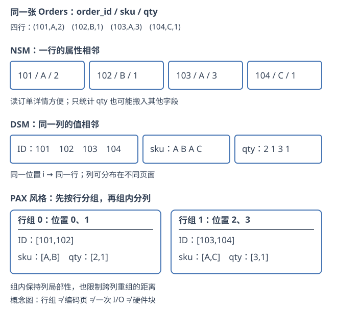
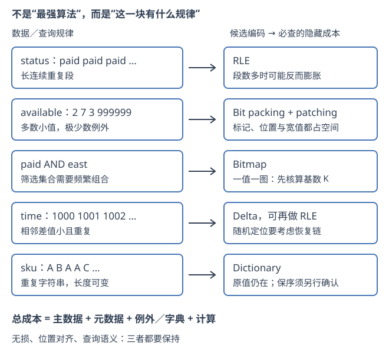

# L6 学习笔记：少搬字节，还要少做还原

为什么同一条 SQL，换一种存储布局就可能快很多？答案不只是“列存压缩率高”，而是：**先让不需要的字节不进入执行路径，再让必须读取的值尽量保持可计算的紧凑表示。**

以下 Orders／Stock 数据、算式、反例与图均为编者自拟；课堂原例是 Wikipedia 登录记录、人员布尔属性与温度数据。原讲内容可在[逐段译稿](#/c/cmu-15-445-2025/lec/lec06?v=draft)中按顺序阅读。

## 1. 先问访问形状，不要先选“最先进的数据库”

设业务有两张表：

```text
Orders(order_id, sku, qty, status, created_at, customer_note)
Stock(sku, available, warehouse)
```

两种请求虽然都叫“查询”，需要的字节完全不同。

| 请求 | 行数／列数形状 | 优先考虑 |
|---|---|---|
| 用户查订单 103 的详情 | 极少行，多列 | 快速定位与整行局部性 |
| 下单后库存从 3 减到 1 | 少量行，读写混合 | 事务正确性、修改与索引维护 |
| 统计本月每个 sku 的销量 | 大量行，少数列 | 扫描带宽、过滤、聚合与压缩 |
| 下单后立即刷新全站统计 | 混合负载 | 新鲜度、资源隔离与维护开销 |

OLTP／OLAP 不是 SELECT／UPDATE 的同义词。按主键读一条订单是读操作，却仍有典型 OLTP 的形状；分析系统也必须接收新数据，只是常以批量方式处理。HTAP 是同时满足需求的目标，**不是换一个名词就抹平读写折中**。本讲尚未展开如何把事务与分析拼成完整架构，教师在片尾把它留给下讲。

### 一个可以算清楚的扫描模型

假设一百万条订单平均每行 200 字节，其中一次分析只用总计 16 字节的字段。不计页头、索引、压缩与缓存，若必须全表扫描：

$$
B_{row}=10^6\times200=200\text{ MB}
$$

$$
B_{column}=10^6\times16=16\text{ MB}
$$

理论字节比为 12.5 倍。这**不是承诺查询快 12.5 倍**：CPU、网络、压缩率、数据选择率、其他算子都可能主导。相反，如果行存已有恰好覆盖查询的索引，就不必搬整个 200 MB；“列存胜过任何行存查询”这个结论立刻失效。

原讲定位：07:29–13:32、15:50–19:16、23:30–26:25。

## 2. NSM、DSM、PAX：到底把谁放在谁旁边



图：编者原创。为可读性只画三列与四行，不代表页、行组或硬件块的真实大小。相同位置对应同一逻辑行；PAX 风格先分行组，再组内分列。

### NSM：让一条记录的属性成为邻居

一次获取订单详情，尽可能在同一页找到 `sku`、数量、状态与备注。写新订单时也不用把每个字段散到很多独立区域。代价是在扫描数量时，备注等无关字节可能搭便车进入内存。

### DSM：让一个属性的许多值成为邻居

扫描 `qty` 时，连续得到数量，不需要跨过订单备注。原理同时作用于磁盘 I/O、buffer pool 有效容量和 CPU 访问模式。代价是重组整行：已经找到行位置 3，还要去其他列取这个位置的值。

若第 $j$ 列是一段定长数组，宽度为 $w_j$，第 $i$ 行的逻辑位置从零开始，则在这个简化区域内：

$$
address(i,j)=base_j+i\,w_j
$$

这里的 $i$ 是共同的**位置坐标**，不是 `order_id`。跨页时还要先定位该位置所属的页／块；压缩后也可能要先定位对应编码块，不能把这条算式直接套到任意文件字节上。

**不变量：所有参与重组的列，都必须用同一行次序解释位置。** 若只把 `status` 单独排序而不共同置换其他列，订单 103 就可能获得订单 101 的状态。列存并没有取消行，只是把“同一行”从字节相邻改成了可恢复的对应关系。

### PAX 风格：把重组范围限制在一批行附近

先把订单分组，再把组内各列连续存放。组内得到同列局部性，重组时又不必跨越整张表的巨大列区域。

但这不是“整个 row group 每次必须全部读取”的保证。读取器可以根据元数据只取需要的 column chunk／page；反过来，存储接口的请求粒度也可能导致额外读取。必须区分：

1. 逻辑行组：共同覆盖一批行。
2. 列块／编码页：具体格式的组织与编解码单位。
3. I/O 请求：这一次向文件／对象存储取多少字节。
4. buffer frame／硬件块：另一层的管理或设备单位。

**反例：把 row group 扩大十倍，压缩更好，所以一定更快。** 更大组可能利于顺序读取与字典复用，却增加写路径缓冲、重建成本，也可能让细粒度访问带入更多数据。调参要围绕实际读取器与查询，而不是把一个格式的推荐值当硬件定律。

原讲定位：19:16–23:30、26:25–47:00。Parquet 的独立文档差异见[资料导读](#/c/cmu-15-445-2025/lec/lec06?v=materials)。

## 3. 压缩为什么可能同时节省空间与 CPU

压缩不是只有“先省磁盘，再花 CPU 全部展开”一条路径。

设原始需读数据量为 $B$，压缩后比例为 $r$，有效 I/O 带宽为 $v$，解码耗时为 $D$。在刻意忽略并行重叠的简单模型下：

$$
T_{plain}=B/v,
\qquad T_{compressed}=rB/v+D
$$

压缩有利的必要比较是：节省的传输时间是否超过额外解码成本。若谓词直接作用于字典码或 RLE 段，$D$ 可能大幅下降；若已有缓存命中，I/O 优势就不能按磁盘带宽重算一次。

### 让谓词走进编码，而不是让数据先走出编码

```text
查询 sku = 'A'
       ↓ 字典查一次
查询 sku_code = 0
       ↓ 扫描整数码，得到行位置
按这些位置读取 qty
       ↓ 聚合
只在结果确实需要原字符串时解码
```

这就是推迟物化／解码的动机。无损要求没有变：编码仍须足以恢复正确值。一个编码是否可用于某个算子，必须证明相关语义保存了，而不是看起来“都是整数”。

**等值可算不等于所有表达式都可算。** 普通字典码支持同一字典中的等值判定；`SUM(code)` 一般不等于 `SUM(original_value)`。两个 row group 即使都用码 0，也可能分别代表 sku A 和 sku B，跨字典比较不能直接比较裸码。

原讲定位：47:00–52:43、59:13–1:01:58、1:15:59–1:20:20。

## 4. 给 Orders 的每一列选编码，而不是整表选一个口号



图：编者原创。编码可组合，右侧检查项决定“压缩了”是否真的更便宜。

### 4.1 重复值很多，为什么 RLE 还可能更大

对 `status` 考虑两个序列：

```text
A: paid, paid, paid, shipped, shipped, shipped
B: paid, shipped, paid, shipped, paid, shipped
```

基数一样，都是 2；A 只有 2 段，B 有 6 段。假设每段存值 $v$ 字节、起点与长度各 $p$ 字节，$N$ 个原值有 $R$ 段：

$$
S_{RLE}=R(v+2p),\qquad S_{plain}=Nv
$$

只有段足够长才能抵消段元数据。这个公式是课堂三元组模型，不是所有 RLE 实现都显式存起点。若编码已能顺序累计位置，可以使用不同元数据布局。

`COUNT(*) WHERE status='paid'` 可直接加 paid 段长度；但与另一个逐行条件组合时，还要对齐位置。按 status 排序可以造长段，却必须共同置换其他列，也可能损害 `created_at` 的顺序性。这是多目标选择，不是“排序越多越好”。

原讲定位：1:01:58–1:05:40。

### 4.2 Bit packing 与 patching：别让一个异常值扩大整个块

若一块 `Stock.available` 都落在 0–200，逻辑类型仍可以是 32 位整数，物理表示却只需 8 位。之后出现 999999，可以扩大编码宽度，也可以让少数异常值走补丁区。

若保留 `11111111`（255）为补丁标记，真实库存 255 也必须走补丁。否则读取器无法区分“数值就是 255”和“请查侧表”。因此补丁方案必须有：

- 主数组中的明确标记或独立异常 bitmap；
- 异常位置到真实值的映射；
- 足以存真实值的表示；
- 能发现异常比例已不划算、需要重编码的策略。

仅从总字节数比较，设主宽度 $b$ 位、异常数 $E$、每个异常的位置与宽值开销 $q$ 位，则至少考虑 $Nb+Eq$，再加页头、映射等开销。异常值很多时，“多数很小”的假设就失效。

原讲定位：1:05:40–1:09:24。

### 4.3 位图编码是在为查询预做选择，不保证存得最少

假设 `status` 有 $K$ 个不同非空值、共 $N$ 行。一值一位图的朴素占用是 $KN$ 位；紧凑整数码约为 $N\lceil\log_2 K\rceil$ 位，不含字典。对于二值列，存两张互补位图显然比每行一位更大。这正是学生在课堂中的有效质疑。

为什么还考虑位图？例如：

```text
paid_mask AND warehouse_east_mask AND visible_mask
```

组合后得到的 bit 位置直接代表满足条件的行；计数可用 popcount。这里 `visible_mask` 是编者补充，强调被删／不可见行不能漏处理。判断优势时要把压缩位图、数据选择率、CPU 实现和生成这些 mask 的成本一并考虑。

高基数列用朴素一值一位图会膨胀；Roaring 等结构能压缩某些分布，但本批没有独立阅读其算法，不把名称当成无条件胜利。

原讲定位：1:09:24–1:13:48。

### 4.4 Delta 与 FOR：恢复路径是不是一条链

订单时间：`1000, 1001, 1002, 1003`。

- 前值差分：基值 1000，后面 `+1,+1,+1`；可再用 RLE。
- 固定基值 FOR：基值 1000，偏移 `0,1,2,3`。

前者要恢复最后一项，需要累计前面的差值，或从某个检查点开始；后者每项直接加基值，但偏移范围可能更大。不要一边存前值差分，一边承诺完全不借助索引或检查点的常数时间任意定位。

差值可能为负，求差可能溢出。实际格式需要规定符号、位宽与溢出恢复规则，不能在有符号 C++ 整数上靠未定义行为“自然回绕”。Parquet 当前编码规范给出了相关约定，属于独立补充，不是课堂展示了代码。

原讲定位：1:13:48–1:15:59。

## 5. 字典省掉的是重复，不是信息

给 `Orders.sku` 分配：`A→0, B→1, C→2`。一百万行中的重复字符串变成短码，字典各存一份原值。若每个字符串都唯一且很长，主列虽然变小，字典仍接近原数据大小，还多出码；不能把“主列只剩整数”当总压缩率。

### 等值、范围与 DISTINCT 分别需要什么

| 优化 | 必须成立的条件 | 反例 |
|---|---|---|
| `sku='A'` 改为码相等 | 常量与列使用相同有效字典语义 | 不同行组的码 0 含义不同 |
| 原值范围改为码范围 | 码保持所需排序规则，边界正确 | 码按首次出现顺序分配 |
| 前缀匹配改为一段码范围 | 匹配值在该排序下连续，边界覆盖准确 | 任意 `LIKE '%A%'` 不保证连续 |
| 只看字典回答 `DISTINCT` | 字典准确反映当前可见值，其他条件已处理 | 字典残留已删除记录的唯一值 |

**删除不能悬空引用。** 如果订单 101 与 103 都引用 sku A 的码，删除 101 不允许把字典中的 A 一并回收。维护保序字典时，插入位于两个相邻值之间的新值，可能需要留空码、间接层或重编码；这些选择都是代价，不是 dictionary 一词自带的解决方案。

原讲定位：1:15:59–1:20:20。课堂说“通常保序”，这里采用更安全的定义：**字典编码与保序编码必须分别确认**。

## 6. 小修改日志是延期付款，不是免费更新

课堂的压缩页例子允许把某些盲写放进 mod log，例如直接设置最后登录时间。类比库存时要小心：

```text
SET available = 7         # 已知新值的写入
SET available = available - 2  # 需要旧值或等价增量语义
```

二者不能无条件用同一种“先不看旧页”的方法处理。读取时也要分清：所需值完全由修改区确定，还是必须读基页再叠加修改？

无论把变化叫 mod log 还是 delta，它都至少引出三个问题：

1. 查询如何保证看到基页加修改后的正确结果？
2. 修改区满了，合并由谁做、会不会阻塞、需要多少额外内存？
3. 落盘与崩溃恢复如何保证修改不会丢失或重复应用？

课堂只用图解释前两者的一部分，不能据此自创 InnoDB 的完整恢复协议。页内 mod log 不等于 WAL，更不等于系统已经采用 LSM。

原讲定位：52:43–59:13。与本批[Project 1 指导](#/c/cmu-15-445-2025/lab/project1?v=guide)相连的是页／帧与生命周期思维，不是要求学习者给 BusTub 实现列存或压缩。

## 全片时间索引

时间依据已顺序全文读过的自动字幕，按内容转折取整秒；边界近似，不表示音画逐帧核验。覆盖完整 00:00–1:21:20；字幕间隙不是静音证据。

| 时间范围 | 核心问题／内容 |
|---|---|
| 00:00–00:45 | 开场音乐、DJ 寒暄 |
| 00:45–02:20 | HW2、Project 1 与 recitation 通知 |
| 02:20–04:15 | 行业访问、SingleStore 新闻插话 |
| 04:15–07:29 | 上节存储回顾；为何转向分析负载 |
| 07:29–11:13 | OLTP／OLAP／HTAP 访问形状 |
| 11:13–13:32 | 粗略负载坐标；历史插话存疑 |
| 13:32–15:50 | Wikipedia 模式；为何先分类的问答 |
| 15:50–19:16 | 逻辑物理分离；登录与跨记录分析 |
| 19:16–21:59 | NSM 与 slotted page 演示 |
| 21:59–23:30 | 从用户名索引定位到整行 |
| 23:30–26:25 | 不使用的字段为何仍然花 I/O |
| 26:25–28:33 | DSM 的读取收益与分散写入代价 |
| 28:33–31:32 | 两阶段列访问；页大小问答 |
| 31:32–34:30 | 固定位置与嵌入 tuple ID |
| 34:30–37:38 | 字符串定长化；CPU 与压缩局部性 |
| 37:38–40:39 | 为什么还要限制重组距离 |
| 40:39–43:43 | row group／column chunk 与 footer 演示 |
| 43:43–47:00 | 分组大小、重复元数据、文件与页问答 |
| 47:00–49:39 | 压缩的代价模型与延迟解码 |
| 49:39–52:43 | 无损、有损、近似查询与压缩粒度 |
| 52:43–54:56 | 通用算法与压缩页修改区 |
| 54:56–56:57 | mod log 是否等于 LSM、写停顿与落盘问答 |
| 56:57–59:13 | 按需解压问答；产品口述范围 |
| 59:13–1:01:58 | 黑盒压缩与直接计算编码值 |
| 1:01:58–1:04:38 | RLE、交替值与整行排序 |
| 1:04:38–1:05:40 | 业务 ID、列间共同置换与排序折中 |
| 1:05:40–1:07:21 | Bit packing，256 位变 64 位 |
| 1:07:21–1:09:24 | Patching、哨兵冲突与异常位置 |
| 1:09:24–1:10:44 | 一值一位图的示例 |
| 1:10:44–1:13:48 | 学生质疑二值冗余；存储和计算的区别 |
| 1:13:48–1:15:59 | Delta、RLE 组合与 FOR |
| 1:15:59–1:18:56 | 字典双向映射与保序范围过滤 |
| 1:18:56–1:20:20 | DISTINCT、删除、插入、是否默认保序 |
| 1:20:20–1:21:20 | 留待下讲的 HTAP；通知与片尾音乐 |

## 自测：先给反例，再揭答案

<details>
<summary>1. 只查询两列，就足以证明 DSM 比 NSM 快吗？</summary>

不够。还要看访问多少行、是否已有覆盖索引、缓存状态、压缩与重组成本。点查一行两列与扫描一亿行两列不是同一个问题。

</details>

<details>
<summary>2. 把 status 单独排好以获得最长 RLE 段，会破坏什么？</summary>

会破坏位置对应的行身份。所有列必须应用同一行置换，或者另有明确的映射恢复关系；不能把不同订单的字段拼成一条新订单。

</details>

<details>
<summary>3. 只有两个不同值，为什么 RLE 可能比原数据大？</summary>

两值可能交替出现。每段长度为一，值之外还要存段信息。RLE 利用的是连续重复，不只是低基数。

</details>

<details>
<summary>4. 补丁标记是 255，真实值也是 255 时怎么办？</summary>

在这种标记约定中，它也必须走补丁表；或者改用独立异常位图等无歧义表示。直接把它留在主数组当普通值，会产生解码歧义。

</details>

<details>
<summary>5. K 张位图一定比小整数码省空间吗？</summary>

不是。朴素位图约 KN 位，紧凑码约 N⌈log₂K⌉ 位。位图可能换来高效筛选、组合和计数；空间及时间要分别比较。

</details>

<details>
<summary>6. 字典中 A 的码是 7，就能把 name &lt; 'A' 改为 code &lt; 7 吗？</summary>

只有已验证码与原值所需排序规则同序才可以。按出现顺序分配的码不支持这个改写；不同局部字典的码也不能直接比较。

</details>

<details>
<summary>7. 字典还保留一项已无可见行引用的 sku，能直接用字典回答 DISTINCT 吗？</summary>

不能。会产生不存在的结果值。必须验证引用／可见性，或通过实际行选择确定哪些字典项有效。

</details>

<details>
<summary>8. “压缩必须定长”与 RLE／delta 是不是矛盾？</summary>

前者是课堂简单数组寻址的目标，不是所有编码的定义。RLE 和分块 delta 借助段长、块头、检查点等组织恢复逻辑位置；任何编码都须明确其定位成本。

</details>

<details>
<summary>9. 一个页有 mod log，是否意味着可以不做崩溃恢复设计？</summary>

不意味着。mod log 是修改组织方式；它何时持久化、如何与基页保持一致、重放是否重复，仍由恢复协议定义，也不能直接把它等同 WAL。

</details>

## 来源与边界

课堂概念来源：Andy Pavlo，CMU Database Group，Fall 2025，L6／`yWnToWrskXE`，1:21:20。依据 2262 条英文自动字幕顺序全文阅读；仅约 42:31 一帧视觉核验，未听音、未完整观看。原讲的 PAX 论文、Roaring 算法、NP-hard 结论、行业史和其他产品实现未独立阅读证明。

独立阅读：Apache Parquet 当前官方 [Metadata](https://parquet.apache.org/docs/file-format/metadata/)、[Configurations](https://parquet.apache.org/docs/file-format/configurations/)、[Encodings](https://parquet.apache.org/docs/file-format/data-pages/encodings/)，取得于 2026-11-15。它们用于明确 Thrift／TCompactProtocol、页与行组的不同、字典与差分的具体边界；不是把 2026 新特性倒填成 2025 课堂内容。详情见[资料导读](#/c/cmu-15-445-2025/lec/lec06?v=materials)。

指定教材 *Database System Concepts*, 7th ed., §§11.2、13.6 的正文未取得、未读，全文翻译许可未知；不以这篇笔记替代教材阅读完成记录。

视频单独标记 Creative Commons Attribution（reuse allowed）；相关课堂改编按 [CC BY 3.0](https://creativecommons.org/licenses/by/3.0/) 署名。本文 Orders／Stock 推演、图和自测为原创；视频许可不外推至独立 PDF、第三方文档或教材。制作完成不代表学习者已完成实验。
