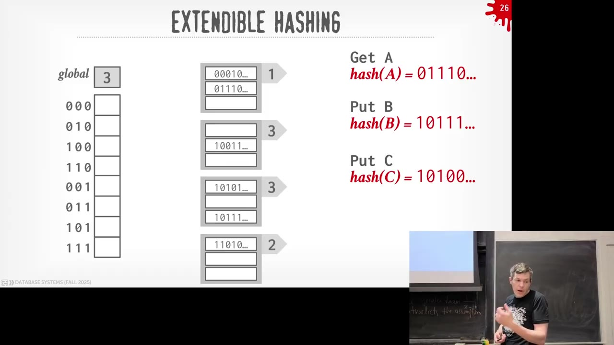
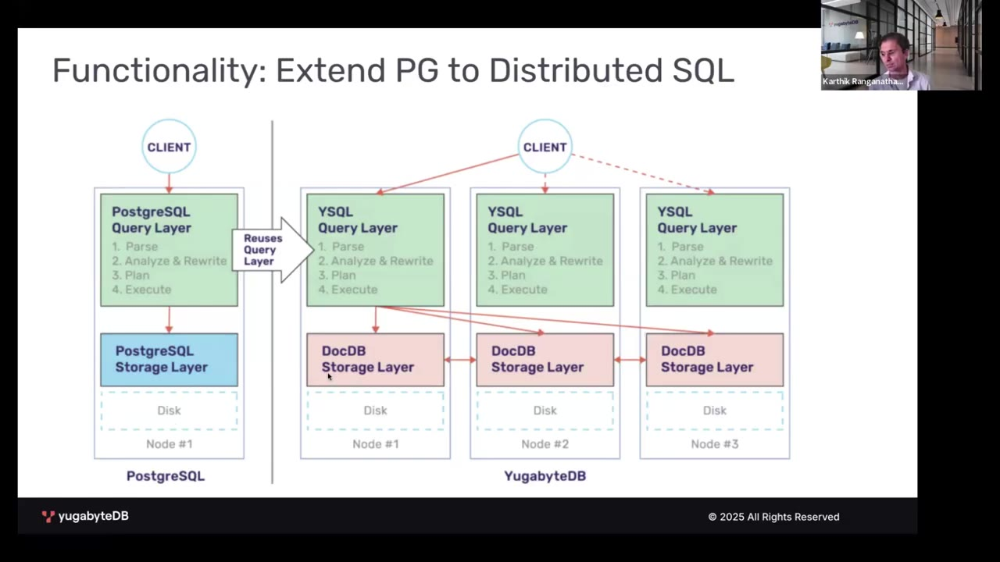

# L7 逐段整理译稿：哈希表与 YugabyteDB 嘉宾分享

## 00:00–02:28 开场：从存储层向访问方法前进

开头是音乐和零散歌词，不在此转录歌词。约 00:25，教师请大家开始上课，感谢 DJ Dash。本日内容很多，还有嘉宾，因此会尽快进入主题。

上一讲结束了存储层的讨论：数据在磁盘上怎样组织，buffer pool 又怎样将页面带入内存。现在沿数据库系统栈向上走，讨论为查询执行准备的基础设施，即访问方法（access methods）。上层执行算子需要一个接口，才能找到底层数据。接下来要把数据结构建立在 buffer pool manager 管理的页面之上。本讲讲无序的哈希表，下一周再讲树这类有序结构。

今天先解释数据库为什么需要自己的数据结构，而不直接拿 STL 容器来用，再快速介绍哈希函数。随后讲静态哈希：开始时确定容量；以及动态哈希：随着键的数量增长或缩小。数据库通常两类都需要。最后由 YugabyteDB 联合创始人分享。

## 02:28–04:33 哈希表不只是表索引

最熟悉的用途是表索引：给定主键或二级键，找到指向表页中记录的 record ID。但数据结构还服务于系统内部，例如目录元数据，以及根据 page ID 查找文件内页面位置的 page directory。数据本体也可能组织在索引里；此前讲过索引组织存储，元组不再放在无序 heap pages 中，而放在树的叶节点。

另一个用途是查询执行的临时状态。做 hash join 时，建立哈希表、装入数据、执行连接，然后立刻丢弃。即使临时结构也可能大于可用内存，因此要能由 buffer manager 支撑，必要时溢写到磁盘。

直接使用第三方库、STL 或某个 Rust crate，通常得到的是由 `malloc` 一类机制管理的内存，而不是数据库页面。进程崩溃后这种内存状态消失；内存不足时可能由操作系统换页并造成抖动。数据库希望自己决定哪些数据进出内存，而不是把这种控制权完全交给操作系统。

编者注：接入 buffer pool 不会自动带来持久性或崩溃恢复；临时结构和可恢复的持久索引仍有不同需求。课堂这里只解释为什么不能把通用内存容器直接等同于数据库访问方法。

## 04:33–06:36 物理组织与并发是两件事

设计内部结构时要考虑数据库的 I/O 特性：尽可能将随机访问变为顺序访问。某个安排在纯内存算法的眼光里似乎多做了工作，但如果能把随机读写变为顺序读写，整体可能更快。本讲先专注实际存储在内存或磁盘页上的组织形式。

另一个困难是并发：多个线程同时读写，怎样避免一个线程改了指针，另一个线程跟随旧地址而出错？这会在后面讲 latch 时处理。本讲及紧接着的基础内容先假设一次只有一个线程访问结构。

还有更高层的正确性。例如一个线程插入键，另一个线程删除它，第一个线程再读却找不到。从物理数据结构看可能完全正确，从事务语义看却未必符合期待。教师提醒：现在不要求解决这个问题，也不能把物理安全和事务正确性混为一谈。

## 06:36–09:24 平均常数时间为什么还不够

哈希表是无序的关联数组，将任意键映射到相应值。键可以是任意长度的数据；哈希函数先将它变为整数，再用这个结果决定从结构中的什么位置开始访问。

空间需求与预期存储的键数量成比例，但通常不会恰好只分配够装下所有键的空间。例如预计装入 n 个键，可以预留约 2n 的容量。课堂将平均访问时间写作 O(1)，最坏情况则需要检查所有键，为 O(n)。

数据库不仅关心渐近复杂度，还关心常数。教师举了刻意夸张的例子：一个哈希函数要 100 毫秒，另一个只要 1 毫秒，二者都可以被概括为“常数时间”，实际却相差两个数量级。一次访问的差距也许不显眼，十亿次访问就会累计成很大的成本。更高效的数据结构能让相同负载运行在更小的机器上；规模足够大时，这就是金钱。

编者注：这里的平均 O(1) 需要良好的散列分布、受控的装载率等前提；若把变长键的长度也视为输入规模，读取并计算整个键的哈希本身并不是与键长无关的常数。

## 09:24–13:20 一个过于理想化的静态哈希表

先想象一大块数组，每个位置称为 slot，不是 buffer pool 的 frame。假定预先知道需要多少个位置，整数键经过哈希后，对槽数 N 取模，就得到数组位置。幻灯片中的大小写 n/N 在这里指同一容量，教师当场说明不用纠结记号差异。

槽里可以放指针，指向另一个内存区域或页面中的负载；那里要能找到原始键和值。为什么原键不能丢？因为跳到一个位置后，必须判断眼前的数据是不是自己真正要找的键，而不能把“落到同一位置”当成相等。

这种最简模型有几个不现实的假定。第一，我们未必预先知道键的数量。可以先扫一遍计数，再扫一遍建立哈希表，有些系统确实这么做，但不能普遍依赖它。第二，键集合未必一直不变。第三，键各不相同并不意味着散列位置各不相同；两个不同键仍可能得到同一个哈希值或同一个槽号。

教师进一步用完整键空间和 perfect hashing 说明无冲突的特殊情形：若键只在 1 到 1000 内，可以直接返回键本身；但把更大的键空间压到更小的输出空间，就不能对所有可能输入保证无冲突。针对已知集合构造完美哈希通常需要预处理和辅助信息。教师将其直观比作“再为哈希表建立一张映射表”，并提到理论上可对最热门的几个键做分支特判，但据他所知数据库通常不这么做。

编者注：唯一键约束、哈希值碰撞、取模后的槽碰撞是三个不同概念。课堂对完美哈希的描述是动机性示意，不是唯一构造算法，也不表示它必须保存另一张普通哈希表。

## 13:20–16:35 哈希函数、冲突处理和存储空间

完整哈希表不只是一个数组。它包括哈希函数、哈希方案和存放数据的空间。哈希函数将输入键空间映射到较小的整数域；哈希方案规定多个键落到同一位置时怎样解决冲突。函数的计算速度和输出分布需要权衡。

本课不设计新哈希函数，直接采用成熟实现。输入是一串字节，输出通常是 32 位或 64 位整数。教师问“最快的哈希函数是什么”，学生提到 identity；教师给出更极端的答案：始终返回常数 0 或 1。它几乎不用工作，但所有键都碰撞，显然没有实用价值。另一端是付出更多准备成本、对给定集合避免冲突的完美哈希。

这里不是密码学课程。教师说，当前讨论的是数据库内部结构，不要求从哈希还原原值，也不把密码学安全或故意构造碰撞的攻击作为本讲目标。

编者注：输出是确定性的“看起来分散”的整数，并非每次调用都会重新抽样。课堂“不考虑攻击”是教学假设，不意味着生产数据库的内部哈希天然免疫用户控制键导致的 hash-flooding，也不能用这里的快速哈希代替密码哈希。

## 16:35–18:22 问答：已经有 RID，为什么还要哈希表

学生提问的大意是：如果 record ID 已经给出页号和槽位，为什么还需要哈希表？教师确认，某些系统的 RID 正是页号加页内位置。但要分清起点是什么。用户执行按邮箱地址相等的查询时，手上是邮箱这个主键或二级键，并没有记录的 RID；表索引负责从邮箱找到 RID，随后才能访问表页。

教师再次强调，索引只是今天讨论的数据结构的一种用途。连接算子的临时状态、系统元数据也需要哈希表。Project 1 的 buffer pool manager 可能使用 STL `unordered_map`；它在崩溃后会消失，也可以换成专门实现的数据结构。Google Abseil、Facebook Folly 中有不错的通用容器，但它们并不因此自动接入本课程的 buffer pool。

编者注：缓冲池中 `page_id → frame_id` 的映射不是 `业务键 → RID` 的索引；frame 是可复用的内存位置，不应当作为持久记录身份。是否需要恢复某张映射，要按其生命周期判断。

## 18:22–20:06 快速哈希函数的选择与追问

教师回顾了自 MurmurHash 兴起以来的快速非密码学哈希发展，称它推动了数据库对现成高性能哈希函数的采用。课堂提到 RapidHash，以及许多较新系统使用的 xxHash／XXH3。对本课而言，知道“字节数组进去、固定宽度整数出来，并且足够快”就可以继续研究数据结构。

学生追问为什么不能用 RapidHash。教师澄清：当然可以；他只是表示，据自己当时的了解，还没有见到数据库大量采用它。他没有在本次课堂前搜索所有开源数据库仓库，因此“没有人用”不是完整调查结论。接下来的例子把具体函数当成黑盒，不依赖其中某个品牌。

编者注：自动字幕中的 `XS hash`、`rabbit hash` 按上下文校订为 xxHash、RapidHash；速度排名与采用情况属于 2025 年课堂判断，本稿没有独立复测。

## 20:06–22:37 静态方案与“开放寻址”

静态哈希是在初始化时确定槽位数，主要介绍 linear probing 和 cuckoo hashing。教师说线性探测极其简单，也因此在实际系统中很有竞争力；Robin Hood、hopscotch、Swiss table 等细节留给进阶课程。另有紧凑哈希结构，适合建立后只读、用完即弃的场景，不一定承担长期插入和删除的开销。

名称很容易混淆：linear probing hashing 是这里的静态线性探测；后面出现的 linear hashing 是动态线性哈希，不是同一种算法。

开放寻址的意思是，键不必永远放在哈希给出的那个初始槽。插入时的占用情况可能改变它的最终位置，哈希先提供一个起点，然后按约定继续寻找。重建或不同的插入顺序都可能改变物理位置。

## 22:37–24:24 线性探测、装载率与重建

结构仍是一张固定宽度槽位数组，可以放在 buffer pool 管理的页面上。插入时先算起始槽；若已占用，就逐槽向后扫描，直到找到空位。查找和删除也沿同样的探测路径前进。到数组末尾后会环绕，所以必须记住起点或限制扫描次数；否则表满时可能陷入无限循环。

装载率是活跃槽数除以总槽数。超过阈值时，常见做法是暂停对结构的操作，分配更大的表，例如扩大一倍，将旧键重新散列并插入新表。课堂以全局 latch 举例，但并发实现不是今天的内容。整表重建很慢，因此经常提前预留容量。有的实现允许调高装载率阈值，但允许接近 99% 满并不代表性能仍然良好。

## 24:24–27:15 插入 A 到 F，以及槽内应该放什么

教师用逐步动画说明插入。A 哈希到一个空槽，直接放入。B 落到上方另一个空槽。C 想去 A 的位置，却发现已经占用，于是向后一个槽，找到空位再写入。D 想去 C 所在的位置，只能继续向后。E 也从 A 开始，连续越过 A、C、D 才找到空位；F 从 E 所在位置开始，又被推到下方。原始键与值要一起保存或能够被定位，才能在后续扫描中辨别碰撞。

线性扫描的优点是访问连续。若探测跨过多个磁盘页，可以按顺序读取这些页，而不是每个冲突都跳到完全不相邻的位置。

若数据本身小且定长，可以直接 inline 在槽里。也可以缓存哈希值，先比较哈希来减少较昂贵的完整键比较，这是空间换计算。不要让槽变得太宽，否则每次“向下一槽”都跨过大量负载，探测会浪费缓存和带宽。

## 27:15–30:38 问答：查找、变长 JSON 和字符串前缀

学生问：刚才一直讲插入，查找怎么做？教师用 F 回答：哈希后先遇到 E，不是目标，就继续扫描，直到找到 F；如果先遇到一个真正空槽，就能判定不存在。表中可能没有这样的空位，因此还要防止绕一圈后无限扫描。最坏情况依然要检查整张表。

小而定长的值可以内联；过大或变长的数据则放在别处，槽里存固定宽度的 RID 或指针。表索引的 RID 可以指向原始元组；连接的中间结果可能已经经过变换或其他连接，不能简单假设原表有对应的现成记录，因此可以指向临时页。

接着学生提出 JSON／变长字段问题，原提问只有片段可辨认。教师解释：这里的槽数组要求固定步长，不能直接把任意长对象一个接一个塞进槽里，否则按槽号计算地址的机制失效。变长键或值可以放在 slotted page 等额外区域，数组只保留固定宽度引用。

另一位学生指出，把键留在哈希表里不是更快吗？教师同意这会减少一次间接访问，但变长键需要折中。例如在槽中保留字符串前八个字符作为前缀，同时保存定位完整字符串的引用；前缀不相等就可以提前排除，前缀相等则仍需检查完整键。课堂将这一类前缀加引用的表示称为 German strings，并解释此前溢出页引用也可采用同样思想。

编者注：前缀或缓存哈希只能快速排除，不能一般性地证明完整键相等；“前八个字符”是课堂示意，不是所有字符串表示的统一布局。

## 30:38–33:20 删除为什么不能直接清空

并非所有哈希表需要删除：某些临时结构只建立、读取、销毁。但表索引通常必须支持。教师先演示一个故意错误的操作：查找 C，从 A 开始向后找到它，然后直接把槽清空。

中间有学生确认扩容问题：装载率太高是否要分配第二张表？教师回答，刚才的静态方案是的，要扫描并重新散列到新表；稍后的动态方案会避免每次都这样处理。

回到删除：若 D 当初因 C 占位而被迫向后放置，现在查 D 会先到原来 C 的位置，看到“空”，便以为 D 不存在。D 明明还在下一槽，却因删除破坏了探测链而变得不可达。

一种修补办法是，从删除点向后扫描到真正空槽，把相关键重新插入；需要依据每个键自己的起点判断位置，不能把所有元素不加区别地向前挪。还要考虑环绕处的键。教师认为这种做法在当前目标下可能太昂贵，因为删除时不知道会牵动多少条记录，因此建议使用 tombstone。

编者注：课堂“没人这么做”的措辞是取舍性说明，不是宣称所有线性探测实现都禁止回移删除。

## 33:20–35:58 墓碑保留探测路径：查 C、查 D、更新 D

tombstone 表示“此处曾有元素，现在已删除”，不同于从未使用的空槽。原负载可以清零，但状态仍需保留。查找扫描遇见墓碑时，要像遇到占用槽一样继续向前，不能提前判不存在。

删除 C 后留下墓碑，再查 D，虽然起点正是 C 原来的槽，但会跨过墓碑找到 D。若想回收这些状态，可以在适当时机重建或重排；新的插入也可以复用墓碑位置。

学生问：如果查询被删除的 C 呢？教师完整走了一遍路径：从 A 开始，A 不是 C，墓碑不算有效 C；继续越过 D、E、F，环绕到 B，直到遇到真正空槽，才返回未找到。不能仅因到达墓碑就把它当成结果。

另一个问题涉及更新 D 的值或再插入 D。教师按“更新已有键的值”解释：先沿正常路径找到 D；不存在就不更新，存在就改写值，不需要因此改变 D 的位置。本节主要研究插入、删除和获取；更复杂的更新语义不是当前重点。

## 35:58–38:41 复用墓碑与保留旧键的争论

新键 G 的起点若是 C 的墓碑槽，可以复用这个逻辑上未占用的位置。状态不必作为每槽一个大型对象内联，可以集中放在页头的位图等元数据中，让数据槽维持整齐的布局。

学生追问是否要另外维护“哪些键已经删除”的映射，以及墓碑是否应记录原先对应的值。教师说，这里的结构本身就能记录删除状态，不需要另造一张表。记住旧键似乎可以优化查询 C：看到“C 曾在这里”就提前返回。但如果 C 后来又在其他位置插入，旧墓碑就不能证明 C 当前不存在，提前停止会漏掉它。

随后一段学生阐述字幕残缺，不能完整复原。教师将其概括为“能不能利用墓碑额外携带的信息做优化”，并承认可以研究；但额外元数据和判断会增加复杂度。许多临时哈希表本来就不支持单条删除，简单方案更有吸引力。他没有给出这些优化绝对不可能的证明。

编者注：若容器要求键唯一，遇到可复用墓碑并不意味着可以无条件立刻结束插入；通常仍要沿路径排除后方已有相同键，再决定使用记下的墓碑槽。墓碑还必须与真正空槽区分，不能只有一个含义模糊的“未占用”状态。

## 38:41–40:00 重复键与专用结构

时间有限，教师加快了后续内容。如果允许非唯一键，可以让某个键指向另一个列表，也可以把同样的键与各自的值重复存入大哈希表。课堂称后者很常见，因为不用维护另一套列表结构。

这会改变查询的停止条件：找到第一个 `xyz` 不代表找齐全部结果，仍要沿探测链扫描到真正空槽；删除全部 `xyz` 也必须覆盖这段路径。如果只要删除一个具体记录，还需要辨别对应的负载，不能把同键记录都混成同一个对象。

教师略过更详细的优化，只举 ClickHouse 根据键类型准备不同哈希结构的例子：短字符串、整数、长字符串等可以用不同布局。他提到其实现有许多专用变体和一篇值得阅读的文章；本稿未独立阅读这篇文章，不把它算作课外阅读成果。

## 40:00–43:17 Cuckoo hashing：让被挤出的键换个家

Cuckoo hashing 不再只给一个候选起点，而用多个哈希函数给键几个候选位置。键的位置可以改变，但始终应在它自己的候选位置之一。候选个数固定时，查找和删除只需检查这些位置，因而有固定数量的槽访问；插入可能更贵，因为会引发连锁搬迁。

课堂示例用一张表、两个哈希函数。它们可以是同一个算法的不同 seed；教师当场收回“保证不同”的说法，说明这样做只是希望输出分散，并不保证两个位置永远不同。插入 A 时两个候选都空，任选其一。插入 B 时，第一个候选被 A 占据，第二个候选空，于是 B 去第二个位置。

再插入 C，它的两个候选分别由 A、B 占据。选择一个受害者，把它赶走，C 占据那个槽。名字来自布谷鸟占用其他鸟巢的比喻。学生问被赶走的记录去哪儿，教师继续演示：C 挤走 B，B 改去另一个候选位置，又挤走 A；A 再去自己的另一个候选，那里为空，连锁结束。

动画为了清楚只显示被挤出键的另一个哈希结果。实际实现不能因为图少画一条箭头，就忘记完整候选集合；可以重新计算两个哈希，并识别刚被赶出的那个位置，不一定额外存“最初用了第几个函数”。

## 43:17–46:54 Cuckoo 问答：环、满表、查找和函数个数

学生问如何避免搬迁形成环。教师最初建议记住最开始的键，有学生指出过程可能更复杂；教师随后承认并不确定只记起点及最近一个键是否足够，若确实需要更多历史就必须承担开销。因此本段没有完成一个可直接实现的环检测算法。

若候选位置持续冲突或表已无法容纳新元素怎么办？课堂答案是扩大并重建，没有免费的解决方法。查找 B 时，先算第一个候选，若命中即可结束，否则再查第二个；幻灯片把两个计算并排展示，不表示必须同时执行。只有检查过所有候选且均无匹配，才能判不存在。

一位学生请教师回到 C 挤出 B 的动画，确认 B 重新插入时是否也要考虑两个哈希。教师回答是的；“最初插入”和“被挤出后重新安置”遵循同一个候选位置约束，动画只是省略了已知的回头方向。

还有学生问应使用几个哈希函数。教师说，这与表的规模、预计元素数量和冲突概率有关；增加候选能让安置更灵活，却增加计算和访问开销。他提到 CMU Dave Andersen 团队的开源实现，凭记忆猜测某个默认值约为六，未当场核实。最后强调，cuckoo 的想法很漂亮，但线性探测很简单、局部性好，他观察到许多系统仍更偏好后者。

编者注：本稿不将“六个”写成库接口事实，也不采纳“只记初始键就一定检测所有环”。工程上需要有界搬迁及明确失败处理；固定候选的查询界并不能推导出插入也具有同样的最坏界。

## 46:54–48:45 动态哈希与桶链

前面两种静态方案都可能遇到容量不足：装载率过高、找不到空槽，或 cuckoo 搬迁无法完成。这时就得重新分配和重建。动态方案则把逐步增长的机制放进结构本身，尽量不要每次搬动全部记录。接下来是 chained hashing、extendible hashing 和 linear hashing。

最直接的是桶链：先由哈希确定某个桶组，再在该组的链上寻找键或空位。发生碰撞时追加记录，现有桶满了就链接新桶。扫描范围局限在所选链，但并不因此消除最坏情况下的线性访问。

教师先顺口把 Python、Java 都当成例子，随后明确说不确定 Python 的默认实现；这里保留自我修正，不把 Python `dict` 描述成已经核实的桶链实现。课堂只用 Java HashMap 作直觉类比，也没有展开具体版本内部细节。

## 48:45–51:06 桶链示例与过滤器预告

结构有一层 bucket pointer array。插入 A 时，哈希并对数组大小取模，跟随指针到某条桶链，在首个空位写入。B 去另一条链；C 与 A 同链，跳过 A 放进下一槽。为了演示，每个桶只有两个槽，所以 D 到来时必须再分配一个桶，并从旧桶连过去。

桶链理论上可以持续增长。如果散列很差，所有键都落到同一条链，就退化为 O(n)。若散列比较均匀，键能分散到多个桶组。E、F 的插入按同一方式继续。

教师提到一个优化：在桶指针附近放小过滤器，先问“目标键有没有可能在这条链里”。若答案肯定不在，就省掉跟随指针与扫描；若可能在，再查真实数据。这类似字符串前缀的早期排除。课堂以 Bloom filter 为例，说它允许 false positive，不应有 false negative，具体原理留到后面。

编者注：无假阴性的前提是所有相关插入都正确更新过滤器，维护期间不会读到错误状态，并且没有错误清除仍被其他键依赖的位。本段不是 Bloom filter 的完整实现指导。

## 51:06–54:17 可扩展哈希：目录深度与桶深度

教师说明剩余约十三分钟，要快速介绍两种较复杂的动态结构。Extendible hashing 不让满桶无限串接，而是拆分满桶，把该桶里的键重新分布。为此，目录中的多个条目可以指向同一个桶；目录不是“每个条目必须有独占桶”。

课堂提到 GDBM、AsterixDB、Couchbase 等使用背景。这些名称和历史关系属于教师口头例举，本稿没有独立查证产品版本或并购关系。

每个桶有 local depth，表示区分该桶所需的哈希位数；目录有 global depth，表示当前查目录时要使用多少位。哈希函数仍然输出完整的 32 位或 64 位整数，只是结构在较小时暂时只取其中少量位。

示例 global depth 为 2，所以目录有四种两位组合。有些目录条目指向同一个 local depth 为 1 的桶，只需第一位就能说明这一桶的归属；其他桶已分开，需要两位。查找仍统一用全局深度定位目录条目，再由指针抵达桶，而不是先猜目标桶的 local depth。

## 54:17–57:03 查 A、插 B、满桶 C 的局部分裂

查 A：算哈希，取课堂采用的前两位 `01`，找到目录 `01` 对应的指针，然后在那个桶中查找。插 B：前两位是 `10`，对应桶还有空位，直接插入，不需要改变其他桶。

插 C 也得到 `10`，但目标桶已满。这个示例里该桶已用满当前目录能够表达的两位，因此 global depth 从 2 增加到 3，目录条目数量翻倍。这里扩大的主要是指针目录，不是把所有键都搬进一张两倍大的数据表。

随后仅分裂原来满的中间桶，按新增的一位重新分配它里面的键；上方和下方未受影响的桶保留原状。新目录中，多组条目继续共享浅层桶；新分开的两个桶需要三位区分。教师把它描述为比整表重建小得多的工作。

图：视频约 56:30 的真实帧，有限片段截取可能带关键帧前滚，时间为近似。画面可见 global=3、八个目录位置与 local depth 为 1／3／3／2 的桶；此刻连接箭头尚未显示，目录共享关系来自相邻字幕讲解，不单凭此帧证明。

编者注：不是任何桶溢出都要目录翻倍。当 local depth 小于 global depth，只需局部分裂和改指针。目录翻倍需要处理 O(2^g) 个指针，不能一概称为常数时间或永远“小到可忽略”；本例避免的是所有记录的全量重新散列。

## 57:03–58:37 深度与极端倾斜的问答

学生问桶旁的数是否约等于“已经分裂多少次”。教师说大体可这么理解；严格地说，它表示当前识别该桶所用的哈希位数，是否等于分裂次数还取决于初始深度。

另一位学生问：会不会遇到病态输入，使目录不断增长，而键仍挤在同一位置？教师承认会。例如十亿条记录在被索引列上全部是值 1，用同一个键直接散列，无法靠多看几位区分这些副本，效果会很糟。

学生还问，是否需要另外记录某条目录路径属于“两位桶”还是“三位桶”。教师解释，图中的额外数字主要用于帮助理解；多个目录项本来就能保存相同的桶指针，因此共享关系已包含在指针结构中。仍未分裂的第一桶可被多个三位目录项指向，查找时自然会落到同一个位置。

## 58:37–1:01:23 能不能挪到别的桶，以及选高位还是低位

学生连续提出两个问题。第一个大意是：既然别的桶还有空位，为何一定要分裂满桶，不能重定向一部分目录项，让数据和另一个桶合并？双方先澄清“重定向”指哪里。教师最初从哈希归属解释，随后承认需要进一步思考所提变体的完整正确性，没有当场证明其一定不可行。

他强调数据库情境的实际成本：另一个桶可能还在磁盘上。若为了利用那里的空间而把它读入、修改、再写回，就把本来只涉及满桶的局部操作扩大为跨页协调。这类额外机制不一定值得；不能只按“所有数据已在内存中”的算法模型来判断。

第二个问题是：选最低有效位会不会比选最高有效位更随机？教师回答，这取决于哈希函数。之前 bit packing 的例子里，原始小整数的高位常为零；这里处理的却是散列后的结果。良好散列希望相近输入，例如 A 与 B，也产生差异很大的位串。幻灯片画高位，是选择了一种一致约定，而不是说高位本质上更优。

## 1:01:23–1:03:58 线性哈希：分裂谁，由指针决定

最后介绍 linear hashing。目标仍是在增长时不重新散列全部键，但与 extendible hashing 不同，触发溢出的桶未必是本次被分裂的桶。教师口头提到 PostgreSQL 的 dynahash、Berkeley DB 和 DynamoDB 的相关背景；这些实现和历史说法未在本稿独立核对。

仍有桶指针与桶，但多出一个 split pointer，标记下一次应分裂哪一个旧桶。当前轮以固定基数 N 开始，示例 N=4；随着 split pointer 前进，逐个增加新桶。寻址可能需要当前的模 N 或下一层的模 2N，选择依据是第一次算出的桶是否已经分裂。

先查 6。为了易算，课堂临时采用 identity hash，`6 mod 4 = 2`。该桶还在 split pointer 之后，尚未分裂，所以无需再算下一层，直接去桶 2 扫描查找。

## 1:03:58–1:05:47 插 17 触发桶 0 分裂，8 与 20 分家

插入 17，`17 mod 4 = 1`，桶 1 已满，于是先加一个溢出桶来容纳新记录。这次溢出触发分裂，但 split pointer 当前指向的是桶 0。因此要分裂桶 0，而不是刚才变长的桶 1，即使桶 0 其实还有空槽。

在桶指针数组末端增加编号 4 的桶。旧的模 4 永远得不到 4，必须用下一层模 8 来区分桶 0 的两半。只重新分配被分裂桶里的键：`8 mod 8 = 0`，所以 8 留在桶 0；`20 mod 8 = 4`，所以 20 移到新桶 4。然后 split pointer 从 0 前进到 1。

虽然当前只新增一个桶，结构正朝完整的下一轮增长；还没轮到的桶不需要立即分裂。这就是把大规模扩容工作分散到多个时刻的核心安排。

## 1:05:47–1:07:54 查询 20 与最后的线性哈希问答

现在查 20，先按旧层计算 `20 mod 4 = 0`。发现 0 在 split pointer=1 之前，说明这个旧桶已经分裂。于是再按新层计算 `20 mod 8 = 4`，去真正存放 20 的桶。第一次计算不能告诉我们记录最终留在旧桶还是去了新桶，第二次才给出最终地址。

有学生对“溢出的不是分裂的”提出质疑，字幕保留的原问题不完整。教师解释，指针最终会轮到刚才产生溢出链的桶，随着持续分裂，结构会逐步重新分布，而不是每次追着热点立刻拆它。后面的简短追问只有教师关于“乘二”的回应可辨认，本稿不补写缺失提问。

最后可辨认的问题是：模 2N 会不会得到尚不存在的桶，导致越界？教师从图的表示说明，指针数组空间可以存在，只是下方桶尚未全部分配。时间已到，他表示下次可以继续澄清，随后转交嘉宾。

编者注：寻址正确性的关键不只是“数组预留了空间”，而是只有旧桶编号小于 split pointer 时才使用模 2N；这时新结果只能是该旧桶或它已经分配的伙伴桶。完整推导见学习笔记。课堂未展开缩容、完整轮次收尾或并发分裂协议，本稿不假装这些已经讲过。

## 1:07:54–1:09:14 嘉宾开场：YugabyteDB 的定位

Andy 介绍 Karthik Ranganathan，YugabyteDB 联合创始人，并问公司是否已经十年。嘉宾说接近十年，约九年半；两人感叹建立数据库需要很长时间。

Karthik 向不熟悉 YugabyteDB 的同学介绍：他们以 PostgreSQL 源码为基础，将其改造为分布式数据库。按他的介绍，产品是开源、云原生的 PostgreSQL 兼容数据库，关注分布式事务、多 API 和 AI 负载，面向业务关键应用，强调韧性、伸缩性及跨地域部署。应用可能是多地域、生成式 AI、边缘系统，也可能是既有高价值系统向云原生环境迁移。

编者注：此后产品能力、客户、性能和许可说法均归于这次嘉宾演讲。嘉宾口头称“Apache 2.0、完全开源”，本稿没有审查各组件许可证，不能据此把整套产品或第三方内容统一判为同一许可。

## 1:09:14–1:11:11 两个坐标轴与支付客户案例

嘉宾说，应先问一种新数据库为什么值得存在。他把市场放在两个坐标轴上：纵轴是 PostgreSQL 兼容程度，横轴是真正的云原生能力。其团队希望处在两者的交点。

图中的纵向阈值代表是否复用 PostgreSQL 源码：复用者可以继续受益于 PostgreSQL 的创新，否则需要自己追赶其行为。横向阈值则代表是否从架构上采用 shared-nothing、具备云原生的韧性与可用性。他认为 YugabyteDB 希望把这两边的优势结合起来。嘉宾也主动提醒，这是一位创始人对市场的解释，听众不应无条件相信，应自行检验。

随后简略带过客户列表，重点提到印度 National Payments Corporation of India（NPCI）。他称印度移动支付业务使用 YugabyteDB，并用支付负载的波动说明：在这样的场景中，韧性、可用性、持续运行与伸缩性直接关系到经济价值。

编者注：字幕中的“所有移动支付”属于嘉宾原说法，不是本站核实的完整支付基础设施事实；也不能从这张定位图推出独立的竞品评测结论。

## 1:11:11–1:12:46 保留 PostgreSQL 语义，还要补架构能力

团队的目标是尽可能保留 PostgreSQL 的全部体验：隔离级别、事务语义、高级特性、扩展，以及跨 PostgreSQL 大版本的滚动升级与降级。嘉宾特别说最后一项很难，投入了很多工作，并称据他所知较少有人这样做。幻灯片还列到存储过程与触发器；他的表述是“目标支持全部”，而不是给本稿一份已经验证完毕的逐特性兼容清单。

与此同时，他们希望越过 PostgreSQL 在伸缩、韧性、可用性、灾难恢复、多地域部署和安全等方面的某些架构限制。现代服务还会期待连接池、可观测性和性能调优能力，尤其是来自其他系统、构建类似 Lambda 服务的开发者。嘉宾说，这些要进入架构本身，而不只是外围补丁。他快速带过本段，目的是先让大家知道产品布局，才能继续解释内部取舍。

## 1:12:46–1:14:17 为什么从已有 API 出发

Karthik 回顾在 Meta 工作的经验：云原生应用的核心争论不只是 SQL 与 NoSQL 二选一，而是在特定场景放松约束、加快处理，并让负载在云原生基础设施上真正运转良好。

创业时许多人说“不要再造一个数据库”。团队后来将这种反馈理解为“不要再发明一个没人懂的新 API”。人们已经知道何时会选择 PostgreSQL、Oracle 等系统，而新接口会让采用者重新建立全部直觉。因此他们最初支持两个接口方向：基于 Apache Cassandra 的 API 与 PostgreSQL API。

嘉宾又提到 Azure DocumentDB 团队在 PostgreSQL 之上构建 API，这类工作有机会被 PostgreSQL 兼容系统继承；他们也与一些人探索 Oracle 相关兼容方向。更多仿真／兼容层正在出现，生成式 AI 可能加快这种趋势。这些是演讲时的观察与方向，不是本稿核验过的发布承诺。

## 1:14:17–1:16:05 保留查询层、替换存储层还不够

架构图把 PostgreSQL 高层分为绿色查询处理引擎和下方蓝色存储组件。嘉宾说，他们保留绿色部分，使其能够以无状态方式在任意节点运行；再把蓝色部分替换成自己的分布式事务存储层，负责分布与复制。存储层向查询引擎提供 PostgreSQL 所期待的 tuple 形式，让上层继续处理查询。

图：视频约 1:14:48 的真实帧，有限片段截图时间为近似。可见 PostgreSQL Query Layer、三个 YSQL Query Layer 与 DocDB Storage Layer，以及嘉宾画面。保留查询层、替换存储层的对照属于嘉宾自己的架构说明，并非本站独立实现审计。原画面有 YugabyteDB 的 “© 2025 All Rights Reserved” 标识；此处仅为评论该段讲解引用单帧，不宣称嘉宾独立幻灯片获得视频以外的再许可。

但只完成这种替换，虽然能工作，性能未必好。如果把大量数据搬到一个节点，再让查询层集中计算，就会增加网络和集中处理成本。下一步自然是 pushdown：把更多运算推到数据所在位置，尽量减少节点间需要传输的数据。嘉宾说，他们投入了很多工作，这仍是持续过程，因为 PostgreSQL 一直发展，更多特性也在不断进入 YugabyteDB。

## 1:16:05–1:18:34 存储差异、优化器与“小查询反而慢”

嘉宾接着讨论如何接近 PostgreSQL 的性能。他将 YugabyteDB 描述为 log-structured 存储引擎，并把它与 PostgreSQL 的 B-tree 访问形式对照。日志结构对 SSD 有吸引力，但 PostgreSQL 的代价模型和执行性能与既有存储访问模式紧密相关，替换底层后不能简单沿用全部判断。他说团队为更广泛地支持这些访问模式投入了接近两年的工作，能力从较低覆盖逐步增加。

另一个问题来自分布式计划。PostgreSQL 通常围绕单节点规划；分布式数据库可能把数据分片到多个节点。用户会抱怨：只有几 GB 的数据，笔记本上的 PostgreSQL 都很快，为什么换系统反而慢了一百倍？嘉宾用“取一千行，最后只返回一行”说明：本地访问与网络访问的延迟数量级不同，如果把许多本地读取变成远程请求，原本很小的查询也会受到巨大影响。课堂给的是示意性的微秒／毫秒与数百毫秒到秒级比较，不是可复现基准。

因此团队需要自适应安排：数据规模较小时尽可能保留接近单节点的效率与韧性，需要扩展时又能自动分片和伸缩。他们还建立测试框架，衡量相对于 PostgreSQL，有多大比例的情况选到了较好的计划。字幕将所参考学术框架写作 `taco`；没有取得或阅读具体论文，因此保留名称不确定性，不补造题名、作者或成绩。

编者注：PostgreSQL 的普通表并不等于“整张表以 B-tree 存储”；嘉宾此处是访问与索引结构的高层对比。课堂也未解释自适应分片或优化器的完整算法，本稿不添加协议细节。

## 1:18:34–1:19:23 连接管理、向量索引与未展开的故事

嘉宾准备从 PostgreSQL 单节点和 PgBouncer 进入连接管理话题，Andy 提醒时间已不足，请他展示最后一页。于是后续只简要点到：内建 connection manager、对向量索引分片并使其与数据关联，以及未来 BM25 和其他索引类型的工作。

Karthik 说还准备了三四个有趣的架构经历，如果有五分钟可以分享。Andy 表示自己很感兴趣，但学生要赶下一节课，已经超时。嘉宾同意留待以后。因此本片没有讲出这些故事，不能根据“原本准备讲”而补出内容，也不能把未来索引方向当作本讲已教的算法。

## 1:19:23–1:20:30 提问邀请、作业提醒与片尾

Andy 邀请同学向 Karthik 提问。字幕中没有可辨认的实质嘉宾问答，接着是教师提到 Piazza 上的相关信息，并说有自己很优秀的硕士生、本科生及实习生在 YugabyteDB 工作，反馈不错。大家鼓掌，教师感谢嘉宾来访。

收尾提醒：周日截止的是 Homework 2。随后进入音乐与零散歌词。本段没有据此改写 HW3 的截止日期，也没有把音乐字幕之外的尾部空白认定为静音。字幕最后一个事件结束于 1:20:26.039，视频余下 3.961 秒未由字幕覆盖。

---

## 来源、校订与许可

来源：CMU Database Group 发布的 Fall 2025 第 7 讲，Andy Pavlo 主讲，Karthik Ranganathan 嘉宾分享，视频 ID `nuNW8IfgPNU`，2025-09-19 上传。视频入口由课程页提供；原始 URL、取得日期、字幕 SHA-256、逐视频授权证据及完整间隙表登记于[来源清单](https://github.com/socoo123/course_web/blob/main/content/cmu-15-445-2025/source-manifest.json)。

该独立视频标记 Creative Commons Attribution（reuse allowed）；本整理译述按 [CC BY 3.0](https://creativecommons.org/licenses/by/3.0/) 署名，已作中文翻译、删去口头赘词、分段及技术注释。两幅实拍帧注明来源与近似时间；嘉宾帧保留其原有版权标识，仅作必要的局部评论引用。视频许可不外推到独立课件 PDF、嘉宾幻灯片、教材、产品源码或第三方音乐，歌词未转载。

已顺序读完 2178 个规范化字幕事件，未把 slides 或题名当作时间证据。ASR 原件未修改：`Gigabyte/Yogabyte` 校订为 YugabyteDB，`Postgress` 为 PostgreSQL，`tupil` 为 tuple，`linear pro` 为 linear probing；嘉宾全名由本视频说明核对。学生长问的残缺、cuckoo 环检测的不确定回答、`taco` 框架名及未核实产品陈述均保留边界。指定教材第七版 §14.5、§24.5 正文未取得／未读，亦未声称独立阅读官方 slides、notes 或嘉宾论文。

本稿按英文自动字幕的原顺序整理，可合并口头重复，但不是逐字听写。讲授：Andy Pavlo；嘉宾：Karthik Ranganathan（YugabyteDB 联合创始人）；CMU 15-445/645，Fall 2025。全片 1:20:30，包含哈希表课堂、课堂问答、嘉宾分享及收尾，不在嘉宾出场处截断。

时间块连续划分的是编辑范围，不代表每秒都有字幕。字幕从 00:00.090 到 1:20:26.039；片首 0.090 秒、片尾 3.961 秒及内部字幕间隙的声音未知，不能认定静音。学生问题若只有教师复述可辨认，就译述复述部分；没有听清的内容不补造。两幅实拍帧只作局部视觉证据，未完整听看全片。技术纠错均另标“编者注”。

