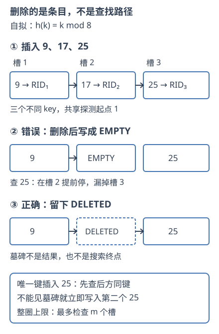
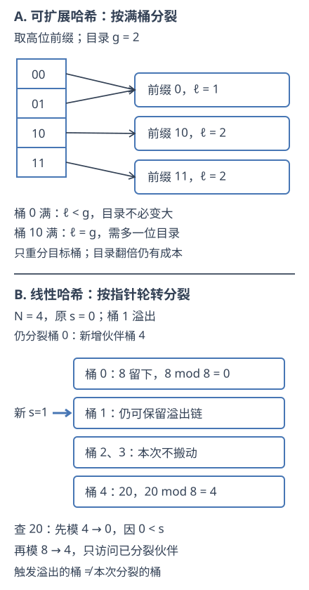

# L7 学习笔记：哈希表维护的是“还能找到”，不只是“能放进去”

给 `Orders` 加一张哈希索引很容易说，难的是解释：为什么碰撞后还能找到记录？为什么一次删除会让别的记录消失？为什么动态扩容并不等于扩容免费？

## 1. 先写清楚 key 和 value 各是什么

设有：

```text
Orders(order_id, customer_email, sku, qty)
Stock(sku, available)
```

“都是哈希表”不代表存的是同一类身份：

| 用途 | key | value／payload | 生命周期 |
|---|---|---|---|
| 唯一订单索引 | `order_id` | RID，例如 `(page_id, slot_id)` | 随表维护 |
| 邮箱二级索引 | `customer_email` | 一个或多个订单 RID | 同键可对应多行 |
| Buffer pool 页表 | `page_id` | `frame_id` | 内存页面驻留期间 |
| 临时连接结构 | 连接键，例如 `sku` | 中间行或临时页位置 | 查询执行期间 |
| 文件页面目录 | 逻辑页标识 | 文件位置等元数据 | 依实际设计决定 |

`order_id=101` 不是“第 101 个槽”；RID 不是邮箱；page ID 不是 frame ID。frame 被复用后，其内容可能完全改变。哈希只负责从已知键走向候选对象，不能让不同层的身份自动互换。

**一个哈希值也不是对象身份。** 即使 `hash(a)=hash(b)`，仍须比较原键；即使原键相同，非唯一索引的两个 RID 也可能代表不同记录。查找“某邮箱的所有订单”与删除“该邮箱下 RID=r 的一条订单”有不同终止条件。

把结构放进 buffer pool，只解决页面管理的一部分。页面生命周期可回看 [Project 1](#/c/cmu-15-445-2025/lab/project1?v=guide)；持久性还涉及日志与恢复，本讲没有给出这些协议。

原讲定位：02:28–04:33、16:35–18:22、27:15–30:38、38:41–40:00。

## 2. O(1) 到底藏了哪些前提

设有 n 条有效条目、m 个槽、装载率 α=n/m。把一次访问分解为：

$$
\begin{aligned}
T={}&T_{hash}(L)+P\,T_{slot}\\
&+Q\,T_{page}+T_{payload}
\end{aligned}
$$

L 是键的字节长度，P 是检查的槽数，Q 是没有被缓存掩盖的页面访问数。此式是概念性分解，不把相互重叠的 CPU／I/O 当成精确可直接相加的实测值。

平均 O(1) 通常把键长、候选个数、桶容量视为固定，并假设散列分布良好、装载率受控。它并不保证：

- 键越长也不用多读字节；
- 槽数不够时仍可不付代价地插入；
- 哈希分布倾斜时仍只查一个槽；
- 一次缓存命中与一次磁盘／网络访问的实际时间相同；
- 平均或摊还界等于单次最坏延迟界。

例如同样检查 8 个键，连续的紧凑槽可能在很少的 cache line 中；8 次指针跳转却可能访问完全不同的页面。数据库关心的不只是比较次数，还包括数据在哪里。

哈希函数应保持确定性，并与相等语义一致：若系统认为 a 与 b 是同一个键，就必须使二者走兼容的散列路径。对变长键缓存 hash 或前缀，可以早期排除，但碰撞后仍要核对完整键。快速非密码学哈希并不提供密码安全或抗恶意输入保证。概率与碰撞的先修可回看 [Project 0](#/c/cmu-15-445-2025/lab/project0?v=guide)，不在这里重做 Count–Min Sketch。

原讲定位：06:36–09:24、13:20–16:35、18:22–20:06、24:24–30:38。

## 3. 线性探测的核心不变量：目标之前不能出现“真正空槽”

为方便手算，下面只在这个例子里令 `h(k)=k mod 8`。依次插入订单 9、17、25：三者起点都是槽 1，最终位于槽 1、2、3。



图：原创示例。图中存的是订单号与 RID 的索引条目，槽号不是 RID。墓碑保存的是探测路径的连续性，不是“被删订单的永久档案”。

### 为什么遇到真正空槽可以停止

插入必须放进探测路径上的可用位置。如果某个有效键位于后面，而它之前存在插入时即可用、之后也未经过破坏性清空的真正空槽，那么当初插入就不应越过这个槽。这个矛盾给出了提前停止的依据。

因此必须区分三种状态：

| 状态 | 查找行为 | 插入用途 |
|---|---|---|
| EMPTY：真正空 | 可以证明本路径上目标不存在 | 可放置新条目 |
| LIVE：有效条目 | 比较键；不匹配则继续 | 不能覆盖无关条目 |
| DELETED：墓碑 | 不能当命中，也不能当搜索终点 | 可以成为复用候选 |

删除 17 若把槽 2 变成 EMPTY，查 25 就会在槽 2 提前停止。若改成 DELETED，查找越过它即可到达槽 3。另一类正确做法是按探测规则重新插入受影响条目，不能盲目把后面的所有元素向前搬一格。

### 最容易漏掉的插入反例

现在槽 2 是墓碑，槽 3 仍有 25。若唯一键容器执行 `insert(25)`，在槽 2 看见“可用”就直接写入，会制造重复键。

正确的逻辑是：**记住第一个可复用墓碑，但仍按容器的唯一性规则查清后面是否已有 25。** 找到已有键，按接口拒绝或更新；到真正空槽或完成一整圈仍未找到，才可使用记录的候选位置。这里描述不变量，不给项目代码。

同理，墓碑上残留的旧键值不能证明“该键永远不存在”：它可能已在别处重新插入。墓碑并非事务删除历史，也不是后续 Project 2 特化 B+Tree 的 tombstone buffer，二者不能混用接口。

### 删除后装载率低，为什么查找仍慢

若表有 n 个有效条目、t 个墓碑，则除了 α=n/m，还要关心：

$$
\beta=\frac{n+t}{m}
$$

β 表示扫描时不能直接作为终点的位置比例。即使 α 很小，β 接近 1 时，失败查找仍可能走很远。重建能去掉墓碑，但要扫描并重新布置条目。不存在“删除只改一个位，所以之后所有查询都无代价”的结论。

表没有 EMPTY 时仍须在 m 次槽访问以内结束一轮，否则不存在的键会无限绕圈。非唯一键查询则不能在第一个命中处停止，要枚举同一路径上所有匹配；删除特定 RID 时还须比较 payload 身份。

原讲定位：22:37–24:24、27:15–38:41、38:41–40:00。

## 4. 负载布局：紧凑槽还是少一次间接访问

假设页里可用于槽的空间为 B 字节，固定槽宽为 w，则每页大约容纳：

$$
\left\lfloor B/w\right\rfloor
$$

将大块 JSON 全放进槽，会增大 w，降低每页可检查的键数。把完整对象放到额外页面，槽里仅存 hash／前缀／引用，可让探测更紧凑，但真正命中后要跟随引用。

这不是简单的“内联永远快”或“指针永远省”。需要比较：

- 大多数查询能否只靠短前缀排除？
- 命中后是否需要完整负载？
- 额外页面是否在内存里？
- 更新负载后，引用是否仍然有效？
- 作为表索引时引用原始 RID，作为中间结果时是否应引用临时数据？

槽固定宽度不要求所有原始字符串固定长度；固定宽度的是槽内表示。共享前缀、同一 hash 的键仍可能不同，只有必要时的完整相等比较才确认结果。

原讲定位：24:24–30:38。

## 5. Cuckoo：把查询的复杂性转移给插入

设每个键有 d 个固定候选位置。结构的不变量是：**每个有效键一定存放在自己候选集合中的一个位置。** 因此查询全部 d 个候选即可结束，不需要像线性探测那样扫描任意长的一段。

当所有候选都被占用，插入必须挤出某个旧键，再为旧键寻找另一个候选。若形成无法终止的搬迁，系统必须有明确的失败处理，例如达到搬迁上限后以新的布置重建。课堂在环检测问答中明确出现不确定回答，不能把“记住最初的键”当成完备算法。

由此得到几个不能省略的边界：

1. 固定 d、固定槽／桶容量下的查询界，不包含任意长键的完整散列成本。
2. 删除找到的键后可以清空该候选，不依赖跨槽探测链；这是和线性探测不同的地方。
3. 候选多，查询计算和可能的随机访问也多；“最坏槽数少”不一定胜过连续扫描。
4. 更换 seed 不保证候选永不相同；坏分布或高占用仍会让安置失败。
5. “找不到安置”不等价于物理数组所有槽都满，候选约束本身就可能造成失败。
6. 对存储多个同键 payload 的系统，需另定重复值布局；唯一键示意不能直接解决任意多重键。

原讲定位：40:00–46:54。本页未独立阅读 cuckoo 论文或特定库，课堂凭记忆提到的默认函数数不作为事实引用。

## 6. 动态扩容的三种办法，究竟搬了什么

### 桶链：先让自己有地方放

散列到某个桶组后，在它的桶链上存储条目，满了就接新桶。不必为每次新增容量重建整表，但长链的查询仍然昂贵。如果所有键散列到同一组，动态分配并没有消除 O(n) 扫描。

桶链的空槽通常不能照搬线性探测的停止规则：删除可能留下空洞，后面仍有记录。必须按该链的组织与结束标记完成查找。删除空桶还涉及更新链指针以及安全回收页面；本讲不展开并发回收。

### 可扩展哈希：满的是哪个桶，就局部分开它

采用高位前缀约定，global depth 为 g、某桶 local depth 为 ℓ，则：

$$
0\leq \ell\leq g
$$

$$
\text{目录条目数}=2^g
$$

$$
\text{指向该桶的目录条目数}=2^{g-\ell}
$$

最后一式来自：前 ℓ 位已固定，后 g−ℓ 位可以任意变化。不同的目录条目不是不同数据副本，而是通向同一个桶的别名。

- **ℓ<g：** 目录已能表达下一位。分裂该桶，两个新逻辑分区的深度变为 ℓ+1，重新分配该桶条目并更新相关目录指针，其他桶不必搬动。
- **ℓ=g：** 先把目录扩为 2^(g+1)，再完成同样的分裂。目录项通常存指针而非全部 payload，但复制／更新目录仍有代价。



图：原创示意，上半使用高位前缀，下半使用取模；二者是不同寻址规则，不要把“前几位”和“模 N”混在一张状态表里。

若桶容纳 b 条记录，局部分配需要处理该桶中的 O(b) 条目；有目录翻倍时还需 O(2^g) 的目录工作。若条目在当前前缀下仍无法分开，可能连续分裂。所有条目具有完全相同的 hash 时，再看位也无济于事：必须有重复值／溢出／深度上限等明确设计，不能无限分配目录。课堂指出这个问题，但没有提供完整解决方案。

### 线性哈希：按计划逐桶分裂

记 N 为当前轮的基数，s 为 split pointer。已经分裂的旧桶是 `[0,s)`，未分裂的是 `[s,N)`，当前已分配的桶号范围是 `[0,N+s)`。

查询 k，先算：

$$
b=h(k)\bmod N
$$

若 b<s，说明它的旧桶已经分裂，最终地址改用：

$$
b'=h(k)\bmod(2N)
$$

否则直接用 b。由于 N 整除 2N，已分裂桶的第二次结果只能是 b 或 b+N；又因 b<s，可知 b+N<N+s。**所以合法的第二次寻址不会落进尚未分配的未来桶。** 这比“先把数组空间留出来”更重要：预留内存本身不证明能读未初始化的桶。

分裂时只处理 s 及其溢出链，把其中条目按模 2N 分到 s 和 s+N，然后 s 加一。完成一整轮，即 s=N 后，以 N←2N、s←0 进入下一轮。这段轮次归纳是编者补足不变量，不声称课堂已完整推演。

例：N=4、s=0。桶 1 因插入 17 溢出，却分裂桶 0。8 留在 0，20 移到 4，s 变成 1。查 20 时先得到 0，因 0<1 再按模 8 得到 4。查 6 时先得到 2，因 2≥1 就去桶 2，不错误地使用不存在的桶 6。

每次增加一个主桶，避免了统一的目录翻倍，但分裂成本取决于被分裂桶及其溢出链的长度。轮转会最终处理所有旧桶，不代表热点链的尾延迟立即消失，也不是对任意倾斜都保证平均常数。

原讲定位：46:54–1:07:54。

## 7. 一张操作成本表，避免只记“快”

以下是单线程概念模型。忽略变长键读取，并假设固定候选数、固定大小桶；磁盘 I/O、buffer pool 命中和锁开销另计。

| 结构 | 查找 | 插入 | 删除 | 扩容／整理 |
|---|---|---|---|---|
| 线性探测 | 分布与装载受控时平均常数；最坏扫 m 槽 | 找空位／墓碑，唯一键还须排重 | 定位后留墓碑，或修复探测链 | 重建需扫描旧布局、重新散列有效键 |
| Cuckoo | 检查固定 d 个候选 | 可能连锁搬迁、失败重建 | 定位后清除，不依赖探测链 | 新布局／新 seed 需重新安置键 |
| 桶链 | 跟随目标链；最坏所有条目 | 找空位，必要时分配桶；排重另计 | 查目标并维护桶状态／链 | 接桶不搬全表，但长链继续存在 |
| 可扩展哈希 | 目录定位后查桶 | 可能连续分裂桶 | 查桶并删；合并为额外策略 | 局部条目重分配；目录有时翻倍 |
| 线性哈希 | 1–2 次寻址计算，再查桶链 | 可增溢出桶，并按 s 分裂别处 | 查桶链并删；缩容另定 | 一次主桶分裂，但要处理整条相关链 |

静态表按倍数增长时，若每次重建成本与当前容量成比例、插入过程分布良好，则多轮容量之和呈几何级数，可以解释摊还插入成本；**这不消除某一次 O(n) 的停顿。** 动态结构把工作拆细，也不意味着任何单次操作都无大开销。

课堂没有完整推演动态结构的收缩，更没有给出并发、WAL 或崩溃中断后的恢复步骤。对这些不能凭表中“动态”二字就宣称已经解决。

## 8. 从嘉宾段带走一个系统问题，而不是一张营销排行榜

YugabyteDB 嘉宾约 1:07:54 出场。他提出的核心设计问题是：怎样保留用户熟悉的 PostgreSQL 查询语义，又替换为可分布和复制的事务存储？紧接着的现实约束是：**兼容的结果不等于相同的代价。**

编者自拟一个简化模型。某次查询需要检查 r 条候选记录、最终保留 q 条。若全送到协调节点过滤，传输规模近似正比于 r；若安全地把过滤推到数据节点，结果传输可接近 q，但仍有请求、分布式执行与状态维护成本。

$$
T_{network}\approx R\cdot RTT+\frac{B_{transferred}}{bandwidth}
$$

R 是串行依赖的请求轮数，不一定等于行数；批量传输、并行请求会改变它。这个式子解释为什么不能把“1000 行”直接换成“1000 次网络往返”，也不能把课堂数量级示例当成普遍基准。

嘉宾描述的逐层取舍包括：

- 复用 PostgreSQL 查询层，替换底层存储，先保留功能接口；
- 再做运算下推，避免把大量数据集中拉回单节点；
- 存储访问模式不同，代价模型也要调整；
- 小规模负载希望接近单机效率，大规模又需要分片与伸缩；
- 连接管理、可观测性、滚动版本升级也属于系统采用成本。

必须保留的事实边界：

- PostgreSQL 的普通 heap 表与 B-tree 索引不同，不能把嘉宾的简略对比写成“PostgreSQL 整表都是 B-tree”。
- “完全兼容”、开源许可、NPCI 客户、性能提升与市场位置均为 2025 年嘉宾陈述，未作产品审计或基准复验。
- ASR 的 `taco` 框架名未确定，本页未引用一篇凭空推断的论文。
- 向量索引、BM25 只被快速点到，架构 war stories 因时间不足没有讲；不在这里提前展开下一讲算法。
- 片尾邀请提问，但字幕没有可辨认的实质嘉宾问答。课堂中的哈希表问答已完整保留在译稿。

原讲定位：1:07:54–1:19:23。

## 9. 折叠自测：用反例检查不变量

<details>
<summary>1. 已有 RID，为什么用户查询仍可能需要哈希索引？</summary>

如果调用者真的已持有有效 RID，可以直接沿页面接口找记录；但按邮箱查询时，调用者只有邮箱，索引要先把它映射到一个或多个 RID。RID 的页号再经 buffer pool 映射到驻留 frame，是另一层查找。

</details>

<details>
<summary>2. 9、17、25 依次落在槽 1、2、3。删除 17 清空槽 2，哪条查询会错？</summary>

查 25 从槽 1 出发，在槽 2 看见 EMPTY 后提前判不存在。改成 DELETED 可保留路径；或依照每个键自己的探测起点正确重排，不能简单抹掉状态。

</details>

<details>
<summary>3. 墓碑可复用，为什么唯一键 insert(25) 不能立即占用第一个墓碑？</summary>

25 可能已经在后面。必须先按规则排除现存同键，再使用记下的墓碑。否则唯一键约束被破坏，后续 update／delete 的目标也会变得不明确。

</details>

<details>
<summary>4. 活跃装载率只有 10%，失败查找仍可能扫描一整圈吗？</summary>

可能。若剩下 90% 都是墓碑，没有真正 EMPTY，则失败查找必须靠最多 m 次检查的边界结束。需要区分有效负载与非终止状态的占用比例。

</details>

<details>
<summary>5. 缓存的 64 位 hash 相同，能否省掉完整字符串比较？</summary>

不能一般性省掉。不同字符串可能发生 hash 碰撞。缓存 hash 不同可直接排除，相同仍需按照键的相等语义确认。字符串前缀同理。

</details>

<details>
<summary>6. Cuckoo 只有两个候选，为什么表尚有空位也可能插不进？</summary>

空位可能不在冲突键群能够通过候选搬迁到达的位置。候选约束会形成不可安置状态；有界搬迁失败后必须采用明确策略，而不是无限循环。

</details>

<details>
<summary>7. g=4、ℓ=2 的桶由多少个目录项共享？溢出一定要把目录翻倍吗？</summary>

共有 2^(4−2)=4 个目录项指向它。不一定翻倍，因为 ℓ<g，目录已包含下一位；分成两个深度 3 的桶，每个由两个目录项指向即可。仅在目标桶的深度已等于 g 时需要扩大目录。

</details>

<details>
<summary>8. 同一键出现一百万次，增加哈希位数为何不解决问题？</summary>

同一键得到同一完整 hash，后续位也相同。若把所有 payload 都当作独立槽记录，分裂无法分离它们。必须明确重复值组织与容量限制，而不是指望动态目录创造信息。

</details>

<details>
<summary>9. N=4、s=1，查 20 和查 6 为什么走不同层？</summary>

20 mod 4=0，0<s，旧桶已分裂，再算 20 mod 8=4。6 mod 4=2，2≥s，仍用桶 2。不能对所有键无条件模 8，否则可能指向尚未分配的未来桶。

</details>

<details>
<summary>10. “增量扩容”能否承诺每次插入都只有常数次 I/O？</summary>

不能。可扩展哈希可能翻倍目录或连续分裂；线性哈希的一次分裂可能扫描很长的溢出链；分配、落盘和缓存状态也会改变实际开销。它避免某些全表搬迁，不等于最坏成本消失。

</details>

<details>
<summary>11. 过滤器回答“不在桶链”，什么时候才能不读链？</summary>

必须保证过滤器正确纳入所有相关插入，删除及并发维护不会误删仍需要的证据。满足无假阴性前提时否定才可靠；“可能在”仍必须查真实结构，不能直接当作命中。

</details>

<details>
<summary>12. 把 PostgreSQL 存储层替换为分布式存储，为什么兼容 SQL 还不够？</summary>

原来廉价的本地访问可能变成网络请求，旧代价模型和计划选择可能不合适。还要考虑下推、批处理、数据放置、请求轮数、连接管理等。本讲嘉宾解释了动机，没有公开一套可直接复现的完整算法或基准。

</details>

## 10. 全片时间索引

边界按字幕语义近似划分，精度为秒，不是逐帧章节。内部间隙不视为静音；连续时间块包含不完整提问的明确说明。

| 时间 | 回看问题 |
|---|---|
| 00:00–02:28 | 音乐、开场与访问方法在系统栈中的位置 |
| 02:28–04:33 | 为什么索引、元数据和临时状态都需要结构？ |
| 04:33–06:36 | 物理组织、并发安全、事务语义有何区别？ |
| 06:36–09:24 | 为什么平均 O(1) 仍要比较常数？ |
| 09:24–13:20 | 预知容量、唯一键与无碰撞各是什么假设？ |
| 13:20–16:35 | 哈希函数与冲突方案如何分工？ |
| 16:35–18:22 | 有 RID 为什么还要索引？ |
| 18:22–20:06 | 快速哈希函数选择与 RapidHash 追问 |
| 20:06–22:37 | 静态容量、开放寻址与易混淆的名称 |
| 22:37–24:24 | 线性探测、环绕和装载率 |
| 24:24–27:15 | A–F 插入、缓存 hash、内联负载 |
| 27:15–30:38 | 查找、JSON、临时页与字符串前缀问答 |
| 30:38–33:20 | 清空删除为什么断开路径？ |
| 33:20–35:58 | 墓碑、查已删键、更新已有值 |
| 35:58–38:41 | 复用墓碑及保留旧键的争论 |
| 38:41–40:00 | 重复键枚举与类型专用结构 |
| 40:00–43:17 | Cuckoo 候选与连锁驱逐示例 |
| 43:17–46:54 | 环、满表、候选数与动画省略的问答 |
| 46:54–48:45 | 静态重建转向动态桶链 |
| 48:45–51:06 | 桶链扩展与过滤器预告 |
| 51:06–54:17 | 可扩展哈希的 g 与 ℓ |
| 54:17–57:03 | 目录翻倍与只分裂目标桶 |
| 57:03–58:37 | 深度、极端倾斜与目录共享问答 |
| 58:37–1:01:23 | 重定向其他桶、高位／低位的问答 |
| 1:01:23–1:03:58 | 线性哈希的 split pointer |
| 1:03:58–1:05:47 | 插 17，分桶 0，重新安置 8／20 |
| 1:05:47–1:07:54 | 查 20、分裂顺序与越界追问 |
| 1:07:54–1:09:14 | Karthik 出场、公司背景与产品定位 |
| 1:09:14–1:11:11 | 两轴市场论点及 NPCI 案例归属 |
| 1:11:11–1:12:46 | 语义兼容、升级与运维能力 |
| 1:12:46–1:14:17 | 选择既有 API 的理由 |
| 1:14:17–1:16:05 | 查询层复用、存储替换与下推 |
| 1:16:05–1:18:34 | 存储访问、代价模型、小规模性能 |
| 1:18:34–1:19:23 | 连接／向量／BM25 点名，故事未讲 |
| 1:19:23–1:20:30 | 提问邀请、实习评价、HW2 提醒与音乐 |

## 来源与阅读状态

- 主来源：CMU Database Group，Andy Pavlo，Fall 2025 L7；嘉宾 Karthik Ranganathan。字幕全文顺序阅读，视频 ID `nuNW8IfgPNU`，时长 4830 秒；视频授权证据与版本见[来源清单](https://github.com/socoo123/course_web/blob/main/content/cmu-15-445-2025/source-manifest.json)。
- 指定阅读：*Database System Concepts*, 7th ed., §14.5、§24.5，仅继承官方课程章节定位，正文未取得／未读。不生成冒充教材全译或独立阅读成果的 materials 页。
- 课堂提到的 ClickHouse 文章、cuckoo 实现、产品源码及 `taco` 框架论文未独立阅读；本页没有把它们列作已读参考文献。
- 原视频单独标记 Creative Commons Attribution（reuse allowed）；课堂内容中文改编按 [CC BY 3.0](https://creativecommons.org/licenses/by/3.0/) 署名。原创例子、推导、图与自测不是课堂逐字内容。独立教材／PDF／第三方产品材料的许可不能由视频外推。
- 文本取得、顺序阅读、局部帧核视与完整听看是不同状态。本次只核视两幅真实帧，没有全片音频核验；学习者实验完成状态仍为 not_attempted。

以下订单示例、推导、反例、SVG 与自测为编者原创。课堂原例使用 A–G、8／17／20；完整课堂及 YugabyteDB 分享见[逐段译稿](#/c/cmu-15-445-2025/lec/lec07?v=draft)。本页不提供学生项目实现，也不提前展开索引并发或后续 Project 2 指导。

