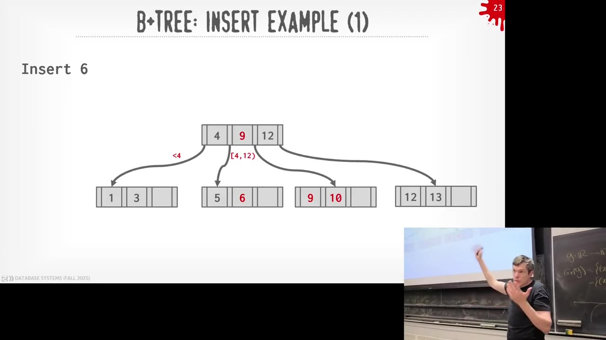

# L8 逐段整理译稿：B+Tree，从有序叶页到可维护的索引

## 00:00–01:54 开场与课程安排

开场是音乐和不完整歌词，约 00:24 教师请大家为 DJ Cash 鼓掌。他说，这是本学期第一次准时开始，也正好要讲他认为最重要的数据结构——B+Tree。其他数据结构当然也有用途，但今天要说明为什么数据库如此依赖 B+Tree。

Project 1 将在本周日截止。上周 recitation 的录像与幻灯片已放在 Piazza。平时周末没有 office hours，不过每个项目周日截止之前，周六会安排多位助教连续值班；希望大家来问的是已经动手后的调试问题，而不是最后一刻才问如何开始。HW3 会在周三发布，课堂说截止日是 10 月 5 日。期中考试定于 10 月 8 日周三，在本教室进行，覆盖 Lecture 1–11；考试当周之前的相关课程都在范围内。下周会发布学习提纲与练习试卷。教师询问是否有课程安排问题，字幕没有记录实质回答。

编者注：这是当时课堂通知，不代替正式题面。HW3 PDF 的日期与官方索引冲突，见独立 HW3 导读，不能用这段口述静默修订题面。

## 01:54–05:28 可选研讨会、反馈与 OLAP 署名更正

今天开始本学期每周一的可选数据库研讨会。有人问，除了本课还能怎样接触数据库；本学期主题是 Iceberg，首场作介绍，下周讲 Hudi，再后面由 MotherDuck 介绍 DuckLake。教师把 Iceberg 与 Hudi 分别联系到 Netflix 与 Uber，并用公司竞购的故事强调这一技术方向的热度。这不是必修活动。

接着是课程反馈：有人称赞 DJ Cash 的电台节目和音乐，希望购买周边；Cash 回应正在准备 T 恤。有人认为教师第一讲不够兴奋、语速还可以更快；教师对此开玩笑。另有评论把“书呆子”与“街头人物”说成不能兼容，教师以自己的经历调侃回应。

真正涉及课程内容的反馈是：此前讲 OLTP／OLAP 时，教师把 OLAP 名称的提出归给了 Jim Gray，这不正确；他在本讲明确改口为 Ted Codd，也就是关系模型的提出者。教师随后讲到受企业委托撰写文章及文章撤回的历史故事，表示纠正课程内容的反馈很有帮助。

编者注：这里保留的是教师当堂更正；没有独立精读这段历史的原始文献。自动字幕的 Ted Cod／Cot、rational model 等按语境校订为 Ted Codd、relational model；收购金额、公司故事与论文撤回原因不作为本站独立考证结论。

## 05:28–07:00 为什么补讲动态哈希

上节课花了较多时间讨论静态哈希，动态哈希讲得较快，尤其线性哈希的删除尚未讲完，所以先补齐。哈希表在数据库内部很重要，例如维护 page table；但通常不是今天要讲的通用有序索引的主角。

链式哈希不断追加桶，最坏可能退化为沿很长的链线性扫描。静态哈希在容量或装载因子达到阈值时，往往要建立更大的新表，再把旧表所有 key 重新放进去；表很大时，这一整体搬迁很昂贵。可扩展哈希与线性哈希的目标都是增量拆桶，不必每次重新组织全部键值。

## 07:00–09:16 可扩展哈希：目录深度与局部拆桶

对 key 求 hash 后仍得到一个完整的 32 位或 64 位值。global depth 表示当前用其中多少位选择目录项，而不是哈希值只有这么多位。不同目录项可以指向同一个实际桶：有的桶只需要一位区分，有的已拆分到两位。

演示先查 A：全局深度是二，取两位得到 01，沿目录指针找到对应桶。插入 B 仍有空位，可以完成；插入 C 则落入已满的桶。示例把目录容量加倍、全局深度增加到三，然后拆分溢出的桶；不需要拆分的桶仍由多个目录项共享，只有新的两个桶需要用第三位区分。再次插入 C 时按三位选目录，便能找到正确的新桶。

教师强调：加倍的是保存桶指针的目录，不是把整张包含所有键值的哈希表复制一份；目录也可以预留容量。编者注：本例发生目录加倍，是因为溢出桶已用尽当前全局深度；一般算法在 local depth 小于 global depth 时可只拆桶并改部分目录项，并非每次溢出都加倍。

## 09:16–12:50 线性哈希：拆的是 split pointer 指定的桶

线性哈希不同：溢出的桶先接一个 overflow bucket，但真正拆分的是 split pointer 当前指向的桶。上节课有人问，这不是在拆一个没有溢出的桶吗？教师解释，拆分按固定轮次推进，最终会轮到热点桶，随着过程推进逐步改善整体分布。

演示开始有四个桶，使用 `h(key) mod 4`，split pointer 指向桶 0。为方便手算，示例把 hash 当作恒等映射：查 6 得到桶 2。插入 17 得到桶 1，该桶已满，于是接一个溢出桶，同时拆桶 0，在目录末尾增加桶 4，并引入 `h(key) mod 8`。桶 0 原来的 key 要用新模数重新分配：8 mod 8 为 0，留在原桶；20 mod 8 为 4，移到新桶。因为新模数恰为旧模数的两倍，这些 key 只会留在原位置或移到新伙伴桶，不会任意散到其他桶。

随后 split pointer 前进到 1。查 20 时先算 mod 4，结果 0 小于 split pointer，说明这个旧桶已拆过，再算 mod 8 得到桶 4。若第一次结果尚未经过拆分，就直接使用原桶。

编者注：教师在模数说明中先说了 n=2、mod 4，随后自纠为原始 n=4、新模数 8。约 12:50 的 ASR 又出现“8 mod 4 是 1”，算术不成立；本段只保留确定的路由规则，不能据此把 8 路由到桶 1。

## 12:50–15:30 线性哈希问答：何时重哈希、何时继续拆

学生确认：是否要用第二个哈希函数，取决于第一次计算出的桶位置相对于 split pointer 的关系？教师回答正确：总是先算第一个，若结果位于已拆分区域，再算第二个。

另一个问题是，一轮扩张完成后会怎样。教师解释，当目录从 0 增长到 7，split pointer 绕回 0，就不再需要原来的 mod n；mod 2n 成为新的第一层规则，下一轮再配合 mod 4n。

问溢出怎样实现，回答就是之前的链式桶：添加一个指针继续连接。又有人问，如果不断往同一个已溢出桶插入，是否还会继续推动 split pointer？课堂采用的策略是会继续拆分。可以选择等第二个桶也装满再触发，但不要忘记极端情况：如果不推动整理，会形成很长的链，查找又变成线性扫描；因此需要权衡拆分成本与链长度。即便当前拆的不是热点，最终也会拆到它。

## 15:30–17:02 线性哈希删除与迟滞

删除 20 先走与查找一样的两步路由：第一次落到已拆分区域，再按新模数找到桶 4，删除目标。例子中该桶随后为空，可以暂时留着，也可以反向收缩，把 split pointer 回退，使相应目录位置不再可达。

教师不建议每次删除都立即积极回收：如果马上又插入新数据，可能刚合回去就再次溢出、分配、拆开。实践会放宽何时收缩的规则，避免同一片空间反复释放与重建。B+Tree 的合并也会遇到相同取舍。

编者注：此处是“最近一次拆分可撤销”的简化图例；不能把“任意桶空了就把 split pointer 往回挪”当通用正确算法。实际收缩必须遵守伙伴关系、搬迁与当前路由状态。

## 17:02–19:00 为什么数据库普遍选 B+Tree

今天先看结构，再谈实现选择，最后尽量介绍优化。多数数据库在用户创建普通索引时会给出 B+Tree 或其变体；若要哈希索引，通常需要显式选择。

原因是有序性带来的通用性：B+Tree 可做点查、范围扫描，以及适用条件下的部分复合键查找。哈希表将 key 打散，没有可直接利用的键值范围顺序；对 `(A,B)` 整体哈希，也不能仅凭 A 求出完整键的目标桶。

名称容易混淆：B-tree 既常指一类树，也指其中一种具体结构；B+Tree 是其中另一种。数据库产品即使接口写 B-tree，内部也往往采用 B+Tree 风格。接下来会明确区分。

## 19:00–22:23 历史名称与实现并非同一件事

教师把早期 B-tree 工作追溯到约 1970 年 Boeing 的研究，提到作者 McCreight 是 CMU 校友，随后提到 1979 年的《The Ubiquitous B-Tree》。名称“ubiquitous”说明当时这类结构已很普遍。

现代实现并不机械照搬第一篇论文，而会混合后续几十年的改进。教师举 1981 年 Lehman 与 Yao 的高并发树工作，提到 Phil Lehman 仍在 CMU，并展示 PostgreSQL 源码说明对该工作的引用。数据库称为 B-tree 的实现，实际可能结合 B+Tree 与 B-link 的思想。

教师问 B 代表什么，学生答 Boeing。他说明有人说 balanced，有人误以为 binary；他转述与研究者交流得到的 Boeing 说法，带有“很有把握但不是绝对确定”的口气。后面会尽量把 B-tree 与 B+Tree 分开说。

编者注：名称起源只是课堂轶事，不作为确定史实；论文正文和 PostgreSQL 当前源码未独立阅读。“NBTree 就是不平衡树”的课堂措辞也不在本站作为源码命名的权威解释。三路树不等于二叉搜索树；这里最关键的是多路分支，而不是字母词源。

## 22:23–25:23 高扇出、等叶深与容量约束

B+Tree 是自平衡、有序的多路树，支持查找、插入、删除及顺序访问。M 表示节点的最大分支数；内部节点若有 M 个孩子指针，相邻孩子之间至多需要 M−1 个分隔键。树的性质之一是，从根到任何叶子的距离相同。

课堂先使用严格版本：非根节点需要满足最低占用率，大致至少半满；不足时要借键或合并，根是特殊情况。B+Tree 适合成块读取和写入，较大的扇出又使树很矮。真实数据库一页可放很多条目，树高可能只有四五层；幻灯片为画得下，才使用三路的小树。顶层是 root，中间是 inner／non-leaf nodes，底层是 leaves。叶层的 key 按指定排序规则排列，可以升序，也可以定义其他比较顺序。

编者注：查找或单次更新的路径复杂度可写成对数级；返回 k 个结果的顺序访问还要付出输出成本，不能统称为只需 log n。半满的精确取整与容量口径必须分别定义内部指针和叶条目，不能混用。逻辑顺序扫描也不自动保证文件物理连续。

## 25:23–27:11 分隔键是路标，叶子才保存索引数据

内部节点由孩子指针和 discriminating keys 组成。分隔键决定下一步走哪一个子树；叶节点则保存真正的 key/value 条目，value 可以是 RID、指向其他结构的信息，或者整条 tuple。

示例根的分隔键为 20：左子树负责小于 20 的值，右子树负责大于或等于 20 的值。内部的 20 是路标，帮助查找选择方向。

再加上 sibling pointers 后，范围扫描可以先从根走到起始叶页，比如找到 15 的起点，然后沿叶层连接继续取较大的 key，而不必每处理完一页就返回父节点寻找下一页。课堂把这些侧向连接联系到 B-link 工作。编者注：叶链与完整 B-link 并发协议不是同一个概念；不能仅凭“有兄弟指针”就宣称已实现后者。

## 27:11–31:08 问答：M、预留空间与“有快速入口的链表”

有人问 M 和 n 各是什么。教师说明，n 可理解为底层数据 key 的数量，M 是节点最大扇出；图中为三路，一个分隔键夹在左右孩子指针之间。

有人不明白范围查询为什么需要 sibling pointer。教师回答，并非没有它就完全不能做，而是到达叶层后可以一直沿叶层读，不必反复回到上层；后面的拆分和合并也会使用邻接关系。

另一位学生问，根只画出两个孩子，为什么还预留三个指针位置？教师引导大家回忆节点存在什么里面：page。数据库向 buffer manager 申请固定大小的页，例如 4 KiB 或 8 KiB；不是每次仅为当前恰好需要的两个指针 `malloc` 那么一点空间。即便有槽位还没用，页面空间也已分配。

教师接着问，这种结构底层究竟是什么。有人答二叉搜索树、哈希表，最后确认叶层是一条有序链表。上层树只是帮助我们迅速跳进这条链表的“脚手架”：没有上层，就得从头扫描；有上层，即使有十亿、万亿条 key，也能通过较少层次定位入口。这也解释了为什么要同时看树的查找能力与叶链的扫描能力。

## 31:08–34:38 节点内容、键值分离与页内排序问答

节点可先想成键值数组，但内部和叶层的 value 含义不同。内部 value 通常是子页编号，拿它到 buffer pool 查找实际内存位置；叶层可以是 RID、tuple，或主键值。某些系统的二级索引存主键，再通过主键索引找到行。NULL 也需要定义排序位置，通常放在某端，具体按系统及索引选项决定。

真实页还有 header：层号、槽容量、实际条目数、前后页标识，以及某些实现使用的 high key 等。除了 key 后面紧接 value 的布局，也可以把所有 key 存成一段有序数组，把 value 放在另一段对应数组；查找时只扫 key，找到位置后再取对应 value，避免跨过暂时不需要的数据。

学生再次问“一个节点等于一页吗”。教师说可以先这样理解，但不是永久限制；大 key 可能需要 overflow，后面会讲。问怎样维持有序，教师以选择排序算法作答，并说明页读入内存、取得 latch 后可以调整其内容。学生担忧每插一次就重排、搬动很多内容；教师回应页内 key 数有限，内存操作可很快。又有人问 key 能否变长，回答可以，但会让布局更复杂。

编者注：已有有序数组插入一个 key，一般是定位位置后移动相应区间，并不要求每次重新 quicksort 整页。“页在内存”不代表整个 8 KiB 页只有一个 cache line，也不消除移动开销；教师是在比较页内工作与更昂贵的外部访问。

## 34:38–37:11 B-tree 与 B+Tree 的关键区别

RID 常用页号加槽号表示，可让系统定位 tuple；索引组织表则可把 tuple 本身放在叶页。教师举 MySQL、SQLite 及可显式选择相关组织的其他产品说明：叶层到底装什么，是数据库设计选择，不由“B+Tree”三个字完全决定。

具体的经典 B-tree 可以在内部节点保存数据 value。因此查找某个 key 时可能在根或中间层就得到数据。B+Tree 则把数据 value 放在叶子：内部只作导航，必须下到叶层才能确认条目是否存在。

B-tree 可以避免某些键的重复保存，但要按键序访问全部数据时，不能只沿一条纯叶链完成，会涉及上下层遍历。B+Tree 在叶层复制用于导航的 key，却使顺序扫描直接得多，后面还会看到并发方面的好处。

因此，在 B+Tree 中删除一个叶条目后，内部仍可能保留相同数值的分隔键，只要它还正确分隔范围；这不意味着数据仍存在。经典 B-tree 中那个存实际数据的条目则不能被当成无关路标保留。

编者注：课堂列举产品时 ASR 曾混入 PostgreSQL；不要据此认为 PostgreSQL 默认是索引组织表。具体产品与版本未在本讲独立核对。

## 37:11–40:15 插入 6：叶页分裂要复制边界键

插入先执行同样的查找，把 key 路由到应当容纳它的叶页。有空间就按序插入；没有空间就拆分。拆分后原节点与新节点各接收一部分条目，并把新的边界加入父节点。父节点也可能因此满，需要继续向上拆，直到能够吸收新条目，或根分裂而增加高度。

演示使用至多四个孩子、三个分隔键的简化树。插入 6 时，它大于 4、小于 12，进入已有 `[5,9,10]` 的叶页。插入后需要容纳四个条目，于是拆成 `[5,6]` 和 `[9,10]`。6 留在原页，9、10 移入新页。

工作尚未完成：若父节点不知道新叶页，之后查 9、10 就找不到它们。所以取右页最小键 9 作为新分隔键加入父节点，并连接新的孩子指针；原有范围被分成以 9 为界的两个区间。图上显式写出的范围只是说明，真实节点通常保存 key，由比较规则解释范围。

图：原视频约 39:56 的真实课堂帧，已实际查看。画面显示第 23 页“B+TREE: INSERT EXAMPLE (1)”、父层 `[4,9,12]`、叶层 `[5,6]` 与 `[9,10]`，以及教师现场画面。父层 9 与叶层 9 同时存在，直接体现 copy-up；图中范围标注仍处于演示过渡状态，不将其当最终完整区间标注。截图来自 39:55–39:57 的短视频-only 片段，流复制可能含关键帧前滚，时间为近似值。

## 40:15–41:17 问答：为什么叶子里的 9 不移走

学生问，把 9 放入父节点后为什么不删除叶子中的 9？教师强调，B+Tree 里存在的数据必须出现在叶层；内部的 9 只是导航副本，所以不能把实际叶条目移走。

又有人问，为什么分隔键 4 没有对应的叶条目？它可能曾经存在，后来已删除；只要继续正确划分范围，内部可以保留 4。随后插入 8，按 `4 ≤ key < 9` 进入左边叶页，仍有空间，直接插入即可。

## 41:17–43:27 插入 17、16：分裂传播到根

换成更大的示例，先插入 17，目标页能够接收。再插入 16 时目标叶页满了，便以 16 为新右半边的开始：小于 16 的条目留原页，16 及更大的相关条目进入新页。

现在要把 16 加入父节点，但父节点就是已经满的根。因此继续拆内部节点，不能只创建新叶子就结束。原根的中间分隔键 13 上升成为新根的路标；较小的分隔键 5、9 组成左侧内部节点，16、19 组成右侧内部节点，各自继续指向原来负责的叶页。新根以 13 划分两边，树高增加一层。

教师说明：向上修复时，不需要重新组织已经处理好的下层所有数据。每一层只解决本层溢出、分隔键与孩子连接；无关子树可保持原样。

编者注：叶分裂是“复制”边界到父层，内部节点分裂则通常把中间分隔键“提升”，不在两个结果内部节点中继续当原位分隔键使用。课堂的“最坏重组整个树”应理解为修复可能传播到根，不是扫描搬动所有 N 个叶条目。

## 43:27–45:36 插入优化问答：能否先向邻居借空间

学生提议，插入 16 之前，邻叶还有空位，为什么不先移动几个 key，避免分裂？教师回答可以：沿邻接关系重新分配，例如把部分边界条目挪到相邻叶页，再放入新条目。这与随后删除时的重分配很相似，是正确的优化，但要增加维护分隔键、多个页以及并发访问的复杂度；今天先讲最基本流程。

教师又解释，根溢出后不能仅加一个顶部路标就停下。仍须满足每个内部节点容量、孩子分区和整体层次结构的约束，按照分裂规则建立新的两个分支。

这些节点都由页支持。若另一侧子树目前在磁盘、没有进 buffer pool，而本次只是调整上层指向其 page ID 的连接，就不必把它全部读进来。局部结构修改可以把不相关数据留在磁盘，这是重要优点。

## 45:36–47:33 删除 6：借键以后必须更新路标

删除也先定位叶页、移除条目。如果删除后仍满足最低占用，便结束。如果低于下限，先看紧邻兄弟是否有多余条目：借一个后，双方都仍满足最低占用，就能通过重新分配解决。如果借走一个会让邻居也不足，只把问题转移给邻居并不正确，应考虑合并。

演示删除 6 后，该页不足。右边“富裕兄弟”可以贡献 9，把 9 移入左叶后，两页占用都合法。但父层原先以 9 分隔左右；若不修改，后续查 9 仍会被送去右页，造成假称不存在的错误。因此把父分隔键更新为 12，使 9 被路由到新位置。此时才算完成。

## 47:33–48:31 删除问答：为什么不遍历所有兄弟找空间

学生询问生产系统会不会用元数据知道各节点有多少孩子或条目，从而找到可借的邻居。教师在听清“production”后说明，通常只考察紧邻兄弟，不为了这次操作去查所有可能的兄弟。

原因不仅是查找次数：并发系统需要取得相关页的 latch，扩大检查范围就会持有更多保护、影响其他线程。教师特别把口中的 locks 改为 latches。后面的另一句学生问题字幕不完整，教师只留下“是，但这里为简单起见只讨论叶节点”的回应，不能还原为一个确定的新问题。

## 48:31–50:32 删除 15、19：叶合并与树高收缩

复杂例子先删 15，叶页不足，向右边借来 17，再把父层分隔键改成 19。随后删除 19，目标页又不足，但邻居 `[13,17]` 和 `[21,23]` 都不能再贡献条目；否则邻居也会低于下限。

因此进行合并。课堂选择把右邻的 21、23 放入保留着 20 的页，形成一个叶页。左合并或右合并都可以设计，关键是保持顺序与连接一致。父节点必须删除原来指向被撤销页的孩子引用，以及不再需要的那条分隔键。叶层现在恢复了合法占用，但父内部节点又不足。

于是修复继续向上。这个示例可以把根层的分隔信息向下结合内部兄弟，合成一个合法内部节点，再让它成为新的根。树高由此降低一层，所有剩余孩子仍被正确路由。

## 50:32–52:55 根的例外与内部重分配问答

学生问“把根拉下来”具体是什么意思。教师解释：当前内部节点不足，邻内部节点也无法贡献，便需要通过父层分隔关系将两个内部节点结合。在这个例子里父就是根，合并后可以消去原来的根层。

注意，数据 key 19 虽已从叶子删除，内部还可能保留数字 19。没有问题，因为查找必须继续到叶子才确认真实存在；分隔键可以不是当前数据集中的某个值。内部整理可以删除不必要的路标，只要保留下来的键与孩子仍然正确划分全部叶数据。

有人问，根不是一开始就没半满吗？是，根是例外，允许低于一般非根节点的占用下限。又问，如果另一内部节点有余量，是否可重分配而不是合并？教师回答可以，移动对应的孩子连接并修正分隔关系即可，不需要把底层叶子重新排一遍。

到这里就是基本 B+Tree。Project 2 要落实许多细节；真正棘手的部分是其他线程同时读写时还要拆分与合并，这属于后续并发讲授。

## 52:55–55:52 复合键与前缀查询

一个索引 key 可以由多个列构成，例如 `(A,B,C)`；建索引时还可为各列指定升降序以及 NULL 放在前面还是后面。它不是把多个列先随机打散，而是按确定的复合比较规则排序，所以既能按完整键查，也能按前导部分查。

例如 `(A,B)` 都是 32 位整数，数据库从 schema／catalog 知道字节序列中哪一段是什么类型。查 `(1,2)` 时，先按 A，再在 A 相等时按 B 作比较，沿分隔键找到对应叶页。只给 A=1 时，则定位这个前缀范围的最左端，扫描全部 A=1 的条目，直到遇到 A 不再为 1 就停止；可能跨越多个叶页。

编者注：ASR 中有“1 小于 1”等不成立片段；这里按教师随后明确的复合键比较含义整理，不当作数值计算。真实比较器还必须处理类型、collation、NULL 与编码，不能仅因“相邻字节”就假定原始 `memcmp` 总等价于 SQL 比较。

## 55:52–58:46 后缀查询与 SQL 条件顺序问答

如果只知道 B，不知道前导 A，情况不同。叶层先按 A 分组，每组内部再按 B 排序；B 的所有匹配通常不是全树中一个连续区间。课堂用扫描各叶页寻找 B=1 的演示说明，不能像完整前缀那样一次定位后马上结束，也可以考虑并行扫描。

教师把缺少前导键的访问联系到 skip scan，并提到某些产品支持相应机制。编者注：真正 skip scan 可以按不同前导值重复定位，跳过不相关区段；不是“所有 skip scan 都等于全叶扫描”，更不是普通复合 B+Tree 保证任意后缀一次对数定位。这里保留课堂演示的成本边界，不给未读版本的产品功能作保证。

学生问，WHERE 子句中的条件是否必须按建索引时 A、B 的次序书写；教师回答不用。`A=1 AND B=2` 与 `B=2 AND A=1` 的逻辑含义相同，SQL 是声明式语言。常用成熟系统能够识别这些条件，不按用户打字顺序机械执行。

随后讨论延伸到 join ordering：重排连接次序对性能影响更大，也更困难。某些系统按 SQL 里的表次序生成计划；较好的优化器会尝试选择更合理的次序。教师提到早期 Oracle 的历史做法作为例子，把深入讨论留到优化器课程。

## 58:46–1:01:38 重复键：把 RID 作为隐藏后缀

主键在逻辑上要求唯一，普通二级索引则常有重复，例如多个人共享邮政编码 15217 或 15213。即使逻辑主键唯一，多版本系统也可能在物理结构中保留同一逻辑 key 的多个版本，所以仍需知道物理条目怎样区分。

第一种方案是把 RID 作为用户看不到的后缀加入索引 key。RID 可理解为页号和槽位，对同时存在的物理记录标识位置。索引对用户声明为 zip code，内部却比较 `(zip_code,RID)`，从而为物理条目建立确定次序。

用户只提供 zip code 时不需要知道 RID，因为这恰好成为复合键的前缀扫描：定位第一个匹配 zip code 的条目，再沿叶层收集同一前缀。演示插入一个新 6 时，实际插入的是 `(6,页号,槽位)`；普通插入、必要时分裂的流程仍可使用。

编者注：RID 不是 SQL 主键，也不是永不复用的全局身份；页槽回收、行移动和版本管理必须由具体存储协议协调。教师说明的是物理条目排序方案，不意味着 SQL 唯一约束可以因有 RID 后缀而被取消。

## 1:01:38–1:04:05 重复键 overflow 链为什么麻烦

另一种方案是在叶节点下面继续挂 overflow pages。找到已有的 6 后，再插入 6，原叶满了就向下追加一页，形成像链式哈希一样的链；插入 7 等值也可能被这样的溢出结构接收，而上层分隔键暂时不变。

教师不推荐这种为重复键不断延长的叶溢出链。查找可能先走完树高，再沿很长的链继续扫描，失去期望的有界路径优势。后来若插入 7.5，需要在 7 与 8 之间拆分，不能只看顶部那一页：下方所有溢出页也要读入、检查、重新分配，两个结果甚至都可能继续有溢出链，维护成本很高。

学生问，只有重复的 key 才追加页号和槽号，还是所有条目都采用相同的扩展 key？教师回答所有 key 都这样表示，并举 PostgreSQL 为例。字幕在这一问附近夹有一次 `[Music]` 标记，未音频核验，不据此断定课堂中断。

编者注：这里反对的是失控的重复键页链；它不等于否定一切 posting list、重复值压缩或大字段 overflow 设计，也不把课堂示例当作所有产品版本的完整实现说明。

## 1:04:05–1:05:42 聚簇意味着数据访问顺序也受益

clustered index／clustered table 的核心是，表数据按某个索引顺序组织。索引组织表把 tuple 放在有序叶层，因此天然沿该树顺序存放逻辑条目。堆表也可以通过某种操作按索引重排，但系统是否持续维持这种顺序，需要另行区分。

教师以 PostgreSQL 的 CLUSTER 为例：它执行时按索引重排一次，后续更新不会自动一直保持同样顺序，需要再次运行重排。若表页中相关行的顺序与索引相配，范围查询找到起始位置后就能以较好的局部性读取后续数据。

## 1:05:42–1:07:57 非聚簇回表：先收集 RID，再按页取

反过来，索引按一种 key 排序，而 tuple 分布在不相关的堆页里，沿叶层顺序逐个立即取行，就可能在不同页之间来回跳。教师用极端的一帧 buffer pool 说明：先读页 102、淘汰，再读 103、淘汰，再读 104；如果之后又需要先前的页，就会重复 I/O。两个连续 RID 恰好都指向 104 时才有机会复用它。

一种优化是先扫描索引，收集所需 RID 及 page ID，按 page ID 整理，再逐页取对应记录；在简化批处理模型中，同一页只需读取一次。若查询还要求原来的 key 顺序，要额外保留信息或在后续恢复输出顺序，而不能把按页顺序输出误当作有序索引结果。

教师进一步提出：若 A=1、B=2 各有一个独立索引，可先分别取匹配集合，再求交以减少回表；并提到 PostgreSQL bitmap heap scan。

编者注：若只对 page ID 求交，得到的只是候选页，不能证明同一 tuple 同时满足两个谓词；精确 RID 交集或回表重检仍必要。所谓“一页只读一次”也依赖分批、内存和并发条件，不是任意执行计划的无条件保证。

## 1:07:57–1:10:03 节点大小由硬件与工作负载共同决定

教师展示关于现代 B-tree 的书，强调几十年的设计仍不断出现新优化；并提到作者在迭代器、查询处理和优化器方面的贡献。这里是推荐阅读的课堂介绍，不表示本站已经读完这些书。

内部节点和叶节点不一定必须同样大。较大的内部节点能放更多分隔键与孩子指针，提高扇出；叶节点如果存 tuple，本身又有不同的空间需求。节点大小还取决于硬件：内存访问很快时，小节点可缩短局部处理和持有 latch 的时间；机械硬盘随机访问慢，则更可能偏好较大的节点，以摊薄定位成本。

教师提到 PostgreSQL 页大小限制以及 DB2 可配置不同对象页大小的设计，并以“可能”“我记得”等口气谈内部与叶节点分别配置的能力。编者注：这些属于课堂产品举例，未按具体发行版独立核验；“慢磁盘用 1 MB”也不是普遍最佳参数。

## 1:10:03–1:11:10 合并阈值：宁可暂时稀疏，也别来回拆并

严格遵守低于半满就修复的规则，会形成某种平均占用行为；课堂提到约 69%–70% 的常见数字。若刚合并就有新插入，又必须拆分，结构修改和 I/O 就白做了一轮。

所以实践可以延迟合并，让一些节点暂时低于半满，等确定有必要回收时再处理。这是用空间换较少维护，不必每次删除都立即恢复教科书的最低占用率。教师再次以某些实现的“放宽平衡”说明这种选择。

编者注：约 69% 不是所有工作负载的占用保证；“平均装载率”也不是“70% 的节点全部装满”。放宽占用与打破等叶深是不同性质，不能混为一谈。

## 1:11:10–1:14:09 变长 key 的四种表示与问答

第一种做法只在索引里放指针，指向 tuple 中的实际 key，复用表页已有的变长字段处理。学生马上指出，比较时不是仍要取得 key 吗？教师回答确实得跟指针读它。早期内存系统曾为省去 key 副本尝试这种设计，但内存中的随机访问也有代价；少保存字节不一定更快。教师举 TimesTen 等历史系统说明，并不推荐把这种间接访问当默认答案。

第二种做法让节点本身变长，比如用类似 slab allocator 的 1 KiB、2 KiB、4 KiB 大小档。它可以容纳不同 key 长度，但 buffer pool 的 frame 管理也随之复杂，近似又在数据库里实现一套内存分配器。

第三种做法是 padding：若字段有固定最大长度，例如 32 个字符，就把短 key 补齐到统一大小，换取简单寻址；代价显然是浪费空间，且比较语义不能被随意填零改变。

常用的第四种是 slotted-page 风格：在页的一侧放可排序的 offset array，实际变长 key 从另一侧放置。查某个位置时，先读偏移，再找到页内相应字节。很大的 key 无法放进一页时，还需 overflow 等机制。课堂将它与之前为重复值不断纵向接链的方案区别开来。

## 1:14:09–1:16:38 页内线性扫描与 SIMD 演示

树已经定位到一页后，怎样找页里的 key？最简单是线性扫描。它不是扫描整个表，只处理一页有限数量的条目，所以不能仅看到 O(n) 就断定不可用。

如果 key 是适合向量比较的定长数据，可以使用 SIMD。教师问选修 15-418 的同学是否学过，然后解释 single instruction, multiple data：一条指令同时操作一个向量中的多个元素，而不是一次只处理一个标量。

演示用 128 位寄存器装四个 32 位 key，再构造四份目标 8，进行并行比较，结果形成匹配掩码。第一批没有匹配，就滑到下一批；最后一批只有三个有效 key，第四个 lane 必须忽略。得到命中位置后，才能取对应 value。x86、ARM、RISC-V 各有相应向量能力，但课堂这个简单等值示例假设了固定宽度，不能直接照搬到任意变长字符串。

## 1:16:38–1:17:47 二分与插值定位的前提

既然 key 有序，也可以二分：比较中间 key，比如 8 大于 7，就继续查右半边，逐步缩小范围。

教师还展示更特殊的算术定位：若数组恰好是 4、5、6、7、8、9、10 这样连续、等距、没有缺口的值，根据最小值、最大值和目标即可算出 8 的位置。学生问，如果数组稀疏怎么办？教师回答，刚才这种直接公式不能用了，这正是适用情形罕见的原因。

编者注：这一演示是满足连续等距前提时的精确定位；一般 interpolation search 可以在稀疏有序数组上以估计位置加继续查找工作，但不能只探一次、未命中就断言不存在。不要把课堂的简化方案当成所有插值查找的定义。

## 1:17:47–1:20:10 Pointer swizzling：省查表，但要保地址有效

最后介绍优化。普通 B+Tree 节点通常存 page ID，不是永久有效的内存指针。沿根指向页 2 时，需要请求 buffer manager 返回装着该页的 frame 地址；再沿叶链去页 3，又要做一次相应的查询。

Pointer swizzling 尝试在已驻留、受保护的情况下，直接保存指向目标内存的指针，省去重复 page-table lookup。教师强调必须 pin 住相应页，防止它被换出后 frame 又装了其他数据；页写回磁盘、将来重新读入时，这些原始内存指针不再有原来的意义，必须有区分和恢复规则。

利用树的层级，还可以约束淘汰顺序，例如在孩子仍有相关 swizzled 驻留关系时，不随意淘汰其内部父页。目的都是不让指针悬空，或误指向一个已经装了别页的 frame。它能减少间接查表开销，但绝不是把 page ID 全部强转为地址就完成。

## 1:20:10–1:22:59 写优化树：把修改暂存在内部缓冲

普通插入和删除若叶页能直接容纳，操作较简单；昂贵的是拆分、合并以及向上的结构维护。能否把多个修改积累起来再批量向下应用？教师介绍 write-optimized tree，提到 Fractal Tree 名称与 Bε-tree。

基本想法是在节点前放一个修改缓冲，课堂称 mod log。插入 7 时，不一定马上一路走到叶子真正写入，而可先在上层缓冲保存“insert 7”。删除 10 同样可以先记“delete 10”。

随后查 10，普通遍历路径之外还必须检查沿途缓冲；示例根缓冲中的删除是最新操作，所以可以判断 10 在逻辑上已不存在，即使底层叶页物理上还有它。教师特别提醒：如果有人直接沿叶子扫描，也必须知道上层还有这些尚未下推的修改，需要额外 bookkeeping，不能把旧物理条目当现有数据。

当根缓冲满了，例如再插入 40，就需要把消息往下传播。一次向下一层还是最终推到叶层，取决于设计。它试图把类似日志结构批量写入的收益和树的导航结合起来。

编者注：这里的 mod log 是结构中的延迟更新消息，不等同于 WAL，也不是 Project 2 的叶页 tombstone buffer。判断“最新操作”需要消息次序、传播与可见性规则，不能普遍假设离根最近的一条消息天然最新。

## 1:22:59–1:24:03 产品轶事与最后问答

教师说这类写优化结构实际采用得较少，随后提到 Tokutek、SplinterDB、RelationalAI 及另一个自动字幕不清楚的产品名，并穿插研究者与企业的故事。这些名称、收购及停维护状态没有独立查证；其中不清楚的姓名和产品不强行校订成确定事实。

最后一个问题是：“为什么没有更普及？”教师回答，因为实现难。举刚才的例子，沿叶子扫描时还要能找到并正确应用上层缓冲中的操作；写路径省下的工作，会变成查询和一致性维护必须解决的复杂性。教师告别，说周三见，请 DJ 播音乐。

## 1:24:03–1:24:42 收尾音乐与未覆盖尾部

字幕约 1:24:07 起再次标记音乐，之后只有不完整歌词，未作为数据库讲授内容翻译。最后一条字幕结束于 1:24:39.679，距离整数片长还剩 2.321 秒；这部分未被字幕覆盖，未听核，不推定静音或补写告别语。

---

## 来源、覆盖与校订边界

本文按全部 2373 条英文自动字幕顺序整理，片长 1:24:42；合并口头重复，不是逐字听写。课堂演示、可辨认问答和课程通知均保留。未听核全片音轨；学生声音缺失时只译教师复述，不补造学生原话。时间分块是编辑边界，不表示每秒都有字幕。

- 原讲作者：Andy Pavlo；发布：CMU Database Group；课程 Fall 2025，课表日期 2025-09-22，视频上传 2025-09-23。来源与逐视频许可见[课程 source-manifest](https://github.com/socoo123/course_web/blob/main/content/cmu-15-445-2025/source-manifest.json)。依技能要求，本译稿不另嵌视频链接。
- 该视频单独核实为 Creative Commons Attribution（reuse allowed）；课堂整理翻译按 [CC BY 3.0](https://creativecommons.org/licenses/by/3.0/) 署名并标记改编。许可不外推至教材、独立讲义或音乐中的第三方权利；不转载歌词。
- 原始自动字幕完整保留在本地来源目录，校订不覆盖原件。顺序阅读范围为 1–600、601–1200、1201–1800、1801–2373；字幕区间并集为 4980.599 秒，内部 60 处缺口合计 98.990 秒，首部 0.090 秒、尾部 2.321 秒未覆盖。连续编辑分块不抹去这些未知区间，也不推定静音；逐项区间存入 coverage.json 并交主审复核。
- B+Tree、tuple、PostgreSQL、SIMD、WHERE 等明显语境术语作规范拼写。算术矛盾、产品名称、历史与学生原话不确定处已单独说明。本文没有逐句音轨认证，也没有全片画面认证。
- 指定教材《Database System Concepts》第七版 §14.1–14.4 正文未取得／未读；没有另做教材译文或 materials 页。课外论文及产品源码仅出现在课堂转述中，不冒充独立阅读。
- 这里是一般 B+Tree 教学算法。固定 Fall 2025 Project 2 的 tombstone 特化与完整并发指导属于制作 P4；本讲不提供项目完整实现，制作完成也不表示学习者完成实验。
