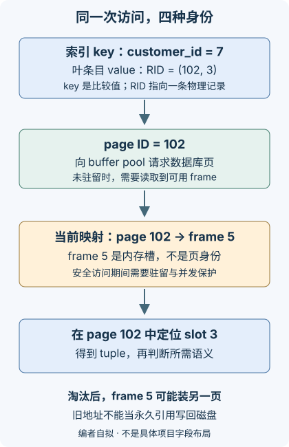
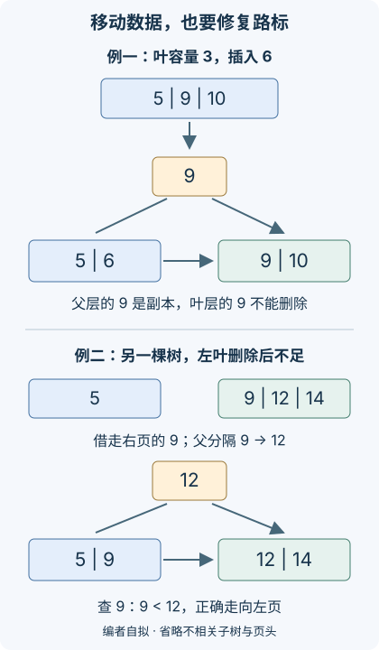

# L8 学习笔记：索引的承诺，是每次修改后仍能找到数据

B+Tree 不只是“一个查得很快的树”。它同时维护两个承诺：**内部路标把查询送往正确范围，叶层把全部实际条目按序连接起来。** 插入、删除、压缩、缓存优化都不能破坏这两个承诺。

## 1. 查询到底需要哪一种“顺序”

设有 `Orders(order_id, customer_id, created_at, status)`，以及 `Stock(sku, warehouse, available)`。

| 请求 | key 组织必须提供什么 | 不能忽略的条件 |
|---|---|---|
| 查订单 103 | 精确定位 `order_id=103` | hash 与 B+Tree 都可支持 |
| 查订单号 100–199 | 按 key 范围连续枚举 | 普通哈希不保序，不能用一次桶定位完成 |
| 查顾客 7 的全部订单 | `(customer_id,created_at)` 的前缀范围 | 先定位该前缀最小边界，再扫到前缀结束 |
| 查所有顾客在某天的订单 | 缺少复合键的前导列 | 不是天然的单一连续范围；可能全扫、重复定位或选另一索引 |
| 返回状态而不返回其他列 | 索引是否已含所需信息 | 还须检查过滤、可见性与具体系统支持 |

哈希适合精确相等定位，但“期望 O(1)”包含哈希分布和合理装载的前提；碰撞、溢出链、扩容不能消失。B+Tree 的优势不是每一种点查都必胜，而是用一套有序结构兼顾定位、枚举及局部维护。

### 动态哈希不是“取消扩容成本”

可扩展哈希只拆目标桶，并在必要时扩目录；线性哈希按 split pointer 轮次推进，热点溢出链可能暂时存在。它们把一次全表搬迁转成增量工作，仍要读取、重新分配相关桶。

若旧模数为 N，split pointer 为 s，线性哈希查找规则为：

$$
b=h(k)\bmod N
$$

$$
\text{若 }b<s,\quad b=h(k)\bmod 2N
$$

一轮完成后 N 加倍、s 归零。仅删除任意一个空桶就回退 s 会破坏路由；收缩要逆着合法拆分次序处理相应伙伴与条目。为了避免反复扩缩，可以保留容量并设置迟滞。

原讲定位：05:28–17:02、17:02–19:00。哈希概率先修见 [Project 0](#/c/cmu-15-445-2025/lab/project0?v=guide)，这里不重做概率教程。

## 2. key、RID、page、frame：四个问题，四种身份



图：编者原创。页号与槽号只为说明身份，不对应课堂页面或 BusTub 固定字段布局。箭头表示访问关系，不表示永久内存地址。

- **key**：按某个比较规则查找的值，如 `customer_id=7`。它可能重复，也可能由多列组成。
- **RID**：物理记录标识，常见教学形式为 `(page_id,slot_id)`。它不是业务主键，不是永远不可复用的身份，也不是 frame 地址。
- **page ID**：数据库持久页的身份。内部节点的孩子指针常以它表达，页不在内存时仍有意义。
- **frame**：buffer pool 中暂时容纳一个页的内存槽。该槽以后可能装另一页，不能把 frame 编号当作稳定的 page ID。

叶层 value 可以是 RID，也可以是主键或整条 tuple。因此“我已经到叶子了”不等于“完整 SQL 行已在手中”：二级索引存主键时还可能要第二次索引查找；存 RID 时还可能要取堆页。

### 覆盖索引与 index-only 并非同义口令

若查询只需要索引已保存的 `customer_id`、`created_at`，从信息内容看它是覆盖的。但数据库还必须确认这些条目对当前事务可见、没有被逻辑删除，并执行不由索引保证的谓词。具体系统可能仍要回表做可见性核验。**字段足够是省回表的必要条件之一，不是所有系统中永不访问表页的充分条件。** 这是编者连接后续执行与 MVCC 的补充，本讲没有实现完整 index-only scan 协议。

原讲定位：25:23–27:11、31:08–37:11、1:04:05–1:07:57。页生命周期先修见 [Project 1](#/c/cmu-15-445-2025/lab/project1?v=guide)。

## 3. 最小正确性证明：路标不必是现存订单

用唯一 key 的简化树，分隔键 s 的约定为：左子树所有 key 小于 s，右子树所有 key 大于或等于 s。更一般地，内部节点的孩子对应互不交错的连续区间，并覆盖该节点负责的全部 key。

要证明查找正确，逐层维护一句话：**若目标条目存在，它一定在当前节点负责的范围内。** 比较器按相同规则选择孩子，归纳保证一直不把它排除，最后到叶子判断是否确实存在。

因此，内部出现 100，并不能证明订单 100 存在。假设左边最大 key 是 97，右边最小 key 是 104，用 100 作分隔仍合法。删除叶子中的 100 后也不必无条件删除所有内部的数字 100。相反，一旦把 key 从右页搬到左页，旧路标可能失效，必须修正。

### 六条适合纸面推演的不变量

1. **统一比较器**：内部导航、页内排序、复合键、NULL 与 collation 不能各用一套规则。
2. **叶层完整性**：实际索引条目在叶层可找到；内部导航 key 不当作数据副本返回。
3. **分区正确性**：每个孩子负责的 key 区间与父分隔一致，无遗漏、无错误重叠。
4. **等叶深**：严格 B+Tree 中所有叶子离根同样远。
5. **容量与最低占用**：内部看孩子数，叶层看条目或字节；根允许例外，精确取整依布局约定。
6. **叶链一致性**：范围扫描沿 next 能按序到达全部后继；若有 prev，也须与 next 配合维护。

占用下限与等叶深不是同一条。延迟合并可以放宽占用，但不能因此随意让一个孩子跳过树层。叶链也不是完整 B-link 并发协议；后者还需要边界与并发访问规则。

原讲定位：22:23–31:08、34:38–37:11、50:32–52:55。

## 4. 插入与删除的本质：数据搬了，谁还在指向旧范围



图：编者自拟状态变化。上半图为单叶扩展成两叶；下半图是另一棵树的删除后借键示例，并不是上半图的下一步。仅画必要路标与叶条目。

### 插入：copy-up 与 push-up 不能混淆

假设叶容量为三，叶 `[5,9,10]` 插入 6 后拆成 `[5,6]` 与 `[9,10]`。父层新增 `(separator=9,new_child)`。这个 9 是 **copy-up**：叶层 `[9,10]` 里的 9 必须保留，因为它对应真实数据。

若父内部页也满，拆它时要重新划分孩子集合，把中间分隔键提升给更高父层，即 **push-up**。中间键已经承担两个新内部节点之间的边界，不必继续作为某个新内部节点内部同位置的键。不要拿叶分裂的“复制保留”直接套内部结构。

若连根都溢出，就建新根，让它指向拆出的两个节点；所有叶子的深度同时增加一。单次分裂可能沿一条祖先路径传播，但不必读取、排序整棵树的所有叶子。

### 删除：有钱的兄弟才借得起

设最低叶条目数是二。删除后左叶只剩 `[5]`，右叶 `[9,12,14]`，可以把 9 借给左边，变成 `[5,9]` 和 `[12,14]`。父分隔必须从 9 改为一个合法新边界，例如 12；否则查 9 仍去右边，出现错误的“不存在”。

若右叶原来只有 `[9,12]`，借走 9 会让右叶不足。此时若合并容量允许，应合并为一页并删除父层多余的 child reference／separator。父又不足时，才继续修复内部层。内部借位不是“只抄一个数字”：孩子指针和相关父分隔关系也必须一起旋转／调整。

根若只剩一个孩子，可以让该孩子成为根，树高减一；若根本来就是叶子，删除最后一个条目的空树表示由实现约定决定。**根特殊，不代表可以保留一个无意义的单孩子根而假装每项高度约束都没有变化。**

### 不要把优化偷偷写成定义

插入前可先向邻居重分配，减少分裂；删除后可延迟合并，减少抖动。但它们都要维护正确路由，并明确新的容量政策和并发代价。一次处理更多兄弟会拿更多 latch，不一定更快。此处没有提供多线程算法，不能拿顺序推演证明并发正确。

原讲定位：37:11–52:55、1:10:03–1:11:10。

## 5. 有序复合键解释了前缀、重复值与跳跃扫描

考虑索引 `(customer_id,created_at)`，次序是先顾客、后时间。数据片段如下：

```text
(7, 09:00), (7, 12:00), (7, 16:00),
(8, 08:00), (8, 12:00), (9, 12:00)
```

查顾客 7：定位 `(7,最小边界)`，扫描到 customer_id 不再是 7。查 12:00：匹配被不同 customer_id 分隔，不能把一次范围扫描的连续性强加给后缀条件。

**SQL 条件的书写顺序不决定索引的列顺序。** 把 WHERE 中两个 AND 条件调换，不会把 `(customer_id,created_at)` 变成 `(created_at,customer_id)`；优化器可以识别等价谓词，但不能凭语法重写让物理排序凭空改变。

Skip scan 的机会来自枚举不同前导值，再对每组定位后缀，而非把后缀变成全局有序。前导列不同值很多时，重复定位成本可能不合算；具体是否支持、是否选择，须看版本和优化器。课堂扫描全部叶页的图只是说明无法直接单区间定位的基础代价。

### 非唯一 key 可以变成唯一物理次序

为每个条目用 `(customer_id,RID)` 排序，顾客 7 的多条订单便有确定位置；只按 customer_id 查，仍是前缀范围。一个 key 有大量结果时，返回它们本来就需要与输出量有关的成本；RID 后缀不是让一百万结果瞬间返回，而是避免把维护困在无界的页链中。

必须区分：

- 物理 `(key,RID)` 唯一，不代表 SQL 的 `UNIQUE(key)` 自动成立。
- 相同逻辑 key 的多版本，不等于所有版本对一个快照都同时可见。
- RID 后缀方案不取消行移动、回收与旧索引条目清理协议。

原讲定位：52:55–1:04:05。

## 6. 对数高度以外，真正付钱的是哪些页

若每个内部页平均有 F 个孩子，叶层共有 L 页，粗略路径页数为：

$$
H\approx 1+\lceil\log_F L\rceil
$$

这是规模估计，不是把可变占用、根的例外抹掉的精确恒等式。一个页若容量 B、页头 h、定长 key 宽 k、子页标识宽 p，内部容量的简化上界来自：

$$
h+Fp+(F-1)k\le B
$$

key 更大、元数据更多，F 就变小；前缀压缩等优化则可能增大有效扇出。本讲没有展开完整压缩算法，不在此补造成课堂内容。

点查可能触及 H 个索引页，再加回表页；上层已缓存时，磁盘读取可少于 H。返回一个覆盖 r 个叶页的连续范围，大致需要路径定位再扫描这些叶页。若每个结果的 RID 落在不同堆页，回表可能反而成为主成本。**索引叶按 key 连续，不等于 tuple 在磁盘连续。**

### 三个 RID 的反例

扫描得到 `(page102,slot1)`、`(page103,slot2)`、`(page102,slot7)`。若立即逐个取，极小缓存可能重复读 102；先按 page 分组，就能一并处理页 102 的两条记录。但输出不再自然维持 key 顺序，若查询要求顺序，必须保留映射或追加排序。大结果也需要批处理与内存预算，不能无界收集所有 RID。

两个索引得到候选页集合后，按 page ID 求交只说明“这个页两边都可能有匹配”，不证明同一行满足两条件。例如页 102 的第一行只满足 A，第二行只满足 B，页级交集仍包含 102。必须有精确 tuple-level 信息或重检。

原讲定位：24:23–25:23、1:04:05–1:10:03。

## 7. 页内布局：少比较与少访问不总是同一件事

| 方案 | 获得什么 | 付出什么／前提 |
|---|---|---|
| key/value 交错 | 表达直接，找到 key 后 value 邻近 | 搜索 key 时可能把无用 value 搬入 cache |
| key、value 分离 | 只扫描紧凑 key 数组 | 两数组位置必须一致 |
| slotted page | 容纳变长 key，排序小 offset 项 | 解引用、碎片与页内整理仍有成本 |
| 最大长度 padding | 简化定长寻址 | 长度差异大时浪费容量；不能改比较语义 |
| 只存 key 指针 | 少保存 key 副本 | 比较要追指针，内存随机访问也昂贵 |

页内线性扫描的比较次数较多，却可能有良好局部性；二分少比较，却有跳跃、分支和依赖。固定宽 key 可以批量 SIMD 比较，但最后不足一向量的 lane 要屏蔽，不能越界加载未允许访问的内存。示例中的 x86 intrinsic 也不等于 Apple Silicon 或 Ubuntu 评分环境的可移植实现。

如果 key 是严格连续整数，可算位置；若中间缺一个，按位置直接判“不存在”就失去正确性。一般插值查找可以使用估计并继续缩小范围，但不是课堂连续数组演示的一次精确定位。选择方案须保留自己的前提，不能只抄“更快”。

原讲定位：31:08–34:38、1:11:10–1:17:47。

## 8. 两种“把工作延后”，延后的责任不同

### Pointer swizzling：延后／省去重复解析地址

普通 child link 的身份是 page ID；驻留时可以缓存 frame 地址，但要保证引用存续期间 frame 仍装着该页，并有失效、去 swizzle 或淘汰顺序协议。仅仅“我刚查过页表”不够：下一刻 frame 可能被复用。pin、latch、dirty 分别处理驻留保护、并发访问与回写状态，彼此不可替代。

磁盘里的 page ID 可以在下次运行重新解析；这次进程的裸地址不具备这个性质。写回时不能把它当稳定引用序列化。这是 [Project 1 页生命周期](#/c/cmu-15-445-2025/lab/project1?v=guide) 在索引中的直接应用，不是要求改写该项目。

### 写优化树：延后把操作应用到最终叶页

内部缓冲先记录 `insert(7)`、`delete(10)`，满了再成批下推。写路径少做随机访问，读路径却必须合并沿途尚未下推的操作与叶数据。

最简单的反例：叶子还含 10，根缓冲已经有最新 `delete(10)`。只扫叶子会把已删除值返回。反过来，上层有新 insert、叶子尚无记录，纯叶扫描又会漏掉新值。范围扫描必须看得见这两类消息，不能只有点查正确。

这是 Bε-tree 风格缓冲更新的概念，不是 WAL；WAL 解决持久化恢复的顺序要求。它也不是 Project 2 的 leaf tombstone buffer。三者都可能使用“记录操作”的词汇，却有不同位置、可见性、回收与维护语义。本讲没有独立读实现论文，不在此给出完整算法或复杂度定理。

原讲定位：1:17:47–1:24:03。

## 9. 折叠自测：先给反例，再看答案

<details>
<summary>1. 内部分隔键 20 存在，能直接返回“订单 20 存在”吗？</summary>

不能。内部只是范围边界，实际条目须在叶层确认。删除叶条目 20 后，分隔键 20 仍可能合法。

</details>

<details>
<summary>2. 叶子 [5,9,10] 插入 6，向父层放了 9，叶层能删 9 吗？</summary>

不能。叶分裂 copy-up 保留真实条目；若把叶 9 删掉，导航虽然有 9，数据却丢失。内部节点分裂才涉及中间分隔键 push-up 的另一套位置关系。

</details>

<details>
<summary>3. 右页的 9 借给左页，为什么父分隔不能继续是 9？</summary>

若约定相等往右，查 9 仍去右页，却已搬空；必须选新边界并维护左右范围。只检查占用率不够。

</details>

<details>
<summary>4. 每个非根节点至少半满，是否意味着总是有一半节点装满？</summary>

不是。前者是每个节点的下限，后者是节点群体的分布。课堂约 69% 的数字也不是对任意工作负载的保证。

</details>

<details>
<summary>5. 只查 created_at，调换 WHERE 两条件的书写顺序能让它成为复合索引前缀吗？</summary>

不能。索引列序是物理比较规则；SQL 谓词顺序只是表达。可能使用 skip scan、全索引扫描或别的索引，但不是改写条件次序改变树序。

</details>

<details>
<summary>6. 页 102 同时出现在两个索引的候选页集合里，能认定它有满足 AND 的行吗？</summary>

不能。两个条件可能由页内不同的行分别满足。需精确 RID 交集或回表重检。

</details>

<details>
<summary>7. 覆盖查询全部输出列的索引，保证完全不回表吗？</summary>

不保证。还需满足谓词与事务可见性要求，是否可省略表页读取取决于具体系统机制。存齐字段不等于已经证明可见。

</details>

<details>
<summary>8. 节点存 frame 号是否比 page ID 更“直接”，可永久保存？</summary>

frame 可复用，旧编号／地址可能指向另一页。只有带驻留、有效期与失效管理的临时引用才安全，持久化身份仍需可恢复的表示。

</details>

<details>
<summary>9. 根缓冲写了 delete(10)，叶扫描为什么仍会错？</summary>

物理叶条目可能还在。读路径必须把未下推操作纳入逻辑结果；同理，上层 insert 尚未落叶也不能漏掉。仅让写入“成功放入缓冲”不等于结构整体正确。

</details>

<details>
<summary>10. 本页的普通删除流程可以原样当 Fall 2025 Project 2 答案吗？</summary>

不能。固定项目含叶页 tombstone 特化，后续还要满足并发协议；逻辑删除、物理槽位、整理时机与操作次序须按固定题面解释。本页提供不变量，不提供可提交实现。

</details>

## 全片时间索引

边界按完整字幕的主题切换取到秒，可能与句子起点相差数秒；不是逐帧定位。音乐、通知和缺字幕区间也不从总片长中删掉。

| 时间 | 核心问题／课堂内容 |
|---|---|
| 00:00–01:54 | 音乐、Project 1／HW3／期中安排 |
| 01:54–05:28 | Iceberg 研讨会、反馈、OLAP 署名更正 |
| 05:28–07:00 | 为什么需要动态哈希 |
| 07:00–09:16 | 可扩展哈希目录与局部深度 |
| 09:16–12:50 | 线性哈希拆桶与两套模数 |
| 12:50–15:30 | split pointer、溢出与一轮完成问答 |
| 15:30–17:02 | 线性哈希删除与避免反复扩缩 |
| 17:02–19:00 | B+Tree 为什么比普通哈希更通用 |
| 19:00–22:23 | B-tree／B+Tree／B-link 名称与历史 |
| 22:23–25:23 | 扇出、等叶深、非根占用与页大小 |
| 25:23–27:11 | 分隔键、叶数据与侧向扫描 |
| 27:11–31:08 | M、预留槽、链表快速入口问答 |
| 31:08–34:38 | 节点布局、页内排序与变长 key 问答 |
| 34:38–37:11 | B-tree 与 B+Tree 的数据位置 |
| 37:11–40:15 | 插入 6、叶分裂、copy-up 9 |
| 40:15–41:17 | 为什么叶 9 保留、插入 8 |
| 41:17–43:27 | 插入 17／16、根分裂 |
| 43:27–45:36 | 邻居重分配优化、局部改页 |
| 45:36–47:33 | 删除 6、借 9、分隔键改 12 |
| 47:33–48:31 | 生产系统为何只看紧邻兄弟 |
| 48:31–50:32 | 删除 15／19、叶合并、根收缩 |
| 50:32–52:55 | 根例外、内部重分配、并发预告 |
| 52:55–55:52 | 复合键完整查找与前缀扫描 |
| 55:52–58:46 | 后缀、skip scan、SQL 顺序问答 |
| 58:46–1:01:38 | 重复 key 与隐藏 RID 后缀 |
| 1:01:38–1:04:05 | 重复键 overflow 链维护反例 |
| 1:04:05–1:05:42 | 聚簇与一次性重排的区别 |
| 1:05:42–1:07:57 | RID 分组回表、bitmap 候选与重检 |
| 1:07:57–1:10:03 | 现代 B-tree 阅读推荐、节点大小 |
| 1:10:03–1:11:10 | 合并阈值与占用统计的条件 |
| 1:11:10–1:14:09 | 变长 key 的四种存储方案 |
| 1:14:09–1:16:38 | 页内扫描、SIMD 比较演示 |
| 1:16:38–1:17:47 | 二分与直接插值的前提 |
| 1:17:47–1:20:10 | Pointer swizzling 与页生命周期 |
| 1:20:10–1:22:59 | 写优化树、节点缓冲与下推 |
| 1:22:59–1:24:03 | 产品轶事、范围扫描难点问答 |
| 1:24:03–1:24:42 | 收尾音乐与未覆盖尾部 |

## 来源、阅读与许可

- 主来源为 Andy Pavlo，CMU Database Group，Fall 2025 L8。完整字幕已顺序读完；只检查必要的真实课堂帧，未听核全片音轨。精确覆盖、原字幕哈希和逐视频授权见[来源清单](https://github.com/socoo123/course_web/blob/main/content/cmu-15-445-2025/source-manifest.json)。
- 视频单独标记 Creative Commons Attribution（reuse allowed），课堂改编按 [CC BY 3.0](https://creativecommons.org/licenses/by/3.0/) 署名。本文 Orders／Stock 模型、推导、SVG 与自测为原创；第三方 PDF／教材不继承视频许可。
- 指定阅读：《Database System Concepts》，第七版，§14.1–14.4。这里只确认课程指定章节，教材正文未取得／未读，没有教材全译或独立 materials 页。
- 课堂提到早期 B-tree、1979《The Ubiquitous B-Tree》、Lehman–Yao 工作及现代 B-tree 书籍；正文未独立阅读，故不把课堂转述包装成论文精读，也不引用未核对的定理、页码或产品版本。
- B-tree 与 B+Tree 的空间和 I/O 比较是设计倾向，不是对任意 key 宽度、存储布局和缓存状态的性能定律。历史名称、公司故事及 ASR 疑点留在译稿中说明。
- 学习者实验仍为 `not_attempted`；本页不是 Project 2 完整答案，也未编译或运行学生骨架。
