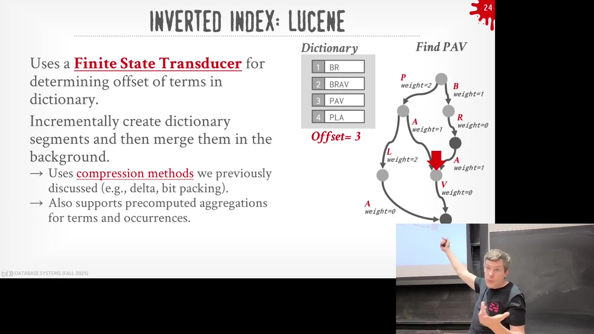

# L9 逐段整理译稿：索引与过滤器 II

## 00:00–01:40 开场与课程安排

开头是音乐，零碎歌词不转录。约 00:25 教师请大家为 DJ Cash 鼓掌，感谢来宾；随后简短询问一位朋友近况，对方表示近况好转，但在伦敦遇到法律方面的问题，不愿详谈。此处人名自动识别不可靠，不据此作现实人物断言。教师把话题转回数据库。

Project 1 临近截止，Homework 3 当天发布。期中考试安排在 10 月 8 日课堂，教师先口误说“lecture zero”，随即改为 L1–L11；复习指南预计周末或下周一发布。周六下午 3 点安排额外 office hours，多位助教到场，使用 OQ 排队。字幕将 Gates 房间识别成“527”，未作音画确认，不把它当作现行地点通知。

## 01:40–04:26 索引给位置，过滤器给成员判断

继续讨论数据库内部的数据结构。索引接收一个属性值或条件，帮助找到记录或一组记录，例如查找邮箱属于 `cs.cmu.edu` 的用户；它给出确切位置，或者范围访问的起点。哈希表和 B+Tree 都是此前的例子。

过滤器则不告诉你记录在哪里，而回答集合成员问题。Bloom filter 的回答不是对称的“是／否”：否定表示可以排除，肯定只表示可能存在，有时会误报。过滤器可以放进索引或其他结构的访问路径里，先排除不可能的请求，再执行昂贵查找。

今天先讲 Bloom filter，再讲 skip list、trie、inverted index 和 vector index。教师举手调查大家对这些结构的熟悉程度：Bloom filter 与 skip list 知道的人都很少；有人知道 trie、radix tree 与倒排索引，向量索引的 HNSW、IVFFlat 几乎无人熟悉。后半讲会把前面的结构或思想重新组合起来。

## 04:26–06:04 Bloom filter 的接口与空间

Bloom filter 是广泛使用的概率型结构。通过位图大小和哈希函数数量，可以调整空间开销与误报率。基本版本只有插入与查询，不提供删除；删除需要其他设计，稍后解释。这里用一个 bit vector 记录哈希映射的位置，而不保存所有原始 key。

同一个 key 经过多个哈希映射，落到不同的位。它很紧凑，因此可用于内存缓存、连接处理，也可以放在哈希表或树的前面。今天不展开 cache line 层面的优化，先掌握最基本的表示和操作。

**编者注：**“不会假阴性”以所有待查询的有效成员都已插入、哈希／编码一致、位未被错误清除且更新已对查询可见为前提。位图不是每个 key 独占一位的 one-hot 编码；不同 key 可以共享位。

## 06:04–08:52 八个位、两个哈希函数的动画

为适合投影片演示，教师使用八个位、两个哈希函数，所有位初始化为零。插入 RZA：对 key 做两次哈希，可使用同一算法配不同 seed，再按位图长度取模。示例落到位置 6 和 4，将两位设为 1。随后插入 GZA，同样计算两个位置并置位。自动字幕对哈希值的长数字识别混乱，本稿只保留明确说明的最终位置，不重建原始数值。

查找 RZA 时，用同样的两个映射读同样的位，两位都是 1，返回“可能存在”；这次确实存在。为什么不会漏掉已插入的 key？因为插入时已把它需要的位设为 1，而正常插入不会把任何位改回 0。

查找 Raekwon the Chef，演示落到 5 和 3，其中一位为 0，于是确定没有插入过。再查 ODB：虽然没有插入它，它的两个位置却都被其他 key 置为 1，于是返回肯定，这是 false positive。增加哈希数量不总能解决问题：位图太小、哈希太多，所有位很快都成了 1，过滤器就失去排除能力。必须一起考虑容量和计算量；即便有相当规模的数据，过滤器仍可能只需很少空间。

## 08:52–10:04 与 Project 0、hash join 的联系

你们在 Project 0 做的 Count–Min Sketch 也是概率型结构：不显式保存所有可能 key 的完整统计，而允许带概率约束的估计误差。Bloom filter 的动机相近，但问题不同，它只判断可能的成员关系。

过滤器的查询很小、很快，可能比哈希表里不断探测、比较哈希和原 key 便宜。做 hash join 时，可以在构建侧哈希表前面建立 Bloom filter。探测侧先查过滤器：返回否就不用探测哈希表；返回是仍必须去哈希表核对。教师提到这种思路有时称作 Bloom join 或 Bloom hash join，后续连接课还会出现。

**编者注：**这不是无条件的速度保证。若几乎每个 key 都存在，过滤器不排除多少请求，却给每次请求多加一次工作。

## 10:04–11:36 为什么基本 Bloom filter 不能删除

Counting Bloom filter 把位换成计数，插入时增加、删除时减少，从而支持删除。学生追问普通 Bloom filter 如何随底层 key 的删除而更新。教师回到位图：一个位可能同时由多个 key 设置，过滤器没有保存这些 key 的身份。若为了删除其中一个 key 就把共享位清零，会使另一个仍然存在的 key 查询失败，也就引入假阴性。

接下来的学生发言只部分可辨认，教师复述涉及误报率和删除。他强调：基本版本不要删位；需要删除能力就使用计数版本，而不是在原位图上硬做清零。

**编者注：**底层删记录而保留普通过滤器的旧位是安全的保守做法，但可能留下更多误报；可以从当前集合重建。计数版本也不能盲删仅仅“查询可能存在”的 key，必须保证删除的是确实插入过且尚未删除的贡献，计数不溢出、不下溢，并正确处理并发。

## 11:36–13:55 Cuckoo filter、SuRF 与频数估计问答

另一种方案是 Cuckoo filter，类似此前的 cuckoo hashing，但不存整个 key，只存较短的 fingerprint。它用更小表示支持成员查询，也能在适当操作约束下删除。第三种是 Succinct Range Filter，简称 SuRF，用压缩 radix tree 的思想，不仅能判断单个 key 是否可能存在，还能回答某个范围是否可能含有 key；普通 Bloom filter 不直接提供这种范围成员查询。

教师说明 Cuckoo filter 和 SuRF 与 CMU 的研究有关，提及 Dave Andersen 及其学生，并举 Redis 提供相关类型为例。这些人物履历和产品历史未独立核验。这里的重点是：同一种“过滤”职责可以有不同表示和操作集合。

学生问 Counting Bloom filter 与 Count–Min Sketch 有何区别。教师回答：Count–Min Sketch 估计某个 key 出现的次数，Counting Bloom filter 的接口目标是成员判断，计数主要帮助删除。学生指出 sketch 能做更多事情，教师接受这种目标范围的比较，没有展开等价实现。字幕在 13:12 附近出现“Counting Bloom won't handle deletes”，与本段前后明确讲述相矛盾，不能作为技术结论。Bloom filter 仍是今天必须掌握的主要过滤器。

## 13:55–16:24 从链表到 skip list

回忆 B+Tree：底层叶节点形成有序链表，上面的内部节点和根节点提供路标，让查找不用从头走到尾。如果只有普通链表，查找一般可能要走线性数量的节点。那能否直接给链表加捷径？

先设想每隔一个 key 增加一根指针，跳过中间节点；再向上增加跨越更长区间的指针。它看起来已经有点像 B+Tree 的路标，但 skip list 不通过节点分裂和合并决定路标位置，而是在插入时掷硬币决定一个 key 出现在哪些层。

因此 skip list 是多层有序链表。它被称为概率型结构，指的是构建布局有随机性，不是查询结果会误报或漏报；正常实现仍给精确结果。这一点与刚才 Bloom filter 的“概率”含义不同。

## 16:24–18:42 层数、期望复杂度与适用位置

最底层含有全部 key，上一层大约一半，再上一层再减半。插入时随机选择新 key 的塔高，于是平均查找路径近似对数长度。B+Tree 通过平衡约束给出高度保证，skip list 则依赖随机分布的期望性质。

教师把 skip list 与 B+Tree 的年代作比较，并解释 skip list 常见于内存索引，尤其 LSM-tree 的 memtable；磁盘上通常还是 B+Tree 更合适。学生问是否只有三层，回答不是，图只是画了三层，可以继续提升。

动画左侧是各层入口，右侧是结束标记，看到结束标记就知道无法继续前进。所有 key 在底层，向上的预计数量为 $n/2$、$n/4$ 等。**编者注：**原字幕把“概率”和“数量”混在一起；若底层编号为 0，独立公平晋升下某个 key 到达第 $i$ 层的概率是 $2^{-i}$，该层期望 key 数才是 $n/2^i$。

## 18:42–21:36 插入 key 5：先准备，再从底层接入

新 key 必须在底层，所以底层不需要掷硬币。从下一层开始掷硬币，成功就继续上升，第一次失败即停止。例子让 key 5 获得三层高的塔；不是逐层相互独立地决定是否存在，以免上层存在而中间缺失。

先创建相应节点，不立即让旧结构指向它们。底层存实际关联值，上层是加速访问的塔节点；上层可沿塔向下。先给新节点的后继指针赋值：底层 key 5 指向 key 6，上面两层后面没有其他 key，因而指向无穷大的结束标记。

然后从底向上修改前驱指针。底层前驱接到 key 5 后，它已经能被正常查找发现，即使上层路标尚未接好。再逐层让前驱指向新塔，完成所有捷径的接入。这里先用单线程的直观步骤说明，不是已经给出了并发安全的发布协议。

## 21:36–23:20 查找 key 3 与图中省略的指针

从最高层入口出发，先看下一节点的 key。最高层下一个是 5，目标 3 小于 5，不能向右跨过去，于是下降一层。在下一层看到 2，目标 3 更大，可以向右到 2。再向前看是 4，目标又更小，于是从当前位置向下。底层继续沿有序链表前进，找到 3。

规则就是：能向右而不越过目标时向右，否则向下；底层进行最终确认。学生问左侧入口是否像一个数组，教师回答它保存每层的起点，让你知道如何进入该层。另一位学生问向下的连线在哪里，教师确认图里省略了这些线，实际也有沿塔下降的关系。

## 23:20–25:35 删除 key 5：逻辑标记与物理清理

暂不讨论下周的多线程问题。每个底层 key 带一个删除标记。要删 key 5，先查找到它，把标记设成 true。以后查询即使走到了这个节点，也必须检查标记并把它视为不存在。这样前台不必立刻移除整个塔、改完所有指针。

后台可以像 LSM compaction 那样定期清理。物理拆塔的次序与插入相反：先断开最高层指向 key 5 的入口，改指向后继；再处理下一层，最后断开底层。当没有读者还在使用这些节点时才释放内存。

教师特别重复单线程假设。若多线程下还有线程停留在待删除节点上，直接释放就会留下悬空引用，因此必须额外保证无人使用。这里的标记与拆链顺序只是算法说明，不能替代完整内存回收方案。

## 25:35–27:33 skip list 与 B+Tree 的折中

把 skip list 的图旋转一下，会发现它与 B+Tree 都在做分层引导；区别是路标由随机塔高而不是分裂、合并决定。它不用重新平衡，不需要像树页那样分裂、合并；删除或插入一个塔通常不会改变其他 key 的位置。

图中是单向链表。加反向指针在单线程下并不神秘，但多线程下会复杂化：不同线程可能从相反方向访问，需要协调更多链接关系。磁盘上则有局部性问题，多个节点的指针追逐可能产生比 B+Tree 更多的 I/O；内存里还可以把若干 key 紧凑打包。

教师举 SingleStore 的行存索引、RocksDB 的 memtable 为例，并不确定地提到 WiredTiger。这些是课堂举例，不作为所有版本的实现承诺。

## 27:33–29:42 为什么 trie 能早早证明“不存在”

B+Tree 内部节点的分隔 key 是路标。某个实际 key 被从叶子删去后，同样的分隔值还可能保留，所以在内部节点看到它并不能证明记录还在，通常必须走到叶子。教师顺带提到上讲 Bε-tree：若在途中的修改缓冲里看到适用的删除消息，某些情况下可提前得知，但不能指望所有查询都如此。

Trie 不在每一层拿整个 key 作比较，而是按 key 的某一部分——字符、字节或 bit——逐层导航。走过的路径本身编码了 key。如果第一层所需分支就不存在，可以立即结束，不必继续下探。教师简述 trie 的早期历史及名称与 CMU 的联系；这些年代和人物未在本稿独立考证。

## 29:42–31:39 前缀 key、字符串和整数的问答

学生问：一个 key 是另一个 key 的一部分时怎么办？师生先澄清是在问前缀情形，例如 `hat` 与更长的 `hate`。查找 `hat` 走到它的终止位置就停止，不必继续追随到后面的 `e`；同时可以保留后续分支。完整 key 的结束与是否存在孩子是两件不同的事。

再问字符串和整数如何共用这个结构。教师把字符串归结为字节表示：先按简单字符编码看，每个字符最终也是数字，可以按位或按字节拆开。浮点数和其他复杂类型需要更多考虑，本讲不展开。

**编者注：**字幕把 ASCII 一处识别为“eight bytes”，后面教师明确说 8-bit characters。这里只是在采用按字节处理的简化模型；ASCII 本身是 7-bit 字符集，不能据此说任意字符串都定长，或 UTF-8 每个字符都是一字节。若要保留数值范围顺序，还需要合适的键编码，而不只是任意内存字节排列。

## 31:39–33:28 trie 的结构与复杂度

普通 trie 不靠旋转或平衡调整来决定结构。对于给定的 key 集合和固定编码，逻辑分支由 key 本身决定，不取决于插入顺序。查找代价按 key 长度 $K$ 计，理想的逐位／逐字符访问是 $O(K)$；例如 `hello` 只有五个字符，就按这些字符依次检查，遇到缺失分支还可以更早结束。

教师定义 span：每一层消费多少 bit 或 digit。一个节点可能指向多少后继，与 span 和实际分支有关；不存在的分支对应空指针，实际 fanout 又会影响物理树高与空间。不能把 key 数量 $n$ 和 key 长度 $K$ 当作同一个变量。

## 33:28–35:34 把 10、25、31 放入一位 span 的 trie

例子要保存整数 10、25、31，每层只处理一位。真实系统通常不会用如此细的粒度，而会考虑字节或更大的单位；这里只为了把路径画清楚。三者按同样的定长二进制编码展开，前面有很多共同的零。

第一层所需的 0 分支继续向下，1 分支为空。因此来一个最高位为 1 的查询时，只看第一层就能排除。接下来又是相同的零，投影片用“重复”省略一长串完全相同的节点。走到出现差异的 bit 后，才需要同时保留 0 和 1 两条分支。

沿各自的 bit 路径到达末端，找到 RID 或记录指针，进一步获取真实数据。这里的位路径是查找 key，末端值是记录位置，两者不是同一种身份。

## 35:34–38:46 压缩空分支、压缩路径与截断信息

刚才的表示很浪费：有些节点只有一条有效分支，却还为其他不存在的分支保留位置。可以在水平方向只存实际存在的分支，省掉空位置。若连续多层都只有一个后继，还可以在垂直方向压缩这条单一路径。

教师进一步演示一种截断：一旦可以指向某条候选记录，就不把它剩下的全部 key bit 继续画在 trie 里，直接保存记录指针。这使结构更小，但仅凭留下的前缀不能保证完全匹配；可能另一个不同 key 也走到同一候选位置。必须跟随指针去核对真实 key，或者把这种结构只用作“可能存在”的过滤器。

教师把压缩 trie 称为 radix tree，并说实际系统通常使用压缩形式，近年又重新受到关注，提到 Cassandra 的 memtable 选择变化。**编者注：**有损截断与无损路径压缩必须区分。把完整边标签合并保存的 radix tree 可以仍是精确索引；“radix tree 必然有误报”不是这里应记住的定义。

## 38:46–41:24 关于确定性、插入与原记录核对的追问

学生问：压缩前确定，压缩后就变随机了吗？教师区分两件事：给定 key 集合，结构的逻辑分支仍可确定；之所以可能把不存在的 key 当作候选，是截断丢失了信息。不是普通的压缩自动产生随机性。

学生继续确认这是不是可以插入的结构，以及新 key 与原有截断路径共享前缀怎么办。回答是可以插入，需要在出现区别的位置把路径展开，稍后展示修改示意。

又有人问“检查原始 key”到底查哪里。教师说记录指针可以指向 heap page，也可能指向其他保存 tuple 的结构，例如索引组织的表；它不关心最后采用什么存储布局，只需抵达真实记录并比较 key。就像线性探测哈希表里落到一个非空槽，还不能马上说找到了目标，必须检查该槽的 key 是否真的相同。

## 41:24–44:28 复杂度、局部性和索引为何值得维护

这一段连续问答中有较长学生发言未被完整识别。可辨认的问题涉及压缩 trie 的复杂度、唯一／非唯一索引，以及数据是否在同一个 block。教师说明：唯一索引的候选最终要么匹配、要么不匹配，可以做一次候选记录访问；非唯一索引还需要考虑对应多个记录。字幕中的“$K+1$”是对额外一次核对的口头计数，不应理解为完整 I/O 公式。

未压缩的路径按 key 长度逐层走，各节点可能位于不同位置。压缩后，这个很小的示例可能全装进一个 block，但真实 tuple 仍可能在别处。未压缩 trie 可以在缺失分支上结束；若成功找到且查询需要 tuple，也还是要顺着记录指针取数据。截断形式则可能为了排除假候选而额外取 tuple。

学生再问为什么做这么多工作。教师把比较对象拉回全表扫描：如果有十亿条 tuple，不希望为了一个 key 扫十亿条记录。索引占用额外空间，也增加维护计算，但换来避免大量无关扫描，通常值得。这里比较的是结构的实际目的，不是声称任何查询使用索引都更快。

## 44:28–46:32 radix tree 的应用、术语与修改动画

教师提到 HyPer 的研究、DuckDB 的借鉴，以及 Tableau、Salesforce、Umbra、CedarDB 的相关演进，并列举 Redis、SQLite 等内部使用场景。还解释 Patricia 是历史文献中与压缩 trie 相关的名字；本稿不把所有这些名字当作严格完全等价的实现，也未核验产品历史。

接着看修改。节点可以保存多个键片段，片段长度可变，可以借用此前 slotted page 的组织思路。插入 `hair` 时，沿 `h`、`a` 找到适当节点，在空位置放入余下部分。删除 `hat`，沿对应路径找到 `t` 并移除；再删除 `have` 后，如果下层只剩一条路径，就可以把 `ir` 提升，重新压缩成较短的路径。

教师明确说略去了许多实现细节；图是在展示分支扩展、收缩的思想，不是可以直接照搬的页格式或完整 ART 算法。

## 46:32–48:38 ART、Judy 与 B+Tree 比较问答

实现家族包括前面提过的 SuRF、HyPer／DuckDB 使用的 ART，以及 Judy arrays。教师讲了 Judy 专利导致采用顾虑的轶事，并表示自己不了解更多采用情况；关于专利到期年份和法律影响，本稿只保留“课堂有此讨论”，不提供法律结论。共同思路是根据节点内实际 key 数量调整节点布局，不必为所有可能分支付出固定的大数组空间。

学生问 radix tree 在什么情形胜过 B+Tree。教师回答：B+Tree 对范围扫描通常更自然；较大的 key 可能让 trie 的共享前缀压缩更有价值；查找不存在的 key 时，若很早遇到缺失分支，trie 可能很快结束。但他同时强调“取决于情形”。许多系统会在两类有序表索引中选择一种，而不是什么都实现；哈希索引与有序索引并存又是另一回事。

## 48:38–50:18 为什么整列索引不等于关键词索引

此前结构很适合点查询，如找某人的银行账户，或者范围查询，如出生日期落在某段时间内的人。可是“找所有出现 Pavlo 的文章”不同：如果给 Wikipedia revision 表的 `content` 整列建普通 B+Tree 或 trie，key 是整段文章，而不是其中每一个词。

用前后通配符在内容中找 `Pavlo`，普通整值索引不能直接告诉你哪些文档含有这个内部词，通常仍需扫描。并且这个字符串条件本身可能不符合人的语义：结尾通配符也会匹配科学家 Pavlov，不一定是想找的完整词 Pavlo。

**编者注：**这里说的是没有专用文本／trigram 等索引的整值索引场景，不是断言任何 DBMS 的任何 `LIKE` 都必然扫描全表。

## 50:18–53:29 倒排索引：term 到 posting list

倒排索引从被索引的列中抽取一个个 term，而不是只索引整列值。教师用中世纪对经文制作 concordance 的类比说明：列出每个词，再列它出现在哪些页。现代系统做的映射类似，只是末端是记录标识。

词典里每个 term 对应计数或统计，以及一条 posting list；posting list 记录包含该 term 的 tuple 的 RID。一条文档会贡献多个 term，也就可能进入多条 posting list。SQL 接口和分词方式在不同系统中差别很大，但“term → 记录集合”的核心思想相同。

一些库专门负责这种搜索结构，而不是替代整个数据库的主存储。教师举 Java 的 Lucene、C++ 的 Xapian、Rust 的 Tantivy，以及在上层提供服务的 Elasticsearch、OpenSearch、Splunk、Quickwit。还谈到许可变化、fork 与公司收购，具体商业历史未独立核实。关系数据库也可能内建全文搜索，但专用搜索系统通常提供更丰富的文本分析与检索能力。

## 53:29–56:43 Lucene FST 动画与权重问答

Lucene 的示意使用 Finite State Transducer，FST。它有类似 trie 的逐字符导航，但路径上的输出权重相加，可得到有序词典中的位置，而不是每条完整路径简单存一个独立记录指针。

查找 `PAV`：先沿 `P` 边，权重 2，累计 offset 为 2；再沿 `A` 边，权重 1，累计为 3；最后 `V` 边的权重 0，累计仍是 3。到终止节点后，跳到词典位置 3，得到对应 term，再继续使用它的 posting 信息。

图：真实视频帧，约 54:49；已查看图中 slide 24、“Find PAV”、`P:2 → A:1 → V:0` 和 `Offset=3`，右下为教师。来源为该讲短视频段，流复制可能含关键帧前滚，时间不作逐帧精确保证。只在译稿呈现课堂画面。

教师先口误说不是 immutable，随即改正为 immutable：这里的构建方式先收集一批 key、构建 FST，再冻结；新数据另建一段，后台再合并，消除跨段重复。位打包、delta encoding 等前面学过的压缩方法也能继续使用。

学生问边上的权重怎么来。回答是预先知道一批 term，把它们排序，再根据词典位置构建图。如果后来插入例如以 `j` 开头、排在原词之间的 term，原有位置与权重就会改变，所以采用批量构建及合并方式。这里是课堂化简模型，不是对所有 FST 的可变性作数学断言。

## 56:43–58:21 PostgreSQL GIN：树中还可以挂树

PostgreSQL 提供 Generalized Inverted Index，GIN。课堂把它解释为：term 词典使用 B-tree 思路，叶子里保存对应 posting 数据。教师特意改用 term 一词，避免把文档里的一个词和整列原始值混淆。

如果一个 term 只对应少量 RID，直接放小数组／posting list 即可；如果很多，就使用 posting tree，于是外层按 term 查找，叶子又可能指向一棵管理记录位置的树，像一片“树的森林”。更新一条文档可能要维护多个 term，这很贵。

为摊销更新，教师类比此前的 mod log：先吸收变更，再由批处理合入主结构。**编者注：**独立阅读 PostgreSQL 18 文档后，这里的具体机制应称为 GIN pending list／fastupdate，不是把所有插入、更新、删除一概等同于通用修改日志，更不是 WAL。查询还要覆盖尚未合入的 pending entries；资料页单独讨论其代价。

## 58:21–1:00:23 从包含某词到排序

找到所有包含 term 的文档只是第一步，还要排序。例如检索 Wu-Tang，很多 Wikipedia 页面会提及它，但以 Wu-Tang Clan 为主题的页面很可能更相关。可以结合某个词在文档中的频率，以及它在整个文档集合中有多普遍来评估重要性；`the` 几乎到处都有，不应该因此让任何文档得高分。

教师提及 TF 类方法与 BM25。BM25 的直觉是同一 term 反复出现时，增益应逐渐饱和，不能让一篇只有同一个词反复堆砌的垃圾文章永久排名第一。这里没有讲完整评分公式，也未推导长度归一化。

教师把 PostgreSQL 内建与专用搜索系统作比较，表示获得 BM25 可能需要扩展，并说自己不确定 Oracle、SQL Server 的具体做法。**编者注：**课堂对 PostgreSQL 排名的“只有 TF”是粗略说法，不能据此断言内建只数词频，或等同完整 TF-IDF；本稿没有独立阅读各产品排名实现。

## 1:00:23–1:01:48 tokenizer、trigram 与当场纠错

简单地按空格拆词还不够。tokenizer 和规范化过程可以去掉连字符，统一 `U.S.A.` 与 `USA` 这样的表示，也可以产生 n-gram，以容忍拼写差异。用三字符窗口切出相邻三元组，就能把原本要求完整词匹配的问题改成若干局部片段的匹配。

教师以 Wu-Tang 为例解释：输入可能漏字或拼错，仍能通过保留的局部片段找候选，而普通精确 term 匹配不具备这个能力。学生指出投影片里 `UTA` 出现两次，教师承认是笔误并感谢指正。重复项不能被解释成某个特意设计的权重。

## 1:01:48–1:04:51 从词面到 embedding 相似搜索

分词器可以处理连字符、空格和某些近似拼写，但只匹配 term 本身，不能自动理解任意语义。若要找“讲述逃离警察的歌词”，全文索引除非展开许多近义表达，否则无法仅凭这个含义匹配所有相关文字。

课堂用一张专辑表及歌词列举例，并说明真实设计更可能按歌曲存，而不是把整张专辑的歌词塞在一起。把文字送进模型，得到固定长度的浮点数数组，也就是 embedding，再用向量索引存这些向量与记录的关系。教师提到 OpenAI、Hugging Face、Word2Vec；它们是表示学习相关的不同工具或方法，不应都理解为同一种 Transformer 架构。

查询文本也经过兼容的同一表示过程。随后对查询向量做 approximate nearest-neighbor search，返回按相似程度组织的 RID，去找对应歌词。浮点数本身不必能由人逐项解释；希望语义相关的文本在所选向量空间中较接近。

## 1:04:51–1:07:27 元数据条件与“近似”的两层含义

还可以让向量检索带上普通列条件。例如除了歌词主题，还要求发行年份大于 2005。若索引保存了足够元数据，可以在候选处理中去掉不满足年份的条目。教师问：先按年份过滤，还是先做向量搜索？没有对所有负载都好的单一答案。

向量索引针对固定维度 embedding 的相似／近邻搜索。这里“数组一维”指容器是一串数字，不是向量空间只有一个维度；所有记录必须采用兼容的维度和表示模型。模型把内容压进向量，本身就不保证人认为相关的结果一定最近；索引的近似检索又可能没有找全数学距离下的最佳邻居。

教师列举 Pinecone、Weaviate、Milvus，以及关系数据库的向量功能与 pgvector；提到 MySQL 时自己表示不确定。这不是经本稿验证的产品功能对照表。接下来介绍两大思路：基于分组的倒排结构和图索引。

## 1:07:27–1:10:24 IVF：质心指向候选记录

先扫描已有向量，用 k-means 等方法形成若干簇，给每簇计算质心。投影片用二维点图来画，实际 embedding 通常高维；聚类本身不意味着已经把向量降成二维。然后建立从质心／簇到该簇记录的倒排映射。

查询也变成向量，判断它接近哪个簇，然后沿这个簇的 posting list 找到附近的候选记录。这与刚才“term → 文档”结构相似，只是字典入口换成了空间区域。课堂将其与 IVFFlat 联系起来，没有展开参数选择和多簇探测的完整实现。

维护很重要：持续插入大量新向量后，原聚类可能不再适合新分布，结果质量会变化。教师提出类似 Lucene 分段的思想：一批先建好，再给新增数据另建结构，之后合并、重新计算。**编者注：**查询时通常使用已训练质心来分配／探测，不是为每次查询重新训练一遍 k-means；只探测部分簇可能漏掉跨簇边界的真实近邻。

## 1:10:24–1:12:01 图搜索：从入口逐步接近查询向量

另一条路线是把向量视为高维空间的节点，给每个节点维护一部分近邻边。查询向量有自己的空间位置，但不必是数据集中已有节点。索引保存一个入口，从它开始，看邻接节点与查询向量的距离，选择更有希望的方向继续移动。

动画先在入口比较几个邻居，再沿更接近查询点的边前进，重复这个过程，最后抵达图中展示的候选。目的不是逐点扫描全部向量，而是用已有邻接关系引导搜索。不过当数据有极大量节点时，单层图的路径与搜索开销仍可能很大。

**编者注：**图中的贪心路径是解释图，不构成“必然找到全局最近邻”的证明；具体距离函数、候选队列和搜索宽度在课堂没有完整展开。

## 1:12:01–1:13:29 HNSW 借用了哪种分层思想

HNSW，全称 Hierarchical Navigable Small World，使用多层图。顶层只有较少节点，先在稀疏层移动，不能继续改善时沿层间关系下降，再在更密的图里细查。底层保留全部节点，上层是越来越稀疏的子集。

教师问这让大家想到什么，学生回答 skip list。确实，构建时随机决定哪些节点出现在高层，让高层像长距离捷径，底层保留细节。动画从顶层入口到另一个更近节点，下降到第二层，继续比较邻居与移动，最后下降到目标附近。

这说明 AI 检索仍大量复用传统数据结构思想，但不能把 skip list 的精确有序查找保证直接移给 HNSW。一个是沿全序保持不越过目标的导航，另一个是用有限搜索近似寻找距离近邻。

## 1:13:29–1:16:25 图能否放在关系数据库里的长问答

学生问图如何表示在关系数据库中。教师回答可以有节点表和边表，按邻接关系表达。学生进一步问是否真的这样保存 HNSW，教师区分：逻辑上可以用表表达图，但向量索引通常采用专门的内部图数据结构，而不是简单把每一步检索都翻成用户表查询。

随后教师发表对专用图数据库的强烈个人看法，认为现代关系执行引擎配合适当算法能高效处理图遍历。他拿列式访问和专门优化举例，指出如果应用每走一条边都与数据库交互，会产生许多网络往返；若整个遍历在服务端表达和执行，就能避免这部分开销。

他提到 SQL:2023 加入 property graph query 的方向，可以在已有表上定义图并表达遍历。学生问哪些产品实现了，他提及 Oracle，以及 DuckDB 的相关扩展研究，表示可以在 Piazza 分享论文；随后对 Neo4j 的实现质量和性能作了负面评价。

**编者注：**这里保留讨论缘由与论点，不把课堂评价升级成“任何关系库都必胜任何图库”的测量结论。该论文、具体 benchmark、SQL 标准文本和各产品版本未独立阅读，因此不补造性能数据或支持矩阵。

## 1:16:25–1:18:25 pgvector 与 top-k 搜索问答

学生问 pgvector 如何实现。教师回答它提供两种路线：最初有 IVFFlat，后来加入 HNSW；并介绍它从个人项目发展、有更多人参与的背景。他认为很多使用场景里 pgvector 已足够，而专用向量服务可能提供更多专门优化，就像全文检索库与关系库内建搜索的差别。年份、参与者与“多数场景足够”都只是课堂陈述，没有独立实测。

另一个学生确认到底在找什么。教师回答是最近邻：如果要返回 10 条，就寻找接近查询向量的 10 个节点。若图有十亿节点，层次结构让搜索先跳过许多区域，在底层靠近目标的位置展开，而不是显式检查所有点。近似意味着这种少访问可能牺牲真实 top-k 的召回率。

## 1:18:25–1:20:10 partial index：把条件写进索引成员资格

最后补充上讲没来得及讲的 SQL 索引技巧，与具体选 skip list、trie 或其他结构并非同一层问题。普通 `CREATE INDEX` 默认覆盖全表符合索引规则的记录；partial index 可以加 `WHERE`，只索引满足条件的子集。

课堂例子查询 `foo`，取 `B`，条件含 `A = 123` 与 `C = 'Wu-Tang'`。若已有相应部分索引，系统可以从目录确认该索引的成员必然满足某条件，再按搜索 key 查找，不必为这个已被成员资格保证的条件重复读原列。索引少了不相关记录，体积可能更小、更易驻留内存。

教师举按月份维护事件／订单索引的用法，例如快速访问 2025 年 9 月的订单。**编者注：**能用的必要前提是查询条件蕴含索引谓词，并被规划器识别。独立文档也警告，不应把大量不重叠部分索引当作分区的替代方案；课堂例子不是对每月无限新建索引的普遍推荐。

## 1:20:10–1:21:51 INCLUDE 与 covering index

另一项技巧是 `INCLUDE`：搜索 key 仍由 `A, B` 定义，但可把 `C` 作为 payload 放进叶子。这样查 `A = 123` 的候选后，可以直接用叶子里的 `C` 判断是否为 Wu-Tang，再从索引返回 `B`。`C` 不是用于树导航的 key，不必让它出现在每层路标里。

如果查询所需值都在索引中，就具备 covering index 的条件，可能执行 index-only scan，省去取原 tuple。即使 `C` 不匹配，也可以在索引处排除，不用继续追记录指针。教师强调这对索引与 heap 分离的组织很有价值，但也说不要把整个表的所有内容都塞进索引。

**编者注：**覆盖了值不等于任何 DBMS 都能无条件跳过 heap。实际读过的 PostgreSQL 文档要求满足 MVCC 可见性检查；相应 heap page 的 all-visible 标记不满足时，即便计划名为 Index Only Scan，也可能回表。INCLUDE 增加叶子体积和写维护开销，不是免费的加速器。

## 1:21:51–1:23:29 总结、下一讲与片尾边界

今天像一份数据结构自助餐：过滤器以后讲 join 还会遇见，B+Tree 仍是常用默认索引；对倒排检索感兴趣可以继续学习 LTI 的专门课程。教师还提到没有展开的 R-tree、k-d tree，用于地理边界等低维空间问题，例如邮编 15217 的范围，并提及另一门相关课程。本稿不据此补写这些结构的算法。

下一讲会打破此前的单线程假设，讨论多线程安全。教师先说 Project 2，随即改为 Project 1 本周日到期，再提醒周六 office hours。约 1:22:57 后出现音乐与零碎歌词，不转录歌词；最后字幕结束于 1:23:26.520，距视频标称结束还有 2.480 秒，未知部分不补造。

---

本稿依据 Fall 2025 英文自动字幕顺序全文整理；保留实质讲授、动画步骤、问答与课程通知，合并口头重复，不是逐字听写。时间边界取字幕，按秒划分，跨界发言按语义归入相邻段。全片 1:23:29；字幕首 0.654 秒以前、末 1:23:26.520 以后及内部字幕间隙未核音，不推定静音。仅本稿 FST 截图已实际查看，未听完整音轨。技术纠错以“编者注”与课堂译述分开。

来源：Andy Pavlo／CMU Database Group，CMU 15-445/645 Fall 2025，L9，课堂日期 2025-09-24，视频上传日期 2025-09-25。逐视频已核实 Creative Commons Attribution（reuse allowed），课堂改编按 [CC BY 3.0](https://creativecommons.org/licenses/by/3.0/) 署名；独立 PDF、教材和第三方材料不继承视频许可。原视频入口由课程页提供；逐来源 URL、哈希、取得／阅读／音画状态见 [source-manifest](https://github.com/socoo123/course_web/blob/main/content/cmu-15-445-2025/source-manifest.json)。指定教材第七版 §14.1–14.4、§24.1 正文未取得／未读。术语校订包括 Bloom、Cuckoo、SuRF、skip list、trie、radix、Lucene、GIN、IVFFlat、HNSW；原 ASR 保留，不静默改写来源。独立 PostgreSQL 18 文档的原创导读见[课外资料](#/c/cmu-15-445-2025/lec/lec09?v=materials)。
