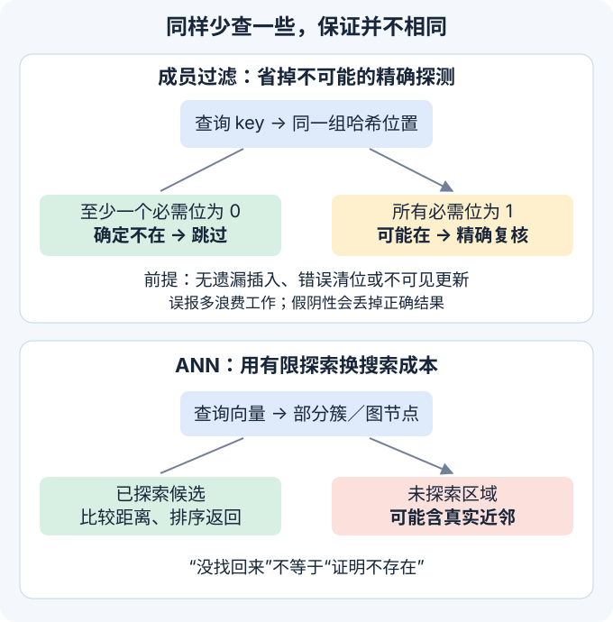
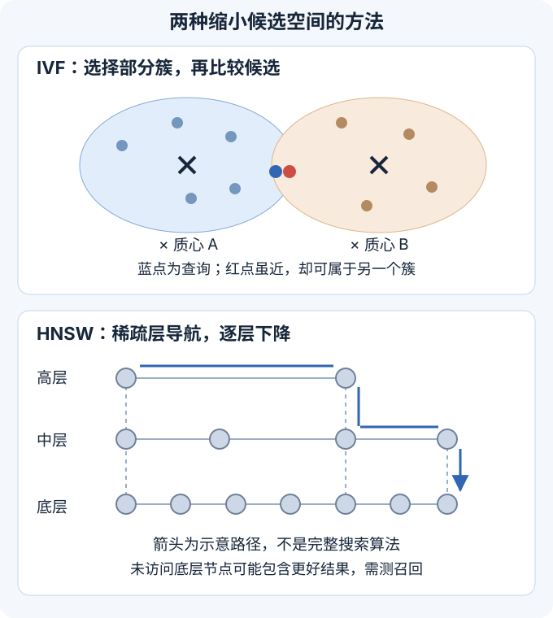

# L9 学习笔记：你允许索引“不知道”什么？

数据库优化不只是“把查找变快”，更是决定：**省略哪些信息，仍能保证不丢正确答案；省掉哪些搜索，愿意承担多少召回损失。** 本讲有四种不同的“近似”，混在一起会直接导致错误设计。


## 1. 先写清返回值契约，再选结构

假设有以下业务数据：

```text
Orders(order_id, sku, status, customer_note, created_at)
Stock(sku, warehouse, available)
```

| 请求 | 需要返回什么 | 可以接受的误差 |
|---|---|---|
| 查订单 103 | 精确匹配的记录位置与可见记录 | 不能拿 104 代替 |
| 查 `sku` 是否可能在 Stock 中 | “确定不在／可能在” | 可多查一次，不能漏掉有效库存 |
| 找备注含“破损”的订单 | 按明确分词语义得到记录集合 | 分词规则要一致；候选必要时复核 |
| 找“快递把箱子压坏了”相似投诉 | 语义相关的候选与排序 | 需测召回／相关性，不能冒充集合成员证明 |

**Key、RID、page、frame 不可混用。** `sku` 是搜索 key；RID 指向记录，常包含页号与槽号；page 是逻辑页面；frame 是 buffer pool 中临时承载页的内存位置。一个索引返回 RID，不等于它可以永久保存某次访问得到的裸 frame 地址。取页、pin／guard、释放生命周期仍要遵循 [Project 1](#/c/cmu-15-445-2025/lab/project1?v=guide) 的约束。

| 课堂的“随机／近似” | 变化的是什么 | 是否允许查漏已有 key |
|---|---|---|
| Bloom filter | 不存在 key 也可能通过位测试 | 正确维护下不允许假阴性 |
| Skip list | 塔高、访问路径长度随机 | 不允许，结果精确 |
| 截断 trie | 只保留部分 key，产生候选 | 正确复核后仍可精确；普通无损压缩不自带误报 |
| ANN 向量索引 | 只探索部分空间／图节点 | 可能漏掉距离意义下的真实近邻 |

原讲定位：01:40–04:26、13:55–18:42、35:34–41:24、1:04:51–1:13:29。

## 2. Bloom filter 的正确性不是概率证明



图：编者原创。左边只画安全的排除与复核；右边画有限候选搜索，不能把未探索部分解释成“不存在”。

### 一个确定性不变量

设位图为 $B[0..m-1]$，有 $k$ 个固定映射。插入 `sku = A17` 时，对每个 $i$ 都执行 $B[h_i(A17)]\gets1$。随后只允许置 1、不清 0，则：

$$
x\in S\quad\Longrightarrow\quad \bigwedge_{i=1}^{k} B[h_i(x)]=1
$$

因此只要任意必需位是 0，就能排除 $x$。这个结论**不要求哈希均匀或独立**；差的哈希会使误报多，但不会凭空清除已经设好的位。真正的前提是：

- $S$ 中每个有效成员都已插入过滤器，而不是只建了部分表。
- 插入和查询使用相同编码、哈希映射、seed 与位图大小。
- 没有错误清位、内存损坏或未同步的并发更新。
- 若过滤器与数据分批发布，查询不能看到“新记录已经有效、过滤器却还是旧版”的不一致状态。

底层删除一个订单，不清理普通过滤器的旧位，会增加假阳性，但仍能安全排除。反过来，直接清它的位可能误伤共享该位的另一个 key。

### 概率用于估算误报，而不是保证维护正确

以下推导是编者补充。假设插入 $n$ 个不同 key，每个 key 使用 $k$ 个近似独立、均匀、可重复落点的哈希映射，共 $kn$ 次置位。一位仍为 0 的概率是：

$$
q=\left(1-\frac1m\right)^{kn}\approx e^{-kn/m}
$$

对一个未插入、且哈希与已插入数据近似独立的查询 key，把各查询位状态视为近似独立，可得：

$$
f\approx(1-q)^k\approx\left(1-e^{-kn/m}\right)^k
$$

这里最后把多个位状态相乘也是近似，不能把有限位图的相关性悄悄当成严格独立。常见近似模型中，固定 $m,n$，误报率较低的选择在：

$$
k^*\approx\frac mn\ln2
$$

实际 $k$ 要取合理整数，并考虑 CPU 与 cache 成本。例如 $m/n=10$ bit/key、$k=7$ 时，上述模型给出约 $0.82\%$ 误报，不是说所有工作负载都精确达到这个数字。对抗输入、相关哈希、容量超标都会改变表现。增加 $k$ 超过合适范围会更快填满位图，不能无限改善误报。

概率与哈希的先修可回看 [Project 0](#/c/cmu-15-445-2025/lab/project0?v=guide)。Count–Min Sketch 估计频数，Bloom filter 做成员预筛；不能因为都使用哈希和计数就混用接口与删除保证。

### 加过滤器是否划算？

设每次过滤器查询成本为 $C_f$，一次精确探测为 $C_i$，查询不存在的概率为 $a$，不存在查询的误报率为 $f$。先忽略缓存相互影响：

$$
C_{with}=C_f+\bigl[(1-a)+af\bigr]C_i
$$

节省来自 $a(1-f)C_i$，所以只有当它超过 $C_f$ 时，这个简化模型才预测获益。存在的查询再多，过滤器都不能省掉精确查找；当所有请求都是命中时，它纯粹增加一层工作。构建与更新成本还未计入。

### 删除型过滤器也有条件

Counting Bloom filter 保存各位置贡献计数，插入加、删除减，再用“计数是否为 0”判断。计数槽由多个 key 共享，因此不是每个 key 的精确出现次数。必须只删真正插入且未删过的成员，避免溢出、下溢和丢更新；仅凭 `possibly_contains(x)` 就执行删除不安全。Cuckoo filter 使用 fingerprint，也必须遵守其删除、重复插入和容量约束，不能把“支持删除”读成允许随意删任意可能存在的 key。SuRF 则把范围排除纳入目标，不是给 Bloom filter 增加一个范围 API 就完成了。

原讲定位：04:26–13:55。课堂只解释位图与取舍，没有给出上述误报公式和成本模型。

## 3. Skip list：随机的是路标，不是答案

有序底层保存全部 key，上层是底层的子集。按常数概率 $p$ 独立晋升，并在第一次失败时停止，底层编号为 0：

$$
\Pr[H\ge i]=p^i,\qquad E[N_i]=np^i
$$

每个 key 的期望层数为：

$$
E[H+1]=\sum_{i\ge0}p^i=\frac1{1-p}
$$

因此在这个模型下，期望指针总数为线性量级；$p=1/2$ 时约为每 key 两层。独立随机塔高、适当层数管理下，搜索／定位插入／定位删除的期望代价是 $O(\log n)$，不是严格最坏情况保证。一个极端但可能的布局是所有 key 都只有底层，查找仍正确，只是退化成链表。

### 查找不变量

当前位置的 key 不大于目标，且尚未跨过可能包含目标的区间。向右之前检查下一个 key；会越过目标就下降。到达底层才作精确匹配，并检查逻辑删除标记。这是基于全序的排除逻辑，不是“选一个看起来更近的点”。

### 维护为何分两步？

插入先初始化新塔和后继，再从底向上让旧结构连接它。底层发布后，正确性已有基础，上层只是捷径。删除先标记，再从顶向下拆路标，最后断开底层。**节点不可达与节点可释放不是一回事**：已经持有旧指针的读者还可能使用它。课堂把并发协议留给下一讲，本页也不补成可提交的无锁实现。

编者补充：即使用 CAS 等原子操作修改单条链接，也不能据此直接推论整套结构无须 latch 或已经线程安全；节点内容的安全发布、竞争修改的处理与读者退出前的内存回收仍需完整协议。

| 操作 | Skip list | 页式 B+Tree |
|---|---|---|
| 点查 | 期望对数指针导航 | 平衡约束下按树高访问页 |
| 范围 | 找起点后走底层 | 找起点后走叶页，较好的页内局部性 |
| 插入 | 定位前驱、随机塔高、改链接 | 定位叶页，必要时分裂并传播 |
| 删除 | 定位、标记／拆塔、回收 | 课堂普通模型下可能借位／合并 |
| 增长 | 增加塔／高度，没有整表扩容步骤 | 局部分裂，可能增高 |

比较时要说明数据在内存还是磁盘、一个节点多大、缓存命中率和输出行数。不能把 $O(\log n)$ 都一样当作 I/O 都一样。上述普通 B+Tree 与固定 Fall 2025 Project 2 的叶页 tombstone buffer 特化不同；完整项目指导在后续批次，不在这里替代。

原讲定位：13:55–27:33。

## 4. Trie：共享前缀可以省空间，丢掉后缀要付复核代价

`Stock.sku` 中有 `AB-10`、`AB-11`、`AC-20`。它们可共享 `A`，前两个还共享 `B-1`。与每层比较整个 key 的结构相比，trie 让路径分段消费 key。

- **水平紧凑化：**只保存实际存在的孩子，不为所有字符留空指针。
- **无损路径压缩：**把单孩子链合并为边标签，例如 `B-1`。查询仍比较标签里的全部信息，不因此误报。
- **有损截断：**只留足以定位候选的前缀，其余信息放弃。查询走到候选不等于 key 相等，要读原 key 复核。

`hat` 和 `hate` 的反例揭示另一个不变量：一个节点可以既标记某 key 在此结束，又拥有孩子。只用“是不是叶子”决定 key 存在，会把前缀 key 丢掉。

固定编码和 span 下，逻辑分支取决于 key 集合；但节点物理地址、内存分配、某些自适应实现的容量状态不必与插入历史无关。理想查询按 key 长度 $K$ 为 $O(K)$，并不等于 $K$ 次磁盘 I/O：节点是否打包、孩子查找方式、标签比较与最终 tuple 读取都会改变实际成本。

插入一个与已压缩标签只共享一部分的新 key，需要在首次分歧处拆开；删除后若只剩一条路径，则可重新合并。ART 的节点自适应不是 B+Tree 的平衡旋转，也不能由课堂图推导出固定页格式。

原讲定位：27:33–48:38，尤其 38:46–44:28 的追问澄清了“压缩”“候选”“回表”三者。

## 5. 倒排索引把一个值变成多个入口

普通整值索引把 `customer_note` 当作一个 key。全文检索先做约定好的分析，再让每个 term 指向出现过它的文档。以下是自拟的规范化结果，不是实际中文分词器输出：

```text
订单 103：箱子 破损 退款
订单 104：箱子 延迟
订单 105：包装 破损

箱子 → [103,104]
破损 → [103,105]
退款 → [103]
```

“箱子 AND 破损”可以交 posting list，得到 103；“箱子 OR 破损”可以并集。这里数字为便于理解的逻辑订单号；实际索引通常保存文档标识／RID，不要直接等同物理 page_id。

### 为什么单条更新变贵？

一条备注修改后，旧 term 的 posting 可能要删，新 term 的 posting 要增；成本不再只是“维护一个索引 key”。重复 term 的频数、位置和字段信息是否保留，取决于查询是否要做排名、短语或邻近搜索。只有文档 ID 列表，不能凭空知道两个词是否相邻。

课堂 FST 示例把路径输出相加得到词典位置：它定位的是 term，不是直接拿权重当相似度。PostgreSQL GIN 则使用 term 树，较小 posting list 内联、较大集合使用 posting tree。二者共享倒排职责，但内部表示不同。

### 分词改变语义，不只是改变速度

索引端把 `U.S.A.` 规范化为 `USA`，查询端也应使用兼容规则。trigram 会让近似拼写共享片段，却不能保证词义相同；反之，完全不同的词面也可能语义相近。频数排名和 BM25 是对候选排序的另一层：term 越多不应无限线性提高分数。课堂未给完整 BM25 公式，本页不把“重复收益饱和”扩写成已经学过完整 IR 模型。

原讲定位：48:38–1:01:48。

## 6. ANN 的两个误差层次，必须分开量

把文本映射成向量 $v\in\mathbb R^d$ 后，至少有两个独立问题：

1. **表示是否合适：** 人类认为相似的投诉，在模型和距离定义下是否接近？即便精确暴力计算最近邻，也可能语义不相关。
2. **搜索是否找全：** 对固定向量、固定距离，ANN 返回了多少真正的 top-$k$？这是索引近似误差。

给定并列距离的固定处理规则、精确参照集合 $T_k$ 与返回集合 $R_k$：

$$
\operatorname{Recall@k}=\frac{|T_k\cap R_k|}{k}
$$

这是编者补充的评估定义，不是课堂承诺某个固定召回率。记录模型版本、维度、归一化和距离定义后才有可比性；重建或换模型后的向量不能随意混查。



图：编者自拟二维投影。IVF 查询靠近簇边界时，真实近邻可能属于另一个簇；HNSW 稀疏层加速移动，但有限搜索并不自动穷尽底层。

### IVF：省掉部分簇的扫描

预先训练质心，把向量分配到簇并建立 posting。查询探测一部分相关簇，再在候选中比较距离。聚类不是必然降维，查询也不是重新训练 k-means。探测更多簇通常增加工作、改善覆盖，但具体效果取决于分布与实现。新数据分布漂移时，要评估旧质心是否仍合适。

### HNSW：省掉图中大部分探索

上层稀疏、下层密集，先长距离接近，再在下层搜索。它借用 skip list 式层次，但没有“有序前驱排除了被跨过区间”的同一证明。局部邻居比较、图连通性与候选搜索宽度会影响结果。课堂的几步贪心动画不能当作完整生产算法，也不能证明返回全局 top-$k$。

### 加一个业务条件会怎样？

如果只接受 `created_at >= 某日期`，先取 ANN top-10 再过滤可能只剩两条，而符合条件的第 11–30 名根本没进入候选。先按条件缩小集合又会改变图／簇的可遍历性与候选分布。故“过滤条件准确”不意味着“受条件约束的 top-k 召回完整”。这与 Bloom filter 能安全跳过确定不存在成员的职责完全不同。

图的逻辑数据模型、向量索引的内部图布局、图查询语言和图数据库产品是四件事。课堂对产品的强烈评论不代替固定版本、固定数据和端到端查询的实测。

原讲定位：1:01:48–1:18:25。

## 7. 少索引一些行，与多带一些列是两条轴

以下是自拟的 PostgreSQL 风格设计示意，未实际运行：

```sql
CREATE INDEX orders_pending_sku
ON Orders (sku)
INCLUDE (order_id)
WHERE status = 'pending';
```

**部分索引决定谁在里面。** 只有待处理订单入索引；查询若想找全部 `sku='A17'` 订单，不能仅用它回答，因为已完成订单不在里面。若查询条件含 `status='pending'`，则满足逻辑蕴含的必要条件，但还要由规划器识别并决定是否有收益。状态从 pending 改成 shipped，即使 sku 没变，仍要维护成员资格。

**INCLUDE 决定叶子额外带什么。** `order_id` 可以作为返回 payload，但不变成按 `order_id` 导航的搜索 key。列越宽，叶页越大、缓存越稀、写入越贵。

**Covering 决定值是否足够，不自动决定可见性。** PostgreSQL 18 文档说明，支持 index-only 的访问方法且所需值都可从索引取得后，还需判断 heap tuple 对快照是否可见。相应页面 all-visible bit 没设时仍可能访问 heap。这里是独立资料补充，并不提前展开完整 MVCC 课程。

大量每月部分索引也不等于表分区；PostgreSQL 官方文档明确警告这种替代会带来规划开销。课堂的“9 月订单索引”是思路演示，不是通用分区方案。

原讲定位：1:18:25–1:21:51。

## 8. 全片时间索引

边界依据全文字幕，精度为秒级编辑分段，不是逐帧场景切换；表的连续覆盖不表示字幕没有间隙。字幕区间并集为 4,908.108 秒，57 个内部间隙合计 97.758 秒；开头 0.654 秒和结尾 2.480 秒未由字幕覆盖，均未推定静音。

| 时间 | 核心内容／问题 |
|---|---|
| 00:00–01:40 | 音乐、开场与课程安排 |
| 01:40–04:26 | 索引位置与过滤器成员判断 |
| 04:26–06:04 | Bloom 的接口和位图 |
| 06:04–08:52 | 插入 RZA／GZA、ODB 误报动画 |
| 08:52–10:04 | Count–Min Sketch、hash join 前置过滤 |
| 10:04–11:36 | 为什么不能清共享位；删除追问 |
| 11:36–13:55 | Counting／Cuckoo／SuRF 与频数问答 |
| 13:55–16:24 | 链表捷径与 skip list |
| 16:24–18:42 | 随机层数、内存使用与期望性质 |
| 18:42–21:36 | key 5 自底向上接入 |
| 21:36–23:20 | key 3 查找、入口和竖向指针 |
| 23:20–25:35 | 删除标记、拆塔和安全回收 |
| 25:35–27:33 | skip list 与 B+Tree 的局部性 |
| 27:33–29:42 | trie 缺失前缀的早停 |
| 29:42–31:39 | 前缀 key、字符串和整数问答 |
| 31:39–33:28 | key 长度、span、fanout |
| 33:28–35:34 | 整数 10／25／31 的一位 trie |
| 35:34–38:46 | 水平／垂直压缩与截断 |
| 38:46–41:24 | 确定性、扩展路径、核对原 key |
| 41:24–44:28 | 复杂度、block 局部性和回表问答 |
| 44:28–46:32 | radix 应用、hair／hat／have 修改 |
| 46:32–48:38 | ART、Judy、B+Tree 比较 |
| 48:38–50:18 | 整列 key 为什么不等于 term |
| 50:18–53:29 | posting list 与全文搜索生态 |
| 53:29–56:43 | FST 的 PAV 路径、权重与不可变段 |
| 56:43–58:21 | GIN term 树、posting tree、缓冲维护 |
| 58:21–1:00:23 | 排名、词频与 BM25 的直觉 |
| 1:00:23–1:01:48 | tokenizer、trigram、重复 UTA 纠错 |
| 1:01:48–1:04:51 | 歌词语义与 embedding 流程 |
| 1:04:51–1:07:27 | 年份条件、向量维度和近似 |
| 1:07:27–1:10:24 | IVF 聚类、质心、维护 |
| 1:10:24–1:12:01 | 单层图入口与邻居导航 |
| 1:12:01–1:13:29 | HNSW 层次与 skip list 类比 |
| 1:13:29–1:16:25 | 图在关系库中的表达与产品争论 |
| 1:16:25–1:18:25 | pgvector、top-k 与避免全图扫描 |
| 1:18:25–1:20:10 | partial index 与谓词 |
| 1:20:10–1:21:51 | INCLUDE、covering、index-only |
| 1:21:51–1:23:29 | 总结、未展开空间索引、下讲与片尾 |

## 9. 折叠自测

<details>
<summary>1. 哈希非常不均匀，会让只插入的 Bloom filter 假阴性吗？</summary>

不会自动导致假阴性。它会让位更集中、误报更多，但已正确插入成员的必需位仍为 1。假阴性要排查遗漏插入、错用 seed／编码、清位、损坏或发布次序，而不是只说“哈希不随机”。

</details>

<details>
<summary>2. 过滤器说一个从未插入的 key 可能存在，能否在 counting 版本中把它删除？</summary>

不能。它可能只是碰撞，减少计数会删掉其他成员的贡献，使别的成员出现假阴性。删除需由真实集合或可靠插入历史授权，不由概率肯定授权。

</details>

<details>
<summary>3. 所有 skip list 节点都没晋升，查询会返回错误值吗？</summary>

不会，只要底层有序、维护正确，仍是精确链表查找。坏的是性能，不是成员答案。这正是 skip list 与 Bloom filter 的随机性区别。

</details>

<details>
<summary>4. 把 trie 的三条连续边合并成一个完整标签，是否必须回表排除误报？</summary>

仅做无损标签合并不会引入误报；完整比较标签即可保持精确。丢掉后缀、只保留候选指针时才可能需要额外 key 复核。若查询还要取 tuple 中未覆盖字段，精确索引也可能正常回表。

</details>

<details>
<summary>5. `退款` 的 posting list 能否直接回答“退款紧跟破损之后”？</summary>

不能，仅有包含关系缺少词位置／顺序信息。要么索引额外保存位置并执行短语判断，要么取候选原文复核；不能从文档 ID 猜出句中位置。

</details>

<details>
<summary>6. 向量索引 Recall@10 为 1，是否证明十个结果都符合人的语义？</summary>

不证明。它只说明在固定向量与距离下找全了精确 top-10。模型表示或距离可能与人的相关性判断不一致，需另测语义质量。

</details>

<details>
<summary>7. ANN 先返回十条再用年份过滤，与在符合年份的集合中取 top-10 等价吗？</summary>

不等价。前十条中被过滤的结果不会自动由后续符合条件的邻居补齐。候选数量、过滤顺序与算法支持决定实际召回，不能从过滤条件的精确性推出检索完整性。

</details>

<details>
<summary>8. 订单只改 status，sku 不变，部分索引可以不维护吗？</summary>

若 status 是索引谓词的一部分，改动可能使订单进入或离开索引子集，必须维护。索引成员资格不只取决于搜索 key 是否变化。

</details>

<details>
<summary>9. 索引带齐 SELECT／WHERE 列，PostgreSQL 就完全不访问 heap 吗？</summary>

不是。还要访问方法支持、规划器选择，以及可见性检查允许。all-visible 条件不足时可能仍访问 heap；“值已覆盖”和“行对快照可见”是不同问题。

</details>

---

## 来源与阅读边界

- 课堂：Andy Pavlo／CMU Database Group，CMU 15-445/645 Fall 2025 L9，2025-09-24 授课，视频 1:23:29。全文读 2,290 条规范化自动字幕；未完成全片音频／视频核验。个别学生发言未完整识别，译稿保留可辨认复述而不补造。
- 指定教材：*Database System Concepts*, 7e，§14.1–14.4、§24.1。仅沿用指定章节定位，正文未取得／未读，不提供教材全译。
- 编者独立阅读：PostgreSQL Global Development Group，PostgreSQL 18 文档，[§65.4 GIN](https://www.postgresql.org/docs/18/gin.html)、[§11.8 Partial Indexes](https://www.postgresql.org/docs/18/indexes-partial.html)、[§11.9 Index-Only Scans](https://www.postgresql.org/docs/18/indexes-index-only-scans.html)。页面于 2026-11-15/16 获取，不倒填为 2025 当时产品版本。
- 原始研究论文未独立阅读全文：不把课堂提及 Bloom／SuRF／ART／HNSW 或某产品等同于论文精读，也不添虚构论文引用。

视频单独标记 Creative Commons Attribution（reuse allowed），课堂改编按 [CC BY 3.0](https://creativecommons.org/licenses/by/3.0/) 署名；自拟推导与图为原创。视频许可不外推至教材、独立 PDF 或产品文档。来源证据及状态见 [source-manifest](https://github.com/socoo123/course_web/blob/main/content/cmu-15-445-2025/source-manifest.json)。本页制作完成不代表学习者已完成任何实验。

本页的 Orders／Stock 场景、证明、反例、SVG 与自测均为编者原创；课堂原例与完整问答见[逐段译稿](#/c/cmu-15-445-2025/lec/lec09?v=draft)。独立 PostgreSQL 18 阅读的版本边界见[课外资料](#/c/cmu-15-445-2025/lec/lec09?v=materials)。
