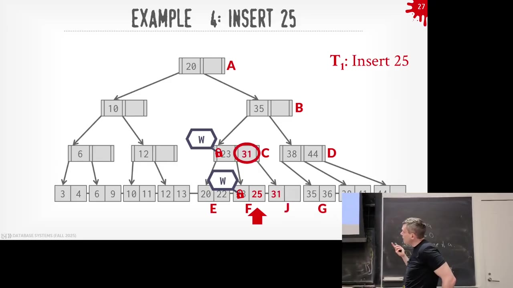
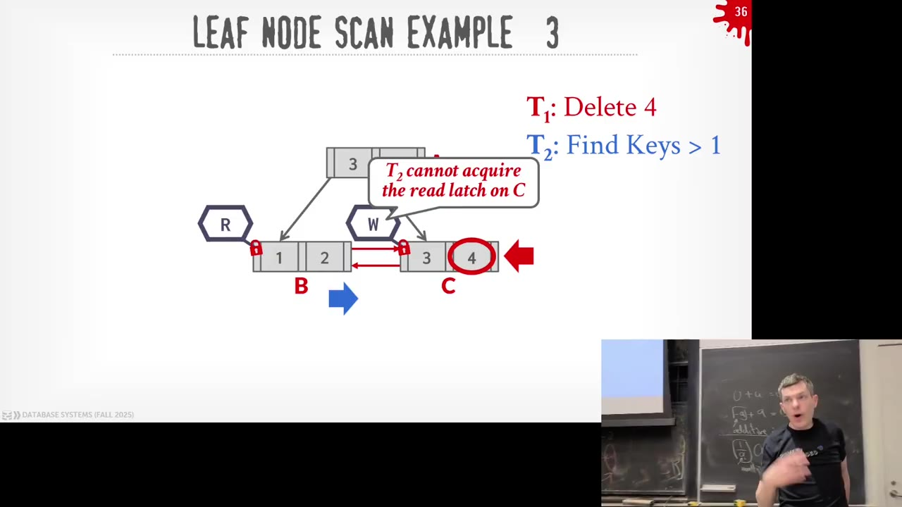

# 索引并发控制：逐段整理译稿

## 00:00–00:59 开场与电台闲谈

开头字幕标有音乐和零碎歌词；这里不转录歌曲。00:00–00:00.090 没有字幕，不能判为静音。约 00:27 后，老师致谢并询问同学的电台节目近况：是不是越来越受欢迎，有没有听众打电话点歌？同学答，有时会有。老师提醒大家，节目每周日美国东部时间下午一点播出，也能在线收听，校外观众同样可以听。随后转入课堂：今天内容很多，索引并发也是他特别喜欢的一讲。

## 00:59–02:09 项目、作业与期中通知

Project 1 昨晚截止，老师估计还有约十人未提交；排行榜似乎有一个实现明显领先，之后要了解原因。未完成的同学应尽快完成。Project 2 今天发布，网页已有题面，需要获取更新后的代码。Homework 3 上周发布，本周日截止，计划紧接着在周一给出批改反馈，帮助大家准备下周三、10 月 8 日的课内期中考试。

Project 2 的截止时间在秋假之后。学习指南和练习卷已经准备好，老师会在课后发布到 Piazza。练习卷的形式与正式考试接近，不过可能更长一些。这里是当时的课堂通知，不是今天的新截止日期。

## 02:09–03:06 可选数据库报告

老师介绍课外报告：当天 16:30 通过 Zoom 邀请 Apache Hudi 的创建者分享；后续还有 MotherDuck 团队介绍 DuckLake，以及 Spiral 团队介绍 Vortex 文件格式。他把 DuckLake 放在 Hudi、Iceberg 的相关问题背景中，把 Vortex 与 Parquet、ORC 等列式文件格式相比较。

此前讲过的 PAX 布局、列式存储和编码技术在这些系统里都会出现。Vortex 的目标是使用更现代的编码技术。报告并非必修，但想进一步了解课程之外数据库工程的同学可以参加。关于旧格式的公司与年代，老师口头回忆带有不确定性，本文不把它改写成已核实的历史结论。

## 03:06–05:52 从单个执行者走向多个执行者

过去两讲讨论了表索引和页表等内部数据结构，但一直假定同一时刻只有一个线程或执行者访问它们。这样讲算法比较简单，不必处理两个执行者同时读写结构的情况。今天要去掉这一假设：多个执行者同时访问，怎样保证它们不把结构弄坏？

现代处理器的单核频率增长有限，但核心更多，还可能有性能核和低功耗核。数据库需要利用这些核心；一个执行者等待磁盘时，另一个仍然可以推进工作。Project 1 的异步磁盘访问已经涉及这种思想。

也存在单线程执行模型。老师以 Redis 及其分支 Valkey 为例：网络处理可以有多个线程，实际执行数据结构操作仍可以交给一个线程。若确实保证同一结构只由一个执行者访问，许多 latch 问题便不存在。这有性能和工程复杂度方面的理由，但不能据此假定本课讨论的大多数数据库也这样实现。

## 05:52–08:09 两种“正确”

并发控制协议可以理解为共享对象的交通规则。这里说 worker，而不是固定说线程，因为 PostgreSQL 等系统采用多进程，其他系统常用多线程；要保护共享结构的基本问题相同。

“正确”至少有两个层次。逻辑正确性关心应该看到哪些数据：我插入 ABC 后再次查询，是否应该看到它？如果别人期间删除它，答案又是什么？这取决于更高层的事务规则，期中以后再讨论。

本讲关心物理正确性：结构内部必须保持健全。沿 B+Tree 的子节点指针走，必须到达仍然有效、符合该路径含义的节点，而不是任意内存、已失效对象或导致崩溃的位置。不仅不能崩溃，也不能因为结构修改到一半而错误地漏掉本应通过该索引找到的键。保证结构可安全访问，并不等于已经决定事务能看见什么。

## 08:09–10:32 课程路线与 lock

今天先概览 latch 的实现，再讨论较简单的哈希表，接着花较多时间讲 B+Tree 自顶向下访问与叶子扫描，最后原计划介绍 Project 2。低层实现只需掌握基本原理，更复杂的同步机制留给进阶课程。

操作系统文献常把这里的 latch 也叫 lock，但数据库课程刻意区分这两个词。数据库 lock 保护的是元组、表等逻辑对象，服务于事务。一个事务可能运行多个查询，需要按规则组成整体，不能随意留下半完成结果。

例如，一个事务插入了十条记录，第十一条违反完整性约束，若事务因此中止，前十条的撤销应由数据库负责，而不是让应用程序自己猜怎么恢复。锁通常可能持有到事务结束，具体规则以后再讲。

## 10:32–13:30 latch 的职责与课堂纠错

Latch 保护数据库内部数据结构的短临界区。执行者进去修改节点、出来，持有时间希望是纳秒或微秒量级，而不是整个事务。

老师现场纠正幻灯片中的文字：不能写成“无需回滚”。如果一个内部操作无法完成，执行这个操作的 worker 必须保证结构没有停在无效的中间状态；必要时记录自己改过什么并做清理或撤销。区别在于责任属于内部算法，而不是依赖事务层替所有 latch 操作自动恢复。

老师提到 Goetz Graefe 关于现代 B-tree 技术的整理表：latch 面向线程或进程及内部临界区，主要使用读、写两种模式；事务锁还有意向锁等更丰富的模式。本讲不展开那些事务模式。

Latch 的死锁需要通过编码纪律和协议避免。这里不假定有一个中央协调器追踪所有临界区，一旦形成环就替我们解开。事务锁层可以有死锁检测和选择牺牲事务的机制，但不能把这种能力默认套在每个页 latch 上。

## 13:30–14:57 读写兼容矩阵

读 latch 允许多个读者同时访问受保护区域，但他们不能在里面修改结构。只要所有访问都遵守协议，读者就能避免在读到一半时遭遇写者修改。

写 latch 是独占的：一个执行者持有写 latch 时，其他读者、写者都不能进入同一个受保护区域。兼容矩阵很简单：读与读兼容；只要至少一方是写，就不兼容。接下来还需要决定：申请不兼容、暂时拿不到 latch 的执行者究竟应该做什么？

## 14:57–18:07 实现目标与操作系统争论

Latch 应尽量小，因为一个系统可能为大量页或对象分别配置它；元数据越大，留给实际键值及缓存的空间越少。没有竞争时，获取路径应尽量短，不应绕过许多管理层。

管理还应分散化：若每次取 latch 都要登记到中央表，这个表本身便成为热点，就像缓冲池页表可能成为共享瓶颈。最后，希望尽量避免系统调用，减少进入内核、调度和额外检查的成本。

老师展示 Linus Torvalds 对用户态自旋锁的批评，并以强烈、带玩笑的方式表达数据库工程师的不同立场：数据库可能希望掌握“取不到 latch 后做什么”的控制权。这里呈现的是课堂立场，不是“所有用户态自旋必然优于 OS mutex”的通用定理。后面会说明，自旋自己也有严重代价。

## 18:07–19:53 三类基础机制与进阶选择

今天主要看 test-and-set 自旋 latch、阻塞式 OS mutex，以及 reader-writer latch。其他选择包括自适应自旋、MCS 队列锁、parking-lot 类机制、optimistic lock coupling，以及 NSync 等库中的同步工具。

这些机制已经有长期研究和现成库，实际工程中不应轻率地自己重造底层同步。老师展示 Apple/WebKit 相关库的微基准，说明针对特定工作负载，可以同时减少元数据和提高性能；字幕中的提升数字不够清晰，不在这里把它转换成可泛化的精确百分比。

## 19:53–22:33 自旋 latch 的得失

最简单的自旋 latch 可以只用很小的状态。课堂 C++ 示意使用 `atomic_flag`：不断执行 test-and-set，若返回旧值为真，说明已经被占用，就继续循环；若旧值为假，则本次把它设为真并成功取得 latch。使用完毕后清除标志。

循环内可以增加策略，比如失败若干次后让出 CPU，或者放弃这次尝试。关键是数据库自己决定下一步，而不是一失败就被阻塞。编者注：`atomic_flag` 不应理解成标准保证的 `atomic<bool>` 类型别名；这里讲的是原子标志的用途。

代价也很明确：反复执行指令并不等于完成有用工作，OS 却可能继续给它时间片。在 NUMA 多插槽机器上，争用的缓存行或内存可能属于另一插槽，反复访问、争夺所有权会跨互连，远比本地缓存访问昂贵。因此“占用字节少”不等于“高竞争下扩展性好”。

## 22:33–24:32 为什么必须原子比较并更新

老师询问大家是否熟悉 test-and-set，然后补充原子指令的意义。若普通 C/C++ 代码先检查某地址的值，再执行写入，其他线程可能在两步之间改掉它；源代码挨在一起并不能防止插入执行。

Compare-and-swap 把比较与条件更新组成不可分割的原子步骤。示例给出一个地址、预期值 20 和新值 30：地址中仍为 20 时，才把它改成 30；若已改变，就失败。这样没有线程能插进“确认等于 20”与“写入 30”的中间。

课堂还展示 GCC/x86 的编译器内建形式，解释编译器如何把这种表达转换为对应机器指令。编者注：test-and-set 和 CAS 是相关但不同的原子操作；双下划线只是这里展示的内建命名风格，不能把所有双下划线函数都认作硬件 intrinsic。原子更新一个标志，也不是自动让整棵树的多步修改变成原子操作。

## 24:32–27:39 阻塞式 mutex 与 futex

另一条路线是使用 `std::mutex`：lock，进入临界区，完成后 unlock。此前的 guard 也体现同一思想：作用域退出时释放所持资源。

问：Linux 上 `std::mutex` 背后通常是什么？课堂回答是 pthread mutex。继续问它怎么实现，同学提到快速路径，老师引出 futex，即 fast user-space mutex。课堂把它概念化为用户态的原子快速路径，加上竞争时进入内核的等待机制。

两个 worker 都尝试获取状态，第一个成功；第二个失败后走较昂贵的阻塞路径，OS 将其挂起，等条件合适再唤醒。OS 为维护等待者和调度状态，也要访问并保护自己的数据结构；因此会增加系统调用、内部同步、调度和跨内存位置的成本。

编者注：这是解释“无竞争快速路径／竞争阻塞路径”的模型，不是说所有实现必然串联两把暴露给应用的独立 mutex，也不保证 C++ 标准库在所有平台都使用同一种 pthread 实现。

## 27:39–30:15 reader-writer latch 的排队过程

前面最简单的 mutex 或自旋状态只允许一个持有者。读写 latch 则区分模式，并维护读者数量、写者或等待者等元数据；`std::shared_mutex` 是课堂列出的接口例子。

第一个读者取得读 latch，读者计数变为一；第二个读者到达，读读兼容，计数变为二。此时写者到达，必须等两个读者退出，不能边有人读边修改指针或字节。

如果之后不断到来新读者，写者可能永远等不到。课堂示例因此把新读者也排到等待队列，先让已经等待的写者在旧读者退出后执行。这样的公平策略需要更多状态和逻辑。不同库可以采用读者优先、写者优先或其他公平策略，不能把此动画当成所有库的保证。若每条小记录都配一份复杂读写元数据，空间成本会很明显。

## 30:15–33:59 关于等待策略的问答

问：为什么 OS 开发者不希望在用户态自旋？老师答，OS 希望调度有用工作，但只看指令执行，不能知道一个线程反复抢 latch 并没有推进查询；既然暂时做不了事，OS 的思路是先挂起它。

数据库的反驳不是“空转永远好”，而是有时可以更聪明地处理失败。比如采用协作式调度与协程：当前任务拿不到 latch，就把执行机会交给同一线程上的其他任务，而不是让整个 OS 线程睡眠。若判断某资源很久才会可用，也可以主动让出给 OS。

问：具体应该选什么？老师说本讲不深入实现，举 MCS 的队列思想：等待者不是全都争同一个位置，而是加入队列；parking-lot／自适应方法还会区分短等待与较长等待。他没有准备更详细的演示页，因此讨论止于设计直觉，不给出完整算法或统一最优选项。

## 33:59–36:28 哈希表：先确定访问约束

接下来即使不固定底层使用哪种 latch，也可以讨论上层协议。静态线性探测哈希表比较简单：沿约定方向探测，并且可以一次只持有一个页或槽位的 latch。课堂先排除扩容造成的布局变化。

若要扩容，最简单的办法是增加结构级保护：普通访问遵守相应共享协议，扩容者取得独占保护后更换布局。单纯对整个结构使用一把独占 latch 很容易实现，却会把修改串行化。

更细的选择是页级或槽位级 latch。页级 latch 覆盖整个块；槽位级 latch 允许不同执行者同时访问同一页的不同槽位，但增加元数据和获取次数。这里的“无死锁”依赖上述访问与持有约束，不是任意带回绕探测、多个持有点或动态扩容的哈希算法都天然无死锁。

## 36:28–38:44 页级哈希表演示：找 D 与插 E

T1 查找 D，哈希定位后先取得目标页的读 latch，再检查槽位。T2 要插入 E，恰好需要访问同一页；它想取得写 latch，却被 T1 的读 latch 挡住，只能暂时等待。

T1 在该页没找到目标，要继续下一页。在这个布局不变、探测顺序已知的例子里，可以先释放旧页，再申请下一页的读 latch；不必像树指针交接那样同时抓住两个节点。

旧页释放后 T2 取得写 latch，但那里没有可用槽位，于是也前进。若下一页仍由 T1 读，T2 又要等待。直到 T1 完成并释放，T2 才能写入。两者处理的键不同，也会被页级保护范围连带阻塞。

## 38:44–40:01 槽位级哈希表演示

现在把 latch 缩小到槽位。T1 每次只保护正在检查的槽位；T2 也为自己准备检查或写入的位置取得写 latch，因为在安全读出状态前，不能先假设槽位为空。

两个执行者沿探测方向推进，碰到对方仍占有的同一槽位时会等待；对方离开后就继续。T2 找到空位插入 E 的同时，T1 可以在不同槽位读到 D。相比页级方案，不相干位置有更多并行机会，但每走一步都可能多付一次 latch 成本。

## 40:01–42:32 dirty、pin 与粒度的问答

同学问：如果页来自磁盘，更新 dirty bit 是否仍需页级保护？老师首先澄清，演示暂时假定纯内存结构，没有缓冲池就没有这里的脏页概念。如果来自缓冲池，当然必须 pin 住，避免正在使用时被换出；dirty 状态也需要按缓冲池协议更新。但这不自动意味着每次不同槽位访问都必须拿整页的内容写 latch。

编者注：pin 保障驻留，不保障页内容互斥；dirty 元数据怎样同步，应服从实际实现，不能把课堂口头“只是翻一个 bit”解释成允许 C++ 非原子并发写而产生数据竞争。固定 Project 2 的 guard 协议仍以其真实接口为准。

问：槽位级比页级能快多少？没有固定倍数，取决于工作负载、核心数、热点分布和每条键值的大小。若键值特别小，而 latch 大小固定，元数据可能与数据本身一样大，空间近乎翻倍。更细粒度带来并行度，也带来更多空间和计算支出，不能只看其中一面。

## 42:32–45:31 B+Tree 的两类危险与 44／41 反例

B+Tree 既要防止两个 worker 同时改一个节点，也要防止遍历与分裂、合并、再分配交错。有人确认：这些协议是否建立在前面那些 latch 实现上？是，但具体采用自旋、OS mutex 还是其他机制，不改变现在讨论的结构保护问题。

演示从删除键 44 开始：删除后叶子占用不足，需要重新平衡；准备把键 41 从 H 移到 I。此时修改者暂停，另一个线程开始查找 41，读取内部节点 D 的路标，选定了原来应到 H 的路径，随后也暂停。

修改者恢复，把 41 移到 I，并更新结构；查找者再恢复，却继续沿先前已经读取的旧路径走到 H，于是找不到 41。最好情况只是误报不存在，更坏时会沿失效指针访问非法内存。问题不在 41 被事务合法删除，而在结构调整让查找看到不一致的路径。

## 45:31–48:18 latch crabbing 与 safe

解决办法称 latch coupling，也称 latch crabbing。先持有父节点 latch，再取得将要进入的子节点 latch；确认子节点对当前操作安全后，才释放不再需要的祖先。

所谓 safe，不是节点自身永远安全，而是这次操作的影响不会迫使它继续向父层传播。在课堂普通 B+Tree 的简化占用模型里，插入时节点未满，能够吸收一个新增项；删除时节点超过最低占用，能够承受一个删除而不再借位、合并。读操作不改变占用，不需要这种写操作的 safe 判断。

基本查找沿途取读 latch，取得孩子后释放父亲。基本插入和删除沿途取写 latch；若孩子 safe，释放所有仍持有的祖先，否则保留可能需要修改的路径。目的是一旦有充分理由，就尽早释放，不把无关子树一直挡住。

同学提前问：更新能否先用读模式，之后再升级？老师说会讲，目前先掌握基础协议。编者注：字幕在“不满所以无需分裂”以及“尽早释放”附近有否定词误识，本文按完整上下文校订；固定 tombstone 叶页不能机械套用这里的简单半满判据。

## 48:18–49:17 查找 38 的逐层交接

查找键 38：先给根 A 加读 latch，然后在仍保护 A 的情况下读取路径并取得 B 的读 latch。B 已受保护，才放开 A。再取得 D，放开 B；取得 H，放开 D；读取 H 中所需内容，最后释放 H。

交接时短暂同时持有父子两者，是为了防止“已读出指针、尚未取得下一节点保护”的空档。父节点受读保护期间，写者不能悄悄换掉该路径；子节点取得保护之后，遍历才有了新的落脚点。

## 49:17–52:09 删除示例与释放顺序

删除从 A 的写 latch 开始。起初不知道下方是否会一路合并到根。B 也处在无法轻易承受删除的状态，因此仍需同时保留 A 和 B。

进入 D 后发现，D 即使因为下层合并少掉一个项，也还能满足占用要求。因此传播到 D 就能停止，A 与 B 都可以释放。

老师提问：先释放 A 还是 B？同学建议 A 在先，因为根挡住更大范围；若只放开 B，新的访问者仍可能卡在 A，去另一侧子树的访问也继续受阻。另一位同学补充，释放顺序不影响这一协议的正确性。老师确认：先放上层是性能优化，而不是反向释放就一定错误。

编者注：以上是课堂对一般协议的说明；固定 Project 2 题面另明确要求从 header 向下获取并按同方向释放，完成项目仍须遵守该具体要求，不能拿一般性能讨论抵消题面约束。

最后进入 H，发现 H 自己便能承受这次删除，不需要重新平衡；于是 D 也可以释放，只在 H 的写 latch 保护下完成删除，再结束。

## 52:09–52:50 插入 45：保留路径后又释放

插入 45 时先取得 A、B 的写 latch。B 有空间，若下面上推一个分隔项也接得住，因此可以释放 A。继续到 D，D 没有足够余量，暂时保留 B。

到目标叶子 I 后发现 I 本身可以容纳 45，根本不会发生分裂。于是 B 和 D 都不再需要，可以释放，在 I 中插入新键，最后释放 I。上层是否需要保留，随着向下观察到的新信息不断更新。

## 52:50–54:55 插入 25：实际分裂与兄弟指针问题

插入 25 时，B 可以接住来自下方的新增项，所以释放 A；C 也能接住新增项，所以继续释放 B。但叶子 F 已没有空间，必须分裂，于是 C 的写 latch 仍要保留。

在受保护的范围内分配新节点，重新分配键，在 C 中添加或调整路标及指向新节点的指针，再完成插入。上层无需参与，因为 C 能吸收这次结构变化。

*真实课堂画面，约 53:39，截取点可能受关键帧前滚影响。配合上文阅读：分裂在叶层发生，保留的父节点负责发布新的路标与孩子指针；不是本站绘制的示意图。*

同学问：既然叶子有兄弟指针，修改时是否也要取得兄弟的 latch？老师答，若需要修改另一个叶子的链指针，确实要保护那个节点；例如新节点插入后，还要更新后继的回指。只考虑从根向下的访问时，父层保护能阻止新访问从该入口进入，但一旦允许沿叶链进入，问题就更多，马上会讲。

编者注：字幕把此处父子和兄弟字母混在一起，本文保留明确的结构含义，不据口头字母推造额外边。“持有父 latch”不能普遍替代所有被修改叶子的独占保护，也不能驱逐已经在叶层的访问者。

## 54:55–57:07 根部瓶颈与乐观路线

老师问，前面每次修改的第一步是什么？都是取得根的写 latch。即使最后只改一个叶子，大家也先在根处争用独占入口，形成瓶颈。注意这不意味着整个操作一直串行，因为安全后会释放根，但入口争用仍然昂贵。

优化是假设大多数操作不需要分裂或合并：内部节点先按查找方式取得读 latch，直到目标叶子，再取得叶子的写 latch并检查。如果叶子足以处理这次操作，就直接修改；若猜错，释放已有 latch，从根重新走基础的写 latch 路线。

老师提到 Bayer–Schkolnick 相关算法，并联系之后会讲的乐观并发控制：先走廉价的常见路径，发现假设不成立再清理、重做。不过这里仍然是树结构的物理并发协议，不是已经实现事务级乐观验证。

## 57:07–58:57 能否原地升级、从中途重来

问：持有读 latch 时，有没有机制可以直接升级为写 latch？老师先强调，若其他读者也持有它，就不能直接宣布自己独占。若知道没有其他读者，可以有支持这种转换的实现。

同学进一步问，能不能等其他读者退出再“原子”升级？可以设计计数、等待队列和升级协议，但需要更多机制，不一定划算。不能把普通读写 latch 当作天然支持无死锁升级的 API。

另一个问题是，失败后是否必须回根，能不能记住路径只重走一半？老师答，也许能，但取决于哪些 latch 仍持有、哪些节点或指针已经可能改变。要结合具体例子看，不能把之前看到的路径当成永久事实。

## 58:57–1:00:11 乐观删除 38

具体协议中，在叶子的上一层仍持有读 latch 时，尝试取得目标叶子的写 latch，然后在保护下判断是否 safe；不是先无保护地检查叶子，再假定情况不变。

删除 38：A、B、D 的访问按读 latch coupling 进行，取得下一层后释放上一层。抵达 H 时取得写 latch，确认 H 可以吸收一次删除，于是释放 D 的读 latch，在 H 中完成修改，不用回头改父节点。

课堂用节点层级说明如何判断即将到叶层；具体项目的数据布局和判叶接口不必与动画一模一样。

## 1:00:11–1:01:38 乐观插入 25 失败为何重走

再次插入 25。先用读 latch 沿路径下行，取得 F 的写 latch 后发现它必须分裂。这时之前的祖先读 latch 已逐步释放，不能直接修改父层，所以放弃本次乐观尝试，释放资源，再从根使用写 latch 协议。

回到前面的提问：能否记住 C 曾有空间，从 C 开始？困难是，当你不再持有保护时，其他 worker 可能已经修改 B 的布局、移动 C 或改变路径。记住地址和过去的容量，不等于现在仍有合法的访问及修改权。

若为了避免重走而始终抓着所有祖先，又会损失本来要争取的并发性。老师的建议是，先用简单而容易证明的重启规则；更聪明的中途重启需要额外验证，不是删掉“回根”这一步就完成优化。

## 1:01:38–1:03:39 叶链扫描打破单向层级

之前都是点查或单键插入、删除，主要自顶向下取得 latch。现在加入叶节点的双向链，扫描可能从不同方向靠近，就不能再只凭“大家都向下”排除死锁。

演示先在 C 中读取，再沿兄弟指针去 B。必须在仍保护 C 时取得 B 的保护，之后才释放 C；否则读取兄弟指针与真正进入 B 之间，链或节点身份可能已经被修改。

这一段 ASR 先说“所有大于四”，随后又说“小于四”并说明从 C 到 B 的反向扫描，谓词方向存在口误或识别不一致。可以确定的教学内容是向左横向交接，本文不凭空给出精确结果集。

## 1:03:39–1:04:37 两个读扫描相遇

两个执行者都先取得根 A 的读 latch，然后分别进入 B 和 C。它们读完当前叶子后，想互相跨到对方所在的叶子。

这里只有读 latch，读读兼容，所以两个执行者都能取得下一节点的读 latch，再释放原先的那个。最后 T1 持有 B，T2 持有 C。相向行进本身不必然死锁，还要看申请模式是否互斥。

## 1:04:37–1:06:07 删除与扫描发生冲突

T1 要删除键 4，T2 要查找所有大于 1 的键。采用乐观协议时，两者先共享根的读 latch。T2 到 B 取得读 latch；T1 到 C 取得写 latch，准备删除。

T2 读完 B 后，想沿叶链取得 C 的读 latch，却被 T1 的写 latch 阻挡。T2 只知道目标 latch 不兼容，不知道 T1 的完整计划；T1 也不会不断查询谁在等自己，那会增加临界区开销。

*真实课堂画面，约 1:05:25，近似时间。T2 的叶扫描与 T1 的叶修改在 C 发生读写冲突；这一刻有等待关系，但是否形成等待环还要看 T1 接下来需要什么。*

现在要回答的是：T2 取不到 C 的 latch，该怎么办？

## 1:06:07–1:08:41 “这已经是死锁了吗”的讨论

老师列出三个选项：等着；主动结束本次尝试、释放自己持有的资源再重试；或者强行终止另一个执行者、抢走它的 latch。课堂使用“kill yourself”指本次操作退出，不是要求结束进程或现实中的自伤行为。

有同学认为不能等待，因为会死锁。老师澄清：当前图中 T1 只是删除 4，不需要 B，也不发生合并，因此还没有形成环；只有 T2 在等待 T1。

有人进一步问，C 的物理位置是否可能改变，让 B 的指针失效？老师答，若要改变涉及的结构和兄弟关系，就必须取得相应保护并更新相关链指针；拿不到 B 的 latch，就不能随意改坏 B 指向的关系。本例的单次删除不需要改兄弟指针。

同学提出另一个会合并并申请 B 的场景。老师确认，那确实可能形成死锁，但不是当前这一帧。关键在于 T2 并不知道自己属于哪种后续情形，因此通用协议不能仅凭“这个例子看起来能等到”就允许无限持有等待。

## 1:08:41–1:10:44 投票与缺少全局持有者表

若选择等待，要等多久？有同学建议乐观地一直等，另一些同学建议退出后重试。老师让大家举手投票；多数讨论集中在等待还是放弃本次尝试，也有人选择终止对方。

老师追问，如何终止对方？首先，当前设计没有一个中央表记录每个 latch 由哪个线程持有。T2 只知道一个资源不可用，不一定知道对方是谁，更不能与对方协商整个结构操作。若新增这种中央追踪结构，本身又需要同步和维护成本。

## 1:10:44–1:12:32 为什么不能强杀持有者

即便在 latch 内保存持有者身份，也不能简单发送信号把对方杀掉。它可能持有上层的多个 latch，可能已经修改了若干节点；必须有机会展开资源持有链，并把未完成的结构操作恢复到可接受状态。

可以设计协作式取消或中断等待的机制，但那需要让执行者主动检查、响应并清理。对本来希望快速进入、快速离开的临界区来说，这会增加开销。若临界区还在等待磁盘，时间会更长，问题也更复杂。

所以课堂给出的简单答案是：取不到时主动退出自己的本次尝试，释放资源，稍后重做。可以设计很短的有限等待，但不能把“强行夺走他人的 latch”当作正确恢复方式；更不能让线程带着半修改状态直接消失。

## 1:12:32–1:14:35 重试成本与跳过节点的提问

事务锁层将来可以利用更丰富的元数据选择牺牲者，例如比较已完成工作或回滚成本。这里却没有这些全局信息。假设对方已修改大量键，而自己只读了一点内容，贸然让对方回滚可能尤其昂贵。

一个执行者最多容易知道自己做了多少工作，因此可以据此采用不同的短等待或重试策略；课堂提到的等待量级只是策略举例，不是要求每个索引都睡固定一毫秒。

问：为什么不跳过被占用的叶子，先读其他空闲节点？老师答，如果要返回范围内的全部键，最终仍得补读那个叶子。沿链到后面的节点往往还需要经过它；若回到上层重新定位，则必须记录未读范围和继续点，处理重复及遗漏，复杂度明显增加。不能直接跳过后宣布完整扫描结束。

## 1:14:35–1:17:30 写者优先不是事务正确性的答案

同学继续提议：写者等待读者时，是否更应该终止读者，因为写入之后它读到的内容就过时了？老师先强调，当前协议没有这种随意终止其他 worker 的机制。

执行者可以记录自身失败次数，适当调整退避；如果长期无法完成，高层调度器可以限制其他访问，让它获得机会。但“读者的数据将过时”是否意味着读者不该完成，已经是事务语义问题。

老师换成完全串行的例子：我插入键 5，随后另一个人删除 5，再轮到我查询，读不到它是否正确？物理上结构可能完全正确；逻辑上是否允许，要看事务顺序和隔离要求。因此，不能从读写 latch 的兼容性直接推断哪一个业务操作必须获胜。

## 1:17:30–1:19:24 有限等待、饥饿与 no-wait

问：普通同步经常等待，这里为什么非要退出？老师答，不是绝对不能短暂等待，而是不能无限等下去。主动放弃、清理、离开结构，然后重试，常常足够简单；下一次回来时，原来争用的 latch 可能已经可用。

问：这会不会饥饿？会。重启协议避免死锁，并不自动保证每个操作都在有限次尝试内完成。系统可在更高层跟踪长期失败的任务，暂时限制其他 worker 进入，让它推进。

若所有人都反复修改同一个键，那个冲突点本来就必须序列化，不可能凭更多线程消除。老师以热门人物留言板上的同一记录为例。

因此叶兄弟申请应支持 no-wait：不能立即取得就返回失败，由算法处理退出与重试。允许有限等待是额外策略，不应重新引入持有着互相需要的 latch 无限等待的环。

## 1:19:24–1:21:05 修改记录与结构性恢复

如果一个操作已经改了叶子，又因为拿不到后续 latch 而必须放弃，它需要知道自己做过什么。课堂介绍 worker-local 的 write set：记录触及的节点以及插入、删除等改动，在必要时撤销；在仍可能依赖这些修改完成恢复的阶段，不能随意释放对应的写保护。

分裂和合并比撤销单个键复杂。老师指出，有些系统允许保留已经完成且仍然有效的结构调整：撤销引发分裂的那条记录，不一定非要把树形状还原到分裂前，只要结构与搜索关系继续正确，后续操作可进一步调整占用。

编者注：这是某些数据库结构修改与回滚策略的说明，不是固定 Project 2 可以任意违反最低占用、丢键、保留半更新父指针的许可。课程中的 write set 也不意味着项目 `Context` 中任何同名字段都保存了完整撤销日志；须分别看真实接口。

## 1:21:05–1:22:18 收束与片尾边界

时间不够详细介绍 Project 2，老师把它留到下一讲。今天最重要的体会是：把数据结构变成线程安全实现很难。做 Project 2 时，先让单线程操作正确，再加入并发协议，较容易定位问题。

下一讲开始把此前的存储、缓冲池和索引部件组合起来，讨论真正执行查询的算子算法，再构建完整查询计划。约 1:21:39 后课堂结束，1:21:42.900 起字幕标记音乐，之后是零碎歌词，不在这里复现。

最后一条字幕结束于 1:22:15.800，而视频元数据时长为 1:22:18。最后 **2.200 秒内容未知**，没有音轨核实，不能因为前面出现音乐便推断尾端也只有音乐。字幕内部还有若干无文本间隙，也不能一概判作静音。

---

## 整理说明与许可

- 原讲：Andy Pavlo，CMU Database Group，CMU 15-445/645 Fall 2025，第 10 讲；课堂日期 2025-09-29，视频上传日期 2025-09-30。视频入口由讲次页头提供，本文不嵌入视频链接。
- 个别视频元数据明确标注 Creative Commons Attribution license（reuse allowed）；按 [CC BY 许可说明](https://creativecommons.org/licenses/by/3.0/) 保留作者及归属。本页是中文翻译、合并口头重复与校订后的改编；该视频标签不自动覆盖独立 PDF、教材、歌曲或其他第三方内容。
- 复用既有英文自动字幕，规范化后按顺序全文阅读全部 2230 条；不是人工逐字听写。实质讲授、示例、问答与通知按原顺序保留。无法辨认的学生原话，仅译述老师明确复述的部分，不补造发言。
- ASR 将 latch、write、root、B+Tree 等词反复识错，本文依据上下文校订；关键否定词、谓词方向及父子字母冲突另行标明。编者技术注不是老师新增发言。
- 字幕始于 00:00.090，止于 1:22:15.800；头尾及内部缺口保留未知。真实关键帧仅作局部视觉核对，未完整听取音轨或播放全片。逐来源取得、阅读与音画状态见[来源清单](https://github.com/socoo123/course_web/blob/main/content/cmu-15-445-2025/source-manifest.json)。
