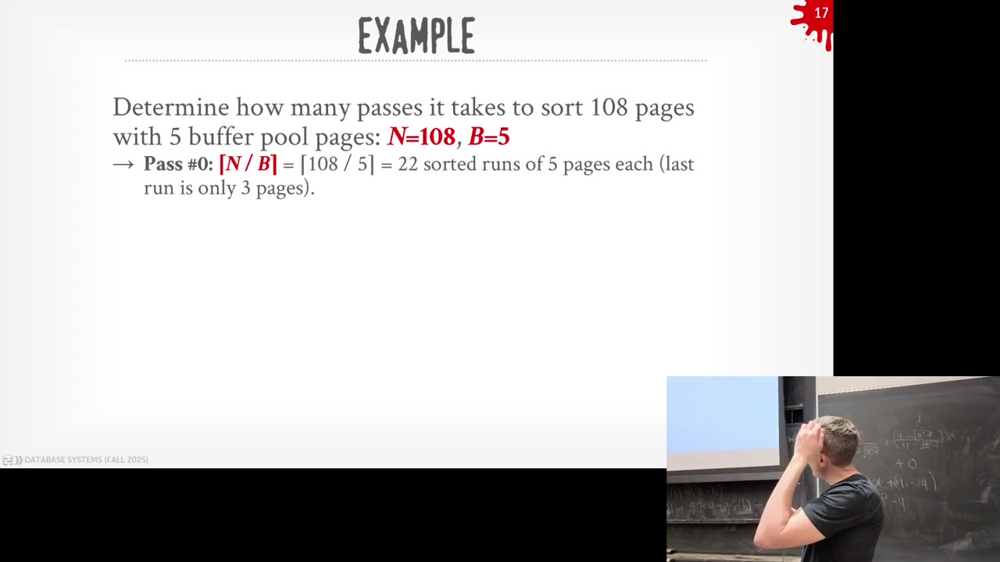
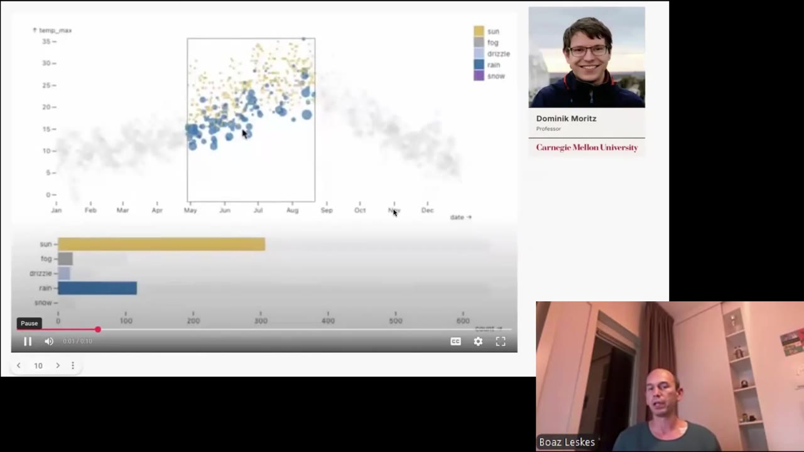

# L11 逐段整理译稿：排序、聚合与 MotherDuck

## 00:00–00:47 开场与课前交谈

开头字幕主要标为音乐，夹有不能可靠连成句子的英语碎片，不将其当作课堂知识或补写歌词。00:28 起出现课前交谈：教师询问对方近况与经济状况，对方说正在改善；教师提到对方希望靠 DJ 工作挣钱，自己可以为这次工作付费，但不能满足所有其他要求。交谈对象和部分上下文不明确。

**覆盖提示：** 00:00–00:00.654 无字幕；字幕事件之间也有未覆盖区间。这些区间不是已证实的静音。

## 00:47–01:55 作业、期中考试与项目通知

今天内容很多。Homework 3 本周日截止，安排是周日交、周一发回解答，为一周后同一时间、同一教室的期中考试做准备。教师本人不在，由博士生监考。Piazza 已发布复习指南和练习考试；来考试要带 CMU ID，以便核对交卷者身份。

可以带一张 8.5×11 英寸、双面的手写笔记纸，不能把整套幻灯片缩印塞进去；在平板上手写再打印可以。有不清楚的问题请发到 Piazza。Project 2 本周一已发布，秋假回来之后截止。

**校订：** 自动字幕的“SMU ID”“practice/proctor”等据语境校为 CMU ID、监考；正式日期在本讲课件写为 Homework 3：10 月 5 日，期中：10 月 8 日，Project 2：10 月 26 日，均属于 Fall 2025 历史安排。

## 01:55–02:54 数据库行业插话

教师提到几个小时前数据库行业出现收购消息：Databricks 收购 Mooncake，原本安排这家公司在秋假后几周来做报告。课堂将 Mooncake 概括为把 DuckDB 放进 PostgreSQL，分析查询可以调用 DuckDB 并读写 Iceberg。教师联系此前嘉宾强调 Iceberg 的内容，提到 Databricks 之前以约二十亿美元收购相关公司，以及其招聘、等待上市等消息。中间有看短信的插话，字幕没有形成可靠完整句子，不补造收购金额。

**编者注：** 这是教师当时的行业评论，不是本站独立核查的交易新闻或产品架构说明。

## 02:54–04:09 从页面和索引走向执行器

课程一直沿系统层次向上：先实现磁盘管理，再用 buffer pool 把页在磁盘和内存间搬运，再在其上建立索引等访问结构。现在开始讨论：真的拿到一条查询之后，怎样利用这些部件执行它并返回结果？

接下来四次课覆盖算子算法、执行方式与运行时结构。今天讲排序，下一次讲连接，再讨论如何把这些算法接成真正的查询处理系统。本讲包含在期中范围内，下一讲不包含。目标是解释在 DuckDB、SQLite、MySQL 等系统的终端里提交 SQL 后，那些结果是怎样算出来的。

## 04:09–05:59 查询计划里的数据流

重新用到学期初的关系代数。查询计划是有向结构，通常是一棵树；有些系统可以使用 DAG，为什么需要它以后再讲。底部叶节点访问表或已物化的文件，数据向上流经过滤、连接、投影等算子。每个算子按自己的定义完成一部分计算，根节点输出最终结果给客户端。

幻灯片上的小方块沿线移动，只是示意，不能替代执行细节：每次传一个 tuple、一批列还是完整结果？由下向上 push，还是由上向下 pull？这些都是后面要讨论的设计选择。此刻先掌握每个节点负责一个基本步骤、共同产生查询答案的模型。

## 05:59–07:56 中间结果也可能大于内存

本课针对 disk-oriented DBMS：不能假设整张表装得下，也不能假设算子之间的中间结果装得下。因此必须能够把中间数据写到磁盘，之后再读回来。选择算法时，有时宁可放弃某个仅按 CPU 渐近复杂度看起来更好的方案，也要增加顺序 I/O、减少随机访问。

Quicksort、Powersort 等在内存中可能很合适，但内存不足、访问变成读写磁盘页时，不能照搬这种判断。数据库知道查询计划、后续算子和内存预算，能够决定保留哪些数据、何时溢写、何时预取。操作系统不知道这条查询接下来要做什么，这也是不把全部内存管理决策交给操作系统的理由。

## 07:56–10:20 排序不只是 ORDER BY

关系模型不规定顺序；SQL 通常是允许重复的 bag，而不是去重集合，但它同样没有默认输出顺序。应用通过 `ORDER BY` 请求按任意指定键升序、降序或使用其他排序参数，所以数据库必须支持排序。

即便查询没有要求有序输出，系统仍可能主动排序。排序后，同一个值连续出现，`DISTINCT` 可以扫描并跳过与上一个相同的值；某些连接算法先排序再归并；建立 B+Tree 时，先排序再连续装填叶子、向上建立结构，通常比逐条插入更有效率。教师以 SQL Server 的临时 spooling index 为例：为一条查询临时建立索引，用完再丢弃。排序因此是多个算子的公共基础设施。

## 10:20–12:12 内存算法与工作内存预算

如果表或者中间结果完全装得下工作内存，就选择合适的内存排序算法。教师列举 Quicksort、Timsort、Powersort、VergeSort 等，并提到有些方法能利用数据已大致有序的性质；不能利用时再退回通用排序。网上的排序动画有助于理解元素如何移动，但本讲重点不是再上一次基础算法课。

系统一般知道 buffer pool 容量，或给某次排序分配一个工作内存额度。例如待排序数据约 1 GB，能用的内存只有 800 MB，就不能假装全量内存排序一定可行。

**校订边界：** 课堂关于 Python 排序算法版本变迁的随口描述没有在本页独立核实，不把字幕里“Powersort uses quicksort”等混杂说法作为实现事实；这里的实质是区分内存排序与需要显式管理磁盘 I/O 的排序。

## 12:12–15:16 排序对象是 key 与 payload

接下来用 run 表示待处理的一段记录序列。先对内存装得下的输入排序，再通过多轮外部归并产生更长的有序 run。课堂图里只画数字，不意味着数据库排序对象只是裸数字。

实际记录是 key/value 对：key 是参与排序的一个或多个属性，value 是对应的整条 tuple，或指向它的 RID／记录偏移。行存常采用 early materialization：既然读取所在页时已经拿到整条记录，就把 tuple 的字节随排序键一起携带，避免以后重新回表。列存常采用 late materialization：先读需要的列，随键携带记录位置，之后确实需要其他列时才取，避免搬运最终会被投影丢弃的数据。

学生问 key 是什么。教师回答：就是正在排序的那组列，称为 sort key；概念上和建立索引时选择的键列一样。payload 则让系统知道排序键对应哪条记录。

## 15:16–17:17 物化选择与本讲路线

OLAP 系统究竟应多早物化，并没有一个适用于所有产品的答案。教师提到 Vertica 早期采用晚物化，后来面对 S3 的访问方式调整设计；也提到 ClickHouse 最近发布添加晚物化的文章。这些是课堂举例，真正的列存查询处理取舍后续再展开。

今天依次讲 Top-N heap sort、external merge sort、用排序聚合以及用哈希聚合，后者也为下一讲比较 sort-merge join 和 hash join 铺垫。最后有 MotherDuck 的短报告。排序虽是很老的主题，却仍有优化空间：教师提到 DuckDB 前一周发布重写排序实现的文章。低层 C++ 优化与高层算法都重要，不能因算法历史悠久就认定问题已经彻底解决；事务也有类似情况。

## 17:17–20:29 Top-N 与边界并列值

如果查询既有 `ORDER BY` 又只需要前 N 条，可以顺序扫描输入一次，维护当前最好的 N 条，而不是把所有输入都排好。课堂例子按 `sid ASC` 取前四行，并使用 `WITH TIES` 保留边界并列值。

输入依次为 `3, 4, 6, 2, 9, 1, 4, 4, 8`。开始加入 3、4、6；遇到 2 后，候选最小的四个是 2、3、4、6。9 比当前最差候选 6 还大，直接忽略。1 到来时进入候选，6 被挤出，候选为 1、2、3、4。之后两个 4 都与第 4 名的键相同，`WITH TIES` 要保留，所以结果扩展为六条。8 仍不能进入结果。

教师以有序的候选集合展示动画，实际可以用优先队列实现。扫描只需一遍；教师在口述复杂度时先后自我修正，也提醒更新 heap 并不是无成本的。20:10 后学生提问的原声没有被字幕完整识别，下一段保留教师的复述。

**编者注：** `WITH TIES` 不是“前 N 条里面任意两个相等就增加行数”，而是保留与第 N 行完整排序键并列的所有行。普通二叉堆实现的更新可达每条 $O(\log N)$，不能把“一次扫描”当作总 CPU 时间严格线性；最后仍要按要求输出候选顺序。

## 20:29–22:25 多查询下怎样知道放不放得下

学生问：怎样判断输入或输出是否能放进内存，尤其很多查询同时执行时如何分配？教师说资源调度不是今天的主题，先想象给每条查询一个内存额度，再限制并发数量。输入本身不必全部驻留：逐页扫描，buffer pool 用此前讨论的替换策略释放旧页；需要努力保留的是候选 heap。

通常 Top-N 的 N 很小，候选能放入内存。若请求前十亿行，就不是这种理想情况。但 SQL 是声明式的，系统知道请求的数量，可以估算数据结构大小。商业系统还可能让查询借用其他查询没用完的资源；教师把 PostgreSQL 的配置方式概括为相对固定。

**编者注：** 这是资源预算的概念模型，不是 PostgreSQL 配置手册。不能据此声称某个工作内存参数是“整条查询绝不超出的硬上限”；多个算子、并行 worker 和实际实现都影响总用量。

## 22:25–24:03 并列值与估计误差的问答

学生追问：并列值很多，怎么估计 heap 大小？教师答：后面会讲代价估计，可以利用直方图、不同值数量等统计信息。但统计是摘要，不是完整数据，公式也只是估计；通常要留出安全余量，避免严重低估。

另一个问题是是否总会把内存估大一些。教师解释，结果真正产生之前无法完全知道其规模，哈希表容量估计也是同样的问题。例如估计会有 100 条记录，可能为 150 条预留空间，以减少运行中重建或扩容。后面会专门用两讲讨论代价模型，因为这件事很难做好。

**编者注：** 余量不是正确性保证；`WITH TIES` 在极端情况下可以返回全表。实现必须能在实际超出预算时采取正确的外存路径，不能只相信估计。

## 24:03–26:37 外部归并的两阶段

Top-N 是特殊情况；一般的全量排序若预计放不进内存，就需要 external merge sort。简单的无过滤全表排序，输入规模比较容易估计；连接之后的中间结果则可能估得很差。一些系统能够先尝试内存算法，发现估计错误后改走外存路径，但不是每个系统都能这样自适应。

外部归并是分治方法。第一阶段，把能装入内存的小块用内存算法排好，必要时写成磁盘 run。第二阶段，把已经有序的 run 归并成更长的有序 run，反复进行直到所有数据成为一个 run。先从 two-way 版本看起：每次合并两个 run；一般的 K-way 则一次合并 K 个。这里 K 是归并路数，不是 run 的页数。

## 26:37–28:29 三个缓冲页的简化模型

设输入共 N 页，可用缓冲空间为 B 页，它必须同时承担输入与输出。在最简 two-way 示例中，pass 0 一次读一页，对页内记录排序，再写出一个一页长的 run。临时结果不是要求直接改写原表：教师明确提到复制到另一个缓冲页形成排序结果。

之后每轮把成对的 run 合并。只需要三个缓冲页：两个输入页，每路一个；一个输出页。课堂假设每页仅有两个 key，是为了展示动画。pass 0 对每个原始页做相同操作，形成一页 run；读入与写出都可以按顺序安排。

## 28:29–30:33 两路游标怎样合并

下一轮生成最多两页长的 run。以有序输入页 `[3,4]` 和 `[2,6]` 为例，各有一个游标。先比较 3 与 2，输出 2 并推进第二路；再比较 3 与 6，输出 3 并推进第一路。输出页 `[2,3]` 满后写盘，复用该输出缓冲继续放 4、6。

学生询问图上的数字是不是磁盘偏移。教师澄清：3、4、2、6 是 key，不是偏移。另一个问题是是否真的把整页读进内存。答案是需要：比较时必须看到键的实际值，不能只拿地址代替键比较；图中一页两个键只是缩小示例。

## 30:33–32:27 run 变长不等于全体驻留

同一轮处理剩余页，得到若干两页 run，末尾不足两页的 run 也合法，用结束标记表示没有更多数据。下一轮归并成最多四页的 run，再下一轮归并成最多八页的 run，覆盖完整输入。

学生确认 pass 0／pass 1 的名称并问为什么只需三个缓冲页。教师拿四页 run 解释：只读每个输入 run 的当前页，而不是一次把整个 run 装进内存。因为各 run 已有序，当前页后面的键不可能突然出现一个更小的值要求倒退，所以游标只向前。用完当前页，再读该 run 的下一页即可。run 可以非常长，但两路当前页加输出页仍只占三个页框。

## 32:27–35:14 新页、耗尽、索引和 I/O 停顿

有学生问归并是否把结果合并进原先那些页。教师说明：例如新 run 的第一页是 `[2,3]`，第二页是 `[4,6]`，它们是输出的新页，与最初的输入页不同。

又有学生问输出页满后是否重新读输入。教师说输入当前页已经在内存里，继续推进其游标即可；直到一页耗尽才换页。若一整个输入 run 先结束，就把另一 run 尚未输出的部分顺序复制出去，它本来已经有序。

学生问：为什么不直接遍历已排序的索引？教师答：不保证这组任意排序键上已经存在索引；有适用索引时当然可以考虑。还有学生指出磁盘读写会让算法停顿。教师确认这个问题，稍后用 double buffering 处理；现在先理解只有三个页框的基本算法。

## 35:14–37:01 pass 数与一般 B 页预算

简化 two-way 算法的 pass 数为 $1+\lceil\log_2 N\rceil$。其中 1 是初始逐页排序；之后 run 的最大长度每轮翻倍。若每轮都把全体 N 页读一次、写一次，每轮是 2N 次页 I/O，总成本就是 2N 乘总 pass 数。

只有三页时，两个输入、一个输出；给了更多内存却仍只照这个方法做，会浪费可用资源。一般外部归并在 pass 0 同时排序 B 页，产生 $\lceil N/B\rceil$ 个初始 run；归并阶段留一页作输出，因此最多同时推进 B−1 个输入 run。更多内存可以减少轮数，但不自动消除每次同步 I/O 的等待。

**校订：** 35:54 左右字幕把“两个输入、一个输出”说反；按前后算法和课件明确校正。36:46 的 B−1 指归并路数，不是新 run 永远只有 B−1 页。

## 37:01–38:40 108 页、5 个页框的完整例子

输入 N=108，可用 B=5。pass 0 产生 22 个 run：前 21 个各 5 页，最后一个 3 页。pass 1 每次归并 4 个 run，得到 6 个 run：前 5 个各 20 页，最后 8 页。pass 2 得到两个 run，长度分别为 80 页与 28 页。pass 3 合成一个 108 页的有序文件。总计四个 pass。

图：约 37:21，实际查看的课堂帧，画面显示 N=108、B=5、pass 0 的 22 个 run；右下角为教师。截取自短视频片段，流复制可能前滚，时间只标近似，不称逐帧精确。后续 pass 的数值来自已读课堂讲解与课件，不是声称本张帧显示了全部动画。

**校订：** 口述中出现“10 页”后立即改为“20 页”；随后“最终 80 页”与“80+28”混杂。最终输入和输出均应为 108 页，80 是倒数第二轮的一个 run。四轮全部物化的页 I/O 为 $2\times108\times4=864$。

## 38:40–41:15 双缓冲隐藏等待

每次读写一页都让工作线程停下等磁盘，会浪费 CPU。机械盘延迟高，SSD 更快，但 SSD 要发挥吞吐也通常需要队列里有足够多的并发请求。天真流程是读输入、计算、写输出，写时 CPU 又没事做。

双缓冲把可用空间分成两组：处理当前这组数据时，另一组进行预取或等待写出；之后交换角色，像 ping-pong 一样交替。因此磁盘 I/O 与有用计算可以重叠。不是把一整个 run 都额外复制到内存，而是在一轮处理的相邻数据块之间流水化。

读写不可能凭空同时获得各自独占设备时的全部带宽，实际调度仍需考虑设备特性。代价是分给每组的有效缓冲变少，初始 run 或归并路数可能缩小；收益是隐藏工作线程的 I/O 停顿，而不是消灭 I/O 本身。

## 41:15–44:08 比较器专门化

基础算法课常把比较两个整数视为常数成本；数据库可能比较长字符串或多列组合，在十亿次比较的量级，解码和函数调用都可能很贵。

一种方法是 code specialization。若每次比较都通过函数指针调用通用比较器，还要根据类型解释键字节，开销会累积。可以预先生成按特定类型比较的代码，让排序循环更容易内联，不必反复判断类型。

教师举了两类例子：SingleStore 等系统可在查询到来时用 LLVM 做 JIT，为该查询的键类型生成机器码；PostgreSQL 的某些排序代码则在构建时通过脚本生成多个类型特化版本，运行时选一个，作用类似模板。这里是课堂说明机制的例子，没有逐版本审读这些产品源码。

**编者注：** 已知类型不等于可以对任意未对齐字节直接做不安全的 `reinterpret_cast`；实际代码还要满足对象布局、对齐与别名规则。

## 44:08–46:02 前缀比较与键编码

第二种技巧是 suffix truncation：先准备一个短的二进制前缀，例如能放入机器字的部分，优先比较它。若前缀已能区分顺序，就省掉完整字符串比较；前缀相同则必须退回完整键比较，不能把前缀相等当作整串相等。

第三种是 key normalization。变长键不利于紧凑布局和快速比较，系统可把属性组合转换为保持排序语义的编码形式，并按实现需要填充。字典编码不总能直接解决问题：同一列来自不同文件时，相同值可能对应不同字典编号，所以不能不加处理地比较编号。

这些技巧的重点是：真实系统里的比较并非免费，结构布局、类型分派、字符串解码都可能决定排序性能。精细实现留到高级课程。

**编者注：** 规范化必须保持完整比较规则，包括多列方向、NULL 与 collation。任意长字符串不能靠一个有限长度前缀无损表示全部顺序；固定长度的快速键仍可能需要后备完整比较。

## 46:02–48:50 B+Tree 何时替代排序

没有适用有序结构时才需要另做排序；哈希表本身不能提供这种全序。若 B+Tree 的键顺序与请求一致，可以顺着叶子访问。关键问题是，索引叶子里可能只有键和记录位置，而查询还需要整条 tuple。

聚簇情况下，tuple 页顺序与索引顺序一致，扫描叶子后顺序读取记录很合适，不需要重新外排。非聚簇情况下，按键顺序追踪 RID 会访问散落在各处的表页；如果要输出全表，可能变成大量随机 I/O。此前按 page ID 重排访问以减少读取的技巧不能直接代替结果要求的键顺序，否则还需要恢复结果顺序。

若只取很少的 Top-N，少量随机回表仍可能划算，比如最多取十来页。教师总结：放得下就用内存排序；只取少量最好结果可用 Top-N；需要全排序且太大，则考虑外部归并。

**编者注：** “聚簇一定更好／非聚簇总是差”是本节简化成本模型下的直觉，不是所有系统的定理。覆盖索引、缓存命中、选择率、物理碎片和精确排序语义都会改变选择。

## 48:50–51:22 索引驻留问答与聚合选择

学生问本课 B+Tree 是否存盘。教师回答本课是，PostgreSQL 和很多系统也是，但不是所有系统都必须如此。再问是否假设它不能完全放入内存：不是；若 buffer pool 足够，树可以全部缓存。某些系统允许优先缓存索引页而非 tuple 页，取决于硬件和工作负载。

聚合是扫描多条记录，计算某个标量结果；带分组时，要快速找到分组属性相同的 tuple。排序和哈希都是实现分组的办法。教师回顾两者随着硬件和算法发展反复占优的历史，并认为当前很多场景倾向哈希；但如果查询本来就要求相关顺序，排序的工作可以与聚合共用，不能独立只比一个算子。

## 51:22–52:58 用排序完成 DISTINCT

例子从 `enrolled` 取成绩为 B 或 C 的课程编号，要求 `DISTINCT cid` 并按 `cid` 排序。先过滤掉不合格记录，再投影，只保留输出需要的课程编号，减少之后排序搬运的数据。

将课程编号排序后，顺序扫描：遇到与上一条相同的编号便跳过；遇到新编号则输出。因为顺序已固定，走到 15-826 后不可能又出现 15-445，所以不需要额外哈希表记住所有过去的值。本来就要 `ORDER BY cid`，去重可以搭上这次排序。

## 52:58–55:20 分组平均值的状态

另一条查询计算每门课学生的平均 GPA。先假设连接已经完成，输入是课程编号与学生 GPA；连接怎么做留待下一讲。按课程编号排序，再扫描每组，维护聚合的 running state。

`MIN` 记当前最小值，`MAX` 记最大值，`COUNT` 记计数，`SUM` 记和。`AVG` 不是每来一条就平均一次，而是保存 `(count,sum)`，结束时相除。课堂以算术平均为例，不展开几何平均。

扫描开始时还没有上一组。读到 15-445 的 GPA 3.62，状态为 `(1,3.62)`；再读到同组的 3.70，变成 `(2,7.32)`。看到课程编号变为 15-721，就知道 15-445 已经结束，输出平均 3.66，然后为新组重新初始化状态。之后换到 15-826，再次结束上一组；输入耗尽时也要输出最后一组。窗口函数更复杂，教师说之后有时间再谈，并未在此实现。

## 55:20–57:01 哈希方案与连线调整

不需要有序结果时，哈希往往更直接：扫描输入，按分组键维护临时哈希表；已有键就更新聚合状态，没有则插入。若哈希表放不进内存，就要将输入分成较小的分区，而不是任由随机访问落到磁盘。

56:16–56:51 左右教师处理远程嘉宾连线的静音状态，确认嘉宾能听到什么时候开始，不是新的算法内容。随后回到哈希聚合：全部状态放得下时简单；放不下必须有外存处理方式。

## 57:01–58:59 外部哈希的分区阶段

external hashing aggregation 也是分治。先顺序扫描一遍数据，用第一个哈希函数把记录分入不同磁盘 partition；之后逐个读回分区，在内存里建立哈希表、计算结果，再处理下一个。

仍用过滤成绩、投影课程号、计算 DISTINCT 的例子。这里若共有 B 个缓冲页，留 1 页作输入，B−1 页分别作为不同分区的输出缓冲；与归并时“很多输入、一份输出”的分配方向相反。每个分区最终可以包含很多磁盘页，并非分区只能是一页。某个输出缓冲满了，就写入该分区并复用缓冲继续接收记录。

同一个分组键经过确定的分区函数必然去同一分区；不同键也可能去同一分区，这不妨碍之后做精确比较。

## 58:59–1:00:38 逐分区重哈希与输出

第二阶段，按分区逐页顺序读入，并建立一个内存哈希表。做 DISTINCT 时，第一次见到某键就保存，重复键忽略。课堂第一个分区里反复出现 15-445，因此最终只输出一次。

一个分区处理完，可以把其哈希表里的结果写到最终输出缓冲，再清空临时状态供下一分区使用。这样做不会漏掉稍后又出现的同组数据：相同键在分区阶段已经被送往同一分区，其他分区不会再有 15-445。注意这个保证来自“同键同分区”，不是来自分区之间有序。

## 1:00:38–1:02:13 容量、二次哈希与冲突问答

学生问能否保证第二阶段的哈希表放进内存，是否只有一页。教师回答不能保证一页，需要根据规模估计；如果有极多不同键，任何方案都必须面对资源约束。

第二阶段使用另一个哈希函数，避免第一阶段落在一起的不同键在新哈希表里仍系统性地挤到同一位置。课堂动画把一个分区简化得几乎只有一种键，实际可以有许多不同键。学生问第二次哈希仍碰撞怎么办，教师答可以用线性探测等正常冲突处理方法；换函数不是宣称不再有碰撞。

处理完一个分区，不必把分配到的每个缓冲页销毁重建，可以清空或重置表的有效状态，再复用。所有分区处理完，最终结果才完整。

**编者注：** 本讲官方 notes 补充了递归分区条件：若某个分区的聚合状态仍超预算，需要进一步划分；普通哈希不能拆开同一个重键。内存判断应针对键、聚合状态、槽位和负载率等总开销，不只看原始分区字节数。

## 1:02:13–1:04:23 哈希汇总与课堂收束

哈希也可以维护 `(GroupKey → RunningValue)`，不只做去重。第二阶段读每个分区时，对相同组累计 count、sum 或其他状态，结束时再计算最终结果。它与排序聚合的区别是状态通过哈希表定位，而非靠有序扫描判断当前组。

教师总结：内存够时排序可以很快；需要溢写时外部归并让顺序块读写成为可能；聚合很多时候可选哈希。贯穿课程的原则是把数据组织成能够顺序读写的块，并用双缓冲让线程在其他 I/O 等待时仍能做有用工作。这也解释了上一讲为什么必须关心线程安全的数据结构。

切换嘉宾前再次提醒：下一讲是连接。本讲内容属于作业与期中范围，下一讲不属于这次期中。

## 1:04:23–1:05:25 嘉宾开场：为什么从单机做云数仓

Boaz Leskes 接过报告。他是 MotherDuck 的工程技术负责人，位于阿姆斯特丹。约十四分钟的报告讨论：基于进程内 OLAP 数据库 DuckDB 建一个云数据仓库意味着什么，为什么这样做，以及部分实现方式。嘉宾说可以随时打断提问，Andy 决定把问题留到最后。

**校订：** 字幕多次把 MotherDuck、DuckDB 和“in-process OLAP”识别成不同拼法，按本视频说明和语境统一；不把字幕中的变体当成不同产品。

## 1:05:25–1:07:26 实际查询量与单机规格

先不要问“为什么单节点”，先看用户怎样使用云数仓。嘉宾提到 Jordan Tigani 等人分析查询模式：用户在 S3 或其他 blob store 里可能存有海量数据，但单条查询实际扫描、关注的范围小得多。展示的图引用 Fivetran 的 George Fraser 对 Snowflake 与 Redshift 查询数据的讨论，嘉宾概括为绝大多数查询只涉及 1 TB 或更少的数据；数据仓库可能有数百 TB 或 PB，但常查最近两周、一个月的数据。

另一个变化是机器变强了。嘉宾比较 2006 年云计算早期约单核、2 GB RAM 的实例与当时的机器：高端可达到四百多核心、24 TB RAM，普通可申请的实例也能达到约 192 个计算核心／vCPU 量级、1.5 TB RAM。过去必须拼很多小机器才能做的事，如今可能在一台大机器完成。

**边界：** 上述图表结论和硬件数字是嘉宾在 2025 年的报告，不是本站复现的统计、当前云报价或严格区分物理核与 vCPU 的规格表。字幕没有可靠给出实例型号，故不补型号。

## 1:07:26–1:09:37 单机效率与 DuckDB 的可嵌入性

过去系统围绕“数据很大、单机很弱”搭建，把许多机器连接起来共同处理。若这两个前提不再总成立，分布式协调、网络和资源分配就可能成为不必要的 CPU 与金钱成本。MotherDuck 的出发点是先把单节点利用好，争取更简单、更高效。

DuckDB 是最近发展起来的数据库，吸收较新的研究，也特别重视使用体验。它既能存储数据并用 SQL 查询，又能读 S3 上的文件、解析 CSV 和 JSON，并通过扩展增加能力。它很轻量，可嵌入各种环境，甚至在浏览器运行完整 SQL 数据处理。嘉宾据此说明，DuckDB 不只是一个需要专门服务器才能访问的传统服务。

**编者注：** “单节点”在这里主要描述一个查询执行实例的取向，不意味着整个云服务没有分布式控制平面、远程存储或多用户调度。

## 1:09:37–1:11:24 双端执行与交互演示

MotherDuck 把本地 DuckDB 客户端连接到云端另一份 DuckDB。dual execution 分析查询，决定哪些部分在云端计算、哪些在本地执行。能在本地完成的部分没有那次远程往返，因而可以改善交互延迟。

嘉宾播放一个由 CMU 的 Dominik Moritz 相关工作构建的可视化示例：选择一张图中的范围，另一张图立即联动更新。浏览器里已有数据库与相关数据，所以每次交互不必都请求远端服务器。

图：约 1:10:25 的实际课堂帧。画面上方为按日期、最高温度绘制的散点，下方为 sun／fog／drizzle／rain／snow 分类条形图，右侧标注 Dominik Moritz，右下为 Boaz Leskes。这里只作为所讲交互演示的必要画面；单张静帧不能验证“即时”延迟或完整动态过程，第三方可视化与肖像权利不因课程视频 CC 标签而被另行授权。

第二个演示是 MotherDuck UI：在本地缓存数据集的样本，用户输入 SQL 时即可对样本执行，实时预览新增列或修改是否符合预期。嘉宾说这是工程师当天下午录制的实时操作录像。这里的预览是样本上的反馈，不等于完整云端数据查询结果已经算完。

## 1:11:24–1:13:27 两个维度：数据量与计算量

嘉宾主动指出前面图表说的是“大多数查询少于 1 TB”，不是所有查询。那么更大的情况怎么办？用两个维度组织问题：需要分析的数据量，以及所需或愿意投入的计算量。

第一类是数据少、计算也少，在笔记本或 Python 程序里嵌入 DuckDB 就很适合。连接云服务仍有价值：嘉宾类比 Git 与 GitHub，本地工具已经好用，云端还能提供备份、协作、授权和访问控制等能力。

第二类是数据多、计算简单，例如统计满足条件的记录数。DuckDB 本身能扫描 Parquet 等文件，但如果数据在 AWS 而计算在笔记本，就得跨广域网络拉数据。把扫描和聚合放到靠近存储的云端实例，只下载小型汇总结果，通常更有吸引力；MotherDuck 希望自动完成这种放置决策。

## 1:13:27–1:15:16 大计算与并发用户

第三类是数据不一定很多，但计算很重：复杂递归 CTE、代价很高的连接，或对低延迟有严格要求，希望所有必要数据都在内存里。可以临时使用很强的云机器，用完关掉，按需要获得算力，而不是让本地硬件永久闲置。

计算需求高也可能不是单条查询复杂，而是同一时刻有很多用户。假设教室里一百个人同时分析数据，总计算量就放大一百倍。DuckDB 启动轻量，所以 MotherDuck 可以为每个终端用户启动自己的云端 DuckDB，称为 duckling；不再使用时再关闭。这是嘉宾解释其多用户扩展方式的重点，不是把同一查询必然分片到一百台机器。

## 1:15:16–1:16:08 数据与计算都很大时

第四类同时需要很多数据和很多计算。嘉宾说先看实际要做什么：大规格单机已能处理相当多工作，较低的协调开销可能提供所需收益。他还提到 DuckDB 生态中的 DuckLake 数据湖格式和架构，以及 MotherDuck 的相关集成，作为更大规模数据场景的方向。

这段没有展开 DuckLake 协议、分布式算法或性能数据。嘉宾预告其 CEO 之后会做 DuckLake 报告，不在此补讲那个报告的内容。

## 1:16:08–1:17:29 扩展插入查询生命周期

嘉宾展示内部 Miro 架构图的一部分，是一个 data region 的结构，不逐个解释所有框。MotherDuck 通过 DuckDB 扩展机制接入。标准查询生命周期先 parse，再 bind，确定表与字段，然后选择执行方式、优化，最后执行。

各阶段都要增加云端能力：绑定器需要认识云表；优化器不仅决定“在靠近数据的一个实例里怎样高效运行”，还要决定“哪些部分放在哪里”。例如把过滤和聚合推到云端，取回较小结果，再与本地数据连接。执行阶段则实际在本地与云端两侧协同运行。这个主题足以单讲一整场，此处只说明它不是在执行器外围简单包一层网络调用。

## 1:17:29–1:18:38 轻量计算与资源隔离

再从单条查询抬高到云系统：通常区分计算层与存储层，MotherDuck 对两者都要处理。嘉宾在剩余时间主要讲轻量计算。单节点和 DuckDB 快速启动，有利于降低冷启动成本；他提出约 100 毫秒级响应的目标，并马上说明真正响应时间还取决于查询本身，轻查询才可能在该量级返回。

实例运行时利用 DuckDB 和单节点的效率；因为重新启动便宜，也可以更积极地关停空闲实例以降低成本。多用户系统还要防止某个用户占尽资源；其做法是把各数据库放到独立容器，把资源分配隔离交给容器编排系统。

**边界：** 这是嘉宾的架构主张与目标，不是本站测得的 SLA；独立容器不证明完全不存在共享存储、网络或控制平面的争用。报告在这里因时间结束，不能根据架构图补造没有讲出的存储层细节。

## 1:18:38–1:19:31 最后一问与结束通知

Andy 因为下一堂课即将开始而打断报告，只留一个问题：MotherDuck 向 DuckDB 上游贡献多少？Boaz 回答，他们有工程师为 DuckDB 写代码；很多支持通过订阅／合作方式提供，并共同引导开发工作。小改动通常由其工程师直接开 PR，大项目则与 DuckDB 团队共同开发。字幕没有可靠展开合同细节或量化贡献，不补写金额、比例或提交数。

教师请大家鼓掌，再提醒 Homework 3 周日截止、完成练习考试；MotherDuck 的 DuckLake 报告安排在下一周周一课后。最后祝大家周末愉快并示意播放音乐。

## 1:19:31–1:20:08 片尾

后续字幕是音乐标签和零碎歌词，不作为新的数据库讲解。最后一个字幕事件到 1:20:06.040；此后至视频标称结束 1:20:08 的 1.960 秒未被字幕覆盖，没有音轨证据把它认定为静音或补写内容。

---

## 引用、校订与覆盖边界

- 本页是对 CMU Database Group 发布的 Fall 2025 L11、Andy Pavlo 与嘉宾 Boaz Leskes 课堂的**按时间顺序逐段整理译述**，合并口头重复，保留可辨认讲解、数值例子、提问复述、连线调整和全部嘉宾段；不是逐字听写，也不是由课件反推的时间轴。
- 已顺序全文读完英文自动字幕全部 2166 个文本事件；原始 ASR、规范化字幕和英文审计文本仅在本地保留，不随站点发布。专名和明显公式口误以“校订／编者注”区分。学生原问题未识别处，仅译教师实际复述，不虚构学生原话。
- 标题边界按字幕主题转折取整到秒，是编辑分块，不代表所有秒都有文本。首 0.654 秒、尾 1.960 秒及内部字幕间隙均未知；没有全片逐句听音或全片画面核验。两张课堂帧已实际打开查看，短片均为无音轨视频，仅供截帧。
- 逐视频原始许可字段为 Creative Commons Attribution license (reuse allowed)。署名 CMU Database Group、Andy Pavlo、Boaz Leskes；本页进行了中文译述、删减口头重复与显式技术校注。[CC BY 3.0 许可说明](https://creativecommons.org/licenses/by/3.0/)及[平台许可说明](https://support.google.com/youtube/answer/2797468?hl=en)。此标签不推广至第三方演示、单独 PDF 或教材。
- 官方 Fall 2025 [notes](https://15445.courses.cs.cmu.edu/fall2025/notes/11-sorting.pdf) 3 页与 [slides](https://15445.courses.cs.cmu.edu/fall2025/slides/11-sorting.pdf) 81 个 PDF 页面已全文读其提取文本，供术语、公式与例子核对；PDF 全文再利用许可未确认，不发布 PDF 全译或原页。指定教材 *Database System Concepts* 第七版 §15.4–15.5 正文未取得、未读；没有教材资料译文。
- 视频原地址、逐来源 SHA、精确字幕并集和审读范围见[来源清单](https://github.com/socoo123/course_web/blob/main/content/cmu-15-445-2025/source-manifest.json)。本页不添加视频跳转链接。系统性推导、原创图与自测在[学习笔记](#/c/cmu-15-445-2025/lec/lec11?v=notes)。
