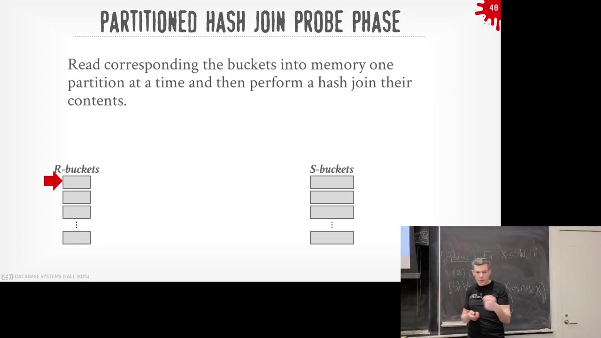

# 第12讲：连接算法

## 00:00–01:21 开场与闲谈

开头为音乐和零碎歌词，不转录歌词。约00:26开始，教师请大家再次鼓掌，随后与现场嘉宾闲聊收入、广播节目是否付酬，以及是否还接私人聚会的演出。对方说经济状况正在改善，之前参与过加密货币项目，现在正在弥补损失。教师以调侃口吻批评加密货币与区块链，并说秋假后讲事务时还会谈到相关问题。这是课堂闲谈与个人评价，不是本讲对区块链实现的技术证明。

## 01:21–03:16 期中考试与Project 2通知

下一次课在相同教室、相同时间举行期中考试。复习指南、讲义和相关资料已放到课程平台，Homework 3答案当天上午已经发布。参加考试要带CMU ID；需要计算对数的同学可以带简单计算器。学生追问手机计算器是否可以，教师答复基本计算器功能可以使用。

允许携带一张纸、双面手写的笔记。目的不是把所有幻灯片缩成微缩胶片，而是让大家重新阅读材料、判断哪些内容值得自己写下来。教师因出差，把原来周三课后的office hours改到次日下午4:15，具体信息会另行发布。

考试范围明确为第1至第11讲，包含两端；今天第12讲的连接算法不在这次期中考试范围内。Project 2已经发布，讲解课安排在考试后的周三晚8点，通过Zoom进行，之后发布资料。关于正式考试是否与练习卷一样主要采用选择题，教师回答形式大致相同，其中有的题也允许填写其他答案。

## 03:16–04:29 数据库报告预告

教师介绍当天16:30的线上报告：MotherDuck联合创始人将分享其经历，提到他此前在SingleStore与Google BigQuery相关团队工作。报告的一条主线是，不必一开始就把系统做成大规模分布式系统；先把单机执行做得足够高效，已经能够覆盖相当多工作负载。

之后还会有SpiralDB介绍Vortex，以及Columnar相关报告。课堂将Vortex介绍为面向Parquet所在用途的新格式，将Apache Arrow解释为内存中的数据表示：不同系统若都理解Arrow，就可以用共同表示交换数据。这里保留的是课程预告，不把口头介绍当作产品兼容性或性能的独立结论。

## 04:29–05:52 从外排转向连接

今天研究单机连接。教师强调，在许多单机分析查询中，连接是很昂贵的工作；进入分布式场景后，还必须考虑shuffle，后续再讲。

上一讲讨论过数据装不进内存时的外部归并排序：顺序写出文件，再顺序读回。今天继续使用同一设计思想——分治。把大问题拆成小问题，在合适的内存规模内处理，最后把结果组合起来。排序与哈希是两种重要组织手段；嵌套循环则是最直接的基线。条件合适时，前两者能避免大量无用比较和反复读取。

## 05:52–07:34 为什么拆表后还要连接

教师用学生、选课、课程与成绩为例：把所有属性塞进一张大表会重复保存许多信息，分成较小的关系通常更自然。规范化理论讨论这类分解；课程不深入讲Armstrong公理和各级范式。教师认为普通应用框架产生的模式常常已经足够实用，只有更深入的设计与优化工作才需要进一步研究。

拆开之后，查询又可能需要把学生、选课与课程信息放回同一个结果中。连接算子承担这个重组工作；希望得到所需的信息，而不是因为执行方式丢掉本来应该匹配的记录。

**编者注：** 课堂把“一张大表”与第一范式联系起来是直观铺垫，并非第一范式的定义；使用ORM也不自动证明模式满足第三范式。分解是否无损取决于约束，不是任意拆表后做连接都能恢复原数据。

## 07:34–09:51 本讲的连接边界

本讲聚焦二元、等值、内连接：每次把两张输入中的记录按相等的连接键配对。其他语义，例如左外连接、全外连接、反连接，需要在基本算法上增加逻辑，而不是直接套用内连接输出规则。

教师也介绍多路连接：一个查询涉及三张以上的表时，可以设想一次处理多张表，但实际系统常用一串二元连接。课堂提到SQL Server早期多路连接的尝试，以及现代worst-case optimal joins；图遍历式查询中，先做二元连接可能产生很大的中间结果，再被下一次连接筛掉，多路算法正是在某些这类问题上有价值。本学期不展开，相关历史与产品评价仅按课堂陈述保留。

**编者注：** inner描述保留哪些行，equi描述谓词是否为相等，两者不是同义词。反连接的“没有匹配项”也不等于逐对使用“不等于”谓词。普通哈希连接不能仅靠改一个比较符号就完成任意非等值连接。

## 09:51–11:01 谁放在外侧

课堂采用两输入的说法：左侧/外表与右侧/内表。一个常见启发式是把较小输入放在外侧，以便后面讨论的算法少做工作。究竟谁较小、先连接A与B还是先连接B与C，由优化器参考统计信息决定；本讲先不研究连接顺序搜索，而研究给定两个输入之后怎样执行。

**编者注：** 这不是所有连接算法的绝对规则。嵌套循环要看行数、页数和内侧索引；哈希连接更关心build侧哈希表的实际内存体积；外连接等语义也可能限制交换方向。物理图的左右位置只是表示约定。

## 11:01–12:24 算子树与两个设计问题

查询计划可以表示成树或有向无环图，树是后者的一种。底层扫描表或文件，数据往上交给算子，根节点产生给客户端或其他目标的最终结果。每次传一行还是一批行，之后讲执行模型时再详细讨论。

今天先回答两个问题：连接产生的记录长什么样？怎样比较两种连接算法的代价？将来优化器选择hash join还是sort-merge join时，会用到这些信息；现在还不讨论完整的决策过程。

## 12:24–14:13 早物化：匹配后携带值

一对记录在连接键上匹配后，连接把它们需要的属性拼成新的输出记录。早物化的例子里，叶子扫描已经把所需属性交上来；连接R与S，便将两侧属性组合后继续向上传递。课堂图示先扫描、过滤，再按R的ID与S的ID相等生成结果。

优点是后继算子要使用属性时，不必再回到R或S取值；值就在中间记录里。代价是携带的数据可能很宽，产生的大量中间结果会占用更多内存和数据搬运带宽。

## 14:13–16:26 晚物化：先携带记录位置

晚物化不急着把所有列值放进中间结果，而是先携带连接所需的键和记录标识。连接之后，上层若确实需要S的另一列，再根据记录标识回到相应存储位置取值。

这种方式适合列存场景：为了连接，起初不必读取完全无关的列。如果输入非常大，而连接筛掉了几乎所有记录，例如十亿条输入最终只剩两条结果，那么最后补取两条记录的其他列很便宜。教师强调，这里的关键不是连接突然改变了逻辑结果，而是传递值还是传递标识的执行选择。

**编者注：** 业务列名`id`与物理RID不是一回事。上层需要哪些属性，决定能丢掉哪些列；不能为了省空间丢掉后面仍然要计算且又无法恢复的信息。

## 16:26–18:36 统一代价模型

本讲用磁盘页读写次数比较算法。R有M页、m条记录；S有N页、n条记录。大写是页数，小写是行数。若中间数据溢写到磁盘，写出和读回都要计入。

为突出外存访问，这里暂时忽略构造哈希表、比较键等CPU计算，也假定查询在单机完成，不计网络开销。最终结果的写出成本同样暂不计入：执行相同连接语义的算法必须产生相同的逻辑结果，即使输出顺序不同，其结果行数仍相同。

**编者注：** 这些省略不意味着真实机器上的CPU、内存或输出免费。特别是结果非常大时，省去共同输出项只能方便比较，不能说明总查询耗时很小；没有ORDER BY时，也不能依赖某个算法恰好产生的顺序。

## 18:36–20:02 为什么不直接做笛卡尔积

内连接很常见，值得专门优化。无谓词限制的cross join则必须让两侧所有记录两两组合，排序或哈希不会凭空减少必须产生的配对。可以用批处理减少访问次数，但不能消灭结果本身。

今天依次讨论三类算法：嵌套循环及其三个变体、排序归并连接、哈希连接。教师建议实现数据库时先用简单方法建立可工作的连接，再重点优化哈希连接；不是说任何数据上哈希都胜出。

## 20:02–22:35 朴素嵌套循环

最直接的方法是两个嵌套循环：对每条R记录，扫描S的所有记录；检查连接谓词，相符便输出。outer与inner这两个名字来自外层循环和内层循环。即使换成哈希算法，有时也沿用这套称呼；各系统计划图的左右方向未必相同。

教师问这样为什么不好。学生指出二次方比较以及I/O问题。最坏的朴素实现会对每条外表记录重新读取整个内表，完全没有利用相邻记录在同一页、已经缓存的数据等事实。

因此成本是：

$$M+mN.$$

M是完整读取外表一次，mN是每条外表记录都扫描N页内表。这里不能把m误写成M。

## 22:35–24:38 一个故意糟糕的例子

课堂取R为1000页、100000行，S为500页、40000行。朴素算法约需5000万次页I/O。用课堂后续统一采用的每次0.1毫秒计算，约为1.39小时。交换两侧后约4000万次I/O、1.11小时，虽然省了一些时间，仍然很差。

但若每页4KiB，两个表加起来约6MiB，很可能可以留在内存甚至较大的CPU缓存中。这个例子故意忽略缓存，说明反复付磁盘读取成本有多荒唐，而不是预测现实中这两个小表一定要连接一个多小时。

**编者注：** 23:08自动字幕出现“100 milliseconds”，与课上小时数量级和后续例题不一致；这里按0.1毫秒，即100微秒计算，并明确保留这一校订。缓存能消除重复磁盘I/O，却不能消除朴素算法的m×n次候选比较。

## 24:38–26:38 按页复用数据

块嵌套循环利用“读一页会带来许多行”这一事实。对每页外表数据，依次取内表各页，并在已读入的两页之间比较所有行。代码形状可能从两个循环变成四个循环，但重复磁盘读取反而减少了。

每个外页只触发一次完整内表扫描，成本变为：

$$M+MN.$$

学生指出这没有改变渐近阶，教师同意，但强调数据库中的常数非常重要。此时决定较小一侧时，应重点看页数，而不只是记录数；磁盘搬运的单位是页。

**编者注：** 25:21附近字幕把页数与行数混说；上述公式按算法逐页扫描的含义校订。

## 26:38–28:07 把更多缓冲帧给外表

真实系统通常不只有两页可用。若算子可以使用B个缓冲帧，简单分配方式是：B−2帧保存一批外表页，一帧读取内表，一帧暂存输出。每读到一个内表页，就让它和这一整批外表记录比较，尽量复用已经读到的内容。

学生问输出是否也可以占B−2页。教师说明，当前示例为了简化，每次填满一个输出页就写出，再继续填下一页；若做异步I/O，确实可能需要更多输出缓冲，但这会改变资源分配，不能同时假装所有帧都留给外表。

## 28:07–30:32 批数与装入内存的特例

外表分为若干批，每批最多B−2页，所以成本为：

$$M+\left\lceil\frac{M}{B-2}\right\rceil N.$$

外表总共读一次；每批外表触发一次内表扫描。如果相关输入已经能够在内存里处理，就只需把输入读入一次，磁盘读取下降到M+N。课堂例子是1500次I/O，按0.1毫秒计为150毫秒。

学生追问为什么不再使用上面的乘法项。教师用全部数据装入内存解释：读入后循环比较无需继续访问磁盘。对于足够小的内存子问题，简单循环有时比先建其他数据结构更划算；后面的哈希分区也可以在局部采用这种办法。

**编者注：** 在这个缓冲模型下，只要外侧能放进B−2帧，内侧就可以逐页流过，不要求两表同时全部驻留。I/O降到线性不等于CPU比较次数也降到线性。

## 30:32–31:49 有限内存的具体数字

B=102时，外侧批大小是100页。R放外侧需1000+10×500=6000次I/O，约600毫秒；S放外侧则需500+5×1000=5500次I/O，约550毫秒。

学生问，全部在内存时是不是仍然在做朴素嵌套循环。教师确认，比较逻辑仍可以相同；坏的是反复磁盘读取。后面采用分治时，足够小的局部子问题可以直接以内存循环解决。这里的“快”是条件性的评价，不是对所有内存数据规模的保证。

## 31:49–34:29 索引嵌套循环

反复扫描内表是在找匹配项；若内表连接键上已有索引，就可以对每条外表记录提取键，并探测索引，而不是再扫描整个内表。课堂还提到，系统有时会临时构造索引完成当前查询，用完丢弃，并提示管理员考虑创建长期索引。

记一次索引探测及所需匹配访问的成本为C，则简化成本是：

$$M+mC.$$

C不能在不知道索引结构和数据分布时直接填成某个固定数字。B+树、跳表、trie与哈希索引的行为不同，索引规模和重复键也会影响工作量。

教师把它与哈希连接联系起来：没有现成索引时，可以为了本次连接临时建一个哈希表，用另一侧记录探测，查询结束就释放。两者高层上都是通过辅助结构寻找候选，但预建结构的成本和选择哪侧构建不能混为一谈。

## 34:29–35:54 从循环转向排序

嵌套循环部分的要点是：避免重复磁盘读取，把可用内存用于批处理，并利用合适的索引。教师随后回顾排序与哈希在历史硬件上的竞争：计算代价与硬件不断变化，并不存在仅凭算法名字就永远有效的赢家。

本讲通常优先考虑哈希连接，但排序归并仍然重要。如果输入已经按连接键排序，或者最终还要按相同键排序，连接可以利用这个顺序，减少重复工作。

## 35:54–38:07 两个不同层次的merge

排序归并连接有排序和归并连接两个阶段。排序阶段可以调用上一讲的外部归并排序；外部排序本身又有生成有序段、归并有序段等工作。不要把“归并有序段”与“扫描两个关系产生连接配对”混成同一个操作。

排序之后，两侧各有游标，比较当前键并决定移动哪一侧。小于另一侧当前键的值不可能突然在后方找到相等对象，因为输入有序。外侧游标可以向前推进；内侧在存在重复键时可能需要回退。学生要求看回退示例，教师转向具体动画，而不是逐行讲伪代码。

## 38:07–40:25 动画：100与200的配对

先按ID分别排序R与S。两个游标都从头开始，遇到100与100，输出一对。外侧保持不动，内侧推进；如果又遇到100，再输出一对。因此不能第一次相等后就把两侧都推进，导致漏掉同键配对。

内侧来到200，而外侧仍是100时，当前外侧100的匹配已经结束。记录先前的键与重复组位置，推进外侧。外侧来到200，和内侧200匹配，输出，然后继续推进内侧。动画暂时用“last value”帮助表达，但实际回退还需要保存位置。

## 40:25–42:16 动画：重复200与终止

内侧到了400，外侧下一条却仍是200。此时需要把内侧回到它的200组开头，给新的外侧200重新产生所有匹配。处理完后，外侧到300，内侧已经在400；根据排序性质，可以确定内侧后方不会再出现300，故推进外侧而不是倒回搜索300。

400匹配后继续推进，500也匹配。即使内侧游标到达末尾，还需保留最后一组的信息，因为外侧可能还有同键记录需要配对。等外侧来到600，而内侧最大键只有500，才能知道不可能再产生新匹配并结束。

## 42:16–45:11 重复键、书签与非等值问答

学生确认保留先前信息是为了处理多条匹配。教师回答是，并讨论若有唯一键约束，可能简化某些重复处理。另一个问题把例子改成多个100：外侧出现第二个100时，应把内侧回到第一个100，而不是仅回退一行。教师明确指出，动画没有画出指针，但实现必须记住组起点；如果所有键相同，回退可能回到整个输入的开头。

学生再问非相等谓词。教师说明要增加逻辑，判断当前谓词允许哪一段匹配、何时推进、何时回退；相比等值情况复杂得多。关于能否处理各种连接条件，课堂回答可以继续扩展，但这里没有给出任意谓词的统一高效实现。

**编者注：** 唯一性要看在哪一侧。内侧唯一不自动允许“两个游标一相等就都前进”，因为外侧重复键仍可能要复用同一内侧记录。按排序跳过候选的证明也依赖谓词性质，不能把课堂的宽泛回答当作任何用户函数都能线性归并的保证。

## 45:11–46:54 排序与扫描成本

排序阶段分别承担R、S的外排成本。归并连接若无需读回重复组，则每侧扫描一次，增加M+N次I/O；若要回退重读，需要了解重复键分布，不能仍把这项当作普遍精确值。教师指出，优化器常用分布假设简化估算。

例子取B=100：R排序4000次I/O，S排序2000次，最终扫描1500次，共7500次，即750毫秒。这比全部在内存里完成的150毫秒多，但能够处理需要外排的数据。这个数字不包含最终结果写出。

## 46:54–48:26 极端重复与已有顺序

若两侧所有记录的连接键都是同一个值，就必须产生所有配对。这样的极端分布既会让回退昂贵，也会让输出非常大；算法不能魔法般消除查询语义要求的结果。

排序归并特别适合输入已有相应顺序，或最终输出也要按连接键排序的情况。学生再次确认M+N的归并成本是不是没有回退的理想情况，教师答复是。不能只记住成本表而忘记这个前提。

## 48:26–51:43 基本哈希连接

哈希的关键性质是：相等的连接键使用相同哈希规则，必然得到相同的哈希结果。这样可以定位到潜在匹配所在的位置，避免对每条记录扫描整张表。

第一阶段扫描build侧，按连接键构建哈希表；第二阶段扫描probe侧，用同样规则查表。两个循环是先后执行，不再互相嵌套。哈希表里至少要保留能够确认连接键的内容，具体载荷可以是所需列值或记录标识。课堂提到线性探测哈希表实现简单且常见。

哈希值相等并不保证键相等，冲突之后仍须比较原始键；同一连接键若有多条build记录，也必须保留全部匹配。还要合理安排容量，不能让表几乎填满，导致一次探测退化成很长的扫描。

## 51:43–52:42 与索引连接的关系

学生问这和索引嵌套循环到底有何区别。教师回答，高层思想相近，区别在于前者使用已有索引，而这里为当前连接临时构建哈希表。普通CREATE INDEX默认往往建立B+树；B+树适用范围广，却未必是大量等值探测的最低成本结构。

在哈希分布和装载因子合适时，预期常数级探测对大规模输入很有吸引力；树需要沿路径查找。不过这并不把哈希探测的预期性质变成最坏情况保证，也没有免去build成本。

## 52:42–54:44 Bloom过滤与侧向信息

构建哈希表时，可以同时构建Bloom filter。随后扫描probe侧，先问过滤器这个键是否可能存在：若明确不存在，就不访问完整哈希表；若可能存在，仍然探测并检查真实键。

这又称sideways information passing：在一侧建立的信息横向传到另一侧扫描路径，而不是只沿普通算子树向上传递。若大多数probe记录根本不可能匹配，过滤器能避免许多昂贵的随机访问或键比较，收益可能明显；教师给出特定场景下约两倍加速的口头例子，不是普遍承诺。

**编者注：** Bloom只能安全排除不可能匹配的项，不能直接认定相等，也不能凭空省掉读取probe输入本身。若是外连接或反连接，“明确无匹配”还可能意味着应输出某种结果，而非直接丢弃记录。

## 54:44–56:27 为什么需要Grace Hash Join

如果build哈希表大到无法留在内存，探测可能变成对磁盘上随机位置的访问，性能很差。继续采用分治：把两侧按连接键划分成较小分区，每次只处理对应的一对分区，让局部哈希表留在内存。

这种方法常称partitioned hash join或Grace hash join。课堂将名称追溯到20世纪80年代日本的GRACE数据库机器。它有两个高层阶段：先把两侧输入分区、必要时写盘，再按分区执行内存连接。历史论文未在本译稿中冒充独立精读。

## 56:27–59:45 数据库专用硬件的插话

教师问大家是否听过database machine，并展示早期专用数据库硬件的照片，谈到针对排序等操作设计专用硬件的尝试。现代也有数据库appliance，例如Oracle Exadata、Teradata，以及Yellowbrick早期的设备路线。课堂提到高昂的机柜和维护费用，以及专用加速器；这些是教师的介绍和估价，不是核实过的产品报价或配置清单。

话题随后转向GPU数据库。即使较老一代GPU不再是机器学习训练的首选，也可能适合某些数据库计算；本课程不展开，进阶课会讨论。教师指出专用硬件的一项历史困难：从设计、制造到交付需要时间，而通用CPU在这期间可能显著进步，把原有优势吃掉。如今云服务和标准化部署也影响采购选择。讨论最终回到Grace算法：机器本身不再流行，算法思想仍然留下来。

## 59:45–1:01:18 只连接同编号分区

扫描R，使用哈希函数把记录追加到分区页；扫描S时使用相同规则。页满后可以顺序写盘。真正连接时，只读一对同编号分区：在R的局部分区上建内存哈希表，再扫描对应S分区探测，产生结果，之后释放局部表，处理下一对。

图：约1:00:46，已实际查看的原片画面，显示 PARTITIONED HASH JOIN 的 probe 阶段、两侧对应桶与教师。短片流复制可能前滚，时间为近似值；不是自绘图。

为什么不会漏掉跨分区匹配？如果连接键相等，相同哈希函数和分区规则会把它们送到同一个分区编号。不同分区之间无需比较。这里的“同一层”是课堂图里的对应桶位置，不意味着算法要比较所有层之间的组合。

## 1:01:18–1:03:56 分区数量与正确性问答

学生问桶是什么、数量如何确定。教师解释桶由页组成，记录继续追加；内存预算可以由系统或管理员参数给定。算子不能自行占用整台机器的所有内存，必须服从上层资源分配。若划分之后仍装不下，需要递归分区。

另一个问题担心R某分区内的记录会和S另一个分区匹配。教师重申：相等值输入同一个确定性函数，再用相同规则选择桶，结果必然一致。这个正确性论证不要求分布均匀；分布是否均匀影响性能。若键编码或函数不一致，则前提被破坏，不能再使用这个证明。

约1:03:00自动字幕异常重复大量字母K，未把它当作真实发言逐字复制；可辨认上下文是在说明按桶数选择分区。对于“桶太满怎么办”的追问，教师引向下一张图。

## 1:03:56–1:06:38 递归分区与倾斜

如果某个局部分区仍然装不进内存，就只对这个分区再次划分。可以换哈希函数或种子；已经足够小的分区不必陪着重做。扫描另一侧时，若落到曾经溢出的分区，也必须按同样第二级规则继续分流，才能对应到正确的子分区。

但如果大量记录的键值完全一样，换哈希函数也无法把同键记录分散到不同独立分区，否则会破坏匹配关系。这时递归不能无限解决问题。教师提出对这样的键退回块嵌套循环；若分区已经很小，也可以直接做内存循环，省去构建哈希表的开销。

课堂说实际经常只需额外一层分区，这是经验描述，不是深度上界。实现必须识别“分区没有变小”的情况，而不是不断递归到资源耗尽。

## 1:06:38–1:07:40 三遍读写的条件

递归分区的成本依赖键分布，很难只用M和N两个数字精确表达。因此先分析只需要一轮外部分区的情况：读原表M+N，写分区M+N，再读分区完成局部连接M+N，合计：

$$3(M+N).$$

例子得到4500次I/O，即450毫秒；此前sort-merge为750毫秒，全部内存处理的输入读取为150毫秒。这里不是说hash join必定三遍，无需溢写时更少，需要更多递归时更多。所有数字仍未计最终结果写出。

## 1:07:40–1:10:07 Hybrid Hash Join

课堂介绍一种折中：某个分区若适合留在内存，就不先把它写出去再读回来；其他分区仍走普通Grace路径。教师用热点分区说明：只要它实际上不太大、可以留在预算内，就可以直接建哈希表并让另一侧对应记录立即探测，也可能对小分区采用内存嵌套循环。

挑战是怎样提前知道谁会热、谁能放得下，以及把内存用于保留这个分区是否比用于其他分区缓冲更有价值。教师提到不同系统对hybrid join的名称和具体实现不完全一致，不能只靠名称判断实现细节。

**编者注：** hybrid的核心是部分分区驻留、部分分区溢写，并不要求一定混用两种局部连接算法；也不是热点再大都应该留在内存的倾斜万能解。

## 1:10:07–1:11:48 容量估算为什么难

probe侧可以流式扫描，大小不必受完整驻留内存的限制；真正希望放得下的是build侧的哈希结构，避免随机磁盘探测。如果大小未知，可以考虑可扩展或线性哈希等动态结构，但额外机制也有代价，因此常见做法仍是估计规模、为较简单的哈希表预留空间。

优化器不但要估计基表，还要估计过滤和多次连接后的中间结果；错误容易逐层传播。多分配一些内存可以降低扩容和溢写风险，但未用满的空间本来能够服务别的工作，所以过量预留也不是免费的。

**编者注：** 1:10:10附近口语先说probe大小，紧接着“希望它装入内存”容易指代混淆；按前后算法及官方notes，驻留要求应落实到build哈希表，而不是要求整个probe表驻留。

## 1:11:48–1:14:59 系统会同时实现多种算法吗

教师展示成本汇总，学生问数据库是否真的实现多种连接算法，并在查询到来时选择。回答都是肯定的；这就是后续查询优化的内容。优化器会使用类似今天的成本公式，但需要结合已知查询、索引和数据统计。

关于具体产品，教师列举PostgreSQL、Oracle、DB2、DuckDB等，并提到MySQL较晚加入hash join、面向OLTP的历史背景。随后强调同一大类内部也有大量变化，例如不同数据类型使用不同哈希表，课堂以ClickHouse为例。产品支持范围、年份、数量和优劣评价在这里仅记录课堂说法，未据产品版本文档逐项复核。

若从头构建系统，常先写容易实现的块嵌套循环，再补哈希连接。困难不仅在算子本身，还在于何时选择哪个实现。教师认为估算容易出错时，哈希连接往往是实用的默认选择，但这仍是经验判断。

## 1:14:59–1:16:35 C究竟包含什么

学生问索引嵌套循环中的C。教师再次说明，它是一次探测的抽象成本，取决于索引、数据与谓词。B+树不只是下降到叶子：若键不唯一，还要沿叶子扫描全部匹配，具体扫描多少由分布决定。到了优化阶段，系统才有查询与数据结构信息去估计这个值。

最后的总结是三种基本组织方式：循环、哈希、排序。本讲一般优先考虑哈希；若需要有序结果，可以考虑排序归并，但有时“先哈希连接，再对结果排序”反而更便宜。必须考虑硬件、输入与结果规模，不能只看最终有ORDER BY就直接选sort-merge。

## 1:16:35–1:17:35 考试提醒与音乐开始

教师问下一次课是什么，同学回答期中考试。再次提醒带笔记和CMU ID，不要带奇怪的东西，并用曾有学生带湿衣物到场的事开玩笑。教师当天不在，博士生会负责监考。约1:16:54结束课堂发言并示意播放音乐；字幕在1:16:59起出现音乐标记及零碎歌词，最后一条止于1:17:34.538。歌词不在这里重现。

## 1:17:35–1:19:13 字幕缺失尾段

字幕实际止于1:17:34.538，标题按秒取整；至1:19:13标称结束共98.462秒无字幕。已取得合法原片尾段，画面显示制作片尾后转黑。原声阈值检测在约1:17:35.638至1:19:12.567连续低于−60dB，约96.929秒；相应末段也有全帧黑场检测证据。阈值检测不等于人工听审。

**省译：** 1:17:34.538–1:17:35.638 的片尾原声未能辨清。语音识别没有给出可译文字；音乐分类也不能排除其中夹有讲话，因此不补词。音轨结束到标称片长相差约 0.433 秒，是时长精度差异，不是另一段漏译。

图：约1:17:35的真实片尾制作字样；只证明这一帧的画面，不能单独证明剩余音频内容。未用讲义或下一讲反推缺失内容。

## 引用、校订与制作说明

- 本文是按顺序覆盖全部2100条既有自动字幕的**逐段整理译稿**，合并口头重复和语气词，不声称逐字对应。学生原话不清楚时，仅译述教师可辨认的复述，不补造问题。
- 正文中的“编者注”与课堂含义分开；重点校订页数/行数、0.1毫秒单位、build/probe驻留条件、重复组回退和连接语义。自动字幕中的Motherdoc、ductb、bless tree等按上下文规范为MotherDuck、DuckDB、B+树；未清楚辨认的人名不强行补全。
- 时间块按字幕转折划分，精度约数秒；连续标题不代表连续有声。首0.654秒与字幕内部间隙没有据字幕推定静音。原ASR、规范化字幕、逐区间覆盖和尾部核对保留于本地来源包，不公开原字幕或媒体。
- Andy Pavlo / CMU Database Group，Fall 2025。该视频逐项元数据标为Creative Commons Attribution（reuse allowed）；本文为中文整理与技术校订。许可说明：[CC BY 3.0](https://creativecommons.org/licenses/by/3.0/)；独立PDF、教材与视频中的第三方片段不因此自动获得同样许可。
- 版本、视频原始入口及逐来源证据收录于[课程来源清单](https://github.com/socoo123/course_web/blob/main/content/cmu-15-445-2025/source-manifest.json)。本页不嵌入视频或片段链接。教材第七版§15.4–15.6正文未取得、未精读。
