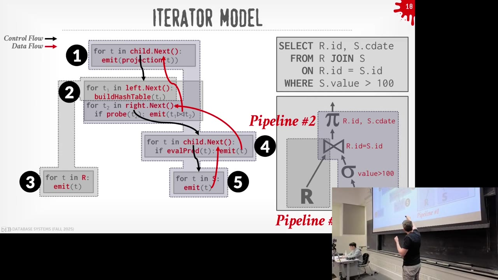
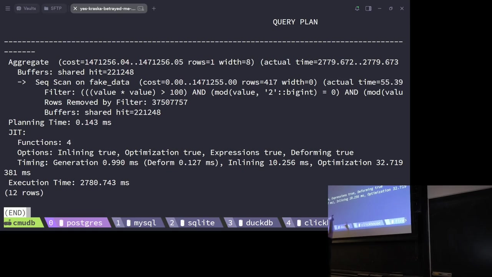

# L13 逐段整理译稿：查询执行 I

## 00:00–01:37 从秋假回到执行器

开头是片头，字幕标了音乐，夹着不足以可靠译成句子的片语。00:24.800 起，Andy Pavlo 请大家鼓掌欢迎现场的 DJ，问他假期是不是跑了不少地方。两人提到洛杉矶、旧金山；对方说有去打碟，朋友想直播，最后没有播。老师说自己假期也四处跑，不过他只关心数据库：去了 Snowflake、Supabase、PlanetScale 和 Microsoft，一路与人聊数据库。

Microsoft 向他讲了一个让他拍案叫绝的想法：让大语言模型改写一条 SQL 以后，怎么证明新旧两条 SQL 的含义相同？试着借助查询优化器做这件事。他很想现在展开，但得先知道优化器是什么；把这个问题留到下周。今天要解决的不是“计划怎么来”，而是“有了计划，数据库怎么真的执行它”。

## 01:37–02:42 项目截止与成绩查看

Project 2 这周日交；习题课录像可从 Piazza 的帖子找 Box 链接。今天早上 AWS 故障，好些服务用不了，包括大家想上的 Gradescope；老师说应该恢复了，但尚未确认。本周六 25 日下午三点在五楼原地点加开答疑。期中成绩已公布，要看自己的卷子和解答，可以周三到他的答疑时间坐下来看。

他问还有谁没开始 Project 2，听到回答后劝大家一下课就动手：上课前提醒过，这个项目比 Project 1 难得多。课件写的是 2025 年 10 月 26 日 23:59 截止，25 日 15:00–17:00 在 GHC 5207 答疑；这是该学期的安排。

## 02:42–04:06 三场课外报告，不是今天的嘉宾环节

今天课后 4:30 是 Columnar 的报告。Apache Arrow 可以类比熟悉的 Parquet、Vortex，但这里着眼于**内存中**的数据表示，目的是让不同系统高效交换数据。老师还提到 Arrow 的数据库连接 API（ADBC）：应用与数据库服务器之间不必以低效的形式来回搬运结果。很多现代系统都用 Arrow；细节在课外报告中讲，并不在本讲现场演示。

明天中午 Astronomer 来八楼作技术报告，有披萨。公司参与开发 Airflow，老师把它比作安排数据从一个系统到另一个系统的编排层；实习和招聘信息此前发过 Piazza。网站恢复后他会再发通知，有意者也可在他们飞走前约下午小组交流。下周一研讨会是 SingleStore 的报告人，接着讲他先前在课堂上谈过的东西。这些活动都自愿参加。

## 04:06–05:45 拼回查询计划

放假前一讲对比了嵌套循环、排序归并和哈希连接。现在已经会内存内外排序、聚合、连接，也有缓冲池和数据页布局了。接下来两周把这些部件装在同一个概念上的 DBMS 里，让一条查询跑起来。今天和下次课先讲执行；下周才讲优化器怎样把 SQL 变成这里要执行的物理计划。

在关系数据库里，计划通常画成算子的有向无环图，许多系统实际实现为树；树是 DAG 的一种。数据**逻辑上**从叶到根，根的输出就是请求者收到的最终结果。请求者可以是终端上的人、应用程序，也可以是系统自己发起的内部查询。图上的箭头还没有告诉你代码里是谁调用谁。

## 05:45–08:38 什么东西会截断一条流水线？

把树再划分一下：如果几道算子之间可以不断传递元组，而不必先把上一道算子的全部结果存下来，它们就可以组成一条流水线（pipeline）。但不是每道工序都能马上产出结果。例如图上只有一个连接符号，先假定它具体用普通哈希连接实现，而且选 R 为 build 侧。扫描 R 的一行就可以把它加入哈希表；可是表还没建全就拿 S 去查，“没找到”也许只是对应的 R 还没来。这个建表阶段必须结束，才能开始这个算法的 probe 阶段。全局排序也一样：在没有预先有序这一保证时，怎么知道最后进来的行不会排在第一位？

所以 pipeline breaker 是实质的数据依赖，不是说数据一到连接就永远不能再流水地走。到了下一阶段，合适的一行照样可以一口气向上传好几层。老师说，早期数据库从磁盘取元组很贵，设计者希望已经取到内存的东西尽量往上用，能处理多少处理多少，别写到磁盘再去拿下一条。这既适用于单行，也适用于一批行。

图看起来像是数据从下往上“推”，实际常常是祖先按需向下要、把结果“拉”上来。今天依次看处理模型、叶子上的访问方法、INSERT/UPDATE/DELETE 等修改操作，最后看 WHERE 或 JOIN 子句里的表达式怎样判断一行能不能过关。

## 08:38–11:52 调用、数据和交付粒度

所谓处理模型，要回答的是各算子怎样运转，怎样把东西从一道工序交给下一道。像行存和列存一样，这既是性能取舍，也是工程取舍；适合交易负载的选择不一定适合分析负载。要分清**控制流**和**数据流**：前者是“谁让这个算子现在执行”，不管算子封装成函数还是类；后者是“结果怎样送到下一道算子”。二者并不一定沿图上的箭头用同一套机制传递。

交过去的“元组”也未必是整行。早物化可以一开始就把需要的字段组装全，之后投影丢掉不需要的列，不必为补列再回表；晚物化可以先给最少的列加一个 record ID，之后真有需求再据此取其余列。

今天比较的另一个维度是**一次交多少**：迭代器模型交一行，整结果物化模型交这个算子的全部输出，向量化或批模型交一个子集。这里的 vector 不是如今检索增强生成里做近邻索引的 embedding，就是一批数据。老师说，熟悉的 PostgreSQL、MySQL、SQLite 等行式系统常采用第一种；面向分析的 DuckDB、Redshift、Firebolt、ClickHouse 等更多用批式。全量物化相对少见，老师打趣说自己都写过其中两个。下面不靠产品名来选，先看它们怎样工作。

## 11:52–13:52 迭代器的约定：Open、Next、Close

迭代器模型也叫 Volcano 或 pipeline 模型；Volcano 是 Graefe 在八十年代末、九十年代初的著名研究系统，既涉及执行、并行化，也涉及优化器。不过七八十年代的系统早已在逐行拉取，不能说是 Volcano 第一次造出了这种做法。

每个计划算子提供 `Next()`。上层调用一次，得到**本算子的下一行输出，或者表示耗尽的 EOF**。已经确定没有下一行，在这一次扫描中就不必反复问。`Open()` 为执行作准备，例如建好索引游标、打开文件；`Close()` 关掉句柄，释放这次运行分配的临时内存。可类比 C++ 的构造与析构，但这里说的是一次算子运行的生命周期。

## 13:52–17:34 沿着 R 与 S 的哈希连接走一遍

老师平时不大愿意在课上贴代码，这次用简短的伪 Python 对照图。查询把 R 和 S 按 `R.id = S.id` 连接，只要 `S.value > 100` 的行，输出 `R.id, S.cdate`。从顶到底把算子编号：1 投影，2 哈希连接，3 扫描 R，4 对 S 作过滤，5 扫描 S。每块代码就是相应的 `Next`。运行时先向根 1 要结果；1 向 2 要；2 要先建表，就向左孩子 3 要。3 遍历 R，将当前元组交上去。怎么问缓冲池、怎么找到下一页是前面几讲的事，这里用一个循环省掉了。图里的 `emit` 类似 Python 生成器的 `yield`：这次交出去，下次从刚停的地方继续，不是从头重跑整个 for 循环。C++ 里要自己安排更多状态。

2 不断从 3 拿行并插入哈希表。直到 3 报告耗尽，2 才知道以后不必再问它，转而向右孩子 4 要；4 又向 5 要一个 S 元组。谓词不成立，就继续取；成立才往 2 送。2 探测刚才建好的表，有匹配就往 1 送。1 取所需列，再把结果交给最初发起这次调用的人。第一条流水线是扫 R、填表；第二条是拿一条 S 尽可能走完过滤、探测、投影。代码里黑色的向下调用和红色的向上交付，叠在一张计划图上却不是同一条路。

约 17:11，实拍投影页 10。看 2 的上下两个循环：左输入写入哈希表，右输入才负责查；不是两棵子树轮流各给一行。截图时间近似。

## 17:34–20:18 接口没有规定叶子内部怎么读

`Open/Next/Close` 的好处是，其他算子不必知道扫描怎么写。可以先把整个表读进内存，记个游标，每次交下一行；也可以每问一次才在当前页上找下一条，页读完再取下一页。两者内部开销大不相同，但对父算子的约定一样。

有人确认是不是要扫完左边才能走右边。老师复述：**在刚画的单线程、普通 build/probe 算法里，是的**。有一种对称哈希连接可以不同地安排两边，不是此处讨论的常用做法。另一个想法是排序归并连接：两边各自扫描、排序，能不能并行做？能，两边都好以后再归并；并行安排下次再讲。学生原问有未被字幕覆盖的部分，这里只译可辨的回应。

按这个接口写，单线程调试尤其直观：用 GDB 或喜欢的调试器一层一层走 `Next`，就知道哪一行到了哪里。BusTub 也会碰到这个执行器概念。老师说简单的目标是尽量让数据留在内存，更激进的系统希望它留在 CPU 缓存甚至寄存器里，再快一点；这里暂不展开机器级细节。

**编者注：** 单行 `Next` 是用来追控制流的课堂模型，不是声称 Fall 2025 Project 3 的实际接口只返回一行。

## 20:18–22:46 十行够了，谁负责停？

OLTP 查询往往只取少量行，逐行调用的成本尚小。比如最上层只要前十个结果，加个 `LIMIT` 算子，攒够十行后不再对下面调用 `Next`。控制和数据共用一个通道，这件事尤其容易做。反过来，分析一张十亿行的表，每行都在多个算子间函数调用，看似一次不贵，乘十亿就不能忽略了。

于是走向另一个极端：一个算子把输入全部处理完，一次把所有输出给父算子，父算子不再回头问它要第二次。这就是这里的 materialization model。倘若到顶层才发现只要十条，下面已经为十亿条付了代价，太迟。所以要尽量把安全的工作放低，或者融合算子（operator fusion），避免把终究要扔的东西搬来搬去。注意单位换成了全结果，列的选择仍是另一件事：传的仍可以是完整的行，也可以只传必要几列及 RID。

## 22:46–25:36 整列交付为什么有人采用？

老师谈到九十年代 CWI 的 MonetDB，早期设计面向整列处理；相关研究者后来又探索批式系统，讲到 Snowflake 和 DuckDB 的学术渊源。回到图上，与逐行 `emit` 不同，算子有一个 `out` 缓冲，循环里不断加入，最后才 `return out`。根 1 让 2 计算全部输出，2 又让 R 的叶节点把全部 R 行装进缓冲，一次交回来建表；再取右侧整份结果，完成探测，交整份连接输出给投影。

看 S 那边最笨的实现：先把十亿行都写进缓冲给 filter，filter 才发现只有十条通过。把扫描和过滤融合，在扫 S 的循环里就判断，交十条而非十亿条。其他两种模型也能融合，而在全量物化时尤其要紧。

老师问：听起来这么浪费，为什么有人这样做？有同学开玩笑说发明者笨，老师不同意，说是很出色的研究者。最初目标是分析型列存，查询也许恰好需要所选列的**所有行**，只是**不需要所有列**。扫描时把列投影掉，留下的列可整块交付，不再为取完一列而重复调用无数次 `Next`。

## 25:36–27:37 能不能干脆融合成一段大程序？

学生问能否把算子全合成一个程序。老师说可以把一条流水线中能融合的处理尽量合在一起；可是一旦跨到另一条流水线，前面讲的依赖还在。并不是给整棵树起一个函数名，等待完成的那一步就消失了。有些研究系统非常善于融合，但也受这个限制。

反过来，内存中的短事务很可能只涉及少量记录、一条很短的流水线。若能将逻辑合在一起，少掉重复取下一行的函数调用，整结果物化也可能很划算；此时瓶颈本来就不是等磁盘。老师举了实验系统 Hyrise 在演进中改换执行方式，以及面向文档、类似 MongoDB 的 RavenDB 等例子。这种模式接口简单，容易写、容易调，直到数据集或**中间结果**变大，显式缓冲的代价才一下暴露出来。产品沿革是课堂举例，不是本页的版本实测。

## 27:37–31:59 交一批：控制开销与算子内核

在单行和全量之间，可以每次返回一个 batch。`Next` 还在，只是交出向量而不是一条记录。老师用 1024、2048 举例，不主张把批做成几百万行。实际批长由设计决定；他说起 DuckDB 时是举例估数，不据此认定某个版本的常量。假设最大批长 2048，filter 滤掉了一半，要不要向下再取，填满了再往上传？也可以不再等，把稀疏的部分批直接传。两种都有利弊，本课不规定唯一策略。

回到同一个 R、S 计划：在各个 `Next` 里准备输出缓冲，扫描到一条先加入，达到发送门槛才成批交付。这个缓冲既不是单条记录，也不是前一模型中可能膨胀成整张表的 `out`。老师说这办法看起来太自然，实际是本世纪初才形成有影响的批式方案；更早的 OLAP 系统也会逐行迭代或者像 MonetDB 那样整列物化。他讲到后来一家初创公司被 Ingres 收购、项目结束，相关创业者又和两位来自 Oracle 的人创办 Snowflake 的经历。

近年的分析型数据库普遍走批式。不只是函数调用摊薄：同一列的同型值连续排在数组里，内核可以用一个很紧凑的循环反复做同一件事，少分支，适合现代 CPU；布局、对齐等条件合适还可以装进 SIMD 寄存器，一条指令处理多个值，或者把批交给 GPU。老师把这些留作方向，不在这里教 SIMD 指令，也不是说所有批都会自动获得加速。

## 31:59–34:37 换一个维度：谁先被调用？

刚才三个例子都从根启动：调用向下，结果被一层层拉上来。换成交整批、交整份，并不强制换执行方向。另一种办法是从输入端推（push）。不是根先层层调用 `Next`；上面有调度器，知道该执行哪些任务或流水线及其依赖，能在合规的次序里自行挑任务。数据的逻辑方向没变，触发计算的地方变了。

仍看那个连接：第一段代码扫 R 建哈希表，第二段代码扫 S、判过滤条件、探测，再投影输出。第二段可以在一个循环里把一条 S 记录一直用到底，这就是流水线内融合。两段之间不再需要 `Next` 调用链或一个直接把记录 `emit` 到另一段的函数；每段有自己的输入来源和写入目的地。

## 34:37–37:05 调度器知道表在哪里，而不必亲自搬元组

调度器列出待执行的任务；不是想怎么重排就怎么重排，任务 2 依赖任务 1 建完表。先运行 1，分配输出状态的位置，例如用缓冲池的页存哈希表；不够就再取页。1 报告完成，调度器才知道等待它的 2 已就绪，并把前者写下状态的位置告诉 2。2 从那里读表，做连接、投影，把结果写入自己的输出处；2 完成后，调度器知道最终结果在哪里，可交还请求者。

这把下达执行命令的**控制流**，与保存、读取状态的**数据流**分开了。在 pull 版本里，谁调用谁的 `Next` 就已经隐含一份调度；push 版把这些任务摊开，有机会从整个查询而不是一个局部调用点看待调度。所谓“推”，是先启动叶端工作让结果往上，不是把结果推向磁盘。

## 37:05–39:08 拉与推各自难在哪里？

从根拉容易实现，`LIMIT` 满足以后停止要数据即可。推式能更仔细安排流水线里的缓存、寄存器和输出缓冲位置，但要协调生产和消费；有的算子更别扭。老师仍拿排序归并连接举例：分别把两边排好，再运行负责归并的阶段；拉式实现则可以让一个消费者依次向两边要已就绪的有序数据。这里指实现上的组织难易，不是说两种方向需要不同的连接语义。

老师列举 HyPer、Umbra 这条研究路线，以及 DuckDB 从早期拉式改为推式的例子；还提及 ClickHouse、基于 Umbra 的商业系统、Firebolt、Snowflake 等。许多分析系统把推和批结合，却不能说“批式就是推式”：他用 DataFusion 举了批式加拉式的反例。具体产品实现还会演变。

## 39:08–41:54 一个数据库可以同时有三种模型吗？

老师把学生的问题复述为：问的不是计划方向，而是迭代、整结果物化、批式能不能共存。理论上可以；代价是每个算子可能要维护多份，还要让不同算子互相组合，很难值得。把批长设成 1，行为有点像逐行，但若仍写一遍输出缓冲，就未必有直接交一行的效率。

另一位学生发现图中 Oracle、SQL Server、DB2 等名字在迭代器和向量化两处都有。老师澄清先前所说的“一般不会这么干”是对**同一个执行引擎内部**而言。老产品起家于行存、逐行拉取；列存分析兴起以后，可在同一个产品甚至同一二进制程序里放不同的执行引擎和代码路径。一个产品支持两类负载，并不等于在同一份算子实现上无代价地任意切换模式。约 39:15 和 40:15 附近的学生原话字幕有空缺，不能把老师的解释还原成逐字提问。

## 41:54–44:25 叶节点怎么从表里找行？

关系代数说“从关系选择、投影”，并不规定要遍历堆文件，还是要走某棵索引树。物理执行必须决定。基本选择有三类：顺序扫描；用一个索引找；有多个可用索引时，分别找候选再合并。找出的数据是成批还是逐行交付，又是前一部分的问题。

先假定表是堆组织的。最直观的方法是从页目录找到第一张要扫的页，向缓冲池取页，枚举页内记录，把合适的记录交给上层，接着扫下一页。扫描算子自己保存游标，记住上次看到的页和槽位；下次调用接着来。也可以先读完每一页把表物化到内存再遍历，但大表得找地方放，通常不是想要的。没索引也总能顺扫，所以它是兜底方案；这不等于它必然慢。

## 44:25–47:26 顺扫如何少等、少搬、少算？

前面已经讲过多种手段。编码和压缩利用重复值，使一次从磁盘取回的一页代表更多元组。知道即将连续读页，就可以预取后面的页，让 CPU 不必每次停下来等 I/O；还可以共享扫描或绕过公共缓冲池，把相应页直接放在工作区。多线程分工下次讲。若数据按键聚簇或有序，找范围、利用顺序进行归并等也可能更高效；晚物化让中间各层只搬眼下所需的数据。

如果相同查询反复执行、数据又没变，为什么不直接给上次的结果？这是结果缓存。物化视图是应用声明要预计算的关系，之后同一个查询，甚至可由它回答的其他查询，能利用这个结果。难就在“仍然新鲜”：比如维护一列的和，插入时加上新值，更新时按新旧差值改，不必每次重扫；更一般的增量维护非常难。老师说这是自己相对不熟悉的数据库领域，课堂上不深挖，并举 PostgreSQL 原生物化视图要显式刷新作对照。

还可跳过无关数据、在一批值上并行运算、或干脆为已知查询生成专用代码。与其解释整棵树逐节点走，不如让生成的程序直接干这件事。老师预告结尾演示 PostgreSQL 编译表达式，而不是给整条查询重新造一套程序。

## 47:26–51:46 两种“跳过”：近似答案与精确排除

第一种是真的改变问题：如果一个月有几百万访问，业务只关心到千位，或许愿意抽样估计访问量。系统可以提供近似聚合，有些还能给统计误差保证；需要精确答案就不能悄悄换成这种模式。第二种常见得多，叫 zone map：预先为一个块的一列记摘要，如极小、极大、数量，按需要还可有平均值、空值数、不同值统计。老师提到 Parquet、Vortex 等格式也能存这类元数据。它一般不能指出某一行在哪，但能告诉你哪些块根本不可能有答案。

课堂小表的一块有五个整数 `100, 200, 300, 400, 400`。查询找 `val > 600`；读摘要就知道最大值是 400，这个块没必要读。把五行想成十亿行，就知道“只读小得多的摘要”为什么值得。学生问怎么在两种方法里选。老师说：能不能接受近似，系统无法猜出你的业务目标，要由查询者说明。每月网站流量可以约数，银行余额可不想让谁给你近似算个总和。利用可靠范围做无损排除，则无需征得用户同意改变答案。这里的“总是做”说的是安全排除的动机，不是说任何分布、任何粒度都能省时。

老师补充，Oracle 的术语是 zone map，文献里也叫 small materialized aggregates，简作 SMA。他指着一篇 1998 年的工作谈到作者和后来 HyPer/Umbra 团队的学术渊源。这是课堂回顾，不表示这里独立核过论文史。

## 51:46–54:43 单索引：哪一个能用，哪一个值得用？

有 B+ 树、跳表等结构，不等于查询一来就知道选哪个。WHERE 中可能同时提及好几个有索引的列，哪条访问路径最省事是下周优化器的话题。今天假定有个“先知”（不是 Oracle 公司）已经选好，执行器按数据结构提供的 API 去查。但可以先理解选择为什么跟数据分布有关。

例子是 100 名学生，查 `age < 30 AND dept = 'CS' AND country = 'US'`，索引分别建在年龄和系上。99 人不满 30 岁，但 CS 只有 2 人，就先找 CS 的两人；反过来，99 人在 CS、全表只有两人不满 30 岁，就先找年龄候选，再去核对剩余条件。中间电话响了，老师说是律师来电，随后继续同一个例子。不是查询文字变了，是数据变了，较能缩小候选集的索引跟着变。

还要看 API 是否支持这类谓词。B+ 树等有序结构能做范围扫描，普通哈希索引擅长等值探测；只给年龄上的等值哈希接口，不能把 `age < 30` 变成一次这种探测。若部门上有能用的等值索引，可以转而走它。查出来的是候选，不是自动满足未检查的国籍等条件。

## 54:43–56:53 多索引：先算记录标识的集合

不一定非得二选一。可以分别从每个匹配的索引取回 record ID 集合，然后按布尔关系组合。AND 对应求交，OR 对应求并；再回表取实际记录、核对剩余条件。老师对照 DB2 的 multi-index scan、PostgreSQL 的 bitmap scan、MySQL 的 index merge，强调思路相通，不是三套完全不同的关系语义。

沿用学生例：从年龄索引拿“不满 30 岁”的 RID，从系别索引拿“CS”的 RID；只保留两圈中间交叠的部分，再取这些记录，看 `country` 是不是美国。两棵索引都没存国籍，集合运算不能替你判断那个条件。这个过程可以画成韦恩图，实现可用位图等结构；最后拿到候选后，逐行还是成批交给上层都可以。

## 56:53–59:32 写数据也可以沿用读计划

到这里会做 SELECT 了。写算子不必重新实现一套“按条件找待删行”的代码。UPDATE、DELETE 可以直接接在扫描结果之上，孩子输出目标 RID，上层负责把相应修改真正落实到表和索引。UPSERT 可用“匹配了更新、没匹配插入”来理解；MERGE 也可以把寻找输入与选择写动作分开。TRUNCATE 在课上被类比为整体丢弃再得到空表，意在与逐行删区别，不是说各产品真的执行 `DROP TABLE` 加 `CREATE TABLE`。

INSERT 有两个设计：在写算子内部根据给定值造元组；或让前面的子算子负责产生符合约定的元组，INSERT 只管把它放进目标表。后者更好组合，来源是常量、查询结果还是临时关系，写算子无需知道；`INSERT … SELECT`、把 SELECT 的结果放进新表或临时表，便都能复用这条通路。老师先提醒另一个陷阱：自己刚改过的行如果移动到扫描游标还没到的地方，会不会又被当作新行？

## 59:32–1:01:18 同一个 Andy 为什么连涨两次薪？

年终要给工资低于 1100 的每个人加 100。在 `people.salary` 上有索引。按拉式模型，上层更新算子让孩子按工资索引扫描，在叶节点中往前走，找符合条件的记录。第一次看到 Andy，工资 999，把它交回上层。写算子把工资改成 1099，也得让索引不再指着旧键、改为按新键可找到他。

再调用孩子的 `Next`，游标向前走……竟然又看见 Andy！新键 1099 在游标前方，仍小于 1100，于是又加 100，变成 1199。单次语句本来只该给这个人一次调整。逻辑上的人还是一个，变的是访问结构中的位置；天真的游标只认识眼前的新条目，不知道这就是自己刚才处理过的那条。

## 1:01:18–1:03:40 Halloween 问题不是锁住另一名用户就完了

老师把上述异常称为 Halloween problem：写操作改变记录在扫描所依赖结构里的物理位置，导致一次操作多次访问同一逻辑行。按索引扫描会遇到；若表的组织和更新会让顺扫再次撞见该行，问题也不限于索引。场上并没有第二个事务来捣乱。

关于得名，他讲了 IBM 的 System R 研究者在七十年代万圣节碰到难题、周五下午先出去喝酒、下周再解决的轶事；课件写的是 1976 年。这是老师讲述的命名故事，不据此补证具体日历。实质是按**本次语句**识别已修改的逻辑行：例如另存本次改过的标识，或由系统的记录头等足够的信息看出这是本次写出的版本，不要再改。底下的扫描远不止伪代码里那一行循环。老师提示以后讲并发控制还会见到相关机制，这里不展开项目实现。

## 1:03:40–1:06:18 算子树里面还有表达式树

JOIN 和 WHERE 中的比较由谁做？计划的每个算子都可以带自己的表达式树。比如 `R.id = S.id`，以及 `S.value > 100`，可用 AND 连接：左边两份输入各取一个属性作等值比较，右边拿 S 的属性和常量比较。到相应处理阶段，算子得对当前元组或元组对真的算出结果，才能决定要不要往上交。在表达式树里，节点可以是比较、算术、AND/OR、函数或取属性、参数、常量；不要把它们错画成扫描表的孩子。

换个带参数的例子。把 `SELECT * FROM S WHERE S.val = $1 + 9` 用 `PREPARE` 命名为 `xxx`，之后调用 `EXECUTE xxx(991)`。老师让大家先把它想成带参数的函数或宏，而不是每次把整个 SQL 再送一遍。可以复用解析或计划的工作，但预备时未必知道以后每次的参数；某个参数下很好的访问路径，对另一个值未必好。老师口头把 PostgreSQL 与“五次”联系起来。

**校订：** 参数据课堂课件是 991。PostgreSQL 的“五次”在官方 `PREPARE` 文档中是**对已经预备的带参语句**选择通用/定制计划的默认启发法：先用五次定制计划取得成本参照，不是连续提交五次相同的普通 SQL 就由服务器自动把它命名为预备语句。

## 1:06:18–1:08:18 沿树把谓词算成一个真值

执行时备好上下文：眼下看的元组、此次执行传进来的参数，以及表的 schema。表达式不同节点需要的信息不同；希望字段位置等尽量预先解析好，不要十亿行每行都重新查目录。

从等号根开始作深度优先遍历。先访问左边的 `S.val`：schema 是 `(id, val)`，当前元组 `(123, 1000)`，所以取出 1000。再看右边的加号：参数槽 1 是整数 991，另一端是常量 9，算出 1000。回到根比较 `1000 = 1000`，返回真；调用者才据此保留这条元组。老师问树解释器算好主意还是坏主意。一位同学说“好，因为它能用”，老师接受这个答案，又追问：那能做得更好吗？

## 1:08:18–1:10:10 直接算，别每行都解释节点指针

有同学答“编译它”。老师说正是：为了省掉逐行 `Next`，前面费了大力气，结果每行又要在表达式解释器里追一串指针、分派一串不同的操作。表达式 `S.val = 1` 本质上只是测试当前值是否为 1，何必每一行都重走属性节点、常量节点、等号节点？可以直接生成做这件事的函数。若对一批值重复同一比较，还可能让编译器自动产生 SIMD 指令，或自己用 intrinsics 写对应内核。

有系统编译整份计划，PostgreSQL 是对其中一部分做 JIT（即时编译）。老师关了灯，准备在终端演示两种做法的实际差别。

## 1:10:10–1:12:29 演示第一轮：先把 I/O 干扰拿掉

这是 PostgreSQL，表叫 `fake_data`，存的真的就是人造数据，约五千万条。老师调整演示让大家看清，然后先用 `pg_prewarm` 把表页预热到缓冲池。关闭 JIT，也关闭并行扫描；并行留给下一堂。运行一个有计算型 WHERE 谓词的查询，这个条件没有合适的索引，只能把数据扫一遍再判断。

用 `EXPLAIN` 是要看计划，加 `ANALYZE` 才是真的运行并测量，加 `BUFFERS` 是检查页在哪里命中：如果本来要测每行表达式的 CPU 工作，第一轮却在等存储，比较会走样。输出里的 `shared hit` 有二十多万，是共享缓冲命中；老师说无 JIT 这一轮大约四秒，再跑也差不多。另一个单列出来的 planning time 是规划用时，不是整条查询用时。本段学生或调显示的交谈有约 4.52 秒和 5 秒的字幕间隙；不虚构里面说过的话。

## 1:12:29–1:15:17 演示第二轮：JIT 与另一种引擎

打开 PostgreSQL JIT，为这条 WHERE 表达式生成 LLVM 中间表示并编译，做特定的计算，不要把“整棵树逐行解释”当作唯一途径。重跑后老师读到大约 2.7 秒，比原先约四秒快了约一秒多。输出多出 `JIT` 一栏：产生了四个函数，还有生成、内联、优化等耗时。这不是白来的：先花编译成本，必须靠足够多次较便宜的执行才能收回。系统用自己的成本估计和门槛决定是否启用，而不是所有查询都值得编译。

约 1:13:12。实帧能读到 `Seq Scan on fake_data`、`Rows Removed by Filter: 37507757`、`Buffers: shared hit=221248`、`Planning Time: 0.143 ms`、`Functions: 4` 和 `Execution Time: 2780.743 ms`。不要把不同节点重复显示的命中次数相加。屏幕右侧截断了 timing 行；换行处只剩 `381 ms` 尾串，不能据此还原总数。自动字幕说“381 seconds”与整次只用 2.78 秒矛盾；不把它或老师对另一轮 planning time 的口估当作精确测量。

再换到 DuckDB。老师说是同一数据、同一查询，用 `EXPLAIN ANALYZE`，检查是单线程，报告不到一秒。这一例里，面向分析的列存、批式、推式引擎没有靠对该查询做同样的 JIT，仍然更快。在逐行行存里实现和调试 JIT 本来就是一桩大工程；若工作负载本来就是扫列，选择不同的布局和执行方式也会有很大效果。老师提到其他分析系统也可能有类似表现。这是**一次课堂演示**，不是证明差异全由某一个开关引起，也不是针对所有数据或产品的基准排名。

## 1:15:17–1:16:48 不生成机器码也能少做很多事

编译课学过的优化，同样能用在 DBMS 的表达式树上。例一，`UPPER(col1) = UPPER('wutang')`：右边参数固定，如果有十亿条输入，没必要把同一个字符串转十亿次大写。算一次，把树上的整个右子树替换成常量 `'WUTANG'`；左边依赖当前行，仍然要算。这是常量折叠。

例二是 OR 两端都调用同一串参数的 `STRPOS`，一边判断结果小于 2，另一边判断大于 8。两个子树其实是一份计算；对**当前行**算一次，把同一个结果交给两次比较，就是公共子表达式消除。下一行的列值变了，不能沿用上一行的计算。应用无需手写两套表达式，系统也能识别并改写，就像以后会学的对整个查询寻找较好执行方式一样。

## 1:16:48–1:18:24 既然 LLVM 会做，为什么 DBMS 还要自己优化？

老师复述最后一个问题：GCC、Clang、LLVM 也会这些优化，如果最后要交给编译器，为什么数据库还要再做一遍？以 PostgreSQL 为例，不是每条查询都走 JIT，没走的路径也值得把这些重复运算省掉。有实验系统想让经典编译器同时优化计划和表达式，但这不是唯一组织方式。

老师又描绘了一种两阶段做法：先为计划生成可快速汇编的 x86 代码，让查询尽早开跑；同时在后台让 LLVM 产生更充分优化的版本。如果优化后的共享对象在查询结束前就准备好，可以换进去执行余下的工作。第一阶段的快速代码没有那一整套昂贵优化，仍有理由让 DBMS 先做好这些容易判断的表达式改写。老师临近收尾时确认录像还开着。

## 1:18:24–1:19:41 从单线程走向下一讲

一条 SQL 可以顺扫或用索引；可以从上拉也可以从下推。同一个查询要算什么，不能单独决定这些选择。做 OLAP 通常希望批式；拉还是推，要看工程复杂度和目标负载，不存在处处胜出的方向。OLTP 常常希望借索引只找少量行；尤其是短小、内存内的事务，整结果物化也可能合适。表达式树是管用的抽象，却不必把它原封不动地当作最快的每行执行程序。

今天推演的主要是一个线程。下次要在同样这些工作里加入多个 worker，再把它们的结果正确合起来。老师示意 DJ 放音乐，课堂讲授到此收束。

## 1:19:41–1:20:18 片尾和字幕空白

第一条片尾音乐标记始于 1:19:41.554，与前一句结束语的字幕有重叠。其后字幕标为音乐，夹有零散英语词，不将它们拼成数据库讲解，也不重录歌词。最后一个字幕事件到 1:20:15.560；标称片长还有 2.440 秒。短段实帧在约 1:20:15.7 和 1:20:17.7 均显示 **OFF PROBATION PRODUCTIONS** 片尾字样。末段原声与其他讲的预录制作片尾相匹配，并非静音。这是对片尾素材的辨认，不是对其中每个词的辨认；不补写歌词或对白。

## 引用与来源

- 据 CMU Database Group 发布的 Fall 2025 L13、Andy Pavlo 课堂，全片 **2230 个英文自动字幕文本事件已顺序通读**。本页为逐段整理译稿，不是逐字听写。合并重复与口头停顿，区分学生发言、教师复述、课件文字校订和编者注；没有把课外活动预告当外请报告。
- 4818 秒标称时长内，字幕区间并集 **4730.898 秒**；首 0.654 秒、45 处内部间隙合计 84.008 秒、尾 2.440 秒没有字幕。最大内部间隙为 40:14.760–40:25.280；另有 18:24.679–18:34.400、39:14.839–39:22.240 等处在问答附近，未知部分不重构。标题按主题转折取整，不表示每秒都有字幕。
- 有限核对：开头约 0.25 秒画面近黑，首 0.654 秒有可测音频；尾部两帧为片尾卡。整数时长与原声流约 1:20:17.98 的精度不同。音量和少数帧不能代替首尾逐句听审；没有全片音画核验。两张课堂截图均由本视频短段截取并实际查看，未用 PDF 代替实拍。
- 逐视频许可标签为 Creative Commons Attribution license (reuse allowed)。署名 CMU Database Group、Andy Pavlo；本页为中文译述、少量技术校订及课堂截帧。参见[平台的 CC 署名许可说明](https://support.google.com/youtube/answer/2797468?hl=en)。逐视频字段未附具体许可版本；不将此标签外推到独立文档、教材或第三方音乐。
- 校订用 Fall 2025 [课件](https://15445.courses.cs.cmu.edu/fall2025/slides/13-queryexecution1.pdf)和[讲义](https://15445.courses.cs.cmu.edu/fall2025/notes/13-queryexecution1.pdf)全文提取文本；“五次”另核 [PostgreSQL 19：PREPARE，Notes](https://www.postgresql.org/docs/19/sql-prepare.html)，是后来的版本说明，不冒充演示机版本。视频原地址、来源指纹见[来源清单](https://github.com/socoo123/course_web/blob/main/content/cmu-15-445-2025/source-manifest.json)；教材正文未取得，未作全译。
