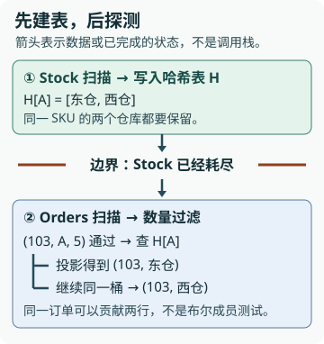
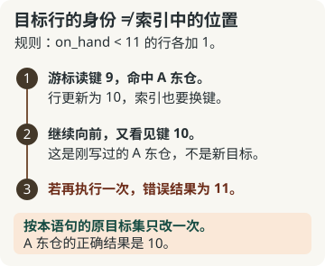

# L13 查询执行 I：一行订单什么时候才算“交付”？

数据库已经选好了连接算法，为什么查询还不能马上返回第一行？因为“最终结果是什么”没有规定哪份状态必须先准备好、谁向谁要数据、一次交几行。本讲最值得带走的是能从计划中指出：第一行输出前哪些工作无论如何逃不掉，哪些工作则会因上游不再需要而省掉。

## 先手推一条查询

这是一个自拟的小例子。`Orders(id, sku, qty)` 按表中次序扫描；`Stock(sku, depot, on_hand)` 的一行是一种商品在**一个仓库**中的库存，同一 `sku` 可以命中多个仓库。假定当前读到的表不变、普通内连接、哈希表放得下，暂不考虑排序与并发。

| Orders.id | sku | qty |
|---:|:---:|---:|
| 101 | A | 2 |
| 102 | B | 6 |
| 103 | A | 5 |
| 104 | C | 8 |
| 105 | D | 7 |
| 106 | B | NULL |

Stock 的输入依次为 `(A,东,9)`、`(A,西,2)`、`(B,东,7)`、`(D,西,8)`。要运行的是：

```sql
SELECT o.id, s.depot
FROM Orders AS o JOIN Stock AS s ON o.sku = s.sku
WHERE o.qty >= 5;
```

**计划。** 以 Stock 为 build 侧，建立 `sku → 匹配的库存行列表`；扫描 Orders，过滤 `qty >= 5` 后再探测，最后投影。图中的两个方框不是两个线程：本讲只用一个线程也得先后经历这两个阶段。



**第一阶段的状态。** 刚插入第一行时 `H[A]=[东]`；读完第二行变成 `[东, 西]`。只把键 A 存为一个布尔值，或者第二次插入覆盖第一次，都会丢掉 SQL 多重集所要求的输出。即使提前探测已经“找到 A”，也还不能证明 A 的匹配已齐；没找到 B 更不能证明 B 不存在。对课堂这套一次 probe、不回补的算法，要等 Stock EOF 才可把哈希表交给下一阶段。

| 订单 | 过滤的三值结果 | 查表/恢复状态 | 向上交付 |
|---:|---|---|---|
| 101 | 假 | 不探测 | 无 |
| 102 | 真 | `H[B]=[东]` | `(102,东)` |
| 103 | 真 | `H[A]=[东,西]`，交第一条后桶还没遍历完 | `(103,东)`、`(103,西)` |
| 104 | 真 | 查 C 没有桶 | 无 |
| 105 | 真 | `H[D]=[西]` | `(105,西)` |
| 106 | 未知 | WHERE 只接收真，不探测 | 无 |

答案是四行；表格给的是在指定扫描序和桶遍历序下可能出现的轨迹。SQL 没有 `ORDER BY`，不对实际交付顺序作保证。分清三个数：6 行输入，4 行通过 WHERE，4 行最终输出。通过的四行都探测了哈希表；C 没有匹配，A 却匹配两个仓库，因此后两个数恰好相等。

## 第一行、最后一行：`Next` 到底承诺什么？

| 时刻 | 谁持有状态 | 能做什么，还不能做什么 |
|---|---|---|
| 打开计划 | 扫描持有页/槽游标，连接有空哈希表 | 准备输入，不承诺已经有输出 |
| 第一次向根请求一行 | 连接读尽 Stock，之后过滤器可能反复向 Orders 请求 | 跳过 101，102 才产第一行；一次调用可以触发许多次子调用 |
| 103 的第一条匹配刚交付 | 连接记住**当前订单和桶内下一个仓库** | 下一次必须能交出 103 的第二行，不能直接让扫描去取 104 |
| 到 106、没有更多匹配 | 底层扫描 EOF，所有待交匹配也已用尽 | 才能向上传 EOF。一次 probe 未命中、一批全被过滤都不等于整棵子树 EOF |
| 上层提前停止 | 各算子仍可能有游标、页引用、临时哈希表 | 即使不再 `Next`，仍需关闭并释放资源 |

这里的 EOF 是控制标记，不是某个数据值。`qty` 为 SQL NULL 的一行是真有其行；把 NULL 当 EOF，会把该行之后的所有数据也截掉。若采用晚物化，向上传 SKU、数量和行标识就够了，不必同时拷贝大字段。但若传的是指向暂存批或缓冲池页的引用，就要保证消费之前底层存储仍有效，或先复制需要保留的列。把页号、可复用的内存帧号、行标识和业务主键当作同一东西，做不出这个保证。

**加一个 `LIMIT 2`。** 在上述访问顺序下，根拿到 102 和 103 的第一条匹配就可停止，甚至不必消耗 103 桶中的第二个仓库；它省下的是 **probe 侧未来的工作**。已经建完的 Stock 表、已经读入的一批或尚未返回第一行前的全局排序，并不会因为根只要两行就自动消失。若先按输出排序取最小两行，随便先读两条就停还会算错。

## 一个算子交换什么？分开四个选择

| 选择 | 两端或几个取值 | 不等于什么 |
|---|---|---|
| 表和列怎样存 | 堆页、索引有序页、按列组织等 | 列存不等于必用某种调度方向 |
| 每个逻辑行携带什么 | 完整字段，或少量列/值加 RID | 晚物化不是“每个算子一次交全部结果” |
| 每次交多少逻辑行 | 1、有限 batch、该算子的全部输出 | 一批不是多维嵌入向量，不保证 SIMD |
| 谁发起下一步 | 根发出请求沿树拉；调度器/输入端启动后向上推 | push 不必多线程，pull 也可以批量 |

**为什么批式不只是把接口参数改成数组？** 假设一条算子边传送 $N$ 行，每次跨边有固定分派开销 $c$。不计 EOF 和固定的打开/关闭，在逐行模型中这项约为 $Nc$；若每批最多 $b$ 行且除尾批外均填满，就约为 $\lceil N/b\rceil c$。当 $N=1{,}000{,}000$、$b=1024$ 时，是 1,000,000 次与 977 次的区别，**不是**说 CPU 总工作减少了 1024 倍：比较、哈希、解码、输出大多仍得逐值做。

- 合理布局的一批同型列能让一个小循环连续访问，减少反复切换算子代码和分派，对流水线、缓存及可能的 SIMD 都有利；变长字符串、任意分支与指针追逐不会因为装入 batch 就消失。
- 若每次都交满批，6 行、批长 2 的 Orders 有 3 个输入批。过滤后各批分别剩 1、2、1 行。可以传原批加选择向量，少搬运但更稀疏；也可以把存活行压紧，等待拼批，节省后续调用但要额外复制/等待。最后不满目标批长也必须交，不能等一个不存在的下一行。
- 全结果物化把同一条边的固定调用降到很少，却通常要让中间结果存活到消费者取用。输出宽 $w$ 字节、行数 $M$ 时，仅有效载荷就约 $Mw$ 字节；索引、对齐、哈希桶、同时存活的输入输出和溢写还没计。普通批缓冲就该边而言约 $bw$，**不能**据此把 build 表、排序状态或整个执行器的内存也估成 $bw$。
- 若扫描十亿行、只有十行通过，先完整物化再过滤会为即将丢弃的结果分配空间；把过滤与扫描融合后可只交十行。能安全融合不等于能把某个上层 `LIMIT` 随便下推到连接之前：前两笔订单可能没有任何匹配。

## 控制流换向，依赖没有换向

**拉式。** 调用栈可以是“投影 → 连接 → 过滤 → Orders 扫描”，返回则反过来。连接最初的调用还会先耗尽 Stock。一个父算子暂停调用即可反压下游生产，所以实现 `LIMIT` 方便；代价是内层可能频繁进行虚调用、分支和状态保存。

**推式。** 调度器先启动建表任务，并给它状态 H 的写入位置。它完成后，第二个任务才获准读取 H，在同一个循环里完成过滤、探测、投影。任务间交接的可以是已完成状态的句柄，不是把整张表再次拷贝。若消费者要提前停止，就需要单独的停止传播或可取消边界；若两边速度不匹配，还得限制中间缓冲，不能靠函数返回自然解决一切。

**判断 breaker 的办法**是提出反例：“再给孩子追加一行，先前交出的结论会不会失效？”没有顺序保证时，追加一个更小值能推翻全局排序的第一行；哈希 build 未终结时，追加一条 Stock 可能把“不匹配”变成“匹配”。相反，已封表后对某笔订单找到的一对匹配，不会被下一笔订单撤回。阻塞是物理算法及其阶段的性质，不是看到 JOIN 三个字就画一条永远过不去的线。

## 访问路径：减少读页，不是减少答案

同样是读 Orders，有三套不同的排除证据。

1. **顺扫与 zone map。** 用页/槽游标读堆表，可配合预取、压缩、投影、扫描共享。令一组的可见非空 `qty` 范围为 `[2,4]`，查 `qty >= 5` 必能跳过它；范围 `[2,8]` 只能说可能有答案，仍要读且检查。一个维护正确的保守**上界**已经足以做前一种排除，低估最大值却能丢行。若实际值是 `{2,8}`，查询 `qty = 5`，范围包含 5 仍然可能零命中。NULL 的谓词如 `IS NULL` 要用与之对应的 null 统计，不能照搬普通比较的证明。
2. **单索引。** 从可用索引取候选，再按剩余谓词筛。索引是否匹配访问方式（等值/范围）、返回多少候选、候选落在多少不同的页都会改变成本。理想化地设表有 $P$ 页，扫描索引用了 $I$ 页、候选散在 $D$ 个堆页；在冷缓存、每个相关页只读一次的简化下比较 $I+D$ 和 $P$。即便 $I+D<P$，随机 I/O 和顺扫吞吐也可能翻转时间结果；这不是优化器公式。
3. **多索引。** 课堂例子 `age < 30 AND dept='CS' AND country='US'` 先求前两个索引各自的 RID 集合，取交集后回表核国籍；精确集合在 OR 下用并集以去重同一 RID。若 OR 的一边没有索引，单靠另一边的集合会漏掉前者独有的行。位图若只精确到候选页，取回页后还需检查行谓词。这里去重按**同一基表行标识**，不是把结果中碰巧值相同的不同 SQL 行去重。

近似查询是另一份契约：抽样不再保证返回原查询的精确计数，必须是业务准许的误差。无损 zone map、索引过滤和早停若能改变应返回的多重集，就是实现错误，而不是性能取舍。

## 写算子：找目标和改目标是两件事

让 UPDATE/DELETE 接受孩子找出的 RID，让 INSERT 接受孩子产生的元组，就能把访问路径与写动作解耦。例如孩子来自普通扫描或 `SELECT` 结果，INSERT 仍是“检查应有约束、写目标表、维护有关索引”。至于约束何时检查、物理更新是否生成新版本，由产品/事务规则决定，不能从计划图的箭头猜到。

**反例。** 对 Stock 执行一次“`on_hand < 11` 的每一行加 1”。沿 `on_hand` 的升序索引边读边改，初值 9 的 A 东仓会被移动到键 10；它仍满足条件，又在游标前方。若再次修改，就成了 11。这里即使只有一个 worker、一个事务，也会错，这就是 Halloween 问题。



课堂里工资 `999 → 1099 → 1199` 是同一种错误。正确不变量是**本次语句确定的每个目标至多执行一次该动作，同时不漏掉原目标**。一种纸面方案是先读出稳定的目标身份，再逐一写；另一种是依赖可识别本语句自写版本的扫描/历史标记。若更新会分配新 RID，单记“已见过的旧物理槽位”不一定能识别新位置；反过来只记 `sku` 又会把 A 的两家仓库误认为同一行。显式隔开选取和修改会花存储与延迟，但能让目标集合不随游标移动而变化。

## 表达式：每行是在算加法，还是在解释“怎样算加法”？

计划树中的扫描、连接描述**关系怎样流动**；算子内的表达式树描述**当前值怎么算**。课堂的 `S.val = $1 + 9`，由 schema 确定取值槽位，由当前元组给出 1000，由此次执行参数给出 991。先求 `991 + 9` 再比较；换一条输入元组可能换左边，换一次执行参数可能换右边。这就给出三个不同的重用边界：

| 表达式 | 安全重用的一个范围（固定语义设置） | 容易写错的地方 |
|---|---|---|
| `UPPER('wutang')` | 确定性常量表达式可预先折叠 | 依赖行值的 `UPPER(col)` 不能一起折掉 |
| `$1 + 9` | 同一次绑定参数的执行，可预计算 | 跨次调用若参数可能变，不能重用旧值 |
| 依赖列的同一 `STRPOS(…)` 子树 | 同一行上若两处需要，算一次即可 | 换行要重算；不能随意合并有副作用或易变的函数 |

对每个节点都追指针、判节点类型再间接调用，树的解释工作有时比比较本身还贵。可以编译表达式成专门内核，也可在列批上直接运行已有内核。**编译有固定成本**：设一次 JIT 额外花 $J$，每条实际求值的行净节省 $\delta>0$，其余成本不变时只有 $N\delta>J$ 才回本。这个 $N$ 是实际到达昂贵表达式的行数，不一定是表基数；若瓶颈在读盘、早停或代码生成耗时甚至比查询还长，依据会变。

**如何读课堂演示（1:10:10–1:15:17）。** PostgreSQL 对约五千万条 `fake_data` 预热、关闭并行，先关 JIT 约四秒，再打开约 2.7 秒。后一轮实屏是 **2780.743 ms**，`Functions: 4`、`shared hit=221248`，另有 `Planning Time: 0.143 ms`；JIT 各分项也以 ms 计，画面被截断的累计数不可由尾串独断。不要将“381 seconds”的 ASR 字样当观测数据。DuckDB 单线程同查询在课堂报告不到一秒，但换引擎同时换了存储布局、执行模型和实现，不能把差值全算到 JIT、push 或 SIMD 上。这里没有运行学生代码、复现计时或确认数据库版本。

## 全片回看索引

下列区间连续衔接，边界按英文字幕的主题转折近似至秒；未知发言不由索引补齐。更细的逐段表述、两张课堂实帧及覆盖限制见[逐段整理译稿](#/c/cmu-15-445-2025/lec/lec13?v=draft)。

| 时间 | 带着哪个问题回去看？ |
|---|---|
| 00:00–01:37 | 片头、假期交谈；改写查询后怎么判断等价？ |
| 01:37–02:42 | 2025 年项目、答疑、成绩怎样安排？ |
| 02:42–04:06 | 哪些是课后的 Columnar、Astronomer、SingleStore 通知？ |
| 04:06–05:45 | 页、缓冲池、物理算子怎样拼成计划？ |
| 05:45–08:38 | 哈希建表和全局排序为什么要等？ |
| 08:38–11:52 | 控制、数据、物化时机、交付粒度各指什么？ |
| 11:52–13:52 | `Open/Next/Close` 约定了什么？ |
| 13:52–17:34 | 先后沿哪些子树调用，又沿哪些箭头返回？ |
| 17:34–20:18 | 同一接口能否隐藏不同扫描实现？左右子树能否同时做？ |
| 20:18–22:46 | `LIMIT` 省哪些调用，全量物化又浪费哪些工作？ |
| 22:46–25:36 | 全量、融合扫描与过滤、按列投影为何不矛盾？ |
| 25:36–27:37 | 为什么很短的内存事务也可能适合整结果模型？ |
| 27:37–31:59 | 过滤后的批是否补满？批内核为什么快？ |
| 31:59–34:37 | 换批长是否等价于改为 push？ |
| 34:37–37:05 | 两个任务如何通过状态位置与完成依赖接力？ |
| 37:05–39:08 | LIMIT、归并与寄存器利用在两种方向中如何取舍？ |
| 39:08–41:54 | 双引擎产品与单个算子支持多种接口有何区别？ |
| 41:54–44:25 | 关系代数没规定什么，堆扫描游标要记什么？ |
| 44:25–47:26 | 压缩、预取、缓存、物化视图各节省哪种工作？ |
| 47:26–51:46 | 抽样与 zone map 的正确性承诺为何不同？ |
| 51:46–54:43 | 学生表的两个索引何时能用、何时值得用？ |
| 54:43–56:53 | 位图交并之后为什么还要核国籍？ |
| 56:53–59:32 | 写算子为什么不必重复实现扫描？ |
| 59:32–1:01:18 | 工资 999 的 Andy 为什么会到 1199？ |
| 1:01:18–1:03:40 | 如何识别本条语句已经改过的逻辑行？ |
| 1:03:40–1:06:18 | 表达式树如何挂在计划上，参数何时绑定？ |
| 1:06:18–1:08:18 | 为何 `(123,1000)` 使 `S.val=$1+9` 成立？ |
| 1:08:18–1:10:10 | 一次简单比较为何要付许多间接调用？ |
| 1:10:10–1:12:29 | 为什么预热、关闭并行、查看 `BUFFERS`？ |
| 1:12:29–1:15:17 | JIT 买来了什么，又不能从 DuckDB 对照推出什么？ |
| 1:15:17–1:16:48 | 常量折叠和公共子表达式消除的重用范围有何区别？ |
| 1:16:48–1:18:24 | 解释、快编、后台优化为什么可以共存？ |
| 1:18:24–1:19:41 | 如何针对 OLTP/OLAP 作条件式选择？ |
| 1:19:41–1:20:18 | 授课结束；音乐字幕、片尾卡与无字幕尾部。 |

## 合上笔记再作答

<details>
<summary>1．只需两行输出。能否用 A 的第一笔库存开始探测，得到两个订单就停？</summary>

不能把它当成这份普通 build/probe 计划的等价执行。后续输入仍可能提供新的 SKU 或同一 SKU 的另一家仓库，不能从未完成的表判断完整的匹配关系。按本例指定的计划，要先读完 4 条 Stock；之后只需处理 101（过滤失败）、102（输出 1 行）、103（取第一条匹配）即可停止逐行拉取。换成批式时读进来的行数可能更多；若有排序要求还要重新分析。SQL 无排序时允许不同输出顺序，不等于随便漏掉匹配仍是同一份连接计算。

</details>

<details>
<summary>2．把哈希表的值从“仓库列表”改成“最后一个仓库”，再把批长从 1 调成 1024，能修复结果吗？</summary>

不能。错误发生在建表：后见的 A 西覆盖了 A 东，订单 103 原应输出两行却只剩一行。批长只影响什么时候交付现有结果，不会恢复已经丢掉的仓库。即使存了列表，若 `Next` 返回后忘记桶内位置，仍会丢第二行或重复第一行。

</details>

<details>
<summary>3．若每批只剩 1 个存活值，为什么“调用少 1024 倍”的估算不再适用？</summary>

公式假设每批接近满载。对同样 K 个存活值，不合并时可能每个值单独占一批，消费边要 K 次交付；拼满再传才接近 `ceil(K/1024)`，代价是复制、额外缓冲和延迟。仍可只传选择向量而不复制原列。输入为何稀疏、在哪条边计数、是否已物化，必须明说。

</details>

<details>
<summary>4．已知某块数量最小 2、最大 8，另有一个仅支持等值的哈希索引。查 qty=5 与 qty&gt;8 各能得出什么？</summary>

对等于 5，摘要最多说明不能排除该块，不能证明块中存在 5；可以使用等值哈希探测来找候选。对大于 8，正确维护的上界已足以精确排除这一块；只靠一次等值哈希 lookup 无法求出一般范围。这里没有使用抽样或统计置信度。

</details>

<details>
<summary>5．若把同一个 SKU 的所有行都标成“更新过”，能防止 Halloween 问题吗？</summary>

可能阻止重复，却也会漏改：A 有东、西两仓，改了 `(A,东)` 并不等于 `(A,西)` 已改。目标身份粒度应是此次语句选定的逻辑行；若 RID 随移动而改变，也不能只记已经过期的物理地址。分离稳定目标集和写入阶段，是最直观的纸面证明。

</details>

<details>
<summary>6．自拟测算：固定编译开销 12 ms，每个真正求值的订单省 30 ns。在几行以上才有希望净赚？</summary>

`12 ms = 12,000,000 ns`，平衡点是 `12,000,000 / 30 = 400,000` 行；要严格净赚，需超过 400,000 次实际求值。若过滤和 LIMIT 让只有 1 万行到此处，按此模型仅省 0.3 ms，无法回本。该题数值自拟，与课堂 JIT 输出无关；真实比较还受预热、并行、编译缓存及布局影响。

</details>

<details>
<summary>7．你能从课堂的 2.78 秒和“不足一秒”推得推式一定比拉式快吗？</summary>

不能。比较跨引擎，列/行布局、向量化内核、表达式实现等一起变了。要隔离方向，应控制数据、查询、扫描布局、算子算法、批长、缓存和线程数，尽量只改驱动方向；规划、JIT 开销、执行时间和实际扫描/输出行数分别记录。同理，四个 JIT 函数不代表四个并行 worker。

</details>

## 引用与来源

- 课堂主线：CMU Database Group / Andy Pavlo，Fall 2025，*Query Execution Part 1*。本文的 Orders/Stock 数据、示意图、代价推导和题解均为编者自拟，不是投影片或学生实验答案。本篇没有课外报告实录，也没有把下一讲的并行实现移到这里。
- 已读同学期[官方讲义](https://15445.courses.cs.cmu.edu/fall2025/notes/13-queryexecution1.pdf) §1–2（图 1–3）、§3（图 4–6）、§4、§5（图 7），以及[课件](https://15445.courses.cs.cmu.edu/fall2025/slides/13-queryexecution1.pdf)的全文提取文本，分别核对 R/S 计划、学生筛选、工资移动、带参表达式和优化例。只用于对读，不将独立 PDF 视作获得完整翻译许可。
- 课表指定 Silberschatz、Korth、Sudarshan，*Database System Concepts* 第七版，§§15.1–15.3、15.7。仅作章节定位，未取得或精读教材正文。一个阅读问题：同一份关系表达式，哪里允许交换算法，哪里必须维持原来的结果多重集？
- “五次执行”仅按 [PostgreSQL 19 `PREPARE` 的 Notes](https://www.postgresql.org/docs/19/sql-prepare.html)作局部术语校订，不是 2025 教室演示的软件版本鉴定。[来源清单](https://github.com/socoo123/course_web/blob/main/content/cmu-15-445-2025/source-manifest.json)保存视频出处和逐项证据。正文为原创学习推演，课堂材料按逐视频 CC Attribution 标签署名；未作逐秒听审或产品压测。
