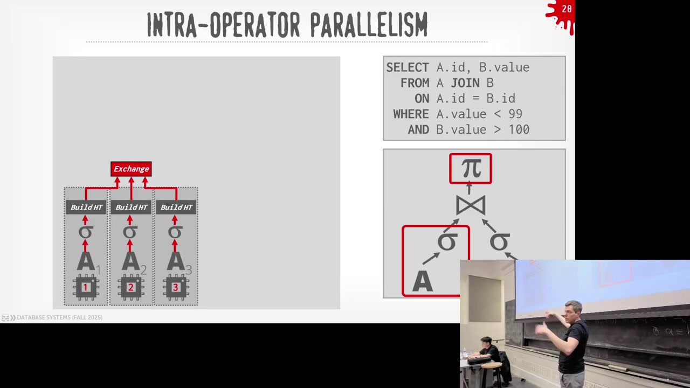
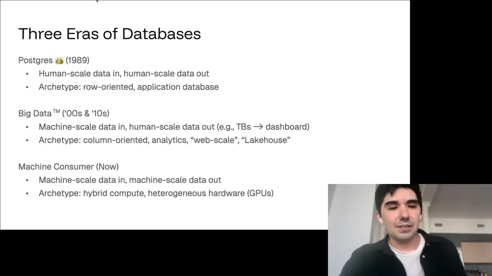
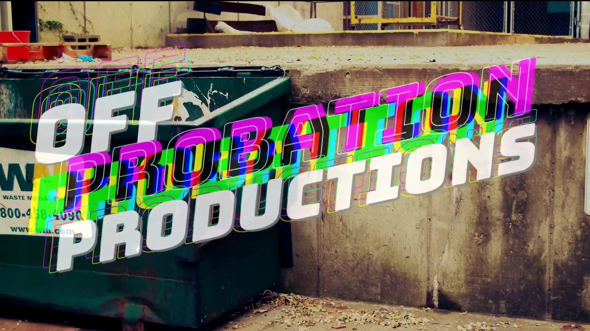

# 第14讲：一份计划，怎样交给多个 worker？

## 00:00–01:24 开场、期中试卷与作业日期

开头约半秒没有字幕，随后是音乐和零星歌词。音乐渐渐停下来，Pavlo 打趣说这倒是个开课的方式，请大家为 DJ Cache 鼓掌。今天要讲查询执行的后半部分，末尾还有嘉宾，所以直接进入正题。Project 2 这个星期日到期，习题课链接已经放出；这个星期六下午三点在 Gates 有额外的答疑。想查期中成绩、看解答的同学，今天课后四点可以去他的 office hours。

Homework 4 今天发布，11 月 2 日星期日截止；Project 3 也在今天发布，11 月 16 日截止。它的习题课在下周，具体安排另行通知。教师说动画弄坏了，先修一下。

## 01:24–02:20 DNS 出问题，为什么像是数据库倒了？

星期一上课那天，互联网发生了一次大的服务中断。教师问是什么原因，有学生答 DynamoDB。他接着区分：并不是数据库引擎本身停了，而是通向它的 DNS 出了问题。依赖它的服务用不到数据库，就跟着坏了一大片。这也是为什么要学数据库：现代应用层层依赖，顺着往下找，往往有个数据库是关键基础设施。DynamoDB 是有影响力的分布式键值／文档存储，教师用它引出一致性哈希；分布式的细节留到学期后面。

## 02:20–03:53 一套算子接口还没告诉我们谁来运行它

回顾上次课：计划里的算子实现相同的接口，比如 GetNext，或者遵循相同的传元组约定。于是我们可以把算子拼成树，数据沿着边流动，在顶端得到交还应用的结果。位置可以换，指的是接口接得上，不是随便换顺序还会得到正确答案；哪些变换保持查询含义，是后面的课。

上次有人问，如果几个线程同时跑这棵树怎么办？当时先按下不谈，是因为得先知道一次查询怎样执行。今天就拿一棵这样的树，把工作分给几个执行者。先局限于一台机器；期末讲把查询送到多台机器时，许多拆分与合并的办法仍然有用。

## 03:53–06:17 同一条 SQL，背后是笔记本还是一组设备？

物理数据库可以分布在多种资源上。这里先不把“资源”钉死：可以是机器、磁盘，也可以是一台机器里的不同内存区域。单核处理不过来，单盘放不下，单个内存区域或单机也可能装不下。增加资源一方面为了性能，另一方面，如果确实做了复制，机器或盘坏了还能有另一份。甚至可以在 AWS 外另设一套系统应对像刚才那样的故障，只是贵而且难，多数人不这么做。

回到声明式 SQL。写查询时我说要什么，不写“把这块数据从这台机器搬到那台机器”。在哪儿搬、怎样搬，是根据查询生成的物理计划要表达的步骤。开发时在笔记本上用 SQLite 或 PostgreSQL 放一个小测试库，生产环境可能是很大的机器，甚至是一个分布式系统。理想情况是 SQL 不用因此改写：应用看到的始终是一个逻辑数据库，不必知道里面切成了多少块。

## 06:17–08:56 本讲把哪些故障暂时拿掉？

教师把今天说的并行数据库限定为资源相距很近的情形；就当是一个机箱、机架中的一个单元。读内存、读同一条 PCIe 总线下的设备，通信既快又相对便宜，也假定可靠。从盘上取东西，一般能取回来；真着火了不在这个模型里。分布式系统不能作同样假设：可能隔机架、可用区、地域、数据中心。教师拿当时讨论中的 Starcloud 太空 GPU 开玩笑：地面与太空之间不但慢，消息还真可能不到。今天假定 worker 之间的指令、数据能送到，不处理丢消息。

安排依次是 process model（系统里怎样有多个 worker）、计划之间和计划之内的并行、I/O 并行。Project 1 的异步缓冲池／磁盘调度已经碰到一点 I/O；这次问还能怎样让不同设备同时工作。最后请 SpiralDB 的嘉宾讲 Vortex 文件格式；他上周做过一个研讨报告，这次是短版。

## 08:56–11:17 worker 不等于 thread

Process model 描述数据库怎样支持多个同时到来的操作、请求或查询。worker 是能替系统执行任务、把结果交回去的计算单位。不要把它只理解成“执行一条 SQL 的线程”：譬如日志结构存储在后台合并若干 SSTable，执行 compaction 的也是要纳入调度的 worker。今天先以执行查询为主。

教师有意用 worker，不直接叫 thread，因为实现不同。第一类是每个 worker 一个操作系统进程；第二类是在一个进程里用线程做 worker；还有一种不是同一维度的分类，即嵌入式系统，应用调用数据库，并把执行调用的 worker 带进去。新系统常见第二种；第一种有历史渊源，PostgreSQL 是例子；SQLite 有助于理解第三种。

## 11:17–13:28 一 worker 一进程：先分派，再执行

每个 worker 都是独立的 OS 进程，例如借助 `fork` 创建；它有自己的地址空间。操作系统看到一组可运行的进程，决定何时让谁占用 CPU。数据库可以让进程睡眠等，但要在这层之上精细控制执行，就得额外做事。

在黑板上的抽象模型里，应用先接触前端 dispatcher，不必知道背后有多少进程。教师以 PostgreSQL 的 postmaster 帮大家辨认这个角色。新连接进来，分派器给它安排 worker；示意图把后续交接画成告诉应用一个地址或端口、由它直接找那个 worker 发送命令。重点是工作交给了谁，不是要求所有产品照这幅图重新建连。不同进程要交换信息，可以显式共享内存，也可以用管道、信号之类的 IPC；PostgreSQL 用共享内存保存共同状态。为什么八九十年代的数据库不直接开线程？教师把问题留给学生。

## 13:28–15:23 为什么旧系统宁肯 fork？

在 Linux 上怎样创建线程？有人提到 `pthread_create`。教师接着问 pthread 中的 P，是 POSIX。当年的各个 Unix——BSD、HP-UX、AIX、Solaris 等——在线程 API 和语义上并不一致。想在每个系统上支持多线程，就可能要分别改线程实现和调度相关代码。相形之下，创建和管理进程的那组基本操作更早有共同约定，可移植性更好。放回当时的选择，就不奇怪早期数据库多用进程了。

即使在 PostgreSQL 的代码里也能见到按 Unix 变种分支的条件编译，但进程的大体行为可以依赖。一个今天仍基于 PostgreSQL 的系统往往继承这个结构：把贯穿全库的“进程之间怎样通信”改成线程模型，不是把 `fork` 换成一个函数调用那么简单。

## 15:23–17:37 一进程多线程；线程池还调度什么？

另一种方法是在一个进程里用 pthreads 或 Windows 的线程接口建多个 worker。它们在同一地址空间，互相看数据容易，不用专门跨进程搬；共享结构仍然要用之前讲的 latch 保护，否则两个 worker 照样会把状态弄坏。分派器可以直接把请求转给某个线程；如果每次都经它会成瓶颈，也可以安排连接此后直接跟某个 worker 通信。不管采用哪种接法，图里这些线程和 dispatcher 同属一个进程。

学生追问：“自己调度”是不是指使用线程池？是不是每来一条命令都要建线程？教师答，不是逐命令调用 `pthread_create`，可以复用池里的线程。更有意思的是，数据库可以在自己的任务间协作式让出执行权，例如用协程回到调度器，再选下个任务；暂停、恢复这样的工作通常比让一组进程配合容易。并非进程绝对做不到，而是要多建机制，还可能跟 OS 的调度打架。

## 17:37–19:12 有许多线程，就已能加速一条查询吗？

学生问图里是不是只有一台数据库节点。答：对，本讲按一个节点理解；到了分布式系统，每个节点照样可以有自己的一组进程或线程。又有人问，难道仅仅因为有许多 worker 线程就叫并行数据库？答：可以有并行，但现在还没说图里几条连线各做什么。它们是在跑同一条查询，还是一个 worker 各跑一条查询？几页之后才区分。

教师又以 Oracle 为历史例子：早年也用进程，后来支持多线程，并提到 2014 年左右的变化。如今线程库的可移植性比当年好多了，很多部署又都在 Linux 上。这里是教师对趋势的口述，不用它判定具体版本、平台的默认配置。

## 19:12–21:45 应用线程走进数据库库函数，再沿调用栈返回

嵌入式不是“进程还是线程”的第三种互斥答案：变的是应用与数据库的边界。从命令行打开 DuckDB，看起来像在与数据库说话，其实命令行程序本身就是应用，正在调库。把 SQLite 嵌进 web 服务也是一样：请求已经在应用的一个线程上运行，这个线程调用 SQLite 后就进了它的库，在里面读取或写入数据库，取到结果再沿栈回到应用。没有一个远端 server 再给这个请求派一个 worker。

纯粹按这个模型，应用不调用，数据库便没有这份执行资源。教师举 Berkeley DB（后来被 Oracle 收购）、RocksDB、LevelDB 等嵌入式库说明调用方式；拿 SQLite 的常见调用路径来和常驻的服务进程作对照。DuckDB 则可以自行启动附加线程，不完全是这个极简模型。这里不要把“请求可在调用者线程上执行”误读成“所有这些产品都没有自己的后台线程”。

## 21:45–24:29 怎样选并行度？谁的故障会拖累谁？

有 worker 之后还有三个问题：在哪儿、何时、怎样执行一个任务？一条查询如果可以分给多人，究竟分几个？得看同时有几条查询、数据在哪儿、取数据的盘多慢。数据库知道任务的含义，也知道可用资源，能据此分配工作；OS 看到的是可运行单元，并不知道哪一段查询会产出下一段需要的数据。教师对比了会自己做比较复杂调度的 Oracle、SQL Server、DB2，和更多交给 OS 的做法。

线程切换和共享地址空间的成本通常较低；代价是一个 worker 发生段错误，整个进程都可能倒。用进程则有一层地址空间隔离，教师用 postmaster 可重新启动进程说明这一点。这不是“坏进程绝不会伤害共享内存”或“运行中的事务一定原地续跑”的承诺。最简单的愿望当然是写出不会崩的系统，可工程上得权衡隔离、开销和实现复杂度。除了一些延续既有架构的产品，教师观察到近二十多年的系统多采用线程。

## 24:29–26:59 能混合使用进程与线程吗？

学生问是否不宜两种同时使用。教师说听说过在进程之内再有线程的讨论，但没有把自己不确定的用途讲作既定事实。可以把前端 dispatcher 放一个进程，把一组 worker 线程放另一个进程；解耦之后甚至能把前端搬到别的机器。不过若只是一个节点，没理由为“同时用了两种”而多添一层，通常采用一个明确的模型。

接下来不论进程、线程，甚至多机，都有共同的问题：怎样切工作、到哪儿合结果。普通笔记本都已有多核，服务器可能有上百核，不能让它们一直闲着。多数系统至少能同时处理不同查询；人们特别强调“并行数据库”时，往往还指它能在同一查询内部做并行。两件事都成立，却是不同的能力。

## 26:59–29:42 查询间并行：多几个客人一起服务

Q1 到了交给 worker 1，Q2 到了交给 worker 2。若二者互不依赖，不必为了执行步骤相互传结果。调度可简单到先到先服务；若以后把事务考虑进来，也许会按事务之前已做多少工作来调整优先级，具体看策略。全是只读查询时协调相对少；共享缓冲池等内部结构仍要 latch，不能因为业务数据只读就任意改元数据。缓冲池在大家共同经过的地方还能做共享扫描、共享游标，减少重复 I/O。

若同时更新，就要回答谁先写、谁看得见谁写的东西，这要等第 17 讲起再讲。现在只要记得：一台机器可以同时回答很多查询，不代表其中一条长查询会变快。教师拿常见的 MySQL 执行路径举例：给它一千个核，若单条计划仍派一个 worker，它还是只用一个核。PostgreSQL 则是两种并行可同时具备的例子。产品举例服务于这个区别，并非穷举所有版本和执行路径。

## 29:42–32:29 查询内的生产者和消费者

一条查询里，有的 worker 在计划下方产出，有的在上方消费。怎么切 pipeline 决定了消费者能否一收到就做，还是只能等所有生产者结束。横向切，让多个 worker 跑同一段计划、吃互不重叠的输入。纵向切，让不同 worker 同时跑计划的不同段；如果上方必须等下方全部做完，过早派一个 worker 在上面空转当然没意义。

回想分而治之：很多关系算子都能拆，先把输入分桶，再让 worker 各做自己的桶，而不必一个 worker 挨个跑。拿之前的 partitioned／Grace hash join 来说，第一遍按哈希分区也能并行；接下来让不同 worker 各拿到一对对应的分区做连接，等值键已经被路由到一起，独立分区之间不用为了找匹配互问。还可选择多线程共同访问一张大哈希表或各用独立表；不能把“可以并行”与“状态一定私有”混为一谈。

## 32:29–35:29 横切算子：还缺一个收齐结果的地方

教师把接下来的三种形状排在一起：intra-operator 是横向，inter-operator 是纵向，教材另外说的 bushy 则可以把两者合起来。第一种最常见，第二种使用场景少一些；复杂的组合往往出现在较复杂的企业产品里。SQL 仍不必声明“我要哪种并行”。

以横向为例，可以按页把数据分开，也可以按列值划分。不相交的输入各有一个算子或流水线实例，每个都执行同一套操作。问题是：上层怎么知道底下的工作已经做全？教师先引入最简单的 **exchange**：在这里设置屏障，等所有预期的孩子都报告完成，再告诉上层可以继续。这是物理执行机制，不是关系代数里多出了一种逻辑操作。其他技术语境也会见到 gather、merge、scatter/gather 等名字，PostgreSQL 则有 Gather 和 Gather Merge。

## 35:29–36:39 为什么必须等齐？学生指出一个反例

学生问：如果已经有一部分结果，不能先往上交吗，为什么 gather 非得是屏障？教师先让大家回想 pipeline breaker：有些计算确实要全量输入。学生继续确认也有能边到边送的情形，教师明确同意，并修正读图方式：先假定这幅入门图里的 exchange 阻塞，后面会放松这个假设。**是否换 worker／汇流，和是否要等到输入结束，是可以分开问的。**

## 36:39–39:54 三路建表，何时才能探测？

板上的查询按 `A.id = B.id` 连接 A、B，分别保留 `A.value < 99` 和 `B.value > 100` 的行，最后输出 `A.id, B.value`。先把 A 分为三份。是页范围、值范围，还是按键散列，不影响此处“每个 worker 恰好拿一份”的说明。三个 worker 同时做各自的扫描、过滤、build，把留下的行放入例子里那张共享哈希表。向上汇聚的在这里主要是**完成信号**，不是要把刚建的整张表又搬给 exchange。教师说图上这条线若画成控制线会更贴切。

约 38:05，原片课堂画面：三个 build 实例还没有变成三个有完整 A 输入的哈希表。它们合作完成的是本例的 build 状态。

等三份 A 都结束，再安排三个 worker，可以重用原来的人；现在各拿一份 B，先过滤，再同时读已建成的表，命中便投影输出。上方还得知道所有探测 worker 都结束了，才能宣告整条查询完成。为什么第一次真的要等？若 B 中的键已来查表，而负责把对应 A 行插入的 worker 还没来得及做，一次未命中就是假阴性。计划除了算子树还有依赖信息，调度器据此让 A 侧先做，不靠碰巧的启动顺序。上方要等“全部结束”才可关闭结果流，并不强制它等到最后才发第一行。

## 39:54–42:28 Exchange 还能一分多，或三路变两路

刚才的 gather 是多路进、一路出，可以只形成一条输出流，不一定非得全量缓存。反过来的 **distribute** 是一路进、多路出：不需要知道下面是什么算法，只要拿到它发来的元组，就可以按规则发到不同 worker。第三种 **repartition** 是多路进、多路出，输入几路不决定输出也得几路。前半段需要三个人扫大量数据，后半段也许只要两人，完全可以在这里从三路变两路。教师采用 SQL Server 一类的用词，各系统名字可能不一样。

多开 worker 不是免费的，发送、接收和协调都有代价。教师用 Google 的 Dremel／BigQuery 体系说明：在阶段边界重新安排数据，就有机会根据当下的工作量增减下一阶段的节点。单机也是这个道理：十个 worker 扫描和过滤，若过滤掉绝大部分，后面两个 worker 就可能够了。回到同学的问题：上下游环节能不能消费已经到达的部分结果，才决定这个边界是否需要当屏障。

## 42:28–45:51 纵切：连接在下面找匹配，昂贵函数在上面算

如果上层能随到随算，不同算子就可以在时间上重叠，不必先完整物化一份中间结果再交接。流处理是一个容易想到的例子：输入不是某一时刻有固定长度的表，而是不断进来的事件流。查询可以持续运行，每五秒输出一次当前结果，或在看到股价超过 100 美元时触发输出。如果非等“所有数据都来了”，可能永远等不到。

换回刚才的连接，假定最终投影要调一个很贵的用户函数（UDF），比如哈希之后再哈希、反复计算。一位 worker 负责连接，有匹配便把元组交出；另一位不断读取这些中间行、算函数并输出。它不必等整次连接结束。如果暂时已经处理完收到的元组，而生产者还活着，消费者应等待对方通知有新输入，不是把暂时空队列当作结束。

学生问这是不是流水线。教师说，是；当然也能把投影和函数留在做连接的那个循环里。拆开可以重叠运行，却增加了工人之间的数据传送，可能要复制；全融合在一个循环中就免了这一步。纵切是在用交接成本换并行机会。

## 45:51–48:29 树的独立枝条可以一起做，是否一定更优？

最后一种是 bushy parallelism。既可以让不同 worker 在不同输入上做同样的事，也可以让不同的计划片段同时执行。教师画了个刻意简化的例子：四个表 A、B、C、D，底部一支连接 A、B，另一支连接 C、D。它们各自可以使用 worker 工作，产生的结果再供上层建表、连接；底部的某一段内部还可以加并行度。这样不是只有一条从左下方一路向上的执行链。

学生确认图的含义。教师解释这幅图讲的是笛卡尔积：左支给 A、B 的所有组合，右支给 C、D 的所有组合，上面再组合二者。学生又问图是不是优化后的、是不是最优。答案要看数据；也许先做 A、B，再顺序接 C、D 更好。许多系统更常生成这种左深树，因为把所有 bushy 形状也纳入搜索，候选数会很快变大。今天的图是解释可调度性，不是替优化器宣布最优。教室摄像头一度转向学生，教师调整后问还有没有问题。

## 48:29–51:18 核有空，不代表盘也有空

如果是 CPU 瓶颈，多 worker 的确能让更多核工作。教师问常见的慢环节是什么，学生答磁盘。近年的本地储存快了许多，有的任务反而又是 CPU 瓶颈；但如果真的在等磁盘页，尤其要去 S3 之类远端拿数据，多开计算线程并没有增加设备带宽。I/O 并行的办法是把工作分摊给多个存储设备。

可以一库多盘、一盘一个库、一盘一张表，或把一张大表铺到多个盘。高级系统让管理员控制得更细；比如把恢复用的 WAL 放一个设备，表文件放另一个。PostgreSQL 的 tablespace 能控制部分落点。教师又以系统只看见逻辑文件路径为对照：管理员可以用符号链接之类把文件挪到别的设备，数据库却未必知道两个路径对应的物理特性。要不要自己掌握这些信息，牵涉到性能、故障之后还剩什么、为了让副本一致要等多久。

## 51:18–53:40 六页、三块盘：每页放一处，还是每处放一份？

上层可以寻址六个逻辑页，不等于知道它们在哪块盘。先看条带化这一端：把页轮流放到三盘，页一上第一盘、页二上第二盘、页三上第三盘，后面循环，类似 RAID 0。每个页只找一个盘读，也只向那块盘写。两个 worker 恰好要不同盘上的页，设备就可以同时服务。为突出这一点先忽略去内存的总线带宽。但坏了一块盘，六页中的三分之一便没了；那上面恰好是你的账户，可不是“还剩大半所以没关系”。

另一端是镜像，这个例子让三个盘各存六页。读任一页都能选任意一份，上层可以均分请求；写一页则三份都要改。本例的确认策略是各设备的持久化都成功，才向磁盘管理端报写完。于是读可以分流，写却要付出多份写入、保持同步、等待确认的费用。这是为了对比两个端点；现实设计不只这两种。

## 53:40–56:28 设备分条带，还是让数据库知道放置方案？

可以买带控制器的存储设备替你做镜像等。好处是透明：数据库仍看到一个逻辑文件系统，底下如何排布都由硬件处理。另一条路不是“在文件系统开软件 RAID”，而是由 DBMS 自己实现不同的存储布局。于是哪个磁盘放了什么、坏一块会波及什么，数据库可以据此决策。教师以 Oracle 等系统为例，认为这种办法更灵活，有机会更快，工程成本也更高。

权衡有三面：性能、持久性、容量。若数据库要 1 TB，三盘完整镜像不是凑若干小盘一共 1 TB 就行，而是每块盘都得装得下这一整份。银行、支付网络这类业务愿意花钱买容量，更纠结安全写入和性能；普通网站常常连 web 服务和数据库都放在同一台机器上，预算和风险完全不同。也不能因为盘贵就往库里不加选择地塞数据。到云上用对象存储，对用户而言容量很容易扩展，底层有人负责冗余；但读得到多少带宽、要开多大并行度、本地留多少缓存，仍是实际问题。

## 56:28–58:29 分区是一个逻辑表，不是让应用改查三个表

教师回头解释之前一带而过的 partition：拆的是互不重叠的集合。可以按一段段页、按值域，也可像哈希那样根据键分派；今后讲分布式数据库再细说。数据库若知道不同盘的存在，就能把一个逻辑表拆成自己分别管理、分别路由的物理段；理想上 SQL 依然针对原来的表，不需应用承担物理位置选择。

这和之前的存储模型也有关：行存把同一元组的属性靠在一起；列存则把各行的同一列放在一起。从“记录沿属性被分开”的意义上，可以把后者理解成纵向划分。不同部分能在不同页、文件甚至设备里。将来多机扩展时还会用到类似思想。这里的**纵向划分数据**与前面**纵向并行执行算子**不是一回事。

## 58:29–1:01:51 为什么数据库还要了解等待关系？

今天的手机都有比早期数据库服务器更多的核。如果设计只会一直跑一个 worker，多出来的资源并不会自动对单条查询有用。多 worker 不只为了同时算：一个在等磁盘或网络时，别的可以继续；涉及更新时，一个查询也可能得等另一个提交了修改才能做下一步。讲到这里播放设备短暂插入别的声音，教师道歉并暂停播放，接着说：数据库知道谁访问、谁修改什么，比只看可运行线程的 OS 更适合决定下一步让谁运行。这里还不是并发控制算法的展开。

下次回到 SQL 怎样变成物理计划。譬如刚才学生问的树形：要并行做 AB 和 CD 再合，还是先 AB、接 C、接 D？先 A 后 B，还是反过来？下周一先谈如何组织和搜索候选计划，周三再谈如何估代价。难点是执行前就必须下决定，却要等执行后才知道数据究竟如何流动。只能利用统计摘要去推断。教师调侃各家的优化器都可能选糟，区别在于会错到什么程度，别把预测当已经观测过的结果。

## 1:01:51–1:03:53 Will Manning：2005 年以后，增加的资源换了样子

Will Manning 接过来，自我介绍是 Spiral 的 CEO，说这和一周多前的报告有一部分重叠。他曾参与 Palantir 的 Foundry，希望这次是自己第二个成功的 EB 级数据系统。先从“古代史”2005 年讲起：大致那时 Dennard scaling 难以维持，不能再靠提高频率让单核持续变快。今天的 GHz 数与二十年前没有天壤之别，晶体管增长的红利更多体现为多核。嘉宾拿当年的手机游戏打比方，请看图中表示时钟频率的黑线与双核出现时的转折。

到 2015 年左右，业界还在学习如何管理这许多核，再到管理许多机器：Hadoop、Mesos，后来有 Kubernetes。典型设想是一个大的、较同质的资源池；习惯的速度层级是内存快于磁盘，磁盘快于网络。很多企业由自置机房向云迁移，嘉宾自己还记得在奇怪的地方上架服务器。他补充一则轶事：Mesos 和 Spark 出自同一实验室，Spark 起初是展示能怎样在 Mesos 上跑计算的例子；后来二者的流行程度却反过来了。

## 1:03:53–1:05:32 2025 年的设备：先问延迟还是带宽

现在机器越来越异构，GPU 通用计算大概不会消失。嘉宾开了一句钱都去了黄仁勋那里的玩笑。关键变化在于：刚才的速度次序对延迟仍有参考意义，**并不保证也是吞吐量次序**。某些配置中网卡提供的总带宽甚至高于某条 PCIe 链路；把数据由 RAM 复制到 GPU 未必比经网络搬大块数据有更高吞吐。这是对具体通路的比较，不是“网络访问总比读内存快”。

存储也分向两端：一端是底层可能仍用机械盘的对象存储，另一端是本地高速 NVMe（Non-Volatile Memory Express）。需要大量 GPU 的团队会向多家提供商要资源，多云变得常见；本地设施也在一些场景回潮，CoreWeave 之类面向新型计算需求的云受到关注。于是“一个大而同质的池子”不再是唯一适合的抽象。

## 1:05:32–1:07:42 三个时代，先问谁消费结果

在嘉宾的第一幅图景里，PostgreSQL 代表应用数据库：人规模的数据进、人规模的数据出。例如打开个人资料的一行，修改邮箱。它今天能做的事远多于此，但行存、面向应用请求仍是容易辨认的原型；早期每连接一进程之类的选择，也要放回其硬件年代看。

第二幅图景是 2000 年代后期至 2010 年代的大数据：自动化采集让输入达机器规模，输出往往仍给人看。TB 级输入也许最终就是仪表盘中的表或图。嘉宾提及 Pavlo、Michael Stonebraker 对这一段历史的讨论，没有在短讲中展开文章。曾经很流行的主张是抛开老办法，改用 MapReduce、数据湖、NoSQL。他把这看作对硬件从单处理器走向许多处理器的一批回应：确实迅速做大了规模，绕了一圈人们又发现有表结构很好用，形成如今所谓 lakehouse。嘉宾用 Hive 的蜜蜂／大象和“鸭子类型加胶带”的玩笑表达他对拼装复杂性的保留。

## 1:07:42–1:10:00 第三类消费方不是人，而是不断等数据的机器

当查询要把若干 TB 结果送出去，甚至追求每秒 TB 级供给，问题就不是“及时画出一张图”。GPU 训练的数据加载就是直观例子：输入机器规模，输出也是机器规模。异构计算从例外变成了设计前提。这是他放置 Spiral 的位置：面向机器规模处理**复杂数据**。所谓“非结构化”容易误导，图像、音视频、向量、张量其实都有非常严格的内部结构，只是传统数据库服务这些访问模式不够好。嘉宾提到慕尼黑工业大学一篇讨论“有 DBMS 为什么还要文件”的文章；他自己的判断是，很多人退回直接管文件，是因为现有 DBMS 没有服务好需求，并不证明文件管理本身更理想。

约 1:07:45 原片画面。中行的例子是 TB 变仪表盘，下行则是 machine-scale data out。这是在变更消费者假设，不是把旧系统简单按年份淘汰。

嘉宾把 Spiral 描述为面向对象存储的多模态列存，具有主键和索引，重视吞吐量。他举一个引人注意的演示目标：动态查询往 GPU 输送的字节／token 每秒数，有机会超过预先把同一结果物化成**本地 Parquet**再读的方式。这里讲的是他的演示对照，并非任何远端读取都快过本地。GPU 侧要接 PyTorch；使用者也常先在本地检查小工作集，所以还得和 Polars、DuckDB 等探查工具合作。

## 1:10:00–1:11:31 训练不是“有什么行就任意返回”

第一类工作负载仍是列式分析，即便做 AI 也常要过滤。第二类是查索引。嘉宾认为人们说的“向量数据库”常指保存向量索引的服务，可这并不是唯一的索引：还可能有倒排索引、二级索引，系统要维护它们，也要能查。第三类是让现成设计头痛的预训练：给一个密度约 50% 的 mask，必须恰好取指定的那半数行；再分 shard、打乱，在各组中按可复现的顺序加载。跨训练 epoch 要能够重现，不再是只要返回同一袋行就行。

要实现前面说的 GPU 供给速度，他们的实际途径是把字节从对象存储直接流出来。嘉宾把 S3 可扩展的聚合吞吐形容为“近乎无限”，想问的是请求够多、布局合适时能不能把网卡喂满；这绝不等于单请求无延迟或任何账户无限带宽。S3 上的字节究竟怎么排由谁定义？文件格式。因此他们要管的不只是数据库高层接口。

## 1:11:31–1:14:21 Vortex：文件格式为什么要有扫描算子？

上周研讨会有长版本，这里只作预告。他们想改进事实标准 Parquet，做了 Vortex；按讲者当时的介绍，它已是 Linux Foundation 项目，不是公司私有格式。“再发明一个标准就多一个标准”，嘉宾拿 xkcd 的漫画调侃；现在的确有好几种新格式，也提到不久前 Pavlo 在 Hacker News 的评论。他自认带有立场，认为自己的交点是开放治理、工业可用的实现和前沿技术；并不否认 FastLanes、F3、Nimble 等工作的技术价值。

与查询执行的连接在于，Vortex 实现了优化的 scan，并支持多种下推，不是只发给你一份布局说明书。它有一些查询引擎的能力；针对 CPU 有向量化执行，针对 GPU 则准备适合设备执行的代码。嘉宾说到“编译”时自己加了限定：对 GPU 这么说合适，不宜把 CPU 路径也一概说成同一类编译。如果有兴趣，可以看前一场报告或实际实现。

接着是**嘉宾报告的测试**：随机访问相比 Parquet 超过百倍，并拿专长随机访问的 Lance 对比；写入约五倍，扫描约十七至十八倍，文件大小大致相近但有波动。他最喜欢的例子是在 NVMe 上跑 ClickBench，经 DuckDB 查询 Vortex 的速度比该对照中的 DuckDB 原生格式还快。课堂没有给出足以在这里复现实验的全套版本、硬件与数据，故这些是有上下文的报告，不是本译稿独立测得的普适倍数。他又说计划在下一版 DuckDB 作为 core extension 随附，并邀请对文件格式和研究实现有兴趣的同学联系；公司在招人，去年有 CMU 毕业生 Connor 加入。教师请大家鼓掌。

## 1:14:21–1:16:44 两个追问：Spiral 与 Vortex、CPU 与 GPU

第一问：Spiral 和 Vortex 有什么区别？答：Vortex 是开放源码的文件格式，关心字节怎样落盘；SpiralDB 是建在这类基础上的托管数据库，还要编排事务、处理索引和制定查询计划。这些服务能力并不因为文件格式开源就都包含在文件里。

第二问：从 CPU 原生执行转到像独立计算机一样的 GPU，最大改动是什么？嘉宾说，算子和流水线这些概念本身并不新，向量化的历史也很长；谈其脉络时提到 VectorWise，顺口纠正了自己先前提过的系统名。真正特别的约束是：**对他们的 GPU 路径，希望在执行一个算子之前就知道输出的实际大小。** 于是怎样划 pipeline、某一阶段开始前必须掌握什么信息，都得围绕这个约束设计。减少数据依赖这类要求与 CPU 的 SIMD 路径也有共通之处；要预定输出大小，则是他们格外需要处理的一项。

Pavlo 接话：GPU、FPGA、CPU 或将来的新硬件会改变实现，但本课两讲的核心概念仍在。嘉宾用线性规划和单纯形作比喻：硬件变了，可行区域的约束跟着变，适合的解会被推到另一个顶点。因此数据库不一定“发明了新思想”，做出来却可能和上一代非常不同。此处是设计类比，不是对数据库计划最优性的数学证明。

## 1:16:44–1:17:19 制作字幕、音乐与最后一条 ASR

此后英文轨转为音乐标记与几段不完整的歌词识别，未出现可辨认的课堂问答；不把歌词残片拼成课程内容。原片短段中实见混音、音乐指导、制作监制、纪念题词，接着是制作标识。英文末条为音乐标记，止于 **1:17:18.818**。标题取整，并没有把自动字幕延长到整秒。

## 1:17:19–1:19:13 字幕之后，哪些是实际核到的？

约 1:17:19.5，从同一视频原片取得。这个画面能识别制作段，**不能只凭画面断言原声中没有人声**。

没有英文字幕的尾段是 114.182 秒，不是又讲了将近两分钟。精确分开看：

- **1:17:18.818–1:17:22.892472**：仍有音频信号。把这 4.074472 秒的原声与其他两讲实际保存的制作尾音按样本对齐，长窗和短窗都吻合，支持辨识为反复使用的预录片尾音轨；不是从字幕的空白猜“静音”。未辨出新的讲课或提问，不据此补译。没有逐字听辨歌词，也不声称完全没有人声或混音背景。
- **1:17:22.892472–1:19:12.544218**：解码原声连续 109.651746 秒处于 −60 dB 静音检测阈值下；末部视觉检测从约 1:17:22.850 开始为黑场，直至最后的解码帧。阈值以下不是宣称每个样本都等于数字零。
- **1:19:12.544218–1:19:13**：原声样本已终止，0.455782 秒是与元数据整数时长的差，不是另有可听可译的一段。

## 引用与来源

- CMU Database Group，Andy Pavlo；嘉宾 Will Manning，Fall 2025。该视频逐项元数据标注 Creative Commons Attribution license (reuse allowed)；[平台许可说明](https://support.google.com/youtube/answer/2797468?hl=en)解释署名与重用条件。视频原始入口及版权字段见[课程来源清单](https://github.com/socoo123/course_web/blob/main/content/cmu-15-445-2025/source-manifest.json)。不把这一标签外推到独立 PDF、歌曲或教材。
- 本页为英文自动字幕的中文逐段整理，合并口头重复并保留课堂问答；另截取原片三帧并加图说。产品例子、性能数字与课程安排均按 2025 年当时的说法。术语如 `pthreads`、`Parquet`、`Vortex` 依上下文与材料校正，不据自动字幕猜歌词。
- 时间标题是近似定位。0–0.654 秒无字幕，字幕内部另有 29 个间隙、合计 58.962 秒（未逐个听审，不能据时长判为静音）。覆盖并集为 4,579.202 秒。尾段按原声和画面另行说明，不从教材填词。
