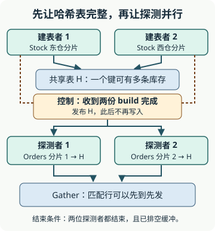
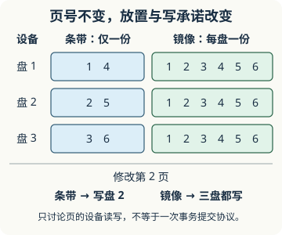

# 第14讲：等什么、分什么、最后卡在哪里？

把一条订单查询从一个核移到四个核，真正困难的不是把数组分成四份，而是回答：**哪一份数据归谁？哪一个未完成的状态会让另一个 worker 算错？哪条硬件通路会抵消加核的收益？** 下面用一笔订单可能匹配多个仓库的例子，把这三问一直追到结果端。

## 全片时间索引

| 原片时间 | 回看时要解决的问题 |
| --- | --- |
| 00:00–02:20 | 课程通知；为什么 DNS 使数据库不可达也会造成应用中断？ |
| 02:20–06:17 | 同一个算子 API 和同一条 SQL，分别藏起了哪一层实现？ |
| 06:17–08:56 | 单机近距离通信假设；分布式为什么不能直接沿用可靠交付？ |
| 08:56–15:23 | worker、进程、dispatcher；以前选 `fork` 的可移植性理由。 |
| 15:23–21:45 | 线程池和协作调度问答；单节点和单查询的区别；嵌入的是调用边界。 |
| 21:45–26:59 | 谁定并行度、谁共享地址空间、谁承担崩溃；混合模型问答。 |
| 26:59–32:29 | 多条查询并发与一条查询并行；分区连接中的独立性条件。 |
| 32:29–36:39 | 横切算子和 exchange；学生对“汇流一定阻塞”的质疑。 |
| 36:39–39:54 | 三路建表／探测：提前 probe 为什么会产生假阴性？ |
| 39:54–42:28 | Gather、distribute、repartition；为什么过滤后要减少 worker 数？ |
| 42:28–45:51 | 纵向重叠、无限流、昂贵 UDF；为什么不把投影融合进循环？ |
| 45:51–48:29 | Bushy 的两个独立分支；课堂追问树形是否最优。 |
| 48:29–51:18 | CPU 不是瓶颈怎么办？表、日志、库、路径和设备的区别。 |
| 51:18–56:28 | 六页三盘的条带和镜像；设备控制器与 DBMS 感知布局的取舍。 |
| 56:28–1:01:51 | 物理分区对 SQL 透明；等待与可运行；下周的计划搜索与估算预告。 |
| 1:01:51–1:05:32 | 嘉宾：频率增长放缓、多核和异构资源；延迟排序不等于带宽排序。 |
| 1:05:32–1:10:00 | 人／机器规模的输入和输出；Spiral 的目标与 GPU 数据加载。 |
| 1:10:00–1:14:21 | 50% mask、可复现 shuffle、直接读对象存储；Vortex scan 与嘉宾报告的对照。 |
| 1:14:21–1:16:44 | 两个问答：文件格式和托管服务的界线，GPU 的输出大小约束。 |
| 1:16:44–1:19:13 | 音乐、制作尾卡与尾部黑场；不是又一段算子课。字幕结束及信号边界见译稿。 |

时间按字幕转折定位，约到秒；不是全片逐帧标注。

## 1. 一台四核机器能同时做什么？先区分三个决定

**决定一：谁提供执行资源？** 在服务进程方案里，可以由 dispatcher 把请求分给独立进程，各地址空间通过共享内存或 IPC 协作；也可以在同一进程内用线程池，直接读共享内存但要维护 latch 与内存可见性。请求抵达嵌入式库时，调用本身已经在应用线程上；库还可以有自己的并行 worker。后者是**部署和调用方式**，不能推出“只用一个核”。一个线程的段错误可能带倒整个地址空间；进程隔离能缩小一些故障影响，但不保证共享状态无损。

**决定二：谁作任务调度决定？** OS 知道哪个线程可运行，DBMS 还知道哪个阶段正在等待 build、哪个要读慢盘、另有几条查询在抢核。复用四个线程不等于给每条查询再建四个线程。任务、执行它的线程、线程实际跑的核是三种对象；数据库选择任务与并行度，不等于它取代了操作系统的 CPU 调度。

**决定三：核给谁？** 四条各需一核一秒的独立只读查询，无竞争且四核可用时，可以约一秒一起做完，吞吐从每秒一条变成四条；单条的服务时间仍约一秒。这是 **inter-query**。如果只有一条长扫描，想让它本身快，就得把它的工作拆给多个 worker，即 **intra-query**。两者能同时存在，也会争用同一组核。更新之间的可见性不能靠多核自然解决；这是后面的事务问题，不是 latch 的另一个名字。

## 2. 把一份 SQL 结果当成多重集来验算

**编者自拟，不是原片数据。** 给每笔至少买两件的订单列出能单独满足数量的每个仓库。只读快照固定，`sku` 非空，先不考虑缺货时保留订单的外连接语义。

```sql
SELECT o.id, s.warehouse
FROM Orders AS o JOIN Stock AS s ON o.sku = s.sku
WHERE o.qty >= 2 AND s.on_hand >= o.qty;
```

| Orders：id | sku | qty |
| --- | --- | ---: |
| 101 | A | 2 |
| 102 | B | 1 |
| 103 | A | 5 |
| 104 | C | 4 |

| Stock：warehouse | sku | on_hand |
| --- | --- | ---: |
| 东 | A | 9 |
| 西 | A | 3 |
| 西 | B | 0 |
| 东 | C | 6 |

先写真值，再谈计划：101 可以选东、西；102 的购买量不够，先排除；103 只有东够；104 只有东够。输出 **四行**：`(101, 东), (101, 西), (103, 东), (104, 东)`，SQL 没有 `ORDER BY`，顺序不在承诺内。若索引或哈希表把 `A` 的第二个库存条目覆盖第一个，就算只有一个 worker 也会错。并行正确性是对**行及其重数**的承诺，不是对打印顺序的承诺。

### 共享 build 的正向执行和一次错误执行

1. 将 Stock 分成东／西两个不相交输入，分别扫描。向共享哈希表 H 插入：`A → [(东,9),(西,3)]`，`B → [(西,0)]`，`C → [(东,6)]`。概念上按键放一串候选；并发写同一桶的操作必须是安全的。
2. 等两个 build 实例都确认完成，且写入对探测者可见，再开放 H 的只读阶段。Orders 按不重叠分片扫描；各自先做 `qty >= 2`，按 sku 查 H，再逐条验数量条件 `s.on_hand >= o.qty`。连接条件选桶不能替代后续逐条判断。
3. Gather 接到匹配行即可往上送，直到两个探测者都报告结束且缓冲已排空，才向下游说 EOF。一次没收到下一批并不是 EOF。



图 1（编者重绘）：课堂 36:39–39:54 的 A/B 共建表例子，改成库存和订单。图中“完成”是控制信息，不是被连接的业务行。

**反证。** 西仓已插入，东仓尚未插入时就把 103 拿去 probe。H 中确实有 A，却只有库存 3；数量条件失败，输出为空。稍后东仓插进 9，即使哈希表每次读写都持 latch，`(103, 东)` 也不会自己重现。因此“查表没有数据竞争”不足以保证查询正确；还需要**何时可认定候选集合完整**的协议。可以设计不同的流式连接并补发后到的匹配，但那已不是这个一次探测算法。

## 3. Exchange 描述流向，不等于“全收完才能动”

| 边界 | 路数 | 必须保持的约定 | 不是它自动保证的事 |
| --- | --- | --- | --- |
| Gather | 多 → 一 | 所有分片的行都能到；所有输入结束才报全局结束 | 到达顺序等于键序；必须缓存全量 |
| Distribute | 一 → 多 | 按规则把记录送给应负责的下游；若是互斥分区就不能重发或漏发 | 每路一样快；分摊流量就保留原顺序 |
| Repartition | 多 → 多 | 按**下一阶段**需要的键／规则重划；输入和输出路数可不同 | 第 i 路一定送到第 i 路；开越多路越好 |

换一种实现：H 不共享，改为每个 worker 拥有本地表。若想让这个 worker 独立完成它那部分等值连接，必须对 **两侧按兼容的 `sku` 函数和分区规则路由**，让同一 sku 的订单和所有库存都到同一目的地。只把 Stock 按仓、Orders 按页分给 worker，再各自只查本地表，不满足这个条件。某一处理者可以在**它所需的分区**已完整、不会再来任何建表输入时提前开始；“全局屏障”是课上共享 H 的安全方案，不是每一种连接的物理定律。

**横切与纵切不要望文生义。** 同一段 `scan → filter` 在多个输入片上各跑一份，是 intra-operator（横向）；一人产生连接匹配，另一人边收边做贵 UDF，是 inter-operator（纵向）。两支独立子树可重叠、每支又能横向切片，是课堂说的 bushy 组合。依赖关系比树形名称更可靠：画出谁必须等谁，才知道哪里实际重叠。没有相等的优化搜索成本、选择率、内存等前提，不能从“可并行的枝条更多”推出“必为最优计划”。

**为什么需要有界队列？** 原讲说消费者没活时可以等；另一方向也要问：生产者比消费者快时谁等待？若每秒生成 120 批、只能消费 80 批，不限容量每秒会多积 40 批。限为 8 个待消费槽，初始为空且速率稳定的近似下约 0.2 秒填满；此后要对生产者施加反压。它不必等下游逐条请求才能生产，但不能无限领先。这个细节参照页底 Volcano 技术报告 §4.1；不是把全部行物化后再开下游。区分**收到一批、队列暂空、上游永久结束**，也是执行器接口的一部分。

## 4. 用关键路径而非 worker 个数估算耗时

以下是**编者算例**，忽略调度抖动，固定输入与算法。两阶段 build → probe，每阶段内部可并行、阶段之间有屏障。三位 worker 在 build 分别要 `4, 4, 10 ms`，在 probe 分别要 `6, 6, 6 ms`。总 CPU 工作量是 36 ms，但墙钟下界不是 `36/3 = 12 ms`，而是 `max(4,4,10) + max(6,6,6) = 16 ms`；另加分派、共享争用和交换的**非重叠**时间。若这些额外时间为 2 ms，实际模型为 18 ms；相对同算法无额外开销的单 worker 约 **2 倍**，并非 3 倍。若能无代价把 build 重分到 `6,6,6`，仍要 12 ms 加开销；若 10 ms 来自不能拆的热门键组，多派几个没有输入的 worker 并不能解决倾斜。

纵切要算的是**重叠是否值回交接**。例如 4 批串行经过连接和 UDF，每批各需 2、5 ms，单核融合无交接共 `4 × (2+5) = 28 ms`。两核独立、可流式、无交接成本时：首批 7 ms 完成，此后瓶颈阶段每 5 ms 完成一批，一共 `7 + 3 × 5 = 22 ms`。不是把 28 对半砍。若生产者每批多花 4 ms 复制且无法与本阶段计算重叠，两段变为 6 和 5 ms，完成时间变 `6+5+3×6 = 29 ms`，反而比融合慢。先说清数据是传指针、传批、还是复制行，再谈切 pipeline 的收益。

## 5. 为什么多三个 CPU 不等于多三条 I/O 通路？



图 2（编者重绘）：课堂 51:18–53:40 的六页布局。左图按页轮转；右图假定同步三副本写确认。页写不等于事务提交。

三盘各可顺序读 200 MB/s，且输入恰好条带均匀，设备理论合计 600 MB/s。但若控制器到内存只有 350 MB/s、CPU 解码最多 500 MB/s，端到端即使理想重叠也至多 `min(600,350,500) = 350 MB/s`。若 1,050 MB 全要经过三段，最乐观也要 3 秒；源都在一盘则最乐观约 5.25 秒。这个上界忽略了定位、小 I/O、排队、同步和结果输出，并不承诺一定达到。

- **条带**：三块同容量 D 的盘可提供约 3D 原始可用空间（忽略元数据）。丢一盘就丢相应那部分页，剩下的页仍在不等于整库可用。并发访问同一页所在的一个盘不会因为另两盘空着就自动变快。
- **全镜像**：三盘各存完整数据，可用约 D。读请求可分散到不同副本；本题要三份都持久化才算写完，所以把一次写同时发给三盘时，关键是最慢一次的完成时间，不必然是三个延迟相加，但确实消耗三次设备写流量。镜像不替代备份，也不替代事务恢复协议。
- **放置由谁决定？** 硬 RAID 或 OS 文件系统可以让 DBMS 只看到一个文件／设备；这不妨碍硬件并行，但 DBMS 未必能按真实设备排任务。逻辑分区可以把不同表、行集合、列或 WAL 放在不同位置，由 DBMS 维护映射。按 `sku` 重分查询**中间结果**、切**持久表**、将**物理块**条带化分属不同层，不能看到“分了三份”就等同。

## 6. 嘉宾为什么关心 GPU 能吃到多少结果，而不是一条结果来得多快？

Will Manning 的对比有一条清楚的因果链：数据输入自动化后，分析查询可以读 TB，交给人的却只是一张图；若消费者是训练设备，**要移出的结果本身**也可能是 TB，因而瓶颈会跑到 scan、解码、传输、排列和设备消费的交界处。描述“更快”前应先问：是首行延迟、全部输出时间、每秒送入 GPU 的有效 token，还是每秒扫描的压缩字节？

把课堂预训练例子具体化：给 1,000 万行中预定的 500 万行，不是从每批任取一半；再按约定分 shard，并让同一轮的 shuffle 可复现。同样条数、不同样本或顺序，已经是另一份训练输入。反过来，普通无 `ORDER BY` 的订单查询不要求凑同一排列。**结果契约不同，正确的 gather 就不同。** 嘉宾解释他们想在启动特定 GPU 算子前知道输出大小；编者举例，若过滤后有多少命中未知，就可能需要先计数，再确定各分片输出偏移、再写结果，或者改用另一种有容量与实际长度约定的实现。这是工程选项，并非所有 GPU 算子的硬性规律。

Vortex 文件格式／scan 解决“字节怎样排、哪些数据能跳过、怎样吐给计算”；SpiralDB 托管产品还管理事务、索引和规划。嘉宾说的“动态查询比本地 Parquet 预物化结果喂训练更快”是**按输出速率、在特定实现和硬件上的对照**。对象存储单个请求的延迟可能较大，许多独立请求却能提供高聚合带宽；链路再快，CPU 解码、过滤、GPU 接收也可能先饱和。课堂的倍数不构成不同数据、压缩率和配置下的统一保证。

## 7. 自测：判定依据比名词重要

<details>
<summary>1. 同时有 32 个活跃数据库连接，能断定正在进行查询内并行吗？</summary>

不能。一条查询也可始终只占一个 worker；32 个连接还可能有的在等客户端或 I/O。要看同一查询是否有多个同时推进的任务及其输入分工。先问“谁在 CPU 上”，再问“它们归属同一条查询吗”。

</details>

<details>
<summary>2. 在 Orders／Stock 例里，“每个订单只要找到一个合适仓库就停”错在哪？若按随机到达次序输出又怎样？</summary>

前者丢多重集中的行：101 的 2 件东、西都满足，SQL 要两个仓库；103 只有东够。无条件停在第一条还可能遇到不合格候选。后者在本题无排序要求下可以，但必须保证每个合法匹配恰好输出一次。输出重数、是否匹配、输出顺序是三项不同检验。

</details>

<details>
<summary>3. H 的每个桶都由 latch 保护，为什么还需要阶段完成协议？</summary>

latch 使访问到的当下状态在物理上安全，并不预言还有哪些行尚未插入。西仓先建完、东仓还没写 A=9，订单 103 即使安全读到 A=3，仍将错误认为无解。等所有可能贡献这个键的 build 输入封口、使写入可见，才可把一次未命中当最终未命中。

</details>

<details>
<summary>4. 收到生产者甲的 EOF，乙的队列眼下为空。消费端能返回总 EOF 吗？</summary>

不能。乙暂空可能只是慢或被反压。跟踪每个上游的终止状态，且要排空已发布的末批。只有无人还会发数据、缓存中也没有数据，才能报全局结束。反过来，若没有排序等约束，不必等全局 EOF 才把甲早已命中的行交给客户端。

</details>

<details>
<summary>5. 订单按 id 二分，库存按 warehouse 二分，两边各自的“第 0 分区”能直接本地等值连接吗？</summary>

不能。从订单 id 或仓库名看不出同一 sku 在哪一侧分片。本地表会缺失合法匹配。可按相同 sku 规则重分两侧，或让每个探测者看见完整已建表；第一种要付路由成本，第二种要处理共享／复制成本。若 `A` 占九成，哈希路由还能正确，却可能把大部分工作堆在一个目的地，正确性不等于负载均衡。

</details>

<details>
<summary>6. 在两阶段时间题里，把最后一个 probe 任务从 6 ms 优化成 2 ms，为什么墙钟时间可能不动？</summary>

原 probe 三个都是 6 ms，新值为 6、6、2，阶段最大仍是 6 ms；build 最大仍是 10 ms。该优化减少总工作量，但没有缩短这一次查询的关键路径。腾出的 worker 如能及时运行别的查询，吞吐仍可能受益，因此先选对指标。

</details>

<details>
<summary>7. 三盘镜像能承受一盘失效，等价于“三个独立写副本让写吞吐乘三”吗？</summary>

不是。一页的三次写是在完成同一份逻辑更新；若确认要求三份持久化，故障时还需另定是否降级的策略。三个副本能分摊独立读，但不产生三份独立的逻辑写容量。若条带化写不同页才有机会分别占用独立通路，又不提供镜像的冗余。

</details>

<details>
<summary>8. 如果网卡吞吐高于一条 PCIe 链路，就应把每次索引单行点查也搬到远端吗？</summary>

不能由带宽排出点查延迟的顺序。大规模连续产出可用并发请求摊薄启动时间、喂饱链路；单个依赖前一步结果的请求仍要付往返延迟。也应比较实际读取字节、解码和传输路径，而不是只看网卡的标称速率。嘉宾的目标是机器消费的大结果，不能直接替代小点查的评价标准。

</details>

## 引用与来源

- Andy Pavlo，CMU Fall 2025，[Lecture #14: Query Execution II](https://15445.courses.cs.cmu.edu/fall2025/notes/14-queryexecution2.pdf)，已读六页正文：§§1–3 资源与 process model，§§4–5 两层并行和 exchange，§6 存储布局。讲义先用阻塞示例解释 exchange；课堂 35:29–36:39 及 39:54–42:28 的追问澄清这不是所有 exchange 的语义。独立 PDF 的整译许可未核得，不复制 PDF 或逐页翻译。
- 编者补充：Goetz Graefe，[*Encapsulation of Parallelism in the Volcano Query Processing System*](https://digitalcollections.ohsu.edu/nanna/record/3876/files/csetech-193.pdf?withWatermark=0&withMetadata=0&registerDownload=1&version=1)，Oregon Graduate Center 技术报告 CS/E 89-007，1989 年 6 月。实际阅读摘要、§4.1 及 §4.2 开头：进程内拉取与进程间传包、结束标记和可选反压。原报告把同时计算不同子树归入 inter-operator 的一个方向；本课把 bushy 单列为可组合情形。抓住依赖和数据分工，不必强求两个分类表字面相同。这不是本讲指定阅读，也无全文译本。
- [2025 课程表](https://15445.courses.cs.cmu.edu/fall2025/schedule.html#oct-22-2025)指定 *Database System Concepts* 第七版第 22 章，仅核到章节定位，未取得／精读该章正文。讲者提及的产业基准、研讨会和其他论文未独立复现或通读，不能当作本页的独立测量。
- CMU Database Group，Andy Pavlo、Will Manning，Fall 2025；逐视频身份、Creative Commons Attribution 标签及原始 URL 见[课程来源清单](https://github.com/socoo123/course_web/blob/main/content/cmu-15-445-2025/source-manifest.json)。2208 条英语自动字幕顺序读完，课堂帧与片尾原声只核有限片段，未作整片听审。订单数据、两图、定量推导与自测均为编者原创，不是产品实现或已运行的学生实验。
