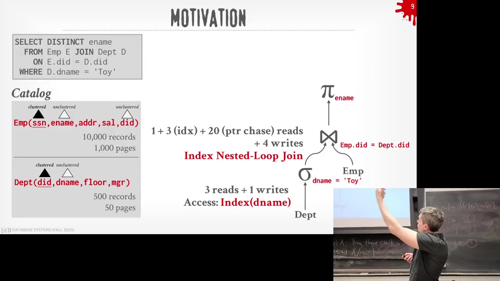
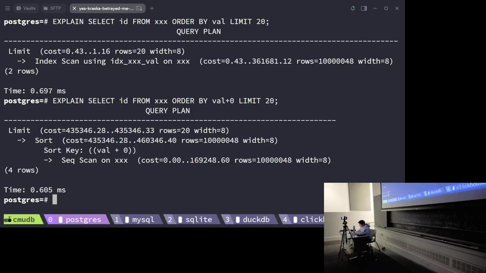
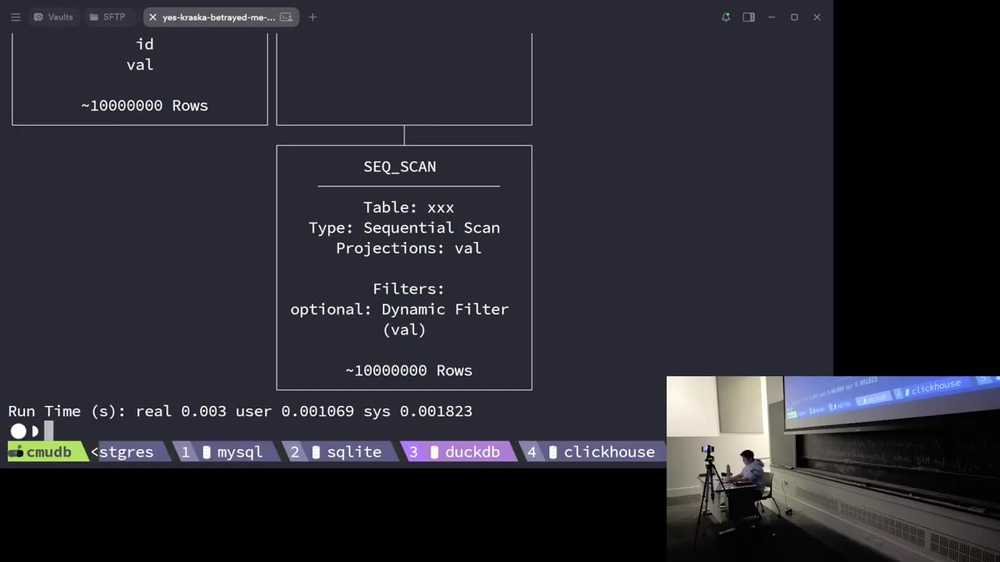

# 第 15 讲｜查询规划与优化 I：课堂逐段整理译稿

## 00:00–01:39｜开场、成绩与截止日期

开头是音乐，夹有零碎的人声。约 00:25，老师请大家给现场的 DJ 鼓掌，问周末过得好不好、赚没赚到钱；答话是「赚了不少」。老师接着说：昨晚交完 Project 2，希望大家休息好了。期中试卷仍可在周三的答疑时间来看；若要申请重评，拍下相应题目发给他。HW4 是接下来这个星期日（11 月 2 日）截止；上周发布的 Project 3 是 11 月 16 日截止。明晚八点在 Zoom 上有项目辅导，通知已发 Piazza。

**学生问：** 排行榜按哪一列计分？**老师答：** 最右边、也就是最后一列。若页面默认没有据此排序，点列头，必要时再点一次切换方向。还有没有关于作业或项目的问题？

## 01:39–02:38｜课后的数据库报告

今天 4:30 的研讨会，请来的是之前给本班介绍 SingleStore 的那位嘉宾。老师记得，上回来讲那天正遇上公司被私募股权公司收购，这次则是收购后的报告。一周后的嘉宾 Ryan Johnson 是 CMU 数据库方向的博士校友，在老师来 CMU 之前毕业，现在在 Databricks 做 Delta Lake。它与之前聊过的 Iceberg、Hudi、DuckLake 属于相关的一类技术。下周二中午的数据库组会还会请 Uber 的人讲他们怎样用 Apache Pinot。

## 02:38–04:07｜上一讲留下了哪一个黑箱？

上周一直在造运行时，也就是查询执行引擎。上一讲具体说到：不同 worker 同时处理数据的不同部分或计划的不同部分，Exchange 把这些结果分送或收拢，最终产生查询结果。可我们总是从「假设已经有这么一棵计划树」讲起：树上写着如何访问表、用什么算法连接，执行器只管照做。这棵树是谁写出来的？

本周要走相反的方向：应用程序或人交来一个查询，我们怎样给已经造好的那些部件安排工作？今天以 SQL 为例，它是查询关系表的事实标准；从声明式语言推导可执行计划的许多思路并不依赖 SQL 独有的语法。

## 04:07–05:56｜先把名字解析清楚

不论应用是用什么语言写的，接到数据库后先发来 SQL。第一步和编译器课一样：词法、语法分析，把各个 token 组织成抽象语法树（AST）。树上写着「访问名字为某某的表」，此时那些名字还是字符串。接着 binder 查目录（catalog），把表名、列名、函数名等绑定到数据库内部的对象标识；例如 PostgreSQL 有 OID。如果 `SELECT * FROM blah` 中的 `blah` 根本不存在，应在这里报错，而不是到执行时才尝试读一个不存在的表。

单独读一张 `foo` 表容易；嵌套查询中同名该指哪一层？同一张表自连接时，同名列属于哪边？真正费工程功夫的是这些作用域和歧义。今天不实现绑定器，假定它已完成名字到对象的映射，也知道所访问列的类型和表的模式。

## 05:56–07:46｜逻辑计划、物理计划、执行引擎

绑定之后，可以说「读这张表，做聚合，按这一列排序」，却还没有说用哪种算法去做。这是**逻辑计划**。优化器收到它后，结合模式、目录里的统计量和代价模型来比较可行的办法。模型中可能有固定系数，用来表达顺序扫描相对索引扫描等路径的消耗。算完之后优化器交出的是「我找到的最好的物理计划」，这才交给上节课的引擎，让它安排执行。

今天盯着架构图上的 optimizer；下节课再盯 cost model。二者经常配合，但并不是所有优化器的每个决定都靠估价。解析和绑定也很重要；只是今天的重点是怎样提出备选、怎样说一个备选比另一个好。

## 07:46–08:58｜玩具部有哪些不重复的员工名字？

要找出玩具部员工的姓名，而且同名只输出一次。SQL 的意思是把 `Emp E` 与 `Dept D` 按 `E.did = D.did` 连接，限制 `D.dname = 'Toy'`，再取 `DISTINCT ename`。目录告诉我们有哪些表，主键是什么，哪些键有聚簇或非聚簇索引。这里员工是 **10,000 行、1,000 页**；部门 **500 行、50 页**。至少要知道查询提到的模式与可用索引。老师插了一句：数据湖之类的环境甚至可能连这些信息都不齐，但这个例子不考虑它。

## 08:58–10:52｜直译成关系运算，为什么会达到两百万次 I/O？

按最机械的办法翻译：叶子读两表，先做笛卡尔积，`ON` 和 `WHERE` 里的条件变成上层两个过滤器，最上面才投影。再把执行器也故意做得很笨：每个阶段完成后先把结果写到临时文件，下一阶段重新读进来。于是一个员工先与所有部门各配一次，不管是不是同一个 `did`。第一份临时结果 T1 可以大到百万页；再读回来，删掉部门号不相等的，写临时结果 T2；随后读回、筛玩具部、再写。顶层还有几页输入和一页输出。只为取得一小份姓名，这个计划做了约 **200 万次页 I/O**。

**编者注：** 扫员工时口头一度说成 5,000；目录、画面和该例的乘式一致用 10,000。`10,000 × 500` 是行对数，不是页数；课堂假定笛卡尔积中间页每页约装 5 对。这里以及后面的数字都是模型中的页访问，不是运行计时。

## 10:52–13:00｜换连接、换物化边界，分别省掉什么？

第一个改进不是换过滤条件，而是让连接一边扫描一边只输出键相等的行。这里用按页的嵌套循环连接；仍然要写临时文件，但不再写出所有员工与所有部门的组合。下个过滤器要读的东西少了，最后仍是那批玩具部员工。总数从约 200 万降到 **5.4 万**。还可以更好吗？

保留同一逻辑，给排序归并连接 50 个缓冲页，换掉嵌套循环，估算降至约 **7,000**（图示 **7,159**）。注意我们还在为算子边界付钱：把上一步的全部结果写到文件，等它写完，下一步再全部读回。上节课称之为物化模式。改为按批把能传的数据向上流水传递，中间文件的这几次写、读就消失，降至约 **3,000**（图示 **3,151**）。这不是「归并排序再也不必访问磁盘」；省的是这些算子之间的往返。

## 13:00–15:15｜把过滤放到能使用索引的那一边

**学生：** 把过滤往下推。**老师：** 对，还有连接两边的次序！先按部门名索引查 `Toy`，再拿少数部门键到员工侧做索引嵌套循环，而不是先把员工全表都送进排序归并。图上部门查找是三读一写；员工侧还得查索引、沿指针取匹配记录，接着是中间写入和最终投影。合起来这个例子是 **37 次 I/O**，不是整个查询只需三次读。

约 13:42，原片截帧。右下是教室；图左是两表的目录，右边部门过滤已在连接下面。「20 ptr chase」表示沿着索引条目的指针取员工数据，不是又扫描 20 个部门。

**问：** 怎么决定谁在左边、谁在右边？**答：** 这里部门名有索引，部门表才 500 行。还要有值分布的知识，才能估出按名筛完只剩多少；假如大部分人都在同一部门，结论可能不同。先抓少数部门，再让它们去探测另一边就划算了。选择率的细账下节课讲。**又问：** 查这些统计量本身不要 I/O 吗？**答：** 要，只是这里略掉了。统计量比实际数据小得多，通常能留在内存；实现上它们也可以就是表，访问有自己的 I/O、锁等开销，锁下周再说。

## 15:15–17:16｜优化发生在你按回车之后

我们更改了谓词位置、物理算法、连接输入方向，SQL 的问题没变。你在终端打开 SQLite、DuckDB 或 PostgreSQL，像做 HW1 那样敲下 SQL，它就要现场做某种这样的选择，再真的去执行。简单查询可能整个只用十来毫秒，其中花在规划上的也许约一毫秒，人觉得是一瞬间；复杂查询就不是这样了，所以之后要讨论何时停搜。老师觉得有趣的正是：这不是预先写好的路线，而是你按回车后系统才把路线造出来。

今天先补优化器的背景，再看怎样变换和枚举备选，然后分两大类：不询问代价模型的规则／启发式，以及基于代价的搜索；后者又有两种方向。新系统常先做前者，项目成熟后才做后者，但转向代价搜索也不会把已有的规则全部丢掉。

## 17:16–19:32｜可以改写，不能改答案；不可能把所有计划都跑一遍

优化器拿到绑定好的逻辑计划，可以先生成其他逻辑计划；交付时却一定要有明确可运行的物理计划，不能只说「把 A 与 B 连起来」，得说用哈希还是归并等办法。它的第一责任是保持与原查询等价。不然干脆直接返回一个 `1` 或 `NULL`，当然极快，却毫无用处。因此每条变换都应有理由保证结果正确。

即使只选连接顺序，优化问题都可能是 NP-hard。平常很多查询没有连接，有连接的常常也就几张表；难点是长尾。老师见过最多约 **1,500 张表**的连接，不是人手打的，是仪表盘上点了许多按钮后生成的。指数规模的空间必须裁剪。谁来判断哪些备选更好？代价模型。理想中，不管人还是大语言模型生成了多别扭的 SQL，优化器都能找到好计划；稍后打开实际系统，就会发现人眼觉得显然的事，它也可能认不出来。

## 19:32–21:42｜逻辑节点和物理节点不是逐个翻译

还是用连接来讲：逻辑节点指定要什么，物理节点写出具体怎样实现。一个逻辑节点未必只换成一个物理节点，一次变换也可能把几个节点收成一个，或者把一个分成几个。还不能只记录输出有哪些行；某些物理性质会影响下一步。若上层要求排序，要知道谁提供了这个顺序：归并连接？单独的排序？表本来就有序？还是按索引次序读出来的？输出是否已经满足所需性质，会改变其他候选的价值。

## 21:42–23:01｜为什么今天一次只优化一条 SQL？

把一条查询当成一座岛，先不考虑同时运行的别的查询。有其他查询争资源，确实可能使某个算子的代价改变。另一种更强的问题是一次收下多条 SQL，安排重叠的工作，或让一条直接消费另一条的结果，有点像之前的共享扫描。可普通应用不会预先告诉系统「我将依这个顺序运行这整批查询」。以前提到的 dbt 是反例，它能给出查询的依赖图，因而有跨查询优化的机会。这里讲的是常见的一个查询进、一个计划出的情形，不做多查询联合求解。

## 23:01–25:08｜三个部件各回答哪一个问题？

**变换规则**说：目前这段逻辑还可以写成什么逻辑、实现成什么物理算子？**搜索算法**说：有这么多步可走，下一步该试哪个位置、哪条规则，如何根据已经看见的结果继续？**代价模型**才说：这两条路线，哪条预计更合适？

老师问，想最准确知道跑一条查询要多久，怎么办？学生答「跑一遍」。对，但若有十亿个可能计划，总不能全跑；跑出了第一个正确结果，本来都可以交给用户了。通常只能用模型近似。老师以 MongoDB 某类候选试跑、沿用表现好的计划作对照：方法简单、有时管用，复杂情形不会因此消失。他半开玩笑说，各家的优化器都有短板，问题常常只是相对而言谁坏得少一点。今天把精力放在前两个部件，估价专留下一讲。

## 25:08–27:31｜变换发生在计划树上，不只是改 SQL 字符串

一条规则可以在逻辑计划上动手，也可以把逻辑部分落实为物理实现。搜索中间的计划甚至可以一半是逻辑算子、一半已经是物理算子；课堂里主要不是在两个具体物理实现之间直接做改写。目标是拿到若干语义等价、值得继续看的替代路线。

**学生：** 这就像 rewrite rules？**老师：** 对，是针对计划这个树／有向图结构的重写。我刚才稍有犹豫，是因为还有一种完全不同的「重写」：例如看见 `SELECT * FROM 某视图` 的 SQL 文本，先在字符串层面替换成别的东西，再送进后面的处理。这种字面匹配也有人做，但容易出错，不是我们眼下这张图上的规则。

变换得到的计划可能立刻更便宜；也可能暂时更差，只是打开了原先无法使用的一串规则，最终反而更好。凭什么允许我们这样改？因为可以让规则立足于关系代数的等价式。我们不指望靠算一遍输出样例来猜两边总是相同。

## 27:31–29:54｜拆合取、交换过滤；学生追问「总是可以吗？」

若在关系 `R` 上用的是 `P1 AND P2 AND … AND Pn`，可以先让一个选择算子只检查一项，再一个一个检查其余的。全都成立的行才能过关，因此拆开后就可以独立挪动各个过滤器。例如 `P2` 既便宜又能踢掉许多行，先做 `P2` 再做 `P1`，最后留下的仍是那批行。**问：** 那可不可以又合并回去？**答：** 当然可以。

**问：** 选择算子能跟任意其他算子换次序吗？**答：** 老师在这节课所画的树中允许相应交换，特别排除外连接：某一侧找不到匹配时，究竟是哪一步补出 `NULL`？改变位置就可能改变答案。经典关系代数的基本例子不带这种 SQL 外连接，今天先不展开。

**编者注：** 这不是「除了外连接就任意交换」。条件所需的列必须在移动后可见，还要维持聚合、`LIMIT`、非确定性表达式等的原有语义。例如「先取前十行再过滤」不能普遍换成「先过滤再取前十行」。

## 29:54–32:56｜有些式子规划时就能算；连接次序却多得数不完

`x=3 AND y=x` 里，利用传递性，可以让第二个比较直接检查 `y=3`。看上去只是改一个记号，实际执行时却可以拿寄存器中的常量比较，不必为每条记录再取另一个变量。`x=1+1` 可以先折叠成 `x=2`；若 `YEAR` 的输入是固定日期（投影举的是 2025 年 10 月 27 日），也不该对十亿条记录提取十亿次年份。

回到本课限定的内等值连接。交换输入，`R ⋈ S` 与 `S ⋈ R` 找到相同的匹配；改变结合次序，也可以先连其中另外两张表。实际算法会对谁作外侧、谁作内侧敏感，所以统计量能派上用场。**学生提到笛卡尔积，老师答：** 类似的代数性质也有，但能用连接谓词时，别白算一个乘积；若用户真的要求交叉连接，那是另一回事。

假设一次只接两份输入，`n` 张表仍有很多种叶子排列，还要乘上不同的二叉树形。若把每一种都展开，时间根本不够。因此有系统会跳过没有必要的叉积，有的只考虑特定树形。System R 宁肯错过某个真实的最好方案，也要把规划时间降到能接受的范围。

## 32:56–34:56｜致敬专辑：一条大过滤器怎样变成两个内连接？

现在不用估大小，先来做逻辑到逻辑的变换。要的是录过 DJ 的致敬专辑的艺人姓名。涉及三张表：`ARTIST`、记录参与关系的 `APPEARS`、以及 `ALBUM`。直接翻译出来是三表做叉积，再用一个大过滤器检查三件事：艺人 ID 等于参与记录的艺人 ID；参与记录的专辑 ID 等于专辑 ID；专辑名是 `'Mooshoo Tribute'`。先沿表达式树的 `AND` 把它们分成三个过滤器。为什么拆？各自依赖的列不同，最低能到达的位置也不同。

第一条连接条件可挪到 `ARTIST × APPEARS` 正上方；专辑名过滤只依赖 `ALBUM`，可一直推到它的扫描上方；另一条连接条件放在能同时看见对应列的位置。现在树里出现了很有用的局部模式：一个叉积正上方就是连接两边的条件。把二者合成一个带条件的内连接，其他位置也按同样方式改。不必先知道它会用哈希还是归并。

## 34:56–37:54｜投影也能下推，但不要剪掉稍后还要用的键

最终只输出 `ARTIST.NAME`；若表很宽，没必要把无关列一直带进连接，尤其没必要带过必须物化中间结果的算子。于是艺人侧提前保留 `ID, NAME`，参与表保留两端的 ID，专辑按名过滤后只需保留用于匹配的 ID。在低一层完成匹配后可以再剪列。省不省，取决于执行模型、数据形状和宽度；不是看见一个投影就一定要为它加一次拷贝。到这里改变的都是逻辑结构，仍没有定物理连接方法。老师打趣说，除了别随便用 `mmap`，这学期至少还要记得：能用条件连接时不要去物化叉积。

规则的数量取决于系统成熟度。老师估计微软公开讲过约四五百条，还说他最近在微软看到过用大语言模型找人没有想到的新规则的工作，稿子将出；许多候选竟然是对的。这里是当时的口头见闻，不是说模型产出的规则天然就正确。

重写也不一定一对一：刚才把两个节点并成一个连接；一个顶层投影又引出了好几个下推投影。有些规则像单行道，把不必要的叉积去掉后，不必保存它的来路。另一些规则则不能扔掉旧候选：如果往下走发现这条路没有好处，还需要回溯。

## 37:54–41:11｜连接顺序是幻灯片碰巧这样画，还是用户指定的？

**问：** 图上把 `ARTIST`、`APPEARS` 先连接，是有意选的？**答：** 这里只是演示这么画，没有证明这个次序更快；比较大小、决定该先连谁，需要代价信息。早年的 Oracle 倒真有过按 `FROM` 中列出表的次序决定连接次序的做法，并把它称作「语义优化」：好像写 SQL 的人特意把希望的次序编码进去了。老师说，实际上写查询的人往往根本没有这样的意思，稍后再给大家看当年的说法。

**问：** 如果我确实想指定次序，有 hint 吗？**答：** 有些系统可以。PostgreSQL 默认没有这种通用的内置 hint，有像 `pg_hint_plan` 这样的扩展，把指令放在 SQL 注释中；可以要求某种连接次序、哈希连接、选某个索引。MySQL、Oracle、SQL Server 等的支持和写法不尽相同。优化器作出明显不好的决定时，这是一条纠正的路，但指定的人得明白自己在干什么。

**问：** 老师自己认为 hint 有价值吗？**答：** 有。只说「去把优化器修好，不应该需要 hint」并不能救所有当下的查询。但它是双刃剑。早年 CODASYL 那类写法，应用把访问路线写死；hint 可能又走回这条路。当时某表很小，指定某种连接确实快；数据分布变了，应该把方向甚至算法调换。十年后接手应用的人只看到一堆 hint，原作者已经离职，没人知道假设是什么，原本的优化就成了坏计划的保证书。

## 41:11–43:23｜不知道运行时参数，还能选计划吗？

搜索器应用变换、产生逻辑或物理备选，必要时问代价模型。但也可能只是规则用光或预算花完就停止，未必每一步都打分。另一个麻烦是信息不完整：预备语句像先给查询起名，之后才像调用函数或 RPC 一样传实参。若系统希望先备好一个物理计划，规划时它怎么知道这个参数会匹配一行，还是几乎所有行？一个简单思路是用平均情形，但连可靠平均值都依赖统计量；有时连统计量也没有。

一种办法是持续套启发式规则，直到无规则可用、打满预算或发现反复循环；这是不少新 SQL 系统最容易迈出的第一步。另一种办法是在候选之间作代价搜索。虽然叫「更成熟的办法」，IBM 在 1970 年代做早期关系系统时就已经实现了它；今天先看规则，并不意味着真正的代价搜索不用启发式。

## 43:23–45:50｜静态规则既好调试，又可能顽固地做错

举个物理选择的简单规则：过滤条件是主键等于一个给定值，而目录里有主键索引，那就让扫描变成索引查找。谓词／投影下推，安全时的 `LIMIT` 下推，也是开发者可以事先写好的规则。连接顺序甚至可以朴素到跟随 SQL 文本，或只看两表的粗略行数决定方向。某一步究竟还叫「规则」还是已算一个极简的代价模型，有时只是用词分界。

早期 Ingres（Postgres 的前身）、早期 Oracle，以及不少没有继承 PostgreSQL 或没有接入 Apache Calcite 之类优化器框架的新系统，都有这条路线。简单查询规划快，断点跟着执行就能看清触发了哪些规则。缺点是很多决定不过是写死的直觉和常数：处理一两个节点尚可；一旦连接很多，表间的依赖、中间结果怎样向上传播，都不是一条局部经验能看清的。

## 45:50–47:55｜「魔法常数」究竟魔法在哪里？

**问：** 什么叫魔法常数？**答：** `WHERE id=123` 且 `id` 是主键时，走索引没什么悬念。但若是范围条件，比较整表顺扫和索引扫描，要看返回多少行、数据怎样分布、顺序读与随机读分别多贵。若规则写成「顺序 I/O 比随机 I/O 快若干倍」，那个倍数从哪里来？硬件和数据都会变。你已经在做一个代价模型了。代价模型一样有校准问题；纯启发式下常数的依据往往更难说清。

老师希望把规则写成能组合的结构，不一定非得造领域专用语言；他说 PostgreSQL 很多地方就是一串 `if/else`。**问：** 为什么不写成 DSL？**答：** 难，改一个已经长成这样的优化器也难。**又问：** 模型是否只优化一个参数？**答：** 不。I/O 可能是磁盘也可能是网络，两者越来越快后 CPU 甚至可能成为瓶颈。更细的权衡下次讲。

## 47:55–50:03｜「好」是响应快，还是云账单低？

**问：** 老说挑好计划，「好」是什么意思？**答：** 多数系统关心性能，人直观感受到的是钟表过了多久。但把若干页 I/O 精确换成多少毫秒很难，所以很多模型用合成的代价单位比较，而不是预报秒表读数。也完全可以把云上花的钱作为目标，并非所有系统都这样做。

老师展示写 Larry Ellison 的书中一段采访，回到早年 Oracle 的故事。Stonebraker 讲到，它曾依据查询文本里表的先后定连接顺序；宣传时却说这是尊重用户书写次序的「语义」优化，把弱点讲成卖点。这是课堂讲的历史轶事，不是对今天 Oracle 的执行描述。

最后不要把两种方法当成非此即彼。可以先用一批可靠的规则做逻辑改写，剩下真正需要权衡的选择，再交给基于代价的部分。

## 50:03–52:34｜搜索过程中，哪一刻可以停止？

生成新候选后，与目前最好的估价比较。某分支一直很差，可以不再深挖；也可能允许暂时上坡，因为跨过眼前这个坡才有机会走向更低的代价。这只是搜索直觉，不是说查询优化器必用梯度下降。系统可以分阶段优化：先是各个单表的访问，再看连接，再看嵌套查询；也可以把更多选择一起考虑。

何时停止？一是给墙钟时间，例如 500 毫秒，一到就交出目前最好且可执行的计划。二是设代价门槛：假如在重规划，不妨找到比旧计划估价好 10% 的就停；或者在一段时间没有改进时停。三是所有允许的候选确实都看完了。像一个简单的 `SELECT * FROM foo`，不见得有多少方式可挑，不必等计时器响。「最优」在这里首先是相对于已经允许的候选和当前模型而言。

## 52:34–54:47｜为什么 SQL Server 的例子数变换，不数秒？

第四种预算是考虑／应用的变换次数。老师以 SQL Server 的做法提问：跟按墙钟时间截止相比，好处是什么？**学生先答：** 至少能考虑一次变换。**老师：** 是，不过实际阈值会大得多。**另一位学生答：** 不同硬件完成同样工作的耗时不一样。**老师：** 对，甚至同一台机器也会有空闲和满载两种情况。一秒内跑了多少条规则会随着 CPU 负载波动；若其他输入、规则、搜索次序都一样，按次数预算更容易得到可重现的计划。

搜索即使到预算，也得先有至少一个走到叶子、能够真的执行的路线。老师口头对照 PostgreSQL、MySQL 与 SQL Server 的实现风格：如果优化程序主要是一套命令式分支，就没有数离散变换那么自然。这里是在比较预算的理由，不是给所有版本规定同一条超时配置。

## 54:47–57:04｜有索引、能用索引、值得用索引，是三件不同的事

逻辑上只是「读表 foo」，物理候选可以是顺序扫描、某个索引扫描，或以前讲过的多索引组合。拿查询条件同目录里的数据结构匹配，再用统计量比较。若只有哈希索引却要做 `<` 或 `>`，它提供不了需要的范围访问；即使都匹配不上，顺序扫描仍是可以交付的后备计划。

术语 **sargable** 是 *search argument able*：条件形状有机会变成访问方法可利用的搜索条件。对简单过滤，似乎只需看一眼「这列有索引」就行；对排序，也似乎只需认出按键读已有顺序。但系统未必认得等价写法，认得也可能估出扫表更便宜。接下来开终端看实际例子。

## 57:04–58:55｜PostgreSQL：范围查找和直接按索引顺序取前二十

老师打开已填好的 `xxx` 表，看一条样例，核对规模约一千万行。`id` 是主键，`val` 是随机整数；除了主键索引，他还在 `val` 上建了 B 树索引。先不真正执行查询，在前面加 **`EXPLAIN`** 读它打算怎样做。按 `val` 的范围筛选并返回 `id` 时，用到了 `val` 索引，不是顺序读完整表。

**画面校订：** 实际键入的是 `val >= 123 AND val <= 456`（右端包含 456）。计划先 `Bitmap Index Scan on idx_xxx_val` 取候选位置，再由 `Bitmap Heap Scan` 回表；条件和估计行数 33,136 都显示在终端。这个数字不是实际交付了 33,136 行。

然后换一个问题：按 `val` 排序，只要前 20 条的 `id`。系统认出同一索引的访问次序就是要的次序，可以顺着读，满足 `LIMIT` 就停。老师转身看投影／摄像设备是否跟上，接着让大家看一个「人觉得当然、系统却不会」的改动。

## 58:55–1:01:12｜在排序键后只加一个零，会怎样？

还是取前二十，把 `ORDER BY val` 改成 `ORDER BY val+0`。`val` 是整数，我们觉得加零没有改变顺序。老师本来想请大家投票，却笑说自己已经把答案泄露了：这个 PostgreSQL 计划没有用原来的索引顺序。是不是建表时没写 `NOT NULL`？即使统计量里碰巧没有空值，优化器也没有按预期简化。老师决定直接试：删表重建，把 `val` 明确标成 `NOT NULL`，用 `generate_series` 重新填数据，等插入完，再为该列建索引。

原写法仍走索引；加零仍走另一条路。再执行 `ANALYZE` 去收表统计，现象也没有消失。这里是给优化器收集统计的 SQL 命令 **`ANALYZE`**，不是把 `EXPLAIN` 变成执行查询的 `EXPLAIN ANALYZE`。老师下节课才细讲统计量。

## 1:01:12–1:03:31｜为什么某行 cost 看起来比另一行小？

**问：** 为什么上面显示的代价反而小？**老师：** 先指出你在比较哪一条、哪一个算子。每个算子都有自己的代价；第一棵树用索引并有 `LIMIT`，另一棵要读整张表再对表达式排序，不能拿屏幕上任意两个数字横比。人会说整数加零没变，系统见到的却是表达式而非原来的列；在这次演示里，没有把它化为可利用的索引次序。

约 1:02:42，原片截帧。上方 `Limit (cost=0.43..1.16 rows=20)`；下方 `Sort Key: ((val + 0))`。`rows=10000048` 是对子树的估计，终端底部的毫秒数是这次 `EXPLAIN` 命令的时间，不能读成执行了一千万行的用时。

有同学追问：那加零、乘一，甚至加一千这类保持顺序的表达式，是否都应该继续用索引？能不能用一套系统的方法来做，而不是逐个特殊处理？老师说，对，这才是希望看到的原则性处理；但所示系统没有在此匹配到。有人提到部分求值很难，又谈到数据库编译器。老师说不是数据库系统绝无可能做这件事，他经验里的 SQL Server 可以处理此类例子，但现场没把它跑起来，不在这里冒充演示。

## 1:03:31–1:04:56｜「加一个常数没关系」要不要考虑溢出？

**学生：** 加一可能会溢出。**老师：** 对。假如能确定数据离上界很远，可设想这样的优化；可是统计量可能过期，系统有理由保守。如果只是需要一个排序次序，能否先照原顺序取，再做投影？若这样推迟了本来会溢出的算术，是应报错、舍入，还是另有结果？老师坦言不知道这里分别会怎样处理。这已经是 SQL 的具体类型语义，不是凭直觉写条规则就行。有人接着说舍入也很奇怪，老师于是临时拐去试强制类型转换。

## 1:04:56–1:07:26｜插曲：你投的是「4」「5」，还是「报错」？

老师先想拿 4.5，又改用 4.2，问转成整数应得 4、5，还是错误，举手投票。**画面上的单引号很关键**：PostgreSQL 中输入的是 `'4.2'::int`，报无效的整数输入语法；`'4.0'::int` 也报错；换成 `'4'::int`，返回 4。老师切到 DuckDB，再次请大家举手，同样的 `'4.2'::int` 返回 4，随后 `'4.8'::int` 返回 5。口头说的「4.2」并不说明输入到底是字符串还是数值，这正是例子的陷阱。

老师又试另一个系统（提到 Firebolt 和 PostgreSQL 风格的解析语法），没有得到可照搬的结论。`::类型` 是这两个演示环境都识别的记法。回 PostgreSQL 改用 `CAST(... AS INTEGER)`：单引号的 `'4.2'` 仍报错，误用双引号则被当成列名，去掉引号把数值 `4.2` 转换后才得到 4。老师又想起某种方言可能要写 `SIGNED`，一时没记准；终端切换／重启后，他笑说差点忘了最初为什么讲到这里。不能把这段演示记成「PostgreSQL 对任意小数转整数都会报错」。

## 1:07:26–1:10:02｜DuckDB：猜索引扫、猜一次顺扫，都没猜中

DuckDB 中已经造了同样的表和索引。先看范围条件，这次决定顺序扫描。再看排序取前二十：谁选走索引，谁选顺序扫？老师揭晓：有**两次**顺序扫描。其中一边只读相关值，做 Top-N；通过哈希连接与再次扫描表的另一边配合，找回要返回的行。这里只看一个 SQL 语句，计划里却不只有一次读表。加零之后仍选类似路线；这是这个引擎在这些数据与设置下作的选择。

约 1:08:13，原片截帧。这是树的一部分，不是完整计划；屏幕上列出了 `Projections: val` 和 `optional: Dynamic Filter (val)`。不能从这里的估计行数判定实际命中过多少行。

老师也实际跑来比较：他说 DuckDB 在这次并行例子中约 0.01 秒，即约 10 毫秒，而 PostgreSQL 的一个比较接近一秒；改了查询再试，仍有差异。**学生：** 难道不是在比较列存和行存？**老师：** 正是，我没说这是公平的基准测试。**又有人建议**强制某个访问路径再比；老师说他记得某些系统里的做法，不确定现场这个系统的 hint，没完成这样的对照。演示说明「索引未必是引擎最合意的读法」，不是哪家普遍快一百倍。

## 1:10:02–1:11:39｜搜索往上走，还是从要求倒着走？

**问：** 刚才说大家的优化器都有问题，哪家「最不差」？**老师答：** 依他的评价，德国团队的 Umbra 在自底向上方面很强，DuckDB 借鉴的是更早的 HyPer 而非直接照搬 Umbra；Umbra 又有后续论文和商业化系统 CedarDB，非开源。自顶向下他看好 SQL Server。他也提到偏向自底向上的理论比较，但自顶向下另有长处。这是他的评价，不是这堂课跑出的排行榜。

多关系的代价搜索，两端都可以起步。自底向上，先只有要读的基表，逐步找办法合起来，直到产生要求的输出；自顶向下，先写「我要这几张表的连接，最终还有这些要求」，再追问为了它必须产生哪些输入，一路走到能访问的数据。老师说光看他双手比划不容易明白，还是画树。

## 1:11:39–1:13:45｜用两表演示前向／后向推理，星形查询能否抄近路？

图上浅色是逻辑节点，深色是物理节点。以 `ARTIST ⋈ APPEARS` 为目标：自底向上先给两张表找读法，再逐层应用可行规则，直至到达连接结果，比较哪条完整路径估价低。反过来自顶向下，从上端的连接要求出发，先沿一个选择向深处走，直到叶子；至少要能交出一个完整计划。随后回过头查看另外分支的实现，再改进已知路线。老师只做方向对照，详细的自顶向下例子挪到下节课。这两个方向也叫 forward chaining 和 backward chaining。

还有一页老师快速带过：若识别出星形／雪花模式，例如一张事实表连着许多维表，可以用一种通常不错的树形作起点，而非完全从零探索所有树。是以查询结构帮助起步，并没有证明这棵起始树就是最优。

## 1:13:45–1:15:14｜System R 为什么限定左深树？

自底向上可以先用静态规则扫过，再用动态规划分而治之。老师看到时间不多，决定先讲完这一边。IBM System R 是早期基于代价的优化器：可把查询分成块，为各块找计划，再组合起来。1970 年代内存小、CPU 慢，为了让搜索可行，它缩小了树形空间。

只看左深树：先连 `A`、`B`，拿这个结果再连一张基表，再拿结果继续。不去尝试「左边先连 `A,B`、右边先连 `C,D`、再把两个中间结果相连」那种灌木形树，也不另枚举镜像的右深方向。老师当场猜测 PostgreSQL 是否仍有类似限制；这是口头推测，不能作产品版本结论。今天的核心是**主动放弃一批候选以买规划时间**。

## 1:15:14–1:17:28｜音乐三表：不是贪心选一次便宜的连接就结束了

先枚举三表各自的访问方法，结合目录挑出值得看的路线。然后按层考虑连接：例如 `ARTIST ⋈ APPEARS` 的实现可以用哈希、可以用归并；`ALBUM` 与 `APPEARS` 先连接又有自己的候选。图里画不下所有方向和算法，并不表示没画的在原则上就是非法。每达到一个子结果，让代价模型比较能产生它的物理路线，保留较好的。再拿已经得到的二表结果试着接剩下的一表：仍可以是哈希、归并或嵌套循环，再在各条路线中取舍。最后才比较到达三表目标的总路径。

老师中途在「最高／最低」间改口：若目标是最小化代价，就应保留估计**最低**者。之所以是动态规划，是因为逐层复用已求出的子问题，不必每次从叶子重新展开所有排列；不是说第一对表哪个最便宜就一条路走到黑。

## 1:17:28–1:19:00｜有序性、最优性与最后一个复杂度问题

还有个麻烦：逻辑树上只写连接，不自动记载数据按什么键排好了；例如哈希连接一般不提供想要的排序保证。若 SQL 还要求 `ORDER BY ARTIST.ID`，一个眼下便宜的路径到最后可能要附加排序。老师把这个处理讲成：对不提供所需顺序的路径记上排序所需的成本，再与本身有序的路径比较。

**问：** 所以保证得到真正最优计划吗？**答：** 不保证。**又有学生说：** 若只看左深树，代价就是二次的。**老师**口头表示同意，又说去掉灌木形、右深形确实大幅缩减空间；所有树形还牵涉前面提到的 Catalan 数。

**编者注：** 「只考虑左深」并不能推出一般的 $O(n^2)$ 时间界。有标签的叶子仍可换序；即使只按表集合缓存，大小从 1 到 $n$ 的非空子集就有 $2^n-1$ 个。System R 原论文也明确保留每一种有用顺序的最佳子计划，与无序加排序比较，并非它不知道顺序。本段保留课堂问答，复杂度计算和历史实现的界线见课程笔记。

老师致歉说这段讲得赶，周三接着回到这里、细讲自顶向下，余下时间讲代价模型。约 1:19:00 示意播放片尾音乐。

## 1:19:00–1:19:39｜制作片尾

原片转入音乐和滚动制作名单，之后出现制作标识。字幕只剩若干不连贯的音乐词片段以及 `[music]`；不据此拼接歌词或推测还有技术问答。页面时间止于视频的整数元数据。最后一个音乐提示自身的结束字段比这个边界晚 645 毫秒，**不是又讲了 645 毫秒**。

## 时间覆盖与辨认边界

下表统计相邻有文字事件取并集之后的内部空隙；不是说该范围整段没有字幕。开头另有 0.654 秒没有文字事件。属于音乐的提示也算文字事件，不能把「有事件」等同于「每个词都听清」，同样不能把空隙称为静音。

| 展示区间 | 内部空隙数 | 空隙时长 | 如何处理 |
| --- | ---: | ---: | --- |
| 00:00–10:00 | 4 | 13.476 秒 | 开场音乐碎词未拼成歌词；授课自 00:24.960 附近进入 |
| 10:00–20:00 | 5 | 6.078 秒 | 保留老师复述的两轮提问 |
| 20:00–30:00 | 5 | 4.027 秒 | 图／字符串改写、外连接追问按可辨意思整理 |
| 30:00–40:00 | 2 | 5.039 秒 | 不补造听不清的提问原句 |
| 40:00–50:00 | 4 | 12.080 秒 | 最长单处 47:52.280–48:00.000，无字幕，不判静音 |
| 50:00–1:00:00 | 8 | 9.083 秒 | 预算讨论及终端输入以相邻字幕和已核画面为限 |
| 1:00:00–1:10:00 | 24 | 40.061 秒 | 有操作、等待、学生插话；常量及计划名按实拍校订 |
| 1:10:00–1:19:39 | 10 | 25.788 秒 | 片尾抽帧可辨制作名单；无逐词听审 |

共 2,214 个英文自动字幕文本事件；首个开始 `00:00:00.654`，末个结束 `01:19:39.645`，原始并集 4,663.359 秒。按 4,779 秒页面边界截断，仅用于覆盖统计的并集为 **4,662.714 秒**；内部 62 段共 **115.632 秒**，开头另 0.654 秒，三项加起来正好是 4,779 秒。原始字幕保留重叠和超界终点，不把整秒元数据解释成最后一帧的精确 PTS。未逐秒听审全片，不用其他年份的录音补缺。

## 引用与来源

- Andy Pavlo 主讲，CMU Database Group 发布，*#15 – Database Query Optimizers Part 1 (CMU Intro to Database Systems)*，2025-10-28；官方视频入口在本页页头。[Fall 2025 课表：10 月 27 日，第 15 讲](https://15445.courses.cs.cmu.edu/fall2025/schedule.html#oct-27-2025)。本页为该录像的中文逐段整理、实拍截帧与编者校注；具体时刻按字幕和抽样片段近似定位，非逐字听译。
- 该条视频单独标记 *Creative Commons Attribution license (reuse allowed)*；[YouTube 对该许可的说明](https://support.google.com/youtube/answer/2797468?hl=en)及其所指 [CC BY 4.0](https://creativecommons.org/licenses/by/4.0/)。没有给其他视频、独立 PDF、教材或第三方音乐推定同一许可。
- Andy Pavlo，[本讲幻灯](https://15445.courses.cs.cmu.edu/fall2025/slides/15-optimization1.pdf)，投影片 6–9、17–23、33、39–41，用于校订目录、页 I/O、谓词和树图；[本讲课堂讲义](https://15445.courses.cs.cmu.edu/fall2025/notes/15-optimization1.pdf) §§1–12、14 供术语对照。真实课堂画面截自原片，非 PDF 页面替代。
- P. Griffiths Selinger 等，[*Access Path Selection in a Relational Database Management System*](https://doi.org/10.1145/582095.582099)，SIGMOD 1979，pp. 27–29；仅片尾历史校订，非课上宣读内容。
