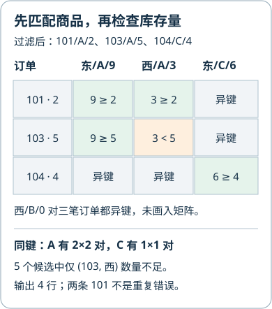
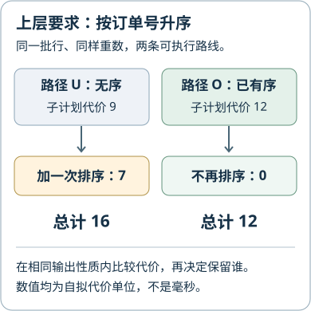

# 第 15 讲｜同一份订单结果，执行路线为什么差这么远？

优化器收到的是一个问题，而不是一套操作步骤。它要同时守住两件事：**换了步骤，答案不能变；为了找一个便宜步骤，也不能先付出穷举所有步骤的代价。** 最容易漏掉的是第三件事：中途得到同样的行，不代表在计划的其余部分它们一样有用。一份按键排好的结果，可能省去下一道排序。

## 原片索引：每段解决什么问题？

| 时间 | 回看片段要问自己的问题 |
| --- | --- |
| 00:00–02:38 | 音乐、课程通知、排行榜和报告预告；技术讲授还没开始。 |
| 02:38–07:46 | 从上一讲的 Exchange 回到 SQL 入口；谁解析名字、谁选择物理算法、谁实际跑？ |
| 07:46–13:00 | 玩具部员工例：消掉叉积和消掉中间文件分别省什么？ |
| 13:00–17:16 | 为什么是 Dept 在小输入侧？统计量访问本身算不算 I/O？ |
| 17:16–23:01 | 何谓同一查询的正确实现？排序为什么是物理性质？为何一次只看一条查询？ |
| 23:01–27:31 | 变换、搜索、估价三个部件怎样配合？哪种「重写」不是字符串替换？ |
| 27:31–32:56 | 合取分解、常量传播、内连接交换结合；哪些前提失效时不能搬动？ |
| 32:56–37:54 | 音乐三表：从叉积到内连接；投影下推如何沿树传递列需求？ |
| 37:54–43:23 | `FROM` 次序、hint 与预备语句：人或规划器究竟知道哪些信息？ |
| 43:23–50:03 | 静态规则、魔法常数和代价单位；「好」到底相对于哪个目标？ |
| 50:03–54:47 | 按墙钟、代价、穷尽、规则次数停止；怎样保证有完整候选可返回？ |
| 54:47–58:55 | 单表访问：顺扫、索引、位图；怎样从可利用的搜索条件进一步选路？ |
| 58:55–1:03:31 | PostgreSQL 的 `ORDER BY val+0`：统计信息与表达式匹配为何是两关？ |
| 1:03:31–1:07:26 | 溢出及带引号的小数强制转换：同一字符串能否代替同一数值？ |
| 1:07:26–1:10:02 | DuckDB 的两次扫描；一次演示不是行存／列存的公平基准。 |
| 1:10:02–1:13:45 | 自底向上与自顶向下从哪里开始？认出星形查询有什么用？ |
| 1:13:45–1:19:00 | System R 的子集搜索、左深树、有用顺序，以及片尾复杂度问答。 |
| 1:19:00–1:19:39 | 音乐与制作片尾，不是另一个规划专题。 |

以上为字幕事件和讲解交界附近的秒级索引，非逐帧切点。下文的订单、手算及代价数字若无特别说明均是**编者自拟**；员工数量级、终端观察和音乐三表路径是**课堂内容**。

## 一、先立契约：要让哪些东西相同？

假设应用要求「每笔买两件及以上的订单，可以由哪些仓库单独供货」。沿用上一讲的表和原始数据，而不沿用它的并行安排：

```sql
SELECT o.id, s.warehouse
FROM Orders AS o JOIN Stock AS s ON o.sku = s.sku
WHERE o.qty >= 2 AND s.on_hand >= o.qty;
```

`Orders(id, sku, qty)` 有 `(101,A,2)`、`(102,B,1)`、`(103,A,5)`、`(104,C,4)`；`Stock(warehouse, sku, on_hand)` 有 `(东,A,9)`、`(西,A,3)`、`(西,B,0)`、`(东,C,6)`。本例 `sku` 非空，读取同一快照。

先把正确输出写在纸上，不排序、不去重：`(101,东), (101,西), (103,东), (104,东)`。这样就有了具体的等价判据：任何合法的计划都要返回这个**多重集**。两个 101 分别匹配了不同的库存行，不是优化器可删的冗余。没有 `ORDER BY`，比较输出时不应要求打印顺序一致；反过来，若用户有排序要求，就不能用「行都在」搪塞。若改为 `SELECT DISTINCT`，还应证明去重在整个计划中确实得到执行，或者在约束下可证明已无重复。

从应用到执行分三道检查：**binder** 把 `o.sku` 绑定到特定表实例的特定列，解决的是名字和类型；**优化器** 决定怎样产生这个多重集，例如选索引嵌套循环还是哈希；**执行器** 真的打开数据、推进算子。空表也不会让一个不存在的列名变成合法输入。自连接里两个别名也绝不能因为指向同一张物理表，就被绑定成同一输入实例。

## 二、早做过滤并不是把所有谓词一股脑推到底

看每个表达式**用了哪些列**，比背「过滤永远往下推」可靠：

| 表达式 | 在哪儿第一次具备所有输入？ | 可作的改写 |
| --- | --- | --- |
| `o.qty >= 2` | 订单叶子 | 内连接下可提前筛掉 102。 |
| `o.sku = s.sku` | 同时看见两边 | 把叉积和紧邻的等值过滤合成等值连接；不要真的先展开叉积。 |
| `s.on_hand >= o.qty` | 同时看见库存量和订购量 | 作为连接的附加条件或连接后过滤；不能只看库存就删掉所有少于五件的行。 |
| `o.id, s.warehouse` | 顶层最终输出 | 临近扫描可剪掉无关的宽字段，但连接键、数量检查所需的列和最终输出列必须保留到消费完。 |



**图 1，自拟逐行推演。** `qty >= 2` 让 4 笔订单变成 3 笔。两笔 A 订单各遇到两条 A 库存，一笔 C 遇到一条 C，于是等值候选是 $2\times2+1\times1=5$。再做跨表的数量比较，`(103,西)` 不够，剩 **4**。若先连两张原表，再筛订单，则等值候选是 $2\times2+1\times1+1\times1=6$，多出了 B；若真做原表叉积，则先得到 $4\times4=16$ 对。16、6、5、4 各是不同阶段的**行数**，不该相加冒充 I/O。

可以作更细的局部决策。若两个均为确定、无副作用且不会报错的过滤器 `p,q` 各自单位输入成本为 $c_p,c_q$、通过率为 $s_p,s_q$，那么先 `p` 后 `q` 的期望评估成本是 $c_p+s_pc_q$；反过来是 $c_q+s_qc_p$。只要 $c_p(1-s_q)<c_q(1-s_p)$，先 `p` 就更省。由此可见：「选择率低的先做」还少问了一句——**为了拒绝一行，要付多少计算？** 这不要求两谓词的通过事件相互独立，但这里假定每次计算某谓词的平均成本不因先做另一项而改变。

**外连接反例。** 给一笔 D 商品订单，没有任何库存与之匹配。`LEFT JOIN ... ON o.sku=s.sku AND s.on_hand>=2` 会保留这笔订单，右侧补 `NULL`；把 `s.on_hand>=2` 从 `ON` 移到外面的 `WHERE`，补空的行在过滤时得到 UNKNOWN，被丢掉。两种答案不同。遇到外连接、聚合、窗口、`LIMIT`、有副作用或可能抛错的表达式，都应先重新问「等价对所有合法输入成立吗？」约束是证明；抽样统计不是证明。

## 三、估计多少候选，可能会改变先连哪两张表

上一节手算的 **5** 来自按键频数做点积，而不只是看总行数。写成式子，非空键的内等值连接有 $|R\bowtie S|=\sum_k f_R(k) f_S(k)$。优化器未必存得起两份完整频数表。举一个简化的均匀估计：假设两个值域有包含关系、同值出现的可能性均匀，才可能近似用 $|R||S|/\max(V_R,V_S)$，其中 $V$ 是不同值个数。过滤后订单有 3 行、2 个商品键，库存有 4 行、3 个键，套公式得到 **4 个等值候选**；真实是 **5**。这里的 4 只是巧合地等于最终输出数，绝不表示模型预测对了**数量过滤后的结果**。

为看清连接顺序的影响，再接一张小表 `Warehouse(warehouse, region)`：`(东,东区)`、`(西,西区)`，仓库名唯一；要求只要西区。先在两边做单表过滤，`O` 还有 3 笔订单、`S` 有 4 条库存、`W西` 只剩西仓。以下仅用**朴素嵌套循环的行对比较数**作一个能手算的指标，假定不建索引／哈希、不计扫描等固定开销；不是实际数据库的模型。

| 候选顺序 | 第一次连接 | 第二次连接 | 同一最终输出 |
| --- | --- | --- | --- |
| `(O ⋈ S) ⋈ W西` | 看 `3×4=12` 对；按同键和足量留下 4 行 | `4×1=4` 对再查仓库；共 **16** 对 | `(101,西)` |
| `O ⋈ (S ⋈ W西)` | 看 `4×1=4` 对；留下西仓 A、B 两行 | `3×2=6` 对再查同键和足量；共 **10** 对 | `(101,西)` |

第二个顺序利用了西区条件先削小库存输入；不是因为交换了 SQL 文本里的两个名字就天然快。若所选地区包含所有仓库，两条路径的中间规模就会变；若有覆盖索引、可共享哈希表或需要跨机器传输，**比较数相同也未必代价相同**。应明确区分四类数字：估计行数、真实行数、以某种模型算出的代价、实际运行时间。只有带执行观测的记录才能回答第四项。下一讲专门处理优化器拿什么统计、为什么会估错。

## 四、从两百万到三十七，省掉的工作不只是一种

课堂上问的是玩具部不重复员工名，员工 10,000 行／1,000 页，部门 500 行／50 页。若中间页可装 5 个员工–部门行对，笛卡尔积就是 $10,000\times500/5=1,000,000$ 页；仅把它写出来再读回去就已约两百万页访问。通过这种推导能发现错误直觉：输入才一千多页，**中间结果**却不受这个页数上限约束。

- **叉积再筛 → 带条件的连接**：保留必需的配对关系，却不写所有无关配对。课堂按页嵌套循环约 5.4 万次 I/O。
- **换物理算法**：同一等值连接改排序归并，给定 50 个缓冲页时图示总计 7,159。这里只换算法，不自动改变 SQL 语义。
- **去掉边界物化**：流水地传批，图示 3,151。排序或哈希内部需要的状态没有随之消失。
- **利用选择率与可用索引**：先按部门名定位，再用有限个部门键去探测员工。图上模型的三段是部门端 `3+1`，连接端 `1+3+20+4`，投影端 `4+1`，合计 **37**。这个结论依赖过滤结果少、索引可用、随机回表数量不大。若几乎人人都在玩具部，就应重算而非照抄数字。

这四步分别涉及逻辑等价、连接算法、算子之间的传输、访问路径及方向。把它们全部归结为「建索引」就看不出没有索引时还能做什么；把全部 I/O 减少归结为「向量化」也混淆了批处理与是否物化。

## 五、「能提供所需性质」本身就是一个候选条件

课堂终端是一个特别好的对照：`SELECT id FROM xxx ORDER BY val LIMIT 20` 的计划 `Limit → Index Scan` 能从已有键序直接读前 20 个；只把排序表达式换成 `val+0`，显示 `Limit → Sort → Seq Scan`。前者根的估计代价约 `0.43..1.16`；后一棵树的排序要等底下输入，根估计 `435346.28..435346.33`。这些值不是秒；下图也不应拿来对应这些数。

不同于「估计值错」，这里首先要问：**表达式提供什么次序，优化器有没有合法且实现过的规则认出来？** 就算两列的统计量一点没错，未枚举出的路径仍没机会被选中。反过来，能按键查也不意味着一定值得查。脚踏实地的读计划顺序是：先读根想要的行数和顺序，再从叶子追供给、回表、排序，最后看 `LIMIT` 是否真能使输入提前停止。Top-N 即使只保存少数候选，若输入无序，通常仍须看完有关输入。

在 DuckDB 演示里，计划选择两次顺序扫描与 Top-N/哈希匹配；第一次看见扫表并不能推断「优化器忘了索引」。行存、列存、并行、数据分布、索引支持的操作都不同。要拿两个产品的毫秒数作论据，请先交待数据、版本、查询、缓存和并发，而不是拿这段课上演示当通用排名。

## 六、分而治之时，为何不能只保留每组表最便宜的一个计划？

自底向上：先枚举基表访问，再把候选拼成两表、三表……自顶向下：先描述根需要的结果和物理性质，找能实现它的算子，再要求各子树满足各自的条件。两者都要产生合法候选，也都会遇到预算；方向不同不等于一个永远更快。录像只介绍了自顶向下的方向，详细规则搜索留给下一讲。

以只枚举左深树的动态规划为例，若不考虑输出性质，可记 `best[S]` 为「恰好连接表集合 S」的最低估算成本。最后加进来的基表可能是任意 $r\in S$，于是逐个比较 `best[S − {r}]` 和基表 `r` 的每种合法连接实现。不要把它误写成「本轮只选一次最便宜的二表连接，其他集合全丢掉」：下一步需要的可能正是另一个二表子集。

加上物理性质后，至少需要区分 `best[S, 顺序]`。想象同一子集有两种路线：U 成本 9 但无序，O 成本 12 但按订单号有序；根要按订单号打印，若 U 再排序需 7。整条路是 `9+7=16` 对 `12+0=12`，O 才是赢家。若上层根本不要求顺序，U 反而够用。一个子计划可被另一个安全淘汰，要考虑上层关心的全部性质，不仅是当前成本。



**图 2，原创示意，依据 System R 的 interesting orders 思路。** “无序”是没有可依赖的所需顺序保证，不等于每次输出一定被随机打乱。原论文在相同表集合上保留各有用顺序的最低代价方案，还会比较无序路径加排序。课堂幻灯展示的是没有在逻辑节点上标注这些物理性质的树，不宜据此断言原始 System R 忽略顺序。课堂三表图用哈希、归并等现代候选讲选择；1979 年论文实际分析的是 nested loops 和 merging scans。

### 左深树是二次算法吗？

不是。先声明计数口径：若 $n$ 个基表各有不同标签，区分连接的左右输入，暂不排除无连接条件的组合，且只数二叉树、不数每个节点的算法，则叶子排列有 $n!$ 种，满二叉树形有 $C_{n-1}$ 种（Catalan 数），合起来 $n!C_{n-1}$。当 $n=3$，枚举出来是 $6\times2=12$。若把某些交换视作同一候选、禁止叉积或固定外侧，会得到别的数；不要把不同口径混成一个公式。

限定左深之后，树形固定了，叶子仍可有 $n!$ 种排列。若改为上面的子集动态规划，忽略物理性质并把每个候选扩展当常数工作，非空子集有 $2^n-1$ 个。各集合分别试末表，候选扩展上界量级由 $\sum_{k=1}^{n}k\binom nk=n2^{n-1}$ 给出。**远比枚举所有树好，不是普遍的 $O(n^2)$。** 若只在一条贪心路径上，每步扫描尚未加入的表，才可能出现二次的比较数，代价是丢掉其他子集与可行路线。片尾问答中的「二次」不能作为 System R 子集搜索的复杂度定理。

## 七、什么时候应该停止优化？

若每次重写都允许再反向套回去，「套到不能再套为止」就可能没有终点。**规则集合**描述哪些替代是合法的；**搜索策略**决定访问顺序、如何避免重复、保留哪些子问题；**代价模型**才对候选打分。这三个部件都可能解释一个坏计划，不要一律怪估计。

- 整棵树尚不能执行，就还没有可交付的候选；因此即便预算紧，也要先有一条完整路线。
- 墙钟预算保护用户等候时间，却会随同一机器的负载剪掉不同数量的候选；固定规则次数更接近固定搜索工作，但不保证固定毫秒数。
- 成本门槛、长时间无改进、枚举穷尽各有前提。「穷尽」也只是穷尽**实现了的**规则和允许的树形，不是证明真实机器上没有更快算法。
- hint 能救当下，也能冻结过时假设；预备语句缺少实参，平均数可能看不见热值。先记录候选是没被产生、被搜索预算截掉，还是已被比较却输在估价，再决定改 SQL、改统计还是改优化器。

## 自测｜能否在不运行数据库的情况下解释计划？

<details><summary>1．有人把 Stock 哈希表写成 sku → 单个仓库，并声称结果行数更小所以更快。用哪一笔订单否决？</summary>

101 对 A 订两件，东仓 9、西仓 3，两者都应出现。只存一个会漏一行；即使查询没有 ORDER BY、看起来行顺序变化无妨，丢重数仍是不等价。先验答案，再谈耗时。
</details>

<details><summary>2．把 s.on_hand ≥ o.qty 改成在库存叶子上过滤 on_hand ≥ 5 呢？</summary>

不行，订购量来自另一边，不是固定的 5。该替换会删掉本来满足订单 101 的西仓 A/3。可以先做同键匹配再做剩余谓词；若从其他条件能推出一条必要但不充分的单侧下界，也仍须保留原条件复核。
</details>

<details><summary>3．订单过滤后，均匀模型说 4 行，最后输出也有 4 行，能宣布等值连接估对了吗？</summary>

不能。等值节点有 5 个候选，跨表的数量检查才丢掉一个。必须对照同一算子输出的同一语义阶段，否则误差会被下游过滤偶然抵消。
</details>

<details><summary>4．为什么「先加哪张表」不能只按基表总行数决定？</summary>

真正驱动下一次工作的通常是过滤及连接后的基数、重复键和访问方法。西区例的 `W西` 虽小，要先连能引用它的 Stock 才能去掉东仓；它与 Orders 没有直接的仓库键。把两个小表不问条件先做叉积，反而制造中间行。
</details>

<details><summary>5．某数据库没为 ORDER BY val+0 选索引。重新收集直方图一定能修好吗？</summary>

不能保证。首先要有合法的表达式化简或识别机制，把该排序需求映射成索引的键序。统计量通常在候选存在后才帮助比较成本；它也不能证明一个可能溢出的表达式对当前及未来所有行恒等。
</details>

<details><summary>6．每个子集只留最便宜者会错在哪里？再解释什么条件下能丢掉另一个。</summary>

图 2 中丢掉成本 12 的有序路径会迫使根走 16 的路线。只有当两个候选满足相同上层需求（或一个在所有相关性质上至少一样好），在相同估价口径下成本也不高于另一者，才有相应的支配理由。
</details>

<details><summary>7．四张表只搜左深树，为什么不能说「只剩四个候选」？</summary>

固定的是树形而非叶子顺序；有方向、忽略谓词连通等约束时仍有 24 种叶子排列。子集 DP 合并许多重复工作，但对四个不同基表仍有 15 个非空集合，还没区分算法与排序性质。
</details>

<details><summary>8．如何区别统计偏差、规则缺失与测量读错？</summary>

先确认所谓数字是模型代价、估计行数，还是真正执行时的行数／时间；再找第一处真实与估计开始分岔的算子。若希望的索引路径根本不匹配查询表达式，调大或调小某张表的估计行数也不能令它变成合法候选。若只有 EXPLAIN 而没有执行观测，则还不能就真实行数或耗时下结论。
</details>

## 参考与来源

- Andy Pavlo / CMU Database Group，Fall 2025 *Query Planning & Optimization I*，[官方课表与录像入口](https://15445.courses.cs.cmu.edu/fall2025/schedule.html#oct-27-2025)、[本讲幻灯](https://15445.courses.cs.cmu.edu/fall2025/slides/15-optimization1.pdf)（投影片 5–9、14–23、29–33、35–41）、[课堂讲义](https://15445.courses.cs.cmu.edu/fall2025/notes/15-optimization1.pdf) §§1–14。录像单条标有 Creative Commons Attribution；[平台说明](https://support.google.com/youtube/answer/2797468?hl=en)、[CC BY 4.0](https://creativecommons.org/licenses/by/4.0/)。讲义 §13 另示嵌套子查询的去关联与分解；本次录像未逐项展开，不反填进译稿。
- **课表指定阅读定位：** Silberschatz、Korth、Sudarshan，*Database System Concepts* 第七版，第 16 章。未取得／未翻译教材正文；不把视频许可推广到教材或独立讲义。
- **编者史实对读：** P. Griffiths Selinger, M. M. Astrahan, D. D. Chamberlin, R. A. Lorie, T. G. Price，[*Access Path Selection in a Relational Database Management System*](https://doi.org/10.1145/582095.582099)，SIGMOD 1979，pp. 27–29、示例图 3–6；[作者论文的 CMU 课程副本](https://15799.courses.cs.cmu.edu/spring2025/papers/02-systemr/selinger-sigmod1979.pdf)。只对照有用顺序、子集搜索与原系统的连接方法，不转载正文或插图；不是本讲另行指定的阅读。
- **编者产品对照：** PostgreSQL 18.7 [§51.5 Planner/Optimizer](https://www.postgresql.org/docs/18/planner-optimizer.html)，尤其 §51.5.1 的索引资格、访问次序及多表搜索。文档描述的基于 `geqo_threshold` 的搜索方式也提醒我们，不要把课上对某产品的随口猜测当成所有版本的实现保证。此文档非课堂演示数据库的版本鉴定。
