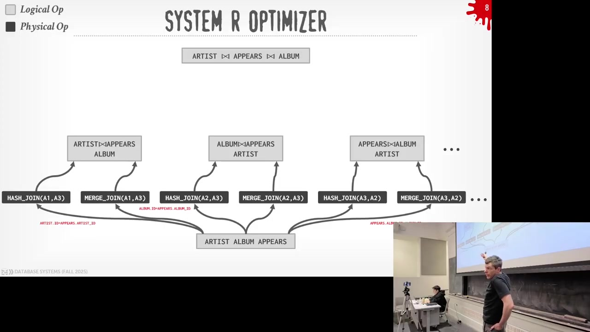
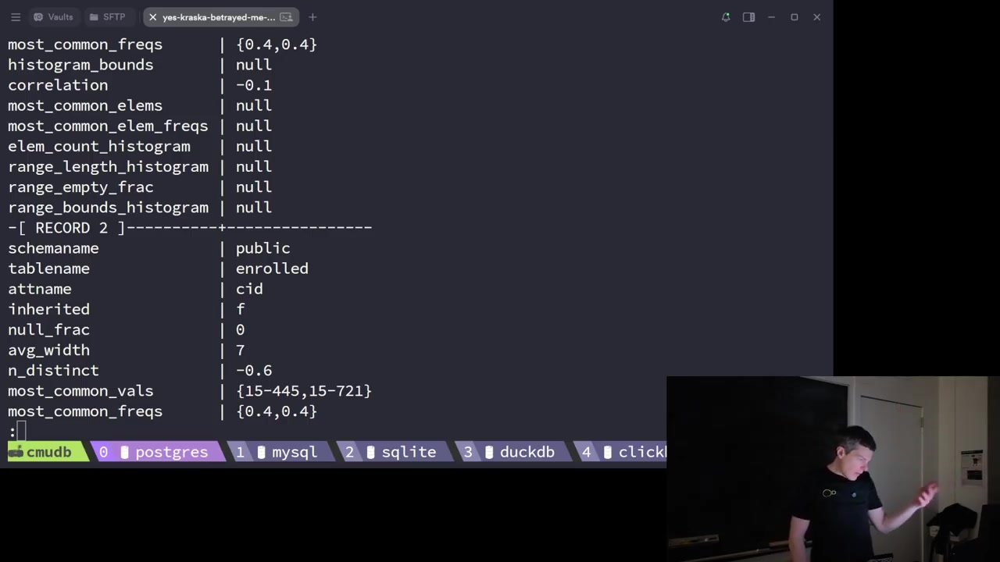
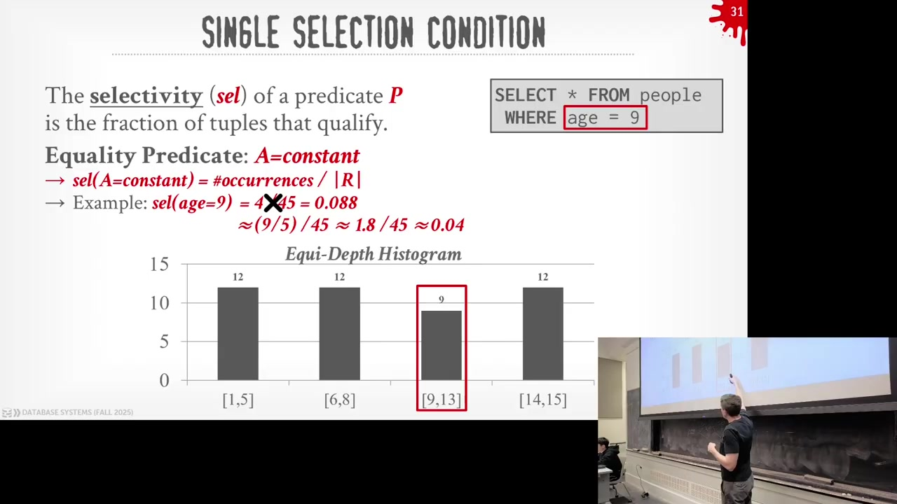

# 查询规划与优化 II：逐段整理译稿

## 00:00–01:08｜开场与上次没讲完的事

开场是音乐，中间有一小截人声，字幕认出的词不足以还原歌词。约 00:25 开始说话：“各位，开始了，给 DJ Cache 一点掌声！”老师跟他开玩笑，问银行账户的问题是不是已经解决，只等钱进来。对方答：“好多了，好多了。”老师说自己得照看一下 DJ，然后回到正题：上次最后几页赶得太快，今天还要接着来。想看期中试卷和解答的同学，下课来办公时间；作业四周日到期；项目三昨晚已经上了习题课，课后把视频和幻灯贴到 Piazza。作业四或项目三有问题吗？

## 01:08–04:52｜优化器最后到底在挑什么？

上次说，查询优化器要把 SQL 变成系统真能运行的物理执行计划。先用解析器得到抽象语法树，再过 binder，把表名、列名、函数名等解析成系统内部的标识。有了逻辑计划，可以先做一些不看成本的改写；不必照着语法树原样翻译。最后一步才是比较几种物理计划，选我们**预计**代价最低的一个。之所以给“代价”加引号，是因为系统、机器和目标都不一样。最简单的是少做磁盘 I/O，也可以算函数求值、处理内存中数据要付出的工作。

计划好不好由三件事共同决定。第一，手里有哪些变换规则，能从一个逻辑计划得到什么等价逻辑计划，又有哪些物理实现？第二，有那么多组合，搜索算法先看哪里，怎样找到其中较好的一个？第三，我们凭什么说它比另一个好？代价模型不是一定要猜中“跑 15 秒”，而是要排出次序。MySQL 打出来的一个数，拿去跟 PostgreSQL、Oracle 的数比没有意义。今天再看自底向上和自顶向下的搜索，然后看收集什么统计、如何估每个算子会吐多少行。这决定算子之间要传多少数据。老师说，这是数据库最难的部分之一，自己也还有很多不懂；先抓住大意，不必把自己当成明天就要实现优化器的人。

## 04:52–07:37｜从叶子向上，还是从要求向下？

两种搜索都为同一个目标服务：找出可执行的物理计划。自底向上也叫 forward chaining：起初只有各表的访问办法，再问表怎么接、接完以后怎么办，直到树根产出结果。自顶向下相反：从“我要什么结果”开始，倒问“得用什么才能产生它”，一直问到叶子。差别不只是画箭头的方向，还在于要回头多少次，会不会反复给同一个东西计价；后面那一类特别需要用 memo 记下做过的子问题。

IBM 20 世纪 70 年代的 System R 是早期基于代价的优化器，从下往上做。老师把 DB2、PostgreSQL、慕尼黑团队的工作，以及借鉴了该方向研究的 DuckDB 放在这个家族里；不是说实现细节都一样。先用规则做谓词下推等初步优化，再分治：每多接一张表，就决定接谁，以及用什么物理算法接。

## 07:37–09:01｜艺人、参演记录、专辑：先定访问路径

学期开始举过这个例子：按专辑名 `Andy's OG Remix` 找出参与艺人，最后按艺人 ID 排。`artist.id` 接 `appears.artist_id`，`appears.album_id` 接 `album.id`。先看三张表各怎么读。`artist` 上没有像 `artist.name=…` 那样的本地筛选条件；这里顺扫它，也顺扫 `appears`。`album.name` 有索引，又有可用于查找的专辑名，故把按名查索引作为这张表的访问路径。

然后再排列：是先接 artist 和 appears 再接 album，还是先接 appears 和 album 再接 artist？就语义而言，甚至可以先做 artist 与 album 的笛卡尔积，再用 appears 的条件筛选；那也是合法候选，不代表是好主意。动态规划是要从底层开始，把这些通向同一结果的路分层比较，不替每一种完整排列都重新算一遍。

## 09:01–12:49｜几千张表，这样枚举岂不是没完？

学生的几句没有收全，老师请他再说一次，再复述：上次提到见过约一千五六百张表的连接；那计划数量不就炸了吗？会不会还没找到什么像样的计划，时间就到了？会。上节讲过，可以只保留左深树，先不考虑笛卡尔积；若已知模式结构有固定的连接形状，还可以进一步删候选。也可以先用近似算法找一个还过得去的起点，再从那里搜索，而不从零开始。课堂先把基本算法搞明白，再谈这些剪枝技巧。

他以 PostgreSQL 为例：表太多时会改用遗传算法，是一种近似，不承诺找出全局最优。他口头说默认“13 张或以上”。有人问数字 13 是哪来的？答：一个可配的经验常数，有人甚至关掉这种搜索。另有人问有没有可用的随机版本。老师举模拟退火和遗传算法：像是掷骰子在搜索空间里走，质量既取决于具体实现（他记得有人讨论过随机性方面的 bug，但想不起细节），也取决于给候选打分的模型；模型不行，搜得再勤也可能选错。如果错得有一致性，排序有时仍可用，后面再说。老师说他熟悉的另一种实现，小于约一百张表能做精确搜索，规模再大就用近似结果引导后续搜索；这是他在课上举的实现例子，不是一百张表的理论分界。

**编者注：** 阈值的口述与文档不一致。PostgreSQL 17 的 `geqo_threshold` 默认是 **12**，判断的是相关 `FROM` 项数达到阈值；`FULL OUTER JOIN` 等还有计数约定。不要把“13”当成调参依据，也不要把老师对实现质量的评价当成实测结果。

## 12:49–16:09｜左边两个表接好了，还得接第三张

看树底的三个名字。假定各表怎么读已经定好，先看 artist 和 appears 这个子问题。可用哈希连接，也可用排序归并连接；嵌套循环当然也可候选，幻灯片放不下，省去了。给通向同一中间结果的两个办法计价，留较低的，再上一层：现在已有 artist 与 appears 的输出，还有 album 没接上。末次连接也有多个物理实现，再比较。沿其他起始表对同样做，最后在能到达根的完整路径中取累计代价最低者。不是把每一张完整的树都重新拿来算。有些启发式还能少做一步：若这两个输入已大到根本不想做普通嵌套循环，就不生成那个候选；但“多大算大”又是一个经验阈值。

约 13:37，讲师指向 System R 示意。深色的两个实现可以抵达同一个两表结果；下一层才轮到剩余一张表。

还有一个麻烦：结果要求按 `artist.id` 排。简单做法是搜索连接顺序时先不管顺序，选完才在顶上加一个 Sort。另一种做法是把顺序当成物理属性：如果某条归并连接路径本来就给出所需次序，比较它与哈希路径时应给它省掉后续排序的好处。局部便宜的路径未必能便宜地把有序结果交给上层。这里讲的是简化搜索与更完整搜索的差别。

**编者注：** 幻灯采用现代哈希连接来说明自底向上的选择，不是 System R 源码算子清单。讲者推荐的专著 §1.2 记载，原始 System R 比较嵌套循环与归并，并已按 *interesting orders*（可能让上层省工的顺序）保留备选计划，不能把它说成只会在最后补排序。

## 16:09–18:45｜从目标搜索：有了上界，就不必走遍每条路

自顶向下以所求结果的逻辑计划为起点，做分支限界。假设已经见过一个完整计划。搜索新分支时，如果沿这条分支的代价下界已经超过那个完整计划，再往下扩也不可能赢，剪掉它。但不同分支可能反复碰到同一子问题，于是用 memo table 保存已经展开、计过价的结果，避免反复计算。

这个方向兴起于 20 世纪 80 年代末、90 年代初，著名的框架叫 Cascades。老师举 SQL Server、Greenplum、CockroachDB，并提到 Databricks 的 Catalyst 是否有相近成分，语气是推测。还联系到前面讲 Volcano 与 Exchange 时提过的研究者 Goetz Graefe，以及微软在 90 年代后期重做优化器的经历。老师很欣赏微软自顶向下的实现，也很欣赏慕尼黑团队自底向上的实现。过去从几篇论文很难拼出工程细节；微软研究者在 2024 年出版的 *Extensible Query Optimizers in Practice* 可以免费读，讲清了其中许多做法，他强烈推荐。这门课今天不展开到那个程度。

## 18:45–22:55｜把“要按艺人编号排序”写进问题本身

仍然要接 artist、appears、album，但这回从根开始，除了要这三表的结果，还要按 artist ID 排。用变换规则把逻辑表达式改成等价的逻辑表达式，或用实现规则把逻辑算子落成物理算子；这里的示范不从物理算子反推逻辑表达式。假设顶层先考察一条归并连接的路，一侧要先得到 artist 与 appears 的结果，再与 album 接。不要一次展开整层：沿着其中一个选择，一路向下，试哈希连接，直到问清各表到底怎样访问，才算这条路径完整。

再回溯，换一条路，试归并连接，再问怎么访问底表。又遇到“怎样访问 artist”了，为什么要重新算？查 memo。这样深度优先走一条、回头走另一条，候选很多时也可以给规则排优先级：例如先试哈希连接。即便规划时间用完，手里至少可能已有一个可运行的方案，不一定全局最优，但不是空手。

再盯着物理要求：单独的哈希连接并不保证按艺人 ID 排，所以它不能**直接**交付这个根要求的结果。不过可以先放一个保证属性的节点，叫 enforcer，此处就是 Sort。它不帮你接表，只保证它交上来的数据有序；下面仍可以走哈希连接。现在比较的是“Sort 加 Hash Join”与已知的归并路径。如果连下界都比后者贵，就连更低一层都不用展开。把属性显式传给子问题，规则就能分清“已满足”“还需要补一个节点”“这条路不必走”。老师表示后面几步动画不逐张展开。最终不管是规则一路改到能执行，还是在自底向上、自顶向下两种代价搜索中作选择，目的都是一棵实际的执行树。

## 22:55–26:20｜估算之前，不能把候选都跑一遍

回想上次算嵌套循环、归并、哈希连接，公式说要读写多少页。但真有一个计划交到手上，公式里的输入从哪来？第一层还能拿基表的分布估，第二个连接吃的已经是第一个连接**估出来的**输出。第一次估错，第二次就站在一个错数上再估。也不能为了给成千上万甚至上百万个候选计价，把它们每个都真的跑一遍；如果已经能免费跑完，直接交结果就行了。

模型输入除了算子还有数据库此刻的状态，尤其是列值分布。以 Reddit 这类持续更新的网站为例，今天的分布未必等于一个月后的；可能不是骤变，而是慢慢漂移。模型输出通常只是系统内部用来判断 A 比 B 好的相对数，不是钟表时间，也不是可直接搬到另一个系统的单位。

## 26:20–30:36｜同样多的结果行，可能要付完全不同的物理代价

物理代价是资源账：读写几个块，占多少内存，用多少 CPU 周期，网络上发多少消息；更细还能想象算 cache miss，但机器的缓存、CPU 等都得建模，越细越不好预测。很多系统从 I/O 入手，再给内存中处理一条数据定个相对价。另一种量是逻辑结果的大小。同样语义下把 A 和 B 接起来，换哈希、归并、嵌套循环不会改变应该输出多少行。这部分估计可以给几种物理方案共用，有时在展开实现前就能少看一些候选。难处还是：要估输出，得先估输入。

PostgreSQL 的例子是给 CPU、顺序 I/O、随机 I/O 不同权重。课上用“内存处理便宜约 400 倍、顺读比随机读便宜约 4 倍”形容幻灯上的默认权重。文档里能配置 `seq_page_cost`、`random_page_cost` 等，但也专门提醒：不存在从所有硬件上都能推出的一组理想常数；只根据很少几次查询大改，反会挑出坏计划。老师拿 DB2 作对照：可在运行环境上做微基准，例如磁盘读取、网络传一个包、CPU 速度，换机器后重新标定；人工仍可覆盖。

**编者注：** 页读取和每行 CPU 处理本来就不是同一种操作。PostgreSQL 17 默认顺序**每页**为 1、随机**每页**为 4、CPU **每行**为 0.01；用 4 除以 0.01 比的是这两项模型权重，不是测出了磁盘与内存的硬件速度比。

## 30:36–34:57｜为什么不校准得更细？统计多久收一次？

问：为什么 PostgreSQL 不做得更复杂？老师答：难，优化器也很脆弱，大家不轻易动。补一套微基准，比重写一整套优化器容易；但不同产品还解决不同问题。想到 Linux 的 `/proc/cpuinfo`、`lscpu` 里那个 BogoMIPS，他用启动时做粗略标定来类比，不是说它等于数据库代价。分布式并行系统还得考虑网络和分层存储，远端盘与本地盘不同；PostgreSQL 的表空间不是这类完整拓扑模型。

要免去把所有查询实跑一遍，就得把数据先总结成统计信息。连接顺序错了有时能慢上千倍，摘要很值钱，但不是免费的：要多准，愿为计算花多久，愿占多少空间，每次更新都立刻重算还是允许暂时过时？没有适合所有工作负荷的一套答案。多数系统把统计存到系统目录的一张内部表中，像普通数据行一样持久化，不是另外在内存堆里悄悄记几个变量。何时更新有不同政策：后台维护、定时任务、改动量过阈值，或者手动 `ANALYZE`、`UPDATE STATISTICS`。老师以 Oracle 夜间作业和 PostgreSQL 大约改动一部分表之后触发后台工作为例，口头的时间、百分比都是近似，不是普遍配置。

## 34:57–39:20｜现场打开 PostgreSQL 的统计行

老师登录演示环境，考虑把灯关小以便看终端，提醒摄像可能受影响。PostgreSQL 有内部目录 `pg_statistic`，`pg_` 前缀是个提示。直接看一大堆内容难读，就缩到以前用过的 `enrolled`，里面只有五条选课和成绩记录。切到展开显示，一块对应一条目录结果，可以读出表名、列名，如 `sid`，以及不同值数、最常见值和频率。这张小表没有必要为所示列另存一套直方图，屏幕上的许多字段是空的。

约 36:34。注意这是统计记录，不是某位学生的一条选课记录。屏幕中的 `cid` 一栏有两个最常见课程号，频率各为 0.4；老师提到的 `sid` 是同一演示的另一列。`pg_statistic` 是底层目录，这类按名字展开的字段可通过 `pg_stats` 视图阅读。

为说明它真是表里的记录，老师在演示库里把这张表的统计删掉，再取就空了；运行 `ANALYZE`，约 23 毫秒（表小到一页就装下），同样的统计又出现。换到规模较大的数据库百科数据，可以见到 `histogram_bounds`，不同列有不同的最常见值；例如 `is_current` 这个布尔字段，false 占多数。意思不是让大家手改内部目录，而是说明数据结构确实存着，日常应由 DBMS 维护。

通常先给各列建单列统计。但邮编和城市这样的列有关联，逐列独立估可能很差。可显式请求多列统计；有些系统也会根据复合索引判断哪几列值得一起统计。列数一多，可能组合是组合爆炸的，不能全建。邮编的例子只说明可能相关，并非“每个城市只有一个邮编”的地理断言。

## 39:20–43:02｜四类摘要，为什么第一类也得压缩？

第一类是直方图：统计每个值或每段值出现几次。第二类是 sketch，像项目零的 Count-Min Sketch，用概率型数据结构近似回答问题。第三类是抽样，保留或访问一小部分行，对样本估统计量或运行小查询。第四类是学习型模型，试图学到分布与基数。老师说传统系统中最常见的是直方图，近十几二十年 sketch 也多了，两者可混用。他举 SQL Server、Umbra 作为他熟悉的规划时用样本的例子；学习型估计研究很有希望，但就他当时所知，生产应用仍很早。有同学问高基数列怎么办，他指着接下来的图说马上讲。

想象年龄只取 1 到 15，每个不同值配一个计数，像哈希表。15 个 32 位的数本身才 60 字节，但那只是小例子。若有十亿个不同值，单是一组 32 位数就要约 4 GB，尚不是原表，而且要给许多列建。有人问：要是所有值都不重复，计数不就都是一吗？对，可以把计数压得很小，例如位打包。但它只是一张表的一列；有上百列，总量还是问题。

## 43:02–46:44｜等宽、等深、单列热点

等宽直方图让每桶覆盖一样宽的值域，只存范围和总行数。需要某个点的估计时，先找桶，再把这个桶的总数摊到可能的值上。另一种是等深直方图：宽度可以变，希望每桶的**总行数**差不多。比如 14 和 15 两个取值合起来就有 12 行；9 到 13 五个值才凑到 9 行。不是强迫每桶恰好一样高，而是不让出现很多次的值和一大堆罕见值草率摊平。

回到同学关心的热点：可以做 end-biased histogram。共有 $N$ 个桶时，用前 $N-1$ 个专门放最频繁的键及其精确计数，其余再合到余项 R，用较粗的平均频率回答。屏幕上是两个高达 8 的值和几个计数 4 的值单列，其余用 R。有人问：分布变了，新的值跻身热点，是不是得重建？是。刚才 `ANALYZE` 的作用就是重算。工程上也可想办法记住哪些页自上次之后没有改，不必每次都从头看所有内容，再增量维护摘要；这又可能带来误差，本来就是近似。又问：直方图在演示中到底怎么存？就是一组数组，没有特别神秘的结构。

## 46:44–50:07｜草图问哪种问题，样本又问哪种问题？

想问某键很常见吗，可用 Count-Min Sketch 估频；想问有几个不同值，可用 HyperLogLog。老师提到 Apache DataSketches（起于 Java，如今有其他语言实现）和 Google ZetaSketch；后者是否仍维护，他并不确定。有些 sketch 比直方图更容易合并，但每种支持的问法、误差性质都不同。因为作业要用基数估计，这里明确跳过 Count-Min Sketch 和 HyperLogLog 的逐页算法演算。

抽样有两条路：保留只读的小样本，在上面估；或者规划时到真表抽几行，别把正在运行的业务拖慢。他用 SQL Server 举例：需要统计时可以暂时停下优化、采样并收集，然后再回来规划。MySQL 有时在优化过程中直接算出某个子查询，拿真结果继续，这与抽样还不是一回事。

屏幕上是十亿行的人员表，只取了 Obama、Tupac、DJ Cache 三条样本。问 `age > 50` 能过多少？只有 Obama 一条，样本给的选择率是 $1/3$，拿来猜全表比例。幻灯里 DJ Cache 写 21 岁，现场纠正现在是 23，老师笑称差了两岁。这三条是为了演示分母取**样本行数**，并不是说这么小的样本足以精确描述十亿人。

## 50:07–53:58｜选择率的分母是什么？

有了直方图、草图或样本，可以开始问每个算子会输出多少个元组。先掌握三类：筛选条件能过几行，两表连接得到几行，分组或去重后剩几个不同值。复杂连接、分组和排序的工作量都能在这些基础上估。令 $N_R$ 是关系 R 的行数，$V(A,R)$ 是列 A 的不同值数；若值均匀，每个值平均占 $N_R/V(A,R)$ 行。平均**行数**不是选择率。选择率是符合谓词的行数除以输入总行数，接下来的公式依谓词而异。

最简单的是 `age = 9`。若有完整频数表，9 岁有 4 人，总共 45 人，精确选择率是 $4/45\approx0.0889$。如果只剩等深直方图呢？9 所在的是闭区间 $[9,13]$，五个整数总共出现 9 次。平均摊是每个值 1.8 行，于是选择率估为 $1.8/45=0.04$。两个数字对应的是用完整频数表知道的事实、和丢掉部分信息之后的估计，不是同一个量的两种精确算法。

约 53:45，红框选中 $[9,13]$ 的柱子。柱高 9 是整个桶的行数，不能把它直接当成 `age=9` 的行数。

## 53:58–58:18｜桶里看不见什么？范围和否定怎么估？

问：刚才那种摊法错在哪里？学生指出，一个桶代表好几个值，不只是所找的那个。对。还假设范围里每个整数都出现，且机会相等。对 9 到 13 岁好像还说得过去；大键值之间常常有洞。为了让公式可算，代价模型不得不做这类假设。好的商用估计器要靠投入多年的专业人才，不能只说“那写好一点不就得了”。所谓均匀性通常只是**桶内**或把热点单列以后的剩余部分均匀，并非现实数据保证如此。

改问 `age >= 7`。$[9,13]$ 的 9 行和 $[14,15]$ 的 12 行全部算；边界切在 $[6,8]$ 中间。该桶有 12 行，三种可能的年龄里有 7 和 8 两种满足，估 $12\times 2/3=8$ 行，一共 $29/45\approx0.6444$。要是中间的键根本没出现，或者集中在 6 岁，这个比例就偏了。反过来问 `age != 2`：先在 $[1,5]$ 的 12 行里估 `age=2` 占 $12/5$ 行，再用 $1-(12/5)/45\approx0.947$。要记住这个小例子的年龄都有值，选择率其实就是从这些行中抽一行，它满足谓词的概率。

**编者注：** SQL 有 `NULL` 时不能无条件用一减；`age = 2` 和 `age != 2` 都不会让空值行通过 `WHERE`。

## 58:18–1:00:55｜两张圈重叠多少，不能由两张圈的面积单独决定

现在同时要 `age = 2` 且 `name LIKE 'A%'`。一个粉圈、一个蓝圈，真正想要的是中间交集。可以先分别估两个单独条件；若把二者看成独立，才可以直接相乘。课上例子是 $0.053\times0.1\approx0.0053$。若改成 OR，要求两圈的并集：加两边再减重复的交集；在同样的独立近似下是 $0.053+0.1-0.053\times0.1=0.1477$。单个 `=` 或 `!=` 容易，多条件就很容易因为并不独立而错。

一长串 AND 要是每次都照乘，估计很快就接近零。老师介绍 SQL Server 自 2014 年前后用的一种缓和办法：按单独的选择率排，把最具筛选力的排在前面，后续条件以逐渐减弱的影响参与，而不是把每个因素足额乘进去。这能缓和一些严重低估，不等于揭示了真正的联合分布，也没有在课上给普适的统计保证。

## 1:00:55–1:03:01｜Honda 和 Accord 为什么不该各筛一次？

Guy Lohman 举过汽车的例子：10 个厂牌、100 个车型。在均匀假设下，`make='Honda'` 的比例 $1/10$，`model='Accord'` 的比例 $1/100$。若再假定二者独立，两个条件同时满足是 $1/1000=0.001$。可是哪家造 Accord？只有 Honda。既已知道是 Accord，厂牌条件就不会再剔除九成，按这个例子的车型频率，真实比例是 $1/100=0.01$。小数点只移了一位，数据大起来就是把十亿行估成一亿行。

前面微软的缓和法就有直觉了：先采用更有筛选力的 $1/100$，较弱的 $1/10$ 打些折扣再参与。它不知道“车型决定厂牌”，未必得到正解，但不会像把独立性信到底那样打折十倍。老师也不认为这个技巧处处有理论保证。

## 1:03:01–1:06:55｜两张表各有多少行，离连接的答案还很远

有 R 和 S，想估 R 的一行在 S 里能配几行。只有唯一键查找时比较好办；一对多要估每键出现几次，多对多则两边同一个热键还能相乘。连单表都难估，现在还要问两张表的键到底碰不碰得到。于是又引入一个简化：**包含假设**，把较小的连接键值域当成落在另一边值域里；按课上的内外表说法，内侧的键在外侧有匹配。它讲的是不同键的重合，不是说每一行恰好只匹配一次。

如果从 R 向 S 看，用 S 的平均每键行数估，可得 $N_R N_S/V(A,S)$；反过来是 $N_R N_S/V(A,R)$。课上给的简式取两种方向中较小的数：$N_R N_S/\max(V(A,R),V(A,S))$。分子是笛卡尔积的行数，分母是两边**不同键数**中较大的，并不是选择率的百分数。

学生声音较轻，老师复述：“你说过 R 里有多行可以跟 S 里多行匹配，那包含假设能怎么办？”它本身不能告诉我们每个键两侧究竟有多热，也处理不了假定有匹配、其实没有的情况。又问那碰到时怎么办。老师强调这是简化公式的代价，现在谈的是内连接，不是还要保留未匹配行的左外连接。也可以试着在样本上实际连一下，以观测改善估计；只靠单列直方图或草图给个一般公式，能知道的确实有限。

## 1:06:55–1:10:18｜A、B、C：下层的猜测变成上层的输入

现在不用知道每个连接的物理实现，只在逻辑树上标行数。A、C 没有本地过滤，叶子可从表行数起步；B 有 `B.id > 100`，幻灯为了省地方没有单画 Filter，应该想象它在 B 扫描上方。先拿 B 的直方图估过滤选择率，得到参加连接的 B 行数。接着对 `A.id = B.id` 估第一次连接。现在算第二次连接时，一边不再是基表，而是**刚才估的 A 接 B 的结果**，另一边才是 C，用 `A.id = C.id` 去配。下方行数、键分布或过滤率估错，上面接着用错数，误差就可能放大。

三张表看起来问题不算大，想想上千张表。老师称这像一座纸牌屋。研究里常见的是多次连接后系统越来越低估。会有什么后果？若以为只上来十行，就可能选嵌套循环；真上来一百万行时，本该构建哈希表。问题不是嵌套循环必坏，是当初让它胜出的“小输入”根本不存在。

**编者注：** 误差传播页把几个 `sel` 混在分母里作示意，不宜照抄为公式。过滤后要先更新子输入的行数和不同值估计，然后在每个实际连接边上重新估；简式给的是预测而非正确性上界。

## 1:10:18–1:13:59｜为什么不边跑边换？往高估又会怎样？

学生问：“为什么不能现场换？”老师说，这叫自适应查询处理。在计划中埋观测点：原来预期约十行，所以打算走嵌套循环；实收行数超过阈值，就丢下这项工作的某些状态，改走哈希。SQL Server 有这种思路，Snowflake 也在一些分组等操作上做相近的事；这不是每个系统、每个算子都能随时换。另一种、粒度更粗的办法是不在执行器里精细修改，干脆停掉查询，把已经看见的行数告诉优化器，让它重新规划。若原计划要一小时，花二十秒重规划却能省一半时间，就划算；若已经做了五十九分钟，又为什么全部推倒？老师不确定有谁按他描绘的完整方式做。

追问：触发重选的阈值应该动态变吗？是，取决于走到树的什么位置、算子、预期与实际的数据量、剩下的工作。差在一张百兆表上和差在 PB 规模上，不是一回事。又有同学提问，老师请他重说，然后复述：“总说低估，那高估呢？”可能反过来选了比嵌套循环贵的哈希连接，也可能给哈希表留过多内存；低估构建端则可能不得不停下来扩容、复制。两个方向都能导致坏计划，不是越保守报大数越好。

## 1:13:59–1:16:36｜从 2015 年的一张图，读出估计偏向哪边

还有几分钟，老师找到了上学期高级专题课的一页幻灯。那门课后来因他生病中断。这页讲 2015 年慕尼黑研究团队等人的工作：使用 IMDb 数据以及连接很多表的 Join Order Benchmark（JOB），不是看单次运行的秒数，而是看每个中间连接究竟出来多少行、优化器当初猜了多少行。老师还提到这项工作后来有回顾。现场拔线时打趣摄像机也跟着受影响，然后继续读图。

五栏对应五个系统。横轴是连接次数，0 是单表筛选，向右才是一层层加连接。中间那条线是预测与实测相等，线上高估、线下低估，纵轴是对数刻度。随连接增加，许多箱体的中线越来越低，不是说所有点都在下面。有同学指一栏追问，老师也指出确有往高处偏的点，另有一栏偏得尤其远。关键现象是把某一步偏小的结果送进下一步，容易再偏小。

## 1:16:36–1:19:01｜猜系统的小游戏，以及该从结果推到哪里

老师让大家举手猜图里的系统，一度把 MySQL 列为候选，到揭晓时想起还有 DB2。课堂放出的揭晓版从左到右是 PostgreSQL、SQL Server、Oracle、DB2、HyPer。在**这份历史负载、这些版本**上，他指出低估最厉害的是中间一栏 Oracle，尽管刚才还讲了商用系统多么复杂。老师把 SQL Server 在图中的相对优势联系到采样，也谈到慕尼黑团队后续系统的采样。听众问这是哪一年，又问厂商到底拿什么测试、后来是否修好。答：这是 2015 年，研究团队为这项工作设计了基准。后来有新系统、新论文；闭源系统内部怎样改，从这张老图看不出来，今天的名次不能据此断定。即使花了几十年、很多工程师来做，这种估计当时仍能差很远。

**编者注：** 论文图 3 把商用产品匿名为 DBMS A/B/C，产品名是课堂揭晓版的标注，不是直接引自原论文。论文 §3.1 明说 HyPer 在基表筛选估计上也用样本；讲者的“只有 SQL Server 采样”不能当作原论文结论。单表筛选上采样有效，不等于跨多表连接的基数已解决。

## 1:19:01–1:21:17｜从基数回到成本；下次换一种正确性

回到结论：我们对真实数据做一层摘要，再对算子行为做一层近似；在持续变化的数据上，误差会很快变大。最终是想知道各算子会检查或吐出几行，再由此算它需要处理多少数据、读多少、写多少。对这个方向感兴趣的，可以看老师 2025 年春季讲的查询优化专题材料；他说明因健康原因只讲到第十四讲，也再次推荐那本介绍自顶向下优化器的微软研究者专著。

优化到此结束，下次转到事务。老师说这大概要算数据库里第二难的部分：并行活动下的正确性，跟底层系统课里谈内存屏障时熟悉的“正确”不太一样，一开始会有点违背直觉。约 1:20:37 示意放音乐。余下是音乐和零散的节奏人声，自动轨不足以可靠复原歌词，未当作授课对白翻译；末段取到的原片确实出现制作片尾卡。

## 时间覆盖与来源

| 范围 | 已知与未辨清之处 |
| --- | --- |
| 00:00.000–00:00.654 | 首条字幕之前。原始音轨起始 0.654 秒不是数字静音，与本课程第 13 讲开头相同位置的音频高度相似；不据此增写词句。 |
| 00:00.654–约 00:25 | 自动轨多次标音乐，并有零散词；未恢复完整歌词。 |
| 约 00:25–1:20:37 | 按顺序整理可辨讲授、演示和问答；学生远声未有可靠原话时按老师复述。全轨有 50 处内部事件间隙，共 84.503 秒，散布于音乐、换页、演示和提问前后；最长是 1:05:34.200–1:05:42.400，之后老师复述多对多提问。不把“无字幕”一律写成“静音”。 |
| 约 1:20:37–1:21:17 | 结束口令、音乐、片尾。最后一个原始事件是音乐标记，起止为 1:21:15.221–1:21:17.241；页面只展示到整数片长 1:21:17。尾端超过 241 毫秒是**字幕时间与片长的差**，不是多出的授课。 |

- Andy Pavlo，CMU Database Group，*#16 - Query Optimization Part 2 (CMU Intro to Database Systems)*，Fall 2025，原片 ID `azTHRpzl10o`；原片入口见页头与[当季课表 10 月 29 日一行](https://15445.courses.cs.cmu.edu/fall2025/schedule.html#oct-29-2025)。本页根据本讲英文自动字幕逐段整理，合并重复和语气词；实拍帧为原片近似时间点的静帧，非生成图，不是全片逐字听写。
- 该视频单独标有 Creative Commons Attribution license (reuse allowed)。[YouTube 的许可说明](https://support.google.com/youtube/answer/2797468?hl=en)现指向 [CC BY 4.0](https://creativecommons.org/licenses/by/4.0/)；单条视频的许可标签本身未给版本号。中文、校注、分段与截帧为本页所作修改。该标签不作为单独 PDF、论文、书籍或第三方音乐的翻译授权。
- 当季[幻灯](https://15445.courses.cs.cmu.edu/fall2025/slides/16-optimization2.pdf)与[官方讲义](https://15445.courses.cs.cmu.edu/fall2025/notes/16-optimization2.pdf)，用于核对专名、公式与演示；[PostgreSQL 17 §19.7](https://www.postgresql.org/docs/17/runtime-config-query.html)用于校正模型常数与 GEQO 默认阈值。
- Viktor Leis 等，[*How Good Are Query Optimizers, Really?*](https://www.vldb.org/pvldb/vol9/p204-leis.pdf)，2015，§3.1–3.2、图 3，课堂引用；Bailu Ding、Vivek Narasayya、Surajit Chaudhuri，[*Extensible Query Optimizers in Practice*](https://www.microsoft.com/en-us/research/publication/extensible-query-optimizers-in-practice/)，2024，课堂推荐。
