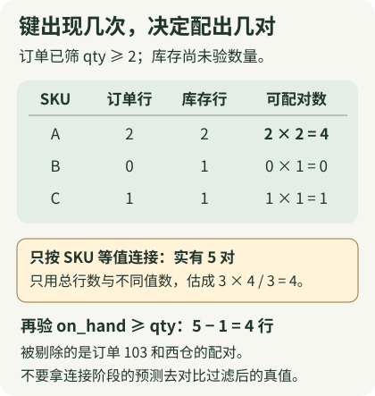

# 第16讲：估错一行，怎么会选错一棵树？

订单 103 要买 5 件 A。库存里有两条 A：东仓有 9 件，西仓只有 3 件。执行器能逐对比较，知道这笔订单有且只有一个可用仓库。优化器却要在尚未把订单与库存接起来以前，回答两个问题：**大约会配出多少对？换一种先后顺序，哪条路更省？** 第一个问题猜的是结果行数，第二个还要考虑访问、排序与传输等工作。把它们混为一谈，就容易误读一份执行计划。

## 全片时间索引

| 时间 | 带着什么问题回看？ |
| --- | --- |
| 00:00–04:52 | 音乐、课程通知；解析、绑定、变换、搜索、计价各回答什么？ |
| 04:52–09:01 | 自底向上和自顶向下究竟从哪里出发？艺人三表例中，哪个索引能先用？ |
| 09:01–12:49 | 表很多时舍弃哪些候选？随机搜索和近似起点有什么保证？ |
| 12:49–16:09 | 两表子计划怎样复用？只保留最便宜的一条何时会丢掉顺序？ |
| 16:09–22:55 | memo、分支限界和 enforcer 怎样协作？“哈希不能直接交付”是否等于“不能用哈希”？ |
| 22:55–26:20 | 为什么不能把所有候选都实跑？误差如何从连接的输入传到输出？ |
| 26:20–30:36 | 哪些成本跟硬件有关？代价单位为什么不等于秒？ |
| 30:36–34:57 | 为什么校准不易？统计刷新要拿什么换准确性？ |
| 34:57–39:20 | 五行 `enrolled` 的 `ANALYZE` 演示。为什么两个字段各有统计还不够？ |
| 39:20–46:44 | 一列十亿不同值，逐值计数要多大？等宽、等深、热点桶各保留什么？ |
| 46:44–50:07 | 草图和样本回答什么？三条人物样本的 $1/3$ 是哪类估计？ |
| 50:07–53:58 | `age=9` 为什么既有 $4/45$ 又有 $1.8/45$？哪个是精确计数？ |
| 53:58–58:18 | 部分命中的范围桶怎样分？遇到缺值或 `NULL`，哪一步不再成立？ |
| 58:18–1:03:01 | AND、OR 和 Honda/Accord 的条件概率；减弱后续谓词影响能解决什么、不能解决什么？ |
| 1:03:01–1:06:55 | 等值连接公式分母为什么取较大的不同值数？包含假设和键唯一有何不同？ |
| 1:06:55–1:10:18 | A、B、C 的上层连接拿到的统计，哪些是猜出来的？ |
| 1:10:18–1:13:59 | 自适应更换算法和整条重规划哪里不同？高估会怎样？ |
| 1:13:59–1:19:01 | JOB 历史实验怎样把高估和低估画在一张图里？论文与课堂揭晓的边界在哪？ |
| 1:19:01–1:21:17 | 总结、事务预告，约 1:20:37 后是片尾音乐，不再增加技术内容。 |

时间按本讲字幕转折约到秒，便于定位，不是逐帧边界。以下用订单数据作**编者纸面推演**；不是课堂实测、作业答案或某款数据库的执行输出。

## 1. 哪些方案可以拿来比？

先写语义，再谈搜索。对不含副作用的普通等值**内连接**，可对保持谓词和重数的等价组合比较先后次序；改成左外连接，就不能任意换边并挪动过滤条件。比如“保留所有订单”和“只保留有库存的订单”不是同一查询，两者运行时间再接近也不是候选关系。

在合法集合内，区分三个层次：

- **访问路径**：扫描全部库存，还是用 SKU 索引找哪些库存行？有索引不代表一定该走索引，命中太多或回表分散时可能更贵。
- **逻辑顺序**：先把 `Orders` 接 `Stock`，还是先让 `Stock` 与“开放的仓库”匹配？前一步交给下一步的行数可能不同。
- **物理实现与交付条件**：同一等值连接可以用哈希、归并或嵌套循环。它们应交付相同多重集，不一定交付相同顺序、消耗相同内存，或同样快地吐出第一行。

**自底向上**可以用“已接哪些表、结果可用的物理属性是什么”描述一个状态，从单表开始，把新表接到已有子计划上。只留左深树、尽量不做笛卡尔积，缩小了待探索集合；这属于搜索策略，不是那些没搜的树在逻辑上都错误。若限定空间不含最好的真实方案，遍历得再彻底也找不到它。课堂动画为了讲清选择，把哈希与归并并排；不要倒推“原始 System R 已实现哈希连接”。推荐专著 §1.2 回顾的原始候选是嵌套循环与归并。

**自顶向下**可以反问：“要交付按 SKU 排好的结果，最后一步有哪些做法？”每条实现再向子树提出要求。memo 记住等价表达式及其在不同物理要求下的已知实现，不是存储本次查询实际产生的订单行。若已经有完整计划代价 11，新分支已知至少要 13，即便更深处免费也不能胜，便可剪枝。要剪的是**有合法下界**的分支；一个很悲观但并非下界的估计，不能证明这条路不会赢。到时间停止搜索时，交出已有的合法方案，不等于证明了最优。

图 1（编者自拟）：假设 H 和 M 的成本已包含为各自输入取得合适形式的工作，无需在 M 后再额外排序。本例输入和比较键满足 M 交付目标次序的条件。若给 H 再加一个 Sort，$7+9>11$。因此 `(Orders⋈Stock, 无次序要求)` 的最优解和 `(Orders⋈Stock, 按SKU有序)` 的最优解不能共用一条“唯一冠军”记录。若只记表集合，后来补排序就可能选错。

## 2. 用哪一种统计，才回答得了当前问题？

从一张 $N$ 行的表中等概率挑一行，`WHERE P` 留下的比例称为选择率。它属于 $[0,1]$；预测行数是 $N\hat s$，可以暂时是小数，但不是表里真的有半条记录。下列摘要放弃的信息各不相同：

| 已保存的东西 | 好回答的问题 | 会丢掉什么？ |
| --- | --- | --- |
| 总行数、不同值数 $V$ | 一个普通取值平均有多少行：$N/V$（无空值且 $V>0$） | 哪个值特别热、两个表热的是不是同一个值 |
| 等宽桶 | 连续区间覆盖哪些整桶、哪几个桶只部分命中 | 热点可能挤在一个宽桶里；桶内仍要插值 |
| 等深桶 | 让行数相近的桶各含一个较细或较粗的范围 | 跨层桶宽不同；桶里缺了哪些具体键仍不清楚 |
| 热点单列、其余合并 | 频繁键的点查询；其余用平均频率 | 热点轮换后列表会旧；不能把余项的**总行数**当作一个冷键的频数 |
| Count-Min Sketch / HyperLogLog | 前者估指定键频数；后者估不同键数量 | 不是精确频数表；仅给 HLL 估出的 $V$ 不能重建任意键的频率 |
| 一小组真实样本 | 可在样本上直接试复合条件，保留部分行内相关性 | 稀有事件可能根本没抽到；两个样本独立抽取时，连接键重合也可能很少 |

课上人物样本有 3 行，`age>50` 命中 1 行，这是 $1/3$ 的**样本比例**，不能据此说十亿行表确有三分之一超龄。一个对照：若某事件概率为 $p=0.001$，独立有放回地抽 100 行，样本中一次也没看见的概率是 $(1-p)^{100}\approx0.905$。**零次观测**并不证明全表为零。采样策略、样本是否刷新、成本能否承受，都属于实现问题。目录中的摘要可以比表落后；`ANALYZE` 更新的是规划用信息，不是把数据行改成另一种分布。

**课堂精读 50:07–58:18。** 同一 45 人例中，整桶行数为 12、12、9、12。`age=9` 命中第三桶 $[9,13]$，均摊后为 $(9/5)/45=0.04$；真数是 $4/45$。`age>=7` 同时包含两个整桶和 $[6,8]$ 的一部分，得 $(9+12+12\times2/3)/45=29/45$。前一个误差源是把热点摊平，后一个还依赖边界、整数值域及桶内是否有洞；连续型数据不能照数整数的办法写“端点差加一”。

## 3. 两个谓词都知道，为什么联合选择率仍不知道？

令 $p$、$q$ 分别为两个谓词为真的比例。恒等式是 $P(P\land Q)=P(P)P(Q\mid P)$；用 $pq$ 替代，**额外假定了独立**。并集 $P(P\lor Q)=p+q-P(P\land Q)$ 本身不需要独立；只有把减项写成 $pq$ 才需要。课堂 10 个厂牌、100 个车型的均匀例中，`Accord` 已经蕴含 `Honda`，交集就是 $1/100$，不是 $1/1000$。即使两列各自的直方图都精确，仍然可以算错十倍。

订单里同样可能有“仓库编号决定所在地区”的依赖。重复叠加相关条件，独立乘积会越乘越小。把后加的条件打折，是对严重低估的防护；它不能凭空学到函数依赖。能收集哪组多列统计、能否利用约束或样本，是另一个决定。**也不是一切相关都会造成低估**：若两个条件互斥，真实交集为 0，而 $pq$ 可为正。

再想一个 SQL 陷阱：100 行里 7 行的年龄为 `NULL`，10 行的年龄是 2。`WHERE age != 2` 留 83 行，不是 90。比较空值得 UNKNOWN，`NOT UNKNOWN` 仍是 UNKNOWN。只有对无空值的二值谓词，课堂的 $1-s$ 才能直接拿来当通过比例。

## 4. 为什么等值连接要乘两侧频数？

回到前讲的小订单和库存。订单依次为 `(101,A,2)`、`(102,B,1)`、`(103,A,5)`、`(104,C,4)`；库存为 `(东,A,9)`、`(西,A,3)`、`(西,B,0)`、`(东,C,6)`。先保留 `qty>=2`，再按 `sku` 等值连接，并检查 `on_hand>=qty`。下文假定键非空、内连接、相同读快照。

图 2（编者自拟）：前讲执行器在探测哈希表时实际看见的是右栏的配对。换哈希为归并并不会把 A 的四种组合减为两种。

有了两侧的精确频率，按键求和就是**真值**：

$$
|R\bowtie S|=\sum_{k\ne\mathrm{NULL}} f_R(k)f_S(k).
$$

只有摘要时怎么办？设 $V_R\le V_S$，均匀、非空、较小的键集合完全落入较大的集合。可配的不同键有 $V_R$ 个；每个键在 R、S 平均分别有 $N_R/V_R$、$N_S/V_S$ 行。乘起来再加 $V_R$ 次，得到 $N_RN_S/V_S$。换边也一样，于是简式为：

$$
\widehat{|R\bowtie S|}=\frac{N_RN_S}{\max(V_R,V_S)}.
$$

不同值数的单位是**种**，不是选择率。若任一输入为空，内连接直接是零，不能硬做除零。若键可空、连接使用普通 `=`，应以两侧非空行数和非空不同值数为基础。若连接键来自过滤后的子树，不能继续盲用基表原来的 $N,V$。

本例过滤后订单为 $N_R=3,V_R=2$，库存为 $N_S=4,V_S=3$。简式给 $3\times4/3=4$ 对，真实为 5。虽然两侧满足值域包含，订单的热点 A 恰好也是库存中的热点，**包含并不等于均匀**。再验西仓库存量，订单 103 的一对才被淘汰，最后恰好又是 4 行。估计碰巧等于最终结果，不能据此说连接节点估得准：从 5 到 4 的那个残余谓词还没在前一个估计中计算！反之，两张表各有一行但键完全不同，简式猜 1，实际 0；这次坏的是包含假设。若有可信的非空外键指向未过滤的唯一键，每条引用行恰匹配一次，则应优先使用这种结构事实，而不是泛用公式。

## 5. 连接顺序怎样变成一次可以手算的工作量比较？

给查询加第三张表 `Warehouse(name, enabled)`：东仓开、西仓关，`name` 唯一。问题是“至少买两件的订单，哪些开放仓有足够库存？”仍是内连接。先在各自基表完成两项本地过滤，得到订单 $O'$ 三行、库存 $S$ 四行、开放仓 $W'$ 一行。下面只比较两种**普通逐对嵌套循环**的候选，计量单位是测试的候选行对；两侧驻内存、不用索引或哈希，忽略公共扫描及结果写出，满足一个候选中的多个条件不另算行对。这不是 I/O 公式、更不是实际用时。

| 候选顺序 | 第一层的真实工作 | 第二层的真实工作 | 合计 |
| --- | --- | --- | ---: |
| $(O'\bowtie S)\bowtie W'$ | $3\times4=12$ 对；验 SKU 与数量，产生 4 行 | $4\times1=4$ 对；剩东仓 3 行 | 16 对 |
| $O'\bowtie(S\bowtie W')$ | $4\times1=4$ 对；东仓 A、C 共 2 行 | $3\times2=6$ 对；验 SKU 与数量，剩 3 行 | 10 对 |

两者都产出 `(101,东)`、`(103,东)`、`(104,东)`。但规划器填这张表时，还不知道两个中间结果分别有 4 行、2 行。假设它把第一棵树的中间结果估成 1 行，又因仓库统计过时，把第二棵树的中间结果估成 4 行。按**同一个**比较模型，两份估价就是 $12+1=13$ 对与 $4+3\times4=16$ 对，于是会选第一棵；实际却是第一棵 16 对、第二棵 10 对。出错的不是连接的语义，也不是加法，而是用来做加法的两个中间基数。若库存还有仓库前缀索引，则连“每次都看完整个内表”这个成本模型都要改。

动手对照：[公共资料](#/c/cmu-15-445-2025)中的「让缺货订单换一个连接顺序」在 SQLite 上实际执行了两个计划。先找**第一个**估计与观测明显分岔的节点；再用外层行数解释下一层循环次数。不要把每轮估计与累计访问直接相比，也不要把本节的行对比较数读成毫秒。

## 6. 估错是否一定要换计划？

课堂 1:10:18–1:13:59 的追问可以写成一个选择：**从现在起继续旧计划的预计剩余成本**，是否超过**转换、重算和新计划的预计剩余成本之和**？已经不可能收回的工作不是继续做错事的理由；但如果已经构建的结构可复用，就不该把它当成必然丢失。切换还必须知道哪些结果已经交给上层，不能重发已输出行或漏掉尚未匹配的重复键。直接 abort 后重规划和在同一执行中切换算子，是不同的状态管理问题。

JOB 论文把估计与实际作相对比较：实际 100 行时，估 10 或估 1000 的正值 q-error 都是 10，而方向相反。单一 q-error 看不出高估或低估；要看方向再用估/实的比值。若一边为零，不应直接做除法，需另报零行情况。图 3 中“0 个连接”仍可能有基表过滤，线上单点和整栏箱体的中位数也不是一回事。2015 年这些特定查询里，多表连接的系统性低估说明独立假设有风险；没有证明每款现代系统、每种数据都会如此，更没有证明只要估错就一定换算法。若候选真实成本相差巨大，粗糙估计也可能排对；若只差一点，影响物理选择的往往是**错误有没有跨过成本交界点**。

## 自测：先说会失去什么，再展开答案

1. 同一等值连接 H 的成本 7，M 的成本 11。能删掉 M 吗？

不能仅凭这两个数删。必须先问可交付的属性。若 H 没有要求的顺序且补排要 9，M 已有该序，两条满足根要求的成本分别为 16 和 11。只在相同要求且不会失去下游可用能力时，局部比较才有意义。

2. 完整计划目前是 20；新分支的估计最终成本是 25，可立刻剪吗？

要分“估计最终值”和“所有后代均不能低于的下界”。只有 25 是同一计价规则下的可靠下界时，才由 25 大于 20 推出安全剪枝。否则可以作启发式早停，却不能宣称已证明最优。

3. 两张表各有 100 行、10 个不同键，为什么无法从这四个数恢复连接真值？

两边的键集合可能完全不相交（零行），也可能都是同样十个键且均匀（每键 10×10，共 1000 行）；同一集合上若热点重合，又会不同。丢掉了重合情况和逐键频数，公式只是加上假设后的一项估计。

4. 每个条件各命中一半 AND 就留四分之一？

仅独立时成立。若两个条件在这批行上完全相同，就留一半；若互斥，交集为零。单列边缘统计相同，联合分布可以不同。

5. 等值连接估成 4 对，最终恰好输出 4 行，如何用订单 103 检出“看起来很准”的错觉？

它在等值阶段匹配东、西两个 A，不是一对。全体有 5 对；直到检查数量时才因为西仓 3 小于订单的 5 而剔掉一对。比较必须定位到相同算子和谓词阶段。

6. 把只开放东仓这个谓词推下去，是否等于无须比较两种连接顺序？

不是。本例两种候选都先得到只有一行的开放仓，但让这张表先接库存可以及早把库存降到两行；先接订单与库存则要先验证另一批候选。局部下推与全局连接顺序是两个决定。

7. 实际行数是预估的一百倍，为什么最顶层未必值得重规划？

倍数本身不说明剩余的绝对工作量，也不说明新计划能省多少。有可能只多出几十行，也可能旧计划接近完成。要比较从此处起两种选择的剩余工作、能否复用状态，以及已交付结果的语义安全。

## 参考与边界

- **课堂**：Andy Pavlo / CMU Database Group，Fall 2025 第 16 讲（2025-10-29），[当季课表](https://15445.courses.cs.cmu.edu/fall2025/schedule.html#oct-29-2025)。[官方 notes](https://15445.courses.cs.cmu.edu/fall2025/notes/16-optimization2.pdf) §1–3（五页）；[幻灯](https://15445.courses.cs.cmu.edu/fall2025/slides/16-optimization2.pdf) 显示页码 7–11 搜索、15–24 模型与摘要、30–43 选择率和连接。原片 ID `azTHRpzl10o`、时长 1:21:17；单条录像的 CC Attribution 标签与独立资料授权分开。纯文本时间按 en-orig 整理，音乐边界和提问复述见中文译稿。
- **课堂引用的实验**：Viktor Leis、Andrey Gubichev、Atanas Mirchev、Peter Boncz、Alfons Kemper、Thomas Neumann，[*How Good Are Query Optimizers, Really?*](https://www.vldb.org/pvldb/vol9/p204-leis.pdf)，PVLDB 9(3)，2015，§3.1 的 q-error 与基表采样、§3.2 图 3 的多表误差。原论文商用系统匿名，且明载 HyPer 在基表上用样本；不把课堂揭晓或猜测当成论文披露。论文标 CC BY-NC-ND 4.0，不提供译文或论文图副本。
- **课堂推荐，非指定教材**：Bailu Ding、Vivek Narasayya、Surajit Chaudhuri，[*Extensible Query Optimizers in Practice*](https://www.microsoft.com/en-us/research/publication/extensible-query-optimizers-in-practice/)，2024。§1.1–1.2 区分空间、计价与搜索并回顾 System R；目录可循 §2.2–2.4 找 Volcano/Cascades，§5.3–5.4 找统计与基数。作者页提供阅读，并非对中文全文再发布的授权。
- **编者核对**：[PostgreSQL 17 §19.7.2–3](https://www.postgresql.org/docs/17/runtime-config-query.html)，模型的相对单位与 GEQO 默认阈值。课程指定 *Database System Concepts* 第七版[教材](https://www.db-book.com/)第 16 章；只作阅读导航，不提供章节翻译。本文的订单三表、成本数字、反例、两张图与自测均为独立推导。
