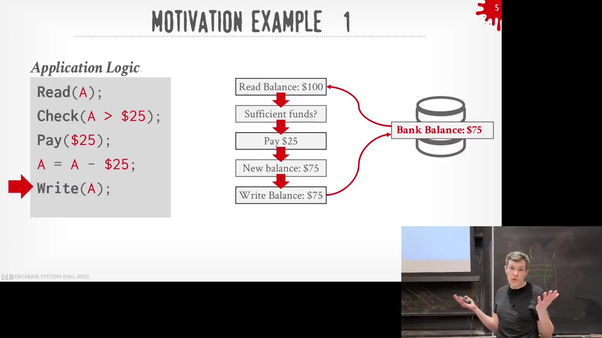
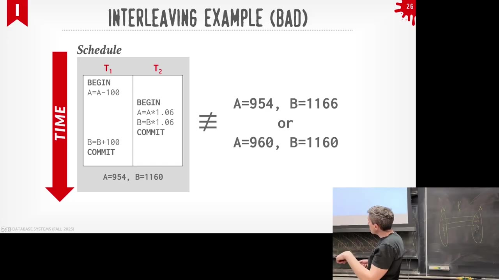
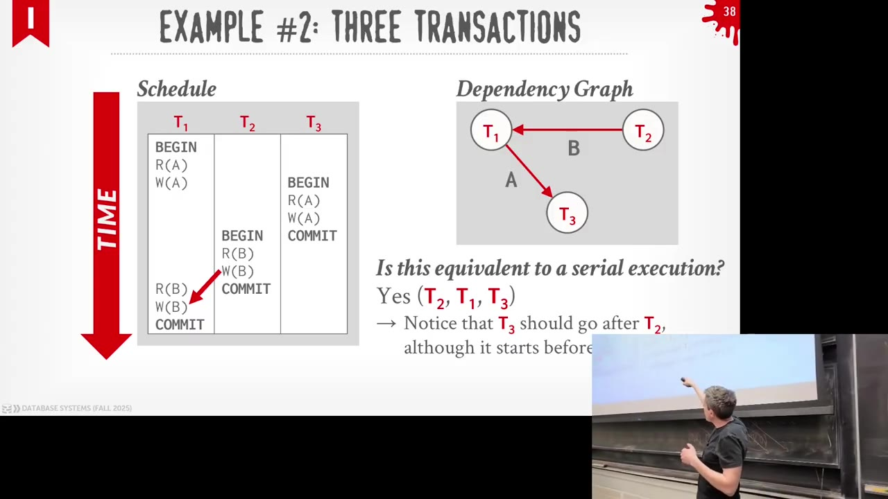
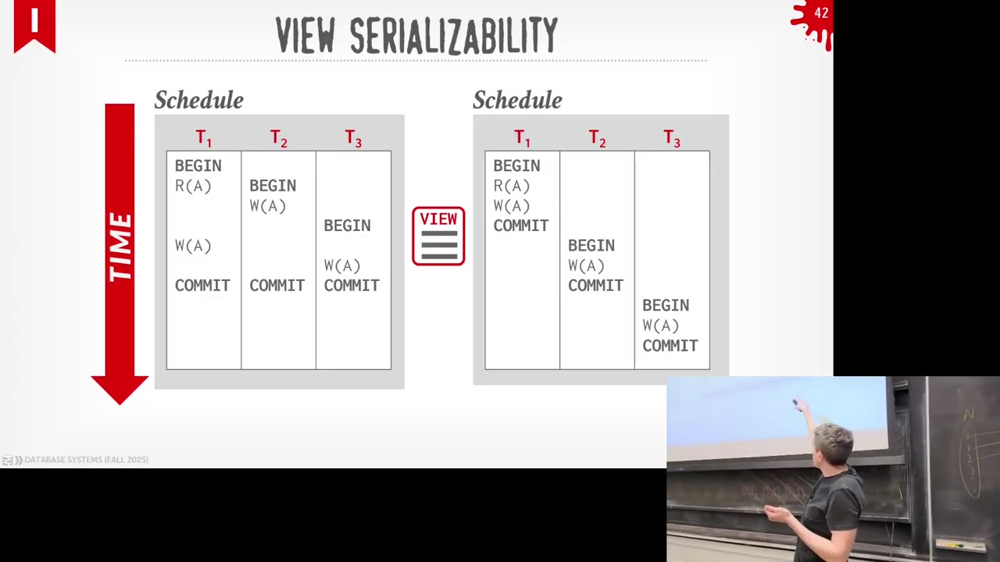

# 并发控制理论：课堂逐段整理译稿

## 00:00–00:24.640｜片头

黑白走廊里，两个人向镜头走来，片名打出 **Database Systems · Fall 2025**。这段没有英文字幕事件；原音与本学期重复片头的对应段吻合。第一条课堂字幕从 00:24.640 起，不把片头配乐写成课堂对白。

## 00:24.640–04:29｜已经能处理一条 SQL，为什么还不能上线？

Project 3 有问题吗？习题课有录像和 slides，请先看，有问题发到 Piazza。接下来几场数据库讲座都可自选：今天课后，CMU 数据库组校友、获过 Jim Gray 论文奖的 Ryan Johnson 讲 Databricks 的 Delta Lake。可以和学过的 Hudi、Iceberg、DuckLake 放在一起比较。老师开玩笑说，Databricks 自己有 Delta，看到 Iceberg 的势头，干脆花大钱收购做 Iceberg 的公司。明天中午在 Gates 楼有午餐，Uber 来讲这些年试过什么，为什么最终用 Apache Pinot；再过一周是 Mooncake：在 PostgreSQL 里借 DuckDB 访问 Iceberg。

把学期地图拉远看：我们学过如何读写磁盘、怎样用缓冲池管内存、怎样访问表；再往上建执行器，用优化器把应用的 SQL 变成可以执行的计划。现在足以从头到尾做一个数据库系统的初版，还不敢放进生产。机器崩溃再起来，能保证没丢数据吗？两条查询同时更新同一处，能保证结果可靠吗？接下来约两周讲并发控制，再一周讲恢复。它们不画成原先那叠方框中的单独一层，是因为它们要修改栈上许多地方。

例如你们的缓冲池替换页时，干净就丢，脏就先写出去；它并不知道改这页的事务是谁、此刻写盘是否安全。一次更新涉及两页，只来得及写出一页就掉电，重新启动时，会不会看到半次更新？现在要回过头，给已有部件加上“事务”和“何时正确”的概念。

## 04:29–08:23｜两个 25 美元付款，为什么余额只减少一次？

以前我们通常盯着一条查询：即便包含 JOIN 或子查询，讨论更新时也常常一次只看一个操作。现在看一项跨多个操作的业务。假设写一个银行应用，用 Python、PHP、Java 还是 Rust 不重要。客户端先读账户 A，拿到余额 100 美元，检查够不够付 25，再向另一个账户付款；本地做减法得到 75，最后将 75 写回 A。如果钱已经付给对方，却在回写 A 之前崩了，重启后两个人各应该有多少？

图中把“付款”和“写回余额”画成了两个动作；两者之间可能出故障。再假设你和室友共用一个账户，同时各付 25。两个线程或两台机器上的两个应用都可读到 100，都判断够钱，都已付款，又都写回 75。实际共付出 50，余额却不是 50。这次没有崩溃，问题来自**交错**。恢复要回答崩溃后保留什么；并发控制要防止并行访问产生这种结果。

## 08:23–12:28｜单人排队加副本，能不能已经做对？

先造一个笨系统：应用可以同时发送许多请求，但只设一个 worker、一个队列，一次只运行一个事务。更新时不覆盖旧页，先把数据库复制一份，到副本上改；成功时切换一个内部入口，例如页目录，让新页成为正式版本；失败或中途崩溃就忽略并清理未提交副本。这样能防住上面两件事吗？

学生担心最后写回的一瞬间也会坏：副本做完，总要写回原来的地方吧？老师说，不必把许多新页逐个拷回旧地址。假定新版本已经准备好，只须**原子地**更新一个指明当前版本的入口；那么一边更新一边崩溃的担忧，在这个模型里就有了明确答案。大家分别举手表决是否安全、是否正确；拿不准也没关系。在这些假设下是正确的；是否快呢？有人说复制太多，有人说没有并发，两点都对。可以细化到只复制被改的两页，不一定每次全库复制，但这个方案仍然让更新者排队，在最后切换入口。

这种思路叫 **shadow paging（影子分页）**。老师联系到 1970 年代 IBM 的事务研究与 Jim Gray；后来系统因性能考虑转向别的方法，也提到 SQLite 的某种模式作类比。我们的目标不是证明串行运行不正确，而是在保证正确的同时，不扔掉并行机会。

## 12:28–16:42｜快、公平、正确，数据库各能管到哪里？

多个事务并发，能吃满多核等硬件，将来跨节点也有类似动机；用户不用总等排在前面的整笔事务跑完才见响应。有时仍要等，甚至因冲突而中止。设计通常先保正确，再想办法不放松保证地加速；给一个非常快但不正确的实现事后补证明很难。老师拿多年后仍能发现并发实现缺陷的 PostgreSQL 作例子。还有公平性：不能让一个请求永久抢不到资源；下节谈锁和死锁时再说。

允许读写交错意味着执行途中**有时暂时不一致**。比如已经给对方入账，自己账上的 25 还没扣，系统瞬间像多了 25。不能寄希望于两条应用动作变成一条机器指令；关键是不能让这样的半成品变成最终结果，或者把它当作隔离事务所应看到的世界。事务成功提交、撤销、或者崩溃恢复后，不能留下那 25。

另一条边界：DBMS 只管自己控制的数据读写。你的应用在中间发出确认邮件，回滚不会把收件箱里的信收回来。老师又拿一个不可逆的外部动作打比方：数据库不会因为调用 `ROLLBACK` 就把外部世界倒带。

## 16:42–21:53｜把实际系统缩成一种可讨论的模型

今天不分 tuple、页、表、索引；统一叫有名字的对象 A、B、C……它可以代表不同粒度，推演里固定粒度。再限制对象集合大小不变：开始时这些对象已存在，结束时也还在；可以读写，暂不插入和删除。事务就是在这些对象上的一串 `R(A)`、`W(B)` 等操作。应用用 `BEGIN`（有的系统也用 `START`）标出开始；`COMMIT` 是请求保存这一组修改，`ROLLBACK` 或 `ABORT` 则放弃，使其仿佛没写过。

谁听说过 ACID？约一半同学举手。**A**tomicity 是全做或全不做；**C**onsistency 是从符合规则的状态出发，每个事务也遵守规则，则完成后仍符合规则；**I**solation 是对事务而言仿佛独占数据库，而不是看到别的事务做了一半的工作；**D**urability 是已经提交的效果在系统掉电、操作系统崩溃后仍应保留。如果连磁盘也烧掉，单机当然不够，要靠另外的故障域和复制。先学单机，再谈多机。

讲到 C 时，老师以多份副本为例：向一台写入并提交，另一台随即读时应看到什么？学生追问：“立刻？这在物理上不可能吧？”老师把“从谁的观察角度算立刻”留给分布式一讲。关于 ACID 这个好记的缩写，还讲了一个取名与“酸、甜”有关的轶事，并明确说自己没找当事人证实。本讲把最多时间留给 I。

> 编者注：事务的完整性约束与副本读写的一致性模型回答的是两个问题。讲者借第二个例子引发讨论，并不是说 ACID 的 C 要求所有物理副本同时收到一个网络报文。

## 21:53–24:25｜谁有权中止？单条语句也是事务吗？

应用开启事务后只有两个结局：提交，所有修改都算；或中止，已经做的一部分也得撤回。中止不只来自应用自己，数据库也能拒绝事务。所以不能在应用里写了 `COMMIT` 就假定成功，要能处理错误，再由应用决定要不要重试。

学生问，只发一条查询也会中止吗？会。一条语句的事务仍然是事务：例如和别人争同一个更新，先阻塞等待，后来可能超时被中止；具体行为要看协议和隔离级别。学生顺势问，是不是每一条查询都隐含一个事务？在用 PostgreSQL 的自动提交方式、又没有显式包进更大事务时，可理解为这一句外面隐含 `BEGIN` 和 `COMMIT`。换个客户端事务模式，可把多条更新放在一起，最后才提交或回滚。老师说，越有人问越想往下讲：题目虽老，做对它仍很有意思。

## 24:25–29:46｜日志到底记什么：语句、值，还是该怎么撤销？

实现原子性的第一条路是 **logging**。不是调试时多打几个 `printf`，而是按顺序留下“事务对数据做过什么”的账本；可以是独立日志，某些布局也把数据组织成日志。redo 信息让我们重做修改，undo 信息让我们把修改逆转。事务运行时就要维护这些信息。以前说脏页可以刷盘，现在要加一道条件：描述该次页修改的日志记录要先于相应脏页到达稳定存储。老师把日志比作飞机的黑匣子：不是猜坠毁前发生过什么，而是重启后仍有记录可查。

学生问：是记录操作本身，还是把每一步的 tuple 拍个快照？答：实现可以取不同层次。接着有人举“先 `SELECT` 做聚合，再拿聚合值更新另一条记录”的例子。恢复关心的是按合法顺序还原数据库。如果记录了最后写入的数据如何变化，不一定要重新做聚合。老师用“像 Git 的 diff”说明记录变化，也提到 *physiological logging*；相反，若记录逻辑操作并重新执行，原查询花一小时，重跑也可能花一小时。很短的操作则有不同的成本账。不必现在就把几种日志格式混成一种。

连续追加通常比随机写很多数据页便宜，和先前讨论 LSM 的顺序写动机相通。记录有时也有审计价值，老师拿金融机构多年保存交易记录作例子。又有学生追问撤销是否必须记旧值。回答仍然是“取决于恢复办法”：要从改过的值恢复原值，就得有足够的旧信息；若有旧快照，也可以回到那个版本，按顺序重放。今天先抓住“在有序基线之上能够重建结果”。

## 29:46–33:53｜快是指平时快，还是断电以后快？

第二条路就是刚才的影子分页：复制被动过的页，在副本上改，提交才翻转入口。后排同学问这两种方法谁更贵。要分两种性能：正常处理事务时花多少，灾后恢复时花多少。多数人赌机器不是成天崩溃，宁愿保证平时快。日志可以顺序追加，正常路径便宜；崩了可能得重放很多记录，差时几小时甚至更久。影子分页平时要复制、改页、切指针，但重启时沿着已提交入口读，未提交的副本忽略，马上就有逻辑上正确的数据库。

老师记得一个 1970 年代波多黎各电力公司的案例（系统名称一时想不起来）：当地可能一天断好几次电，如果每次为恢复等一小时，刚上线又掉电，就值得用平时较慢来换恢复快。System R 曾用影子分页，后来的 DB2 转向预写日志。老师列举 LMDB、CouchDB、Tokyo Cabinet，说 LMDB 作者对 `mmap`、影子分页的偏好恰和自己相反；对于这门课的通用磁盘系统，他推荐日志，不是说一切故障分布下成本都一样。

有人确认这里说的就是 **write-ahead log** 吗？是。“ahead”是相关日志必须先持久化，然后相关的数据页才可以写出去；这不意味着 `COMMIT` 必须等所有数据页都落盘。

## 33:53–37:54｜写了日志就崩、发了提交却没收到回执怎么办？

学生追问：日志入盘了，数据还没入盘就崩怎么办？老师先区分“事务已经提交”与“客户端知道它已经提交”。如果应用要求提交，系统已使提交生效，但在回答“成功”之前崩溃，事务仍然已提交。应用只知道没收到回执，不等于可以断言失败；它必须查清结果。

又问，是否等应用说 `COMMIT` 才能开始写日志？并不是。有的修改先留内存，也可以在事务仍运行时就将相应记录写盘。如果要改十亿页、内存只有一百页，全程扣住所有变化再写根本不可行。在这里的日志模型中，**提交记录**持久化才决定提交，而不是看到任何一条普通更新记录就算。于是还有另一种情况：应用根本没要求提交，某些日志甚至数据页已经落盘，机器却崩了。重启要分清意图记录与实际页状态；不该留的改动要能撤销。学生一层层把“日志有，数据不一定有”的两种结局分开了。

再问下去，运行五年的系统难道从头重放五年？所以有 checkpoint、snapshot 来限制恢复时回看的长度。可事务可能在一次检查点前开始，检查点后才结束。有同学建议“等没有事务的时候再做检查点”：若检查点花半小时，愿意让网站停半小时吗？金融机构还可能很频繁地做。允许事务在取检查点时继续活动，就是后来要讲的模糊检查点。老师预告 IBM 的 ARIES 长篇论文以及单机故障的边界；设备彻底烧毁就另需跨机办法。这里不提前展开恢复算法。

## 37:54–41:00｜数据库凭什么知道“负一百岁”是错的？

数据库模拟现实，存的整数却没有“年龄”的天赋知识。把一人的年龄改成 −100，在整数运算上完全合法，在业务上不行。应用得先把规则告诉数据库，比如定义 `CHECK`、`NOT NULL` 或添加约束；DBMS 才能在约定的边界拒绝破坏这些规则的写入。学生问这个词叫什么，答：**integrity constraint，完整性约束**。

老师又提到另一个常听到的词 *eventual consistency*。若同一份数据有两份副本，在第一台提交，立刻从第二台读，复制可能还没追上，于是看见旧值；最终赶上与当下可见不是同一承诺。老师回顾 2000 年代这类选择，认为把这些可见性差异全留给应用程序员推理会很难，稍后课程再谈更强的保证。

## 41:00–43:14｜隔离的承诺，并不要求只有一个 worker

让开发者把事务写得像单独运行：不必自己考虑改到一半时另一笔事务恰好怎样插进来。这是一个对外的编程模型，不是要求机器真的闲着等某个事务做完。DBMS 希望同时推进许多事务，却让它们的效果像按某个串行次序执行。

并发控制协议决定谁现在可以读或写什么、什么时候允许提交、什么时候必须等待或被中止。死锁怎么防、已经发生怎么打破，留到下一讲。大略有两路：悲观地认为有冲突，事先禁止或延迟危险的动作；乐观地相信冲突不常见，先做工作，提交时再检查能否接受，必要时清理。这是实现选择，还不是“什么结果正确”的定义。

## 43:14–50:07｜一个转账、一次计息：正确答案不唯一

账户 A、B 各有 1000 美元。T1 从 A 转 100 到 B，T2 给两个账户各加 6% 利息。希望两件事能重叠，省掉等待；会有哪些结果？两个账户最初共 2000，转账不改总额，计息后应共 **2120**。若先 T1，再 T2，得到 `(954,1166)`；若先 T2，再 T1，得到 `(960,1160)`。两个账户的具体数额不同，两种串行结果都可以。不要求哪个请求先到机器，哪个就一定先执行。老师顺带拿 Spanner 的 external consistency 和这里的普通可串行化作对比，本题不添加真实时间约束。

> 编者注：斯潘纳论文中的真实时间条件是 **T1 已完成提交后 T2 才开始**，则串行序中 T1 在前。课堂以相差半毫秒递交请求口述得过强；两个实际重叠的事务不因其中一个开始较早就必须先提交。

学生问，怎样用算法确定顺序？分两课：今天假定操作已经给全，拿到一个 schedule 后判断**对不对**；下节才谈不知道未来查询时如何在运行中**保证**它对。另有同学问，是否所有串行顺序总有一种相同的判据？这里用 2120 只是为了让人一眼看出少钱。数据库不能假定每个客户都交给它一条“两个账户应适用某个总额公式”的高层规则。真正要比的是操作、各对象和事务观察到的状态。老师又应一位同学的追问重述：要找的是**至少一个**能解释这次交错的串行顺序，不是要求与每个顺序都相同。

又问，有什么系统不能保证隔离？老师说隔离有强弱，也不能只看产品设置项的名字。他举 Oracle 所谓 `SERIALIZABLE` 与学术定义可能有差距、PostgreSQL 的并发实现也曾修正缺陷为例，强调做对很难，并未在课上测试某个发行版。

## 50:07–54:43｜同样在交错，哪一种会少 6 美元？

为什么交错？例如 T1 扣了 A 的钱，接下来访问的页没在缓冲池里。等 I/O 时可以让 T2 先算 A 的利息；等到能访问 B，T1 先把钱加到 B 并提交，T2 再给 B 计息。T1 和 T2 在时间上交错，但在 **A 和 B 两处都是 T1 先、T2 后**，所以相当于先转账再计息。

坏例子只换一处顺序：T1 从 A 扣 100，T2 给 A、B 都计息并提交，T1 此时才将 100 放进 B。钱在两个账户之间的那一刻恰好被计息过程跳过；A 是 954，B 是 1160，总额 **2114**，少了那 100 应得的 6。这与任何串行结果都不同。

若有一百万笔事务，当然不能靠人枚举结果。我们人眼看到 `A=A-100`，知道它是转账；抽象的 DBMS 只看到 `R(A)`、`W(A)`，不知道客户端做什么算术。于是需要描述调度的形式性质。**串行调度**是不交错、一个接一个。说调度等价，是在比较它们执行后的效果；若一个调度和**某个**串行调度等价，就是可串行化。允许这个自由度，DBMS 才能找并发机会，否则又回到了单队列。接下来会把这里较直观的“结果一样”收紧为可检查的等价定义。

> 编者注：官方 slides 的好交错页（投影片号 25）右侧把“先转账、后计息”的终值印成了另一种串行次序的 `(960,1160)`。依该列操作实际算出 `(954,1166)`，与左侧一致；总额相同本身不是两列等价的证明。

## 54:43–57:24｜三种冲突与两个暂缓的问题

再次限定模型：固定对象，已知所有事务接下来做的操作。正常系统既允许插删，也不知道客户下条语句是什么，不能在一般情形下把今天的离线判定当成在线调度器。

两个操作什么时候有冲突？属于**不同事务**，访问**同一对象**，并且**至少一个是写**。所以方向上有读–写、写–读、写–写。为什么没有读–读？你和我只是看同一份数据，不会因此改掉对方该读的内容。要防的是会导致非串行观察的交错，并非见到任何一个冲突对就要宣布失败。

还有两类现象今天不详细做。扫描一段范围，再扫时别人插入或删除了一条符合条件的记录，结果集合改变，称为**幻读**；这超出了固定对象的设定。还有 *write skew*（写偏斜）：两个事务从同一状态作决定，各自的写合起来出现问题，不能简单当作两人覆盖同一对象；细节留待后面。

## 57:24–1:01:50｜读两遍、读到未提交值、覆盖彼此的写

**不可重复读**：T1 第一次读 A 为 10；T2 也读 10，把它改为 19 并提交；T1 再读却得到 19。如果 T1 真的是独自执行，中间没有自己的写，为什么两次结果不同？这里 T2 确实提交了，问题不是脏值，而是它恰好插进了 T1 的两次读之间。

**脏读**：T1 读 A，写成 12；T2 读到这个 12，按它算出 14，先提交；T1 后来却中止了。T2 的决定依赖一笔最终不作数的写。学生问，如果应用实际上不在乎具体的数，这还重要吗？老师说高层语义可能改评价，待会再讲；此处 DBMS 只认读写，客户端完全可能有“余额超过 10 才再加 2”这样的分支。又问，是否只能在别人提交后才读其新值？按串行效果，不能读另一笔尚未提交的中间修改。若另一笔恰好在我的两次读之间提交，我再读一次呢？那正是上一例，不是脏读。

> 编者注：这里比较的是串行执行中能读到什么。只看已发生读写的冲突图，并不约束提交次序；禁止脏读、避免因别人回滚而级联中止，还要有相应的恢复性保证。下讲的基本两阶段锁保证冲突可串行化，却不单凭这一点阻止读未提交值。

**写–写的坏交错**：这次不必先读。T1 将 A 写成 10；T2 直接把 A 写成 19，又把 B 写成 Bob；最后 T1 把 B 写成 Alice。不问旧值就写叫**盲写**。终态是 `(19,Alice)`，而两种串行结果只能是 `(10,Alice)` 或 `(19,Bob)`。课上把它放在 lost update 一栏；要点是两个对象上的覆盖顺序相反，不是说每两次先后的写天然有错。

## 1:01:50–1:05:43｜不用猜业务，怎么认出冲突可串行化？

两个术语一起出现：**冲突可串行化**在通常的读写模型里容易检验；**视图可串行化**允许某些前者不允许的历史，待会看。讲者把理解应用意图当作愿意接受更多交错的直觉，也提醒看懂任意应用很困难。先从可机械判定的版本开始。

两个调度冲突等价，当且仅当它们是相同事务的相同操作，并且**每一对冲突操作在两者中的先后都一样**。某调度若与一个串行调度冲突等价，就叫冲突可串行化。建立依赖图，也叫优先图：**每笔事务一个点**；若 Ti 的操作先于 Tj 的冲突操作，就画 `Ti → Tj`。所有这样的约束若构不成环，就存在一个一起满足它们的串行顺序；有环，就没有这样的冲突等价串行顺序。

第一张图里 T1、T2 各自读写 A，再读写 B。A 上 T1 的写先于 T2 的读，画 `T1 → T2`；B 上 T2 的写先于 T1 的读，又得 `T2 → T1`。再考虑 A 上两次写、B 上两次写，只会重复已有的同向边。两点互相要求在对方之前，这才是失败的理由。

## 1:05:43–1:09:57｜三个事务先后关系，和一个读错总数的观察者

第二张图有三笔。T1 先读写 A，T3 后读写 A；T2 先读写 B，T1 后读写 B。同对象上的读后写、写后读、写后写可分别作证，去掉同向重复边后只剩 **`T2 → T1 → T3`**。没有环；逻辑上可以先 T2，再 T1，最后 T3。现实中反而是 T1 更早开始，T3 也比 T1 更早提交。课上口述一度把 B 上的事务号混说在一起，老师随即纠正；看列名与箭头最清楚。

第三张图把应用算术加回来。T1 把 10 从 A 挪到 B；T2 只读 A、B，求和并向调用者返回（`ret(sum)` 是应用伪代码，不是 SQL）。T2 在 A 扣款后读 A，却赶在 B 入账前读 B；A 上 `T1 → T2`，B 上 `T2 → T1`，不冲突可串行化。T2 从来没写数据库，照样会读出错误分析结果。

老师换了应用目标：不是求余额和，而是数余额大于等于零的账户，把计数返回。如果两笔账户在这个例子里都不跨零，计数不受影响，对这个应用来说结果也许正好能接受。要找这种额外空间，就得知道上层究竟怎样用读到的值，而不只是看 `R/W`。老师以此引入更宽松的视角。

> 编者注：“这个计数碰巧不变”是**应用输出等价**的直觉，不是形式上的视图等价判据。T2 读了哪一笔写，仍可能不同；形式条件见下一段。

## 1:09:57–1:13:54｜盲写为什么能躲过冲突判据？为什么系统不都这样调度？

看这一条调度：`R1(A), W2(A), W1(A), W3(A)`。T1 先读 A 的初值再写；T2、T3 都不读，直接覆盖。`R1` 在 `W2` 前，要求 T1 在 T2 前；`W2` 又在 `W1` 前，要求 T2 在 T1 前。因此不是冲突可串行化。可若拿它与串行的 T1、T2、T3 比，**唯一的读仍读初值，最终写 A 的仍是 T3**，无人读出那个被盖掉的 T2 中间值。这就是正式意义上视图可串行化、却不冲突可串行化的一个见证。

课件给出的视图等价条件是：逐个读核对，读初值的仍读初值，读某个事务的写的仍读那次写；再核对每个对象的最终写者不变。这里恰好只有一个读，所以老师特别强调 T3 的末写。不能一般化成只比最后一个数，或者认为有任意盲写就一定能串行化。

学生问：能不能把冲突判定扩展一下，让实现接受这种交错？老师说，通常不是预先拿到三份做完的事务脚本，而是 T1 先来，T2 后来，T3 的下一步还不知道。它写完 A 会不会再做别的事？某些已知盲写和“只是数账户”不是一回事。老师顺带提到一些限制事务提交流程、使调度更可预测的系统，举到 Amazon 系统和 Fauna。设想先试跑一遍读写而不发布修改，提交时重放，看观察结果是否与试跑一致；相符才有理由接受。学生问是不是 copy-on-write？老师说重点不是复制一份，而是先不应用修改，然后重跑比较。

> 编者注：这一段自动字幕只给出含混的 Amazon 产品名，不据此认定具体产品或其实现。重放条件处字幕一次把肯否写反；按紧接着的“结果相同说明没有发现冲突”的复述整理。

## 1:13:54–1:17:20｜可否由应用直接指定哪些交错是好的？

一位同学问 *rule-based serializability*。老师追问：“rule-based 是指什么？”中间一段学生原话未可靠辨出。按老师接下来的复述，问题是：应用能不能以编程方式告诉 DBMS，“这些特别的交错没关系”？老师说，可以在更高层利用业务信息设计，自己不知道哪种通用 DBMS 会自动接受任意这种规则。

举例：东西海岸的人同时买热门演唱会的票。先不考虑选座，只问如何保证总票数不超卖，又不为每张票都横跨全国协调。可以像托管额度（*escrow*）那样，把 50 张给东部、50 张给西部，区域内各卖各的，某区额度用完要再领 50 才协调。这里放宽协调的依据来自**事先分配的额度**。把事务逻辑写成数据库内的存储过程也提供更多信息，但老师说他没见到通用系统仅靠分析任意过程代码就自动推导所有这些交错。

眼看超时，老师最后画调度的集合：最里面是一个个真正串行的调度，外层是冲突可串行化，再外层是视图可串行化，外面还有许多其他调度。放开冲突等价会多容纳一些交错，但要付出判定成本。最后回到 **D**：已提交修改要经得起崩溃，失败事务不能留下半次更新；日志和影子分页都是这个故事的一部分。

> 问答边界：1:13:57.680–1:14:26.520 没有字幕事件；投影仍是视图可串行化。局部原声识别没有可靠恢复学生的长句，以上只转述讲者确实复述的部分。

## 1:17:20–1:20:07.640｜为什么把正确性交给数据库？

老师说，并发与恢复工具难做，但很有价值。回想早期 NoSQL 风潮，MongoDB、Cassandra 等常被拿来说明“事务太重”“不用 SQL 也行”；如果要求每个业务开发者自己推理副本差异、向量时钟、并发异常，代价也很高。老师让大家猜哪家公司无意间推动过这种说法，提示以 G 开头：Google。Bigtable 的设计被许多公司当作模板，但 Google 后来又做了 Spanner。这里是在对比系统设计取舍，不是说历史上所有产品的每一种操作都没有任何原子保证。

老师切换投影片动画，找出 2012 年 Spanner 论文里的一段：其作者宁愿让应用开发者在事务用得太多、确实出现瓶颈时处理性能，也不愿让每个应用从一开始就自己绕过缺失的事务保证。老师用 Jeff Dean 打趣：让少数专门做系统的人把这件难事做好，大家都能用。下讲才讨论在运行时怎样用两阶段锁保证合法交错，以及放宽正确性要求的隔离级别，并看会出错的演示。最后留下一句让现场同学试试的话，指代不清，不另补出一个演示结论。

## 1:20:07.640–1:20:45｜制作署名与片尾

此后可见课程制作署名（包括 Andy Pavlo、摄制人员、音乐署名与纪念卡），末尾转入 **Off Probation Productions** 尾卡。1:20:07.640–1:20:34.160 没有字幕，抽帧可辨署名，原声有信号但没有可靠对白转录，不将这一段写成静音。1:20:34.160 起的字幕是片尾配乐里的短句，不是新的数据库讲解；不转印歌词。最后一个字幕事件止于 **1:20:41.240**，离整数片长还有 **3.760 秒**。末段原声与本学期其他录像的制作尾曲相符；未用前一讲台词去填本讲。

> 计时口径：页头取原站的整数片长 1:20:45。所取原版视频流、音频流分别报告约 1:20:44.48、1:20:44.52；末缺 3.760 秒是相对**整数片长**的字幕差，不代表还能从媒体里另取足这 3.760 秒的声音。

## 来源、许可与整理说明

- 讲授 Andy Pavlo，上传 CMU Database Group，*#17 – Concurrency Control Theory (CMU Intro to Database Systems)*，Fall 2025，视频 ID `tMFAgvDViAI`，2025-11-04 上传；原片观看入口在页头。[2025-11-03 官方课表](https://15445.courses.cs.cmu.edu/fall2025/schedule.html#nov-03-2025)、[当讲 slides](https://15445.courses.cs.cmu.edu/fall2025/slides/17-concurrencycontrol.pdf)、[当讲 notes](https://15445.courses.cs.cmu.edu/fall2025/notes/17-concurrencycontrol.pdf)。本课表指定《Database System Concepts》第七版第 18 章，未在此翻译教材。
- 本条视频许可字段为 *Creative Commons Attribution license (reuse allowed)*；[YouTube 许可说明](https://support.google.com/youtube/answer/2797468?hl=en) 指向 [CC BY 4.0](https://creativecommons.org/licenses/by/4.0/)。本文据原录像及 en-orig 自动字幕作中文逐段整理、合并重复、校订术语，四张 JPEG 为该片对应时刻实拍画面，非重新绘制的课件。许可未外推至独立 PDF、教材或配乐。
- 课末论点及真实时间条件核对：James C. Corbett 等，[*Spanner: Google’s Globally-Distributed Database*](https://www.usenix.org/system/files/conference/osdi12/osdi12-final-16.pdf)，OSDI 2012，§1、§2.3（论文正文页 252、254）。
- 以话题转折定位章节，除明确给出的边界外取近似整秒。按 4845 秒片长计，原字幕文本区间并集 4655.202 秒，内部有 76 处不相连、合计 161.398 秒；加首尾共 189.798 秒无字幕时间。问答以可辨提问或讲者复述为限；不能据无字幕推断无声音，也未逐字听校整片。
