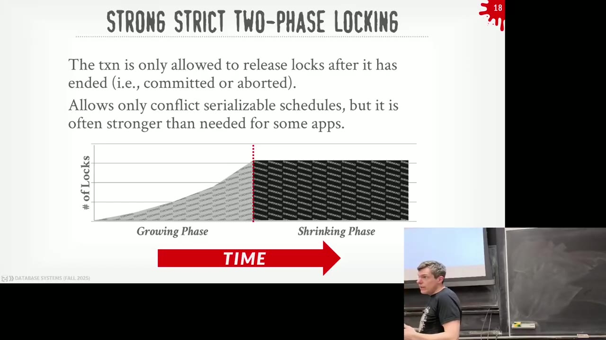
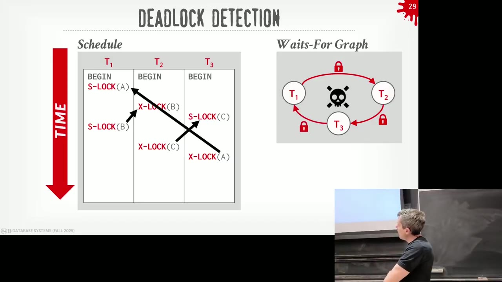
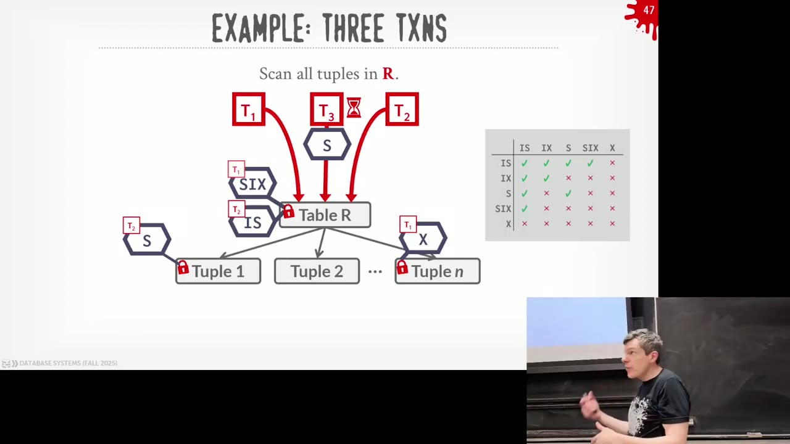

# 两阶段锁：逐段整理译稿

## 00:00–00:42｜开场：DJ 今天去了哪里？

片头是 Fall 2025《Database Systems》的黑白画面和音乐，字幕只留下几个不完整的唱词。老师开场说到 DJ Cache：原来赚钱是要交税的，他这回算是学到了，今天跟会计在一块儿。那是他的麻烦。咱们今天有很多东西要讲，还有一位客人，所以尽量抓紧时间。

## 00:42–03:29｜拿不到未来的 SQL，怎么保证隔离性？

上次刚开始讲并发控制。ACID 里花时间最多的是隔离：一组事务操作排成的调度，到底在什么意义下是正确的？课堂区分了冲突可串行化和视图可串行化。系统实际要提供可串行化时，我们关心的是前一种可以落实的保证：画出冲突依赖图，看有没有环。稍后在死锁里也会看到环，但那是另一张图。后一类可以允许更广的一些排列；老师由此谈到，如果想再利用应用究竟对这些读、写有什么要求，仅看数据库收到的请求不能轻易推知，最坏还要去问人。系统不会靠这样猜测来放行事务。

上次所有纸上题都有个方便的前提：老师把事务从第一项读写一直到提交或回滚，整个序列预先给了你。你能站在结尾问“排得对不对”。真实系统是事务先开始，应用发了一条 SQL，下一条甚至还没决定；有些特殊系统能提前知道，这里不能假设如此。我们要的是在线也能交付冲突可串行化的历史。今天用的工具就是锁。

**编者注：**形式上的 *view equivalence* 比较初始读、每个读取值来自哪个写，以及每项的最终写者；不是“理解业务且最后金额一样”就自动视图等价。这里保留老师由此谈应用语义的脉络，二者不混为定义。

## 03:29–06:20｜上回看的是 latch，这次看 lock

老师放回索引并发那节的对照表。上次只看右半边：操作一页或 B+ 树一个节点，拿 latch、处理内部结构、尽快放掉。今天转到左边：表、元组，甚至整个数据库，是有内容、有事务含义的对象。多个事务可以交错读写这些对象。一个事务更新索引时当然也会拿 latch；但它的事务锁通常能一直持到这整个事务结束，而不是只跨过一次修改节点的短临界区。

写索引代码的人可以约定取闩的次序，不在每把 latch 后面再安排一套检测与牺牲事务的机制。可应用将交什么请求、按什么次序交，系统开发者没有这种控制权。死锁既可能出现，就得建立能预防它的协议，或有一个知道谁在等谁的管理者，负责打破僵局。锁的信息集中记录在 **lock manager**；latch 则通常嵌在它保护的数据结构上。操作系统语境里常被叫作 lock 的那个低层同步原语，在我们这张表里倒更接近 latch。

## 06:20–08:27｜锁管理器的第一张账本

看 T1、T2。T1 要依次读 A、写 A、再读 A；T2 也要读、写 A。先不分锁模式，增加两种记号：`LOCK(A)`、`UNLOCK(A)`。开始没人持有 A，管理器准许 T1，T1 就能读。T2 来要同一个对象，管理器一查：你不是现在的持有者 T1，不能把锁也给你，先等着。T1 继续写、再读、放回 A。管理器不只记得 T1 已释放，还记得 T2 正在队列里，于是准许它继续，直到用完放锁。

这件小事里还有很多细节：什么类型的锁能一起发？怎么安排取与放，才产生可串行化的调度？老师把两阶段锁放回 Jim Gray 等人上世纪七十年代的工作中。下面讲锁类型、2PL、检测或预防死锁、分层扩大锁的作用域，最后交给 Firebolt 的德国嘉宾。

## 08:27–11:38｜模式、升级、等待队列，以及为什么不持久化这张表

latch 有读写之分，事务锁称为共享（S）和排他（X）。不同事务在同一对象上可以同时持 S；一旦一方持 X，另一方的 S、X 都不能给。真实产品远不止两种：老师展示 MySQL 的意向锁、Oracle 不同层次的表锁等。各家的额外模式会使实现和兼容性表更复杂，不会取代“何时能取得、何时必须释放”的协议。意向锁留到后半节。

读写之前，去管理器请求相应权限。已经持有 S 后又要写，可以请求升级 X；如果别人也持有 S，你自己的 S 并不让这个升级自动成功。事务运行中何时能主动释放，是协议的问题；提交或中止时，剩余的锁也要释放。管理器维护一张类似哈希表的锁表：对象、已有的锁和持有者、尚待授予的请求队列。靠这些状态，它能回答哪些活动事务在持锁，哪些正在等待。

演示里开两三个终端便于看清楚；若高端系统一秒处理十万甚至百万事务，维护这些暂态信息并不便宜。它跟磁盘页和真实数据不同：按本课的单机模型，崩溃时正在执行的事务都不再继续，重启不必把崩溃前的等待队列和锁表照原样复活。

## 11:38–14:59｜每一行锁请求都合法，合起来仍可错

现在把模式写全。T1 先拿 X(A)，读 A、写 A，然后把锁还了，事务本身没完。T2 此时申请 X(A)，当然能拿到：它写入自己的值，再放锁。轮回 T1，它要再读 A，取 S(A) 也合法。老师问：它读到哪个值？是 T2 写的，不是自己刚写的。这种异常叫什么？课堂答：不可重复读。可见“有锁”不是“得到了可串行化”。连每一个请求单独看都对，照样会错。

于是引入**两阶段锁（2PL）**。每个事务在增长期按需申请或升级；不相容可以等，死锁或其他原因也可能使它被中止。它不用一开头就列全将来要读写什么。一旦释放了第一把锁，自动进入收缩期：只能放掉已经取得的锁，不能取得新的锁。图中把请求和解锁写出来，是教大家读调度，并非说普通 SQL 应用里每条 `SELECT` 前要手工调用“锁 foo”。系统看到声明式查询，就能为它申请需要的锁。个别系统的表锁等显式命令是另一回事。难的是系统如何知道何时可以提早放。

## 14:59–17:18｜锁数量曲线与学生的问题：等是什么意思？

横轴是一个事务的生命周期，纵轴是它持有的锁数。可以一把把增加；释放第一把之后只能不变或减少。老师又画一条先降后升的曲线：这不允许，原先那个错误就可能从这里钻进来。重做刚才的例子：T1 一开头拿 X(A)，读、写，知道自己还要读 A，不能为了空出 A 把锁放掉再拿回来；T2 要 X(A)，被挡住。T1 读完、放掉之后，T2 才能写、提交。

有人问老师，工作者“正在等待”具体是什么意思？老师答：就是停在这里，在这个简化模型中不能往下做；真实实现有别的技巧。又有同学指出：若不能显式解锁，又不知道后续整个调度，怎么知道可以解锁？老师肯定这个观察，请大家等一下：实际实现通常选更严格的版本，收缩不像刚刚画的那样一段一段发生。他以 SQL Server 作口头举例，并没有在课堂里运行该系统来测定锁的生存期。

## 17:18–20:03｜冲突图无环，仍挡不住级联回滚

单靠基本 2PL，已经能保证运行时生成的调度冲突可串行化：如果事后再画冲突优先图，图里没有环。不过协议还会有级联中止。老师把“本来做的工作全白做了”作为额外的代价来讲，并不是说一个读过未提交值的事务可以不管上游结局就对外提交。

T1 先拿 X(A)、X(B)，读写 A 后放掉 A，还留着 B，随后读、写 B，最后却回滚。它一放 A，T2 就可拿 X(A)，读到 T1 的修改，再用这个读值去写。等 T1 中止，才发现原本就不应把那个值当成已提交的数据：这正是脏读。若允许这种交错，系统得另外记录“T2 读过 T1 的写”，不让 T2 抢先提交。T1 若中止，T2 也必须撤销。否则若已经告诉客户端最终结果，客户端据此作了决定，再撤销内部更新也收不回外界已经知道的事。

## 20:03–24:44｜几轮追问：收缩期不是事务停止运行

后排问，眼前这个也是 2PL 的例子，那它到底解决了前面哪个问题？老师翻回原图：原先 T1 放掉 A，中间可能去等个模型响应之类的东西；T2 便拿 X 写 A、放 A，T1 随后又拿 S(A) 才读到中间插进来的值。如果真正地 T1 后 T2 或 T2 后 T1，都不会有这个观察。2PL 禁掉的是**放了再取**，并不禁止 T2 在 T1 已经释放 A 后成为新的持有者。

学生再核对：增长期不能一边放锁一边还自称在增长，对吗？老师先把阶段名说反，随即改口：只要放了第一把，就是收缩期。接着有人指出投影里虚线的位置不够准确。老师同意：第一次释放时锁的数量就下降，不能画成越过分界仍往上鼓一个包；这张示意图该改，学生是这些年头一个指出这一点的。

再回到级联。假设读过这笔未提交写的不是一个事务，而是几千个。一个中止迫使一大串都中止，CPU 和 I/O 花出去了，没一件工作能交付。学生问 T2 怎么知道自己应回滚？老师答：系统另外维护依赖元数据，幻灯没画出来。另一个问题是 A 已经解锁，怎么还能继续操作？要看是谁放了哪一把：T1 放的是 A，仍持 B，收缩期不禁止对**仍持有权限**的 B 读写，T2 则可以在自己的增长期拿 A。又有人概括：阶段是逐事务的，不是整台数据库只有一个增长期和收缩期？老师说，对，T1、T2 各有各的阶段。

## 24:44–28:18｜宁肯挡住一些原本可行的并发

既然事务不知道下一步，就只能先假设可能产生冲突，在访问之前取锁。这会拦下一些事后看其实也可串行化的安排，交出一部分并行度。老师拿钱作比：你的钱被算少了，数据库跑得快对你没多少好处。不过银行常用流水账再作汇总，并不见得原地改一项余额；许多系统的默认隔离级别也不是最高的可串行化。钱是帮助想象正确性代价的例子，不是对商业银行实现的断言。

基本 2PL 还有两件事没解决：读到别人未提交的改动，可能一同回滚；不同事务按各自顺序拿锁，还可能相互等待。先对付前者。老师说他熟悉的实现往往用 **strong strict 2PL**：增长时照常取锁，此后都留着，直至提交或中止才一起释放。于是对别人来说，我写过的对象不会因为我中途放锁而暴露；要读它，得等我的事务结束。学生把收缩期形容为“末尾的一小下”，老师同意，前面的画法只是示意。

课堂实拍约 27:45。看投影上方的文字：“事务结束（committed or aborted）”才放锁；不要把示意曲线的形状理解成已允许在提交前逐把释放。

## 28:18–30:58｜strict 还是 strong strict？保留现场分歧

老师接着想区别另一个名字相近的变体 **strict 2PL**。他在口头上把它描述为提前放 X、把 S 留到最后，并由此说仍可能有脏读。然后给出 *strict schedule* 的含义：一个事务写过的值，别的事务不能在它结束前读或覆盖。这样不会级联中止；撤销时也不用先追一长条相互覆盖、相互读取的依赖链，可以恢复被改对象的原值。

同学连续追问锁究竟留哪一种、哪一种不会级联，是否只有强版本才有保证。老师再次确认强版本的读锁写锁都留到最后，教材也称 **rigorous**；至于普通 strict 的两种锁，自己可能记反了，课后再核对。这里是讲课当场的犹疑，不能据此把早放 X 教成 strict 的规则。

**编者校注：**按第七版教材作者课件的幻灯 18.10，**strict 2PL：所有 X 留到提交或中止，S 可在收缩期先释放；rigorous / strong strict 2PL：S、X 全部留到结束。**前者已经挡住脏读和脏写，避免由此造成的级联；后者还让其他写者必须等待读者事务结束。CMU 本讲书面讲义 §2 写对了只提前释放 S，却误说这样会重新引入脏读与级联。基本 2PL 本身就保证冲突可串行化，不要误答成“只有 rigorous 才可串行化”。

## 30:58–35:38｜一百美元去哪了？三次算同一笔总额

T1 从 DJ Cache 的账户 A 取出 100，存到他的收款人账户 B；老师开玩笑叫对方庄家，又说也可能是报税的会计。T2 只读 A、读 B，把和给应用。投影的初始状态 A、B 各 1,000，不论先完整地运行谁，总数应是 2,000。

**加锁但不讲两阶段。**T1 拿 X(A) 读 A；T2 的 S(A) 暂时等。T1 把 A 减成 900 写回，抢先放掉 A。T2 读出 900，放 A，再拿 S(B) 读出尚未更新的 1,000。现在 T1 才要 X(B)，反被 T2 挡住。T2 放掉 B，报出 1,900，T1 才把 100 加进 B。钱没有从数据库消失，是 T2 把扣款**之后**与入账**之前**拼到了一起。两种串行顺序都不会报这个数。

**基本 2PL。**T2 起初仍等 A。关键是 T1 这次先拿 X(B)，再放 A。于是 T2 虽可读到新的 A，去拿 S(B) 时却得等；T1 有权继续读 B、加 100、写 B、放 B，T2 随后读到 1,100，总数是 2,000。T1 放 A 以后再没去拿新锁。这一次两个事务最终都提交；前一个回滚的情形另说。**强严格 2PL。**T1 先取的 X(A) 一直不放，T2 从第一次想读 A 起就得等；T1 完成整个转账，到结束时才释放，T2 随后读到一对完成的余额。这个例子的效果近乎串行，不意味着所有强严格调度都不允许重叠。

学生问：幻灯把 `UNLOCK` 写在 `COMMIT` 上面，难道不是该提交以后才解锁？老师答：对，不要把 PowerPoint 排列的两行当成一个可插入别人操作的空隙。放锁是处理提交的一部分，没有另给应用一个“提前放”的命令。最后看调度集合图：串行在里面，外面依次有冲突可串行化、视图可串行化；强严格 2PL 在冲突可串行化范围内，也落在“无级联”区域。无级联是另一项性质，不是与那几个集合完全同心的圈。

## 35:38–40:39｜同时不能往下走：两人一圈，或三人一圈

现在解决第二个问题。T1 先拿 X(A)，T2 拿 S(B)、读 B；T2 再要 S(A)，被 T1 挡住；T1 还持着 A，转头要 **X(B)**，被持 S(B) 的 T2 挡住。这样各有一把对方必须等的锁，又都不可能前进到释放点。**编者注：**这一处口述把后一个请求说成 shared，按投影显示页 26 是 X(B)。若双方在 B 上都是 S，B 不冲突，这个死锁例子就不成立。

有两条路：要么准许等待，之后找环、打破它；要么在有人要一把不相容锁时，照优先次序决定谁能等、谁中止，使环根本不能形成。老师说昂贵的商业系统有许多可调策略，也对 Oracle、DB2、MySQL 作了带保留的比较；究竟哪个合算，要看硬件、负载和具体设置。

先看检测。管理器维护 *waits-for graph*，节点是事务。T1 持 S(A)，T2 持 X(B)，T3 持 S(C)。T1 去拿 S(B)，加 T1→T2；T2 去拿 X(C)，加 T2→T3；T3 去拿 X(A)，加 T3→T1。锁表给出“谁持有”，队列给出“谁正请求”，这样就找到了环。不必猜三方以后还会发什么查询。

课堂实拍约 39:51。投影右边的红箭头从等待者指向持有者；从 T1 顺着箭头能回到 T1。它不是用来判定已执行读写是否冲突可串行化的优先图。

监视得多勤才好？才两三个事务当然容易；几万笔事务的图上，每毫秒跑一次完整查环会抢走执行事务的 CPU。可若每五分钟一次，刚错过上一次的事务可能干等 4 分 59 秒。一个工程折中是先便宜地找只有两笔事务的小环；若找不到，或解了这个环仍没打通主要阻塞，再做较贵的通用查环。不是只会找二环就算已经覆盖所有死锁。

## 40:39–44:02｜解环不等于随便找个人杀掉

除了客户端可以 `COMMIT` 或要求 `ABORT`，DBMS 本身也可以决定中止一个事务。要撤销改动、释放锁，满足原子性；然后才谈重试。若是系统知道完整调用的存储过程，可在服务器里重新调用，类似重发一个 RPC。若下一步掌握在应用代码手里，往往要把异常还给客户端，由它决定从头再试；并非所有应用都写好了这段处理。

选受害者会大大影响代价。按年龄挑，有的策略倾向杀较新的；重启时若保留原时间戳，它就不会永远作为最年轻的事务被牺牲。再看进度：两笔事务一笔已经更新十亿条，一笔只更新一条，通常宁愿撤销后者。也可以数已拿的锁，因为每次在锁管理器中查表、修改条目，需要保护内部结构的 latch，十亿把锁本身就是工作。若允许级联，还得算杀这笔会带着几笔一起退；强严格 2PL 没这种脏读依赖。老师用商业产品的丰富统计和简单策略对比，但没有给出一个适合所有系统的单选答案。

## 44:02–46:23｜回滚一定要退到开头吗？

刚才把中止都想成整个事务撤销。还有保存点（savepoint）：`BEGIN` 后在合适的状态留下一个可退回的位置。比如前五笔更新做完设保存点，第六笔去拿锁导致僵局；如果撤销后面这部分足以打破环，就未必要让前五笔从头重做。老师说更详细的演示留到以后。

学生问谁选择保存点。显式的保存点由应用请求。另有些情形 DBMS 可以在更小的边界上尝试恢复：一条 `UPDATE` 要改两行，第一行已改，等第二把锁时形成死锁；若回到本语句开始前、撤销第一笔改动并解除相关阻塞即可解环，就可能重做该语句，而不必倒回应用。要看系统支持和究竟释放了哪一项。又有人问：前面所谓 A 究竟是行、表，还是一个单元格？现在故意没有规定，例子常把它想成一条记录，但完全可以是别的层级，稍后会讲。

## 46:23–50:55｜不用等图中出环：规定只许一个方向等待

预防不是先看全图，而是在锁请求碰到已有持有者时作决定。给事务一个开始时间戳，较早者优先；不相容时可以等待或让一方中止。若只保留朝同一年龄方向的等待，不可能兜回起点。

两个方案容易混，老师拿 T1（时间戳 1，老）和 T2（时间戳 2，年轻）逐格走。第一种排列是 T2 先抢到 X(A)，**老 T1 来要**。在 *wait-die* 下，老可以等少，T1 等 T2；在 *wound-wait* 下，T1 优先级高，受伤中止的是**持锁的 T2**，它撤销、释放，老请求才能获得锁。第二种排列反过来：T1 先有 X(A)，**年轻 T2 来要**。wait-die 不许年轻的等老的，于是请求者 T2 中止；wound-wait 许年轻的等老的，T2 留在队列。老师起初一句话把后一方案说得像“老请求者自杀”，随后举的这两格例子和屏幕规则均如上。

为什么没有死锁？对同一套规则，所有真正等待的箭头只朝一个方向，与 B+ 树操作按一致方向取 latch 的理由相似。系统可以支持两种策略让人选，并非一次运行时可随意混着让双向等待都发生。事务被中止后再试，仍用它**原来**的时间戳，否则它会一遍遍从队尾作为新来的被赶走。至于哪套胜出，取决于负载。

## 50:55–55:15｜更新十亿行，就要造十亿个锁条目吗？

回到“到底锁什么”。若每项只能配一把固定粒度的锁，更新十亿条记录就得去管理器十亿趟。这不是在 CPU 上翻一个位：先哈希，找到条目，再拿内部 latch 修改状态；办锁的成本可能超过改数据本身。可若一律锁整库，明明要改的只是一个字段，却让大量无关工作停下来。我们想尽量少拿锁，又不想排除不冲突的访问。

把对象排成树：库→表→页→元组→一行的属性。若 T1 需更新整表，在表上取排他权限，保护就隐含覆盖下面所有行，不必列十亿个条目。各事务要遵守同一套层级协议，不能另一个事务从中间直接钻进来。老师举产品说明粒度选择：早期 MongoDB 的数据库级写锁；SQLite 同时只准一个写者，并非等于一概不许其他读者；行锁、表锁常见，某些系统也有页锁。有人会把库置为只读，这也不等于定义了完全相同的锁模式。按老师当时的见闻，Yugabyte 是他能举出的属性粒度例子；精细锁换来更高并行度，也意味着要表示到字段的元数据，协议更复杂。不是说所有引擎把所有这些层都实现了。

## 55:15–57:52｜在表上留下一个意向，让另一方不用查整棵树

只有 S、X 两种模式还很难兼顾粗细：一个只改少数行的事务若直接锁整表，代价巨大；可要整表锁的另一个事务也不能逐叶去找有没有人正在写。于是让祖先上的**意向锁**先说明下面将有什么活动。老师称它为 hint，意思是下层访问的标记，不是想忽略就可忽略的优化器建议。

IS 表示要在下面取共享权限；IX 表示要在更细处取排他权限（也可支持细处的读）；SIX 兼具两部分：当前这个节点及其子树已经共享，下层的少数对象另取排他。把三种意向与 S、X 一起列相容表：X 与其他事务的任何模式都不相容；IS 除了 X 外可以和别的模式共存。原来省掉的逐行检查，并不是不查了：想访问更细的对象，先沿祖先取得足以支持这次访问的意向，到了目标再拿实际读写权限。

## 57:52–1:02:18｜两笔事务点查点改，三笔事务读写整棵树

第一个例子只留表与元组两层。T1 要查 DJ 的余额，即读一行；T2 把收款人的账户增加 1%，改另一行。T1 在表 R 上拿 IS，再在目标行拿 S。T2 不用也不该申请整表 X——它会阻挡所有读写，还和已存在的 IS 不相容；应在 R 上拿 IX，再到自己那一行取 X。表上的 IS 与 IX 相容，目标行又不同，两者可以并行。若目标是同一行，表层过关后，还要在行层解决冲突。

第二个例子有三笔事务，按 T1、T2、T3 顺序发起。T1 要读 R 的全部行，只改其中一行；T2 要读一行；T3 要把整张表都读一遍而不改。这里不指定选择哪套死锁处理，只看请求怎么走。T1 在表上拿 SIX，而在最后那条要改的行另拿 X。SIX 里的 S 不是意向：T1 已有整棵子树的共享权限，不用每条待读行再拿一把 S。T2 在表上要 IS，与 SIX 相容；它要读的是前面一条没被 X 锁住的行，可以再拿该行 S。若改成最后那行，就不是同样的结论了。

T3 为减少管理器请求，直接申请表 S。为何它要等，明明也是读？T1 的 SIX 包含对下层的写意向，和“整表无一行会被写”的 S 要求冲突。T2 提交、放掉自己的 IS 和行锁，并没有让 T3 解禁；只有 T1 结束，T3 才能取得表 S，隐式覆盖全部行。

课堂实拍约 1:01:41。矩阵在投影右侧；左边 T2 的行 S 与 T1 的行 X 分在不同的叶子。真正挡住 T3 的不是“另一个读者”，而是 T1 在表上的 SIX。

## 1:02:18–1:04:16｜估错了要读多少行，能改用粗锁吗？

老师说，假设原以为表里只有一千行，拿一千把行锁可以接受；扫描下去才发现有十亿行。这时管理器可以回到层级的上方，把原来表上的 IS 转成 S，以粗锁覆盖大量细锁，减少管理成本。这叫扩大锁粒度（lock escalation）；不是粗锁申请天生就能通过。

**问：**为什么 T3 不也拿 IS？**答：**既然知道要读十亿行，IS 只是声明还要到下面逐项拿，一个表 S 才直接得到全表读权。**问：**为什么 T1 用 SIX？**答：**因为它确实要读全部，仅写一个子项；表 S 的部分替它覆盖读，再单独给写的行取 X。**学生补充：**若所有行都要写，不如直接把表锁住。老师同意。比如简单地做一个加列、删列的模式变更，系统可拿表 X，挡住其他人边读写边遇到改变中的结构。这是容易解释的一种实现，不是所有 DDL 的唯一方法。

## 1:04:16–1:06:45｜告诉系统“我读完这行马上要改”

通常应用不手动选层级，系统从 SQL 判断应该在哪锁、拿什么模式。有时应用知道更多，比如一次大改就显式锁表。更常用的是给 `SELECT` 加 `FOR UPDATE`。在前面简化的锁模型里，普通查询先拿 S，下一条语句真要更新或删除，才又找管理器请求升级。既然现在就知道是读—改—写，何不在读时争取修改权限？如果一开始就拿不到，至少不必把已经读完的数据和做过的工作白白回滚。

老师提到 PostgreSQL 的 `FOR KEY SHARE`、`FOR SHARE`、`FOR NO KEY UPDATE`、`FOR UPDATE` 有各自相容性，MySQL 也有 `LOCK IN SHARE MODE` 等写法；他不确定具体哪些形式属于 SQL 标准。**编者注：**课堂先拿 S 的说法是简化模型，不意味着 PostgreSQL 每次普通 `SELECT` 都给结果行加共享行锁。

## 1:06:45–1:10:16｜“跳过拿不到锁的行”什么时候反而是对的？

有同学问更低的隔离级别是否改变语义。老师先答不变，又停下来斟酌，说排他模式会让相关操作排队，隔离级别还没讲，以后再细看。他没有给出“加一句 `FOR UPDATE` 就让整个事务达到可串行化”的结论。

还可以选择 `SKIP LOCKED`：遇到当下拿不到合适行锁的元组，就不把它放进本次结果，继续向后找。那同样的数据上连续跑这条查询，结果可能不一样？会的。想像数据库里有一张工作队列表，许多外部工作者来轮询，取一件要做的事并更新为已领取。如果排在前面的任务正由另一个工作者领取，我没有必要在那里等；跳过去，还可以立刻领下一件。老师将它与 `FOR UPDATE` 的作用口头对照：后者强调“读的时候就拿修改权限”，前者强调“拿不到怎么办”。**编者注：**PostgreSQL 实际语法可以二者合用 `FOR UPDATE SKIP LOCKED`；它们并非互斥的两种锁强度。

课末老师回顾锁式协议和变体，说会在 Piazza 再核 strict/strong/rigorous 的叫法，以教材为准。死锁可以检测后解开，也可以按优先级不许它形成；层级让粒度可以变化。嵌套事务和保存点没有展开；之后才谈乐观协议、版本和不同隔离级别，不在今天补讲。最后还有人追问，跳过锁会不会产生不一致的结果？老师答会，所以不能拿来做一般应用里的完整查询；从队列只想找“我现在能拿走的东西”，这样的语义才正合适。

## 1:10:16–1:13:02｜Benjamin Wagner：可预测的负载，需要可预测的计划

老师把讲台交给来自 Firebolt 的 Ben，介绍他在慕尼黑工业大学学过数据库，师从当地研究者（字幕里导师姓氏不可靠），很年轻就做工程负责人。老师问是否 24 岁；Ben 笑着澄清：现在 26 岁，加入 Firebolt 时大概 22 岁。这并不是对“22 岁出任负责人”的确认。

Ben 谢过介绍。大家前几周学过查询规划，他想从工业系统谈一个很具体的问题：小心看待基数估计。翻页一度卡住，恢复后他先说明什么负载需要这种优化器。Firebolt 是横向扩展的分析数据库，SQL 方言兼容 PostgreSQL；处理 TB 乃至 PB 级数据，客户在上面建的是面向用户、直接支撑业务的实时应用。一次查询往往应在几十到几百毫秒内结束，还可能每秒来几百甚至几千次查询。

以监控仪表盘为例：客户可以有一万、十万名自己的用户，但很多人反复看的是同类视图、同样形状的查询。既然模式是可预测的，查询性能就必须也可预测——这不只是单次测试快不快，而是客户为生产服务付钱的原因。

## 1:13:02–1:16:19｜把四种可疑原因一一排查

是什么让 SQL 性能变得没准？其一，摄入变了，突然写进来三四倍的数据，查询自然更重。但在他接触的生产客户中这不常是原因：平台和基础设施团队会仔细控制数据摄入。其二，查询形状变了。由 agent 生成 SQL 确实可能打破这个假设，今天先放一边；传统仪表盘的模式却经常重复，很少一下冒出从未见过的查询。

其三，一万人同时登录的流量尖峰。这会发生，可以靠可靠的排队、自动扩容、消化暂时积压来处理。其四，是不是把系统本身做得过于聪明了？某组件在九成例子上更快，却让剩余表现无法预测。在他们的经验里，这反倒是值得先看的嫌疑。优化器的威力很大：选对连接顺序，可能比单改执行器快上百倍甚至上千倍；能带来如此大的收益，也能做出同样糟的选择。这是量级举例，不是这堂课跑的基准。

Ben 推荐刚获得 VLDB 2025 Test of Time Award 的 *How Good Are Query Optimizers, Really?*；光看摘要就能看到基数估计经常偏得很远，对连接计划影响有多大。接下来回到 Firebolt 自己的处理办法。

## 1:16:19–1:19:22｜不是把 PostgreSQL 的优化器装进来

他们兼容的是 PostgreSQL 方言，并非使用 PostgreSQL 源码。规划器从头用 C++ 写，设计借鉴 **Calcite**。当时有 170 多条基于规则的改写：过滤下推、化简表达式、消掉重复的聚合或连接，都是同学见过的概念。团队特别关注机器生成查询里的冗余；Ben 提到他们在 BTW 2025 的论文，专谈如何让几条规则合起来优化相关的聚合子查询。另有基于代价的连接重排，在连接图上自底向上做动态规划。上述机制也接到了 Iceberg 表上；对现代分析系统来说，这不是边缘格式。

新同事进规划组时，他会先讲几个取舍。第一，**可预测往往比碰巧挑中完美计划更重要**。第二，如果不能保证总能选对，要给有需要的用户控制权：可以固定连接顺序，固定分布式聚合策略，包括是否先做预聚合。第三，尽可能少让不可靠的基数估计驱动选择；在他们当时介绍的策略里，主要把它用在收益足够大的连接排序，不愿到处承担估错的代价。第四，在托管自有格式里，你能控制采哪些统计；把同样方法搬到 Iceberg，很可能只可靠地知道基表行数。这正是后面那个小例子难的地方。

## 1:19:22–1:22:28｜两个“七万”有截然不同的含义

左边 `events` 是有 **50 亿行**的 Iceberg 事件表，通过 `tracker = 'rb080'` 过滤；右边是 **7 万行**的 `event_types`，按 `event_type_id` 做哈希连接。投影先把右边放在建表侧、左边放在探测侧。问题是，如果只知道基表行数，过滤上面该填什么估计？直觉是行越多，可能的不同值也越多。投影举了一条称为 SQL Server 启发式的公式：选择率猜作 $1/\sqrt N$，乘回 $N$，输出约为 $\sqrt{5\times10^9}\approx70{,}711$ 行，投影简写“约 7 万”。它不是测出来的选择率，两边的 7 万也不是同一种证据。

只比较两个点估计的话，两侧行数稍有变化，建哈希表的方向就可能反复翻转。Ben 说他们近几个月在做、当时正往生产系统推的办法，是让计划从底到顶**同时携带下界和上界**。本例基表行数由元数据给出：左侧 `[50 亿, 50 亿]`，右侧 `[7 万, 7 万]`。在左侧上方加过滤，点估计仍可记 7 万，但真正的保证只能写成 `[0, 50 亿]`。范围向上传播会越来越宽，这是投影列出的实际难题。

他们仍先作传统的自底向上成本重排，再作一次降低风险的选择：若界限能保证某个输入小，就倾向用它建表。本例总用 `event_types` 建哈希表，不是声称过滤后左侧一定有更多行，而是右侧有可信的小上界。Ben 说这里只是一个小例子，底下还有很多工程，欢迎有兴趣的人联系；谢谢大家。此段的表名、过滤字面量、行数、公式和上下界经本次嘉宾投影核对，不另行展示嘉宾的独立课件。

## 1:22:28–1:23:04｜片尾

从约 1:22:27.927 起字幕重新标为音乐，随后夹有零散唱词，画面进入制作名单（包括 Andy Pavlo、DJ Cache）。这些碎词不足以组成有把握的歌词，也不作课堂问答翻译。最后一条是音乐标记。原片标称止于 1:23:04，字幕原始终点 1:23:04.662 完整保留在底档，不把多出的 662 毫秒写作额外教学。

## 参考与许可

- Andy Pavlo 主讲，Benjamin Wagner（Firebolt）闪电演讲，CMU Database Group 发布；CMU 15-445/645 Fall 2025，[11 月 5 日官方课表与本讲入口](https://15445.courses.cs.cmu.edu/fall2025/schedule.html#nov-05-2025)。视频题名为 *#18 - Transactions with Two-Phase Locking ✸ Firebolt Database Talk (CMU Intro to Database Systems)*，原片入口在页头，单视频 ID `drStlhNbfHI`，2025-11-07 上传。
- [当季课程投影](https://15445.courses.cs.cmu.edu/fall2025/slides/18-twophaselocking.pdf)及[当季书面讲义](https://15445.courses.cs.cmu.edu/fall2025/notes/18-twophaselocking.pdf)用来校对课堂图、锁模式、矩阵、金额；strict 与 rigorous 用[《Database System Concepts》第七版作者配套幻灯 18.10](https://www.db-book.com/slides-dir/PDF-dir/ch18.pdf)校核。课表指定的是教材正文 §§18.1–18.3、18.9；本文不是教材或讲义译本。
- 本条原片许可字段是 *Creative Commons Attribution license (reuse allowed)*，字段本身不写版本；[YouTube 许可说明](https://support.google.com/youtube/answer/2797468?hl=en)链接 [CC BY 4.0](https://creativecommons.org/licenses/by/4.0/)。本站将英文授课与报告逐段整理为中文、压缩口头重复、补充标明的校注；三张课堂截图从原片有限区段截取，截取时刻约至秒。许可不外推给独立 PDF、嘉宾课件、教材或第三方音乐。
- 原始英语自动字幕有 **2289** 个非空事件；重叠区间先合并，标称片长内覆盖 **4862.720 秒**，含音乐及非语音标记。片首无事件 **0.654 秒**；内部有 **44** 段无事件，共 **120.626 秒**；片尾无正缺口。最大内部间隙 16:29.079–16:37.600 在“等待是什么意思”的问答处；若干其他提问靠讲者复述。字幕间隙不代表静音，没有逐字可辨证据的地方不补造学生原话；片头片尾不是整首歌词的译文。
