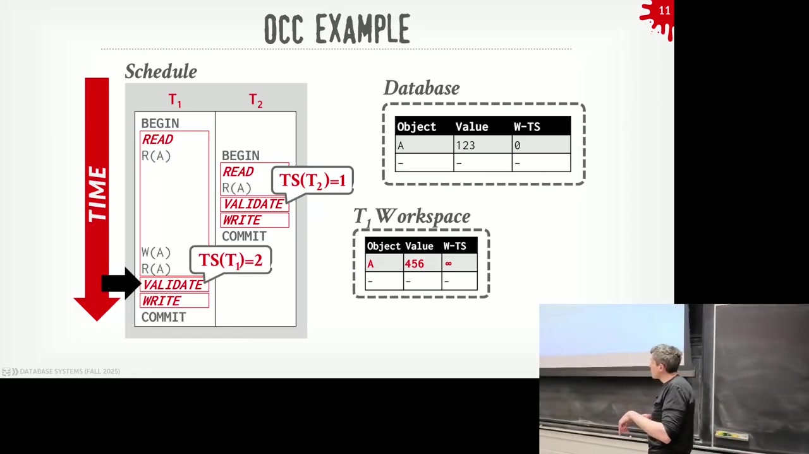
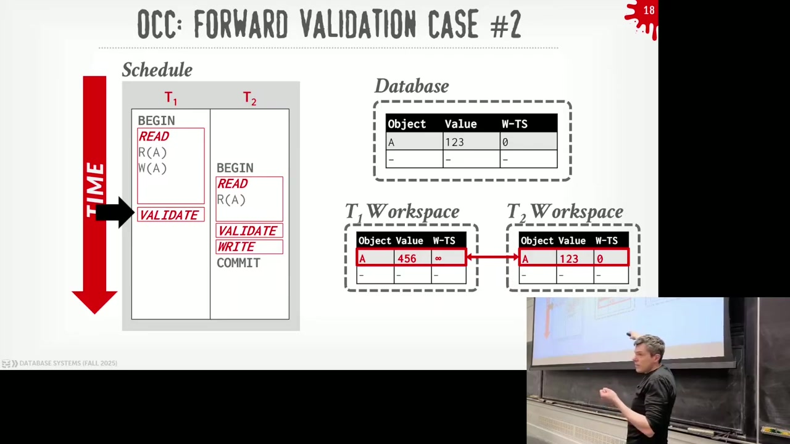
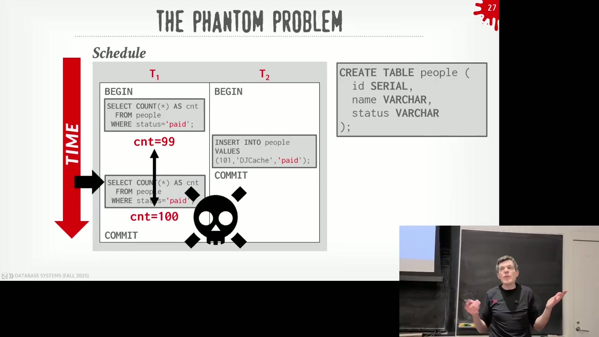
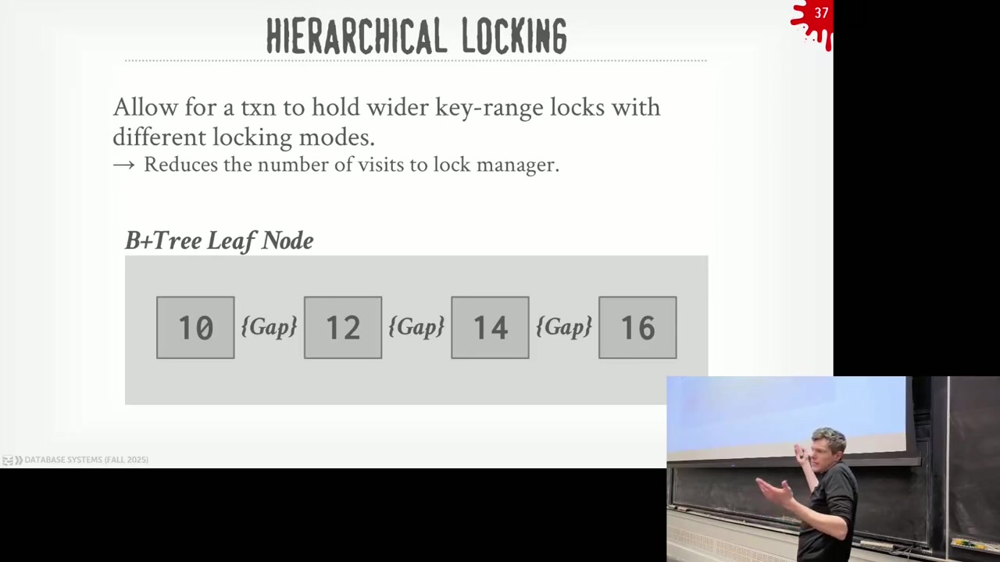

# 时间戳排序并发控制｜逐段整理译稿

## 00:00–03:04 · DJ、截止日和讲座通知

片头是课程音乐和 Fall 2025 片名。音乐里的零散词不当成教师讲话。约 00:25，Pavlo：「好，开始吧。给 DJ Cache 鼓鼓掌。欢迎回来。上周怎么样？」DJ 说本可以更好：有人说他的 beats 还得缴税。老师追问，是会计师这么说的？要交的不是鼓点本身的税，而是拿鼓点赚的钱的税吧？对。那就得交。很高兴你又走回正轨了。转向全班：「今天东西不少，不过讲事务我就很兴奋，来吧。」

Project 3 是这周日到期；周六在 Gates 有特别答疑，下午三点到五点。老师口头纠正日期：「是 15 号，不是 5 号，我少写了个 1。」有问题去 Piazza 或 office hours。HW5 原来也写在 16 号，他把两样事安排到一起了；现在往后移一周，23 号交，Gradescope、Piazza 和网站都应更新。有人对 P3 有问题吗？还有谁没开始？如果担心 P1 的 buffer pool manager 或 P2 的 B+ 树不完全线程安全，可以先在它前面放一个 latch，例如整个页表前放一把。台下插话未完整收清；老师答，这一阶段更可能慢在事务、lock manager 一类的东西上，不是这把页表 latch。

今天课后是 Mooncake 的联合创始人做报告；这家公司做过让 PostgreSQL 读 Iceberg 表的扩展，后来被 Databricks 收购了。明天 dbt 一位联合创始人从费城飞来，中午在 Gates 八楼，有披萨；下午 2:30 在 8115 还有招聘、实习说明会。不用特别报名，来聊就行。上周三来过的 Firebolt 的 Ben 呢？上次我说他今天讲，说错了。今天是 Mooncake，他是下周一在研讨系列里通过 Zoom 讲。

## 03:04–07:25 · 为什么不等算完再查？

上节讲两阶段锁。运行时要交错安排若干事务，还要能保证可串行化。2PL 的出发点是悲观的：你要碰一个对象，必须先以相应模式拿到它的锁，拿不到就不能碰。我们看了几种变形，常见的一种是 strong strict，把所有锁拿到最后。

把假设反过来：如果大多数事务根本不互相挡路，而且很快呢？想一下打开一个网页：发几个查询，取很少的数据，毫秒量级就结束。也有持续一秒、一分钟、几小时，甚至几天几周的事务，以前较常见，现在做成批更新也可能遇见，但不是我们这里设想的多数。能不能先让事务做事，不为每次读写先要锁，直到要提交再问「刚才真有冲突吗」？要是绝大多数没有，可能比 2PL 划算。

今天讲的乐观协议属于时间戳排序这一组。不靠先取得锁来决定操作次序，而用时间戳记录实际发生或应当发生的顺序。假如序列指定 $T_i$ 在 $T_j$ 前，效果就要跟先完整做完 $T_i$ 再做 $T_j$ 相同；物理上并不需要两段程序紧挨着跑。除了事务，对象也要有元数据。先不规定对象是 tuple、页还是表；问题是它上次何时被访问、何时被修改、最后是哪一笔写的。DBMS 在内部维护这些东西；Postgres 有些信息可以在 SQL 看见，正常查询不必叫应用去管。还记得早先说过的页头、元组头吗？这些时间信息就可以放在那里。

## 07:25–11:30 · 时间戳不等于钟表读数

「那么从哪里拿时间戳？」席间有人说用卫星。「先别跳那么快。卫星究竟给你什么？什么样的时间？」答：墙上钟表那样的时间（wall clock）。先定协议所需的性质：给事务分的戳是唯一的，分好不再改，新的号向前增加。整数会绕回，用 64 位要很久才撞上边界。同样叫时间戳，不同协议发号的时机并不一样：稍后这个方案是到提交过程才领；另一些方案在开始和结束区分两个时刻。老师用 PostgreSQL 引出下讲，今天先只看一个排序号。

物理时间可以用系统钟；用 UTC 就不至于因为夏令时调慢一小时而把未来的操作记成过去。还可以有 GPS、原子钟这类很精确的时间基础设施。老师提到 Spanner 和 Amazon DSQL，后者的报告在同时开的高级数据库课上讲过，并非上一节本课。另一个简单办法是逻辑计数器，每来一个就加一。放到多机上，如何让各节点自己的计数器直接对得上？单靠各加各的不行。也可以采用混合办法。今天把这些困难暂时封装起来，假定发出的号唯一且向前。PostgreSQL 的 32 位事务号会绕回，要有专门的处理：数字小了，不表示物理上真的回到了过去。

今天重点叫 *Optimistic Concurrency Control*，简称 OCC。这里有个命名绕口令：它是「乐观并发协议」这一类中的一种，名字又恰好就是「乐观并发控制」。后半节会看，光有前面讲的 2PL 或这个 OCC，哪些异常还挡不住；以及系统为什么会有意降低隔离去换性能。

## 11:30–15:54 · 名叫读阶段，也能写

每笔事务有个自己的工作区（private workspace）。可以把全局库里读到的对象拷进来，在这一小块内存里改，其他事务看不见。要提交时，再看已经做过或正在做的别的事务，是否读写过与自己相关的对象；比较哪一批事务，取决于验证办法。可能批准，也可能要放弃这次、重来。重点是修改到这时还只在私有草稿里。

2PL 的历史我们讲过，IBM 的 System R，1976 年。这个 OCC 工作是 1981 年 CMU 的。H. T. Kung 是做网络的，不是专做数据库；老师打趣，建网络最后不就是为了和数据库说话吗？所以也有道理。阶段名可能听起来有点怪：

第一是 **read phase**。尽管名字叫读，应用的读和写都在这里执行。写一定进工作区，读不一定复制；如果要保证再读同一对象不会变，第一次就存一份，下次从那里读。应用说 `COMMIT`，自动进入 **validation phase**，领一个号，检查按这个号排是否还能等价于串行执行。通过才有 **write phase**，把私有修改装到全局库，令其他事务可见。多项修改要一起生效，不能看见半笔；演示里可以先设一把全局闸，真实实现未必要这么做。所有改过的对象得到这笔事务在验证入口领取的写时间戳。不是一开始领，也不是先公开结果再领。大部分应用工作在第一阶段，后二者是提交协议。

## 15:54–19:11 · 跟着黑箭头看 A 的两份拷贝

黑框是 DBMS 内部阶段，就像上节图上标 lock、unlock 一样，不要求应用自己写这些框。左边 $T_1$ 要读 A、写 A、再读 A；右边 $T_2$ 只读一次 A。全局库先有 `A=123, W-TS=0`，当作是先前时间戳为 0 的 $T_0$ 写的。$T_1$ `BEGIN`，有一个空工作区；第一次读，把整个 A 拷进来。切给 $T_2$，也有自己的空区，也从全局拷进 123。两笔读的是一件东西，但没改，不是冲突。

$T_2$ 先要求提交，在验证时取得 1。此刻 $T_1$ 也读了 A，但没写；$T_2$ 通过。写阶段没有修改可装，扔掉它的私有拷贝就行。切回 $T_1$，现在把私有 A 改成 456；私有 W-TS 暂写成 $\infty$，表示修改待定，**不是已经提交了一个无限大的时间戳**。再读，读到刚在私有区写的 456。到验证入口才给 $T_1$ 戳 2。没有还在运行的对手与它冲突，验证过后将改过的记录标 2，把 `(456,2)` 装进全局。

约 18:43，原片实帧，投影显示页 11。注意黑箭头在 VALIDATE，不在 WRITE；全局与私有区同时显示不同的值是正常的。

## 19:11–23:02 · 三组追问：迟发号、十亿份、怎么原子安装

同学问（老师复述）：既然操作都做过了，为什么等验证才发号，不一开始就发？因为物理上 $T_1$ 先开始，逻辑上却该是 $T_2$ 在前。若进入时就钉死次序，就得让此后的操作迁就这个次序，少了并行的余地。同学再次概括：验证时发，给并行调度更多自由？对。看 A 就清楚：$T_2$ 根本没看到 $T_1$ 的写，且 $T_1$ 在它结束后才公开写。把 $T_2$ 排到后面，反而解释不了它为何读到旧值。正确性要求的是**某个**串行顺序，而不是到达顺序。

又问：拷这么多东西，内存怎么受得了？若真更新十亿个对象，按这个办法确实要有十亿份改动的副本。下节看只记差异的办法，可能小得多；中间结果也可以由 buffer pool 作后备，页被换到磁盘，再换进来便是。另一个问题是原子性：图上只推一个 tuple 容易，横跨多张表、多个页呢？老师说稍后再来，最朴素是整段前面就一把 latch；台下追问是否大家共用，老师答是，想想当时的单核环境。并行验证则可以要求大家按同一个键序取 latch：我动 A、B、C，你也动这三样，两人都按 A、B、C 查，而不是我拿 A 想要 B、你拿 B 想要 A。有人补充还要考虑公平。对，但今天先不解决这个问题。

## 23:02–27:06 · 两种验证，检查的对象不同

在读阶段要记每笔事务的读集、写集；到这里为止先只讲 update，还没讲 insert/delete。若要可重复读，就把读到的东西也放进私有区。多版本下会有别的信息可以问：我开始以来它是否被改过？它在哪个时间区间还是最新的？这就是区分两个时刻有用的地方，下节再讲。还有个被 PowerPoint 方框藏起来的细节：真实的索引指向全局表，你若已经在私有区改过 A，再从索引去全局就读错了。必须有地方记「这张表的 A 我有自己的副本」，不能每次重新走全局 B+ 树。

验证阶段才决定交错是否说得通。先设一次只有一笔验证；若许多线程同时验证，就要保护各工作区的集合，提防数据竞争、拿 latch 互等。高层检验的道理一样，底层机制却不免费。两种方向通常选一种：**向前验证**看看我现在要提交的写，是否会被仍在运行、逻辑上将排在我之后的事务漏掉。它们已读过什么？可窥见它们的活动集合。**向后验证**是看看我运行期间已有谁提交，我是不是错过了本应看见的写。如果我在那个提交之后才在逻辑上生效，却拿着之前的状态，就说不通。

老师说向后做更常见，举了 Amazon DSQL 等系统：可以检查有关时间窗口里已结束事务的集合，或查对象的最新写戳与当初读到的戳。先演向前的，是因为它把「实在什么时候做」和「逻辑上排在哪」的差别显得特别清楚。

## 27:06–30:16 · 向前验证的前两道条件

现在就站在 $T_1$ 进入验证那一点。它领号；别的事务若还在读阶段，还没领号，就先把排序位置看作 $\infty$。针对每个逻辑上较后的 $T_2$，下面三种充分条件至少要有一种成立。先假设没有另外的人正在并行验证。

第一种最容易：$T_1$ 写阶段已经完成，$T_2$ 的读阶段才开始。$T_2$ 连开始都没有，当然不可能已经读错 $T_1$ 的东西；它开工便会看到已经装好的修改。这就是实实在在的串行。画两笔是为了简单，还没开过工的即使有几百笔，也是同一道理。

第二种，两个事务可以重叠，只要 $T_1$ 写完，$T_2$ 才开始写，并且 $T_1$ 没改过 $T_2$ 读的任何对象。换成集合，$W_1\cap R_2=\varnothing$。这项检查防止「逻辑上在未来，却已经读了旧对象」。有人追问另一边的集合呢？老师说一步一步来，前面是你根本没跑，这里是你虽然跑了但没读我的写，第三种还会管写与写。

## 30:16–35:38 · 冲突时非得杀提交者吗？

看例子：$T_1$ 把 A 读进来，在私有区写成 456；$T_2$ 开始，从全局读到的仍是 `(123,0)`。现在 $T_1$ 先验证，它想占据较早的顺序号。把 $T_1$ 的写集和 $T_2$ 的读集一碰，撞在 A。假若 $T_2$ 真在 $T_1$ 之后单独运行，怎能读到 123 而不是 $T_1$ 要装的 456？这不是两个写者抢同一个键，$T_2$ 甚至什么都没改；但不可以按这顺序让双方都过。课上选择让 $T_1$ abort。

约 30:47，原片实帧，投影页 18。红线连的是同一个对象在两个工作区中的记录，不是说两笔事务都要写 A。

「为什么不杀 $T_2$？」老师先开玩笑：人家 $T_2$ 什么坏事也没干，是你的错。又请同学说一遍。问题其实是，$T_1$ 好不容易做了许多事，$T_2$ 才刚起步，丢掉后者不是更省吗？可以设计另一种受害者政策，前提仍是正确；并行时我跟你冲突，到底让谁死，要另加协调。验证失败的自己退比较简单，就像先前 B+ 树遇到拿不到 latch 的处理。

约 32:14–32:32 是长的字幕间隙，学生的完整句子不能可靠逐字给出。老师接着复述并用黑箭头答：若 $T_1$ 的戳比 $T_2$ 小，串行序是 $T_1$ 在前。不要以为图上两笔都已经拿号；把箭头当程序计数器。此刻 $T_2$ 还是 $\infty$，$T_1$ 要得 1，$1<\infty$。再问，为何比较时间戳，不直接比较值变没变？两个 64 位数比较很便宜；如果值是很长的字符串，做差异比较就不一样了。

另一位问到 livelock，老师几次确认问题：若到处都是冲突，会不会烧掉很多 CPU，做完才发现不能提交？当然。悲观的 2PL 在这种场景可能更合算。他们十来年前在很多核上比较过各种协议；若所有人都要改同一个键，归根结底一次只容一笔更新，极端时都趋向串行。轻竞争偏向 OCC，多一点竞争可能偏向 2PL。学术原型会想测出竞争强弱、动态换协议；工程上一个协议已够难做好，真要求兼顾两套，老师说他不愿接这个活。回到图：该排在之后的读者已经错过这笔写，所以不能批准图上这个提交者。

## 35:38–39:36 · 交换验证顺序；第三种相容条件

还是 $T_1$ 私下读写 A，$T_2$ 从全局读 A。这次把验证顺序换了：$T_2$ 先验证。操作本身没变，$T_1$ 早就在自己的区里算出 456，可是向前查的是**我要公开的写**有没有被别人错过，不是看见别的私有区有新值就一定冲突。$T_2$ 没写，它排在前面，读旧值当然可以，先提交。再轮到 $T_1$，把 456 作为后来那一笔安装，同样可以提交。物理上早就动过手，逻辑上这笔改动现在才发生。

还要能处理写阶段也重叠的情形。第三个条件是，较早的 $T_1$ 先结束其读阶段，而且 $W_1$ 与 $R_2$、与 $W_2$ 都不相交。再看一个动画：全局 A 原为 123，B 为 XYZ。$T_1$ 读写 A；$T_2$ 这回先读的是 **B**，还没物理地读 A。$T_1$ 领 1，当前对方只读 B，没有撞上它写的 A，因此把 A 改成 456、标 1，安装到全局。等 $T_2$ 恢复运行，才做它的第二次读，这次读 A 就真的取得 `(456,1)`。最后 $T_2$ 领 2，没有写要装，释放工作区。这跟 $T_1$ 在前的串行解释一致。

把时间线缩小看：向前不是「只查比我晚开始的」。以 $T_1$ 结束时的竖线为准，当时凡还活着、还在读阶段的事务，都可能逻辑上排在 $T_1$ 后面。图里的 $T_3$ 物理上比 $T_1$ 早开始，照样得能查它先前读过什么；所以活动事务的集合不能随便扔。

## 39:36–46:08 · 扫到最后一笔时，第一笔又读了怎么办？

向后查不盯着别人正在改的集合，而是看从**我开始到现在**有哪些其他事务提交，比较那批已经定下来的记录。老师用时间条指出图上有关的是 $T_2$。一位同学长问：向前查要怎么保证你扫过所有读者之后，没人刚读了你的写？若查到表尾，表头的人又动了一下，难道不得叫世界停住？老师先确认问题在验证这一步，不是说已经过了验证。

答：对，朴素串行办法就是挡住这段时间。或者在全局库或公告表上先标出「我在验证，将要改这几项」，我去查别人；再有人要读这些项，就先等。学生又指出，新来的事务也要反过来查，等于做了一点向后的事。对。若每笔很短、集合很小，而且全在内存，这个窗口可能不到一毫秒；若事务要跑几小时几天、相关集合很大，这个代价就不能装看不见，可能几乎变成串行。下节多版本在 tuple 本身记状态，常常可在当地判断该不该读，虽仍有事务表，不是什么都必须反复找一个全局地方。

台下又问（约 42:54–43:04 的远声不能逐字复原）：向后查，难道真要知道从我开始以来谁提交过？是。有张内部事务表，记录还没开始、在读／验／写阶段的，以及虽已提交、但别人仍需依赖其信息而尚未清掉的。对于向前的示例，验证完成、提交之后就不再是那组活动对手。教室里继续追问，起初只能听出零碎的「check」，老师要求讲清**谁**在**何时**查。问题逐渐说清：验证者为何一定得查一份事务清单，不能直接去主库核对我的读写对象各自的时间戳吗？

答：不仅是写过的，读过的也别漏。若信息等价，从正确性上讲逐项回查当然可以；差别在代价。一张内存里的状态表查起来很快，而我读过、没改过的 tuple 可能早被换到磁盘，为看它此后有没有变，得重新把它读一次。听起来奇怪，确实有系统这么做。再问：前向和后向哪个更快？老师没有给出固定赢家；他觉得最终性能可能相近，但向后检查已经走完的事务，不去干扰别人的运行，工程上较容易，所以更常见。

## 46:08–48:44 · 工作白做、拷贝成本与产品追问

串行提交与并行提交我们已经碰过了。并行时要让不同 worker 以一致的次序保护各自要查的结构。OCC 很理想的输入是几乎没有冲突，最好大家只读：两个人读同一项不耽误提交。高竞争时，OCC 常常到最后才退，前面全白做。2PL 想取锁时就可能被挡住，通常较早付出等待；也别神化 2PL，做了一百万件事才拿最后一把锁，也可能此时才卷入死锁而被选中止。

另一个代价是 `memcpy`。一行有一千个属性，只改一个，今天图上的整行拷贝仍要带一千个；下节的 delta record 能只保留变化的部分。有人问不可重复读怎么办？下节会用时间戳解释。有人问 PostgreSQL 是不是就在做这个？老师先说也会复制 tuple，但新 tuple 放在表的另一页，不是图上的私有小盒子；再提醒不要把名字混成一个：它有多版本，会用锁，在可串行化时还有谓词相关的保护。不能单凭「会复制」就把它叫成本讲这一套 OCC。

## 48:44–53:02 · 没有发生过的行怎么上锁？

前面把数据库想成固定对象集合，只有读和更新。现在考虑 SQL 实际问的东西，特别是插入、删除会改变结果集合时。表 `people(id, name, status)`。$T_1$ 运行 `SELECT COUNT(*) FROM people WHERE status='paid'`，得到 99。切到 $T_2$，插入 `(101,'DJCache','paid')`：「干得好！」$T_2$ 提交。切回 $T_1$，完全相同的查询，这次返回 100。不是某一行里 99 变成了 100，是**符合条件的那些行**不一样了。

约 50:12，原片实帧，投影页 27。右边是表定义，中间是另一个事务插入并提交；锁住左边第一次访问的旧记录，不会锁住尚不存在的第 101 号记录。

假设用 2PL，先不取整表共享锁，只锁第一次看见的记录。问题在于那时没有 DJ Cache 这条，第一笔事务上哪儿去锁它？新行能进来，后一次扫描就像看见了幽灵，所以叫 phantom read。反过来，范围内原有的记录消失也可能改变扫描结果。若真是两笔事务串行，插入者无论排在前还是后，都不会刚好分开同一笔里的两次查询。

有人抓住细节：已有行若被共享锁长期护着，别的事务怎么删得掉？老师停了一下，把课堂反例收回到最干净的**插入**情形；用哪种协议、怎样保护范围，要分开说，别把删除也硬套进这幅 2PL 图。另有学生问了一段，老师复述：问题是不是**一笔**事务前后两次查，结果不一样？对。如果是我查出 99、你在另一笔事务里查出 100，中间有人插过，这是完全正常的串行解释。

## 53:02–57:05 · 四种办法，先看锁全表和重扫

第一种干脆：锁表、锁库，或者覆盖所有有关页，不让人插进去。打十亿行的大表，只为查个很小的范围就这样锁，显然多锁了。第二种是到提交时重跑扫描，看是否少见或多见了数据。怎么知道不同？得留着读到的东西。席间问是不是可能要留海量记录；对，或留能可靠区分结果的表示。假设事务很小，这可能可以接受：读一次你的账户，再读一次；或者你在 Amazon 下过十个订单，重读十个，不是免费，也没夸张到不能做。老师回应台下「没那么贵」：没有免费的午餐。另两种是谓词锁与索引锁，后者更常见；在内存里重扫便宜一些。若一定要可串行化，有的系统宁愿锁全表。

具体重扫，保留有关基表扫描的 `WHERE` 条件，提交时看入选的对象及所依赖的数据是否跟第一次相同。不必为了一条聚合查询再把整个聚合、连接和最后的算术原样存起来；重要的是底下究竟从各表看到了什么。老师提到 Hekaton 用重扫；又以 DynamoDB、Fauna **类比**一种反过来的做法：先跑一次「侦察事务」，不把更改真的安装，记录会访问什么，再执行正式的一次，看两次的访问是否吻合。第一次的调度也得有排序协议约束，不是随便跑两次、结果碰巧相同就能证明正确。这是课上的概括，不是几个产品逐版本的实现规格。

## 57:05–1:02:23 · 十亿项长事务的追问；从谓词的交到具体的行

后排提出一段较长的问题；57:04.520–57:19.040 是其中的长字幕间隙，原声不能可靠恢复学生的字句。老师反问，所谓「长」是时间很久，还是改了十亿项？还有另一笔非常短的事务，对吗？其间多次答「对」。最后由老师重述假设：$T_1$ 改十亿项还在运行，$T_2$ 半途进来，读了一项 $T_1$ **已经改但尚未提交**的值，还想马上提交。若不允许基于脏读提交，就不能先这样放行 $T_2$；不在意这种隔离则可能准许，后果归应用承担。**编注：**这里是假设能读到未提交写的通用问答，不是说本讲私有工作区突然能被旁人看见。教师把「等写者提交」和可串行化连着说；前一要求还涉及可恢复性，不能仅凭冲突图无环推出。

第三种，把锁的对象换成谓词。System R 年代就提出这个想法，难在高效判断谓词是否相交。设想所有可能的行落在一个高维空间里，`WHERE` 画出其中一块区域，不是对锁表里编号 123 的那一行加锁。若读的区域和别人可能写的区域重合，就需要并发协议决定谁等、谁中止、怎么处理死锁。在二维里好画，列很多、谓词复杂就难；老师口头形容这个相交判断在一般情形计算上很难，并非说每两个简单区间的相交都难算。

一种近似叫 *precision locking*。老师讲到几代有渊源的系统 HyPer、Umbra、CedarDB，以及一篇上世纪八十年代少有人引用、后来被重新找到的论文。回到眼前两条 SQL：第一条查 `status='paid'` 的整个区域；另一条插入的人恰好叫 `DJCache`，状态是 `paid`，其所在的更小区域当然跟前者相交。真有一万列怎么画、怎么求交？有人问 precision locking 具体看什么，老师答：看另一边**实际的行**。把事务记下的集合想成一张小表，把对手的谓词往那些 tuple 上试，是否匹配？这样不用先求所有可能取值构成的几何区域。Project 4 会遇见简化版思想。

## 1:02:23–1:06:20 · 索引上能锁住什么：一个值、一个空隙、一段键域

更常见的是借有序索引来表示谓词的一部分，连当前不存在的值也能覆盖；无需在锁管理器里枚举每个可能的未来键。锁的逻辑身份来自索引与键／区间，不表示要把事务锁直接塞进 B+ 树节点。四种层层加上去：单键、间隙、键范围、再配上层次。有人问没有合适索引呢？要扫描，锁策略也可能得退到整张表。又问不存在怎么锁？「gap locks，两张幻灯以后就到。」

已有的单键最好懂，比如 14 本身。锁管理器可以记哪个事务对哪个索引的哪个键持什么模式；边界需要时可设虚拟键，例如正负无穷。现在若想插 15，树里却只有 14 和 16，就把相邻键之间的**开区间** `(14,16)` 当作可加锁的对象。整数里只有 15；若域容得下 15.1、15.2、15.3，都在同一 gap。字符串也一样，不必一个个预先造出来。

逐个已有键、逐个 gap 管起来也繁琐。把一个键和紧邻的 gap 合成一把键范围锁，例如 `[14,16)`：14 包含，16 不包含。以后有人要向这范围插入，必须跟这把锁协调。回到已付款查询，若索引能定位 `paid` 的键域，就保护对应键以及能插入新 `paid` 项的间隙。可以约定向后一侧合，也可以向前一侧合；一种实现必须把方向和开闭端点说清，不是每次任选。

## 1:06:20–1:10:23 · 叶页会分裂，逻辑区间锁会跟着变成页闩吗？

把上讲的层次模式也用进来。这次下面是索引里的实际键和区间，上面是更宽的一段。两笔事务可各持父范围上的意向排他 `IX`，在下层一人独占 `[14,16)`，另一人独占单点 12；两个 `IX` 相容，不相交的工作可以同时做。要插 15 的人却不能趁「这条还不存在」钻过去，于是能挡住幻读。

约 1:06:36，原片实帧，投影页 37 的起始动画。图上此时只有键和 gap；两把 `IX` 和下面的 `X` 是随后的推演，不是说这帧已经画完。

「gap 究竟长什么样？」老师先确认是问实现：锁表里可以标明开端和末端，比如两端都开的 `(14,16)`。真正沿叶层扫描时，你一开始未必知道范围里有哪些键；走到相应条目要查锁管理器，看看能否取得读它所需的锁。把它跟 Project 2 的 B+ 树迭代器联系起来想。

又问，在页后部一个 gap 插入，是否要一路锁到页尾？你已在页内，可以读出周边键，也知道想插入或删除的键，向锁管理器请求覆盖目标的范围，要不要到页尾取决于那段范围是什么。学生继续举插入、移动 16 的情形；老师终于区分出问的是**页内物理移动**，把问题复述成插 15 后要拆节点怎么办。答案是在物理修改页时仍须写 latch。刚才的事务 lock 保护逻辑键域；字节移动、挪槽、拆页必须靠保护物理结构的 latch。索引是高效找到逻辑范围的办法，不会替你维持页的物理正确性。

## 1:10:23–1:14:16 · 没有索引的代价；不默认给最强隔离的原因

台下好几只手。老师复述一问：要可串行化，扫描所用的范围却没有索引，难道是查询会变贵的重要原因？是，没有白来的保证。又有人问能否先对谓词做语法或静态分析。老师说，一旦谓词带函数事情就复杂了；学生澄清是想要一条便宜的快路径：若能**证明**一定不冲突便放过，否则回退到较重的处理。这是合理的设想。问有没有这方面的研究，老师答五十年来很多人在试，也许有，他不知道，没硬给出处。

讲了三节可串行化，秘密却是很多系统默认不给。老师特别举 Oracle：即使设置名叫 `SERIALIZABLE`，他在投影的比较里把其实际保证归到较弱的 snapshot isolation。不是说系统完全不用锁或 OCC，而是不愿把防所有额外异常的代价都默认摊给用户。刚才前排一直问，没索引怎么办？得用慢的办法扫或锁。系统若默认慢得让人受不了，用户可能就去用别家。

隔离级别调的是事务会看见其他并发事务哪些行为：脏读、不可重复读、丢失更新，还有刚才的幻读。若从开始时就请求一个较弱的级别，可能容许其中一些。接下来的表从 SQL-92 常见四级讲起，用基于锁的实现来帮助理解。

## 1:14:16–1:18:18 · 四级、同一把锁持多久，以及老师暂不确定的一问

`SERIALIZABLE` 不容许幻读，读可重复，也不脏读；这一表里的丢失更新也不应发生。`REPEATABLE READ` 按这个锁模型仍可能有幻读；已读的原对象则不应一会儿一个值。`READ COMMITTED` 可能遇到幻读、不可重复读、丢失更新：第一次看到的是已提交的旧值，接着别人提交，再读到的仍是已提交的值，但不再相同。`READ UNCOMMITTED` 像不系安全带，表里几种异常都**可能**。老师特意说是「may」，不是一定会；没有其他并发事务时，即使用最低级别，这一笔自己跑也是串行的。

怎么用锁做出这几档？strong strict 2PL，再加前面说的防幻保护（索引锁、谓词保护等）来取得串行等价；不管 gap、只把已读写对象一直锁住，就留下幻读这个洞。再降一级，读时取 S，读过立即还，X 仍拿到提交；这已经不符合严格的两阶段取放顺序了，但可更早让需要写的别人通过。最低一级的示意则连读用的 S 都不取，说的是读者愿意看到什么。写的时候怎么办？老师说通常应用不能显式 `unlock` 一条写过的 tuple，X 会持到结束。

一位同学追问 read committed 及以下跟 lost update 的关系。现场有「能」「不需要……」等短促交错，老师想了一会儿，提到是否放掉 X 又说「我得再核对。这件事确实不容易。」不把这几句写成定论。**编注：**课件显示页 41–42 和讲义 §4 明确写 RC **可能** lost update，示例实现却仍将写者的 X 持到结束。二者不矛盾：若两笔先后都读过旧值再据此写常量，写操作可以互斥，但后一笔仍能覆盖前一笔的计算。不必靠提前放 X 来解释；一次原子 `UPDATE x=x+1` 又不是同一个读算写例子。

## 1:18:18–1:21:20 · 默认值、快照和严格可串行化

在事务还没执行查询前，应用可以选隔离级别；语法因系统而异。老师指产品比较表：SQL Server、MySQL、Oracle、PostgreSQL 这几个常用关系库，表上没一个默认 SERIALIZABLE；MySQL 标的是 REPEATABLE READ，另外几个标 READ COMMITTED。学生问另一栏的 snapshot isolation 是什么；老师说下节专讲。SQL-92 那张基于锁的异常表不足以描述多版本会有的另一种异常；先想成我看见的是开始以前已经提交的数据库快照。

再问：难道所有系统都有一种 OCC？不，有的用 2PL。问答中老师把排序协议与多版本分开：多版本可以搭 2PL，也可以搭 OCC；时间戳可以告诉你一个版本何时创建，不能仅从这个戳推出谁被允许做哪一步。再问哪个较常见，他答 2PL。回到表，老师举了 Ingres（Stonebraker 在 PostgreSQL 之前的系统）、纽约的 CockroachDB、他读研时参与的系统 VoltDB 等以可串行化为默认的例子；提到 Spanner 时又顺口猜 DSQL，随即说自己不确定 DSQL，没下结论。

Spanner 提供的 strict serializability 又叫 external consistency。老师用「到达、提交的先后也对得上」来强调它比只要找到一个串行序更强。**编注：**严谨说，串行历史须尊重可观察的实时先后，特别是 A 已经结束、B 才开始，就不能倒排；并不要求所有**重叠**事务一律依 `BEGIN` 到达顺序排队。

## 1:21:20–1:24:42 · 游标稳定、调查与收场

「什么又叫 cursor stability？」四级之外还有好些级别，别把它们全挤成一条直线。图从 READ UNCOMMITTED 到 READ COMMITTED，再往上有不同分支。老师用 DB2 游标举例：读游标当前正在看的东西时有锁，游标过去会放掉；重新扫一遍却不保证一样。现场追问是否扫描时不许插删，老师答只谈正在看的范围，扫完即放。**编注：**这句话容易听成整段扫描被冻结。IBM 对 Db2 11.5 的 CS 定义是游标定位的**当前行**（具体还取决于游标和配置）；取下一行或事务结束后相应读保护可释放，改过的行另算，幻读仍可能发生，不是整次扫描持有通用范围锁。

老师说自己讲得有点快，演示留到下次。要记住，生产中大多不是用 SERIALIZABLE。他们曾向 DBA 调查生产事务最常用的级别，READ COMMITTED 很常见，恰也是很多产品的默认值。有人问这算合理默认吗？「谁知道？得看情况。」如果 99.99% 的时候没事，唯独某一次读到不该读的值，你甚至怎么知道刚才出事了？刷新网站之后计数器怪怪的也不能都怪在这上面——那常是 eventual consistency 的另一回事。

最后把两派合起来看：悲观派先拿锁；今天讲的乐观派借时间戳排序、事后验证。没有哪一个在所有工作负载上都赢。下一次多版本会把技巧组合起来：新版本可以在共享存储里出现，再用时间戳判断**你**准读哪个，不必永远只想成一人一个私有盒子。约 1:24:02 老师让 DJ 起音乐。其后是配乐、零碎歌声及制作片尾，不作歌词译写。最后的字幕事件止于 1:24:39.239；此后原声仍有伴奏，画面为制作片尾。取得的音轨解码到约 1:24:41.664，播放器时长 1:24:42 为整秒标示，不把相差的约 0.336 秒当成实际静音。

## 引用与许可

- Andy Pavlo，CMU Database Group，**#19 - Timestamp Ordering Concurrency Control (CMU Intro to Database Systems)**，Fall 2025，官方录像入口见页头；[当季课表第 19 讲](https://15445.courses.cs.cmu.edu/fall2025/schedule.html#nov-10-2025)。此处为中文逐段整理译稿，非逐字听写；删语气重复，远处话音不能可靠恢复时以讲者复述标界。
- 四张图均为从**本条**公开录像短段解出的 JPEG，保留课堂投影与讲者，未重制；原视频许可字段为 Creative Commons Attribution license (reuse allowed)，未在字段中注明版本；[平台许可说明](https://support.google.com/youtube/answer/2797468?hl=en) 指向 [CC BY 4.0](https://creativecommons.org/licenses/by/4.0/)。不将这条许可外推到配乐、独立 PDF 或教材；不提供原声、歌词、原字幕或视频切片。
- Andy Pavlo，[当季 slides](https://15445.courses.cs.cmu.edu/fall2025/slides/19-timestampordering.pdf)，投影显示页 11、16–24、27、31–37、40–46；[notes](https://15445.courses.cs.cmu.edu/fall2025/notes/19-timestampordering.pdf) §§1–4。仅作数值、阶段、端点和术语核对。
- 校注：[IBM Db2 11.5，Isolation levels，Cursor stability](https://www.ibm.com/docs/en/db2/11.5.x?topic=issues-isolation-levels)；[Google Cloud Spanner，External consistency](https://cloud.google.com/spanner/docs/true-time-external-consistency)。
