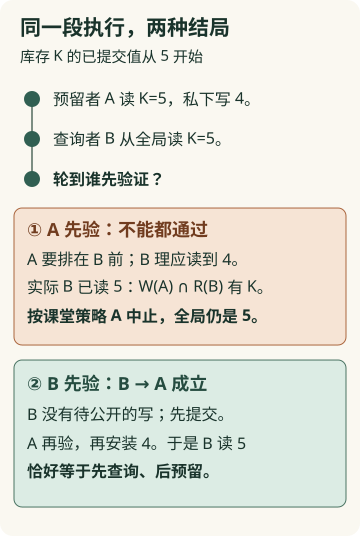
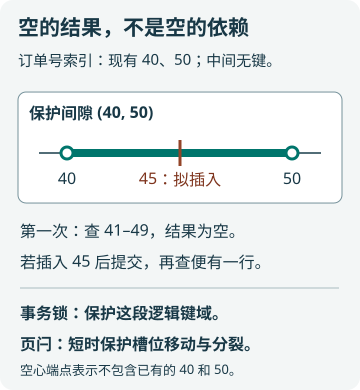

# 时间戳排序：凭什么批准这笔提交？

库存原有 5 件。预留程序已经算出新库存是 4；另一个查询却返回了 5。这一定是错的吗？**先问哪一个值已经公开，再问能否给两笔事务找到一个说得通的顺序。** 如果查询排在预留之前，5 就是正确答案。如果坚持预留在前，而查询早就记下了 5，给双方各贴一个不重复的号也无济于事。

本讲的实验台是**单版本、私有工作区的乐观并发控制（OCC）**。不要一看到「时间戳」就自动套用「事务一开始固定一个快照」；也不要把「不用先拿逻辑行锁」听成「系统内没有同步」。

## 全片回看：在哪一段找哪一个问题？

按原片事件的内容换挡，时间取整到秒。表中的问句是回看片索引；后面的订单、库存和代价算例则是编者的纸面推演。

| 原片区间 | 带着哪一个问题回看 |
| --- | --- |
| 00:00–03:04 | 片头、DJ 问答；P3 何时答疑？为什么老师把 HW5 从 16 号改报为 23 号？Mooncake、dbt、Firebolt 各是哪天？ |
| 03:04–07:25 | 如果请求很快且碰撞少，是否值得每次访问前都拿事务锁？时间戳除了放在事务上，还能放哪儿？ |
| 07:25–11:30 | 卫星提供什么？时钟、逻辑计数器、整数回绕与协议发号时点是四件什么事？ |
| 11:30–15:54 | 私有区隔离谁和谁？为什么应用的 `UPDATE` 在读阶段，所谓写阶段却属于提交协议？ |
| 15:54–19:11 | 从 `(123,0)` 到 `(456,2)`：先开始的事务为何领 2，先返回的读者为什么不改全局 W-TS？ |
| 19:11–23:02 | 迟发号释放了哪一种次序约束？更新十亿项、跨多页安装、按 A/B/C 拿 latch 各有什么代价？ |
| 23:02–27:06 | 索引只指向全局时如何读到自己的写？向前与向后分别查谁的证据？ |
| 27:06–30:16 | 前一笔已经写完时，后一笔的读／写进行到哪儿会改变需要检验的条件？ |
| 30:16–35:38 | 仅读不写的对手怎么也能挡住写者？为什么挑自己 abort？时间戳与大字符串、livelock 与热键有何关系？ |
| 35:38–39:36 | 调换验证次序能否让两笔都过？如果对方先读 B，等你公开以后才读 A 呢？ |
| 39:36–46:08 | 查完集合却尚未公开修改的缝隙怎样处理？查已结束事务和重新读磁盘上的 tuple 差在哪？ |
| 46:08–48:44 | 为什么高竞争下白做工作？一行千列只改一列谁在复制整行？多版本是否等于 OCC？ |
| 48:44–53:02 | `paid` 从 99 到 100：哪一条被锁住的旧行变了？已有行的删除为什么不能硬套这个插入例？ |
| 53:02–57:05 | 锁整表、重扫、谓词锁、索引锁分别在保护什么？重扫真的要重做聚合吗？ |
| 57:05–1:02:23 | 长事务和短事务的远处问题；未提交读与私有写有何不同？怎样拿对手实际写过的行测试谓词？ |
| 1:02:23–1:06:20 | 单键、开间隙和半开键范围的端点怎么画？没有合适索引怎么办？ |
| 1:06:20–1:10:23 | 两个 `IX` 可以共存，哪两组下层键仍互斥？插入 15 挪动 16 时应找事务锁还是页闩？ |
| 1:10:23–1:14:16 | 能静态证明谓词不相交时是否值得走快路？为何产品不一律默认最强隔离？ |
| 1:14:16–1:18:18 | 四级表中的「可能」是什么意思？X 持到最后是否足以杜绝一切丢失更新？ |
| 1:18:18–1:21:20 | 默认级别、快照隔离、MVCC 与 OCC 的区别；严格可串行化多保证了哪种先后？ |
| 1:21:20–1:24:42 | 游标稳定能稳定多久？调查中的默认值是否合理？两派协议总结、下讲预告与片尾音乐。 |

## 一、先画两本账：我看过什么，其他人能看到什么？

用 `Stock(sku, available)` 和 `Orders(id, sku, status)`。假定每个 SKU 唯一、这里只看 `K`。初始已提交 `K=(5,0)`，第二个数是最后一次成功写者的戳。A 要预留一件；B 是向用户展示余量的只读请求。把「事务内的读算写」和「把结果对其他人公开」分开记：

| 物理步骤 | 全局 K | A 的私有证据 | B 的私有证据 |
| --- | --- | --- | --- |
| A 第一次读库存 | `(5,0)` | 读到 K@0，`R_A={K}` | — |
| A 做减法 | 仍为 `(5,0)` | 草稿值 4，`W_A={K}`；再读自己的 K 得 4 | — |
| B 第一次读库存 | 仍为 `(5,0)` | 4 仍未公开 | 读到 5，`R_B={K}`，`W_B=∅` |

**读集记的是依赖，不是查出来的数字。** 即使 B 没把库存显示在返回包里，只用「大于零」决定是否显示按钮，K 也参与了它的决定。**写集记的是修改，不是所有缓存的行。** 复制一份只读记录不会让 B 成为写者。对象标识、所见版本和新值含义也不同，用「集合里有个 5」无法表达这些事实。

图 1。自拟 K 库存例；黑体结论对应课堂「提交者遇到冲突自己退出」的前向变体。切换政策可以换受害者，但不能在固定的错误顺序下同时批准两者。

**路径一：A 先验。** 若按 A→B 提交，串行执行应该先写 4，B 再读 4；已发生的 B 读却是 5。交集 $W_A\cap R_B=\{K\}$ 给出见证。按课上策略 A 中止，丢掉 4，**无需把全局 4 改回 5**——全局从未装过 4。下一位看到的仍是已提交 5。若业务重试，要重读；不应把上一次的私有结果直接发布。

**路径二：B 先验。** B 的写集为空，向前看不会有别人错过 **B 的写**；B 先成功得到较小的戳。A 之后再验、装 4。解释：先查得 5，再成功预留。库里的 W-TS 记录写者 A，不是每一次只读提交的戳。这只是此例的成功理由，不是「凡只读都不需要任何验证」：若是向后验证，多步只读事务也可能错过运行期间的已提交改动。

## 二、为什么要三个条件，不直接判集合相交就结束？

固定两个事务 $i,j$，要求序列为 $i\rightarrow j$。把 $R_i,W_i$ 分别写成**对象集合**；把读阶段、写阶段称为阶段，别跟集合名字混用。下列是课堂和 Kung–Robinson 原论文里的**充分条件**：对每一对这样的事务，三项中至少一项成立。不能把一项的时间条件和另一项的集合条件拼成自己喜欢的版本。

| 重叠有多深 | 足以让 $i$ 在 $j$ 前的条件 | 哪条坏事被排除 |
| --- | --- | --- |
| 不重叠 | $i$ 写阶段完成，再开始 $j$ 的读阶段 | 后者开始时已见完整前态，根本不需要拿两个集合硬比 |
| 两笔的读可重叠，但最终安装不交错 | $i$ 写阶段完成后 $j$ 才开始写，且 $W_i\cap R_j=\varnothing$ | $j$ 已经做过的读没有错过 $i$ 的写；物理安装保证 $i$ 不会在最后覆盖 $j$ |
| 连安装也可能重叠 | $i$ 比 $j$ 先结束读阶段，且 $W_i\cap R_j=\varnothing$、$W_i\cap W_j=\varnothing$ | 既不会读漏，又不用担心两笔安装按相反顺序覆盖同一对象 |

**检验一个反直觉的方向。** 为什么第二项不是 $R_i\cap W_j$？让 $i$ 先读库存 5，$j$ 随后改成 4。按 $i\rightarrow j$，$i$ 本来就不用看见后者的 4，这条依赖完全合法。相反，如果 $i$ 写 4，$j$ 却读 5，把 $j$ 排在后面才有问题。也不能一见 $W_i\cap W_j\ne\varnothing$ 就引用第三项说两笔永不相容：在第二项适用且没有相关读时，顺序明确的两次盲写可以有串行解释。

**向前**从正要提交的早号事务看尚活跃的后来者，注意活动读集还能增长。**向后**从后来到验证点的事务看自己执行期间先提交的早号事务。举个只涉及一种迟读的向后反例：A 在 `BEGIN` 后读 K@0；C 后来把 K 改为 3 并已提交；假设 A 后验证并打算用旧的 5 决定给订单放行。若把 C 排在 A 前，A 的决定就基于过时的读；见证是 $W_C\cap R_A$ 的 K。若 C 是在 A 开始前**已经**完成的，则 A 第一次正常读到的就该是 3，不必为此遍历全历史。

**验证与公布不可留洞。** 假设 A 查到所有活动事务都还没读 K，宣布「无冲突」，随后停住；B 此刻读了旧 5；A 恢复并公开 4。若没有额外协调，刚做的检查已经过期。原子的工作不是单纯取一个全球唯一号；检查、阻挡会使结论失效的访问、公开整笔结果，必须构成正确的提交交界。串行临界区最易解释；并行协议可公告正在验证的键、保护相应状态，按统一键序取得短期 latch 等。统一键序只解决一类循环等待，不会自动给整笔事务原子可见性或公平性。

**哪些记录可以清掉？** A 的私有区失败就可丢，与向后验证所依赖的**其他已提交写集**不是同一种存储。若一笔长事务从很早就一直活着，很多已提交写集仍可能要与它比较。论文 §3.3 给出一种可行取舍：只保留有限的近期集合，若早期证据已缺，就让无法证明安全的长事务重来，而不是把「查不到」解释为「无冲突」。这是编者对原论文的补充，不是下讲 MVCC 的版本回收算法。

## 三、账本上没有一行写错，为什么范围查询仍会错？

换成订单：索引里只有订单号 40、50。审计事务 S 问「41 至 49 号里有哪些订单？」第一次返回空集。另一事务 I 插入 45 号并提交，S 第二次同样扫描返回 `{45}`。只锁住**返回的每一行**，第一次等于一把也没拿；只在验证时重读第一次返回的 RID，也没有一个 RID 可供检查。若 I→S，两次都应有 45；若 S→I，两次都应为空。没有第三种串行解释。

图 2。自拟整数订单号与开区间；绿色横条保护「这里还可能出现键」这一事实，空心圆明确排除 40、50。自上向下读即可，不需横拖时间轴。

| 保护方法 | 在这个例子里保留什么证据／排除什么行为？ | 容易误判的代价 |
| --- | --- | --- |
| 锁大范围或整表 | S 占共享表锁，I 不能以不相容模式插入 | 连插 9000 号的无关事务也可能被挡 |
| 提交时重扫 | 保留扫描谓词及必要的输入证据，重新查选中的行及其依赖，看 45 是否新出现 | 两次 `COUNT(*)` 都是 1 也未必输入相同；记录身份和相关值不能被一个计数替代 |
| 谓词／具体写集验证 | 锁「41≤id≤49」这一条件，或用该谓词去测试并发改变的具体记录 | 任意表达式、函数、多个字段的相交未必廉价；更新也可让原本不满足的行变成满足 |
| 索引区间 | 保护会容纳 45 的间隙；有序索引提供边界表示 | 用哪个索引，在哪端含已有键，最小／最大处用什么虚拟边界，都影响是否漏插入 |

课堂 `(14,16)` 与 `[14,16)` 不同：前者只管空隙，后者还管已有键 14；另一种约定是围绕后继键保护 `(12,14]`。实际用哪边是协议约定。事务要锁的是**逻辑键域**，不是数组的第几个槽。分裂或移页会改变槽号，不会把业务的「41 至 49」改义。锁管理器解决不同事务能不能改这段逻辑数据；页闩解决此时两条线程能不能同时重排物理字节。

## 四、性能：节省了等待，还是把等待换成了扔掉工作？

设一次尝试平均耗费 $c$，成功概率 $1-p$。**只作估算**：若重试独立同分布且每次成本相同，每次成功大致需 $1/(1-p)$ 次尝试，成本约 $c/(1-p)$。若 $p=0.02$，约 1.02 次；若 $p=0.8$，约 5 次。真实热点会使重试相关，估算甚至可能过于乐观。也别拿这个式子比较两种协议的绝对快慢：2PL 还会等待、维护锁表，也可能在最后一把锁死锁，$c$ 也会因为协议而变。

- **轻冲突**：很多互不相交的 SKU、短事务，避免每项提前排队有机会划算；很多只读访问互相不构成写读冲突。
- **热键**：所有人都扣同一 SKU，最后一刻才发现失败，不但重新做减法，还可能重新跑连接、扫描和拷贝。悲观方案在冲突点让一笔先行，可能少做白工；两种都改变不了同一键的成功冲突更新须有一致顺序。
- **宽行、长读、多核**：复制一千列只改一列；很久以前读过的页已经不在内存；发号或提交临界区成为热点。判断瓶颈不能只数 `abort`。应分别量尝试／成功之比、复制字节、验证范围、等待与提交段耗时。

## 五、隔离级别不是完整的实现说明

下面是**课堂单版本锁模型**，不是给现实所有产品下相同保证。SQL 标准常见的三种读现象与工程上关心的丢失更新也不是同一张定义表：本讲的比较特意把后者一并列入。

| 级别 | 在课堂例中可能暴露什么？ | 如何想象一种锁实现？ |
| --- | --- | --- |
| SERIALIZABLE | 表中这四类异常都排除；目标仍是整个结果可串行解释，不止四个勾叉 | 所有已访问项的 S/X 持到事务结束，另保护谓词或索引范围 |
| REPEATABLE READ | 原行稳定，但查询范围可能新增行 | 长持行 S/X，不另外锁空隙 |
| READ COMMITTED | 不脏读；可有不可重复读、幻读、读算写的丢失更新 | 一次读完可放 S，写者的 X 仍持到结束 |
| READ UNCOMMITTED | 还可能看到别人未提交的暂态 | 示意中读不取 S；不能倒推出所有写者都提前放 X |

**为什么长持 X 仍会丢失应用的更新？** 甲乙各自在没有长持 S 的时候读到库存 5，并在应用内各算 `5−1=4`。甲先取得 X、写 4、提交并释放；乙后来取得 X、写**预先算好的常量 4**、提交。库里没有两个 X 同时写，最终却只有一次扣减的结果。把它改成原子表达式、自带前提的更新，或选更强协议，轨迹会不同；不要把某一次 `UPDATE` 的行为外推到所有应用读算写。

**把快照隔离放在哪？** 读到一个稳定的起始快照，不代表能为所有已提交事务找出共同的串行解释。本讲的验证戳决定候选顺序，不是起始快照；下一讲用[两仓库存的写偏斜](#/c/cmu-15-445-2025/lec/lec20?v=notes)具体检验两者的差别。

**严格可串行化又多一层。** 客户端已经看到 A 成功才发起 B，串行解释就不能把 B 写在 A 前面；这称为尊重实时先后。若 A 与 B 的执行相互重叠，并不因此要求所有人按到达顺序排队。产品名叫 Repeatable Read、Cursor Stability 或 Serializable 时，仍应查该系统语义；例如 Db2 的游标稳定主要说**定位在当前行时**的保护，并不为整个扫描谓词承诺无幻读。

课件显示页 47 还列出了 `READ ONLY` / `READ WRITE` 访问模式，录像没有展开。它们描述事务是否打算写，是可以利用的执行信息；**不是**又多出两个隔离级别。

## 折叠自测：先说出证据，再给结论

1．A 比 B 早十秒开始，能否排在 B 之后？把什么当证据？

能，只要两者重叠且所有读写结果都能用 B→A 解释。例如 B 读到已提交的 5，A 的新值 4 只在私有区，B 先验且只读。决定可行性的是读到了谁的哪个状态、什么时候安装，不是 `BEGIN` 队列。A 若已经提交返回后 B 才开始，则额外的实时次序约束也需考虑。

2．在验证条件 ② 中，为什么可以不要求两个写集互斥？

因为这项条件另外要求前者已写完、后者才开始写。只要后者没有读取前者本应给它看的改动，即使两笔盲写最后装到同一键，其安装顺序已经与序列一致。若允许写阶段任意重叠，就不能再借用这个理由。

3．向前验证时检查完活动事务表，再不加保护地发布，少了哪一步？

缺少对「检查之后到公开之前」的同步。已被扫过的事务可能又读了旧值。需要使这段不可被不相容的访问穿过，或让新读者能发现正在验证的写并正确协调；取到唯一时间戳本身没有这个作用。

4．两次查询都返回一笔订单、计数也相同，是否足以证明无幻读或无陈旧输入？

不够。一次是 45 号、另一次是 46 号，计数都等于 1；或者是同一订单但结算依赖的金额变了。若验证目标是保持底层扫描的依赖，必须识别成员及相关读取，或以其他足够强的方式保护其谓词，不能把碰巧相同的聚合数当证明。

5．I 要插 45，S 锁住 40 和 50 两个已有键，而没有锁 gap。I 是否一定被挡？

不一定。两个单点并不包含 `(40,50)` 的内部。须有覆盖 45 的范围／间隙保护或其他等价机制。插入函数短时间拿了页写 latch 也不是保证：两次查询之间 latch 早可能释放了。

6．B 的验证号是 1，A 的验证号是 2。能不能据此断言，A 自开始就只读「时间 2 的快照」？

不能。A 在时间戳 2 尚未分配时就做过读写，重复读同一对象可来自私有拷贝；发号只提出「若都通过，B 在 A 前」这一候选串行顺序，验证还须检查它和已经发生的操作是否相容。若把它当作 `BEGIN` 时就有的读快照，连图 1 中物理时间的方向都说不通。

7．读者见过另一事务私有草稿 4，后来那笔事务中止。能说这是课堂 OCC 的正常回滚效果吗？

不能。单版本私有区的要点恰是未提交的 4 对另一事务不公开；正常 abort 丢掉草稿，已提交的 5 不变。若另一事务真读了 4，说明假设或实现变了。换到共享存放多个版本的模型，也要区分「物理上有一条记录」与「逻辑上可见」。

## 引用与阅读定位

- Andy Pavlo，CMU 15-445/645 Fall 2025，[第 19 讲课表行](https://15445.courses.cs.cmu.edu/fall2025/schedule.html#nov-10-2025)、[当季讲义](https://15445.courses.cs.cmu.edu/fall2025/notes/19-timestampordering.pdf) §§1–4、[当季幻灯](https://15445.courses.cs.cmu.edu/fall2025/slides/19-timestampordering.pdf) 显示页 11、16–24、27–37、40–47（动画 PDF 页码与显示页码不同）。全片顺序、课堂实例及问答见同讲「中文译稿」。
- **课程指定**：A. Silberschatz、H. F. Korth、S. Sudarshan，《Database System Concepts》，第 7 版（2019），[作者目录](https://www.db-book.com/toc-dir/toc.pdf) 印刷页 xi：§18.5 *Timestamp-Based Protocols* 从 p.861 起，§18.6 *Validation-Based Protocols* 从 p.866 起。阅读时分清「操作到来时按给定戳查」与「完成读阶段才验证候选序」；这里只核目录、不给教材全文译文。
- **原论文，编者选读**：H. T. Kung、John T. Robinson，*On Optimistic Methods for Concurrency Control*，ACM TODS 6(2), 1981, pp.213–226，[CMU 保存的原论文](https://db.cs.cmu.edu/papers/1981/kung-tods1981.pdf)。§2 pp.216–217 比较私有修改与公开对象；§3.1 p.218 逐项对照三个充分条件；§3.2 p.219 图 2 及发号时机；§3.3–§4 开头 p.220 看历史集合有界、饿死和串行临界区的代价。此处是独立思考路线，不是论文译文。
- **编者校注**：[IBM Db2 11.5，Isolation levels，Cursor stability](https://www.ibm.com/docs/en/db2/11.5.x?topic=issues-isolation-levels)，核当前行锁的时限；[Google Cloud Spanner，TrueTime and external consistency](https://cloud.google.com/spanner/docs/true-time-external-consistency)，核可观察实时先后及其相对普通可串行化的额外约束。产品说明不是课程指定教材。
