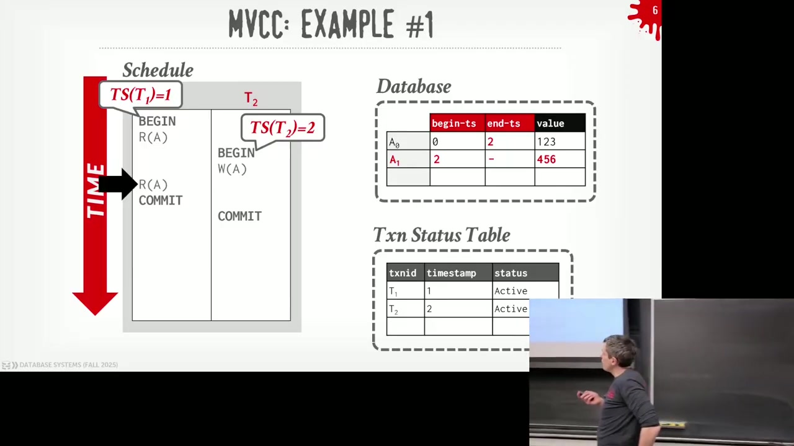
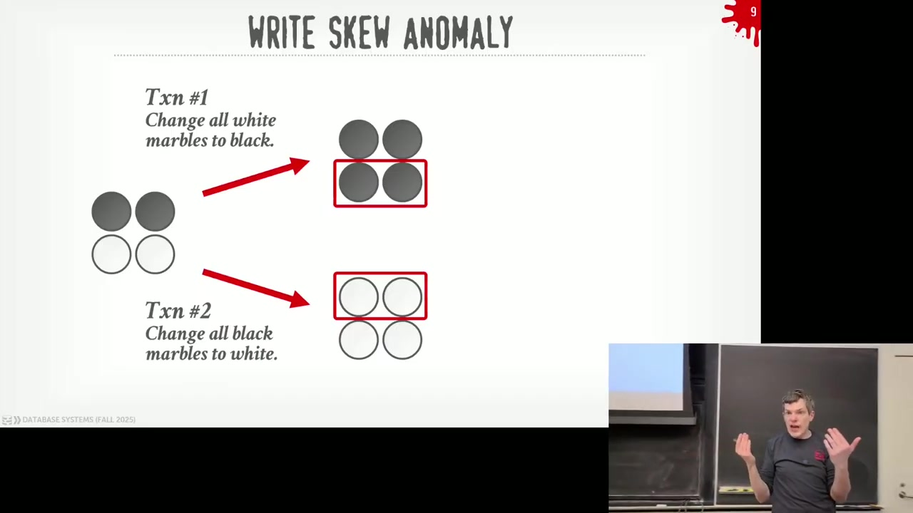
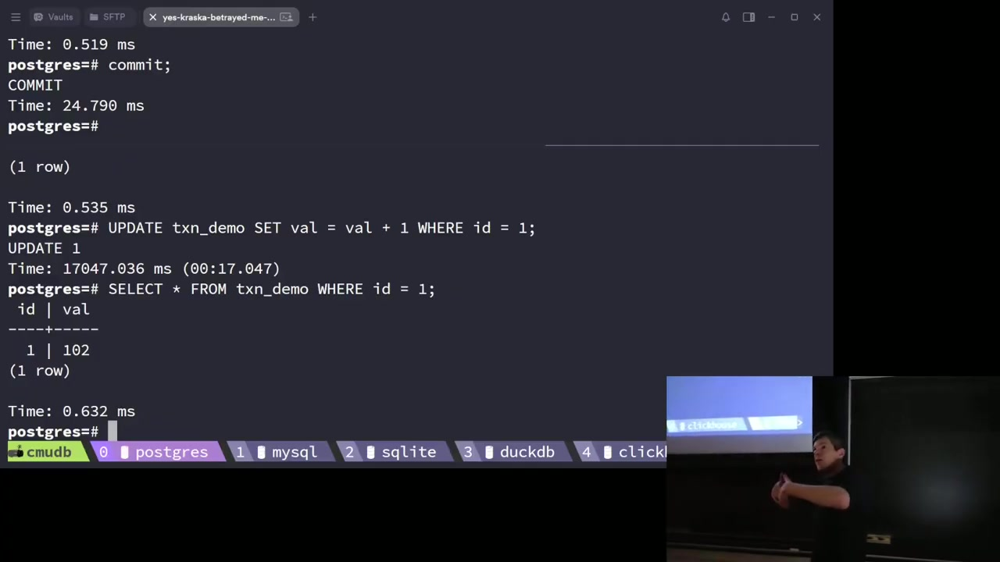
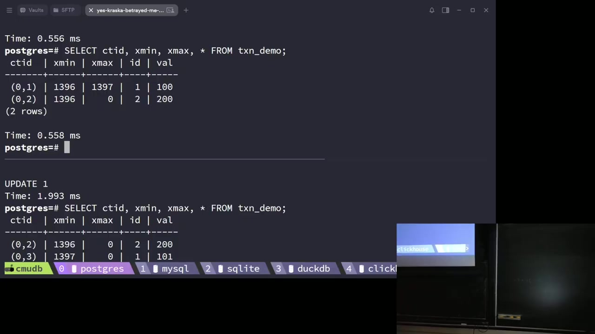
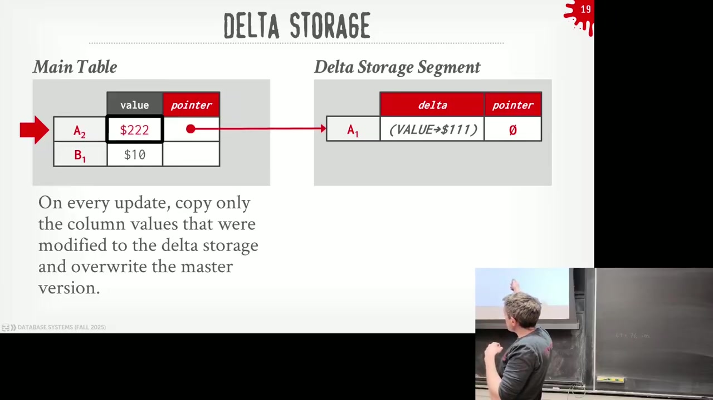
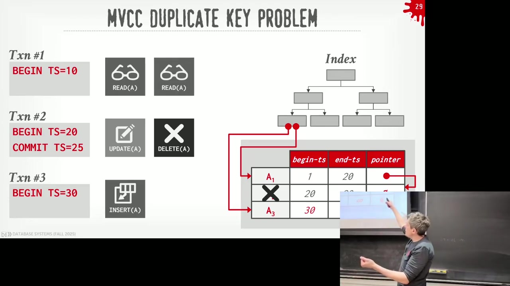

# 多版本并发控制：中文逐段整理译稿

## 00:00–02:10｜今天没有外请嘉宾；作业与项目答疑

开头是带音乐的课程片名。自动字幕在音乐里给出零碎词，临近上课有简短寒暄，不能据此还原完整对白。约 00:27，Andy 谢谢提前到的同学：前一节课没人来，他们一度以为今天是不是不上课了。即便如此，DJ 设备还是架好了，这是真敬业！原定今天来的 Yellowbrick 嘉宾因时间冲突改期，所以这节只有我讲。也好，多版本这个题目东西很多，今后到处都会见到。

在座的同学听一下：Project 3 是这个礼拜天交，他先说成星期一，随即改口；本周六下午三点在 Gates 有专门的答疑。再提醒一次，HW5 已顺延一周，**23 日交**。Project 4 本周初已经发了，12 月 7 日星期天交。打算把习题课安排在下周、感恩节之前，具体再通知。先把 Project 3 做完，确认测试过了，再合并课程公开仓库当时发的更新，开始 Project 4。

问 Project 3：嵌套循环连接写最朴素的 nested-loop join，还是 block nested-loop join？老师把问题重复给全班，反问「你想做哪一个？」听完回答说可以，让你自己决定。学生选的是哪种，录音里不够清楚。

## 02:10–05:01｜从私有工作区走向共享的版本

上节讲乐观并发控制。跟悲观的两阶段锁不一样，乐观协议是假定冲突不多，先让事务做事，准备提交时再查是否违反顺序要求。上次那种 OCC，改动不是直接落在人人都能读的共享数据上。复制要改的元组到自己的工作区，在那里加工；验证通过，到了写阶段才装进公共数据库。

今天还会有「我处理的东西同时运行的别人看不见」的效果，但新版本可以已经安放在全局数据库里，不非得藏在私人空间。上节最后讲了幻读：同一事务两次读一个范围，中途别人插入或移走了满足条件的行。没存在的对象，第一次既上不了行锁也不在普通读集合里，2PL 和 OCC 都得另外处理。可以用索引上的锁；锁整个表当然也能挡住，可太粗了。

名字里虽然有 concurrency control，MVCC 并不是让你把锁、时间戳排序或 OCC 扔掉，改学一套与它们排斥的协议。恰恰是给这些协议多一个维度：可以选择不同版本，而不必都抢同一份数据。你们之前做的 BusTub 都是单版本，到 Project 4 才要把它变成多版本。

## 05:01–08:22｜一个逻辑对象不等于一份物理元组

应用用主键指认的是一个逻辑对象 A。底下每次改 A，可以留下另一份状态。老师先用「不覆盖、创建新版」来讲语义：不应把还要供别人读的旧内容毁掉。等讲到差量存储，会看到主表槽位本身其实可以覆写，只要仍有办法重建旧版。读者拿到的不只是值，还要读版本元数据，判断对自己哪份可见；同一逻辑对象并非有几份物理拷贝就给查询返回几行。

一直更新就会积一串历史。活动事务都不可能再看到的旧版，可以由 garbage collection 清掉，回收空间，也省得以后再翻。反过来，保留历史并让查询指定「按时刻 xyz 的表查」，就能做 time-travel query。平常查询找当前可见状态；审计金融交易则可能问「当初我做这笔交易时，数据库究竟是什么样？」

有人问商用系统真这么做吗？老师说有，而且会为此收费。早期 POSTGRES 在八十年代就留历史。又问：为什么后来拿掉？他说九十年代发现很多用户根本不需要永久穿越，数据却一直长、磁盘会满，于是要有 vacuum。他拿 SQL Server 开玩笑：把「不跑收集器」卖作额外十万美元的功能，存储还得另付。随即也承认，并非只关 GC 就够，查询接口还得能指定时间。这里是课堂打趣，不是产品报价。

## 08:22–12:03｜读写为什么不必互相等，以及这想法从何而来

在以前那个单版本 2PL 例子，普通读要 S 锁，写要 X 锁，二者不兼容。现在，一个写者忙着造新版，读者可以拿旧的可见版，不必等；反方向，普通快照读也不妨碍写者造新版本。没说两个写者也能随意写同一行。有人问这跟索引怎么配合。老师请他等到这堂课后半段：正是索引使事情变难。

多版本不是新潮流。老师追溯到 1978 年 MIT 的博士论文，当时更像在从操作系统／文件系统角度考虑命名与同步；到八十年代数据库圈意识到，可以拿来处理事务。他举早期的 Rdb/VMS 和较轻的 InterBase，说到 Jim Starkey（后来参与创办 NuoDB），以及当年的 DEC 和 VAX 机器。「可以把 DEC 想成当时特别红的科技公司。」接着聊收购：DEC 到 Compaq，Compaq 又到 HP；Rdb 的产品线则卖给了 Oracle。

InterBase 后来有开放源代码的 Firebird，商业版也仍在；他提到俄罗斯还有分支，名字说得不肯定。插一句浏览器的故事：Netscape 之后的浏览器想叫 Phoenix，名字撞了；又想叫 Firebird，却已有这个数据库，后来才叫 Firefox。另一头的 Oracle Rdb 跟通常口头说的那个 Oracle Database 也不是一个产品：虽都是关系数据库，前者来自 DEC，他说如今主要是维护，并不是今天一说 Oracle 大家通常想到的主力系统。

## 12:03–14:59｜第一张时序图：T₁ 已经读了 A，T₂ 还能写吗？

以后图上 A₀、A₁ 这些下标，是方便指着动画讲，不代表实现非存「我是第几版」不可。上节每个对象有写时间戳；现在画两个字段 `begin-ts`、`end-ts`，在事务时间坐标上标一版的范围。初始只有 A₀，值 123，起点是 0，终点画横杠，意为尚无终点。老师强调，不要把「末端没有值」直接念成「最新**已提交**」，现在只知道它是最新的物理版本。

T₁ 开始，拿到 1，读 A。先不管索引如何找到 A；1 落在从 0 开始且没有上界的区间，返回 A₀。切出去，T₂ 得到 2，要写 A。单版本系统里 T₁ 要是还持 S 锁，T₂ 拿不到 X。这里却可以另放 A₁，值 456，起点 2；旧版数据 123 不动，A₀ 的终点标 2。老师特地说区间是**左闭右开**：`[0,2)` 不含 2。

## 14:59–17:49｜学生追问：还得回头写 end，有必要吗？

问：为什么要存结束时间？难道看下一版不就行？老师先确认他在问哪个字段：你的意思是，造 A₁ 已经要写一份，为什么还得回头碰 A₀？那现在若来的是 T₃，它应该看到哪一版？有人答 A₁。他又调换编号：假设新写的是拿到 3 的事务，还有时间戳 2 的读者呢？边界既帮助判断读者落在哪一段，也帮助在以后判定旧版已经没有人需要。图是在说明一种布局，并没有证明所有系统必须物化两列。

但还有个更根本的问题。目前 T₁ 和 T₂ 都可能活着。仅盯着两个数，并不知道造了这一边界的事务到底提交没有。再加一个全局事务状态表，可以想作哈希表，记事务号、时间戳及 Active、Committed 等状态。切回 T₁ 再读 A，仍拿原来的 A₀，这次读可重复。等这两个事务都结束，如果再没有早快照，之后来的时间戳 3 又不在 `[0,2)` 内，A₀ 才不再对这批普通读者有用。

原片 17:00。右上是版本表，右下是事务状态；只看任意一张都会漏掉一半条件。

## 17:49–22:20｜第二张图：为了写而检查 A₁，并不是读到了 A₁

换个顺序。T₁ 读 A₀，写出 A₁，准备之后再读。切到 T₂，它先读 A，再想写 A。如果天真地允许它接着造 A₂，新版就接在别人尚未成功的修改后面了。系统可从 A₁ 没有结束标记、起点指向事务 1，再到状态表发现 T₁ 仍 Active。课堂这一种策略就地拒绝 T₂ 的写，把 T₂ 标为 Aborted；等不再需要其记录，再清状态表。这是写写冲突，不是 T₂ 连读请求都发不出去。

学生接连追问：T₂ 怎么知道该读 A₀，不读 A₁？假设暂时什么索引技巧都没有，物理上可以把两份都扫一遍。老师先顺着「A₀ 的 end 是 1，而 T₂ 的号是 2，按数字该到 A₁」讲到下一步不能从未提交的 A₁ 接着写。学生接着问：那只读、不写呢？刚才说它看见 A₁，不就读了没提交的东西？老师回头澄清自己的措辞：**读 A 的结果是 A₀**。给 A₀ 标结束、造 A₁ 的 T₁ 都还没提交；T₂ 的一致性快照不能接纳这次改动。为了找写冲突，物理上必须检查 A₁ 的存在及其作者，不等于把 456 返回给查询。若反而准许它按自己的旧值接着写，在这个例子里可能丢掉前一写。

学生还问，原来那个 A₀ 凭什么仍能读？老师让大家看下一页。约 21:27–21:35 的远处追问收音很低；可确认讲师随后再次说 T₂ 读 A₀、写的时候才须考虑 A₁，不能替学生补一段逐字原话。

## 22:20–24:00｜快照的一致性，以及一处现场改字

这就是 snapshot isolation，快照隔离。一个事务得到的是开始时的一张一致快照：只纳入当时已提交事务的效果。例如 T₁ 同时改 A 和 B，T₂ 不该看到「新的 A 配旧的 B」这种被撕开的单次提交。读已提交也不等于保证整个事务总用同一张快照；这里还会有一种待会儿才讨论的异常。

若两个事务要更新同一对象，这张图用的是**先写者赢**，不是后写者赢。老师停下，当场改投影片上的 *last*：这一点不能写反。刚才 T₁ 先占住 A 的写，T₂ 在碰到的是活跃写者时中止。

> 编者注：下载版 slides 显示页 8 仍写 *last writer wins*；现场明确纠正，官方 notes §1 也写 *first writer wins*。1995 年论文描述 SI 的抽象提交规则叫 *first-committer-wins*：重叠且写同一对象的事务不能都提交。提前在写入时仲裁，是实现选择，不是把「先写」和「先提交」当成一个时刻。

## 24:00–28:35｜两黑两白：每个人都没看错，合起来仍不对

老师用 Jim Gray 讲过的弹珠比喻来代替抽象定义。桌上四颗，初始两黑两白。T₁ 的任务是「把所有白的换黑」，T₂ 是「把所有黑的换白」。让它们在两个 worker 上一起开始，两张快照都是两黑两白。T₁ 只写原来白的两颗；T₂ 只写原来黑的两颗。动画里的红框是各自的写集合。都装入后，原黑已白、原白已黑，仍然两白两黑。

原片 25:38。右边上下两组是**各事务自己的视图**，不是数据库最后变成八颗；取红框对应的两个写集合，合起来才是最后四颗。

如果真是先 T₁ 后 T₂，第一笔之后全黑，第二笔把它们**全**变白。反过来就会全黑。哪个顺序都不会留下混色，这叫 write skew（写偏斜）。单版本的可串行化两阶段锁在这种读条件上有适当保护，对方不能在读锁还在时获得冲突写锁；单纯的快照读却不挡这两笔不同对象的写。可串行化的 OCC 也不能放行这一对都提交。

他说 SQL-92 那一代用脏读、不可重复读等描述隔离，主要沿着锁系统想问题，漏了这个现象；后来才有论文重新厘清。他转述过一位作者的邮件，开玩笑说审规范的同事当时正忙着写程序，没留意。Gray 很擅长把复杂问题说成人话；提到他拿过图灵奖、参与早期锁工作，以及「五分钟规则」、几个 9 的说法。有人问：SI 是比读已提交还弱吗？老师回答不是；别把它机械塞进上节从 RC、RR 一直往上的单线图。

> 编者注：五分钟规则讨论的是数据留内存与从磁盘取回的成本权衡。「几个 9」这一句是讲者随口举的例子，不作为延迟指标定义。Berenson 等人的 §4.2 更精确：在他们的比较定义中，SI 强于 RC，与**基于锁的** RR 则并非简单强弱关系。

## 28:35–32:45｜让写者等一等：在版本之上做锁管理

决定做多版本，会波及此前几乎所有模块。课堂有人指着投影问一样东西，老师只说那是个「特别项目」，继续列今天五件事：选并发协议、版本放哪、怎么收垃圾、索引怎么办、删除怎么办。刚才朴素的时间戳方案不是唯一解，还能配 OCC，或者配 2PL。

把第二张 A 的时序重演：T₁ 读 123，拿到对逻辑 A 的写权限并装入 456；T₂ 进来仍能读 A₀。不同的是 T₂ 请求写 A 时，锁管理器不是立即宣布它失败，而是因为 T₁ 的 X 锁把它挂在队列里。T₁ 自己再读时能看到自己的 A₁，提交、放锁；T₂ 随后取得写权限，按图装上 A₂（值 789），更新区间。这张动画是在对比**遇写冲突等还是退**，不是证明任意隔离级别在唤醒后都应继续原写。

追问：最后不还得一次只有一个人写吗？为什么有用？老师答，写确实要排队，读却没有一直等。T₂ 读的是旧版，即便 T₁ 对逻辑 A 有排他写权限，这种普通读也不取单版本 2PL 的共享行锁；能边读边写才是区别。锁要防的是别人在同一逻辑记录上同时装新版，不是阻止存储层摸任何包含 A 的字节。

## 32:45–37:09｜PostgreSQL 两个终端：请举手，100、101，还是 102？

老师切到 `txn_demo` 表，有 `id` 和 `val` 两列、两行数据。上下两个终端是两笔独立事务。他退出来重新进入，确认恢复 PostgreSQL 的默认隔离；把 `deadlock_timeout` 在演示里设成 30 秒（他对默认值的口述是猜测）。先各自 `BEGIN`，普通查询都能取 `id=1` 那一行，起点 100。

上方执行 `UPDATE txn_demo SET val = val + 1 WHERE id = 1`。上方自己读，101。下方普通读呢？同学答 100。对，上方没有提交。现在下方也执行同一个自增，光标等住了，因为上方正占用这个逻辑对象的写权限。老师回上面 `COMMIT`。下方终于能继续。现在让大家举手：会是 100？无人。101？还是 102？**下方读自己的结果是 102。** 上方事务结束，不等于下方也结束了。

原片 35:55。下方打印的 17.047 秒包含等待时间；屏幕上读到的是 `val = val + 1`，不是把早先查得的常数 100 再写回去。

为什么不是 101？PostgreSQL 默认是 Read Committed，而不是 Repeatable Read。这个简单单行 `UPDATE` 得定位行再做加法，等上面提交后，符合条件的新版是 101，因此再加一得 102。老师又演一遍普通读：新一轮上下方先都见 101，上方更新但尚未提交时下方看不见；上方提交，下面再发一条查询便看到了变化。这次无需下方也写，照样能看出普通查询没有固定在事务最初的快照。

## 37:09–40:25｜切 MySQL：这次为什么还是 100？

仍是两个会话、两条记录。老师先确认没留在可串行化模式，开始事务，发现终端／数据库上下文不对，停下来复制命令再试。他顺口说 MySQL 这儿似乎能在一个事务里跨数据库名，而 PostgreSQL 不是这样；这段是操作中的插话，并非两系统隔离性的对照实验。

重新开始，上方读到 100，下方也读到 100。上方给 `id=1` 加一。下方此刻普通读？100，没提交的新版不能拿。现在上方提交，在它那里查当然是 101。下方还在同一个事务，问是 100 还是 101？**100**。老师解释 MySQL 这里默认的 Repeatable Read 保持了它在这个事务内已经看到的快照。

再开一轮，结束下方原事务；已有记录分别为 101、200。上面把第一行再加一，下方此前还没读过，这时第一次查，应看到 102 还是 101？101，上面仍没提交。上面现在提交，下方再做普通读，刚才定下的视图仍没改变。区别不在两系统是不是都有多版本，而在**哪时取快照、哪种操作使用它**。

## 40:25–44:50｜让行头说话：1396、1397 和三个槽位

老师回到 PostgreSQL，先退出一个残留的事务。这次别只 `SELECT *`，把 `ctid, xmin, xmax` 也列出来。`xmin` 是创建这份行版本的事务号，这里看到 1396；`xmax` 为 0，表示当前示例没有已生效的终止者。`ctid` 是物理位置，可理解成页号和槽号；查询知道当前扫描哪页、哪一项。可以写条件按 `ctid` 直接查到这份版本，但不要把这个地址当业务行号，产生新版时地址会变。

上方面板用 `BEGIN TRANSACTION ISOLATION LEVEL SERIALIZABLE`，先查表。下方改第一行，这回 `UPDATE` 后带 `RETURNING`；类似查询的输出投影，让它直接返回 `txid_current()`，报告本次写者号 **1397**。先问上面现在该看哪份？仍是刚才的旧行。但再看物理元数据：那份旧行的 `xmax` 已从 0 变 1397。看到行头变化，不等于查询收到对方未提交的 `val`。

原片 44:31。上方有 `(0,1)`、`(0,2)`，第一行 `xmin=1396, xmax=1397, id=1, val=100`；下方保留第二行 `(0,2)`，第一行却是自己写的 `(0,3), xmin=1397, val=101`。新版本真放在同页另一个槽，不是输出排序把同一行挪了位置。老师对这种存法颇有意见，说稍后会讲理由，然后回滚这组演示。

## 44:50–46:05｜把写者相互堵住：原来仍会死锁

若 PostgreSQL 真有死锁检测，造一个环就能看到。演示把检查等待设成 10 秒。上下两边都开始事务：上方改 `id=1`，下方改 `id=2`，各自都成功。再让上方改 2，等下方；下方改 1，也等上方。两把写权限形成环，不是多个读者在互相阻塞。

稍等，报告出来。上方那笔被选作牺牲者，释放资源；下方那条原本等待的更新立刻能跑。投影报告两进程分别等待对方的事务，顶端显示等待约 10 秒。不要解读成锁一等够十秒一定杀它，也不能从一次结果断定每次都是上方或总杀先开始的那个。

## 46:05–48:47｜请求 Read Uncommitted，真的能看脏行吗？

换个低隔离级别，两边明确请求 `READ UNCOMMITTED`。先看现有行：某版 `xmax` 带着 1399。此前这个事务回滚了。要查事务状态才知道，虽然行头上出现那个号，这个删除／替换没有成功，并不能仅因 `xmax` 非零就不返回行。

再让上方写，`RETURNING` 得到事务号 1400。下方执行普通读，究竟读前面那版，还是能看到 1400 未提交的更新？按这个级别的名字，它**可以**给你脏读；在这台 PostgreSQL 上，结果没有。老师说，这是「往好的方向骗你」：它接受命令，但按 Read Committed 做；再实现一种能让你读到别人未提交内容的路径，还得额外做工。他对比某些系统报了高隔离名却只给较弱行为，顺带拿 Oracle 打趣；这不是在课堂上运行 Oracle 验证。既然已能不挡写地读一致快照，更低一级对这里的性能好处也未必大。

## 48:47–51:25｜问答：是扫描算子被挡，还是 UPDATE 被挡？

有同学问，是说 MVCC 之下 `READ UNCOMMITTED` 一概没用吗？老师答，不是，我说的是 PostgreSQL 的这个实现不会这么做。接着一段来回里学生声音远、短句有重叠。老师先确认他指哪张表、读表是不是会拿共享锁；例子中的 `id` 是主键。能辨出的核心问题是：如果更新算子从子算子拿记录，读／顺扫会先阻塞，还是到要执行更新时才阻塞？

老师答：锁管的是逻辑对象。假想全表扫，worker 完全可以物理上把各版都看过，读时间／状态才能知道哪些应返回；没把一份仍需读的历史凭空抹掉。是要改那行、竞争安装新版时才需相应的写权限。那是否**恰好**在 update executor 升级／取锁？这得看实现、锁表用什么标识。若锁绑死一个会随着版本搬动的 RID，不好用；若已知主键就能定位逻辑对象，实现甚至可以在执行到更新算子以前锁它。又有人问要不要多版本索引。他说大家一直追问的正是后面的难点，还剩半小时，得往下走。

## 51:25–55:17｜有了版本链，仍要选把什么放在链上

总不能每读一行就把全表所有拷贝都找一遍。可以在元组头放指针，把同一逻辑行的物理版连成一条链。索引提供进入链的入口，worker 再找自己的可见版。接下来的设计不光决定谁是链头，还决定链上到底是整行还是足以重建它的信息。

第一种 append-only：修改时复制完整元组，把改后的新行放回跟普通元组同一个表空间。第二种 time-travel storage：也做整行副本，但把历史版本放进另一块与主表相联的存储，可把它想成引擎自己管理的一张历史表。第三种 delta storage：根本不拷贝所有列，只将要改的列原来是什么存成差量，主表留下最新值。

有人问第二种到底是只存上个版本，还是把各个旧版都放进去？是历次仍保留的旧版，不只上一次。老师提到 SAP HANA 曾一度反过来把新版放另一头，后来改了；举例时会把当前行放主表。有人可能觉得两种全行复制差不多，分开放却会改变 GC 等工作。他偏爱第三种：PostgreSQL 及其许多分支沿用追加整行，这部分在他眼里是后端最不理想之处，甚至专门写文章批评；他举 MySQL 和 Oracle 为差量式的例子。这里是对常见工作负载的设计判断，不是说差量读历史总最快。

## 55:17–57:52｜同一张表里追加整行：链头是最旧，还是最新？

现在写 A。在内存里拷出原元组所有值，生成新版，装到主表空槽；A 不同版本可与 B 等其他行交错摆放。动画为好画把 pointer 列放在尾部，实际可在记录头。连好指针后，若索引指的是 A₀，链从旧到新，后续版本只接到尾部。读者从索引或 RID 命中 A₀，然后顺着 A₁、A₂……走，结合起止时间找自己能用的一份。多数事务来取的是当前状态；链很长时，从最老开始真不划算。不过这朝向对稍后讲的合作清理有好处。

反过来，newest-to-oldest：插入 A₄，让 A₄ 指回 A₃，原先指向 A₃ 的链头得改指新位置。不是物理上把所有行往后搬，而是入口／指针要对。只要新版可见，最新读到入口就完成；可是如果一个或多个索引保存物理链头，插新版后就得去那些索引修改引用。没有免费的一头。

## 57:52–59:12｜历史区单独放完整旧行

同样是改 A，这次先将主表的旧整行复制到专门的历史区，接好它的后继关系；主表位置可以直接换成最新值，让它指向刚刚移走的那版。再改一次，又多一份全行，当前主行留下指向历史区最新历史的指针，这个例子按新到旧走。他用 SQL Server 举例，再提到 HANA 对方向的取舍。

只是搬个地方为什么重要？知道那边只有旧版，GC 可以主要翻历史区，不必为了找旧记录遍历大家都在读写的主表。像刚才讲的 PostgreSQL 追加布局，vacuum 则不得不触碰主表页，可能与前台事务争资源。别把 *time-travel storage* 这个布局名混同于先前说的任意历史时刻查询：空间若已回收，名字本身不能把值变回来。

## 59:12–1:01:09｜反向差量：把 A₃ 还原到 A₂

老师最推崇的是只存真正改动的列。改之前，把那些列的原值放进独立的 delta 区；可以把这部分想成 rollback segment。原值安放好，再覆写主行，更新指针。第二次修改时同样留下差量，把这一条接在先前的差量前面，因而主表仍从最新往旧找。

原片 59:40。主行 `A₂` 的值为 222，指向 `A₁: VALUE → 111`。读旧值需要的是改前的 111，不是把 222 再写一次。

GC 也受益：若知道水位线，能证明某一整块回滚段都不可能再被读到，有时直接丢弃那块，不用一条条去主表里折腾。读过去呢？像反着打补丁。在查询自己的缓冲区拷当前 A₃，按顺序应用回退到 A₂ 的差量，就得到要的 A₂；要更早就继续，别把主表本身改回去。图上只有一个属性，没显出节省来；设想一千个属性只更新一个，就知道为何不想把一千个全复制。

## 1:01:09–1:03:31｜哪一版可以还给空间管理器？

旧不等于废。读者在事务开始取得一致性快照，只看当时已提交的状态。一个更新的已提交版存在，**在没有仍需旧版的活跃事务时**，较老版才可能释放。中止事务造的版本也要清，因为它们不能成为别的事务的已提交结果。这里有两问：怎样找到候选？找到后，怎样知道现在安全？

老师说可在事务状态表掌握一个向前移动的门槛，也就是仍须服务的最老事务／快照的水位；如果有人把事务挂好几天，这个门槛就可能被卡住。怎么找候选有两大路：直接检查元组，可以让后台线程扫，也可让正在运行的事务顺手清；或让事务登记写集合，告诉清理器自己作废了哪些旧版。记录作废只是候选，还要过前面那道可见性检查。

## 1:03:31–1:05:33｜后台 vacuum：12 到底能不能读 A₁₀₀？

举例，T₁ 和 T₂ 活跃，时间戳分别是 12、25。把这些边界告诉 vacuum，让它扫表，比较每一版的起止。如果 A₁₀₀ 和 B₁₀₀ 的区间都是 `[1,9)`，最老的读时刻 12 已经过了 9，它们不服务这两个事务。图里另外一版 B₁₀₁ 是 `[10,20)`，12 就还能用，不应跟着清。

学生插话：12 难道不能读 A 吗？老师补出图上的隐含条件：如果 A 在 12 时仍存在，别处应还有接替的 A 版本。系统知道链朝哪走、一个节点是不是中间节点，而投影没有把整个 A 链画出来；你提醒得对，应当补画。重点是不能只见「A 上的开始号 1 小于 12」就删除，也不能删掉仍是当前版的行。

每回都顺序扫也很笨：有些页自上次 vacuum 后根本没动，读盘、挤进缓冲池，还会把更有用的页踢出去。他把优化解释为用位图找出需要考虑的页，跳过无需重扫的地方；它不是告诉你这行究竟怎么改的，只能减少候选页。

> 编者注：课堂口语用「自上次后是否改过」来说明跳页的价值。PostgreSQL 的实际 visibility map 跟踪的是整页 *all-visible* 等性质，页以后改变会使相关标记失效；不是一个保存所有修改明细的 dirty bitmap。

## 1:05:33–1:08:55｜顺手摘节点，还是让写者报告 A₂、B₆？

合作清理：读者 GET(A)，从索引到旧→新链的头。它知道全局最小活跃时刻；若一路遇到谁都看不见的老节点，就顺手摘掉，更新索引使其指向新的链头，再继续找自己的版本。有人说，这便是旧→新也有长处？对，这种方式下，访问最新数据本来就会经过老垃圾。但一个逻辑上的 `SELECT` 此时物理上在写！它不必为「修改 A 的业务值」去拿事务 X 锁，却得用 latch 等短期保护安全地改指针和索引。

老师本已转到事务级 GC，又回去补一句：如果从来没人读 B，那一长串 B 的旧版本谁来摘？微软的人称这种冷僻位置为 *dusty corners*。只靠顺手帮忙会永远漏掉这些地方；要全部清干净，还需周期性让后台来扫。

事务级办法不再让 vacuum 漫山遍野找目标。事务写出 A₃，知道旧 A₂ 被自己替代；再写出 B₇，知道旧 B₆ 被替代，把这两项放在自己的旧版本集合。图上例子开始号为 10、提交号 15；在示意记录中，旧版的上界被写成 10。事务结束后，把 `{A₂, B₆}` 交给集中收集的 worker，等没有还看得见它们的事务，再按清单找位置、回收。比起每个读者自己发现垃圾，这是一种集中管理候选的办法。

## 1:08:55–1:11:11｜主键是链的入口，改主键像换了个逻辑对象

终于答索引问题。主键索引提供逻辑行的链头；像 InnoDB 那类索引组织表，行就在叶页里，那里就可看作链头，旧值另在回滚段。若修改的是主键列，通常把语义拆成「删旧键，再插新键」。还要处理同一个键删掉并提交之后又被人合法插入的边界情形，待会儿有图。

辅助索引不这么轻松：它的值究竟指什么？你前面选了旧→新还是新→旧，同表追加还是差量区，都会改变链头会不会搬。若它指着每次会变的新位置，写一行就不止动一个地方。

学生追问改主键，老师复述：若 `id=1` 要变成 `id=2`，我的描述是先按旧键删、按新键插；你建议先试新键，早点知道是不是冲突。老师认为这种优化可以考虑，逻辑效果还是删旧与插新这件事。远处的完整提议未辨清，不把它说成一个实现方案。这里更不是说事务中可以向其他读者暴露两步之间的一半结果。

## 1:11:11–1:16:01｜辅助索引装物理地址还是主键？

老师用 Uber 当年从 PostgreSQL 转 MySQL 的工程博客引出一个现实取舍：在他们的工作负载和硬件上，多版本和辅助索引的组织有明显的性能差异。他打趣说完整标题或许应是「从 MySQL 到 PostgreSQL 又回 MySQL」，来回迁移花的钱够请人咨询了。投影中的外部博客不是本讲授予再发布许可的课堂原创图，这里只转述老师拿它要说明的问题，不搬博客图，也不把一次公司的经验当通用基准。

方案一，辅助索引保存逻辑指针，像一把稳定的钥匙。不论物理位置怎么搬，先查辅助索引拿逻辑标识，再经映射到真正链头。坏处是多一跳。方案二，直接存物理地址，少一层查找；看下面这组**追加整行、新→旧**的例子，老师还特意说这不是照搬 PostgreSQL 的方向。

由主键 GET(A)，查到 RID 就到链头；要旧版还得往下走，但定位入口很直接。若多个辅助索引里也都放这个物理 RID，插入新的 A₄ 成为链头之后，除了主键索引，所有指向老头的辅助索引都要改。哪怕这次只动了**不在任何索引键里的列**，只要地址变了就得改引用，还得相应访问和保护那些索引结构。一个索引问题不大，几十个就不同了。

换逻辑指针怎么走？他用 MySQL 的索引组织方式举例：辅助条目带着主键，拿到主键再去查主索引，叶子里正好有数据行。仅仅因为一个普通属性更新、当前版位置改变，不需要令所有辅助项跟着换地址；主键值本身变了，则回到前面说的删除再插入，相应辅助项当然要维护。额外一次查找，换少改许多指针，没有一个答案独立于负载。

## 1:16:01–1:19:53｜删 A，再插同名 A：索引为何必须容得下两份候选？

大多数系统不在每个索引键里复制一整套版本状态，索引组织表的叶子则本身就有行数据。老师说 PostgreSQL 用物理引用、版本可能跨页，索引中可以有指到不同物理版本的项，免得查一次沿一条很长的跨页链从头追。换来更快定位，也留下 GC 清索引引用的代价。不能由「有指向版本的条目」推出「每个索引键都编码完整提交时间表」。

底层索引还必须应付不同快照中的重复键。以前讲过，在只接纳唯一字节串的 B+ 树中，可以用 `(辅助键, RID)` 区分相同辅助键。类似地，可以附标识或少量版本信息来区分两条物理项：业务上都是 A，存储的字节却不必一样。但这只是让树装得下候选，主键是否允许插入仍需按语言语义原子地查冲突，并且旧入口不能在仍需它时被清掉。

例子按三笔事务走。T₁ 从时间 10 开始读 A，找到 A₁。T₂ 从 20 开始，先更新 A 成 A₂，又删除 A，在 25 提交。收集器还没跑，指向原链的入口还在那里；老 T₁ 也还活着。T₃ 从 30 开始，把同一个键 A **另插一行**，得到 A₃。对新事务而言这个键已空，插入是合法的；对 T₁ 而言，再读必须仍是 A₁。哪怕 T₃ 现在也提交了，T₁ 的旧快照仍不该转去 A₃。

原片 1:18:55。关键不是链上多了个普通更新，而是新 A 和旧 A 是两段不同的逻辑生命期，图中不是把旧链直接接到 A₃。一次查找可以拿回多个入口，worker 再选对其快照成立的那条；物理重复不等于允许同时存在两个都对当前视图有效的主键。

## 1:19:53–1:22:42｜逻辑删除、系统对照与下课

最后讲删除。GC 最终会物理删老版本，但是事务先要让「从某时起不再有这行」这件事可见，而老快照还可以找到此前的数据。一个办法是在头部留删除标记：扫链时既要看标记，也要看对自己的事务它是否已生效。另一个办法是链的最新变化放一个特殊的空墓碑版本，找到对自己可见的墓碑就知道此处没有行。等所有旧版都没人能用，才拆整条旧链。

老师展示系统对照表。PostgreSQL 是追加整行；SQL Server 面向内存事务的 Hekaton 也列在追加这一类，但并发协议和清理方法可以不同。相较之下，投影里的 MySQL-InnoDB 等选差量，DuckDB／HyPer 将差量与事务级 GC 配合。他强调自己的工程判断：新设计通常更愿意把历史单独处理，而不想在活跃主表中到处留旧全行。以 PostgreSQL 为例，插十亿行并提交，然后全删并提交，普通 vacuum 能使空间可供表**重用**，不意味着同等大小的文件空间立刻退给操作系统。要压紧文件，他提 `VACUUM FULL`、`pg_repack`；不是说普通 vacuum 什么都没收。

> 编者注：PostgreSQL 18 手册还说明，普通 `VACUUM` 在表尾有整页空闲并可取适当锁时也可能截短。把课堂十亿行例理解为区分「表内可再次分配」和「表文件缩小」，不要写成无条件永不截短。

多版本所以放到现在才讲，是因为前面学过扫描算子、缓冲和辅助索引，才看得出选择一种布局会改变多少别的东西。即使某系统不支持把多条 `UPDATE` 放进同一笔事务原子提交，也可能在内部保留多版本。这一讲到这里；下周两讲转去讲保证数据不丢的日志与恢复，之后再谈分布式。他请 DJ 放音乐。

## 1:22:42–1:23:20｜制作尾声

最后一句下课提示后，自动轨标音乐，间有音乐词片段。1:23:01 附近原画面是剧组署名，接近实际画面末端是制作方片尾卡。这段不转刊歌词，也不把片尾算成课堂提问。播放器标的整数片长为 1:23:20；字幕最末 `[music]` 事件到 1:23:19.727。所取原始声轨与画轨约在 1:23:19.512、1:23:19.467 结束，因此整数刻度最后 0.273 秒不是一段有可核声音的额外讲解，更不是实测静音。

## 来源、译述与许可

- Andy Pavlo 讲授，CMU Database Group 发布，*#20 - MVCC: Multi-Version Concurrency Control (CMU Intro to Database Systems)*。Fall 2025 [官方课表 11 月 12 日第 20 讲](https://15445.courses.cs.cmu.edu/fall2025/schedule.html#nov-12-2025)，原片 ID `tUFha9-DuSk`（观看入口见页头）。本视频单独列明 Creative Commons Attribution license (reuse allowed)；[YouTube 许可说明](https://support.google.com/youtube/answer/2797468?hl=en)链接 [CC BY 4.0](https://creativecommons.org/licenses/by/4.0/)。本站改作：英文讲授按原顺序中文译述、合并重复；六张课堂帧为原片截图，无音轨。许可不外推至独立 PDF、产品博客、他人配乐或教材。
- 时间依据：本条 `en-orig` 自动轨，2,227 个非空事件。00:00–00:00.654 未落入字幕，但本条原音有可测信号；00:19.050–00:27.519 横跨片名与现场，前半句没有可靠逐字识别。102 个内部无事件时段共 183.821 秒，空档本身不证明没有发言。第二例反复追问、两终端设置与等候、48:47 后有关算子拿锁的对话等处，依据教师复述和可辨片段整理，不给远处的同学补整句。末端已另核原媒体，不套用别讲片尾结论。没有声称全片逐字人工听写。
- 校订对照：[当讲显示用 slides](https://15445.courses.cs.cmu.edu/fall2025/slides/20-multiversioning.pdf)、[当讲 notes §§1–5](https://15445.courses.cs.cmu.edu/fall2025/notes/20-multiversioning.pdf)，用于核例中列值及图序，不再发布整套课件。[Berenson 等，1995，§4.2](https://www.microsoft.com/en-us/research/wp-content/uploads/2016/02/tr-95-51.pdf)、[PostgreSQL 18 §5.6](https://www.postgresql.org/docs/18/ddl-system-columns.html)、[§13.2](https://www.postgresql.org/docs/18/transaction-iso.html)、[§24.1.2、24.1.4](https://www.postgresql.org/docs/18/routine-vacuuming.html) 和 [MySQL 8.4 §17.7.2.3](https://dev.mysql.com/doc/refman/8.4/en/innodb-consistent-read.html) 仅作技术校订，不替代或冒充课上实测版本。
