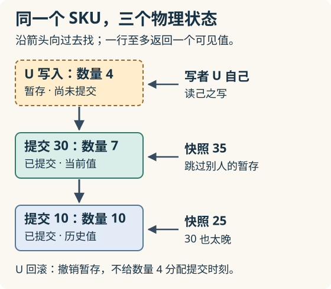
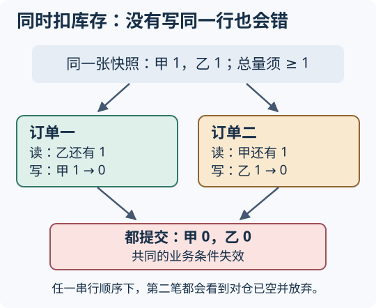

# 多版本并发控制：先问谁在读，再问读哪一版

库存页面显示还剩 7 件，订单事务却已把这行改成 4 件。两边有没有一边读错了？先问两件事：这 4 件是谁写的，提交了吗？库存页面用的是哪一刻的快照？**物理上存在、对某个读者可见、允许作为下一次写的起点，是三个不同的判断。**

## 一行库存，三种读者

设商品 K 在提交时刻 10 有 10 件，订单甲扣掉 3 件，在 30 提交。订单乙的事务 U 接着又扣 3 件，尚未提交。在本例中，已提交时间戳按提交顺序递增；普通读使用事务快照。图从新到旧排列的是**逻辑上可重建**的版本，不要求每一版真有完整副本。

图 1 · 本站自拟库存版本链。注意中间的 7：即使物理页上已经放了 4，对其他最近的已提交读而言，7 仍是当前值。

| 读者或事件 | 怎么判断 | 结果 |
| --- | --- | --- |
| 盘点 R，快照 25 | U 是别人的未提交写；30 晚于 25；10 不晚于 25 | 10 件，再读仍为 10 |
| 客服 S，快照 35 | 跳过 U；30 是不超过 35 的最近提交 | 7 件 |
| 写者 U 自己 | 同一事务已改过本行；先处理读己之写 | 4 件 |
| U 最后 Abort，新读者取得快照 | 忽略或去掉 U 的效果；旧提交没有被撤销 | 7 件，不是 4，也不是 10 |

用公式表达已提交部分：找 $c=\max\{c_i\mid c_i\le r\}$，其中 $r$ 是快照时间、$c_i$ 是同一行各版的**提交**时间。若没有这样的版本，读者看到「不存在」；若命中可见删除标记，也是「不存在」，不能因为不喜欢这条结果就继续往前找一行活的。事务自己的变更另判。课堂开头用的是起止字段配事务状态表，并非把任何行头整数都代入这个公式。尤其不能把 PostgreSQL 的 `xmin` 当作提交时间。

**如果另一个写者 V 来了呢？** 它可从旧版读到 7，却不能据此覆盖正在写的 U。协议可以立即拒绝 V，也可以等 U 结束再判。若 U 提交，基于旧快照的 SI 写不能无条件接着提交；若 U 中止，V 仍须按自身快照、谓词和写规则重新判断。课堂 PostgreSQL 默认级别的自增能等到前一写提交、在新值上再加一，是另一套**写语义**，不是 SI 允许丢失更新。

## 为何货架仍会被两笔看似正确的订单清空？

仓库甲、乙各有这款商品一件。最后一件必须留作换货备品。订单一只扣甲，且只在乙还有一件时才批准；订单二对调甲乙。两笔分别执行时都不可能破坏规则。

图 2 · 本站自拟的写偏斜，不是课上黑白弹珠的复画。

- 若一先于二：一扣甲之后，二读甲只会得 0，必须放弃。若二先于一，理由对称。
- 若同时从 `(1,1)` 开始：一读旧乙，二读旧甲；写集却分别是 `{甲}` 和 `{乙}`。只检查同一行写写冲突，找不到交集，两笔可能都提交，得到 `(0,0)`。
- 反过来根据读值推顺序：一读的是二扣减**前**的乙，要求一在二前；二读的是一扣减**前**的甲，又要求二在一前。这里的环是读写依赖，不是锁等待环。即使没有任何请求被阻塞也会出现。

**快照隔离（SI）**保证读一张一致的已提交快照、看到自己的写，同时限制并发写同一对象；**可串行化**还要求所有成功事务的结果能用某个串行顺序解释。把事务级快照再读十遍，读到的仍是 `(1,1)`，不是解决办法。应让真正的可串行化协议跟踪读写／谓词依赖并在必要时中止，或者改变事务设计，把这条跨仓业务规则归到一个共同保护的对象上。若采用后一种方案，要说明所有改变该规则的路径都受保护，不能只保护下单按钮。

## 两套终端为什么给出不同结果？

先分清快照时点，再预测输出。课堂分别演示普通 `SELECT`、自增 `UPDATE`、显示行头以及死锁。不要把一次实验的实现和默认值写成 MVCC 的定义。

| 设置 | 普通读看哪一刻 | 上方把 100 改成 101 后，下方发生什么？ |
| --- | --- | --- |
| PostgreSQL，默认 Read Committed | 每条普通查询开始时的已提交状态，加上自己的写 | 上方未提交时读 100。若下方同样执行 `v = v + 1`，它等上方提交，重新核对这一行仍匹配，按 101 加一，于是自己读到 102。另一轮只重读的实验，上方提交后下方的下一条 `SELECT` 能看到变化。 |
| MySQL / InnoDB，默认 Repeatable Read | 一般由事务内**第一次一致性读**建立这张快照 | 下方已读到 100，上方提交后下方同一事务的普通重读仍是 100。新开一轮，快照中已有 101，上方未提交的 102 不可见；快照既定，上方后来提交也不会改变下方的普通重读。不要把这一句推广到锁定读或 DML。 |
| PostgreSQL，请求 Read Uncommitted | 普通读实际按 Read Committed | 不返回上方未提交的 1400 号事务的改动。请求较弱级别不等于系统必须提供脏读。 |

上方事务已提交，不意味着下方也已提交；一笔操作看到的新值，也不等于别的会话立刻能看到该值。`ctid` 标一份物理行的位置，更新可能换槽；`xmax` 非零也不能单独证明这行已死。现场的 1399 恰是一次回滚留下的边界标记。看调试输出时，先记「哪个会话、哪条语句、谁提交过」，再解释行头。

## 版本放在哪里，钱就花在哪里

若一行有 1,000 个等宽字段，每次只改一个，记行宽为 $W$、被改部分为 $d$，回看 $k$ 次修改（忽略记录头、指针、压缩与页局部性）：完整历史副本的数据量约 $kW$；反向差量约 $kd$。但还原旧行要从当前行出发，按**从新到旧**的顺序应用差量。少写并不意味着所有历史读都更快。

| 布局 | 新版怎样写 | 谁承担代价？ |
| --- | --- | --- |
| 同一表空间追加全行 | 留下旧行，另找槽写新行，连上链 | 混着新旧行扫描和清理；旧→新链头稳定但取最新可能走长链，新→旧链取最新快但链头物理地址可能搬家。 |
| 当前全行 + 分离的完整历史表 | 先把旧行移入历史区，再覆写稳定的主行 | 旧行仍占整行，清理历史少干扰主表。这里的 *time-travel storage* 是布局名，不等于承诺永久接受任意历史查询。 |
| 当前全行 + 分离的反向差量 | 保存将被覆盖列的**旧值**，再改主行 | 最新读简洁，宽行小更新节省空间；长快照可能要走多条差量。要把主行、版本头、链指针作为一个可安全观察的变化发布，不能让读者用错底稿。 |

继续用 K：若当前数量 7，最新差量保存的是订单甲扣减之前的数量 10，而不是简单记录「加 3」。别的列可能是字符串或改成了 NULL；一般不能靠给当前数值做算术逆运算还原。这里说的差量是旧列值，本例不涉及故障恢复。

## GC 的问题不只是哪一版旧

还是图 1：去掉中止的 U，已提交版本的可见区间分别为 `[10,30)` 和 `[30,∞)`。假设不支持另开早于水位线的历史读，没有其他保留要求。

1. 快照 25 和 35 都活着：最老活跃读时刻 $w=25$。10 版虽「很老」，对 25 却是**唯一**答案，所以不能回收。按 `begin < w` 删除会出错。
2. 25 退出，只剩 35：$w=35$。旧版的结束时刻 $30\le35$，再不会被这组读者或未来普通读命中。若 $w=30$ 也一样，右端点不属于旧区间。当前的 7 虽然开始时间也小于 35，却必须保留。
3. 物理释放还要看路径：若保存的是差量，必须保留**足以重建最老受保护版本**的链段；若索引还指向旧槽，还须正确改链、撤索引引用，并让正在遍历的 worker 安全离开。Abort 的版本没有提交读者，不等于可以在别的线程正摸着指针时立刻复用内存。

找候选也有成本。后台 vacuum 扫页，可用页级信息跳过没必要处理的页；沿旧→新链顺手清理能分摊扫描，却使逻辑 `SELECT` 真正去写链和索引，冷键还可能永远不被碰到。让写者登记自己淘汰了哪些版本，收集器就不必四处找，但提交清单是**候选**，不是越过水位线的通行证。若业务要保留可查询的三个月历史，还要服从那道保留界线，不能只看当前事务。

## 索引给的只是候选，不是可见性结论

仓库按 `sku` 建主键索引，另有按地区等列建的辅助索引。若新→旧链头一写就换槽，且 $m$ 个辅助索引都保存物理链头，即使更新的是**未建索引的库存列**，也可能要维护主索引和这 $m$ 条引用。若辅助索引保存稳定的逻辑键，查找多一次映射，移动链头却只改映射；辅助键值本身改变，当然还得维护相应索引。InnoDB 有显式主键时，辅助项带主键列，再去聚簇索引找行；这也说明主键过长会让每棵辅助索引长胖。

**再试一次删除。** 旧报表从时刻 25 看到了 SKU K。商家在 40 提交下架，又在 50 用同名 SKU 上了一条新商品。快照 25 应命中旧商品，45 应无结果，55 才命中新商品。如果只保留「K → 最新新商品」一个入口，25 就找不到旧行；如果扫到哪个 K 都返回，又可能重复计数。物理上可同时保留多个入口（或设计等价的历史查找路径），再从候选版本中判可见性。**唯一性约束约束的是允许并存的逻辑状态，不是禁止介质上出现两份同名历史字节。** 两个同时抢占空主键的新事务仍要原子仲裁，不能各扫一遍空结果就各自成功。改主键时按旧键删除、新键插入理解，不能遗忘老快照和辅助入口。

## 回看索引

边界依英文自动字幕、讲者转场与现场画面就近取整；相邻区间接壤，不是逐帧切点。

| 时间 | 回去找什么 |
| --- | --- |
| 00:00–02:10 | 片头、取消外请讲者，HW5 延期，嵌套循环 JOIN 怎么选？ |
| 02:10–05:01 | OCC 私有工作区、幻读与索引锁；为什么多版本不是另一个互斥协议？ |
| 05:01–09:35 | 物理版和逻辑行、历史查询、审计与存储费；谁不会被谁阻塞？ |
| 09:35–12:03 | MIT 博士论文背景；DEC Rdb、InterBase、Firebird 和名字轶事。 |
| 12:03–17:49 | 第一个 A 例：起止边界、为什么另需事务状态、何时能丢 A₀？ |
| 17:49–24:00 | 第二个 A 例和反复追问：物理上看到 A₁ 为什么逻辑上读 A₀？现场改正 first writer。 |
| 24:00–28:35 | 四颗弹珠的两种串行终态与写偏斜；老标准漏了什么？ |
| 28:35–32:45 | 五个设计决定，MVCC + 2PL：能读旧版，为什么另一个写者仍要等？ |
| 32:45–37:09 | PostgreSQL 两会话自增的 100、101、102 及第二轮重读。 |
| 37:09–40:25 | MySQL 的两轮普通一致性读，换一次事务何时换一张快照？ |
| 40:25–44:50 | PostgreSQL 的 `xmin/xmax/ctid`；事务 1397 如何留下两份不同槽位的行？ |
| 44:50–48:47 | 双行互锁谁被中止；回滚的 1399；请求读未提交能否看见 1400？ |
| 48:47–51:25 | 读未提交是否有意义、扫描/更新算子究竟在哪一步会等？ |
| 51:25–57:52 | 三种布局；别把历史区误作只留上一个版本；链朝哪边连？ |
| 57:52–1:01:09 | 独立历史表、反向差量与宽行小更新。 |
| 1:01:09–1:05:33 | 活跃低水位、Abort、后台 vacuum 与时间戳 12/25 的反问。 |
| 1:05:33–1:08:55 | 合作清理、无人访问的角落及按事务报送旧版本 A₂、B₆。 |
| 1:08:55–1:16:01 | 改主键；Uber 个案；辅助索引取物理地址还是逻辑键？ |
| 1:16:01–1:19:53 | 旧快照中同键仍在、新快照中同键已重插：两条不相连的链。 |
| 1:19:53–1:22:42 | 删除标志／墓碑、系统横向对照、VACUUM 回收哪种空间、下课。 |
| 1:22:42–1:23:20 | 制作尾声，有配乐／零碎歌词识别，不是另一个数据库例题。 |

## 自测：先判断，再展开

快照 25 第一次查 K 时，30 版已经提交了。为何仍读到 10？

问的是这张快照的边界，而非程序执行到这一行的墙钟时间。25 只能选 25 及以前已提交的最新版。在本例中只有提交时刻 10 的版本满足。若改成逐语句快照，则必须重新给出这一条语句的快照时刻才能回答。

U 与 V 都做减三，U 回滚。为什么最后不该因此把库存还原成最初的 10？

应仅撤销 U 自己在已提交数量 7 上做的暂存修改；产生 7 的订单甲已成功提交。不管物理上是丢弃一个暂存全行，还是沿差量恢复主行，都不能误撤前一笔订单。V 的效果取决于它是否获得写资格并提交。

两个事务重读都得到相同结果，写集合也不重叠。为什么还不能证明可串行化？

稳定读不能排除交叉的读写依赖。看两仓例：订单一依赖订单二尚未扣乙，订单二又依赖订单一尚未扣甲。不存在同时满足两个读值的串行顺序。

快照 25 仍活跃，但 10 版不在主表而是一条差量。能只保护时间戳等于 25 的记录吗？

不能。可能根本没有恰好在 25 提交的记录。须保护 25 实际能看到的状态，以及从当前行重建它所需的每个中间差量；否则可见性比较正确也会拼出错误内容。

读者普通 SELECT 没申请行的 S 锁，怎么仍可能有写入与短时等待？

事务隔离意义的读，与维护数据结构的动作不同。合作清理可要求读者摘除不可见老节点，物理上改索引和指针，需要 latch 等短时同步；这不等于获得对业务行的事务写权限。

只更新未建索引的数量，何时仍需要改辅助索引？

在追加新版、链头搬家且辅助索引保存物理链头地址的设计中，需要让相关入口指到新地址。稳定逻辑键的间接引用可避免这种指针更新，代价是查找要再走一层。

看到一行的 xmax 不为零，或在唯一索引中找到相同键的旧项，能立刻断言什么？

两者都不能单独决定逻辑结果。前者还需查询事务状态与自己的快照；后者要判定同键历史属于哪个生命期、当前是否仍占用该键，以及是否有正在竞争的写者。

## 参考与许可

- Andy Pavlo、CMU Database Group，[Fall 2025 课表第 20 行](https://15445.courses.cs.cmu.edu/fall2025/schedule.html#nov-12-2025)、[当讲原视频](https://www.youtube.com/watch?v=tUFha9-DuSk)。课堂包括两个终端演示、弹珠与 A/B 例。视频标示 Creative Commons Attribution license (reuse allowed)；[平台许可说明](https://support.google.com/youtube/answer/2797468?hl=en)指向 [CC BY 4.0](https://creativecommons.org/licenses/by/4.0/)。
- [当讲 slides](https://15445.courses.cs.cmu.edu/fall2025/slides/20-multiversioning.pdf) 显示页 6–9、13、16–24、25–33；[当讲 notes](https://15445.courses.cs.cmu.edu/fall2025/notes/20-multiversioning.pdf) §§1–5。用来核动画、术语与边界，不转载 PDF。课表指定 *Database System Concepts*, 7e, §§18.7–18.8；只确认目录定位，未据此翻译教材正文。
- 课堂提及、编者核读：Hal Berenson、Phil Bernstein、Jim Gray、Jim Melton、Elizabeth O’Neil、Patrick O’Neil，[*A Critique of ANSI SQL Isolation Levels*](https://www.microsoft.com/en-us/research/wp-content/uploads/2016/02/tr-95-51.pdf)，1995，§4.2，特别是 first-committer-wins、H5、A5B 与 Remarks 8–9。论文中的提交时判冲突和课堂的先写者排他不是同一实现。
- 编者补核，非声称课堂所用服务器版本：PostgreSQL 18 [§13.2.1–3，隔离与并发更新](https://www.postgresql.org/docs/18/transaction-iso.html)、[§5.6，系统列](https://www.postgresql.org/docs/18/ddl-system-columns.html)、[§24.1.2、24.1.4，空间回用和可见性图](https://www.postgresql.org/docs/18/routine-vacuuming.html)；MySQL 8.4 [§17.7.2.3，一致性非锁定读](https://dev.mysql.com/doc/refman/8.4/en/innodb-consistent-read.html)、[§17.6.2.1，聚簇与辅助索引](https://dev.mysql.com/doc/refman/8.4/en/innodb-index-types.html)。仅引用结论和位置，不复制手册。
