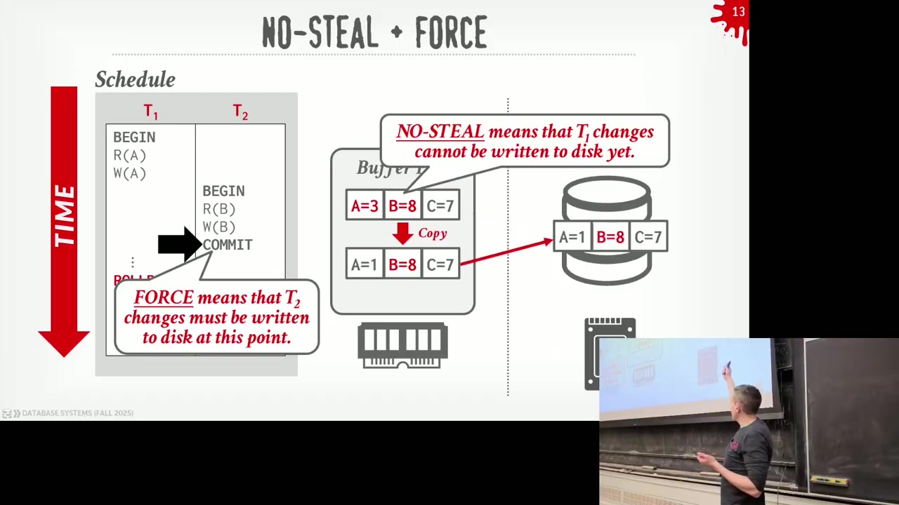
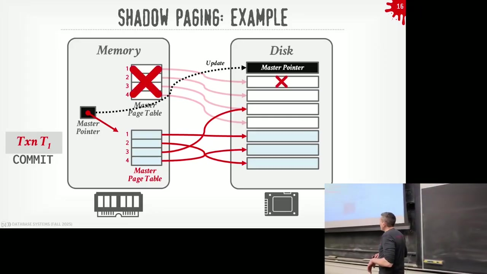
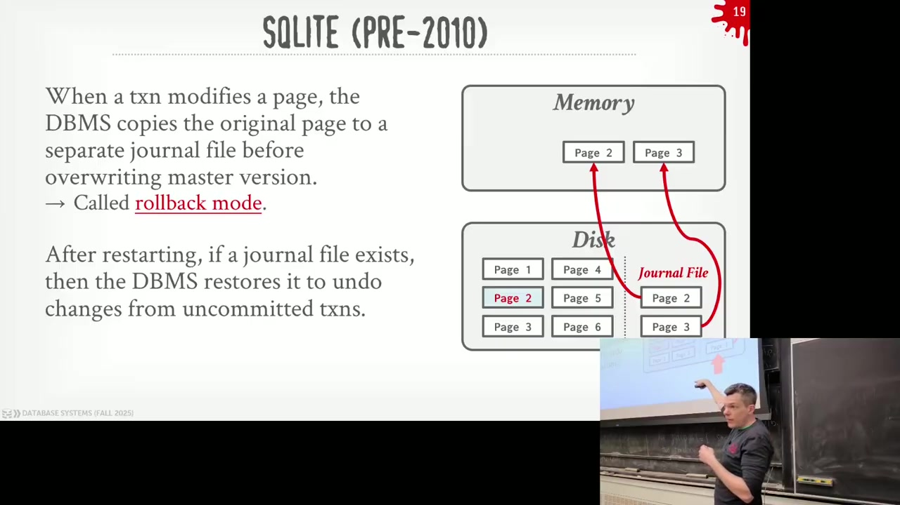
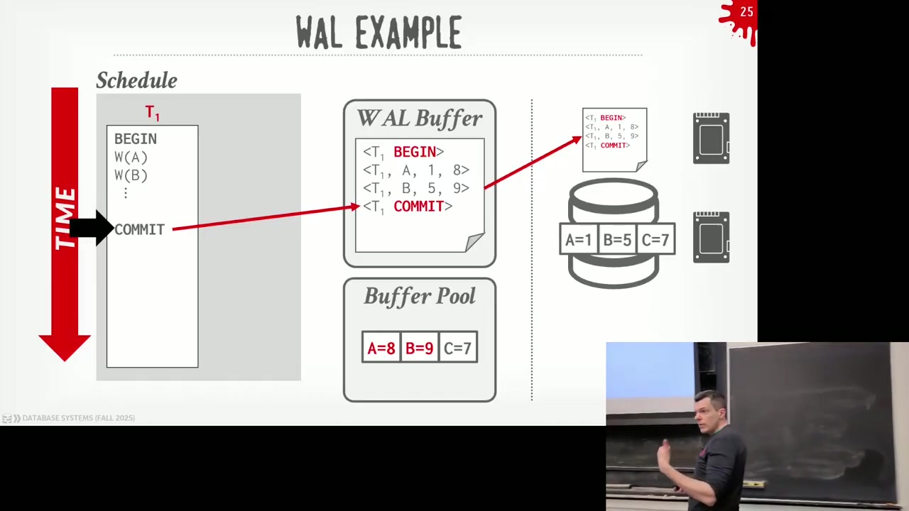
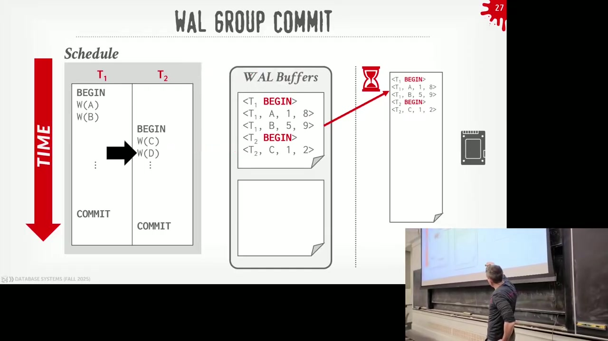
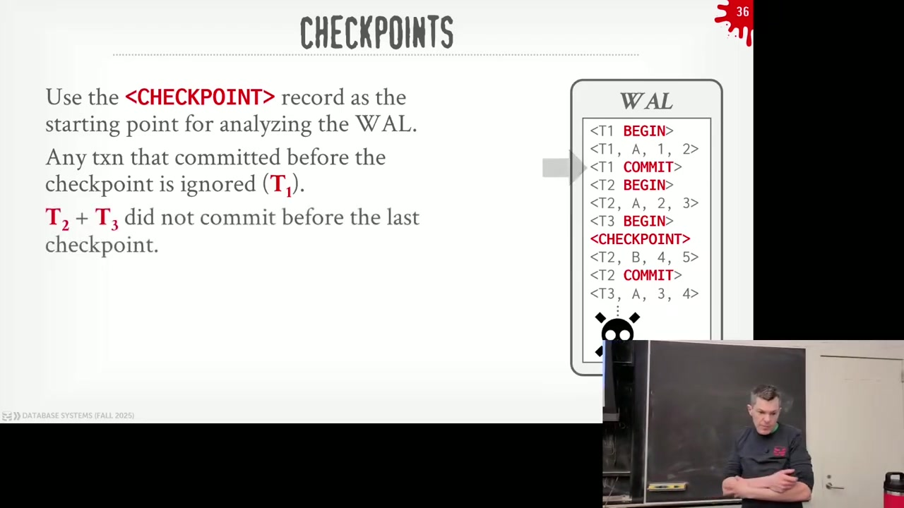

# 数据库日志：中文逐段整理译稿

## 00:00–01:46｜开场、作业和考试

音乐片名后转到教室。Andy 请大家给 DJ 鼓掌：以前的 DJ 不时有私事闹到办公室，今天这位这学期一直准时，很专业，学期还没结束也要说声谢谢。接下来事情不少。HW5 在本周日（11 月 23 日）截止；Project 4 上周已发，明天 11 月 18 日晚八点在 Zoom 讲解，链接在 Piazza。事务很难，所以说明故意写得很细，请先读，不要到了答疑课才开始看。投影给出 P4 截止时间为 12 月 7 日 23:59。期末考 12 月 11 日周四下午一点，三小时，考场还没定；没有提前考或另约补考，不要在此之前安排离校。

## 01:46–04:00｜同学问：高级数据库课 15-721 怎么了？

Andy：也有人给我写信。Jignesh Patel 正在做临时系主任，本来要找到接任者，让他下学期教入门课、我教高级课；现在外部遴选还没开始，入门课没人接，我就不能同时教 721。问会不会及时找到人？我当然希望；你愿意来当主任吗？这是吃力不讨好的工作，也不是我能决定的。又问他有没有涨工资？我不知道。我知道的是，他现在要教课、管系还要做研究，总不能一直这样。

如果能恢复我会发邮件，但别押注。有人追问何时能知道（原问不完整）：不可能开学两周后才告诉你突然开课，理想是 1 月初就知道。以前几乎只有我教入门课，候补一度有五百人，后来才从 Wisconsin 请来另一位老师。即使今年能再招到一位数据库教师，也更可能是秋季有人接手、秋季再开高级课，春季目前不乐观。

## 04:00–06:23｜讲座预告，从多版本转向故障

今天课后有 Firebolt 的 Ben 讲他们怎样支持 Iceberg，他以前来这间教室讲过。Snowflake 今明两天在校，明天中午有我的前学生来讲，大家也可以去找他们聊；我知道已经有人收到全职录用，不知道其他实习和岗位的进度。下周是英国的 XTDB。讲者用股票打比方：不仅关心每笔行情实际发生在什么时候，还能另外沿时间维度追问，假使在较早一点交易会怎样？这是为理解多条时间轴作的类比，本课不展开时序库。投影片列的是 11 月 17 日 16:30 Firebolt、18 日 12:00 Snowflake、24 日 12:00 XTDB。

上次是并发控制最后一讲。一个逻辑对象可以有多个物理版本，不必原位覆盖；留差量或留完整拷贝，就能给读者一致的快照。并发协议不只影响锁管理器：系统其他部分都要知道事务可能做什么。我们已有了正常执行期间的原子性、一致性、隔离性；这两讲问的是：**断电以后，原子性和持久性还在不在？**

## 06:23–10:23｜已经向外说了成功，内存却丢了

T₁ 读 A。忽略是怎么查索引找到 A 的，先把所在页从盘读进缓冲池，再把指针交给执行器。为使问题简单，假定单版本，直接把内存里的 A 从 1 写成 2。现在 COMMIT，我们告诉外部修改成功。一场暴风雨使电源中断，缓冲池没了；电力恢复后盘里的 A 还是 1。我们不能一边向人承诺提交，一边让已经答应保留的东西在重启后消失。

如果下一笔合法事务又改写 A，当然可以；问题是这次**故障**本身不该倒带。今天讲平时要留下什么证据，下次讲重启怎样读这些证据、重建当时的状态。本周假设稳定存储尚在；如果整个数据中心掉进天坑，另有分布式的问题。

反方向的竞态也重要：数据库已经把提交安全地留在盘上，网络成功回复还没发出就崩了。这不是数据库违约。应用不能从「没收到回复」推出「没有提交」，理论上应能回来查事务的结果，尽管现实里许多程序没这么写。

## 10:23–14:22｜今天的路线，UNDO 与 REDO

先讨论缓冲池什么时候能写回，再比较影子分页和预写日志；接着问日志项应写什么，最后用一个不好用但易懂的检查点留题。这里主数据在非易失存储（硬盘、SSD，甚至对象存储），操作前复制到易失的 DRAM；内存能按字节改，写盘却是按页。举例：设备一次只保证 4 KB 原子写，一个 8 KB 数据库页就不能据此保证两半同时成功。一个事务改了两页，更不能让断电后的数据库只留下它的一半。**编注：**4 KB 是本例假设，不是对所有硬件、对齐和写入路径的承诺。

UNDO 是去掉没有成功完成的事务的影响：应用显式回滚、并发协议迫使它中止，或者崩溃时还在跑，都可能需要。REDO 是把应当留下但还不在盘上的效果装回去。今天初步用「恢复已提交、消除未提交」讲**最终目的**，不是把下讲 ARIES 的 redo 扫描限定为只读已提交事务。

## 14:22–17:23｜T₂ 改 B，为什么把 T₁ 的 A 也带出去了？

原页有 A=1、B=9、C=7。T₁ 读 A 触发取页，在内存改成 A=3。切到 T₂，读 B 命中同一页，又把 B 改成 8。两事务改不同记录；我们暂不画上层 2PL 或 OCC。T₂ 现在要提交。如果把它所在的整页写到盘上，盘就有 A=3、B=8；可是 T₁ 从未说它要提交。随后 T₁ 要求回滚，怎么办？可以接到请求就回话，再由引擎收拾，但不能永远留着 A=3。

老师请大家想一个最直接的办法：把页读回来，对照后反转 T₁ 的改动。对这一页似乎可行；如果事务动了十亿页呢？逐一读回、改回、写回，写到中间又崩溃呢？不能把一次性手工修补当作恢复协议。

## 17:23–20:13｜两个互不相同的问题：STEAL 与 FORCE

**STEAL** 问的是：未提交事务弄脏了页，替换器能不能把这个页驱逐，覆盖稳定存储中最近一次提交的版本？允许就叫 STEAL，不允许就是 NO-STEAL。学过 ARC 或 LRU-K，也不能仅凭「最不常用」就刷页；得先有资格写。这里说的是引擎选用的页管理策略，不是事务可临时选的隔离级别。

同学指出 NO-STEAL 甚至会让某些事务做不完。老师复述：对，如果要修改十亿处、脏工作集又放不下，靠全留内存就没法结束。可以给尚未提交的东西找旁边的地方写，马上会讲。**FORCE** 问的是另一件事：回应提交前，是否**必须**把此事务改过的数据页全写稳？NO-FORCE 是不要求，不是禁止写。FORCE 让恢复少猜一件事；但不凭空提供跨多页的原子性。

## 20:13–24:18｜NO-STEAL + FORCE：能不能只写 B？

从头来一次：T₁ 改 A，T₂ 改 B，T₂ 要提交。FORCE 说 B 得写，NO-STEAL 说其中还混着没提交的 A，不能照抄整页。最简单是做一份干净的候选页，只装 T₂ 的改动：缓冲池里是 `(3,8,7)`，刷出的副本却是 `(1,8,7)`。这样 T₁ 回滚时只需撤内存中那处变化，不用再去盘上清掉它。

*21:22，原片静帧。左侧箭头停在 T₂ COMMIT，右侧出盘的是重新组出的页，而不是眼前那份脏页。*

问为什么 NO-STEAL 会挡住这个写？答：如果只写 B 当然没问题，难处恰是 A 和 B **碰巧在同一页**。问怎么知道 A 原值？先假定事务有记哪些内容从什么改成什么的元数据。问没地方复制呢？是的，这正是这个笨办法的漏洞。还有人提议等。谁等谁？T₂ 等 T₁。原则上可以，但人在终端开了 T₁ 后起身走了呢？老师回忆 Databricks 讲座举过 notebook 用户开事务后离开、要设约 24 小时超时的例子；T₂ 难道也等一天？

若写集能放下，这办法容易理解。不过「恢复看盘就行」在刚才的图里还靠了一层简化：只刷一页，假设其写入原子。多页到底是不是一次都装好了？没有提交元数据，解释不了。

## 24:18–27:26｜影子分页把「写出去」和「装成正式版」分开

早期 IBM System R 的思路：有一份只含已提交状态的主版本（master），另有正在修改的影子版本（shadow）。临时页可以写到盘的别处以腾内存；它没有覆盖主版本，所以不违背本例对 NO-STEAL 的要求。重启时不能凭「文件里看见一个新页」就把它算成提交，得看稳定的 master record 指向哪个**页目录**。提交时先写好新页和目录，再原子切换这个小小的根指针。

老师列举喜欢内存映射和此类方法的 LMDB；CouchDB 用向文件末尾追加来减少随机写，随后要回收；还提到 FastDB、GemStone 和稍后会画的 SQLite。有人问影子页到底在哪？答是在内存和盘上都可以有，接下来看图。它像 MVCC，但这一版复制、锁定的单位是**页**，不是一条元组。

## 27:26–31:34｜根指针、只读事务与多个写者

主目录把逻辑页号映射到磁盘位置。T₁ 开始时，影子目录里的指针与主目录相同，不是先抄全库。改某页时才为它做副本，把影子目录的对应项改指新页；再改别页，再复制。读者 T₂ 沿主根找，仍见旧页，不会看到 T₁ 做了一半。课堂以 LMDB 一写多读说明：这不是所有影子方案的数学限制，而是让实现容易得多。T₁ 提交时先确保将成为主版本的内容耐久，再切过去；此后新来的事务走新根。重启也以盘上根为准，旧目录和失效旧页在安全时回收重用。

*29:42，原片静帧。红叉标出旧目录，新的 Master Page Table 同时引用保留的页和换过的页。*

问：这里只能有一个写者吗？答：图里是。多个写者也可以凑成一批共同安装，但不能一换根就顺手发布另一个未提交者。另一种想法是互斥地锁定各自的页，只把我已提交的部分装入新主目录，为你的在途修改马上重建影子目录；做得到，代码复杂得多。LMDB 是索引组织的数据，数据就在 B+ 树里，这里的「替换目录」可以具体为换树根。

## 31:34–34:47｜这不就是版本？三个页怎样一起原子生效？

有同学把它与多版本联系起来。Andy 说，MVCC、影子分页、日志结构化合并树和 WAL 确有相似之处；不同层各有要解决的问题，所以看上去重复。早期 Postgres 也试过借元组副本保留历史；下面的文件系统可能又写 journal，SSD 内部还有自己的记录。除非能管整套栈，否则很难把所有重复消掉。别因为两个地方都追加写，就认定一个已经替代另一个。

另一位问影子分页怎么保证原子性。假如 T₁ 改三个页，没法命令硬件同时写完三页。办法不是让三页在同一个物理瞬间落盘：先把三页和目录都放好，但还没有发布；最后只需保证文件头上那个小根记录是一次原子写。读它的人要么得到整套旧映射，要么整套新映射。崩溃时若没切根，就忽略孤立的影子页；事务自己中止也一样，不改根，迟早把临时页收掉。

## 34:47–39:23｜影子方案把成本搬到哪儿？

整张页表如果都复制，大库会很贵。树形映射可以只复制变动叶子到根的路径。即使如此，页换了地方、旧位置空出来，一张表越来越不连续；顺序扫描不断跨越空洞，越来越像随机读，还得运行昂贵的垃圾回收。这在 System R 的慢磁盘年代格外明显。

问 SSD 时代还担心吗？老师提到自己做过更快的 Intel Optane 持久内存研究：按他的回忆，介质越快，复制内存的开销反倒越突出，影子方式当时也没胜过 WAL；硬件已经停产，若要对今天的设备作定量判断，还得重新看数据。再问预取和顺序性：做扫描仍然希望相邻；只做点查，离散一点影响小。MVCC 是否一定同样碎？未必。例如用主表保最新值、旁边保存逆向差量，多数只找最新值的查询不必跑去追全套旧版本。

接着有人回到同页两事务的问题（远处原问不全）。老师指回第一幅图：因为两个写者分别动了一页中的 A 和 B，才得把另一人的改动从出盘副本剔掉。刚才的影子例只有一个写者，不会把另一个没提交的写混进去；多写者则要做拆分合并，或拿页级排他锁，干脆不让两人同写此页。

## 39:23–44:43｜SQLite：记下「改之前」，而不是另选新根

老师转向 SQLite 的 rollback mode，并谈到它为了嵌入飞机、卫星之类长期系统而重视格式兼容；他把 2010 年描述成转向默认 WAL 的分界。**编注：**SQLite 官方文档写的是 3.7.0（2010-07-21）**新增可选 WAL**，默认仍是 rollback journal 的 DELETE 模式。这里按老师图解讲回滚日志，不把「已淘汰」当产品事实。

一写者修改页 2 之前，先把页 2 的**旧内容**留进单独的 journal 文件并写稳，然后才在内存改它；页 3 同理。现在准备提交，先写新版页 2，恰在写页 3 途中系统崩溃。内存没了。恢复不能赌页 3 尚未写或已写完：回滚日志里装的是原来的页 2、页 3，把两者拿回来，都覆盖到主文件。这样无论刚才哪一页走到了哪一步，都回到事务前。

*42:05，原片静帧。右下 Journal File 中的两个页沿红箭头回到内存。图中白框是修改前，不能当作新值回放。*

同学追问「如果修改页 3 的事务没提交呢？」答：这就是没提交的情况，不需要先猜主文件页 3 的内容。又有人把日志里的蓝白框看反：写出去的是蓝色新版页 2；拿回的是白色旧页 2 和 3，投影上颜色不如屏幕清楚。影子目录的意思是「这些没发布的**新**页可以不理」，journal 的意思是「这里留下了你可能要恢复的**旧**页」。老师确认同学的小结：旧页重写并安全落盘后，再删 journal，才恢复正常执行。数据库启动时读日志、找检查点，就是因为上次可能没有干净关机。**编注：**SQLite 具体检查的是符合条件的 *hot journal*；不是遇到任意同名文件都照着回滚。

## 44:43–48:46｜为什么改为先写 WAL？

影子分页往不连续的位置写，就算用 CouchDB 那样在末尾追加再压实，也常得为改一点内容复制整个页。更希望把许多小改动合成顺序写。WAL 是数据文件以外的一条日志，存下足以撤销、重做所需的信息；最要紧的不是文件叫 log，而是**受它保护的修改记录必须先持久化，相应脏页才可以覆盖盘页**。老师提到曾在特殊持久内存上研究过反过来的 write-behind logging，那不是今天普通机器的规则。

因此可以用 STEAL：事务还没提交也能写盘，只要它留下了足以事后擦掉影响的证据；也可以用 NO-FORCE：提交不要求把一千个散布的数据页刷一遍，却仍要把这笔事务截至 COMMIT 的日志安全写完才能答复。就算要记至少一千条更新，它们可以集中顺序写。有人问，选影子分页是不是因为简单？是的，简单版比较容易做；WAL 若加检查点，还得能处理一次重启恢复到一半又崩溃，难度不在同一处。

## 48:46–52:44｜运行时留下哪几种记录？

老师重新走一遍四个词：不准偷写，就少了处理盘上未提交版本的麻烦；能偷写，就要能 UNDO。提交时不强迫刷数据页，就得能 REDO。新增一个内存里的**日志缓冲**，按变更追加；投影说通常由 buffer pool 承载，他现场提醒不应拘泥，普通的一块内存也能做。后台写回线程不能独自决定驱逐，还得知道弄脏该页的日志到了哪里。下讲会给每条日志一个 LSN 来跟踪。

本例每笔事务有 BEGIN；这里似乎多余，下次沿日志找事务边界时有用。每个变更记事务号、对象号、旧值（撤销）、新值（重做）。像 PostgreSQL 那样另建元组版本时，不一定要额外存一份原值来做这类原地反向覆盖；不等于一切多版本引擎都不用恢复信息。最后追加 COMMIT，把包括它在内的必要日志前缀写稳，才向应用确认。顺手也写出别的未提交事务的普通记录？可以。持久日志里有 UPDATE 并不等于该事务已经有 COMMIT。

## 52:44–54:29｜课堂动画：盘里的 A 还是 1，也能回复成功

T₁ 开始，日志缓冲里先放 BEGIN。改 A 时追加 `<T₁,A,1,8>`，在缓冲池把 A 改成 8；改 B 同理，记 `<T₁,B,5,9>` 再把 B 改为 9。两步还只动内存。提交时追加 COMMIT，把日志送给操作系统并等待同步完成（老师用 `fsync` 表示这一道屏障），然后才把成功回给外部。

*53:38，原片静帧。磁盘数据页仍是 `(1,5,7)`，缓冲池已是 `(8,9,7)`；右上保存的是含 COMMIT 的日志。*

问：可我们还没把那些值写进持久的数据页啊？对，这正是要点。把内存全丢了，仍可以从日志装回 T₁ 两次修改，所以不缺兑现承诺所需的东西。

## 54:29–57:28｜组提交省的是同步次数，不是持久性

每笔事务单独等一次慢同步，很快会碰上瓶颈。假设一次 flush 需 1–5 ms，只能串行地一笔等一笔，即使取 1 ms，每秒也才一千笔。有的站点希望十万甚至百万。group commit 的办法是让多笔要提交的事务共享一趟写：日志缓冲满就写，或者比如五毫秒到期，把这批到位的记录一并写出。

同学确认是否只能隔五毫秒提交一次（字幕的一处单位误识成分钟；老师随即说的是 milliseconds）。老师答，在那一批里完全可能有一万笔。这牺牲的是等待时间，得到的是总吞吐。延迟预算取决于业务：老师举广告实时竞价，要在约四五十毫秒内答复；有学生问这还包括网络开销吗？是，所以若总期限 50 ms，给你处理并发出的时间可能只有 40 ms。很多网站五毫秒成组不算慢，而追求微秒延迟的高频交易又是另一种需求。这些是课堂数量级，不是测量或服务承诺。

## 57:28–59:48｜双缓冲、并行填充和交易系统的插问

图有两个日志缓冲。T₁ 的 BEGIN、改 A、改 B 先进第一个；T₂ 开始，改 C 也进去。轮到改 D 时第一个满了，交给后台写盘，同时切换到第二个缓冲继续追加；数据缓冲池的更改在动画里省去。两个 COMMIT 都到了第二个缓冲，T₁ 不能因为第一个已经刷了就提前回话。到时间再把第二批接到日志尾，两个提交都跨过持久点，才可一起回话。可用不止两个缓冲，目标是边填边顺序写，并保持日志的前缀顺序。

*58:00，原片静帧。第一批里有 T₂ 对 C 的更新，沙漏表示写出仍在进行，尚未到右侧调度的 COMMIT。*

问高频交易的人怎么办？老师谈到内存数据库、复制、昂贵的容错硬件，提到 NonStop SQL，还以三台机器并行计算、比对结果来说明为极低延迟与可用性可以付出多大代价，以及有人愿意专门铺低延迟光纤。是课堂举例，不是对某个产品具体副本协议的规格说明。

## 59:48–1:01:50｜LSM 已经追加写了，为什么还要日志？

LSM 的 memtable（可用跳表或树）先在内存吸收写入，满了再整理成不可变的 SSTable。尚未刷出的 memtable 是易失的，许多这类系统仍用单独 WAL 重建它。对应的数据已安全进入 SSTable，且没有别的依赖，旧日志段才可能退役。不要把表的物理布局和故障时可重建的凭据混为一谈。

老师比较正常路径和恢复路径：许多系统选 STEAL + NO-FORCE 配 WAL，因为假设不会每五秒崩一次，平时顺序写日志更值得；重启时为筛选和回放付钱。反过来，FORCE + NO-STEAL 的影子方案重启只需认根，平时却要复制和刷页。**编注：**口述在 1:00:50 左右把 WAL 的组合说反一次；这里按前后示例和投影片显示第 29 页校正。

## 1:01:50–1:04:21｜物理、逻辑、生理三类日志；表以外还有索引

前面的方框只写「T₁ 改 A」，实际得能找到 A。物理日志指明具体页、偏移和字节差异，像针对旧内容的一小块补丁。逻辑日志可记原来执行的高层操作，例如 SQL，本来做什么，恢复再做。折中是 physiological logging：**页间物理定位、页内按逻辑槽定位**。这给页内重排留出余地，不要求记录的字节位置永远不动。

别只想表：索引也是数据库状态。可给索引变化记日志，否则可能得扫描全表来重建。老师提到一些内存引擎本来就得把全库重新装进内存，便选择在那时顺便重建索引，以少付平时的日志成本。这是选择，不是允许索引与表永远不一致。

## 1:04:21–1:07:30｜把同一条 UPDATE 用三种方式记下来

课堂把 `foo` 中 `id=1` 的 `val` 从 ABC 改到 XYZ。物理记法如表页 99、偏移 1024、改前 ABC、改后 XYZ，索引若有对应的改动也得有办法恢复；投影另画索引页 45。逻辑记法只记 T₁ 运行了这条 UPDATE。生理记法则是页 99 的槽 1，把 ABC 改为 XYZ；页内记录紧缩后搬了家，只要槽还正确指向记录就能找着它。

一条 SQL 改十亿行，记一个高层操作很省；但表达式有 `random()` 或当前时间呢？昨天执行和今天恢复不能各取自己当时的时间。并发事务在较低隔离级别下实际观察的顺序也不能靠 SQL 文本重新猜。原查询跑一小时，把原查询重做一遍并没有什么魔法保证变快。因此课堂说常用的是页内逻辑的折中，不是原样存每条 SQL 来恢复。

## 1:07:30–1:10:33｜复制和变更数据捕获

问能否让人选择采用哪种日志？对单节点内部恢复，通常不是给用户切换的开关。到复制层，确有物理或逻辑方式可选，例如 PostgreSQL。第二台 PostgreSQL 可以像在恢复一样持续消费第一台发来的日志；区别是它读的是网络上不断送达的更新，而不是事故留下来的固定文件。

另一个用途是 CDC，即 change data capture：让外部消费者知道库里究竟改了哪些数据，用于 ETL，送往 Snowflake、Databricks 等分析系统。讲者提到 Oracle GoldenGate、开源 Debezium，以及把变更接进 Kafka、转成 JSON、再加工发给下游的做法。投影片并列 WAL、触发器、时间戳三种捕获途径，这里主要讲从 WAL 取。**发出**日志不等于另一台机器已经持久地收到了它；如果主机倒了，怎样保证副本不缺记录，是以后分布式部分的问题。

## 1:10:33–1:13:05｜阻塞式检查点，先写日志还是先写页？

如果数据库跑了一年，WAL 一直长，从头扫描一年日志才能启动，就算不重跑 SQL 也太慢。想在某些时刻知道「这些页此前的变化都已写到盘」，留下一个能向前缩短搜索的路标。先讲一个不适合照搬部署的办法：暂停正在执行的查询，也不放新事务进来；**先**刷内存 WAL，**再**把所有脏数据页刷盘；追加 CHECKPOINT 并把这条记录写稳，然后才恢复运行。已经被刷出的页可以含尚未提交的事务，所以路标不能独自替所有人作提交决定。

## 1:13:05–1:15:25｜读检查点图时，同学发现一个漏洞

老师从最新日志往回找最后的 CHECKPOINT（这是找路标，不是倒着 redo）。T₁ 在检查点前提交，它的效果已在盘。T₂ 在点前改 A、点后改 B、点后提交；T₃ 跨过检查点、后来改 A，却没等到提交就崩了。结论是：不能少掉已提交 T₂ 的作用，得 REDO 其尚未在盘的部分；又不能留下 T₃ 的作用，得能 UNDO。老师说到 T₂/T₃ 时先把两者笼统说成没提交，随即按图改正。

*1:13:56，原片静帧。右列的时间自上而下；不要把中间的 CHECKPOINT 横线当成「下面写过的事务都没提交」。*

有同学指出：如果某个事务在很久以前改过数据，检查点过后再也没动，光看后缀不就漏了它？老师答：对，本玩具方案为了找这些事务可能还是得扫很远，下一讲会记住哪些事务当时仍活跃。**编注：**投影片显示第 35–36 页与口述都是「原地暂停后再恢复」，所以有跨点事务；当讲书面 notes §8 另写成「阻止新事务，等现有事务全完成」，后者是更强的排空版本，没有相同的跨点例子。不要把两个前提拼起来使用。

## 1:15:25–1:17:52｜暂停多久、多久做一次？

一旦阻塞等待所有脏页写完，线上延迟就受缓冲池规模与脏页比例制约。想象高配机器有 100 TB 缓冲，最坏全脏，后续查询就要为 100 TB 写入等候。不光如此，找还没提交的事务也费时。检查点太频繁，系统忙于刷页；隔太久，恢复要扫描和处理更多日志。包括下讲 fuzzy checkpoint 在内，也没有所有业务通用的周期。老师举五分钟一次为愿意为快恢复买单的业务例子，不是在给 HFT 规定参数。

还可以按日志量触发，例如假设每写 512 MB 才做一次，在空闲或偏读的机器不必每隔固定时长都做同样的工作。老师借 MySQL 打比方，没有把 512 MB 当所有版本默认值。希望下次既能找出取点时仍在跑的事务，又不必把工作停下来。

## 1:17:52–1:19:48｜WAL 要终身保存吗？组提交会不会丢成功？

问是否要留数据库诞生以来的整条 WAL。答：为崩溃恢复通常不需要。正确的检查点和相应安全边界能让较旧的部分退出恢复路径；但审计、金融监管之类可能有额外留存要求。老师以「七年」打比方，并回忆不同产品、不同年代的清理行为。不是所有日志都必须保存七年的法规结论，也不能一见 CHECKPOINT 就删掉其前全部。

回到 STEAL + NO-FORCE：页可以提早刷，提交又可以不刷数据页，但如果向客户作持久承诺，相关日志必须已经稳了。老师提醒留心 *synchronous commit* 的开关，并凭印象说 PostgreSQL、MySQL 往往默认没开、可能有几毫秒窗口。**编注：**这句不宜照录成配置建议。PostgreSQL 18 的 `synchronous_commit` 默认 `on`；MySQL 8.4 InnoDB 的 `innodb_flush_log_at_trx_commit` 默认 `1`。**同步组提交**是多笔一起等刷盘成功，**异步确认**才是日志还没写稳就回复。五毫秒的组批等待本身不是成功后会丢的五毫秒。

## 1:19:48–1:21:12｜下讲 ARIES、IBM 的历史问题

下讲做更好的检查点，然后真正拿日志和检查点执行恢复。称为 ARIES 的方法出自 IBM，论文 1992 年发表。课上将介绍教材与原论文里的主线：analysis、redo、undo。实际产品不一定逐行照书做，但大框架帮助理解它们在解决哪些问题。

最后有人追问 IBM 和 shadow paging 的关系（原问的尾词被自动轨误识）；老师肯定早期 IBM 的工作，打趣说向当年的 IBM 前辈介绍研究，常会得到「八十年代我们就做过」的回答，只是许多事未留下论文。ARIES 的长文之所以值得读，是因为哪怕恢复过程再被打断也不能丢数据，这件事确实难。老师示意 DJ 收尾。**编注：**别把前面的教学模型当完整 System R 历史：Gray 等 1981 年对 System R 的论文摘要明确区分，事务 UNDO/REDO 用日志，检查点用 shadow 文件。

## 1:21:12–1:21:49｜制作片尾

语言转为音乐标记与配乐中的零散词。1:21:14 原画面是 Andy Pavlo 演职员卡，1:21:33 是音乐署名，1:21:48.4 为 Off Probation Productions 尾卡。这是制作尾声，不再刊录歌词。末条字幕终点 1:21:46.679，距整数片长还差 2.321 秒；这一段本讲原声持续有信号，并非实测静音。孤立音窗不能可靠分辨字词，不补作课堂发言。原音流约到 1:21:49.070，原画流约到 1:21:49.017，略超过页头的整数秒。

## 时间覆盖、来源与许可

- Fall 2025 [11 月 17 日官方课表，第 21 讲](https://15445.courses.cs.cmu.edu/fall2025/schedule.html#nov-17-2025)；原作 *#21 - Write-Ahead Logging + Shadow Paging (CMU Intro to Database Systems)*，Andy Pavlo 讲授，CMU Database Group 发布于 2025-11-18，ID `CedEy54pe3g`，视频入口在页头。本视频单独标有 Creative Commons Attribution license (reuse allowed)；[YouTube 许可说明](https://support.google.com/youtube/answer/2797468?hl=en)对应 [CC BY 4.0](https://creativecommons.org/licenses/by/4.0/)。本站改作：中文逐段整理、去除重复、另加校注，六张无声原片截图。视频标签不外推到独立 PDF、教材、论文或配乐。
- `en-orig` 自动轨共 2,249 个非空事件，按顺序全读；段落标题取近似秒，非逐字听译。首缺 0.654 秒，64 处内部空档合计 168.123 秒，尾缺 2.321 秒；合并重叠后的事件共覆盖 4,737.902 秒。诸如 18:37.400–18:46.960、21:27.240–21:35.600、30:29.000–30:38.080、38:00.440–38:11.520、48:02.200–48:11.520、1:17:43.159–1:17:52.320 跨同学发问或停顿，远处不清处只用明确的现场复述，不由时长或一帧画面猜原话。
- 对照：[本学期 slides（显示页 1–40）](https://15445.courses.cs.cmu.edu/fall2025/slides/21-logging.pdf)、[本讲 notes §§1–8](https://15445.courses.cs.cmu.edu/fall2025/notes/21-logging.pdf)。校订出处：[SQLite WAL §§1–3](https://www.sqlite.org/wal.html)、[SQLite hot journal §4.1](https://www.sqlite.org/lockingv3.html#hotjrnl)、[PostgreSQL 18 §19.5.1](https://www.postgresql.org/docs/18/runtime-config-wal.html#GUC-SYNCHRONOUS-COMMIT)、[MySQL 8.4 §17.14](https://dev.mysql.com/doc/refman/8.4/en/innodb-parameters.html#sysvar_innodb_flush_log_at_trx_commit)、[Gray 等，1981，摘要](https://research.ibm.com/publications/the-recovery-manager-of-the-system-r-database-manager)。
