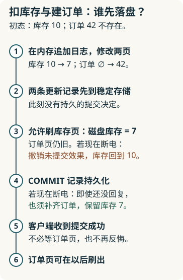
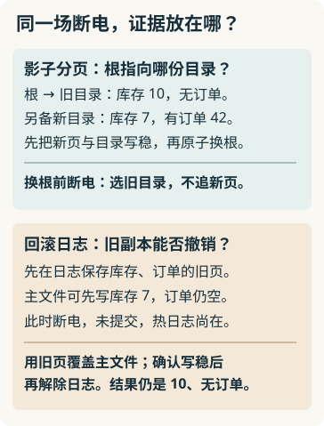

# 数据库日志：订单已经成功，为什么数据页还能是旧的？

你为订单 42 预订三件商品。断电后，库存从 10 变成了 7，却找不到订单。**光看这两个数据页，无法断定应该补订单，还是把库存改回 10。** 同样的磁盘画面，可能属于提交以前或提交以后。恢复需要另一份能区别这两段历史的证据。

## 同一个磁盘画面，两种正确答案

先固定模型：一个写事务 T，一次在两个不同的页上扣库存、建订单。数据文件和 WAL 在掉电后仍可读，内存全失；引擎承诺本地同步持久提交，储存设备遵守同步请求。这里演算的是数据库崩溃，不是介质全部损毁或跨站点容灾。

图 1 · 本站订单例。沿数字向下走，每次假设在两个相邻动作**之间**断电。图中选择让库存页先刷；这是一条合法执行，不是每个事务都必须走的顺序。

| 中断处 | 还能从稳定存储读到什么 | 必须恢复成什么 |
| --- | --- | --- |
| 第 1 步后：两条更新只在内存 | 库存 10，无订单；没有更新的持久日志。按 WAL，此时不能已经覆盖数据页 | 保持 10、无订单 |
| 第 2 步后：更新都已刷，页都没刷 | 有库存与订单更新，没有 COMMIT | 仍是 10、无订单；出现 UPDATE 不代表应该公布它 |
| 第 3 步后：库存页先刷 | 库存 7、无订单；有更新日志，无 COMMIT | 去掉 T 的影响，库存回 10 |
| 第 4 步后、回复前 | **数据页与上一行完全相同**，但日志多了耐久的 COMMIT | 保留库存 7，补齐订单 42；客户端超时并不能改变这个答案 |
| 第 5 步后、订单页写出前 | WAL 与上一行相同，客户已经收到了成功 | 同样保留 7 和订单 42；绝不能只因订单页还空就改判失败 |

**两个先后关系请分别读。** 对页 P，保护 P 上所有即将刷出变更的日志前缀必须先持久化，才允许写回 P。对事务 T，直到包含 `COMMIT(T)` 在内的相应日志前缀持久化，才可作**持久提交**的成功应答。第一条约束数据页写回，第二条约束客户端可见的承诺；两条都没有要求「提交之前全刷数据页」。课堂动画 **52:44–54:29** 给了更小的证据：盘里还是 A=1、B=5，却已能从 WAL 恢复 A=8、B=9。

对工程师还有个区别：同步请求**发出**、操作系统缓存接收字节、稳定存储**完成**，不是同一事件。恢复时还得识别完整有效的日志尾，而不能把半条 COMMIT 算作成功。若客户端没收到答复，应按业务请求号查订单或幂等重试，不能盲目再扣一次。后两点是编者对例子的应用，不是录像里的代码实现。

## 从两个反例推导谁需要 UNDO，谁需要 REDO

**STEAL 问的是可不可以提前覆盖正式数据页；FORCE 问的是提交时必不必须把数据页写稳。** 允许不等于要求。一个页可能同时含 T₁ 对 A 和 T₂ 对 B 的改动，上层记录间没冲突，底层却只能整页刷写。课堂的初始页是 `(A=1,B=9,C=7)`；T₁ 改成 A=3 未提交，T₂ 改成 B=8 要提交。若 NO-STEAL + FORCE，不是「把缓冲池整页 `(3,8,7)` 同步出去」：得组出只含 T₂ 已决定效果的 `(1,8,7)`。且只保证写一页原子，推广到多页还缺一个原子发布决定。

| 数据页策略 | FORCE：提交必须装好全部数据页 | NO-FORCE：提交时可有数据页滞后 |
| --- | --- | --- |
| NO-STEAL：不覆盖正式页以留下未提交效果 | 不因偷写而要 UNDO，也不因漏刷而要 REDO；仍须解决多页原子安装 | 不为偷写做 UNDO；可能要 REDO |
| STEAL：允许未提交效果覆盖正式页 | 可能要 UNDO；不因已提交数据未刷而要 REDO | 可能两者都要；本讲的 WAL 模型 |

这里说「不要」仅指这两种故障后**修复正式数据**的需要，不是说运行时可不处理回滚、撕裂页、目录切换或临时空间回收。比如设备保证的原子写单位若比数据库页小，掉电后可能混合新旧半页，单记一个字段差量不足以修复整个破页。PostgreSQL 18 的 `full_page_writes` 是具体对照：第一次在检查点后更改某页时还可记全页图像。别把课上 4 KB 当所有设备的承诺。

## 同样复制页，影子分页与回滚日志为何相反？

图 2 · 本站把 **24:18–34:47** 和 **39:23–44:43** 的两段课上机制放在同一笔订单上重演。上半图的证据是**哪一套新页对外生效**，下半图的证据是**被覆盖的旧页原来怎样**。

- **影子分页。** 对未改动的页沿用旧指针，改动的页写到新位置；把新内容、路径和目录先写稳，最后才原子地更新小根记录。三页交易不需要原子地写三个大页，只要发布点足够小且可靠。若颠倒顺序，恢复会走到持久根所指向的一个尚未写稳的页。多写者并发时不能借自己的提交把别人的影子改动也公布；旧根还有读者时也不能随意复用旧页。复制路径、碎片、回收和写者协调是代价。
- **SQLite 式回滚日志。** 在覆盖正式页前保全其旧映像。若未完成交易留下 *hot journal*，要从中还原旧页，等还原结果耐久，再使 journal 失效；不是仅凭文件存在便回滚。课上页 2 和页 3 中途崩溃的关键，是没必要猜「哪张新页恰好写完」。这不是发布新目录的那种 NO-STEAL。SQLite 3.7.0 是新增 WAL 选项，不是改成所有数据库的默认模式。
- **不要把历史画成二选一。** Lorie 1977 年的论文摘要讲页到磁盘位置的双映射；Gray 等 1981 年对 System R 的论文则描述了「日志做事务 undo/redo，shadow 做检查点」。还有一个读图陷阱：原论文 §2.1、图 7 称可修改的一侧为 *current*、留给重启的已保存一侧为 *shadow*；而**本讲**把暂存新改动的一侧称为 shadow。先问哪一版可改、崩溃后沿哪一个根，不要只按名字对应。

## 日志很小为什么还要等？三种写法，大不相同的账单

同样的存储屏障，分摊到一批提交上，可提高吞吐而不提前承诺。假设一趟同步耗时 1 ms，若一次只完成一笔，单条串行路径最多约 1,000 笔/秒；一批若顺便带出十笔，理想的**屏障吞吐**约十倍，不表示每笔延迟变成 0.1 ms，也不保证 CPU 等其他资源跟得上。把一块满缓冲异步交给 I/O 时，另一块可以接着填；某笔事务的 COMMIT 在后一块，就必须等持久前缀越过后一块的相应位置。**同步组提交是一起等；异步提交是不用等就回复。** Postgres 18 默认 `synchronous_commit=on`，MySQL 8.4 InnoDB 默认 `innodb_flush_log_at_trx_commit=1`，不能用 1:19 左右老师的记忆反推部署配置。

现在给库存更新选日志内容。下面三个条目是编者自拟，`K` 是库存键。不要和课上 `foo` 的页 99、槽 1 混用。

| 留下的证据 | 它解决什么，又依赖什么？ |
| --- | --- |
| **物理**：页 7、偏移 80 处 `10 → 7` | 补丁贴到精确字节位置；布局重排后必须保证重放仍在正确的物理上下文 |
| **逻辑**：为订单 42 把 K 的可用量减 3 | 操作可很短，却要保证重演作用在同一批行、得到同样的输入和结果。时间、随机函数、并发交错是反例；一小时的原操作可能还要再跑一小时 |
| **生理（physiological）**：页 7、槽 2 的数量 `10 → 7` | 先物理定位页，再由槽定位记录；页内紧缩可移动记录的字节，但不能随意把这个槽交给不相干的行再套用旧日志 |

索引同样有恢复成本。更新了索引，要么留下其恢复信息，要么有可靠的重建途径；「不记索引日志」并不免费，可能把一次全表扫描搬到了重启。LSM 的 SSTable 已不可变，也不说明易失的 memtable 安全，尚未进入持久表的部分仍可能依靠单独的 WAL。**WAL 描述持久化次序，不规定日志必须是 SQL、字节补丁或哪一种存储布局。**

## 一个检查点能告诉你什么，不能告诉你什么？

课堂的阻塞版是「暂停并阻止新工作 → 先刷 WAL → 再刷所有脏页 → 写稳 CHECKPOINT → 继续」。这样能说：此次已刷出的页，不用从数据库开张以来把每次更新全重做。但不能说：这些页上出现的每个事务都提交了。把下面这一小段历史写在纸上：

1. T₁ 改了数据，提交。U 改一件库存，尚未提交，之后一直没有新动作。
2. 暂停大家，按上述次序作检查点；这一步把 U 的未提交库存也刷进了正式数据页。
3. 继续运行，V 创建订单并提交，订单页还没刷；系统崩溃。

只看点后的日志，只能发现 V，却看不到 U，恢复后库存就错了。课堂显示第 36 页用 T₁、T₂、T₃ 演示了「点前已提交可忽略、点后提交可能要补、没提交可能要撤」；同学随即指出了这个**沉默的跨点事务**反例。如果协议改成「先等所有活跃事务完成」才作点，反例前提不成立，但代价是必须等最慢的那个事务。更好的设计要记录哪些事务仍活跃、哪些页可能尚未安全反映在盘，而不必停止整个世界。下讲 ARIES 的 analysis、redo、undo 正是用这些信息做恢复，**它们不是 checkpoint 的三个别名**。

检查点频率是运行开销与恢复时间的选择，不是越密越安全。有 100 TB 脏数据时，全停刷盘可能极慢；遭受故障后不能接受长时间离线时，又不能无限推迟。定时或按日志增长量触发都可以。旧 WAL 何时回收，还要同时满足本地仍需的 undo/redo、备份归档、复制或下游消费等保留条件；有路标不等于可以直接按这一行截断。

**CDC 不是提交协议。** 日志可喂给另一台服务器重放，也可由 Debezium 等解码为 Kafka 下游的订单变更事件。如果只读到 T 的 UPDATE，就按「订单成立」发货，后来 T 却回滚，数据库恢复再正确也救不了已发的包裹。下游得尊重事务边界，并处理重放或重复投递；本讲没有证明跨站复制可靠、外部副作用只发生一次，也没有教授分布式提交。

## 全片回看索引

时间来自本讲 `en-orig`，转场约到秒；术语校订在译稿里单列。每行都是原片区间，不是本页自拟例的时间。

| 原片区间 | 回看时试着回答 |
| --- | --- |
| 00:00–04:00 | 片头、课程日期；为何 15-721 的开课安排还没确定？ |
| 04:00–06:23 | Firebolt / Snowflake / XTDB 预告；MVCC 解决了哪一部分问题？ |
| 06:23–10:23 | A 从 1 改 2，却在复电后消失；为什么「回复丢了」是另一种情况？ |
| 10:23–14:22 | 易失内存、4/8 KB 假设、UNDO/REDO 各自为了什么？ |
| 14:22–17:23 | 同一页的 A、B 分属两个事务；为何回滚十亿页很难？ |
| 17:23–20:13 | 替换器的资格限制，与提交 ACK 的条件有何差别？ |
| 20:13–24:18 | 分离 T₁ 与 T₂、旧值、内存不足和「等一天」的现场追问 |
| 24:18–27:26 | 影子副本也能在磁盘上；为什么不算偷写正式版本？ |
| 27:26–31:34 | 读者沿哪个根？若有两个写者，切根时如何不暴露另一人？ |
| 31:34–34:47 | MVCC 和日志的层次；用一个原子动作发布三张页 |
| 34:47–39:23 | 磁盘与持久内存的瓶颈如何不同？单写者何时省掉拆页？ |
| 39:23–44:43 | SQLite 页 2 已刷、页 3 不确定；journal 的白框是哪一版？ |
| 44:43–48:46 | 随机整页写与顺序变更；哪些动作必须在页写之前？ |
| 48:46–52:44 | 日志缓冲、BEGIN/UPDATE/COMMIT，未提交记录能先落盘吗？ |
| 52:44–54:29 | A/B 动画；回复成功时哪份证据已足够？ |
| 54:29–57:28 | 广告竞价的时间预算；组提交提高了吞吐还是降低了单笔等待？ |
| 57:28–59:48 | 双缓冲里第一个何时满？HFT 提问为什么带出复制？ |
| 59:48–1:01:50 | 既有 SSTable，memtable 的 WAL 为何还可能必要？ |
| 1:01:50–1:07:30 | 表与索引、`foo` 的三种日志、可重复性与重演成本 |
| 1:07:30–1:10:33 | 复制模式可选不等于能随意切换本地恢复；CDC 怎样接下游？ |
| 1:10:33–1:13:05 | 为什么先刷 WAL、后刷脏页、再写完成标志？ |
| 1:13:05–1:15:25 | T₁/T₂/T₃ 分类；同学的「点后沉默」反例为什么成立？ |
| 1:15:25–1:17:52 | 100 TB、时间或日志量阈值；代价由谁承担？ |
| 1:17:52–1:19:48 | 保留、审计与安全截断；同步确认与五毫秒成组是否矛盾？ |
| 1:19:48–1:21:49 | ARIES 预告，IBM 历史追问，约 1:21:12 后转制作尾声 |

## 自测：先判定，再展开

库存页要被替换，T 还没提交，但有关更新 WAL 已经持久。STEAL + NO-FORCE 下能写页吗？能回客户成功吗？

能写页；不能凭这一事实回成功。后者需要包括提交记录在内的日志前缀已经持久。若此时崩溃，应能消除 T 残留在页上的作用。

反过来，COMMIT 已刷、库存和订单页都还没刷。这是违反了哪条规则？

两条都没有违反。NO-FORCE 允许推迟刷数据页，前提是能用稳定日志恢复全部已提交作用。若客户端没收到回复，结果对客户端未知，对恢复器并不未知。

一次同步覆盖八笔提交。第一笔等了 4 ms，是否丢失了这 4 ms 的持久性？

如果八个客户端都在同步成功之后才收到确认，没丢持久性，只增加了等待时间。若先回复再等后台同步，那才更改了承诺。

影子根已经指向新目录，但新订单页还没写完。此时能以「根切换是原子的」保证恢复正确吗？

不能。根本身虽没有写半截，它可能完整地指向一个不完整版本。原子安装依赖先写稳其能到达的新增内容，再切根。

记录 SQL「将所有待发订单的时间改为当前时间」，比记每个修改更紧凑。恢复时缺什么？

要能重建当时命中的订单集合、并发可见顺序以及当时求出的时间。用今天的快照和时钟重跑同一句，可能不是同一项修改。

最后一个完整检查点之后没见到事务 U，可以回收 U 在检查点前的所有日志吗？

单凭这一条不能。若 U 是点前改库存、跨点后再未动作的事务，可能必须借更早的日志撤销未提交效果。即使本地恢复已不需要，还要看其他保留者。

## 引用与阅读边界

- 本课：[Fall 2025 11 月 17 日课表](https://15445.courses.cs.cmu.edu/fall2025/schedule.html#nov-17-2025)、[原片 CedEy54pe3g](https://www.youtube.com/watch?v=CedEy54pe3g)，Andy Pavlo / CMU Database Group。单条视频标示 Creative Commons Attribution license (reuse allowed)；[平台说明](https://support.google.com/youtube/answer/2797468?hl=en)指向 [CC BY 4.0](https://creativecommons.org/licenses/by/4.0/)。本页图表与订单演算为编者原创，素材非独立课件的复制。
- 课堂校对：[slides](https://15445.courses.cs.cmu.edu/fall2025/slides/21-logging.pdf) 显示页 10、13、15–19、21–29、31、33–40；[课程 notes](https://15445.courses.cs.cmu.edu/fall2025/notes/21-logging.pdf) §§1–8。第八节的排空式检查点与投影的原地暂停前提不同。指定教材为 Silberschatz、Korth、Sudarshan，*Database System Concepts* 第七版，[目录第 19 章](https://www.db-book.com/Previous-editions/db7/toc-dir/toc.pdf) §§19.1–19.8；§19.5 是缓冲管理，§19.9 ARIES 不在本讲指定范围。只查目录，不整译教材。
- 编者历史补核：Raymond A. Lorie，[*Physical Integrity in a Large Segmented Database*](https://research.ibm.com/publications/physical-integrity-in-a-large-segmented-database)，1977，摘要的 dual mapping；Jim Gray、Paul McJones、Mike Blasgen、Bruce Lindsay、Raymond Lorie、Tom Price、Franco Putzolu、Irving Traiger，[*The Recovery Manager of the System R Database Manager*](https://research.ibm.com/publications/the-recovery-manager-of-the-system-r-database-manager)，1981，摘要的 transaction log 与 shadow checkpoint，以及[作者提供的原论文 §2.1、图 7，印刷页 230](https://www.mcjones.org/paul/recovery.pdf) 中 current / shadow 的命名。课末预告的原作是 C. Mohan 等，[*ARIES: A Transaction Recovery Method Supporting Fine-Granularity Locking and Partial Rollbacks Using Write-Ahead Logging*](https://research.ibm.com/publications/aries-a-transaction-recovery-method-supporting-fine-granularity-locking-and-partial-rollbacks-using-write-ahead-logging)，1992；此处核题录，不以此代替后续算法讲解。
- 编者版本校订：[SQLite WAL §§1–3](https://www.sqlite.org/wal.html)、[SQLite rollback journal §4.1](https://www.sqlite.org/lockingv3.html#hotjrnl)；[PostgreSQL 18 §19.5.1，`synchronous_commit`、`full_page_writes`](https://www.postgresql.org/docs/18/runtime-config-wal.html)；[MySQL 8.4 §17.14，`innodb_flush_log_at_trx_commit`](https://dev.mysql.com/doc/refman/8.4/en/innodb-parameters.html#sysvar_innodb_flush_log_at_trx_commit)。这些是产品手册对照，不是现场运行配置或调优实测。
