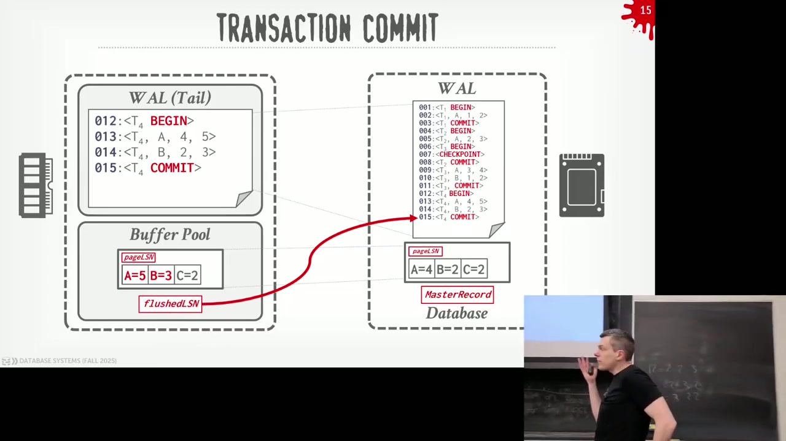
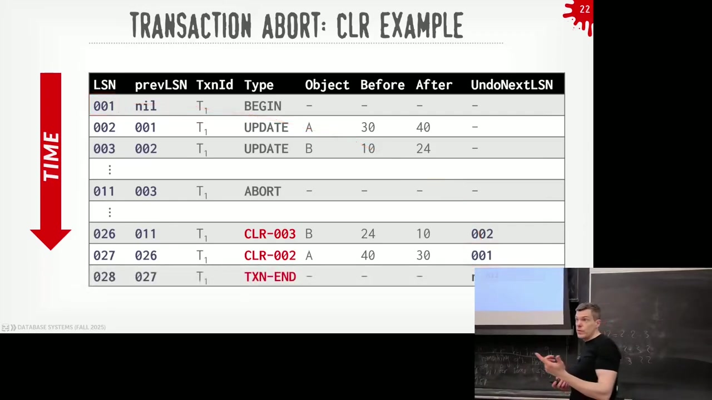
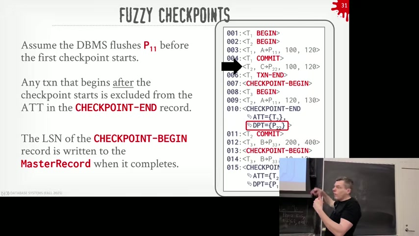
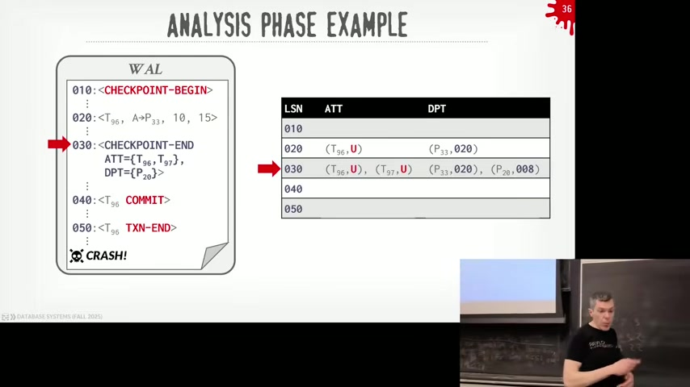
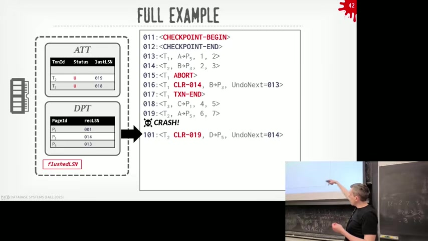

# 数据库恢复：中文逐段整理译稿

## 00:00–00:57｜开场：先谢谢 DJ，今天得抓紧

开头是配乐和黑白的课程片名；随后切入第 22 讲 *Database Recovery* 的标题、DJ 和教室。音乐中有零碎词，不把它们整理成现场讲话。约 00:26，Andy 开始：给 DJ 一点掌声！本来还想多夸两句，但今天要讲的东西太多，我们马上开始。

Project 4 的习题课是昨晚开的，slides 和录像现在都有了，今早发过消息。投影片上写的帖子编号 `@280`，我觉得不对，不要按它断定去哪儿找。HW5 是接下来这个星期天交；期末在 12 月 11 日，HW5 之后还有一次作业。课务页列的日期是 HW5 **11 月 23 日 23:59**、Project 4 **12 月 7 日 23:59**、期末 **12 月 11 日 13:00**。

## 00:57–03:41｜正常运行时留下证据，重启时兑现承诺

上次讲日志，是恢复协议的上半场。想象系统刚对外说“你的事务已经提交”，接下来不论挂的是数据库进程、操作系统还是机器，都不能说刚才那笔不算数。因此，一部分工作一定得在故障**以前**做：平时就把事务对对象做过的修改记入预写日志（write-ahead log，WAL）。今天讲另一半：系统重新上线，怎么看这些证据，把库恢复到正确状态？

说“回到崩溃时”，不是连当时做到一半的事务也接着跑。先重现那一刻能由日志证实的变化，再清掉半截事务，不能只留下某笔事务的一半。这里沿用 **STEAL + NO-FORCE**：改脏页的事务还没提交，缓存也可以把这页写出去腾位置；事务提交时，又不要求把它改过的所有页都刷出去。所以磁盘上既可能多着不该保留的东西，也可能少着已经承诺的东西。

图里 T1 在故障线前提交，得保住；T2 已经中止，要保证它的变化撤干净；T3 跨到故障线仍未完成，也不能留下效果。上节把 Undo、Redo 所需的信息放进 WAL，末尾还讲了能免于从头重播的简易检查点。那种检查点的问题，正是今天要解决的。

## 03:41–08:51｜为什么 ARIES 宁可先重复工作？

这里用的是 **ARIES**，全称 *Algorithms for Recovery and Isolation Exploiting Semantics*，IBM Research 在关系型系统 DB2 的背景下发展，论文发表于 1992 年。比起“最省”，先问怎样保证一笔都不丢：宁可把事情记得啰嗦些，再在证明安全后移去多余工作。以前的做法有先 Undo、也有先 Redo 的。这套做法明确为 **Analysis、Redo、Undo**；在本课的保守模型中，最后一个阶段收完才对外开放新事务。各家数据库不必逐条照搬，三段工作的分工、特别是补偿日志的思想要抓住。原论文约七十页，还涉及不同隔离方式下的并发，今天用 Strong Strict 2PL 的可串行化情形把问题缩小。

第一件事是 WAL。修改要有记录，尤其不能先把脏页刷到盘、过后再指望它的日志会落盘。要是中间掉电，回来只看到一页改过了，并不知道是谁改的、改了什么。第二件事是**重做时重复历史**：从证据出发沿时间往前走，连后来要被撤销的操作也纳入重放范围；宁愿先确认该做的已经做到，不要凭一个猜测跳过去。后面会讲怎样用页头认出“这条已经在页上”，并不是每页都真的重写。

第三件事：某个事务自己 Abort，或跨着故障没有提交，逆转它的更新时也要记额外的日志。正常执行时，“有改变就留下证据”；为什么到了回滚就不算改变了呢？我希望精确知道页上发生过什么，包括我自己为清理残局做的工作。下面先给日志编号，再讲正常运行的 Commit/Abort，然后换成不挡住所有事务的 fuzzy checkpoint，最后拼成 ARIES。今天还有 ClickHouse 来宾；如果时间不足，下周一再接着讲。先按相对保守、信息有冗余的版本走。

## 08:51–14:07｜日志、页、事务和检查点各有一个“位置”

投影片只放一两个事务，看上去顺序一目了然；换成同时有几百、几千个事务更新不同页，得有统一的**日志序号 LSN**。每条记录的 LSN 全局唯一且单调递增，表达修改在日志中的物理次序。别把它和 OCC 的事务时间戳混为一谈：上层依然可以用锁或乐观并发控制决定逻辑顺序。图里每条加一是为了好算，不要求真机按这个步长分配。

同一个 LSN 可以被系统的不同部件引用。无论索引页还是表页，页头的 **pageLSN** 记本页最近一次修改对应哪条记录。它可能指向磁盘上已有的日志，也可能指向日志缓冲里的新记录。另有一个全局 **flushedLSN**，表示已经持久化的日志前缀到哪里为止，而不是“最近写出的是哪一页”。替换策略说最想淘汰某脏页时，缓冲池要比较二者：`pageLSN ≤ flushedLSN`，日志已经有据，才可写出；否则先等。也可以由缓冲池催日志管理器提前做一次刷写，合并其他事务一起刷，等收到确认再换出页。

还有个容易和页头混的 **recLSN**：这页自上次刷干净后，**最早**又把它弄脏的是哪条记录？它不必写在页头，可放在内存的脏页表。每个事务还要记自己的 **lastLSN**，即属于我的最近一条；若需中止，从这里反着找。最后，在磁盘上的 **master record** 留一个全局入口，指向最近一次成功完成的检查点**从哪条记录开始**。稍后会明白为什么存的是开始而不是结束。

## 14:07–18:29｜能把这页刷出去吗？先问它指向哪半边

屏幕左边是内存：WAL 尾和缓冲池里的页；右边是磁盘：WAL 持久前缀和数据库页。两边同一页的 pageLSN 可以不同，内存页可能更新。同理，一条已经落盘的日志也许在内存尚留副本；水位讲的是“至少已持久到哪儿”，不是“内存最后只剩什么”。磁盘旁边还有 master record，重启从它进日志。

Andy 问：如果我现在要刷一张刚改过的页，它的 pageLSN 指向已经在磁盘上的记录，行不行？行，它的修改有证据。把指针移到只在左边内存日志尾的记录呢？现在 pageLSN 大于 flushedLSN，不安全。颜色和箭头背后的真实手续是：为该更新取得 LSN；持着页上的写 latch 改内容，同时推进页头；每次日志缓冲因攒满或组提交而确实刷成了，才推进 flushedLSN。

接下来的演算作几项假设。日志记录放得进一页，磁盘写在该粒度是原子的。现实中大元组的记录当然可能跨过 4 KB 或 8 KB：例如分成“二段中的第一段”“第二段”，仅第一段到达不能宣布整条成功，更不能据此对外确认提交；今天暂不展开发现撕裂记录的机制。假设单版本、Strong Strict 2PL、STEAL + NO-FORCE；用记录页或页内对象差异的物理/生理日志讲，不拿一条原 SQL 当重做。为让图留得下，只改一个对象、略去维护索引的日志，不是说真实系统的索引更新可以无证据。

## 18:29–20:50｜Commit 不是把所有脏页推到磁盘，END 也不是 Commit

事务想提交，先在内存日志缓冲里加 COMMIT，立即刷或等其他提交凑成一批都行；关键是等持久前缀**覆盖自己的 COMMIT**，随后才能告诉调用方“提交成功”。这里加一种记录 `TXN-END`：表示该事务所有收尾结束，不会再为它做事。对于正常提交，这是在确认提交以后放进缓冲的内部簿记，不要求立即为 END 单独强制落盘。中止的 END 会更有用，过会儿看。

看看动画：T4 先 BEGIN，更新 A、B，各写日志，数据页在内存跟着改变。COMMIT 排在 015，刷日志到这儿、推进 flushedLSN、答复外部；之后才补 END。页本身此刻不必都送到盘上。日志缓冲如果分双缓冲、三缓冲，可以换走已持久的那截内存，省得白占着；这不是说拿走持久日志里日后还要恢复的部分。

**20:20，原片实帧。** 左边是 WAL 尾和已改的缓存页，右边数据库页仍可保留旧值。回答“已经提交？”时应看 COMMIT 是否进入持久 WAL，而不是两边页的数值是否一样。

## 20:50–25:09｜Abort 以后、END 以前，要留下什么？

正常运行中中止一个事务，基本上就是把重启 Undo 的办法用在一个事务上。先加一个 **prevLSN**：同一事务的日志串成逆向链。即使没有这个字段，扫全日志仍可找到同一事务，区别在效率。假如每秒有上千事务交错，沿 lastLSN 和 prevLSN 走，只为这个事务付查找代价。T4 的 BEGIN 前面没有同事务的记录，前驱就是 nil。

别忘了并发控制还在工作。事务报告 Abort 的那一刻**不能马上丢锁**。我要回到改过的对象上，把它还原成我开始前的样子；如果已让另一事务取得锁、写入自己的新值，我再把旧值盖回去，毁的是别人的写。一般等逆转做完才放锁。至于中止由应用要求，还是冲突处理器挑中这笔事务，下面的处理并无不同。

T4 已 BEGIN、改过 A 和 B、收到 ABORT。图中 ABORT 与 `TXN-END` 中间特地留了一排问号。Andy 问台下：这里具体做什么，跟着前面的记录找到它们，然后呢？隔着教室的几声答话不全清楚。能确认老师接受的是“处理 Undo”，但继续追问：今天讲日志，光把页改回去，怎么记录**我们做过哪些撤销**？回滚到一半机器可能再崩，就靠这个。新类型是 **CLR，compensation log record（补偿日志记录）**；在这个物理前后值例子里，旧值与新值对调，就能描述逆向更新。

中止与提交的对外承诺不对称。可以先告诉调用方“你这笔不会提交”，不必等所有 CLR 强制落盘才答复。后台仍有责任把所有更新撤完，锁也没因此提早消失。一位同学问（按老师复述）：**如果还没回滚完机器就挂了呢？** 答：回来接着撤，稍后用 ARIES 最后一段来解释。

## 25:09–29:15｜把回滚画成一张小日志表

换成表格，一行一条记录，有 LSN、同事务的 prevLSN、事务号、类型、对象、前值、后值，还有补偿时看的 `undoNextLSN`。T1 的 001 是 BEGIN；002 把 A 从 30 写成 40；003 把 B 从 10 写成 24；别的流水省略掉。011 是 ABORT，前驱 003。这就给出第一步要撤谁，不用找全库的更新。

逆转 003：在 026 写 `CLR-003`，B 从 24 回到 10。这个 CLR 在本事务日志史上的**前一条**是 011，而**下一件要撤的事**是 002。再去 002，在 027 写 `CLR-002`，A 从 40 回到 30；它的前驱是 026，下一待撤位置回到 001 BEGIN。到此不是去撤一个 BEGIN，而是知道更新都处理完，可以在 028 写 `TXN-END`。比较两条路径：正常 Commit 与 END 间没有这串补偿；Abort 与 END 之间有实际的回滚工作。有人追问：提交了能马上写 END 吗？老师区分：**正常提交可以；重启过程中可能得再保留一点状态。**

**26:55，原片实帧。** 看 026 这一行：左边的 011 是 prevLSN，最右 002 才是下一待撤位置。这两个字段若都译成“上一条”，正好丢掉本例要说明的区别。

一般的流程就是记 ABORT、逆序取更新、做反向更新并记 CLR，走到开头记 END，释放锁。能不能在撤到某个对象时提前释放它的锁？只有你能事先证明**本事务没有对它的更早更新尚待撤**时才谈得上；如果同一对象被改过几遍，看到一次就释放绝不安全。最后一个问题：会不会为撤销一条 CLR 再写一条 CLR？不会。它记下的是已经执行的补偿，要时可以**重做**这次补偿，不会“撤销撤销”。

## 29:15–33:21｜追问：既然旧值还在，为什么需要 CLR？

第一问由讲师重复：既然有原更新，为什么 CLR 表里还要前值和后值？例如原来有 30→40，反向是 40→30，不是自己可以推出吗？对，图是刻意写得冗长，好让大家看清逆转。又有同学提想法，老师把它概括成“是不是可以把一些东西缓存起来？”可以研究这种优化，但先建立肯定正确的模型，再想办法加速；那句远处原话不足以断定对方建议缓存哪一项。

另一个问题更根本：没有 COMMIT 就知道事务没成，回头去读普通 UPDATE、倒过来不就完了吗？学生把“自己 Abort”与“中途崩溃”作比较。Andy 回应：我们通常**不为每次刷数据页都记一条日志**，不能只凭 UPDATE 判断该变化在磁盘上已经做到哪里。学生追问：总得能查到昨天给 A 写了什么，难道不能据此逆转？老师说，是能拿到原记录，但要**按对的状态、对的顺序**逆转。新的检查点不会停掉全世界；拷页时有的改动已落、有的没落，期间又有人继续改。仅知道昨天的旧值，不等于知道现在盘上各页及前一次回滚的进度。记录原更新和已做的补偿，是为了崩溃后也能重新走通。每年都有同学说这浪费，没错，会有优化余地。

Andy 用 PostgreSQL 举“宁可多留信息”的例子：检查点后的首次改页，WAL 还可带整页信息，以免页出问题后靠零星差量拼不回。**编者注：**这是类比，不是说 PostgreSQL 照搬本讲 CLR。其 `full_page_writes` 文档针对部分写入的页；ARIES 原论文 §5.2 则明确 CLR 可只带足以 Redo 的信息，不要求另存可撤销 CLR 的 before-image。课堂表格同时列前后值是教学表示。

## 33:21–36:42｜检查点能免去重播五年的日志，但为何不能天真地拍快照？

系统不停有事务，WAL 就不停增长。机器重启后我可不想先从五年前开始播，得有一个能跳进去重建状态的位置。上次的简易办法：挡住新事务，等所有正在运行的都结束，不再有查询修改，刷出缓冲池里的脏页，记检查点。此刻没有在途事务，盘上是干净一致的切面，恢复太容易了。代价是什么？如果长事务跑几小时、甚至几天，别人全在等它。

稍微好些：**不等事务结束，只暂停继续修改**。一个线程跑事务，一个线程做检查点，池里有 P1、P2、P3；同一笔事务先动 P3、再动 P1。它改好 P3 时被暂停，检查点依次把 P1、P2、已修改的 P3 写出；检查点完成再放行，事务这才改 P1。磁盘切面现在只含半笔，事务随后还可能提交。倒不是说这样一定不能恢复，而是不能看见检查点就假定事务一个都不跨界；还得回日志找它的另一半。要让恢复知道往哪里找，需要把当时的内部状态留下。

## 36:42–40:59｜记两张不同的表：哪些事务还得管，哪些页可能要查？

第一张是 **ATT，Active Transaction Table**：事务号、状态、lastLSN。跟并发控制里记活跃事务有些像。状态可表示仍在运行、正在完成提交，或 *undo candidate*（可能需撤）；恢复向前读时不要先猜一个活事务最终一定提交，先当候选，后来若有 COMMIT 再改判。看到 END 才能去掉条目，因为该事务不再有事，不论是提交收尾还是中止收尾。

第二张是 **DPT，Dirty Page Table**。在正常运行的视角，它列缓冲池哪些页脏，配每页本轮最早的 `recLSN`；讲者先说“最新”随即改口“最早”。最新修改在页头 `pageLSN`，不要互换。改页的事务已 Commit 也好、没 Commit 也好，不决定这页是不是脏。

看两次阻塞式检查点的动画。第一次假设 P11 已刷，T1 的 END 在检查点之前，故 ATT 只剩 T2，DPT 里是 T2 改过的 P22。第二次，T2 有 COMMIT 却没有 END，仍与新来的 T3 一起在 ATT；假定 P22 已刷，而 T2 修改 P11、T3 修改 P33，故 DPT 是 P11、P33。学生问：**第一次为什么没有 P11？** 因为假设它写出去了；并没有一条“刚刷 P11”的 WAL 才能让你现场从日志上读出来，只能结合检查点的表和这个例子的前提。多了元数据是进步，但刚才仍暂停着写事务。

## 40:59–44:16｜模糊检查点：把开始时的信息放在结束记录里

真正要的是检查点运行时别的事务仍可修改。扫描脏页会与它们交错：某页在开始时脏，真正写出时可能已带上后来事务的新值；某次更新又可能恰好发生在对该页的处理**之后**，最新的那份仍在内存。还有的页是在检查点开始后才第一次变脏，开始时的清单当然看不到。不要把“完成一次 fuzzy checkpoint”当作“所有页都对应同一瞬间”。留好 ATT/DPT 和日志边界，就有办法回头查。

现在把单个 CHECKPOINT 拆成 BEGIN 和 END。**本课示例的约定**：记录开始时看到的两张表，把它们的内容放进 END 日志记录。这样 007 BEGIN；T3 在 008 才开始；T2 此间还在 009 写 P11。010 END 里写的仍是 007 时的 ATT={T2}、DPT={P22}。T1 在 006 已 END，P11 在第一轮 BEGIN 前已刷；T3 后来开始，不在这份快照里，并不表示它从未发生。看见 010 持久后，才把 master 更新为 **007**。再来一轮，013 BEGIN、015 END 安全后，master 才换成 **013**。发生故障，重启沿这个固定入口找最后一轮成功检查点的起头。

**43:25，原片实帧。** 右侧 007 与 010 之间已经夹进用户日志，010 内圈的是 P22；这就说明不能把 END 看成“冻结了所有事务的当前状态”。

**编者注：**课件的“BEGIN 时取表”是此处推算的确定约定。原论文 §5.4 允许逐批读取表，靠从 BEGIN 以来的日志补上变化；只在 END 已持久后发布 BEGIN 的地址。模糊检查点本身不以强制刷清全部数据页为必要条件，也不能用它替代提交同步。

## 44:16–49:11｜三个阶段并非从同一点同向扫描

第一段 **Analysis**：从 master 指的 BEGIN 正向看持久 WAL 到末端，搞清哪些事务已经结束、哪些要保留或应回滚，哪些页需要调查。第二段 **Redo**：再跳到可能缺失的最早页更新，正向重放，连日后要 Abort 的修改也考虑。第三段 **Undo**：把最终没有提交事务的改动逆转。图中三个范围可能越伸越早，不是沿相同起点扫三遍。Redo 开始点要看**分析后的 DPT 中最小的 recLSN**，不是某个活事务最早的 BEGIN；Undo 倒追未完成事务的链，可能伸到检查点以前。重放途中还可能遇到 CLR，重新做到那个补偿是对的。

Analysis 究竟更新什么？看到 TXN-END，把这个事务从 ATT 拿掉。其他属于事务的记录若让我们首次认识这个事务，就记入表、通常先暂列候选；随着后续记录更新最后位置，看到 COMMIT 改为提交状态。另一路，某条页更新引用了尚不在 DPT 的页，就把该页和当前 LSN 加进去，以此作最早可能须重做的起点。已在表中的页不能随每次更新把起点都后移。结果：ATT 告诉你还有哪些事务要收尾，DPT 给你一组**可能尚未落盘**的脏页。想确定最新页到底写到了哪条，多数时候得读页；这张表不是磁盘上的真值表。

## 49:11–52:18｜T96、T97：同一时刻，为什么左边没有 P33，右边却有？

010 是 CHECKPOINT-BEGIN，开始分析时还没从这条本身读到那两张快照。020 出现 T96 把 P33 上 A 从 10 改成 15；它的 BEGIN 在图的上方、检查点开始前。我们暂时还不知道它的命运，故右侧工作表添 `(T96,U)` 和 `(P33,020)`。不能确定检查点扫页与这个更新孰先孰后，也就不能径称该修改已经落到盘页。

030 是 **CHECKPOINT-END**，不是事务 END。它告诉我们在检查点开始时就有 T96 和另一个此前没露面的 T97；当时 P20 也脏，最早记录是 008。现在应**合并**，不是把此前工作的表覆盖掉：右边有两个待定事务，DPT 有 P33/020 和 P20/008。040 见 T96 COMMIT 改 C；050 见 T96 TXN-END 去掉。崩溃时还得追 T97 在图外做过的事。两个页此前都被改过，在不读页的情况下还不能判定其最后磁盘状态。

学生指着 030 问：**为什么这里的 DPT 里面没有 P33？** 老师回答的“没有”说的是**左边日志中 END 所带的快照**：BEGIN 时 P33 尚未脏。右边的表是分析器扫到现在的**工作结果**，自然保留来自 020 的 P33。最后一句口头把存放处说成“transaction end”；投影清楚写的是 CHECKPOINT-END，不应把 T96 的 050 当成这份表的容器。

**51:00，原片实帧。** 030 左框写 `DPT={P20}`；右边同一行出现 `(P33,020)` 和 `(P20,008)`。若两边看成一张表，这个问答就会变成矛盾。

## 52:18–57:11｜Redo 有三道筛选，只有最后一道必须取得页

老师在向 Undo 过渡前两次收住：现在**还没开始撤**。既然有了 ATT/DPT，把日志里该算的动作逐条纳入重放；若已有中止留下的 CLR，也把它当历史来重做。不因重放而另造一条 UPDATE 或一条新的 CLR。正向扫描的入口是最小 recLSN；那是迄今已知的最早“可能欠着”的更新。

面对某条 LSN 为 `L` 的 UPDATE 或 CLR，目标页 P：第一，P 根本不在 DPT，它不是候选，跳过。第二，P 在 DPT，但 `L < recLSN[P]`，它早于这页可能欠更新的界线，也跳过。两项只查内存里的 DPT，不用为这条去磁盘取页。第三，剩下的还不能说欠着；把页拿来（已在恢复缓冲则直接看），读页头。若 `pageLSN ≥ L`，这个动作已经反映在页上；只有 `pageLSN < L` 才依日志重做，并把页头设成 L。**编者注：**约 54:30–55:08 的口头对第二条的“先/后”绕反，依当堂显示页 38、官方 notes 第 6 页与论文 §6.2 校正。等于 recLSN 是候选，等于 pageLSN 却跳过。

重做某一条页操作时不另记更新，也无需每步强刷。不在并发跑新用户事务，何苦每次都等待 I/O？到这一趟收尾，依**课程约定**给已有 COMMIT、但尚留 ATT 的事务补 TXN-END 并移走；不是把仍是 Undo Candidate 的事务也放走。剩下一类还需要我们**生成新的 CLR**，那才是 Undo。

## 57:11–1:00:28｜全例前半：先决定谁还活着，再决定从哪里重放

Analysis 已经找出状态、Redo 已把历史补齐，就轮到处理没能提交的事务。沿每个候选事务的 `lastLSN` 向后走，多个事务并在一起时总取**最大的待处理 LSN**；用链跳掉无关记录。真正撤一次更新，追加一条 CLR。这里与正常 Abort 的作用相同。

投影用一段截取的 WAL 串全流程：检查点实际是 **011 开始、012 结束**（讲师先说 010 随即改口）。013 T1 改 P5，014 T2 改 P3；015 T1 Abort，接一条补偿、017 T1 END。018 T3 改 P1，019 T2 又改 P5，然后第一次崩溃。master 指回 011；012 中的起始快照假定含 T1、T2、T3 与一张 P1（最早变脏在图外的 001）。开始时按候选看，继续扫描，T1 已 END，于是移出；注意这笔 T1 **中止收尾**而非提交，老师在这里口头用了“commit”。最后 T2 的 lastLSN=019，T3 的 lastLSN=018。DPT 中 P1/001、P3/014、P5/013，所以 Redo 从 001 起，哪怕事务在 011 之前已经做过事。

**编者注（原片和公开投影都可见的笔误）：**016 印的是“T1 CLR-014，B→P3，UndoNext=013”，而 014 属于 T2，013 才是 T1 对 A/P5 的更新。按本课物理更新的规则，T1 只能补偿自己的更新；该行不能拿来推导“跨事务补偿”。图没有给出全部更早的日志，不能从这处互相冲突的标签编出一个确定的修正版前驱编号。

## 1:00:28–1:03:38｜再崩一次：T3 已结束，T2 剩哪一步？

走完正向 Redo，开始倒着撤 T2、T3。在待撤的位置里 019 比 018 新，故先给 T2 的 019 写 101 CLR，`undoNext=014`。接下来该处理的最大位置不是 014，而是 T3 的 018：写 102 CLR，使它指向图上方 T3 的 005 BEGIN，T3 可以在 103 写 END。老师把保守刷写也演一遍：可以让这些 WAL、相应脏页落盘，维护真实的 flushedLSN；不是要求每补偿一条都把全库刷一遍。如果再次启动，数据页自己的 pageLSN 还可以帮你跳过已经落盘的变化。**第二处标签偏差：**019 原写 A/P5，101 却印成 D/P5。目标页相同不足以构成正确撤销；本物理例中要撤的是 019 本来的对象。

**1:00:48，原片实帧。** 左侧候选最后位置是 019、018；右侧 101 明标 `UndoNext=014`。同时可见 019/101 的 A/D 不一致，不能拿这两个对象标签作实际更新依据。

就在 T3 已处理完、T2 的 014 尚未撤时，机器**在恢复中又崩了**。第二次从头做 Analysis；只剩 T2（口头先说 T3 随即改正）。Redo 在必要时重放已有 CLR。沿 101 的 `undoNext` 知道接下去要撤 014，于是在 201 写 T2 的 CLR，图上下一待查位置 004；到链头收尾在 202 写 END。现在才可对外说“可以运行新查询、新事务了”。

有同学问：中止过程中间崩溃呢？老师答：刚演的正是这个，T3 的 END 已有，但 T2 还欠最后一项。追问中老师反问“你说的 partial CLR 是什么意思？”远处的解释不能可靠逐字辨出。老师用同一条链再答一遍：重启时先重放已经能看到的 CLR，再去 014 生成下一笔补偿；即使反复重启，走的仍是到事务 END 的那条路。**课堂这里演的是多步回滚只做了一部分**；它不是“识别并直接采用写到一半的 CLR 字节”的演示，前面已有单页原子写的假设。

## 1:03:38–1:06:35｜在哪个阶段再次崩溃？什么时候能少做点？

如果在 Analysis 崩，怎么办？没什么特别动作：它只是读日志、重建内存表，回来再做。Redo 时崩呢？也回来重做。可能重复检查或施加相同的历史效果，但在页头的保护下最终状态一样。要加速，可以别为每个事务收尾强刷脏页，让写出在后台做；赌的是“不会很快再崩”，赌错损失的是更多重做时间，而不是已承诺的数据。Andy 把论文的保守风格和常见的异步实现作对照；不要把这句推广成原论文要求“每个 END 都必须强制写一遍”。

Undo 还有一种研究思路：不等立刻把每个旧页亲自改好，先记下这个页欠哪些逆转，类似此前学过的页修改清单；允许新事务较早开始，等真要读写这页时，先落实挂在它身上的撤销。并不是容许新读者看见应撤而未撤的值。另一条看似简单的优化是让应用少跑那种很长的事务，既然改应用容易说难做到，也别当成万能开关。

时间有点紧，下次可快速回顾。要记得：STEAL/NO-FORCE，事务不停而检查点仍可做，Redo 从可能遗漏的最早页更新入手，Undo 用 CLR 使多次重启也能正确逆转；LSN 记录必要的物理次序。到学期这个时候，你们已经知道怎样造出一个安全、正确的单机数据库——第一版未必好用，但原理会了。下次转向分布式，那才更难。现在交给嘉宾。

## 1:06:35–1:08:33｜换人：Robert Schulze 谈 ClickHouse 的追加分析负载

Robert 接通远程画面。他说，两周前 Firebolt 的 Benjamin 来过，于是自己大概是这学期第二位来讲的德国人。他提到 Firebolt 从 ClickHouse 的开源代码分支起步，**据他所知**仍用相同文件格式，于是开玩笑：看来这个格式有些地方做对了。今天想讲 ClickHouse 怎样组织数据、怎样用索引做好快速分析，不接着讲 ARIES。

ClickHouse 是开源、面向列的分布式分析数据库，代码主要是 C++。嘉宾以报告当时的规模说，开源已约十年、GitHub 上将近四万五千颗星，可以小到树莓派，也可用于由很多强力服务器组成的集群。典型任务是从几十亿、几万亿行里过滤和聚合，而不是一条条地做就地更新。存储层偏爱追加，INSERT 快；更新和删除并非不支持，只是这种布局下通常较费功夫，他们也做了优化。不断插入、几乎不改，听来特殊，其实事件、日志、时序与金融记录都是常见负载。以上规模是嘉宾当时的说法，不是今天的排行榜或实测。

## 1:08:33–1:10:50｜每批插入生成 part，为什么合并像 LSM 又不像？

图左一串 INSERT，各批数据形成磁盘上的一个 **part**。他把它简说成“一份文件加元数据”：不需先和既有 part、全局结构同步再去查唯一性；在这个比较里，插入主要受写盘能力制约。每个 part 内的行都按用户事先选的主键列排列。图旁的 buffer 则是异步插入，可以先攒多笔小 INSERT 的行，合成一批再落成 part。

数据继续进来，小 part 越堆越多，后台 compaction 把多个小 part 合成较大的。输入都已经排序，多路归并就够了。很像 LSM，对不对？不同的是这里强调 **part 同级而非固定树层**：扫描可跨 part 并行，不必受层级暗含的时间顺序约束；合并也不局限某一层。代价是更新和删除较棘手，不能直接指望传统分层 LSM 的时序和 tombstone 覆盖规则。嘉宾的论点针对这个设计，不是断言所有 ClickHouse 引擎、所有时代都没有任何删除标记。

**编者注：**作者论文 §3.1 的精确定义是可独立解释的不可变 part，通常对应目录及列文件，小 part 有合并布局；不是“每个 INSERT 永远恰好产生一个普通文件”。

## 1:10:50–1:13:50｜一张网页访问表：少读一个字节，也许就少等一次远端请求

放大一个 part。表里记录某地区的用户访问哪个网址，投影列有 EventTime、RegionID 和 URL。这里才几秒钟，就有成千上万行。用户挑 `EventTime` 作主键，于是 part 内按事件时间排序。光有整体有序还不够，要有更小的扫描粒度：课堂把它每 **8192 行**切成一个 **granule**。首块编号 0，行 0 到 8191；下一块从 8192 开始。嘉宾把它讲成扫描算子能够选取的最小单位。

底下的查询按事件时间过滤 `page_hits`，数符合条件的 page views。理论上可以直接对磁盘里的 EventTime 列二分，访问次数只是对数；可如果数据在对象存储上，一次探测就是数十毫秒，反复远端跳读仍慢。换一种做法：为**每个 granule 的第一行主键值**留一个索引项。图上两项分别对应 g0、g1 的起始时刻，不是全列每行都有指针。1000 个项就能照看八百多万行，所以索引小到可以留在内存。查询先在小索引里二分，定位**不能排除**的 granule，才去把对应数据读进来。最后仍要过滤，因为候选 granule 可同时含匹配和不匹配的行。要提速的实质是让大部分数据根本不被读，不是把每条判断都变快。

**画面与术语：**1:13:25 的原投影标出 g0 的第 0/8191 行、g1 的第 8192/16383 行、稀疏索引及查询框；不是现场执行 SQL 并显示了返回行数。若谈物理 I/O，作者论文区分逻辑 granule 与可覆盖多个相邻 granule 的列压缩块，不能把粒度解释为每次磁盘读必恰为 8192 行。

## 1:13:50–1:15:43｜另外两种剪枝：换一个排序，还是只加一点摘要？

第二种是 **projection**。把同一批行再按另一组主键列排序，想成表的一种排列；工作负载若经常过滤非原主键列，这个次序可能更合适。projection 在 part 粒度实现，一个 part 可以有多个选择，优化器为查询选适合的。好处是有时快很多，明显缺点是空间：把数据按一两个新次序再存，足迹很容易翻倍、变三倍。这里描述的是嘉宾展示的物化排列，不是说所有 projection 唯有这一种形态。

更轻的是 **skipping indices**：在一组 granule 上存少量元数据，扫描器据谓词判断整块是否能排除；若元数据足以证明全块满足，也能省去相应判断。例子有 min/max、块内不同值集合、Bloom filter。它们比完整投影省空间，但假定了某种数据分布，调起来反而更难：若一块什么值都可能有，几乎没法跳。嘉宾就讲到这里，有问题可以联系他。结束投影给出项目仓库和他参与的论文题名，不是老师布置了额外必读全文。

## 1:15:43–1:17:54｜JOIN 的瓶颈是什么？两轮问答与片尾

Andy 留一点时间让同学问 Robert。第一问的大意是 ClickHouse 有没有计划**把 JOIN 做得更快**，提问者觉得这是痛点；字幕对学生所指的具体应用不清，不能补成某个基准名称。答：正在做，最近实现了 **join reordering（连接重排）**，还有许多连接优化在加。第二问沿着“瓶颈”追下去；Andy 帮忙复述：之前到底是哪一个主要瓶颈，你们这几周或几个月才解决？Robert 说没有某一个特定技术障碍，**历史上的许多用户原本就用反规范化的一张巨型事实表**，当时几乎不需要 JOIN，所以工作重心不在那里。

Andy 把 ClickHouse 与 Umbra、Yellowbrick 并提，赞叹工程积累。他回忆 Yandex 大约 2016 年公开它时，第一次见那张功能清单还以为是纸上产品：怎么有人能在一年里写出来这么多？后来才明白人家早已做了很久，只是当时才公开。再次谢谢 Robert。约 1:17:17 起是音乐、制作署名和结束卡，不另作一段技术发言；歌词不转载。

## 字幕覆盖、来源与整理边界

| 区间 | 这部分能据什么译述？ |
| --- | --- |
| 00:00.000–00:00.654 | 首条文字前 654 ms，原音有信号，视频由黑色画面起。不能据第一条音乐标记反推这一截是静音。 |
| 00:00.654–1:17:53.533 | 顺读 `en-orig` 全部 **2152** 个非空事件（含音乐标记）。时间戳有重叠，合并后 60 段、合计 **4576.812 秒**；中间 **59 处**无字合计 **96.067 秒**。按讲话和画面切章，不把某个章的总时长冒充字幕覆盖率。 |
| 片头、问答、片尾的主要内部间隙 | 最长 00:19.050–00:26.160，跨片头到教室。23:32.251–23:35.760 的答题、24:58.712–25:00.799 的回滚提问、27:11.559–27:14.559 的 END 提问、29:48.225–29:54.000 的优化建议、51:47.960–51:51.200 的 P33 提问及 1:02:46.040–1:02:51.280 的 partial CLR 追问，均不以邻句填出学生原话；按可辨回答及讲师复述整理。片尾 1:17:19.473–1:17:22.693、1:17:24.713–1:17:27.933 等在制作音乐段。 |
| 1:17:53.533–1:17:54.000 | 相对整数时长尾缺 **467 ms**。其中约 **249 ms** 仍有原音样本，末端卡可见；原 AAC 约在 1:17:53.782 结束，后约 218 ms 是显示时长取整余量。未取得可确证的新词，不称全段静音。 |

**出处与修改：**CMU Database Group 发布的本条录像（ID `X2jc4qalNy0`）；[Fall 2025 课表 11 月 19 日行](https://15445.courses.cs.cmu.edu/fall2025/schedule.html#nov-19-2025)给出本讲入口、两位讲者和阅读范围。本条独立标有 *Creative Commons Attribution license (reuse allowed)*；[平台说明](https://support.google.com/youtube/answer/2797468?hl=en)指向 [CC BY 4.0](https://creativecommons.org/licenses/by/4.0/)。中文为按段整理、校订的改写，配五张从本条录像截取的讲课实帧；并非逐字转写，未分发英文字幕、原视频或第三方配乐。

课例的编号、表格和两处不一致对照[当讲 slides（显示页 15、19–22、29–31、36、38、41–43）](https://15445.courses.cs.cmu.edu/fall2025/slides/22-recovery.pdf)、[官方 notes §§2–5](https://15445.courses.cs.cmu.edu/fall2025/notes/22-recovery.pdf)；术语校订参见 [Mohan 等，ARIES，1992，§§5.2、5.4、6.1–6.3](https://doi.org/10.1145/128765.128770)、[PostgreSQL 18 §19.5.1](https://www.postgresql.org/docs/18/runtime-config-wal.html#GUC-FULL-PAGE-WRITES)、[Schulze 等，PVLDB 2024，§§3.1–3.2](https://www.vldb.org/pvldb/vol17/p3731-schulze.pdf)。独立文档许可并不随视频转移；不附投影片 PDF、嘉宾的论文图片或教材译本。