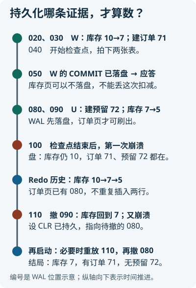
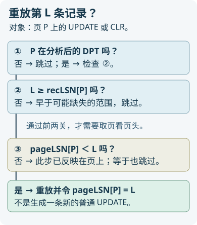
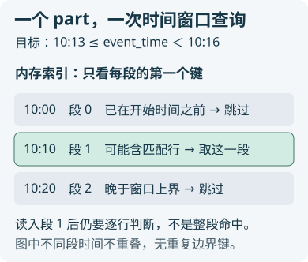

# 数据库恢复：拿什么证明一笔订单没有丢，也没有多扣？

假设客户收到了“订单 71 成功”，重启后却只看得到订单，看不到库存扣减；同时另一个**没成功**的预留 72 反倒已经写在磁盘页里。哪一页可信？只看页，回答不了。ARIES 的办法是先按持久日志重建发生过的事，再把没有提交的事务撤干净；恢复本身也可以被崩溃打断。

片尾的 ClickHouse 嘉宾短讲讲扫描剪枝，不是 ARIES 的第四阶段。先用本页的订单 71 推到第二次重启，再对照[课程公共资料](#/c/cmu-15-445-2025)中「订单已确认，为什么磁盘上还没有订单」，或在 [HW6 恢复部分](#/c/cmu-15-445-2025/lab/hw06?v=zh)练习分辨日志证据。

## 全片回看索引

以本讲 `X2jc4qalNy0` 的 1:17:54 时间轴为准；切点据原英文自动字幕、讲者转场与选定实帧近似到秒，不表示连续有字幕。音乐、听不清的远处发言与精确覆盖见逐段整理稿。

| 原片区间 | 回看时带着的问题 |
| --- | --- |
| 00:00–00:57 | DJ 开场；习题课、HW5 和期末安排是什么？ |
| 00:57–05:40 | 崩溃前已提交、已中止、未结束的三个事务，分别要保住或清掉什么？为什么先重做？ |
| 05:40–08:51 | WAL、重复历史、给撤销记日志，分别防哪一种丢失？ |
| 08:51–14:07 | 页、事务、持久日志、检查点各自跟踪哪个 LSN？ |
| 14:07–18:29 | 何时能逐出脏页？为何举单页原子写、跨页日志分段的例子？ |
| 18:29–20:50 | COMMIT、客户应答、TXN-END 哪两个之间必须等持久化？ |
| 20:50–24:59 | 谁能发起 Abort？为什么这时还不能放锁？为什么回滚也写日志？ |
| 24:59–29:15 | 回滚未完掉电怎么办？T1 两个 CLR 的两种链指针各去哪儿？ |
| 29:15–33:21 | 能不存双像、缓存结果、甚至不写 CLR 吗？“昨天的值”不能证明什么？ |
| 33:21–36:42 | 等所有事务结束、或只暂停写，两种检查点各付什么代价？ |
| 36:42–40:59 | ATT 和 DPT 回答的不是同一个问题；两次检查点为何看不见同一组页？ |
| 40:59–44:16 | Fuzzy checkpoint 的 END 里放什么时候的状态？master 何时从 007 改为 013？ |
| 44:16–49:11 | Analysis 从哪儿开始，结束时的两张表分别能证明到哪一步？ |
| 49:11–52:18 | T96/T97 例：到 030，快照不含 P33，重建出的表为何反有 P33？ |
| 52:18–57:11 | UPDATE、CLR 都进入 Redo 的筛选。哪些判据不用读盘页？ |
| 57:11–1:02:21 | 多个未提交事务谁先撤？全例两次崩溃，T2 为什么还欠 014？ |
| 1:02:21–1:06:35 | “部分 CLR”问的是部分回滚还是撕裂记录？重启、延迟撤销、单机课程小结。 |
| 1:06:35–1:10:50 | ClickHouse 追加、排序 part、异步插入和后台合并，哪里像 LSM、哪里不像？ |
| 1:10:50–1:13:50 | 按 event time 找网页访问记录，稀疏索引比直接在对象存储二分少做什么？ |
| 1:13:50–1:15:43 | Projection 与 skipping index 分别用什么换 I/O？ |
| 1:15:43–1:17:54 | 两个 JOIN 问题、讲师致谢、制作音乐尾段。 |

## 1．先写日志，到底要“先”到哪一步？

本讲取 **STEAL + NO-FORCE**：缓存可以逐出含未提交更新的脏页；事务提交时又不强制它的所有数据页落盘。前者制造了 Undo 需求，后者制造了 Redo 需求。WAL 不是磁盘毁损后的异地备份；以下假设已同步的日志可读、页写原子、单机单版本、Strong Strict 2PL。物理更新用前后值示意，暂略索引结构操作。

| 证据 | 存在何处；精确含义 |
| --- | --- |
| `LSN`、`prevLSN` | 日志记录的物理顺序；`prevLSN` 指同一事务的上一条，不是全局上一条。LSN 不是事务时间戳，也不是用户可见性条件。 |
| `pageLSN` | 在页头；此页已经反映的最近一条更新/补偿。缓存中的新页和磁盘上的旧页可以不同。 |
| `flushedLSN` | 日志管理器的水位：持久 WAL 前缀到哪儿；它不是最新数据页的编号。 |
| `recLSN` | 运行期 DPT 条目：这一轮页首次变脏的更新。恢复时是**最早可能尚未落盘**的位置，可能偏早，不能偏晚。 |
| `lastLSN`、`undoNextLSN` | 前者是 ATT 里某事务最近一条；后者在 CLR 中绕开已补偿的更新，指下一个待处理位置。 |
| `MasterRecord` | 固定的持久入口，指向最近**已成功完成**检查点的 **BEGIN**。 |

记录更新并取得 LSN，持写 latch 更新缓存页及页头。这不等于每次在内存改一字都等磁盘。**写出脏页 P 前**，先保证 `flushedLSN ≥ P.pageLSN`；否则要等或主动刷日志。**肯定答复提交前**，必须持久化到该事务的 COMMIT。两个“先”分别保护不同的承诺。多个事务可以共摊一次日志同步，它们各自的提交记录仍必须在已持久前缀内。`TXN-END` 则是簿记终点，非客户收到的承诺；清除内存日志缓冲也非删除仍供恢复用的持久日志。

## 2．一笔已承诺的订单，一个悬着的预留

取两个页：`S` 记录商品库存，初值 10；`O` 是订单页，初始没有 71、72。W 要买 3 件；U 后来想再预留 2 件。它们在 W 提交后才交换同一库存对象的写权限。为把盘上证据写清，约定原始页头均为 0，日志编号只表示顺序，以下忽略无关记录。

| LSN | 日志 / 事件 | 能断言什么？ |
| --- | --- | --- |
| 010、020、030 | W 开始；库存 `10→7`；订单 71 `无→已确认` | 缓存页分别反映 020、030，尚非客户承诺。 |
| 040 | 检查点 BEGIN | 课堂取样约定：快照 ATT 有 W/030，DPT 有 S/020、O/030。 |
| 050、060 | W COMMIT；强制 WAL 到 050，答复客户；之后记 W END | 即使库存盘页仍是 10，也必须保住 W。 |
| 070、080、090 | U 开始；O 中添预留 72；S 从 7 改 5 | U 没有 COMMIT。设 WAL 已到 090，O 刷成 `pageLSN=080`，S 仍未刷。 |
| 100 | 检查点 END 载 040 拍的两张表；持久化后令 master=040；随后掉电 | 持久 WAL 含整个 010–100，磁盘 S=10、O 有 71 和 72。不能因为同在 O 上就把两笔一起保留或丢弃。 |

只挪一个崩溃点就改变结论：若 050 尚未持久，系统**不得**先回成功；若 050 已持久但应答丢在路上，W 仍是 winner。恢复解释数据库是否已提交，不能凭日志证明客户一定收到了网络消息。

图 1（原创）：看两次故障前**已持久**的证据，不把数据库页、WAL 和给客户的应答画成同一次写入。

## 3．Analysis：为什么不能把检查点的两张表直接当作真相？

等待所有事务结束再刷页，恢复容易，在线请求却得等最长的事务。只暂停更新再刷页，可能已经写出同一事务的第一个页、还没做第二个更新。Fuzzy checkpoint 允许事务继续执行：课程模型在 BEGIN 取 ATT/DPT 的状态、待 END 才记入日志；只有 END 可恢复了才能发布新的 master。若只落了新 BEGIN 而 END 没落，仍用上一个成功检查点。

从 master 处向持久日志尾**正向**读。ATT 跟踪事务状态和最后位置，END 可来自完成的提交**或**完成的中止；DPT 跟踪页而非事务。一次写命中新脏页才为其设 `recLSN`，不要随着后续写递增。读到 END-CKPT 要和 BEGIN 以来的记录**合并**，不能擦掉区间内的更新、倒退 `lastLSN` 或复活已结束的 W。用课堂的 BEGIN 取样模型，等价而好理解的算法是：先取 END 内的基线，再从对应 BEGIN 回放事务状态和页更新到崩溃点。

- **课上 49:11–52:18：**010 BEGIN，020 T96 把 P33 上 A 从 10 改 15，030 END 里是 T96/T97 和 P20。原快照当然不含 P33；重建结果却同时有 `(P20,008)`、`(P33,020)`。040 T96 COMMIT，050 T96 END，最终 ATT 只留 T97（U）。DPT 里留下 P33 不表示 T96 还活着。
- **订单例：**最终 ATT 只有 U/090；DPT 保守地留 `S→020、O→030`。盘上 O 已经刷过，却没有一条“刷 O”日志来告诉 Analysis。把干净页误列候选会多一次检查，把可能遗漏的更新排除在外则会丢数据。
- **与原论文的区别：**Mohan 等 §5.4 允许在取表时分批短暂加 latch，而不要求全系统同时拍照，也不以把所有脏页刷清为完成前提；不同时间看到的条目靠从 BEGIN 起分析消化。不要把课上的快照约定硬套给其他实现。

## 4．Redo：不是“把已提交事务的 SQL 再跑一遍”

从分析结果的 `min(DPT.recLSN)` **向前**扫到日志末端，这里是 020，不是 040，也不是 W 的 BEGIN。无 DPT 条目时，这个页级 Redo 没事可做。UPDATE 和已有 CLR 都是候选，事务是否 winner 不参与筛选。同一条记录对同一页至多补上缺失的那一步；靠状态判据达到可重复启动，不要求所有裸操作（比如自增）天生幂等。

图 2（原创）：注意两个不同的等号。`L = recLSN` 仍是候选；`L = pageLSN` 却说明此条已包含在页里。第三关看取来的**当前页**；同一轮 Redo 此前已在缓冲中更新的页，不必重复读旧磁盘副本。

**订单例逐条算：**020 命中 S，页头 0，重做到 7/020；030 命中 O，但磁盘已有 080，跳过；080 对 O 恰等于 080，仍跳过；090 命中 S，当前 020 小于 090，再做到 5/090。这时库存 5 **暂时是正确的恢复中间态**：完全重复了 loser U 的历史，并非恢复完的业务结果。重放不制造另一份 UPDATE/CLR，也不要求每步强制刷出页。课程例在 Redo 尾为 ATT 中已有 COMMIT 但无 END 的事务补 END，这与“重放这一页时不再为它记更新”不矛盾。

## 5．Undo：回滚走的是哪条链？回滚做到一半会怎样？

对仍是 U（Undo Candidate）的事务，以其 `lastLSN` 建待处理集合。每次取**最大待处理 LSN**。普通更新：逆转其作用、追加 CLR、沿原更新的 `prevLSN` 继续；遇既有 CLR：**不要撤销补偿**，走其 `undoNextLSN`；遇无需撤的普通记录则沿同事务的 `prevLSN`。到链头结束该事务，写 END。这与把整段日志从最早的 loser 记录**正向**扫描不同。多次更新同一对象，反向顺序才把状态还给最初写入者。正常中止也遵循同样逻辑；收到 Abort 时可以先通知“不提交”，却不能因此让别的事务先写、再用旧值盖住它的写入。

**订单例继续：**撤 090，于 110 写 CLR `S:5→7, prev=090, undoNext=080`。假设 110 已持久，但在撤 080 前再次掉电。

- 若 S 的补偿页已按 WAL 规则刷到盘（`pageLSN=110`），再次 Redo 看到 090、110 都跳过；若 S 从未刷过（`pageLSN=0`），再重放 020、090、110，最后仍是 7。两条路径物理 I/O 不同。
- U 的 110 是**已发生的补偿**，不为它写“反补偿”。下一件事是 080：写 CLR 撤掉 O 上的预留 72，不动同页的订单 71；随后到 070 的 BEGIN，写 U END。最终 S=7、只保留 71。
- 反过来，如果 110 **没有持久**，其页效果也不能已经落盘（WAL）。下次依据较短的持久前缀再次执行撤 090 是必要工作，不是错误的“双撤”。

课堂全例（57:11–1:03:38）里 T2、T3 的待撤更新分别是 019、018，先补偿 019，再补偿 018 并结束 T3；T2 通过 CLR 的 `undoNext=014` 越过已完成的工作。第二次重启只剩 T2 的 014。**校订提示：**显示页 41–43 把 016 印成 T1 补偿 T2 的 014，又将补偿 019 的对象从 A 印成 D。前者违反“同一事务逆链”，后者违反“逆转所写对象”。不要依这两处抄出另一套算法；也不能据残缺前缀推断所有对象原值。

## 6．如何估算恢复成本？

检查点主要缩短 Analysis 的连续扫描，**不**是“此 LSN 以前可立即删 WAL”的证明。一个迟迟不刷的旧脏页会把最小 `recLSN` 拖早；一个跨越多次检查点的大事务会让 Undo 沿自己的链再往前走。DPT 前两道门不需页 I/O，第三道门对不在缓存的候选页至少要取页。多次故障时，CLR 既是进度也是恢复材料：日志量付在每次**实际需要补偿的更新**上，不为已存在的 CLR 再造 CLR。

若在 Analysis 中重启，重建内存表即可；在 Redo 中重启，重新按页头判定。加速措施有代价：异步刷恢复后的页可省等待，下次又崩溃就多重放；延迟 Undo 要有访问屏障，不能在页上存在尚待撤销的值时直接交给新读者。缩短应用事务可减少最坏回滚量，却不总能改应用。

## 7．为什么 ClickHouse 嘉宾谈的“省掉读盘”不是同一种算法？

Robert 的原片例是按 `event_time` 排序的网站访问统计。更多 INSERT 产生新的有序 part；异步插入可以先攒批，后台用多路归并把小 part 并大。它像 LSM 的排序合并，却不是查询必须沿固定树层逐层找行；不同 part 可以并行扫。这里的 primary key 服务于排序和剪枝，插入不靠逐个查主键保证唯一。嘉宾用逻辑“文件”讲 part；不要据此断定每个 part 只有一个物理文件。

图 3（编者另举订单事件）：教学图只画三个 granule，时间不跨段；先从内存首键索引排除首尾，再读中段做精确过滤。录像例按每 8192 行取一个首键，1000 个索引项可覆盖约 819 万行；8192 是该例/常见默认值，不是对所有表和数据大小的保证。直接在对象存储上为每次二分探测付一次数十毫秒延迟，即使比较次数为对数也可能很慢。

换过滤列怎么办？嘉宾的 **projection** 示例是同一批行的另一种排序，优化器可以选，但物化副本占空间；**skipping index** 给一块数据加少量 min/max、值集合或 Bloom filter 元数据，不是另一份全表。若目标值在区间外，可以不读；在区间内不表示一定有匹配行。两者依赖列分布、相关性与工作负载。与恢复的可比之处只有“元数据保守排除不必做的 I/O”：DPT 漏掉真需重做的页会损坏库，查询剪枝误排会漏结果，但事务正确性和扫描性能是两个问题。片末 JOIN 问答谈历史上的去规范化单大事实表及新做的 join reordering，不是 ClickHouse 没有 JOIN。

## 自测：先写下证据，再展开

1．内存中页头是 44，持久日志到 41，事务正在因冲突中止。可以直接驱逐这一页吗？

不能把该脏页写盘。先将 WAL 至少刷到 44，再刷这一版本的页；事务不再提交不意味着它产生的物理更新可以绕过 WAL。若写回的是后来带补偿的新页，还得覆盖它更新后的页头 LSN。

2．050 COMMIT 已持久、W END 和数据页都没持久。应答包是否发出未知，能把 W 当 loser 吗？

不能。持久的 COMMIT 就是恢复中的提交决议；是否需要重做由 DPT/页头决定，是否需要事务收尾由 ATT 决定。网络包是否到达客户不是恢复状态的一部分。

3．上次成功检查点在 40；新的 BEGIN 200 已持久，END 还在内存。分析从哪里开始？Redo 一定从同处开始吗？

从 master 指向的上一次完整检查点 40 开始分析。不能提前发布 200。Redo 根据分析后的最小 recLSN 开始，可能早于 40，也可能晚于它；DPT 空时不必做页重放。

4．P 的 recLSN 是 20。依次遇到该页记录 17、20、28，而取来的页头是 20。哪条真的修改页？

17 在 DPT 下界之前，无须为它取页；20 通过下界筛选，但已在页上；28 才重放并把页头推进至 28。DPT 阈值和页头阈值不能互换。

5．两个 loser 的待处理位置是 91、86。91 是 CLR，undoNext=74，prevLSN=89。下一个实质动作是什么？

不反做 91，也不沿 89 把已补偿的工作再做一次；把 91 换成 74，下一次取最大为 86。只有 86 本身是可撤更新时，才为它生成新 CLR。

6．订单例中磁盘 O 上有未提交的 72。为什么既不把整页换旧，也不在看到 72 时立刻删它？

同页还承载必须保留的 71，整页回退可能覆盖已提交改动；看到行值也不知其完整事务史。用日志和页头重现历史，再沿 U 的 080 精确补偿，保留 71。

7．每个时间段的 min/max 都覆盖查询点，Bloom filter 又给“可能在”。能据此返回结果而不读候选行吗？

不能。不能排除不等于命中，更不代表全块命中。应读候选并执行实际谓词。工作负载与块内分布不合适时，小索引虽然便宜，却可能几乎省不下 I/O。

## 定位与出处

- **录像署名与修改：**CMU Database Group，[Fall 2025 第 22 讲原片](https://www.youtube.com/watch?v=X2jc4qalNy0)，Andy Pavlo、Robert Schulze。单条视频标有 Creative Commons Attribution license (reuse allowed)；[平台许可说明](https://support.google.com/youtube/answer/2797468?hl=en)对应 [CC BY 4.0](https://creativecommons.org/licenses/by/4.0/)。此页以中文重新组织讲解，三幅示意图均为另画的教学例。

- **当讲：**[2025 秋课表，11 月 19 日](https://15445.courses.cs.cmu.edu/fall2025/schedule.html#nov-19-2025)、[Andy Pavlo，官方 slides](https://15445.courses.cs.cmu.edu/fall2025/slides/22-recovery.pdf)（显示页 9–12 水位，18–22 CLR，26–31 检查点，36–43 重启例）、[官方 notes §§2–5](https://15445.courses.cs.cmu.edu/fall2025/notes/22-recovery.pdf)（表 1、图 2–4、pp.5–6 跳过条件）。课表指定 *Database System Concepts* 第七版 §§19.1–19.9；这里只作阅读定位，未据教材正文制作译本。
- **课堂提到、编者查读原论文：**C. Mohan、Don Haderle、Bruce Lindsay、Hamid Pirahesh、Peter Schwarz，*ARIES: A Transaction Recovery Method Supporting Fine-Granularity Locking and Partial Rollbacks Using Write-Ahead Logging*，ACM TODS 17(1), 1992, 94–162。[出版记录](https://doi.org/10.1145/128765.128770) · [论文](https://people.csail.mit.edu/tdanford/6830papers/mohan-aries.pdf)。§5.2 的 CLR 链、§5.4 的模糊检查点、§§6.1–6.3/图 9–12 的恢复入口、页筛选和最大待撤位置。论文有逻辑撤销、部分回滚等比课例更广的情形；没有整译论文或复用其图。
- **编者补核：**[PostgreSQL 18 §19.5.1 `full_page_writes`](https://www.postgresql.org/docs/18/runtime-config-wal.html#GUC-FULL-PAGE-WRITES) 是首次改页时写整页像以防撕裂，并非 CLR；[ClickHouse 官方 Primary indexes](https://clickhouse.com/docs/primary-indexes) 的 *Sparse primary index creation/usage* 与 *Key takeaways* 区分“可能命中的 granule”和“匹配的行”。文档只校订术语，不代替当年课堂或证明当时版本。
- **嘉宾片末展示、编者对照：**Robert Schulze、Tom Schreiber、Ilya Yatsishin、Ryadh Dahimene、Alexey Milovidov，[《ClickHouse – Lightning Fast Analytics for Everyone》](https://www.vldb.org/pvldb/vol17/p3731-schulze.pdf)，PVLDB 17(12)，2024，§§3.1–3.2。granule 是逻辑扫描单位，实际列 I/O 还经过可覆盖多个 granule 的压缩块。此论文另标 CC BY-NC-ND 4.0；这里只作事实和章节定位，不转载其图、截图或译本。