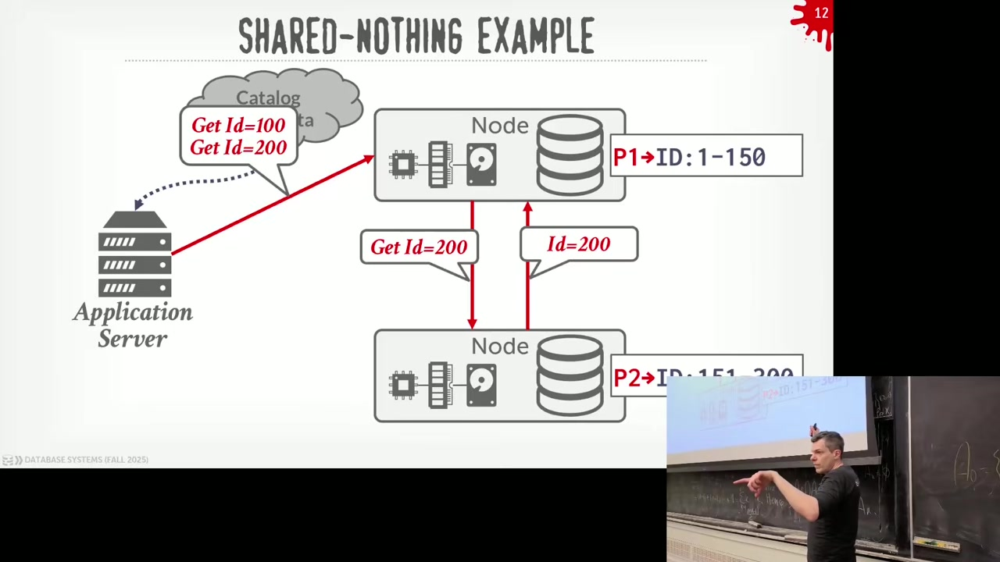
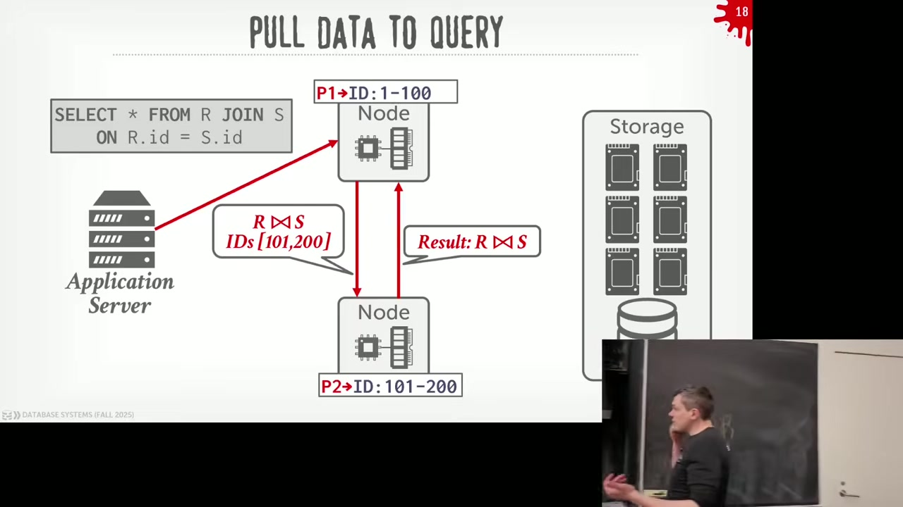
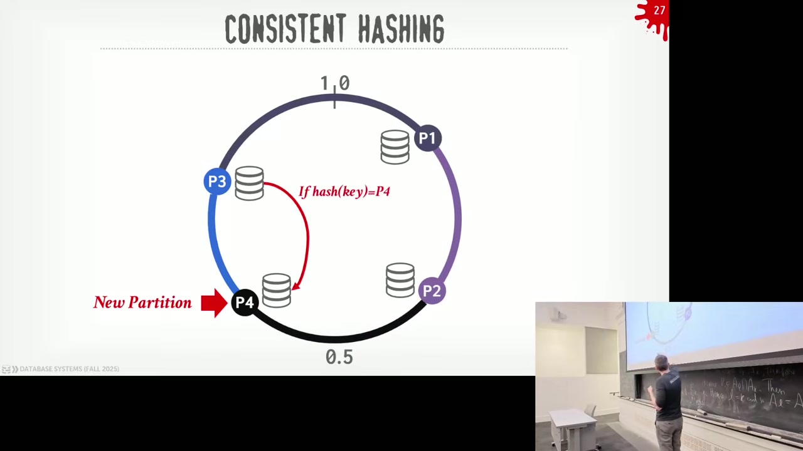
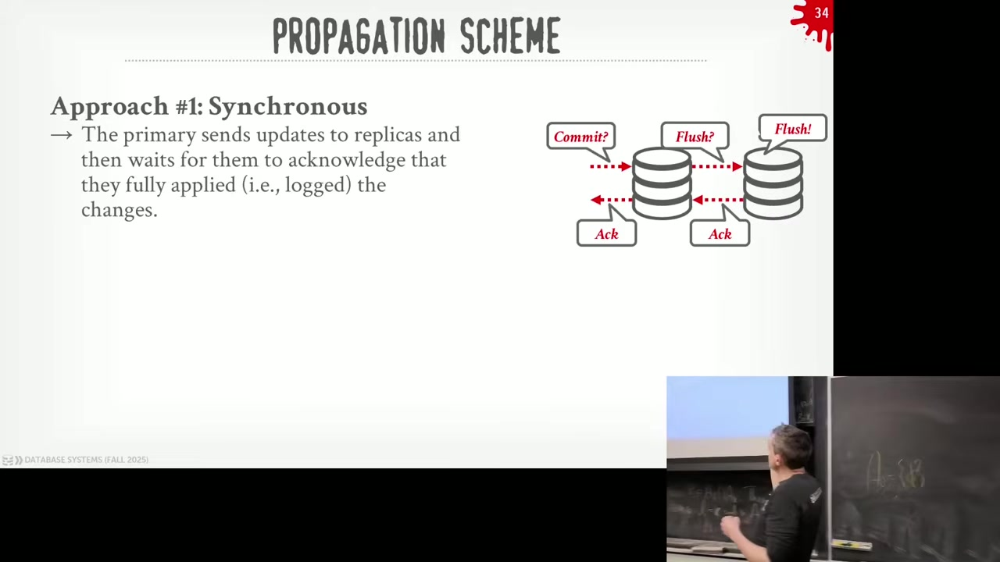
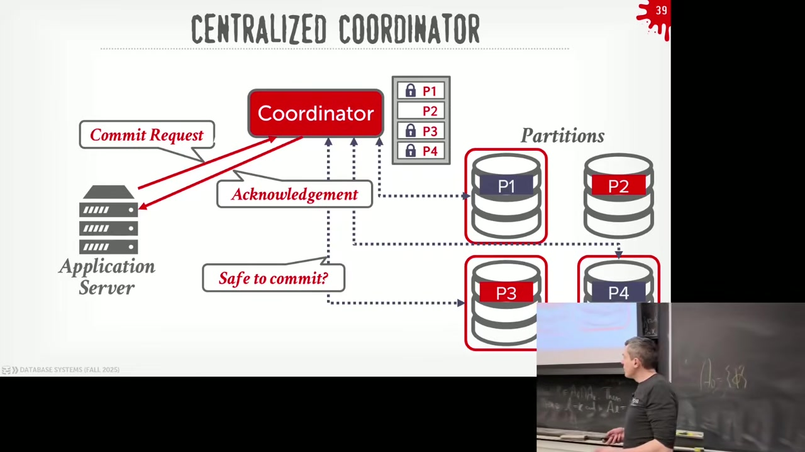

# 分布式数据库（一）：中文逐段整理译稿

## 00:00–02:27｜课务：作业、期末和下学期的助教

开场有课程片头和零碎人声，不能把不连贯的歌词当课堂对白。Andy 接着开了个玩笑，提到什么失散的兄弟、还要找他要钱；指的是谁，字幕不清。好，回到班上：学期快结束了，今天和下次要讲的东西都很多。Project 4 的习题课是上周开的，投影片上的链接通往录像和讲义。HW6 今天稍晚发，和 Project 4 同一天交。期末是 12 月 11 日，我这周会把复习指南和模拟题贴到 Piazza；别订考试之前就要出发的行程，不能为个人改期。下学期还会开 445/645。如果喜欢这门课，就来当 TA；如果觉得 BusTub 是你见过最糟的代码，也请来当 TA，我们想听听你打算怎么改。

**同学问**：期末能带几页小抄？跟期中一样。考察重点是期中之后，到接下来这节课的内容。以前的知识当然还要用，不能说考完期中就不需要懂 SQL 和关系代数了；但我不会特地追问期中已经考过的 buffer pool 细节。考场排了三小时，题量大致跟期中相当，按约 80 分钟能做完来出；想用满三小时也可以。

**编注：**字幕把 Project 4 的月份记成 September；同一段紧接着说与 HW6 同日，课务页写的是 **12 月 7 日 23:59**，期末 **12 月 11 日 13:00**。讲师没有在此另报小抄的具体页数。

## 02:27–04:07｜三场研讨会预告，不是本片的客座报告

今天课后有一位在英国做 XTDB 的讲者。我们没怎么讲时间型数据；可以先想象，时间是元组的一等属性，而不只是另加一个普通字段。那个系统还能处理不止一个时间维度，细节留给报告。下周是 Snowflake 的人介绍 Apache Polaris，一个面向 Apache Iceberg 的开源目录。讲师讲起当年的收购故事：按他的说法，Snowflake 想以大约六亿美元买下 Iceberg 团队所在的公司，Databricks 出价到了十亿；公司当时约四十人，已有收入。没买到团队不表示 Snowflake 不能用 Iceberg，他们另做了 Polaris。

还有临时加进来的 Apache Fluss。团队发了不少邮件想来讲，老实说我以前没听过，也没碰见过用户，等报告再听听。这会是本学期研讨会的最后一场，春季再开。毕业离开 CMU 也欢迎在 Zoom 上继续来，常有以前的学生来听。这里是在预告另外三场活动，接下来还是 Andy 自己授课。

## 04:07–08:20｜把会做的事搬出一台机器，什么不再可靠？

到这儿，大家已经知道怎样做单机数据库了：能处理事务，能在故障后恢复，也会把 SQL 变成计划并执行。今天和下次是在这个基础上看分布式系统，不是推倒重来。原本一台机器里的层次，现在可能摊在两台、四台乃至更多机器上。是从计划层往下传任务？从存储层往上取数据？还是在中间，比如各个 buffer pool 之间协调？快查询和故障后不丢数据这些要求一个都没消失。

想想以前讲过的并行执行。一台机器上有许多核或 CPU 插槽，线程或进程间传话很快，通常可以把通信当作可靠的；真要是同机连消息都传不过去，这台机器恐怕早出了更大的问题。现在对端可能在地球另一侧，光传播就有下限；讲师举的量级是上百毫秒，丢包和恢复碰在一起可能是几十秒甚至几分钟。更糟的是，消息发了，不代表到达。网络会断，包会丢；也可能机器还活着，却迟迟不处理请求。比如 Java 进程有个很大的堆，垃圾回收把执行停住十秒、三十秒；从你这头看，跟那台机器消失了一样。这时候应该怎么办？

分布式系统课会花许多时间在 Paxos、Raft 之类的共识协议上。那些也用得上，但先弄清系统长什么样，再看在上面加什么协议。优化、并发控制、恢复仍然是原来的问题，还得再算一笔账：另一座机房可能只有更少的核。做计划、安排事务、选择并发控制时，不能假装所有机器都一样。

## 08:20–11:31｜四个设计问题，两种扩容目的

一，应用去哪儿找数据？单机连上那个地址就行，现在一张表分在几台机器上，把查询交给谁？二，资源怎么划分？是整张表归某台机器，还是切得更细？应用需要知道切法吗？三，查询送到了这里，数据却在别处，到底送查询过去，还是把数据拉过来？四，怎样在整个库内保持正确性和一致性，不让应用重新面对我们以前讲的那些异常？有的系统干脆不保证立即一致；那并不是问题消失了，而是应用必须知道会看到什么。

今天先拼好基础：体系结构、分区、复制，再过渡到跨节点事务。下一讲再细讲分布式事务控制和分析查询，例如跨节点 JOIN。并行通常是多加资源让任务更快；分布式当然也想更快、更能装，但还可能是为了**不停服务**：一台机器坏了，应用仍能向其他机器查库。这不是多给同一台机器装几个核就能办到的。

## 11:31–16:55｜CPU 能直接碰到哪些资源？

这套分类从八十年代就有。先盯住一颗 CPU：能直接访问谁的内存、谁的磁盘？前半学期用的是 **shared everything** 的单机模型：CPU、内存、磁盘同在一台机器里，本机各执行者看得到同一套资源。**Shared nothing** 是各台都有自己的 CPU、内存和盘。本机不能伸手去翻远端内存里的页，必须走上层网络发消息，让对方的 CPU 接收、执行，再把结果传回来。一般先想成 TCP/IP；也有 UDP、Mellanox/RDMA 等更专门的实现。

**Shared disk** 是各有 CPU 和私有内存，持久数据却放在所有节点都能访问的同一逻辑存储上。要跟另一台计算节点说话还是发消息；只是为了读数据，不必先请那台节点代读它自己的盘。还有文献里的 **shared memory**：处理器跨节点共享内存地址空间和磁盘。科学计算、高性能互连里可以讨论这个模型；常规数据库里我不知道有什么典型实例，这门课不展开。

**同学追问**：shared everything 不就也共享内存？是，但先说明讨论的机器边界。好几台各自“什么都共享”的单机放在一起，若跨机只能发消息，从外面看仍然是 shared nothing。这里的 shared everything 指的是一台机器。又问：图上只画了一块盘，真的只能有一块吗？不是；物理上可以有很多设备，对计算节点表现为一个逻辑盘。S3 算不算？对，这就是后面的例子。还有人问 shared nothing 图上的网络和入口流量怎么理解。讲师请对方重说；能辨清的回答是：查询进了中间节点，它若需要别台的记录，不能直接读那台的内存或盘，要靠消息请对方处理、回传。

最常见的起点还是先做单机。Mike Stonebraker 在八十年代为 shared nothing 写过文章；在云对象存储普及之前，很多分布式库都是这样造的，现在新分析系统里的 shared disk 更常见。**问**：Spanner 算哪一类？讲师说，从节点分工看很像 shared nothing，底下又在读写分布式文件系统，所以界线会模糊。**编注：**字幕在这里出现 `Borg`。原始 Spanner 论文 §2.1 明确说 tablet 的文件与 WAL 在 **Colossus**，看计算层与看存储层不一定得到同一张图。

## 16:55–20:30｜Shared nothing：200 在谁的本地盘？

每台机器有本地盘和内存，自己手边的数据自己处理；查询只落一个节点时，不用老跑远端，性能、效率都好。麻烦是加机器、减机器，或者有一台倒下要接手。不能说“这里新添了个节点，你也去看同一块盘吧”，原来的数据并不在它那里。八十年代、九十年代到二十一世纪头几年，你听说的分布式系统许多都是这一路。

看图里的应用服务器。旁边有个 catalog，告诉它数据怎样分布；此时不必先决定目录是不是独立服务。先假设整个库就一张表，ID 从 1 到 300，P1 管 1–150，P2 管 151–300。只要 ID=200，就路由到 P2，它在本地找出结果交回来。如果一个查询同时要 100 和 200，入口却是 P1，P1 看目录知道自己没有 200。它要么请 P2 执行“找出 200”这个小任务、拿回结果，要么取回自己处理所需的数据。不能去别人的本地盘自己取。

现在中间加一个 P3。图上变成 P1 管 1–100，P3 管 101–200，P2 管 201–300。P3 的新范围一半原先在上面，一半在下面；必须实际把两处相应数据挪来，再使目录反映新位置。先前说的“本地快”有个价格：改变分工本身有搬运成本。

## 20:30–26:26｜目录、索引，以及为什么客户端只接一份结果

**问**：应用服务器得知道具体范围吗？理想情况不用，有的产品确实让它知道。我们想要的是：同一条 SQL，搬到多机库仍能跑；不能因为今天动了分区，明天就要改所有应用。客户端可以问一个入口该找谁，也可以连任一节点，让节点查目录。目录也是数据库：以前只说表、列、模式和约束，现在再加分区规则、数据放在哪儿、网络拓扑等。业务数据需要事务保证，决定业务数据去哪里的目录也一样需要。

**问**：索引怎么维护？若按 ID 分区，每台就为自己那一段维护本地索引。由 SQL 看出要查 ID=200，把查询送对节点后，在那一截索引内查即可。二级索引却未必按同一个键来分；可以做一个大家都去找的索引服务，也可以把它复制到多处。这跟把一个本地索引自然分段是两个问题。

*22:44｜单条原片实帧。上下两根箭头是 P1、P2 之间的往返，不是 P2 另开一个客户端结果集。*

**问**：插入时遇到某台已经装满怎么办？看分区办法和触发重平衡的标准，后面讲一致性哈希和 rendezvous hashing。有些早期 MongoDB 部署吸引人的地方正是自动分片：这边太满、太热，就切出一块搬走。讲师用早期做法说明危险：如果数据搬了，目录却没跟着一致地切换，在两台上都有副本时，两笔查询可能各改一份，结果就错了。另一极端是把整个库锁住，搬完再放开。不能光说“会自动搬”就忽略了迁移中的读写。

**问**：既然 P2 已经拿到 200，为什么不直接把这一行回给应用？这里不是客户端分别发两次 GET，而是一条 `SELECT … WHERE id IN (100, 200)` 发给一个数据库端点。JDBC/ODBC 的这种调用约定是返回一份结果集；普通应用不会为一条查询突然从两处分别接结果。可以设计另一种驱动，但我们的目标是让数据库自己分发、汇合，应用不必知道下面切了几份。**又问**：图里这些节点是对等的，还是已经有主节点？这幅图还没规定主从。只看一件事：各有一块数据，想拿别人的必须发消息。老师请同学先让他翻到后面的图再继续。

## 26:26–32:19｜Shared disk：可以只改分工，不能忘了旧缓存

每个计算节点仍有本地 CPU、内存，还可能有 SSD，用来缓存或在内存放不下时暂存。**主存放位置**不在这些本地盘，而在共同访问的文件系统、对象存储上，例如 Amazon S3、Azure Blob、Google Cloud Storage。把它想成一台逻辑设备就好。数据湖和 serverless 服务常见这种形状；Snowflake、Databricks 等面向分析的系统也用类似的拆分。

同样有目录或前端帮助找入口。查 101，知道要从存储读 Page ABC，把一份带回缓存；查 102，则去拿 Page XYZ。加一台计算节点，现在只需在目录里把负责 101 的工作重新指定给中间那台，不需要为了这个变化把持久数据本体从上往下搬。**问**：既然谁都能读公共盘，为何一定要划责任范围，不能谁都处理任意键吗？只读很容易；想想写。底下更新了 102，别处可能还有昨天的 102。我们怎么知道哪些人有副本、怎样让它们知道已经过期？同学说“加锁”。锁加在哪里？回答“到处”。难道为了一把锁要向所有节点广播？也有人提出设置主节点，这是一个方向。

再看更新 101：改了 ABC 页之后，其他缓存过 ABC 的节点得知道下次要取新版，或向负责它的节点取，或再去共享存储取。共享的是存储，不是所有机器的内存。云存储还有一个好处：加容量通常是多付点钱，不需要找到某部机器拆开机箱装盘；你的信用卡额度可能比云厂商的容量先用完。计算节点可以独立加减。

**问**：那为什么说 shared disk 可能没有 shared nothing 快？缓存没命中时，要经过网络跟别的设备要数据。做 OLTP 可以各自缓存，可写进去的数据最后仍得出去，缓存副本还得处理。**再问**：差别是不是远程磁盘 I/O 的代价？是；另外，若事务横跨多节点，提交还得等参与者来回表态，不过这个成本两种架构都有。不要把“大家用一块逻辑盘”当成已经解决了分布式提交。

## 32:19–38:26｜推查询还是拉数据？一段关于 S3 Select 的争论

查询到了我这里，数据不在缓存，或根本属于另一台机器。方案一，把整条查询或一段计划推到有数据、也有算力的地方，先在那里过滤、计算，只传回结果。方案二，把所需字节拉到我这里，再像本地查询一样算。不是二选一；“存储端”自己也可能有一点计算能力。

比如 S3 Select：请求一个对象时带上一个受限的 SQL 表达式，让存储端先过滤，再传符合条件的部分。不能当成任意 JOIN 引擎，但过滤掉大部分数据可以少传字节、少花传输费。此功能对新用户已经不开放。**问**：为什么不再给新用户？我不知道。是问这对生意好不好，还是对数据库好不好？如果问技术价值，我觉得丢掉这种能力很可惜；我不知道实际用了它的系统有多少。若这里有一 PB 数据，可不想为了几个符合条件的值全都搬回去。

同学提出：这样一块核心性能岂不是交给别人控制？是。前面我反复说操作系统不可靠，现在好像又劝你信 Amazon。要看工作：简单过滤能否拆成足够多并发请求？假设本机只有二十核，远端却能并行处理许多对象，那么可借到别处的算力。举“一千个请求”是说明可能的并行度，不是平台配额保证。反过来，服务端运算要付钱，本地算也许便宜；怎么把一 PB 搬出来、要多少本地 SSD 来缓存，也都要算成本。**追问**：搬一次不就行了？前提是它不被其他工作挤出缓存，前几周的 buffer pool 问题一个没少。

**又问**：不用 S3 Select，自己能不能避免把整个桶拖回来？能。先用目录掌握对象信息，用索引、zone map、过滤器作判断。有人刚放下一批从未见过的 Parquet 文件，你怎么会自动知道里面有什么？先读 footer，把元数据带回来，花的钱远小于全文件；再决定读哪些部分。讲师随口估了一下 footer 可能连一 MB 都不到，不是格式上限。谓词下推、投影下推、尽量少读，跟读本地盘时的原则一样。微软一侧也有同类思路，支持能力不必完全一样。

## 38:26–43:03｜一次 JOIN 同时可以“推计划”和“拉页”

查询是 `R JOIN S ON R.id = S.id`。假设 1–100 的 R、S 在上方节点，101–200 的 R、S 都在下方。别把下方的两堆行全拉到上方做 JOIN；入口可以给下方一段计划：“你把 101–200 这部分连好，把局部结果寄给我。”入口把自己的部分和它的部分接起来；若后续还有算子，就继续处理。这是 shared nothing 上的示意，重点是要连接的相应键在同一处。

换成 shared disk，先假设两边缓存都是空的。上方仍可把负责 101–200 的片段交给下方；下方再向共享盘把需要的页拉入本地缓存，运算后返回。上方可以合并结果或继续执行。**计算节点之间在推计划，计算节点与存储层之间在拉数据。** 同样写“101–200”，上幅图是物理分区，下幅图只是说目前这些键由谁负责；持久的本体还在共享存储。若更新这个范围，要先交给负责者，再由它传播必要的信息。

*40:20｜看清三个位置：应用左边发查询，两个计算节点之间传片段与结果，右边才是持久存储。“拉”说的是从存储取数据，不排斥节点之间推计划。*

有人接着提问，字幕只留下 `server` 一类残句；讲师回答“下一页就是”。转到分区：可以切磁盘、节点或执行任务。细到记录时，从表里选一列或多列作为分区键；粗到文件时，Snowflake、Yellowbrick 这类分析系统可以给不同节点分配 S3 文件。通常把数据切成不相交的子集，但也会有重复部分。应用写一条查询，内部按目录把计划片段分出去、最后拼成一个答案。分别记住两种“负责”：本地持有主数据，还是只负责调入、处理它。后一种计算节点坏了，已经可靠存进共享存储的数据不随它消失。

## 43:03–49:02｜为什么突然讲 Parquet？专用格式一定更好吗？

**问**：前面讲的是自家 DBMS 的页、slotted page 或 LSM，怎么到了 shared disk，总听见 Parquet？它只是很常见的开放列式文件格式，尤其常见于分析和湖仓。可以让另一应用绕过数据库服务器直接把文件写到 S3，再让数据库去读。这不是说 shared disk 天生规定怎样编码字节；用 PAX、槽式页、LSM 或其他布局，是另一层的选择。也不是说所有文件必须由外部应用产生。特别在 OLTP，数据大多还是用 `INSERT` 进服务器，由数据库自己写。

同学说：有点意外，怎么肯接受一个“随便什么、又老又开源”的标准？Parquet 可不是随便哪里捡来的，行业里到处用。**追问**：可我们自己定制格式，不是总会更快吗？要看什么数据、什么工作负载、在哪种硬件上运行，更要问工程时间花在哪儿。拿 Snowflake 的选择作比：要是做 shared nothing，就得自己负责跨节点存储容错、同步等一大摊事。他们选择以 S3 为可靠存储，在前面放无状态计算节点和缓存，掩盖访问延迟，把自己的工程力量花在把分析处理做快。底下的 S3 变好，自己也能受益。跟“所有层都要自己控制”看似矛盾，但初创公司少造一层基础设施是实在的优势；对延迟特别敏感的 OLTP，未必会这样选。

回到文件格式。如果只服务一个给定应用，你当然可以定制从存储到执行的每一层，把它推得非常快。但通用数据库要卖给不同应用，在许多软硬件组合上跑；为一种负载设计的东西不一定适合另一种，得找出可接受的共同部分。Parquet 出来的时候，很多人还用 JSON 或 CSV 存分析数据，那时列式是很大的进步。十多年后压缩、访问手段仍在变，Vortex 等新格式也在尝试改善；这不改变眼下很多云分析系统面对的就是一堆 Parquet 文件。可以做得更好，和今天需要读这种通用格式，两件事都成立。

## 49:02–51:21｜按整表分：不见得聪明，但有时正合适

最朴素的办法：表一全给一台，表二全给另一台。还可以更粗，把两个数据库分别给两台。只查单表当然很舒服；要跨表连接就不那么好了，整张表大到一台装不下，这办法更是当场失效。不过我确实碰见过这样用的场景：应用数据正常分片，另有一张日志表只插入、几乎不读。让它独占一台，大量追加就不会挤着别人的更新。

另一种看似相反的选择，是把一张表**完整复制给每个节点**。比如查邮编的小表，课堂粗估约三万五千行，既小又不常改。JOIN 时每台都有本地那一份。**问**：这样每次更新不是更贵？是，但邮编并非每笔订单都变；讲师用一年几次更新来说明，额外写成本要和省下的大量远程读比较。这叫复制小表，不是把它水平切成好几份。

## 51:21–56:41｜水平切行：从等值路由到加节点重排

更常见的是水平分区，NoSQL 语境里常叫 sharding。取表的一列或几列，作为把整行送到哪儿的依据，常用主键但不是非它不可。目标也不只有“每人拿同样多的字节”：某台上的数据很少，偏偏所有查询都冲它去，再塞数据给它并不能让负载均衡。按范围切，就把连续的键区间分给不同节点，边界选在哪儿取决于你想均衡容量还是请求。还可按谓词写分配条件，比如同为 Andy 但年龄条件不同的两组发到两处；轮询则把行、文件依次交给各个分区。最常见的还是范围和哈希。

看四列的示例表：从第二列取 a、b、c、d、e 作为键，用 `hash(key) % 4` 选桶。课件将四个分区命名为 P1 至 P4，a 和 d 在 P2、b 在 P4、c 在 P3、e 在 P1。如果 `WHERE` 里明确给了这个键的值，查的时候用同一规则算一次，就知道去哪儿。图里 shared disk 的 1、2 和 3、4 是职责划分；若一次想读 3 和 2，下面的节点可以把一段请求传给上面，也可把数据带到自己这里。shared nothing 的同样几个数则表示记录真的在各自的机器上。

**讲师问**：这种哈希分区有什么毛病？**同学答**：没把分区键写在条件里，就可能得广播。对；即使提了分区键，条件若是 `BETWEEN 1 AND 1000` 而非等值，哈希值也没保留键的连续性。还有一个毛病呢？**同学答**：变化。对，新添一个分区，或掉了一个，以前 `% 4` 现在 `% 5`，同样的键可能全变位置。图中 a 从 P2 到 P4，连不在新分区上的键也得在旧节点之间搬。范围也可能要重划好几段。有人问能不能用稳定点的映射？正好到下一页。

## 56:41–1:02:19｜一致性哈希：新邻居只接走一段

先说 consistent hashing，再说 rendezvous hashing。前者在 Dynamo、Chord 以及后来不少 shared-nothing 的 NoSQL 系统里很出名。老师请听说过它的人举手，不到半班。把哈希空间想成圆环，0 和 1 是接缝。把分区 P1、P2、P3 标在环上。一个键哈希后落在某处，从落点沿顺时针找第一个分区，这就是它的归属。另一个键按同样的方法找自己的后继。倒着想，P1 负责的是上一个标记 P3 之后到 P1 的弧段；P3 负责从 P2 之后到自己这段。

现在把 P4 插在 P2 与 P3 之间。以前 P3 管一整段，现在只把从 P2 之后到 P4 的键交给 P4，别的弧不用跟着动。再插 P5、P6，也是局部变化。大家还是要有一致的环成员信息；用红黑树这类有序结构就可以查环上的后继。**同学问**：图里的三段并不等长，数据也不会自动平分吧？正是。可以给同一台机器分配多个虚拟位置，于是它拿到几个不同地方的弧段。位置够多、数据不极端倾斜时，分布会平些；要是所有行的分区键全是 1，多少标记也分不开这个热点。

*59:03｜顺时针从 P2 到 P4 的这段从原负责人 P3 转给新负责人，红箭头画的是迁移方向。并非把整个 P3 搬空。*

环还可以指示**副本放置**。比如复制因子是三，一个键的第一个后继是 P1，那么主放置在 P1，再顺时针到 P6、P2，各放一份。查这个键时就知道哪几个位置可能有。可是写入 P1 后，P6 和 P2 是否立刻更新？不一定。若异步传播，读不同的那份可能得到不同答案。这是另一个设计问题，不是环算法替我们解决的。讲师提到 Snowflake 分派文件、Couchbase、Cassandra，还举 Riak 标志里的环和扇形为例；谈到亚马逊后来公开的系统并非照搬早期论文。**编注：**这里说的经典原论文系统名是 **Dynamo**，不应据此断言今天 DynamoDB 用同一套实现。有虚拟节点时，还要数不同物理机器，不能把同一台上的三个环标记算作三个容错副本。

## 1:02:19–1:04:55｜Rendezvous：为“键、候选节点”打分

另一个历史很早的办法，是 rendezvous hashing，也叫最高随机权重。讲师回忆这篇工作比 MIT 的一致性哈希还早；课上把环上的稳定分配与这种按权重挑选的思路联系起来。做法不需要先沿环走：对每个键，把它和候选分区的标识拼在一起，分别做哈希，分最高的那个得这个键。比如键 a 对 node1、node2、node3 的分数是 100、90、80，那就给 node1。对 b、c、d 也各自这样排，首选不必相同。

加入第四台时，旧候选之间的相对名次不变。只问新来的分数有没有超过原冠军。图上 a、b、c 的第一名没变；对 d，node4 排到 node2 前面，于是 d 从 node2 搬到 node4。讲师在这里尝试比较查找复杂度，口头几次改口。**编注：**按刚才实际展示的算法，最朴素的 rendezvous 要对每个候选算分、取最大，n 个候选就是 O(n)，无需把所有分数排序。若已在本地存好有序环，找后继可二分或查平衡树，m 个环标记是 O(log m)。不能把分布式逐跳查找和本地表查找混作同一种开销。

## 1:04:55–1:10:47｜有了副本，谁有权写，主节点失火怎么办？

接下来给同一份东西做多份拷贝：可以复制整表、记录，也可以是文件。目标是某一台挂了，服务不用停下来等它重启。很常见的部署并没有把业务表切片分给多台，只是一个完整的单机库，加几个跟随它的副本；主节点坏了，提升一个副本接手。可见“分不分区”“共享存储还是各有盘”和“复不复制”是不同选择。我们要依次问：副本怎么配置？修改怎么送过去、什么时候送，过去后怎样更新？

**Primary–replica**：先对每个对象指定一个主节点，写这个对象必须去它那里，由它负责把变化传给跟随的副本。主节点坏了，要做 leader election，确定谁有资格接手。可以想像目录里有张“对象 → 当前主节点”的表，改这个决定也必须是原子的。Paxos、Raft 一类技术会在这儿出现，具体协议留待下次。**Multi-primary** 则允许在不同位置改同一对象，问题不是接不接得住请求，而是两个地方同时改了，到底按什么顺序、谁算成功、如何解决冲突。

很多企业里的 PostgreSQL 部署，用的是主节点读写、把已产生的修改持续或按提交送给副本的形状。若系统允许，把只读查询转给读副本，就不打扰主节点上的写；代价可能是读到旧值，是否能接受看应用。多主则可以在不止一个节点上读写，节点之间或经协调者决定哪些并发写可以保留。

**问**：为什么非得换主？原主起火不工作了，谁来接单？剩下两台若都说自己是新主，那就失去了单主的意义，必须只选出一个。**问**：多主有什么例子需要拒绝一个写？假设我和你各写同样的两个对象，系统承诺可串行化，就不能让最后的内容一半取自你的事务、一半取自我的事务而又解释不成任何串行次序。可以用两阶段锁或 OCC 来阻止不相容的并发结果，必要时让一笔失败。**又问**：能用 Multi-Paxos 吗？下次讲。要是用两阶段锁，锁究竟放在哪儿？再过几页回到这个问题。

## 1:10:47–1:15:36｜复制：回执等什么，以及什么时候发送

先插一页 **K-safety**。想法是预先规定至少要有多少可用拷贝，低于安全要求便停止接收更新，而不是在最后一份也很可能丢的情况下继续对外承诺。讲师举“原有三份，倒了两台，宁可停下来”的例子。**编注：**口述同时提到 K=1、至少一份存活，数值和“剩一份即停”并不完全对齐。课件显示页 32 的定义是“可用副本数**低于**阈值则停”，若阈值确为 1，剩 1 并未低于 1。因此这里保留安全策略的意思，不把口头例子当作精确阈值公式，也不把它当成所有产品对 k-safety 的统一定义。

多主也可以让每个主各自带副本，两个选择不互斥。现在问：修改发生后，什么时候能告诉外面的应用“成功”？同步传播的图里，应用请求提交，主节点把变化送到副本，请它 **flush**。副本要能说“我收到了，而且已把日志写到稳定存储”，再发回相应的确认；主节点等到所要求的确认，才给应用回提交成功。若策略要求很多处都确认，慢的那个也会拖住回复。**问**：这就是两阶段提交吗？讲师答，2PC 是在有多个参与者时落实共同决定的一种办法；本页强调的是“要等所要求的确认”。**编注：**单份日志的同步复制并不因此等同于跨分片的 prepare/decision，两张图的参与者和承诺不同。

*1:12:44｜先看右侧副本的 `Flush!`，再由右向左读两支 `Ack`。这张图没有跨分片的 prepare 投票。字幕稍后发生密集重词，按同段原音的 flush、确认和对外回复整理，没有把重复词当作额外步骤。*

异步呢？主节点可以通知副本去写，但不用等副本回话，先告诉应用成功。于是有个窗口：如果主机本地的日志盘永久损毁，备用端又没收到那笔修改，换机后就找不回刚才对用户承诺的结果。即使没损毁，只是暂时没追上，也可能读不到新值。一些 NoSQL 系统就是为了不等远程回复而选这边；如果非常在意不丢数据，要认真定等待规则。也不是只能“全等”和“全不等”：一主三副，可以规定三副中等两份确认就回，不在这里把这种门槛自动等同于任何一致性级别。

还有跟上题不同的选择：**何时发日志**？持续发送指事务没结束时每发生一次更新就传，最后再发 commit 或 abort。好处是提交时不必积压一大包，坏处是连后来中止的操作也传了，副本要懂得如何处理。另一种先在主端攒，等应用请求提交才送全部修改和提交信息；失败的不用提前在副端回滚，但提交关键路径上的工作更多。讲师说常见的是前一种。至于 active–active 与 active–passive 的执行位置，今天跳过，留到下次，不把课件上没讲的页补成台词。

## 1:15:36–1:19:47｜协调者：拿到锁的 ACK 不是提交成功的 ACK

现在回答“谁跟谁说话，锁放哪儿”。先撇开复制：如果每笔事务只碰一台的东西，各自做本地并发控制就好。麻烦在一笔事务要改几处分片，还要让参与者就能否提交作出共同决定。有两种形状：一个中央协调者像管交通的人，可以有运行中所有事务的全局视图、维护锁；或者节点自行组织，按需选一个领头的来管这笔事务，没有一台常驻机器非得知道全世界所有事务。

看中央方案。假设我要碰三个分区，先发锁请求。可能是协调者解析 SQL 推出要哪些锁，也可能客户端明确列键、范围和分区。协调者把锁记入表，回复“你已得到这些锁”。此时应用才可以向相关分区发实际查询，做工作。等到要提交，还得另向协调者提出请求：“这笔事务做了这些，现在能提交吗？”协调者去询问各参与分区；分区有各自的本地并发规则，可能同意也可能不同意。满足了所需条件之后才返回提交结果。开始工作时的锁回执不是最后的事务回执。

*1:18:18｜P1、P3、P4 带锁，P2 没有。问所有参与者，不等于问整个集群的每个分区；图中朝向应用的确认针对的是本次提交请求。*

八九十年代有 TP monitor 一类产品来协调多个后端。讲师聊起老称呼，落到今天的术语就是 transaction processing monitor。后来有 X/Open XA 一类接口，让协调者能与 Oracle、TimesTen、NonStop SQL 等不同资源管理器配合，各后端仍可运行自己的本地机制。他提到 BEA 后来被 Oracle 收购，认识的一位创办人早年在 Sun 做数据库；又说到与 CMU Andrew 项目有渊源、后来被 IBM 收购的 Transarc，以及给 HBase 等做事务的 Omid。**编注：**字幕把 XA 附近的术语记成 `2PL`。XA 所对应的外部事务管理与两阶段**提交**不能写成两阶段**加锁**：锁解决隔离，提交协议要参与者对结果一致。

## 1:19:47–1:22:46｜中间件、临时领导者、异构后端

另一种常见形式是中间件：不再让应用先单独要锁、再分别去各台；应用把查询全发给一个入口，由入口路由、维护必要的锁信息，向各分区发请求并收结果。从应用看像连着一个数据库服务。讲师以 Spanner 以前 Google 分片的 MySQL 和 Facebook 的大规模 MySQL 部署作类比，重点是外面看到的单一逻辑接口，而非这些产品永远只有一台物理前端。

去中心化协调时，应用可以在任一节点开始。为这一笔选一位领导者；后续请求可直达分区，也可经它路由。到 commit 时它要去问**这笔事务涉及的**其他分区，收集是否允许提交的信息。没有永久的全局交通警，不表示一笔事务不用协调。具体消息和故障处理下次再讲。

再把中间件下面相同软件的好多实例换成异构系统，就是 **federated database** 的出发点。通过同一个查询入口，可以连自己的数据库、MySQL、PostgreSQL 等不同后端，看起来仍是一个逻辑库。想法在九十年代已有人做，要把它做得好却不容易。最后想像两个分区：事务若只改自己的那个没什么；一旦先碰这边、又要碰对方，前面学的 2PL、OCC 还得能用，还会遇上分布式死锁。同一个机架来回传消息可能很快，美国东西海岸之间却是另一回事。这些是下次分布式 OLTP 和分布式 OLAP JOIN 的起点。

## 1:22:46–1:24:31｜最后两问：联邦数据库真有吗？并行算不算共享？

**后排问**，讲师请他重说：有已经实现的联邦数据库吗？Trino、Presto 可以用 connectors 接多种后端，PostgreSQL 的 foreign data wrappers 也提供类似能力。真正的难点在于读懂原查询之后，按每个目标系统的能力切出有用片段，能在那头执行的谓词、投影尽量在那头做。如果只能实现所有后端都认得的最小公分母，最后往往退化成对远端做 `SELECT *`，把整张表吸回来再慢慢筛。

**又问**：并行数据库跟前面那种共享架构不是一回事吗？在某个抽象层次很相像。并行机器后面挂 NAS 或存储网络，也会有共享存储的样子；一台有二十个 CPU 插槽的机器，站远点看当然也是共享资源。往下看则要具体到 WAL 是不是送去共享盘，节点之间怎么协调。高层的归类相似，不表示这些实现选择毫无分别。老师祝大家假期愉快，下周一见。

## 1:24:31–1:25:08｜结束片段

告别后进入制作人员表：1:24:32 的画面标为 Executive Producer，1:24:36 为 Starring，随后还有布景和服装署名；1:25:05.5 和临近本条视频轨末端的 1:25:07.7 都可见 OFF PROBATION PRODUCTIONS 片尾卡。结尾两段音轨采样与相邻讲的制作音轨高度吻合；这是对制作段的交叉佐证，不是对每个底层声音的辨认。不抄歌曲的零碎词，也不把片末无字幕段写成课后问答。

## 版本、覆盖与出处

- 当讲是 Andy Pavlo 主讲的 Fall 2025 第 23 讲；**XTDB、Polaris、Fluss 均为预告，没有来宾在本片接棒**。章节边界取自这一条录像的字幕与画面，不移用其他学期的同题课。
- 原片共 1:25:08（平台整秒）。`en-orig` 是自动字幕，2,383 个非空事件；首条起于 00:06.560，末条止于 1:25:05.400。相互重叠的字幕合并后共 54 段，覆盖 4,956.754 秒。片头未覆盖 6.560 秒、片尾按平台时钟未覆盖 2.600 秒；内部有 53 个间隙，共 142.086 秒。最长为 1:24:35.719–1:24:56.480，另一个较长段为 00:11.320–00:28.880。**字幕间隙不等于静音**。14–32 分钟间及后半场的听众话音有若干残缺，文内保留老师能辨认的复述与回应，不冒称逐字还原。
- 两个非空字幕事件只有起点、没有时长（1:12:51.440、1:12:51.520），属于同一处重词；保留原事件，不增加覆盖时长。原视频轨约到 1:25:07.783，原英语音轨约到 1:25:07.879。所以上述 2.600 秒是到**平台整秒时钟**的距离，不是 2.600 秒的可听静音。00:11.320–00:28.880 横跨黑白片头、第 23 讲标题与讲师开口；不能把这整个间隙都说成音乐。5 张课堂静帧直接取自这条 720p 视频；原声只做局部信号比对和设备端语音辨认，不是逐秒人工收听。
- 来源：CMU Database Group，*#23 – Distributed Databases Pt. 1 (CMU Intro to Database Systems)*，Andy Pavlo，ID `IFLQBWY6dlE`；原片入口见页头，[11 月 24 日官方课表](https://15445.courses.cs.cmu.edu/fall2025/schedule.html#nov-24-2025)。本条明示 Creative Commons Attribution license (reuse allowed)，[平台说明](https://support.google.com/youtube/answer/2797468?hl=en)关联 [CC BY 4.0](https://creativecommons.org/licenses/by/4.0/)。本站改作中文整理、加入编注并从录像截帧；不延伸授权到第三方配乐、单独 PDF 或教材。
- 术语校订据[本讲投影片](https://15445.courses.cs.cmu.edu/fall2025/slides/23-distributed1.pdf)显示页 2、10–18、23、26–28、32–35、39–46 和[官方讲义](https://15445.courses.cs.cmu.edu/fall2025/notes/23-distributed1.pdf) §§1–6。另对照 [Dynamo 原论文 §§4.2–4.3](https://www.allthingsdistributed.com/files/amazon-dynamo-sosp2007.pdf)、[Spanner 原论文 §2.1](https://www.usenix.org/system/files/conference/osdi12/osdi12-final-16.pdf)、[S3 Select 官方限制](https://docs.aws.amazon.com/AmazonS3/latest/userguide/selecting-content-from-objects.html)、[PostgreSQL 18 §67.4 / XA 与 2PC](https://www.postgresql.org/docs/18/two-phase.html)。编注不冒充现场回答。
