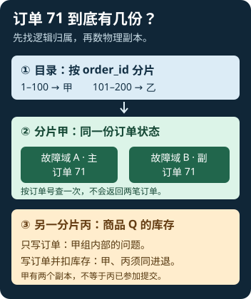
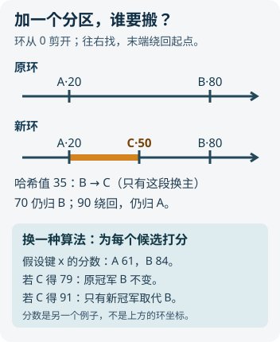
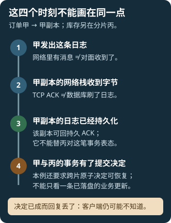

# 分布式数据库（一）：找到订单 71，不等于提交了订单 71

客户端执行 `SELECT * FROM orders WHERE order_id = 71`。开一台机器时，“连接到数据库”和“到达这条记录的管理者”差不多是同一回事。现在目录说 71 归甲，甲的主、副本在不同机房；付款还要改商品 Q 的库存，Q 归丙。即使这些东西全部藏在一个 SQL 端点后，**找哪一片、读哪一份、两处写能否一起生效，是三个不同的问题。**

## 全片索引：每段带一个可以回听的问题

时间取自本条 `en-orig` 顺序与现场换题，精确到秒只用于回找，并非逐词听写。最后的制作段也计入片长。

| 原片时间 | 要追的因果关系 |
|---|---|
| 00:00–02:27 | 片头、课务问答：期末考场三小时，出题量如何？ |
| 02:27–04:07 | XTDB、Polaris、Fluss 是接下来三场研讨会，不是本片三个嘉宾。 |
| 04:07–08:20 | CPU 多一个核，和另一个机房多一台机器，为什么不能用同一套通信假设？ |
| 08:20–11:31 | 查找、执行、划分与正确性；扩容何时是为了不停服而不只是快？ |
| 11:31–16:55 | 从 CPU 看直接可达的资源；问答中的“一个逻辑盘”是否等于一块硬盘？ |
| 16:55–20:30 | ID=200 的本地查找、100/200 组合查询，加 P3 以后实际搬什么？ |
| 20:30–26:26 | 谁知道范围？二级索引怎么办？分片迁移以及客户端为何只收到一份结果。 |
| 26:26–32:19 | 取 101 的 ABC 页、取 102 的 XYZ 页；改变负责者后，谁手里还有旧页？ |
| 32:19–38:26 | 推表达式还是拉字节？S3 Select、远程费用、缓存被逐出、Parquet footer。 |
| 38:26–43:03 | `R.id=S.id` 的局部 JOIN，如何在一个执行计划里同时看到推与拉？ |
| 43:03–49:02 | Parquet 讨论：应用可以绕开服务器写文件；自定格式和通用格式怎么取舍？ |
| 49:02–51:21 | 整表一机、隔离追加日志表、到处复制小邮编表，分别省了什么？ |
| 51:21–56:41 | 整表按行切，等值键与范围查询的区别；取模的除数从 4 变 5。 |
| 56:41–1:02:19 | 一致性哈希的后继、局部迁移、虚拟节点；环为什么不能证明副本同步？ |
| 1:02:19–1:04:55 | Rendezvous 给每个候选打分：新节点为什么只抢走它能夺冠的键？ |
| 1:04:55–1:10:47 | 主副本、多主写、读副本、选主和两笔并发事务的写冲突。 |
| 1:10:47–1:15:36 | 安全阈值；提交时“要不要等”与事务中“什么时候传”是两个轴。 |
| 1:15:36–1:19:47 | 锁表、中央协调者、TP monitor、XA：“锁已取得”与“事务获准提交”有何差别？ |
| 1:19:47–1:22:46 | 中间件、临时领导者、异构联邦库，以及跨地区死锁的预告。 |
| 1:22:46–1:24:31 | 课末问答：connector 的最小公分母；并行数据库与共享架构在哪一层相像？ |
| 1:24:31–1:25:08 | 告别转片尾；不把零碎字幕或内部无字幕区解读成新讨论。 |

## 1．数据位置透明，不等于物理开销消失

**课堂 11:31–32:19。** 如果问“这是哪一种架构”，先画出一个节点的边界。CPU 能独立用哪些资源，要谁帮它去取哪些资源？

| 模型 | 本机可以依赖什么 | 一台计算节点加入时，别忘了什么 |
|---|---|---|
| 课堂单机 shared everything | 本机执行者共享内存和盘 | 多核并行不是另一个独立的故障域 |
| Shared nothing | 自己的 CPU、内存、磁盘 | 让它真正承担新分片通常要迁移数据，再切换目录；查询可能跨网 |
| Shared disk | 自己的 CPU 和内存，共同的逻辑持久存储 | 分配任务不必挪主数据，但缓存要预热；旧缓存的失效与并发写仍需协调 |
| 文献模型 shared memory | 跨处理器共享地址空间和盘 | 把高速互连当作普通远程网络会低估成本；本讲不把它当作主流数据库实现 |

**用订单算一次。** 课堂的 P1 原管 1–150、P2 管 151–300；加 P3 后三者分别管 1–100、201–300 和 101–200。订单 71 一直在 P1，订单 171 原在 P2、现归 P3。shared nothing 里，要让 P3 对 171 的写成为权威写，光把文件复制过去不够：在切换期间谁有权接新写？若新旧目录的客户端各找到一台不同的“主”，完成两次磁盘复制也救不了排序。反过来，shared disk 中持久数据根本没搬，P2 的本地缓存也不会自动消失；“现在由 P3 负责”并没有令旧缓存瞬间变新。

**实现陷阱：不要把目录当成静态配置。** 它记录的不只是模式，还有键范围、负责人、必要时还有配置版本。编者举一个机制上的检查：如果路由器携带旧版本去找退休的负责人，服务端需要拒绝、转发或以其他能维持单一写权的方式处理；“改了客户端的地址簿”本身不是迁移正确性的证明。选择哪种切换协议则超出本讲。

## 2．从“查询要找谁”推到“回给谁”

**课堂 18:24–26:26、38:26–40:47。** 一条 `WHERE id IN (100,200)` 是一次 SQL 调用，而不是驱动分别发的两条业务请求。第一个节点能取 100，再请另一个节点取 200，然后交回一份结果集。照分区键放的本地主索引能帮每片快速找到自己的行；如果改成按邮箱查，而分区键是订单号，本地每片都有邮箱索引，也不等于入口已经知道哪片有那个邮箱。可能要询问多片，或另维护从邮箱到订单位置的全局结构，并承担更新协调成本。

课堂 JOIN 更精确：R 与 S 都按同一 `id` 范围划分，等值连接不可能把 `[1,100]` 的 R 行与 `[101,200]` 的 S 行配对。因而各片局部 JOIN 后合并就够。**别只记“JOIN 可以下推”**：若 R 按订单号分，S 按门店分，而连接条件是 `R.customer_id=S.id`，这个局部性前提就没有了，可能得重分布一侧、广播小表，或拉到同一处处理。下讲才会系统比较方案。

**课堂 32:19–38:26；以下是自拟成本账。** 一个远端对象 80 MiB，投影、过滤后只剩 1 MiB。先忽略请求头、压缩和缓存：远端能执行该谓词时，传输量比拉全对象少 79 MiB；若高频重复使用整批数据并且本地缓存一直命中，永远按“一次省 79”外推就错了。应分别数首次读取、重用次数、逐出后重读、存储端计算费用、服务限制以及两侧并发量。如果对象端没有计算能力，也可以只取 footer，用统计信息排除整批 row groups，再拉候选列。这不是把 SQL 发给 S3 执行；它是用元数据减少自己要读的字节。即便使用 S3 Select，它也只为**一个对象**执行 SQL 子集，不是替你把桶里的两个表连接起来。

## 3．分片切的是集合，复制增加的是同一集合的拷贝

**课堂 40:47–56:41、1:04:55–1:10:47。** 表一全给 A、表二全给 B，是整表分配；把一个小邮编表发给所有节点，是复制；把 `orders` 按 `order_id` 的值切成不相交的行集，才是这里的水平分片。把“有两台机器”直接等价成“有两个分片”会在故障分析时数错票。

**图 1｜编者自拟。** 先将订单 71 映射到一个逻辑分片，再把这个分片的两份状态放到不同故障域。如果机房 A 挂掉，订单副本可用于接管；如果库存分片丙拒绝扣减，订单分片再多副本也不能代表丙说“同意”。

选分区键前先写出负载：

- **订单号等值查询占绝大多数**：哈希键便于只路由一片。**按订单日期扫一周**：若分区键仍是订单号，日期范围不能直接告诉你去哪一片。用日期范围分区能剪枝，却可能令“今天”独自承受大部分写流量。
- **按商家 ID 分片**可令一个商家的小范围订单事务留在本地；若半数订单都来自同一商家，这个键本身就是热点。容量均衡不是访问频率均衡。
- **一次读取整个小维表**与“对每行平均分布”不是同一个目标。若表大多只读，每片一份可把网络 JOIN 变本地 JOIN；若每天高频修改，复制与失效开销必须另记。

## 4．为什么取模扩容会动别人，而稳定哈希不会处处洗牌？

**课堂 55:13–1:04:55。** 分区编号从零开始，自拟哈希值 17。`17 % 4 = 1`，`17 % 5 = 2`。第五个桶加入，键却从**一个旧桶挪到另一个旧桶**。原因不是哈希函数变了，是除数改变了整个地址规则；当然，并非每个键一定移动，例如 0 仍在 0。

**图 2｜据课堂两种算法另做的数例。** 20、50、80 是环上的坐标，不是订单号；下面的分数是另一种算法的示例。查环用后继，查 rendezvous 用最高权重，这两句比背论文年代有用。

- 在原环上，35 的第一个顺时针标记为 80（B）。加 C=50 后，只有 `(20,50]` 换主，35 转到 C。若顺时针走过最后一个标记就回到第一个，故 90 一直归 A。虚拟节点能把**多个不同键**的范围摊开，不能拆散全部写入同一键的热点。选三份副本还要落在不同物理故障域，不能只数三个虚拟标记。
- Rendezvous 为每个 `(key, candidate_id)` 生成稳定分数。旧候选 ID 及打分函数不变时，新候选到来不会改变旧分数的相对顺序；只有新分超过旧冠军才搬。反过来，删除非冠军不会改变这个键的主归属；删除冠军才让下一名接手。若改了节点 ID 或打分方法，稳定性前提随之失效。
- 两种方法都需要一致的成员信息；一个节点以为 C 已上线，另一个仍按旧表路由，就会给同一键不同答案。稳定映射减少的是**必须重新安排的键**，并没有提供迁移中的原子切换、容灾或强一致读。按全部候选算分是 O(n)；已有本地有序环的后继查找可 O(log m)，其中 m 是环标记数。不要把课堂 1:04:40 左右的口头改口抄成复杂度结论。

## 5．网络 ACK、持久 ACK、事务决定：这封回信证明了什么？

**课堂 1:10:47–1:15:36，结合前面 WAL 的编者推演。** 副本是主副配置还是多主，是写从哪儿进入的问题；同步还是异步，是**回答客户端前等什么**；连续传播还是提交时才发，是**什么时候开始传**。完全可以连续发日志、对提交仍同步等待；也完全可以事务结束才开始发，却不等备份刷盘就回复。这三根轴不能合成一个开关。

**图 3｜原创事件图。** 只画同一条订单更新的复制支线，再接到“订单和扣库都成功”的事务条件；不是完整的 2PC 或 Raft 消息序列。课堂同步例中的数据库回执明确要求副本 flush；换一个系统，必须重新读懂它对 ACK 的定义。

| 观察到的事实 | 仍不能推出什么？ |
|---|---|
| 主节点的发送调用完成 | 对端可能还没收到；对端慢、消息丢失和暂时停机，从这里常分不清 |
| 对端 TCP 确认收到了这些字节 | 内核确认字节，不证明数据库进程处理了，也不证明稳定存储已写好 |
| 副本刷了该条更新日志，并给出约定为持久的 ACK | 该条更新可能属于尚未决的事务；不代表另一分片已同意，不代表用户此刻能读到 |
| 协调协议已有可恢复的全局提交决定 | 回复仍可能在路上丢失。客户端超时不证明回滚，也不应把重试自动当成一笔可以再扣的全新订单 |

**故障反例。** 在只涉及一个分片的异步例子中，主节点本地已有 WAL，就先回“成功”；复制尚未到达时主盘永久损毁，只剩落后的副本。这次接管有可能丢掉刚获确认的写；若只是主进程暂时退出而盘没坏，则不能据此断言必丢。同样，等到所需副本回了持久 ACK 提高了特定故障下的耐久性，却不自动保证所有只读查询都线性一致：读到哪台、读到哪个进度、怎样防止旧主继续写，都要另外约定。

课上的 K-safety 只用来讨论“可用拷贝少到什么时候不敢继续写”。本讲显示页 32 的规则是低于最低可用数则停；口头“三份倒两份，K=1 就停”的数字与这条不等式不完全相符。若策略明确是“至少两份”，那么从三份剩一份才是无歧义的停写反例。它和“这笔事务是否已经提交”不是一个判断题。

## 6．在一笔订单事务里，只数参与者，不数机器名

**课堂 1:15:36–1:24:31。** 假设业务要求“创建订单并扣库存，两步全成或全不成”。若订单和库存都在一片，本地并发控制与恢复就能处理这两步的原子性，另按该片的复制契约对外回复。若它们在甲、丙，甲能证明甲组日志前缀一致，丙能证明丙组日志前缀一致，也仍有可能出现“甲想保留而丙必须放弃”。缺的不是一个更多数的甲副本，而是**贯穿全部参与分片的共同决定**。

集中式图里实际有两次问答：先问“这几把锁拿到了吗”，再做查询，最后问“所有参与者都允许提交吗”。拿到锁只表示可以按隔离协议操作；它不是承诺下一步一定成功。去中心化的图则是**这一笔**选一个协调者，不是说每个节点能各自决定一半提交。中间件把这些路由藏在单一 SQL 接口后；联邦数据库还须把计划翻成异构后端真的会做的操作。对方只提供扫描接口时，再漂亮的统一 SQL 也可能退成全表复制。

**给下讲留一个断点。** 2PL 管交错顺序，2PC 管原子去留，Paxos/Raft 可以帮一个副本组就某些状态达成一致；这三件事可以叠在同一个系统里。上图的第 4 步是要实现的业务条件，不能因为画了一根箭头就说已经实现。下一讲再看 prepare 之后为什么不能自己超时撤回，此处不假造一轮课堂上没执行过的协议。

## 自测：先决定证据在哪一层

1．订单 71 有三份副本；商品 Q 在不同分片上。向订单两份副本写入成功，是否已经完成“订单 + 扣库”？

没有。两个回执即使都是稳定存储回执，也只来自订单分片。还缺库存参与者的处理和共同的原子决定。若事务真的只涉及一个分片，才没有这项跨片协调义务。

2．所有节点都能访问共享存储。目录把 171 交给 P3；旧 P2 还缓存着它。现在最不该做的是什么？

在没有版本或失效约束时让 P2 无条件接受该对象的新写，或无条件把旧缓存当作最新值。共享盘解决“能读到同一持久位置”，没有自动交接唯一写权或同步私有缓存。

3．按订单号做哈希分区，单片上又有日期索引。查“周二的所有订单”为什么可能仍要问所有片？

日期索引只是每片自己的查找捷径，不是全局路由信息。除非还有能排除分片的目录统计、全局索引或其他布局，入口不知道哪片没有周二的行。

4．图 2 的 C 加入后，哈希值恰好为 50、恰好为 20 的键分别归谁？如果两者其实都是一个热点键的重复访问呢？

50 命中 C，属于 `(20,50]`；20 命中 A，不在新接管的区间。一个确定的键只会得到一个哈希落点；许多次访问同一键不会自动散到许多虚拟节点。读副本是否能分担还取决于读一致性要求，不能擅自扩散写权。

5．副本收到整条日志的 TCP 字节就崩溃。主节点能用 TCP ACK 代替约定好的 flush ACK 吗？

不能。字节可能还在内核缓冲或进程内存，恢复时没有可读取的持久记录。若策略承诺等备份落盘，应等应用层明确代表持久化的确认。即便确实收到这种回执，也要区分更新记录和提交决定记录。

6．外面只看见一个 SQL 入口，所以内部要么只有一台机器，要么一定有一个永久协调者，对吗？

都推不出。单端点是一项接口约定，可以由中间件路由，也可由任一接入节点替本次请求找参与者。临时协调者没有所有事务的全局视图也可以负责这一笔；能够统一连接多个后端并不保证所有谓词都成功下推。

## 接着读与来源

- **回到这条时间线：**[原片](https://www.youtube.com/watch?v=IFLQBWY6dlE)，CMU Database Group，Andy Pavlo，2025 年 11 月 24 日授课、25 日上传。本条标有 Creative Commons Attribution license (reuse allowed)，[YouTube 说明](https://support.google.com/youtube/answer/2797468?hl=en)指向 [CC BY 4.0](https://creativecommons.org/licenses/by/4.0/)。据课程重组为中文问题链；三图均为自拟，不是搬用独立课件或论文图。精确字幕边界、听众原问和音画限制见[同讲译稿](#/c/cmu-15-445-2025/lec/lec23?v=draft)。
- **Fall 2025 课程资料：**[课表 11/24](https://15445.courses.cs.cmu.edu/fall2025/schedule.html#nov-24-2025)、[当讲 slides](https://15445.courses.cs.cmu.edu/fall2025/slides/23-distributed1.pdf) 显示页 12、14、17–18、23、26–28、32–35、39–46；[官方 notes](https://15445.courses.cs.cmu.edu/fall2025/notes/23-distributed1.pdf) §§1–6，图 1 比资源，图 2–4 比归属，图 5 比协调消息。分区之后的复制配置与传播例详见**录像和 slides**，不要把它们说成五页 notes 里有一整章。课表指定 *Database System Concepts* 第七版 §§20.4–20.5、Ch.21、§§23.1–23.4，只登记章节，不附教材译本。
- **课堂提到，编者核对：**Giuseppe DeCandia 等，[《Dynamo: Amazon’s Highly Available Key-value Store》](https://www.allthingsdistributed.com/files/amazon-dynamo-sosp2007.pdf)，SOSP 2007，§§4.2–4.3、图 2：环、虚拟节点以及使 preference list 包含不同物理机器；不将历史 Dynamo 推广为当前 DynamoDB 的内部实现。James C. Corbett 等，[《Spanner: Google’s Globally-Distributed Database》](https://www.usenix.org/system/files/conference/osdi12/osdi12-final-16.pdf)，OSDI 2012，§2.1、图 2：底层 Colossus、组内 Paxos、跨组事务管理可以分层读。
- **编者补核：**[Amazon S3 Select](https://docs.aws.amazon.com/AmazonS3/latest/userguide/selecting-content-from-objects.html) 的 *Requirements and limits*：单对象、SQL 子集、非新客户功能；[PostgreSQL 18 §67.4](https://www.postgresql.org/docs/18/two-phase.html)：XA 模型、prepare 后的 commit/rollback，而非按两阶段锁去解释 XA。这些是边界说明，不是指定阅读或本次运行记录。
- **站内衔接：**要查“字节被确认”究竟是哪一层，读 [CS168 Spring 2025 L12 · TCP](#/c/berkeley-cs168-2025/lec/lec12?v=notes) 的“持有与确认”；要追“YES 后还能不能反悔”，读 [MIT 6.824 Spring 2021 L13 · 分布式事务](#/c/mit-6.824-2021/lec/lec13?v=notes) 的“prepared 超时”与“多数不能代替参与者”。再回到 [L24 · 分布式数据库（二）](#/c/cmu-15-445-2025/lec/lec24?v=notes) 和 [HW6 推演指导](#/c/cmu-15-445-2025/lab/hw06?v=guide)；阅读不等于做完作业。
