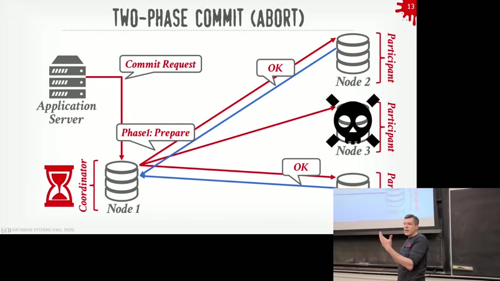
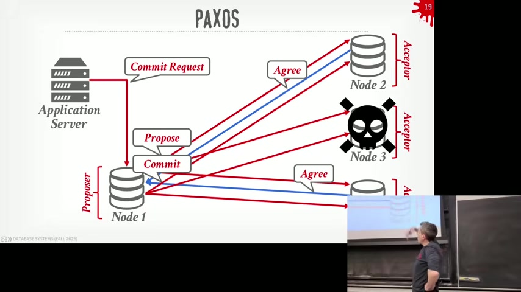
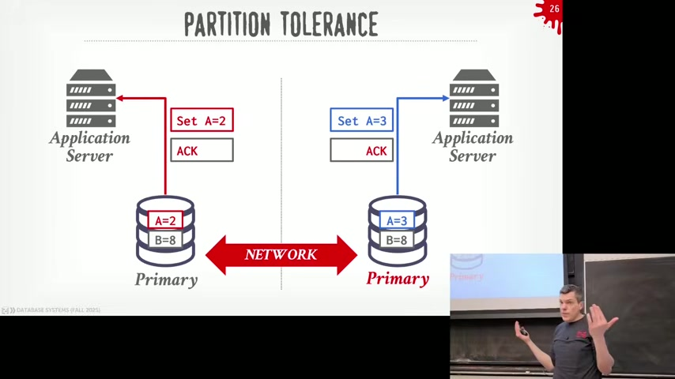
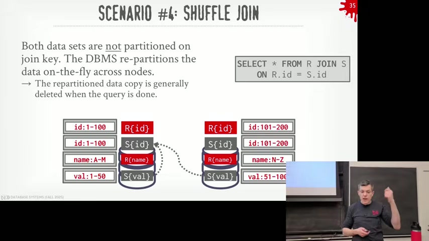
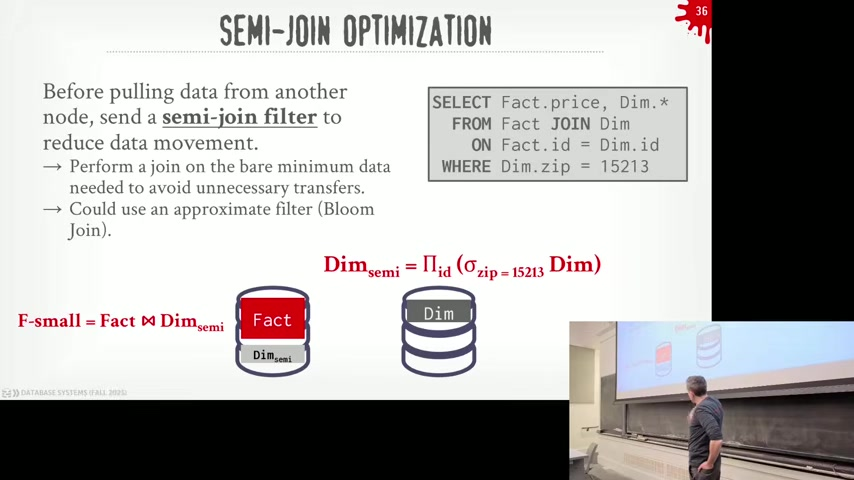
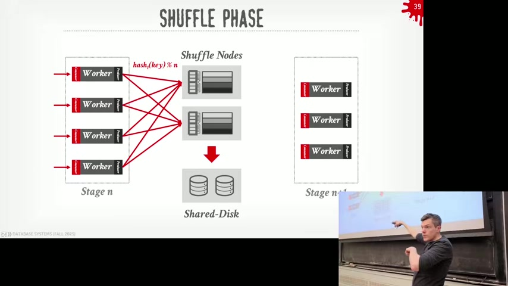

# 分布式数据库系统 II：中文逐段整理译稿

这堂课把一个问题问了两遍。事务横跨机器时，**谁有权说可以提交**？分析查询横跨机器时，**哪台机器有足够的数据做连接**？以下沿课堂顺序；“编注”才是整理者的解释。远处学生声音不清时，依据讲师的复述整理，不把复述写成学生的原话。

## 00:00–03:18｜开场、期限与两场报告

片头有音乐；英文轨把其中几拍识别成零碎词，不作讲课或歌词翻译。约 00:25 起讲师先说，DJ 今天不在，去见税务会计了；这句落在字幕空档，原音不同截段的识别一致支持这个意思。随后说他周三最后一课应该会回来。今天讲的仍在期末考试范围内；时间靠后，不会深挖细枝末节，HW6 已经有相关题。讲师先说周三交，随即改正：**Project 4 和 HW6 都是周日交**。12 月 6 日周六下午三点到五点在 Gates 五楼有 Project 4 答疑，会发 Piazza 通知，有问题先贴上去。12 月 11 日周四在学生中心的大礼堂期末考试；复习提纲和模拟卷在收尾，预备今晚发。周三先复盘考点和大家对 strict 2PL 等内容的疑问。有意下学期当 TA 的同学可以申请。有人问 Project 4 的最高额外加分，答：应该和前几个项目一样，印象中是 25，还要再核对，不是当场作保证。

还剩两场数据库报告；幻灯片上的中午十二点不对，两场都是下午四点半。今天 Snowflake 的人讲 Apache Polaris，这是 Iceberg Catalog API 的开源实现。讲师借收购故事解释来由：据他回忆 Snowflake 原想约六亿美元买做 Iceberg 的 Tabular，Databricks 以约十亿美元买走，Snowflake 便做自己的实现。下周的 Apache Fluss 团队也会介绍他们在建什么；讲师说自己还不熟那个系统。

## 03:18–07:26｜回顾上堂课，把 OLTP 与 OLAP 分开看

Shared-nothing 是每台机器把自己那份数据放在本地盘，机器间通常走 TCP/IP，也可以用其他传输方式；shared-disk 把主要数据放在共同的外部存储，例如 S3、GCS、分布式文件系统，计算节点各自把页取进本地内存。水平分区也叫 sharding，通常把行分成互不相交的子集；选键后可以按哈希或范围路由。希望查询所需的数据恰好同地；等会儿就要看连接键不凑巧怎么办。上次还区分了主从与多主复制，以及外置事务监控器、应用与数据库之间的中间件等集中协调，和各节点自己协作决定提交的去中心化方式。

网站下单、在 Reddit 或 Hacker News 发评论，每笔事务只碰少量数据，操作反复发生，还有人在等结果；这是 OLTP，讲师举的目标是几十毫秒，如低于 50 毫秒。OLAP 则对积累的数据探索、连接、汇总，查出以前不知道的事情；一条查询可能跑几秒、几分钟乃至几小时，能在秒内返回往往已经很好。不是说事务库不做分布式连接、分析库不要事务，而是哪一种开销值得系统设计者优先优化。今天是把本来足够开一门课的内容浓缩到两部分，重在认识做系统时的选择。

## 07:26–11:37｜一座逻辑数据库，为何需要说清故障模型？

最好让应用觉得面对的还是一座 PostgreSQL 那样的数据库。同一条查询应有相同的逻辑含义；改了几台机器上的数据再提交，也还想保住原有的 ACID 性质。分布式不是把单机所学推翻，而是把它调到困难模式：一个参与者倒了呢？提交消息迟到或丢了呢？触及一百台机，要等哪一百个回答？

先定一个假设：即使硬件不是自己的，这些数据库节点的软件也在同一管理域内，可能崩溃、迟缓，但不会恶意反悔或撒谎。讲师问，不信任节点时要换什么？课堂答“拜占庭”。区块链是不互信节点协作的例子：会多做容错、维护不可随意改写的账本，课上提到 Merkle tree，不展开算法。讲师强烈反对把此成本带入普通高吞吐交易，举了 Amazon 并用“五到十倍”来形容代价，还拿之前不建议数据库用 `mmap` 的话开玩笑。这里是他的判断，不是本课实测。可信节点之间跨机投票本来就受传播时间限制。

## 11:37–17:08｜提交、状态机与不可反悔的决定

怎么让大家对一次提交达成一致？讲师从数据库的 atomic commit 讲到分布式系统的 consensus：如果大家记下了相同的提交次序，重放同样的状态变化就能回到相同状态。不管数据分片还是复制，跨机协调的问题都不会自动消失。举手统计，听说过 2PC 的人不到一半。早期有两阶段提交，后面有三阶段提交；讲师也提到面向特殊硬件的四阶段研究。这里不追它们的细节，看谁必须等待谁。Viewstamped Replication 在 1988 年，课堂以 1989 年标记早期 Paxos，后来有 ZooKeeper 的原子广播 ZAB 和更强调易理解性的 Raft。数据库里常会见到 2PC 与 Paxos，甚至两者出现在同一个系统。其他分布式课会花更多时间讲。

2PC 常归到 Jim Gray 名下，他还做了两阶段锁等工作。讲师说 Gray 把点子追溯到一位意大利程序员，后者又说像纸面合同的签署流程。回到资源管理者（RM）：事务读写时还在 working，应用发 COMMIT 只是请求；各方调查能否履行，进入准备状态，最后是 committed 或 aborted；中止就回滚。一旦决定不得反悔；各方最终不能一个提交一个中止。协议要谈得上推进，须有节点存活、能连通；一直因为故障而中止，并不等于事务一定能成功，却与“永远悬着”不同。

**编注：**课堂先用“同一件事”作类比，后面学生正好找出了类比的边界。原子提交决定**一笔跨资源事务的结局**，只有所有必需资源都能准备好才允许提交；共识决定**某个实例的一个值**，多数副本保护的是这个值。2PC 本身既不排全库所有事务的总次序，也不把数据复制到别处。各方同一结局不要求同一物理时刻得知它。

## 17:08–21:31｜2PC 正常路径与否决路径

图中应用已做过读写，向节点 1 发提交请求。先不追究它如何选中节点 1；这笔事务由 1 当协调者，2、3、4 当参与者。即使集群有一千台机，也不是向所有无关机器拉票。第一阶段，1 带事务 ID 发 `Prepare`。参与者按本地并发控制方式检查该事务能不能提交，回 OK 是投赞成票。1 **收全** OK 才转入第二阶段，通知大家 `Commit`，这时不是询问。各节点执行决定，再回 OK。课堂先画保守的客户端通知方式：第二轮 ACK 也收全，才回应用成功。图没画的是稳定日志：阶段、投票、结果要能从非易失存储恢复；可以跟数据 WAL 共用一份，也可以有单独的协调日志。

再从提交请求开始走一次。下方节点已同意，中间节点却发现完整性约束违反，投 Abort。**不必等上方的 2 号投票**，一个无法履行就不能提交。1 进入决定阶段，给参与者发 Abort，也可立即告知应用失败。跟单机死锁相似：不必等所有回滚、日志中的 CLR 等清理完，客户才知道要重试。参与者之后完成撤销，回 ACK；最后不应再留下这笔事务待处理的修改。

## 21:31–26:22｜故障与三个追问：超时、最后的 OK、反悔

22:19 原片实帧。沙漏在协调者 1 身旁，3 号参与者画成骷髅；剩下两个 OK 不是“二比一通过”。

有人问有一台死掉怎么办，正是下一张动画：2 和 4 回应了 Prepare，3 没回。进程真崩溃、机器还活着但 JVM 做很长的 GC 停顿，都可能从协调者这里表现成“没有回应”。`ping` 能通不等于数据库正处理请求，要观察服务层的心跳；反过来，也不能把一次超时证明成对方物理宕机。在这个**还没收全准备票**的情形，等到超时，1 选择中止、告诉应用，活着的参与者稍后确认。

追问：超时选定中止后，是先把 Abort 发给应用，还是先发给参与者？哪一个先发不影响这个决定的正确性。通常希望应用早点醒来准备重试。这里比较的是两次发送的先后，不是等回滚结束才发消息。又问：那还要最后的 OK 做什么？参与者记“我收到中止”；协调者记“谁已经确认收到”。它若重启，不能仅从自己曾经发送过就推断对面收到过。ACK 帮它知道还要通知谁，不能反过来当作决定成败的一票。

如果第一轮全同意，第二轮却有节点说不，或干脆不回呢？答：那是节点故障，不是合法的改票；已经决定的事务仍提交。换节点时要从日志学到结果。又确认：在 commit 阶段一台机掉线，对外还算提交吗？是。注意这和正常路径“客户端什么时候收到回复”是两个问题：真相不会因回复丢掉而改变。

## 26:22–29:29｜重启如何找到旧决定？

每一轮收了什么、准备发什么、作了什么决定都值得记录。理想顺序是先把需要恢复的承诺刷盘再对外确认。讲师提到现实系统为了缩短等待，不一定每一条协调消息各刷一次，少量信息丢失可能要靠别的日志重建，恢复也会变慢。这不是允许凭尚在内存的承诺给客户端报成功。

参与者重启时，如果事务只在工作、没承诺准备好，可以中止；如果已经 prepared，要向协调者打听结局。协调者也可能已决定提交但来不及向应用发成功，不能因为应用没听说就把它改成中止。讲师谈到协调者宕机时倾向能中止就中止、必要时换协调者，也提出参与者重新组织、交流已知情况的办法；查清先前结局会拖住依赖它的工作。反之，一个参与者在**第一轮还没投到赞成票**就失联，协调者可走中止路径，因为不能假定它的修改已被保住。

**编注：**必须给“协调者死了就中止”加条件。还在 working 的参与者可否决；但一个已持久记录 `PREPARED` 并投过 YES 的参与者，若不知道全局决定，不能单方面撤销。它既可能只是没收到 COMMIT，也可能没收到 ABORT；若无法取得决定或能排除提交的证据，就要等。这才是经典 2PC 的阻塞点，受阻的是相关事务与资源，不必然是全库每一笔无关事务。

## 29:29–32:26｜少等一趟网络，不等于少做一个阶段

第一种优化不常见：若已确定这是该事务在某节点的最后一个查询，就在请求上顺带说“执行后我就要提交，把准备票也附在查询结果里”。必须是应用能表明的事实，不能猜最后一次而后又来一条语句。把完整逻辑放进存储过程，像一次 RPC 调用，更容易知道边界。第二种更常见：所有参与者第一轮都已同意，决定可恢复，就先回应用成功，不在客户端的等待路径上再放第二趟往返。讲师把普通和提前确认两段动画重走了一遍：**参与者接收决定的第二阶段仍要做**，后续依赖这个结果的操作也不能假装它已在各处清理完。

2PC 很早就用于分布式数据库，可它会在故障点等人。接下来换一种问题：如果几个节点是在给同一个值作见证，是否非得人人在线？Paxos、Raft 和 Viewstamped Replication 允许在有足够可用副本的条件下，由多数继续工作。

## 32:26–36:25｜Paxos 的论文为什么难读？

讲师说 Viewstamped Replication 在早期便讨论了异步网络下的故障，Paxos 随后提出。问谁读过 Paxos 原文；有同学说读起来像一场大冒险。Lamport 把《The Part-Time Parliament》写成考古故事，想象在希腊岛上发现一种议事制度，人们在石板上留记录、后来者再来读；不像拿来就能实现的算法说明。讲师转述：早期投稿被拒，多年后重投，发表时编者还开玩笑说稿子是从编辑部文件柜后面发现的。Lamport 网站记下了自己对往事的看法。讲师读研时在分布式课上夸作者、埋怨审稿人，没想到任课的 Maurice Herlihy 正是当年的审稿人之一。他听到的另一个版本是：审稿人不反对考古笔法，只希望加个写清算法的附录，作者不愿改。这里是课堂轶事，不是对同行评审档案的独立考证。

后来有《Paxos Made Simple》，讲师仍觉得不好读，更推荐 Google 写 Chubby 实现经验的《Paxos Made Live》。他接着提到 Gray 与 Lamport 2006 年的论文，用它联系 2PC 与 Paxos。**编注：**严谨的特殊情形是论文构造的 **Paxos Commit 在可容忍的协调层故障数 F=0 时退化到 2PC**。不是把任意事务中的全部分片投票改成多数投票。Google 论文正式发表于 2007 年，并非讲师随口估计的 2004 年。

## 36:25–38:16｜两张赞成票在什么意义上够用？

37:26 原片实帧。与 22:19 对照：中间的节点仍掉线，但右边的角色已经从 participant 换成 acceptor。图上标作 Commit 的第二轮请求尚不是客户端的成功回复。

仍看一个应用和四个节点的图，角色改叫 proposer 和 acceptor。learner 可以得知已经选定的结果，不等于也有投票权。提议者发第一轮消息，中间的接受者掉线，上下两个仍然同意；三个接受者中的两个已经是多数，可以送出下一轮提议。多数接受后，才向应用报告这个值已确定。掉线的接受者回来，或由副本接替，必须读记录、学会之前漏掉的状态变化，不能说“没问过我”就另定一套。这个成立的前提仍然是进程按协议行动。

## 38:16–44:37｜课堂争论：没有问到的到底是副本，还是唯一的库存？

第一个问题：假如缺席的不是没回答，而是明说了 abort 呢？讲师先停顿，又区分用途：如果这是对事务约束的否决，就必须中止；如果大家只是在选 leader，没当选者当然不能以自己不同意为由推翻结果。接着有人质疑：照此说来不是还得等那台机吗？超时后若已有负责该值的合法多数，不必等每个副本；可是那台机若回来才发现这笔交易本来就不合法呢？讲师说，要看并发控制和验证放在哪：2PL 的锁与一些约束可在执行时检查；若是乐观并发控制，还要安排验证。如果元组 A **只有**节点 3 有，而且只有它能证明条件成立，那么它一倒，这个证明确实不见了。讲师尝试用另有副本来帮助接管的情形解释。

又问这是否说明某种多版本并发控制和 Paxos 不合适（现场缩写不清）。答：不是在作这个结论；要么执行中已可靠地检查，要么有掌握相关状态的副本能接着处理，不能等决定后才发现不可逆的约束冲突。后排追问：3 回来不同意呢？答：它不能翻案，要按已定日志恢复。又有人问，若“提交”本身还包括约束检查，岂不是又得等相关各方？答：合法性须在不可逆决定之前确认；选举不涉及这一业务约束。复制能维持既有状态，但不替你证明一项未检查的事实。

“是分片更容易出问题吗？”讲师用 `NOT NULL` 回答：一台机和多台机的非空条件并没有变，可以在改值时查。也可先跑一遍查询，记将访问、修改什么，检查而不实际写，再在后续阶段施加改动；他把它与先前为处理幻读而重复扫描的思路类比。接着学生指出：我想插入的非空值可能**与已有值重复**，又怎样保证唯一？讲师提到幻读检查、两阶段锁仍要做，停下来想具体例子，承认这里一下讲不清，留到下堂课再跟进。本堂到此只确定一件事：决定一旦提交，不该回头再发现它不能执行。不能把这段问答写成“课堂已给出完整唯一性算法”。

**编注：**`NOT NULL` 可以只看拟写入的行，唯一约束还取决于别的行及并发插入。一个只学习结果的 learner 本身不能给必需分片代投准备票；数据副本须有足以代表该分片的正确协议和状态。两阶段锁管隔离，两阶段提交管结局；名字相似，并不是一个算法。

## 44:37–48:56｜相撞的提议、领导权与进展

看两个 proposer 夹着 acceptors 的时间图。第一个以编号 n 提议，得到同意；第二个以更大的 n+1 出现，接受者给更高轮承诺后就拒绝迟到的低轮请求。新一轮能被接受，旧提议要换轮重试。问题是双方不断抬价、不断把对方撞下去，会一直没有工作完成。Multi-Paxos 的思路是选出一位相对稳定的 leader，让它连续提出日志项；领导权稳定时，可把第一阶段的代价摊到许多项上。leader 故障再走恢复/选举，不是大家每写一行都重选一遍。

有人问为什么周期性续任。答：需要判断旧 leader 是否还承担职责；太频繁，时间花在选举上，太稀疏，真失效时又会停等。课堂举了不同系统的不同租期作印象说明，讲者自己也没把所有数值说准，不当配置建议。两台都想当 leader 时可以退避，例如一次等 50 毫秒，再等 100 毫秒，以减少反复碰撞，期望有一方跑完。2PC 若在准备后失去协调者可能阻塞；Paxos 有多数相通且足够久不再相互抢占才谈得上进展。Raft 同样有 leader，不过投票看候选日志是否足够新。讲师看看时间，还剩约半小时，要赶在本堂讲到连接，必要时周三再接。

**编注：**n 是提议轮次，不是“编号小的事务已提交也该作废”。经典 Paxos 同一实例若已有被接受的值，后继提议者须从多数回复中承接最高已接受编号对应的值；不能拿新一轮抹掉已选定的值。Raft follower 通常也投选票、参与日志复制，并不等于 Paxos 中无投票职责的 learner。

## 48:56–55:50｜CAP：线一断，两边都说自己是主库怎么办？

52:59 原片实帧。两处都标 Primary；左右应用收到的 ACK 各自是真的，却不能证明现在有一份线性一致的 A。

即使确认提交这个动作有了协议，还得问：网络断开后系统还能为客户端做什么？讲师引入 Eric Brewer 的 CAP，从一致性、可用性、分区容忍三个愿望说起，并开玩笑类比择偶条件不能全得。实际问题不是任意勾两个字母，而是**真的发生网络分区时**，能否既保证跨两侧的最新一致视图，又让两侧所有正常节点继续接受请求？课上把常见的 NoSQL 与传统/新式分布式 SQL 设计做对照，不意味着看到产品类别就能判定某次读的语义。

看两个机房各一台应用服务器，数据开始是 A=1、B=8。一侧在主库设 A=2，把更新（例如 WAL 信息）送到副本并使之可读，然后给客户端 ACK。此时另一侧开始读 A，不论从哪个提供这种读保证的节点取，都应看到 2 或后来值。若只是副本坏了而网络仍通，两台应用也可改找活的主库读。但若**中间的链路断了**，左边原主仍觉得自己是主；右边从“联络不上”猜主库死了，又把自己升主，两个客户端分别写 A=2 和 A=3，都拿到 ACK。网络恢复后哪个决定算数？这是一幅展示 split brain 风险的反例，不是正确的多数派选举算法会让两边同时当选。

方案一：没有足够票的分区停接修改；有些系统可以明确按较弱保证提供只读，但不能对读的时效撒谎。重新取得多数后再提供相应服务。方案二：两边继续收读写，恢复后合并。最简单按时间戳选最后写入的值，可能把另一次已经确认的更新盖掉。另一类做法用向量时钟识别因果关系，遇到并发的不同版本，把候选交给应用合并。这里比较了 MVCC：在 SQL 快照里通常是系统帮你选可见版本，不要求调用者面对版本链。讲师提到 Riak，让普通应用开发者判断版本是否能合在一起很难；多语句事务尤其不能想当然地取“最新”一个值。

## 55:50–1:00:00｜PACELC：没有断网，也有等与不等的代价

CAP 很简练，没有把普通时刻的响应时间放进来。PACELC 说，有分区 P，面对 A/C；否则 E，常在延迟 L 与一致性 C 之间取舍。图中主在美国东部，两个副本分别在美国西部和欧洲；把 A 改成 2 后，主应等多久？不等远端便回，成功来得快，但刚去远端读可能仍见 1。等到近处 ACK，也不知道海另一边是否已经应用。若允许客户端立刻从任一副本读最新，图里就等传播到各处；也可有别的读路由策略，而不是所有系统都必须等每个副本。超时可以按协议中止未决定的写，或按约定接受暂时不同步，不是靠延迟阈值改变已提交的事实。

银行账目和 Reddit 帖子能接受的后果不一样。讲师讲早期 Facebook 的故事：各洲有 MySQL 数据副本，写要回美国主数据中心，再传播到例如南美。用户刚发帖就刷新，在本地副本读不到自己的帖子，会以为失败了。讲师说当时一种办法是把新帖暂放浏览器 cookie，刷新时先显示给这个人；后来部署方式又有变化。前端补显示改善的是自己的体验，**没有让其他客户端立刻看到那次写入**。

## 1:00:00–1:04:23｜分析查询：前两种连接已经同地

换到 OLAP。大型分析查询常把时间花在连接与读数据上。最笨的办法是把所有输入装进一台机，再跑学过的单机连接；既失去并行，也可能根本装不下。现在的问题不是另发明一套嵌套循环、哈希、排序归并，而是让**每对应该匹配的行**相遇，再在各机跑这些普通算法。结果逻辑上应与单机相同；没有 `ORDER BY` 不要求输出顺序相同。

第一种布局：`R.id = S.id`，大表 R 的 ID 1–100 在一边、101–200 在另一边，小表 S 已完整复制在每台机器，比如只有几万行的邮编维表。维护 S 的更新另有复制成本，但做这条查询时，无须为寻找匹配行而搬输入。每台各拿自己那份 R 和本地完整 S 连接，把局部结果送往负责回应应用的节点，拼起来即可。这里的“union”是汇集局部结果，并非给一般 SQL JOIN 擅自做去重。

第二种：S 不再完整复制，和 R 一样按 id 切，**两表分界与落点相同**。相同 ID 仍必然同地。若用哈希，要求路由规则也相容，而不是两张表“都用了哈希”便自动匹配。各自连接、汇总给应用的后半段不变。

## 1:04:23–1:08:30｜广播、洗牌与两道问题

开始装数据时选的键未必符合几年后查询的连接键。第三种：R 按 id 分，S 却按 `val` 分，左边 1–50、右边 51–100。好在 S 很小，把本地那份送给对面，对面也送来另一份，两边一拼都有完整的 S，就退回第一种情形。局部连接后汇总。有人问：如果不止两台，每个节点都得把自己的那一份给其他参与节点吗？逻辑上是，所有计算该连接的节点都要有小表。shared-disk 也可各自去共享存储取，但如果 50 台都向 S3 重复付读取费用，可能不如一台读、分发给其余机器，或用共享缓存。广播说的是怎么搬，底下仍是 hash join 或 sort-merge join，所以可说 broadcast hash join。

第四种：两张表都很大，不能广播；R 按 `name`（A–M、N–Z）分，S 按 `val` 分，而要比较的是 id。现场选一套 id 的范围或哈希规则，让两侧各自把行发往对应目标，用本次查询的中间副本把两表重新分区。现在同一 id 的 R 和 S 又落在一起，退回第二种，再做局部连接、汇总。Shuffle 同样只是数据交换方式。有人问像不像 MapReduce？答：像，其中的重分区思想相通，但数据库在八九十年代就这样做，不是 MapReduce 第一次发明它。课堂把它和分组、排序作类比，并非说任意 map 函数在 SQL 中就是 GROUP BY。

1:07:41 原片实帧。底层原分界是 `name` 和 `val`，上方两排临时数据才按 `id` 合在同一侧；不是把所有行广播到两边。

## 1:08:30–1:11:32｜半连接：只送能帮助匹配的东西

1:09:54 原片实帧。右上是 `Fact.price, Dim.*` 与邮编 15213，左下 Fact 表旁边多出的是压小的筛选键集，不是整张 Dim。

先预告事实表与维表：购买记录一行一次，量很大；商品说明、名称、邮编之类可另作维度，不用在每笔购买上重复。这里 Fact 在一台机，Dim 在另一台，按 id 连接，只取 `Dim.zip = 15213` 的行，输出 `Fact.price, Dim.*`。先在 Dim 端筛出这个邮编所对应的 id，发键而非整张维表给 Fact 端，再在 Fact 那边把一定不匹配的行剔掉。只把候选事实的连接键和需要的 price 发回来，和本地维表精确连接。过滤、投影都尽量推到远端，别为了不用的列付网络费。键集合太大还可送 Bloom filter：小而可能多放进几行，最后仍要核验，不能漏掉真正匹配。

问：这种优化能让查询优化器自己做吗？是的。个别系统可以显式写半连接，但不要求用户在本例的查询中加一个专门关键词。看逻辑条件和输出，优化器可以采用过滤器、下推投影，再生成执行计划。

## 1:11:32–1:16:51｜真正慢的常是交换；把生产者与消费者拆开

讲师收回前面的笼统说法：“连接最贵”往往是因为它里面的 **shuffle 最贵**。要把中间数据拷出、过网络、在别处重组。即使不考虑网络，键严重倾斜也可能一台忙死、许多台空转。把查询划成阶段，可以在交换处根据观察到的数据来调整分区和计算能力。并非每个系统都在每一阶段插 shuffle；课堂拿 BigQuery 的流水线边界作例，把它当能观察中间结果、重新安排上游计划剩余工作的接口。讲师还举了独立 shuffle 服务 Celeborn、Uniffle，以及他用来说明速度要求的 Google 内存交换/专用硬件例。这里是课程举例，不是对云厂商当前硬件的验证。

为什么划出一层有用？本地 hash join 不必自己了解每台对端的位置。图中第一阶段四个 worker 从本地或共享存储读输入，产出中间结果，按 `hash(key) % n` 送到 n 个 shuffle 目的地。内存不够就 spill 到共享盘。第二阶段发现结果比估计少，只开三个 worker，各自从内存或盘读回需要的分区，继续计算或输出。前后 worker 数量不必一一对应。讲师问像以前学过的什么？不是要大家再答一次 MapReduce；是并行查询里的 **exchange**，尤其是其中的 **repartition**。那只接住多路输入再分发的盒子，到了分布式系统依然是同一个抽象。

1:15:44 原片实帧。左边四个生产者，中间 shuffle 节点与 Shared-Disk，右边三个消费者；数目之所以可以改变，是因为读取的是分区而不是绑定上游线程。

## 1:16:51–1:19:05｜收束、最后一讲预告、片尾

让多节点保持强的一致状态不容易，但不能把所有推理责任都扔回应用。2PC、Paxos、Raft 都很常遇到，讲师觉得开源 Raft 实现多，推动了采用。连接要少搬数据，又不能为省网络漏掉匹配，先保证每台局部连接拿得到所需的行。下一堂是最后一课，DJ 会回来。先回顾期末，包括刚才没讲透的提交与约束问题；再试着把 15-721 的分析系统话题浓缩为一课，讲向量化、即时编译、不同数据格式、并行哈希连接。**这些额外预告的分析专题不考**，不是说本堂的分布式内容不考。约 1:18:28 起字幕转为音乐及片末碎词；不翻配乐，不据此补造课后问答。

## 字幕覆盖与来源

| 时间 | 所能确定的范围 |
| --- | --- |
| 00:00.000–00:00.654 | 第一条音乐标记之前没有文本，不当静音。 |
| 00:00.654–1:19:02.840 | 顺读本条 `en-orig` 全部 2247 个非空事件（含配乐标记）。有重叠，合并为 61 个区间，共 4621.394 秒；内部有 60 处没有文本，共 120.792 秒。章节相接，不代表字幕逐秒连续。 |
| 主要无字处 | 00:19.050–00:28.720 跨片头转场及 DJ 缺席说明，按原音补译；23:11.200–23:15.120、25:12.520–25:21.200 在故障追问；40:55.560–41:02.880、41:20.680–41:32.240（最长，11.560 秒）、43:26.599–43:31.040 在约束讨论；1:10:47.123–1:10:52.400 在优化器提问。最长缺口的前后音轨也能确认讲师复述了“若要查约束，是否又回到 2PC”；不能从中可靠逐字还原学生的问题。 |
| 1:19:02.840–1:19:05.000 | 相对整数时长尾缺 2.160 秒，原音仍有 34560 个 16 kHz 样本；1:19:04 可见制作片尾卡。视频轨实际到 1:19:05.167，音轨到 1:19:05.207，均略超过整数时长。末段没有独立核实的新语句，不称静音。 |

**出处与修改：**CMU Database Group 发布的录像 `pQh5fka3FC0`，讲师 Andy Pavlo；[本学期 12 月 1 日课表](https://15445.courses.cs.cmu.edu/fall2025/schedule.html#dec-01-2025)给出本条入口。该视频单独标注 *Creative Commons Attribution license (reuse allowed)*；[平台许可说明](https://support.google.com/youtube/answer/2797468?hl=en)链接到 [CC BY 4.0](https://creativecommons.org/licenses/by/4.0/)。中文按段归并、转述、校订；不分发字幕原件、配乐或视频。课堂动画键值核对[当讲投影片，显示页 11–17、20–30、33–40](https://15445.courses.cs.cmu.edu/fall2025/slides/24-distributed2.pdf)与[当讲讲义 §§2–4](https://15445.courses.cs.cmu.edu/fall2025/notes/24-distributed2.pdf)；上述许可不外推至独立 PDF、教材或论文。编注的事务与共识边界据 [Gray 与 Lamport，2006，§§2–5](https://www.microsoft.com/en-us/research/wp-content/uploads/2004/01/consensus-on-transaction-commit.pdf)及 [Lamport，2001，§§2.2–2.4](https://lamport.azurewebsites.net/pubs/paxos-simple.pdf)。
