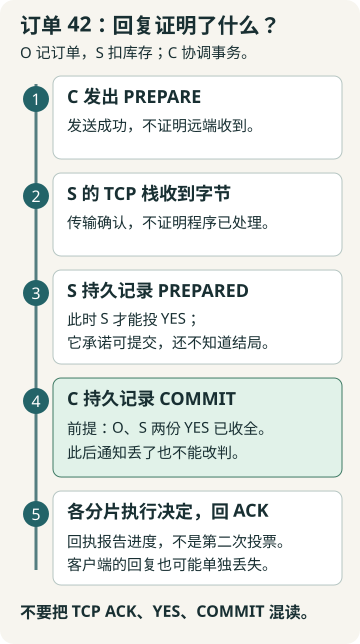
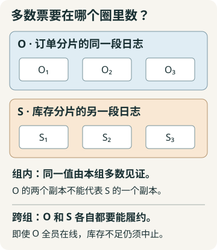
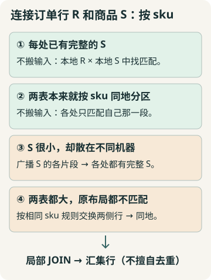

# 一笔订单跨两台机器：谁能说“提交”，谁能做连接？

订单 42 要买两件 A。订单记录在 O，库存记录在 S。O 响应得很快，手头还有两个一模一样的副本。这三台都说“没问题”，能给买家发成功通知吗？**不能：没有一台能说明 S 还有两件可卖。** 把问题换成“统计商品 A 的销售额”，答案也不能靠数机器：得先找出订单行和商品行在哪儿，哪台机器能看到应该匹配的一对。

前半讲追踪一笔写入的证据；后半讲追踪一对匹配行的去向。下面的订单和数字是编者自拟，非课堂原题。课堂使用的是节点 1–4、值 A 与 B，以及关系 R、S 和事实表/维表。

## 全片索引：按原片 1:19:05 回看

时间切点按 `pQh5fka3FC0` 本条英文自动字幕、说话转场和选定实帧近似到秒。问答中部分学生的原句不可辨，片头还有一句不在字幕里；逐段译稿单列证据边界。

| 时间 | 回看时要解的问题 |
| --- | --- |
| 00:00–03:18 | DJ 缺席；作业与期末安排、加分提问、Polaris 与 Fluss 两场报告。 |
| 03:18–07:26 | 本地盘与共享存储、分片与复制；OLTP 和 OLAP 分别要缩短谁的等待？ |
| 07:26–11:37 | 一座逻辑数据库遇到丢消息、停机怎么办？为什么不按拜占庭故障设计本例？ |
| 11:37–17:08 | 资源管理者何时能准备、提交或中止？稳定、安全、进展是同一要求吗？ |
| 17:08–19:44 | 正常 2PC：Prepare 的 OK 与决定阶段的 OK 各证明什么？ |
| 19:44–21:31 | 有一票拒绝，为什么不必等待其他准备票或等回滚全部结束？ |
| 21:31–26:22 | 未得一张票、最后的 ACK 丢失、第二阶段节点反悔，为什么是三个问题？ |
| 26:22–29:29 | 重启读到 working 或 prepared，有何不同？协调者失联谁可能被阻塞？ |
| 29:29–32:26 | 最后一条查询夹带投票；提前回复客户究竟省掉谁的一趟等待？ |
| 32:26–36:25 | 石板寓言、审稿故事与三篇 Paxos 阅读；F=0 比较的是什么算法？ |
| 36:25–38:16 | 三个接受者缺一个，为什么仍可能选定值？掉队者如何学到结果？ |
| 38:16–44:37 | 拒绝、唯一副本、并发控制、分片、非空与唯一约束：多数到底能代表谁？ |
| 44:37–48:56 | 编号 n 被 n+1 抢占，如何避免无休止竞争？Multi-Paxos 与 Raft 的 leader。 |
| 48:56–55:50 | A=2 和 A=3 获得两个 ACK：分区时停写、读旧值或事后合并各牺牲什么？ |
| 55:50–1:00:00 | 跨洲副本不故障也有传播延迟；银行账目与发帖、cookie 回显。 |
| 1:00:00–1:04:23 | 小表已复制、两表同键同地，为什么可以直接跑本地连接？ |
| 1:04:23–1:08:30 | 广播一张表还是按键交换两张表？共享存储收费、MapReduce 类比。 |
| 1:08:30–1:11:32 | 邮编 15213：先送什么键、再送哪些列？优化器能否自己选择半连接过滤？ |
| 1:11:32–1:16:51 | 数据倾斜；阶段边界、独立 shuffle、内存不足落盘，四个 worker 为什么能变三个？ |
| 1:16:51–1:19:05 | 结论、最后一讲和不考的扩展专题、制作片尾。 |

## 1. 一次提交请求走过五道门槛（17:08–31:38）

**故障假设。** 同一管理域中的节点会崩溃或跟不上，但不会故意伪造投票。消息偶尔不到，超时只能让等待者采取协议允许的下一步，不能告诉它“对方没做这件事”。这与要容忍恶意节点的协议是两套前提。

图 1 · 编者按课堂两阶段动画自拟订单 42。只画了一条发送方向；这是保守、可恢复的 2PC 路径，不要求每个网络包都单独写盘。注意第 3 格没有“成交”二字。

1. **第一阶段是承诺。** C 收到提交请求，分别向 O 和 S 发 `Prepare(T)`。S 检查库存、锁/验证条件及恢复所需信息；若确实能在重启后按任一最终决定履约，先持久记录准备状态，再投 YES。库存只有一件就投 NO。C 也许同时是一个参与者，但身份不能相互替代。
2. **第二阶段是通知决定。** 要提交必须收齐相关 O、S 的准备证明。C 先使决定可恢复，再通知 `Commit(T)`。任一合法 NO 都能截断提交路径；C 可以决定中止，告知用户，不必等两个分片都撤完。决定后的 ACK 是“收到/完成了指定阶段”的证据，不是给参与者再投一次票。
3. **两个省时办法的前提不同。** 已明确是该分片最后一次查询，才允许把准备票带在响应里。若全体准备且提交决定已持久确定，可在参与者全部回 ACK 之前回客户；决定通知、执行与恢复责任都还在。把“很少崩溃”当成“不必保住准备或决定记录”是错误优化。

### 用两段无法区分的历史说明阻塞

S 已发 YES，C 突然联络不上。历史甲：O 拒绝，C 记录 ABORT，给 S 的通知延误。历史乙：O 同意，C 记录 COMMIT，给 S 的通知也延误。**S 的本地输入一模一样**：只有 PREPARED。如果 S 在超时后就放回库存，历史乙会出现“订单成交却没扣库存”；如果一律扣成最终值，历史甲又错了。它需要能证明决定的日志、已知可靠的另一方或恢复后的协调者，否则必须保留承诺等待。

再改变一个细节：S 尚在 working 并且根本没有投 YES，C 尚未决定提交。现在系统可以沿中止路径退出。改变的不是超时时间，而是**有没有交出去不可撤销的准备承诺**。客户端自己超时则更弱：甚至可能只是给它的成功包丢了，并不知道事务究竟结束在哪一边。

## 2. 同一事务有两种“同意”（36:25–48:56）

图 2 · 编者把课堂争论画成两个分片组，三副本只是便于数票；不是说 2PC 要求每个分片恰有三个副本。

- **分片**决定“谁管哪个事实”。给 S 增加副本不会让 O 自动知道库存；复制 S 则是把同一分片的状态保在多处，而不是新增三份可售库存。
- **组内共识**解决“对于这个日志位置，合法选择了什么值”。在三个固定投票成员中，两个构成多数；任意两个多数至少重叠一个。还要配合承诺、持久状态和选值规则，才能让未来多数继承既有选择，**不是有交集就已证明任意协议安全**。S 组内可以提交一条 `PREPARED(T)` 日志；这时全局事务仍可能由 C 判 ABORT。
- **跨分片原子提交**解决“这笔事务在所有相关分片上最终是全做还是全不做”。每个有义务检查约束、作修改的分片都不能缺席。O 有三票、S 只有一票，并不能拿全体六台的四票越过 S 的故障。可以用 Raft/Paxos 维护组内日志，再由这些逻辑分片参加跨组 2PC；两层是在回答不同问题。

**课堂争议的准确落点。** 对 `NOT NULL`，检查拟写入的一行就可能足够；两笔并发事务争抢同一个唯一键，则还要协调相应索引范围或在受保护的状态下验证。几个不知道该键现状的节点一致选择“可以”也不能凭空创造合法性。2PL 关心隔离，不是 2PC；MVCC 提供版本，也不自动解决冲突。讲师在 43:31–44:37 对并发重复插入没有给出完整方案，保留作下次复习，不把补充当现场答案。

**把图上的 n、n+1 还给 Paxos。** 同一实例的一轮 prepare 发给多数，acceptor 承诺不再接受更低轮，并返回自己先前接受过的最高编号和值。提议者在多数回复中若发现旧值，须继承其中编号最高的那个，否则方可提出自己的值。第二轮被多数接受，值才被选定；第一轮的 promise 还不算选定。更高轮能抢占低轮，不能覆盖已经选定的值。多个提议者若总互相抢占就可能没有进展，故 Multi-Paxos 借稳定领导权摊薄准备开销。租期是课堂的一种实现说明；安全性不是靠“等待 50 ms 就没有冲突”。Raft 中候选者向固定成员请求选票，投票者检查候选日志是否至少和自己一样新，不是从宇宙中找出唯一“全局最新”的一台。

Gray–Lamport 的 **Paxos Commit** 构造恰好揭示两层为何能组合：为每个 RM 的 `Prepared/Aborted` 结果运行一个实例；每一个实例都选中 Prepared，事务才可提交。F 指协调/接受者层能容忍的故障数。作者证明的是该构造在 F=0 退化到经典 2PC，**不是普通 Paxos 多数可替任何分片批准交易**。

## 3. 网络不断，也可能读到旧库存（48:56–1:00:00）

**CAP 的反例不需要两次并发写。** 初始库存 2，网络把左右两个存储节点隔开。左边确认“库存改成 0”，此后右边才开始一次读。右边自断线后听到的消息，和“左边根本没卖出”时分毫不差。若它必须在本地正常应答，很可能在两种执行中给同一答案，无法同时满足两种执行所要求的最新值。若它等左边证实或拒绝服务，保住了一致性，却不再保证每个活节点上的请求均能成功完成。这里的 C 是**线性一致性**（一次操作看起来在调用与返回之间瞬时生效），不是业务约束意义的 ACID C。

课堂更直观的画法是分区两边各自选自己为主，一边 ACK `A=2`、另一边 ACK `A=3`。等网络恢复，靠最后写入获胜可以得到一个值，但并不保证两张已经发出去的成功收据都符合业务含义。向量时钟能区分一方在因果上继承另一方、还是两份并发版本，却不能替人决定“这两笔库存扣减是否都合法”。只在有法定票数的一侧写、让另一侧明确停止提供强读写，是另一种取舍。把少数侧的旧值标明为陈旧读，和对它承诺实时一致是两回事。

**PACELC 的 E 是 else。** 即使没有分区，跨洲同步复制也至少要给消息传播留下时间。若本地快速确认、允许远端独立读，就可能被远端旧副本追上之前的读撞见。若读始终路由到可证明新鲜的一侧，读本身可能多一趟网络。朋友圈/帖子客户端暂存新帖，可以让发帖者刷新时看到自己刚发的内容，不会使其他设备的读突然也成为线性一致。选策略前先问：保证是给哪个客户端、读哪一个端点、从哪个时刻开始？

## 4. 同一对行，迟早要在某台机器相遇（1:00:00–1:08:30）

订单行 `R(order_id, sku, price)` 与商品 `S(sku, category)` 按 `sku` 等值连接。R 里有两笔各自购买 A，S 中一条 A 的商品说明；单机结果里就应有两笔。局部连接可以是 hash、merge 或 nested loop；distributed/broadcast/shuffle 修饰的是输入如何到达，不能替局部匹配算法作决定。

图 3 · 按课堂四种布局重绘为订单例。绿色两种已同地，橙色两种需搬输入；四种都仍可能有汇集输出的网络流量。

1. **已有完整小表。** 每台持有完整 S，R 的每行仅属于一个分区；本地连接再拼接，各订单行出现恰好一次。复制的是 S，不要把每台的所有 S 再各输出一次。
2. **已有兼容分区。** 按 `sku` 划分且两侧边界、映射和目标相容，R 中 A 所在的机器必然也能找到 S 中所有 A。仅仅字段同名、哈希函数不同或范围错位，不足以证明同地。
3. **广播小表。** S 小但散在各处，将所需的 S 片段临时补到每个 R 分区，再退回情形 1。编者估算：四个节点各有本地四分之一，S 过滤后共 8 MB；不用压缩、无额外转发时，补齐四份总需跨节点传约 `8 × (4−1) = 24 MB`，不是只发 8 MB。并且每个接收方要有容纳整份输入/局部结构的空间。
4. **双边 shuffle。** 两侧都大且原分区不合适，按同一 `dest(sku)` 发到目标，退回情形 2。每行只去它应去的目的地，不是各发一份给所有人；若一侧本来就满足目标布局，可只交换另一边。无 `ORDER BY` 时汇总后顺序可变，但重复数不能随意变化。

## 5. 先发存在性过滤器，再发真正需要的列（1:08:30–1:11:32）

课堂查询输出 `Fact.price, Dim.*`，条件是 `Fact.id = Dim.id AND Dim.zip = 15213`。为什么不只寄 price？因为最后还要辨认它属于哪个维度键。为什么不一开始寄整个 Fact？因为很多键一步就能排除。按三个方向走一次：

1. Dim 端保留邮编 15213 的行，从中提取可匹配的 **id 集合**。向 Fact 发 id，维表的描述等大列暂时留在原地。
2. Fact 端过滤，但不把同一 id 下的多次购买去重。只回候选的 `(id, price)`；若后续投影或谓词还要其他列，也必须带上。
3. Dim 端在**已经筛选的维度行**上按 id 精确连接，输出所需全部维度列与事实 price。若第一步改发 Bloom filter，其假阳性只多运一些不匹配行，精确连接会淘汰；假阴性会丢失本该出现的购买记录，因此不能接受。它是优化器可以选择的缩量手段，不改查询语义，也不是要求用户把内连接改写成只返回左表的逻辑半连接。

## 6. Shuffle 不只是 JOIN 的前缀（1:11:32–1:16:51）

四个生产者按目标分区写中间结果，三个消费者可在下一阶段重新分工；把中间分区从具体线程上拆开后，后端既能从内存取，溢出时也能从共享盘取。课堂把这和单机并行计划的 **repartition exchange** 接上：上段负责产出，下段只声明自己需要哪些键，不必硬编码它们来自哪个 worker。

**搬得均匀和算得均匀并不相同。** 若大部分订单都买 A，简单改用另一哈希函数，所有 A 仍会被送到同一个桶。该桶的匹配又可能产生大量输出。通常要先观测实际中间规模、热点键和输出，再决定增减并行度、分开处理热点，或在小侧可控时复制部分输入；不是“多开几个 worker 一定快”。BigQuery、独立 shuffle 服务与可溢出的共享存储是课堂的设计例，不是指定云产品测评。

## 自测：先自己沿一条消息或一行数据走一遍

1. C 发出 Prepare，紧接着收到了覆盖这段字节的 TCP ACK。S 现在处于什么事务状态？

不知道。对端 TCP 收到相应字节，不代表数据库进程已读、完成约束检查、持久化 PREPARED 或发出 YES。即便后来收到有效 YES，也还不等于全局 COMMIT。

2. O 和 S 都投 YES。C 持久记录 COMMIT 后，发往 S 和客户端的包都丢了。分别能推断什么？

全局决定不可改。C 恢复后可重发，S 仍按未决承诺等待并最终应用；客户端只知道本次等待没有得到回应，不能推断已回滚，也不应把重试当成新的独立扣款。

3. 两个分片各有三个投票副本。O 三个在线，S 只有一个在线，既没有 S 的准备证明，也没有已定结果。能用总共四票提交吗？

不能。O 的副本没法就 S 组的日志形成多数，更不知道 S 的业务条件。跨组事务又必须得到每个相关分片的合法准备；这与全机群开机率无关。

4. 更高轮提议已经获得 promise，就能把同一槽里原先选定的订单换成另一张吗？

不能。promise 既不是第二阶段多数接受，也不赋予任意改值的权力。后继轮要依据回复中最高已接受编号的值继续，维护已选值的稳定性。

5. 网络恢复后两个客户端都最终读到 A=3，就已经证明此前线性一致了吗？

没有。收敛只描述最后的状态。若左侧写 A=2 完成后、下一次写开始前，右侧有读返回旧的 A=1，那么此前的历史已经不满足线性一致，后来收敛也不能挽回。

6. 四台机器都按 id 分 R 和 S，但 R 的 id=100 在第二台，S 的 id=100 在第一台；两边直接局部连接会怎样？

漏掉该 id 的匹配。布局的充分条件是相同键的相应记录能相遇，不是列名相同。修正路由或交换不合布局的一侧；小表也可以广播。

7. Bloom filter 给不属于邮编 15213 的 id 放行了一条事实行；可以直接把它算进销售额吗？

不能。过滤器只排除一定不匹配的键，放行只表示候选。带 id 回到满足条件的维表做精确比较，保留正确的连接重数后再汇总。

## 来源与继续阅读

- **课堂本体：**Andy Pavlo，CMU 15-445/645 Fall 2025，[12 月 1 日课表与原片入口](https://15445.courses.cs.cmu.edu/fall2025/schedule.html#dec-01-2025)、[当讲 slides](https://15445.courses.cs.cmu.edu/fall2025/slides/24-distributed2.pdf)（显示页 11–23 为协调/共识，24–30 为分区/延迟，33–40 为连接/交换）、[当讲 notes](https://15445.courses.cs.cmu.edu/fall2025/notes/24-distributed2.pdf)（§2–4）。课表指定 *Database System Concepts*, 7th ed., §§20.7、22.9；只核对书目与指派范围，不声称读过或翻译书中正文。页中三图和算例均为编者重画自拟。
- **课堂提及，编者核对关键章节：**Jim Gray、Leslie Lamport，[《Consensus on Transaction Commit》](https://www.microsoft.com/en-us/research/wp-content/uploads/2004/01/consensus-on-transaction-commit.pdf)，ACM TODS 31(1)，2006，§§2–3、§4.2、§5。看 RM 的 prepared 前提、按 RM 建实例及 F=0 的明确比较。Leslie Lamport，[《Paxos Made Simple》](https://lamport.azurewebsites.net/pubs/paxos-simple.pdf)，2001，§§2.2–2.4；对照两轮选值与竞争导致无进展的反例。
- **课堂口头推荐，不是课表指定正文：**Tushar Chandra、Robert Griesemer、Joshua Redstone，[《Paxos Made Live – An Engineering Perspective》](https://research.google/pubs/paxos-made-live-an-engineering-perspective-2006-invited-talk/)，PODC 2007；核对作者页出版信息及摘要，未把工程论文改编为教材。
- **编者补充：**Seth Gilbert、Nancy Lynch，[《Brewer’s Conjecture and the Feasibility of Consistent, Available, Partition-Tolerant Web Services》](https://www.comp.nus.edu.sg/~gilbert/pubs/BrewersConjecture-SigAct.pdf)，2002，§§2.1–2.3、§3.1 定理 1。原文的 C、A 和分区反例比“任选两个”精确。
- **站内衔接：**[上一讲：分片与复制](#/c/cmu-15-445-2025/lec/lec23?v=notes)给出数据放置；[MIT 6.824 L13：prepared 超时为什么不能独自中止](#/c/mit-6.824-2021/lec/lec13?v=notes)与 [L5：Raft 投票及日志新旧](#/c/mit-6.824-2021/lec/lec05?v=notes)分别接两层；[CS168 L12：累计 ACK 与接收边界](#/c/berkeley-cs168-2025/lec/lec12?v=notes)解释网络回执。[本课公共资料](#/c/cmu-15-445-2025)串起订单 42 的全过程，可再用 [HW6 分布式部分](#/c/cmu-15-445-2025/lab/hw06?v=zh)练习，不代表已经作答或得分。
