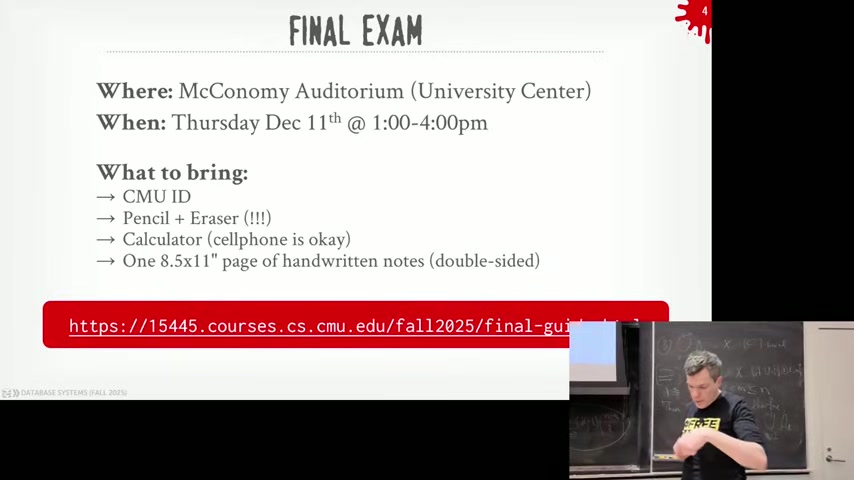
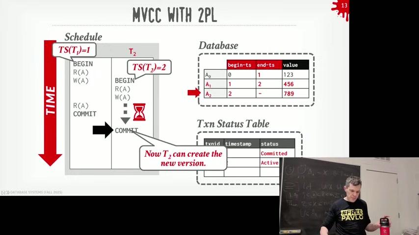
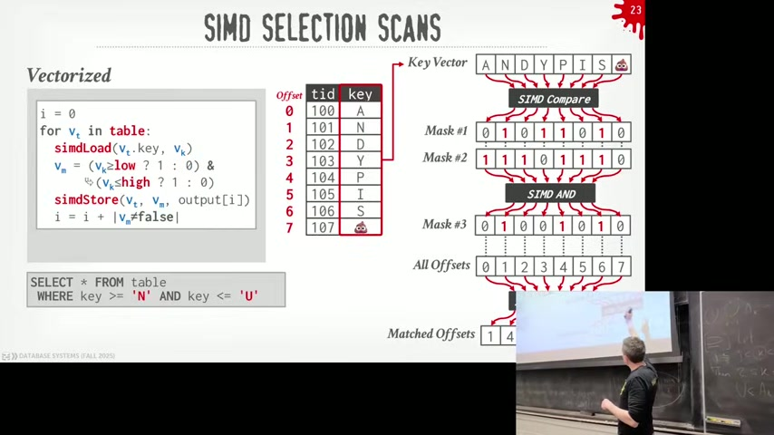
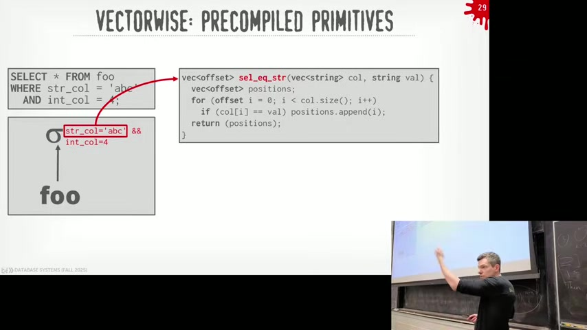
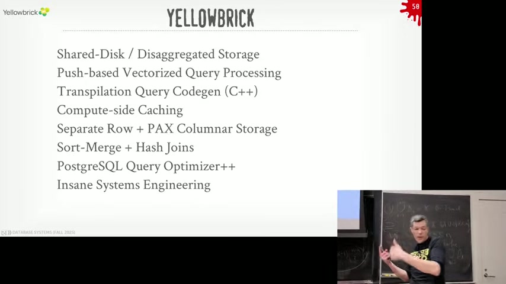

# 期末复习、分析引擎速览与「我们懂 SQL 吗？」：中文逐段整理译稿

这节课有三段：Andy Pavlo 先告诉本届学生该复习什么，接着讲现代分析引擎怎么扫描、生成代码，再由 Leonid Libkin 接过话筒问一个近乎相反的问题：即使引擎快到能立刻给出答案，你确定那条 SQL 问的就是你想问的吗？下述日期、政策、产品评价均处在 **2025 年秋季** 的课堂语境。

## 00:00–03:03｜本学期最后一场，作业和期末考试怎么安排

片头配乐过后，Andy 请大家给 DJ Cache 鼓掌。周一怎么没来？台上简短的回答提到了税务会计。那天跑来办公室、声称自己是失散兄弟的家伙又是谁？DJ 说是个狂热粉丝，不认识。Andy 道谢：这学期有你，教室里一直很有活力。今天东西很多，最后还有来宾，我们直接开始。

Project 4 和 HW6 都在 **12 月 7 日周日 23:59** 到期。特别答疑是**周六 12 月 6 日 15:00–17:00，GHC 5201**，不是周一。HW6 的解答会在周一由课程方公布，供考前复习。本学期的期末考不在这间教室。下学期不教 15-721，愿意来这门课当助教的同学可以申请。有同学问 Project 4 能不能用 late days？可以。

我会在 Piazza 发通知。助教的日常答疑一直开到本周六（含当天）；之后不要指望他们还在。我的额外答疑在 **12 月 10 日周三，10:30–12:00 和 16:00–17:00，GHC 9019**。两个时段都不合适就给我写信。Will 可能还在城里，我问问他周一或周二有没有空，这不是已经敲定的排班。

**12 月 11 日周四 13:00–16:00，University Center 的 McConomy Auditorium**。带 CMU ID、铅笔和橡皮；可以带计算器算对数。像期中一样，一张 letter size（8.5×11 英寸）的纸，两面可以写自己整理的手写笔记。练习卷入口已发在 Piazza 和课程网站。食物要合理；往年真的有人带过湿衣服、蜡烛，朋友在另一所学校还碰上过用来舒缓情绪的蛇。这些都别带。

> 编注：口头说手机可作计算器，公开考试指南明确不许使用蜂窝/Wi-Fi 连接；这不是允许上网。电子手写后打印可以，不许把整套课件缩印上去。投影片一处写了自相矛盾的「Saturday Dec 7th」；本年度 7 日是周日，口头说周六，特别答疑页明确写 6 日。这里不访问受限练习卷或解答。

实帧 02:30：投影列的是这一次期末考的安排，不是下学期的考试通知。

## 03:03–05:39｜旧知识是前提，连接算法要会比较成本

期中以前讲过的 SQL、缓冲池、哈希表、B+ 树、存储模型、查询处理和查询间并行不会忽然消失。不会再像期中那样深入考 SQL 语法，但得看懂 `SELECT * FROM ...`，否则怎么回答它的执行问题？有同学问窗口函数，指实现还是语法？我还没出完卷，不打算专门出窗口函数题。它跟分组计算有亲缘关系，但期中考的是语义；这半学期关心的是怎样造出执行查询、运行事务的系统。对 BusTub 要有基本理解：不会让你坐在考场写完编译、调试，更不会问某文件第几行写什么。会问你做过那些项目就该能解释的概念。

期中前那个周一的 **join** 也在范围内。朴素嵌套循环若每个外层元组都重新取一遍内层的块，I/O 很糟；改按块处理，或有合适索引就做 index nested loop。sort-merge 要用之前的外排序；哈希连接有简单、分区和 hybrid 三种思路，hybrid 把一个分区的哈希表留内存，让其他分区落盘。Bloom filter 可筛掉肯定没有匹配的项。拿到元组数、页数、可用缓冲页数 M，应该能比较「这时做排序归并，要多少 I/O？做哈希要多少？」而不是只会背算法名。

## 05:39–09:41｜一次给几行、谁驱动谁、怎么并行、怎样估算

优化器可以自顶向下或自底向上搜索；我一时以为少了一张投影片，实际上它在后面。会不会根据谓词和一个小直方图估选择率、算大约有多少行？这类题可以出，但不会给你一幅巨大而复杂的图。

执行模型要分三种。Volcano/迭代器一次 `next` 交一条；物化模型一次交一个算子的整份结果；向量/批模型一次交一批。这跟 push/pull 不是同一个维度：从根调用 `next`，让请求向下、结果被拉上来，是 pull；从叶开始计算，把符合条件的数据向父算子送，是 push。访问路径包括顺序扫描和它的优化、单索引与多索引扫描，还要知道更新查询会给扫描带来什么问题。表达式树长什么样？每行数据到手后怎样把叶子的值一路算到根？等会儿还会再看。

worker 是一个进程还是进程内的一条线程？代价与好处各是什么？查询间并行是多个查询同时跑，查询内并行是多位 worker 合做一个。水平切分让多个同类算子实例各处理不同范围；垂直/流水线并行让下游已经在处理上游刚交出的那一部分数据，不必等全表扫完。再想一层 I/O 并行：多块磁盘对 DBMS 来说是 RAID 或设备隐藏起来的一个整体，还是系统知道各盘的位置、会定向调度？现在学过 WAL 就有一个有用的例子：表数据放一个盘，日志放更快的另一个盘，因为提交对外确认要等日志持久化。

找到优化器那页了。谓词下推、投影下推，能早筛行、早减列就别把无用数据搬上去；嵌套子查询改写不打算深考。统计信息可以是直方图或 sketch；从小摘要估某个谓词会匹配多少，而不是声称知道精确答案。

## 09:41–12:57｜隔离级别允许异常，不等于每次都会出异常

原子性、一致性、隔离性、持久性，各是在答应应用什么？给一个调度，怎么判它是不是冲突可串行化？两个调度是否保留了每对冲突操作的先后？视图可串行化比冲突可串行化宽，有同学答对了。不是说在线系统都能廉价判断自己放过的每一个调度是否恰好有相同的读来源与最终写入。千万别把「不是冲突可串行化」直接当成「不存在任何等价串行历史」。

SQL 中通常从强到弱列 serializable、repeatable read、read committed、read uncommitted。快照隔离在侧面，给出的是另一组保证。问某级别可能出现什么异常，以及靠什么机制避免。有人追问：看到隔离级别，能不能说某异常**一定**会发生？即使给你一批事务，也取决于实际交错。一次磁盘 I/O 可能恰好把某事务卡住，这次没看到，换种时序就看到；开 read uncommitted 却每次只跑一笔事务，实际历史仍然是串行的。事后分析「到底有没有读到不该读的」也不容易，尤其那一笔读完又写了，后来的人再据此读写，影响会一圈圈传播。

## 12:57–17:33｜排队还是中止，验证还是留版本

两阶段锁先增长，再收缩；一旦释放第一把锁就不能再要新的。通常 SQL 并不让程序显式 `unlock`。strict 2PL 把 X 锁留到事务结束，收缩阶段里 S 锁可以先释放；strong strict（也叫 rigorous）连 S 锁也留到最后。别的事务读不到未提交写，避免前一个中止就得跟着一串中止。死锁检测在 waits-for 图里找环，选牺牲者打断，有时不只一处环。预防则按时间戳排优先级：在 wound-wait 或 wait-die 下，遇到持锁者不是总能等，可能抢占使对方中止，也可能只能自己退出。

多粒度锁从库、表到页、元组，甚至属性。意向锁挂在祖先上，告诉别人细粒度对象下面正在发生什么，不必逐个去问。包括同时在上层共享、下层打算排他的情形。目标是减少锁管理器来回交涉，又不要为省事锁死整个表，注意锁升级的条件。

OCC 的三步是读、验证、写。读阶段也可以改数据，只是改在私有工作区。为了讨论简单，想象验证阶段有全局 latch、一次只让一个人做。向后验证是看已提交者有没有写了我读集中的项、使我的旧读无法排在它后面；向前验证是看还在执行的事务是否已读了我将写的项，它们若没见到我的写，就不能随意排在我之后。通过验证才能发布写入。

MVCC 怎么放版本？追加完整版本、把历史版本另放一张表、保存 delta；链从旧到新还是从新到旧，各使哪种读取便宜？delta 常把当前行放在原位，沿撤销记录向过去追。旧版本没有任何读者还会用，才可以回收；要知道哪些索引项也跟着维护，别跟正在查看旧快照的人打架。

## 17:33–21:32｜Piazza 上的 MVCC＋2PL：能读旧版，不代表能立刻改写

有同学问 MVCC 怎么和 2PL 合在一起，教材措辞与我的讲法似乎不完全相同。重走例子。T1 的起始时间戳是 1，读逻辑行 A，再写 A；T2 的时间戳是 2。原值 A0 是 123。这里读不拿阻塞写者的共享锁，但对同一逻辑行，一次只准一个写者造新版本。T1 取得写锁，造出值 456 的 A1，用自己的标记开区间，末端尚敞开；在前驱 A0 上也留下这次变更的标记。要结合事务状态表看，不能只算「2 大于 1」就让 T2 看到 A1。

切到 T2。T1 还没提交，T2 可以读已经提交的 A0，不被它挡住。T2 接着也想写 A，这一次要取的恰好是 T1 持有的写锁，只能等。这里设的是死锁检测；若改用带年龄优先级的预防协议，要再看双方年龄和具体协议，不能任意夺锁。切回 T1，它再读 A 看得到**自己的写**，提交后事务表状态换成 committed、释放写锁。投影片最后让获准继续的 T2 建 A2，值 789。

台下和 Andy 来回追问：T2 当初读的是旧 A，现在它也能写，我们是不是已经得到可串行化？没有。Andy 在现场把异常称为 *write skew*，又转回关系图：要承诺完全可串行化，还要找出读写依赖、必要时拒绝这个事务。他以 PostgreSQL 更强隔离下的检查作比方，不是说单凭版本链就能做到。台下一些句子不全，能确定的是这里一直在辨「例子本身是否保证冲突可串行化」。

> 编注：投影片是说明读写的教学模型，不是一份真实产品的隔离协议。这里两笔写**同一个 A**，不要照抄「写偏斜」当作标准快照隔离下可以发生的轨迹：通常的 first-committer-wins 会拒绝并发写同一项的后来者；典型写偏斜是读了重叠的数据、却写向不同项。台上给定的「等后继续写旧读的结果」有丢失更新的风险。年龄顺序 T1 老、T2 年轻，年轻 T2 在 wound-wait 下等、在 wait-die 下自己退，不会仅凭年轻抢占 T1。

## 21:32–24:34｜多版本划不划算？考题会说明协议吗？

实帧 21:38：最后一格里已经有 A0、A1、A2；箭头指向 T2 可以建立的新版本。画面还停在例子上，原片正在等台下提问，不凭静帧给台下人补词。

对第一问，Andy 的复述是：给 2PL 加 MVCC，性能上会怎样？要维护多份数据或 rollback segment，当然有成本；但读者能继续读旧版本、不被写者挡，这是换来的收益。单版本也不是不用留东西：原地盖了旧值，总得有 undo buffer 或别的办法在中止时找回。可以把旧值放进日志，可要是已经刷盘、内存里不在了，中止时得重新读回再撤销。没有免费的选择。

第二问是教材是不是说 MVCC 配 2PL 总是用 strict 2PL。Andy 不赞成把它作为普遍定义，说自己还参考 Gray 与 Reuter 关于事务处理的著作，会在 Piazza 贴依据。他对 PostgreSQL、SQL Server 使用哪一种变体用了保留语气。学生追问做题时究竟假设什么；答：题干会说明协议、使用哪种版本机制、并发序列、链的方向，不靠猜某一家的默认设置拿分。

## 24:34–27:27｜崩溃恢复与分布式复习的尺度

缓冲池能不能把**未提交事务**弄脏的页赶到磁盘？STEAL 可以，NO-STEAL 不行。提交应答之前是否强制把该事务的脏数据页全刷出？FORCE 要，NO-FORCE 不要。本课 WAL 例子配 STEAL/NO-FORCE：先保证描述那次修改的日志到盘，数据页可以提早或延后落盘。页上的 pageLSN 找出最近那条修改；日志的稳定前缀还没到这里，就不能把这个脏页先刷出去。

影子分页用另一组页和根切换守住一致状态，课堂模型重启直接沿有效根读取，不必像 WAL 这样重演；代价通常转到正常运行。若偏爱正常路径的性能，愿意在重启时多做点事，就用 WAL。检查点要分会不会阻塞，模糊检查点的活动事务表与脏页表是 ARIES 重启的线索。

分布式部分来得快，考试问大概念：shared-disk 与 shared-nothing，多主与主从（leader/follower），水平分区，2PC、Paxos 到底解决什么，分布式 join 怎样搬数据。半连接优化不一定搬整张表；把连接键的过滤信息（例如 Bloom filter）送去预筛是一种做法，不是让有假阳性的过滤器代替真正的匹配。

## 27:27–33:03｜上一讲遗留的问题：多数票能不能越过约束？

上次说 Paxos 和两阶段提交时，大家问完整性约束违反了怎么办，我讲得不够清楚。2PC 里每个参加事务的分区都得同意。协调者发 prepare，一个说可以，另一个查到约束冲突说不可以，这种情况本来就应该能发生，整体就不能提交。相反，Paxos/Raft 的多数是**一组副本就日志决定或次序取得一致**。不要把它想成让副本各自临时判断交易合不合法，然后允许多数票盖过真正掌握数据的分区。Andy 描述一种先认定事务通过验证、再把决定放入有序日志的安排；状态机对同一顺序必须产生相同的决定。

有人问另一个节点也要提交另一笔、也要占下一个日志位置呢？问题是排序。网络分开，两边都以为自己是主，重新连上时若一边可擅自宣布 T1、T2，另一边却宣布 T2、T1，就不再是一条日志。不能让各自的本地想法都变成已确认的顺序。

另一个问题很尖锐：检查约束本身不就要跟许多节点协调，代价难道不高吗？对，所以不少分布式产品不像单机一样支持所有参照完整性检查，外键常先受到限制。台下点名 Spanner。Andy 认为它有主键、唯一键，也应支持外键；追问者所说的 `CHECK` 原来是 SQL 关键字，不是泛指「检查一下」。某一行是否为空这种局部要求，和一个全局 assertion 完全不同：如果每笔提交都要广播一个查询、确认没有任何违反的行，代价就高了。他并没有现场查看 Spanner 手册，别把这串问答当完整产品规格。

学生提到外键要有网络通信。看你怎么分：学生表的主键 `student_id=123` 和选课表指向 123 的各行如果恰好同机，核对就很容易；若必须到处广播就不同。有些系统只为与分区键相配的外键提供检查。能不能接受这个限制，由应用决定。

> 编注：先验证再复制是讲者举的一种设计，不是所有共识系统的必要固定阶段。同一确定性状态机也可以复制命令，再依同一状态、同一次序验证。跨分片原子提交和各分片内部的多数副本复制可以同时存在，不互相替代。

## 33:03–36:01｜排除项、缓存与一次插问

嘉宾 flash talk、周一周二 seminar、某个具体产品怎样实现，都不是期末考试题。不是说 Spanner 不值得讨论，只是不要背「这个产品这样、那个产品那样」。还有没有关于考试的问题？那我们试试把 15-721 的进阶内容塞进剩下的四十来分钟。

先回顺序扫描。很多优化都见过，今天点两个缺口：**结果缓存**是相同 SQL 再来、底层数据没变，直接交回上次结果；**物化视图**保存的是一个查询的结果关系。希望数据一变就跟着更新而不重跑全查询，就要做增量维护。按键分组的计数插一条加一容易，遇到 join 就复杂得多。比如 PostgreSQL 可以建物化视图，通常需要显式刷新；别看见「物化」就自动推断系统会以增量方式帮你维护。

这时有人想起考试还没问完：真要坐满三小时？不，题量大致与期中相当，那里约一小时二十分；可以用满，但不必。Andy 统计过交卷时间，对成绩看不出明显对应，先交的人可能最高也可能最低，满分也可能最后才交。怎么取得时间？不是神奇的在线统计，是收卷时写下来的。

## 36:01–40:48｜为什么把不合格的行也写进输出缓冲？

进阶课常问 OLAP 怎样再快一点。先不加新硬件。对十亿行判断 `low < key AND key < high`，一般人会写：每读到一行，若符合就复制到输出，输出指针向前走。慢处在哪里？台下答 `if`。超标量处理器会预测分支并推测执行，猜错就把流水线里走错的那批工作丢掉，重新取正确路径；像 OCC 在失败时撤销私有成果，只是这里发生在硬件。

换个奇怪的写法：**先把当前项写到输出的第 i 格，再求谓词真假得到 0 或 1，只给 i 加这个数**。不合格时 i 没挪，下一项直接覆盖刚才那格。循环结束只交 `[0,i)`，最后那次无效的试写不算结果。有同学说比较本来就会给 0/1，为什么非写三目运算？只是把示意写得直白。又问这样不还是有分支？条件的真假一直存在；重点是生成的热循环有没有依数据跳转。这里假设编译器把判断实现为无跳转的比较或掩码，不是说任何源代码长成这样都会更快。

台下提醒：复制也可能很贵。是的，这里想的是一批列向量，写的单位很小。图上的横轴是选择率；接近零时几乎都不匹配，预测容易，带分支的循环并不吃亏。分布使分支难以预测时，错猜惩罚凸显；无分支方案比较像一笔固定开支，每项都试写，不受匹配比例同样程度的影响。别把这图读成「无条件复制一整条宽记录一定划算」。

## 40:48–44:39｜一次比较多个 lane，最后交偏移而不是整行

还有人不熟 SIMD 吗？多数人知道，那就直接把刚才的循环向量化。把一批键装进寄存器，分别与上下界逐 lane 比，得到两个掩码，再按位 AND。一个 512 位寄存器到底能装几项，取决于元素宽度，不是「512 个元组」。课堂具体例把范围换成闭区间 `'N' ≤ key ≤ 'U'`；键依次有 A、N、D、Y、P、I、S，末槽无候选。从 0 起编号，最终符合的 lane 是 **1、4、6**。做 compress 时，拿掩码去压紧偏移数组 `0,1,…,7`，输出就是 `1,4,6`，后继算子据此取得相应行。

「vectorized」有两层含义，容易混：算子**一次交一批**是执行接口；CPU 用**一条指令在多个 lane 上算**是 SIMD。前者给后者提供了成批输入，不能把两个词当同义。Andy 讲到 CWI 的 VectorWise 和做这些工作的 Marcin Żukowski，后来系统被 Ingres 收购，他又与来自 Oracle 的同事共同创办 Snowflake。这是技术沿革，不是说用批处理的引擎都来自同一份代码。

实帧 43:30：合成掩码为 `0 1 0 0 1 0 1 0`。右下角课堂机位遮住了部分最终位置，仍可从上面完整的掩码读出三个入选偏移；最后一槽是图标，不属于示例范围。

## 44:39–48:37｜哈希命中怎么也用上 SIMD？

其他结构也能用 SIMD，但一旦随机访问跳出了 CPU cache，等内存可能才是大头。回忆标量线性探测：先算键的 hash、找到起点，再一个槽一个槽找。水平向量化的桶把四个键排在一起、四个 payload 另放；输入一个键，算出桶，一次加载邻近候选，让一条向量比较同时检查四个 lane，掩码指出到哪个 payload 继续。还有纵向的方法，这里不展开。

若键是变长字符串，不宜把四串长短不齐的文本直接塞到四个 lane。给每个槽附一小段**定宽哈希指纹**，比如完整 hash 是 32/64 位，先比 8 位。指纹不同，原键必不相等；指纹相同才回头比原键，绝不能把 8 位相同当作 join 成功。

同学问为什么这样比逐个比较快？内存取一条 cache line，例如 64 字节，既然都取来了，尽量多利用里面的候选；四个标量比较换成一次四路向量比较。装寄存器也有成本，而例图的四个 32 位 lane 只是 128 位示意，不是 AVX-512 的上限。台下又提到多数候选会失败，此时可把排除失败者的开销摊开。对，先用固定长度前缀筛掉大多数长键，剩下的小集合才值得做真正的字符串比较。

## 48:37–51:07｜偏移表还是位图？空荡荡的一批要不要立刻送？

selection vector 是从当前输入批中选中了哪些**位置**，后续算子只处理这些位置。另一种表示是跟输入位置一一对齐的 bitmap，每位为一才有效。假如一批 1024 行只剩一行，带着整批向上走当然可能浪费；可以先把行积在 staging buffer，再凑成紧密的一批送过去。反过来，等着凑满也有拷贝和延迟，各系统的取舍不一样。有同学问可不可以自适应切换？可以，但两条路径你都得实现和维护。

我们不在这里展开 GPU。上一代一些 GPU 数据库受限于显存，往往需要整份数据装进卡里；NVLink、更快的 PCIe 等在改变可行的设计。Andy 说自己看好之后一年的项目动向，没有给出产品承诺。数据并行、安排好输入形状这些原则仍然适用。

## 51:07–56:45｜把解释查询的工作搬到编译阶段，代价在哪里？

BusTub 的一般做法：拿到计划树，向下走，碰到谓词又要解释一棵表达式树，处理每行时定位元组、查模式、算列偏移、处理转换。爱丁堡的 **HIQUE** 尝试另一种做法：把特定查询计划生成为 C/C++ 程序，调用现成编译器，得到共享对象，链接进 DBMS 后执行。模式确定时把元组大小、属性偏移、常量与谓词烘进代码，循环就不必再为每行间接寻址、解释树节点。学生问能不能直接用 GCC？可以。问这样编译来得及吗？这恰好是下一步要解决的麻烦。

有人问有没有 JIT 的系统。HyPer 不先吐 C 源码，而是吐 LLVM IR，再交 LLVM 生成机器码；这省去了反复走 C/C++ 前端。后来 Umbra（讲者也提到商业化的 CedarDB）先有自己的 IR，可以用轻量的手写路径很快生成汇编、汇编后先跑。同时后台开优化的 LLVM 编译；短查询在后台做完以前已经结束，就不切。长查询下一次调度任务时，检查「优化版已经就绪吗？」，好了就调它，没好仍跑先前那版。不要求一条指令跑一半把机器码抽走。

听起来很棒，我的团队也写过 LLVM 查询引擎。痛处是调试：程序停在某条动态生成的指令上，不一定有符号告诉你是引擎 C++ 的哪一行**生成了出错的 IR**。那才是要改的地方。有团队甚至在 Mozilla `rr` 的基础上做逆向追溯的调试工具。Andy 用几句玩笑形容为此投入的精力。代码生成也不是新发明：IBM System R 在 1970 年代就把查询计划化为机器可执行的程序。除了定位生成端的错误，存储接口一改，还得成套改生成器。

## 56:45–59:46｜不为每条查询现编，把已有的原语接起来

VectorWise 的另一条路，后来 Snowflake、Photon 也走：构建引擎时用模板生成许多**带类型的预编译原语**，如整型列等于常量、整型列小于另一列、字符串列匹配一个值。二进制里已有这些函数，执行计划是在运行时选择并连接函数指针，不需要用户每来一条谓词就编一个新程序。

学生指出函数调度和间接跳转也很贵。若一行一调确实如此；一批只调一次，调用成本就摊在多行上。看 `str_col='abc' AND int_col=4`：第一原语扫字符串列、吐出匹配位置；第二原语接整型列、常量 4 和那份位置表，只检查前一关留下的行。不管整句 SQL 怎么组合，基础类型和基本运算是有限的。有人问是不是仍得有代码生成框架？批量生成类型变体当然需要工具，但「什么类型等于什么类型」这一族模板远比一个完整 JIT 容易掌握。原语崩了，可以像普通程序那样在 GDB 里定位。Andy 偏爱这一工程取舍，接下来就看具体系统，而不是把它视作压倒一切工作负载的定理。

实帧 58:18：箭头从 `str_col='abc'` 指向处理字符串列的独立函数；返回的是位置，第二项条件尚未应用。

## 59:46–1:01:01｜举手选系统：哪些只是备选？

时间有限，来投票吧。BigQuery？Snowflake？Redshift？选 Redshift 的不多。Yellowbrick？这个我可能要动用我的决定权。Databricks Photon？很明显得票高。还有 ClickHouse。最后选的是 **Databricks、Yellowbrick，再简短讲 ClickHouse**。Snowflake 只顺带展示联合创办人 Marcin 的纹身照片，开个热爱数据库的玩笑；并没有依次讲完讲义中 BigQuery、Snowflake、Redshift 的整套系统章节。这里也不转载照片。

## 1:01:01–1:06:12｜Photon：可维护的 C++ 内核、表达式融合和 shuffle 后调整

Spark 原来用什么语言？同学答 Scala。跑在哪里？JVM。早期 Spark SQL 的一条快路径为 JVM 生成代码，但工程师既得懂数据库、编译器，还得懂 JVM 的可观测性与性能。原来的逐行、行式表示又不是我们想要的列批处理。Photon 是嵌进 Databricks Runtime 的 C++ 引擎：通过 JNI 进入原生执行；有支持的部分就接过去，不支持就保留在原有 Spark 路径。Andy 指着论文作者说其中也有当年上过这类课的学生。

它从分离的存储读数据，pull 模型拉列批，算子由预先编好的内核组成。团队发现一开始新路径并非到处都跑赢已有 JIT，但时间能花在把真正的算子写快，不必老忙于检测 JVM 内部行为。台下要性能数，他没有现场给数字。对可能含 NULL 的列，常见批次却没有 NULL，就可以选择少检查的快路径，遇到不满足前提的批次要回正确的一般路径。有人问为何不干脆把「没看见 NULL」的摘要保留下来？对第一次碰到的 Parquet、CSV，不能预设已有可信统计。JSON 中一个字段通常是整数，偶尔变字符串，也有类似的快、慢路径问题，不能直接忽略例外。

先区分两种融合。把过滤算子放进 scan，是**算子融合**；把两个已有类型原语的比较合成一个，是**表达式融合**。比如日期 `cdate` 同时不早于 1 月 1 日、不晚于 4 月 1 日，就用一个预制的闭区间内核，而不是先运行一个比较、输出中间位置，再运行另一个。少一次调用，还可能少一趟搬运。

还有 Spark 的 shuffle：先切较多分区，真正重排完才看见各分区有多满。讲者类比哈希连接的再分区；投影片演的是把不同程度利用的五个分区重新归组，三个较小分区合并，下一阶段不用为每个小块都起一个大任务。**合并小分区**与**拆一个过大的热点分区**不是同一操作；图展示前者，口头讨论也提到处理倾斜的更一般动机。

## 1:06:12–1:09:08｜Yellowbrick：把代价追到盘、网卡和内核

Yellowbrick 的团队见到我，还记得我在课上怎么形容他们：一家刚起步的公司，真不太会想一开始就做到这么深，市场团队却很喜欢这句话。这是一个 C++ 分析引擎，前端来自 PostgreSQL 分支，保留接 SQL 的那层；持久数据在对象存储，工作节点上有缓存。它用 push 式批处理，查询转成 C++ 再编译；有缓存计划则复用，没有则走编译服务。

引人注意的是从 S3 一直到工作节点，再到节点之间的通信。团队不满意通用 NVMe 和网卡 I/O 路径的开销，于是自己控制设备访问；也不满意内核 TCP 栈与中间拷贝，于是以 UDP 为基础做自己的**可靠传输**，借 DPDK 等在用户态运行，不把热路径上的处理反复交给操作系统。启动时预留内存，尽量掌握硬件与调度。Andy 的夸张说法是「从此不跟 OS 打交道」，指的是正常执行热路径，不是说不用操作系统。对有金融技术背景、长期投入的团队，这种选择跟新创业团队很不一样。

问与 RDMA 有什么不同？RDMA 有相应硬件要求；这里追求的是在云上可得的网卡等条件下，自己做高效的报文收发。有人还提起别的相关协议，第二个远处的名称不清，Andy 回应这是约十年前就做的设计，不能默认所有云都配了某种专用硬件。UDP 本身并不替你实现可靠、有序交付，更不保证数据库提交。

实帧 1:07:02：老师的比较清单把「数据放哪儿」「谁推着算子走」「何时编译」列成不同维度；这里没有使用厂商的独立架构图。

## 1:09:08–1:12:24｜ClickHouse：按键类型和机器选哈希表

ClickHouse 源自 Yandex，团队公开系统之前已经做了多年。Andy 回忆，约 2016 年看到它列出的功能时还以为「哪有个没听过的系统突然做到这地步」；不是这些功能突然造出来了，是此前外面没看到。这个 C++ OLAP 系统使用 pull 式向量执行，传统布局是 shared-nothing，也有面向对象存储的部署；表达式可以编译。讲者认为当时的优化器处理单表分析比处理复杂的多表连接更得心应手，这是他在 2025 年对该实现的评论。

他最想展示的，是 hash join/group by 背后的数据结构。课堂说 ClickHouse 有二十多种（口头举 24 种）哈希表实现；不是让每条查询同时用二十四张表，而是按键的物理形状挑适合的表。对于字符串连接，普通线性探测表未必理想；按短串长度、槽内能否放下、是否跨 cache line 专门布局，就可能省掉指针追踪和比较。讲者展示一种字符串 join 加分组的微基准，特意说图上的比较对象并非都属于 ClickHouse。思想很像预编译原语，只不过针对的是存放与查找键的数据结构。

同一算子也可有不同的 SIMD 版本。某些较早的机器长时间使用宽 512 位指令会降频，反而较窄的 AVX2 路径更快；按硬件选择实现，比永远挑最宽更合理。要把一个真实系统做快比单背算法难多了。时间已经超了，Andy 接通下一位讲者，提到爱丁堡也是前面 HIQUE 的发源地。

## 1:12:24–1:16:20｜Leonid Libkin 接棒：一个被广泛使用的标准是谁写的？

视频说明把嘉宾入口标在 1:12:24；Andy 把话交过去，约 1:12:31 Libkin 询问是否可以开始，得到肯定答复后开讲。**Leonid Libkin：**大家真的懂 SQL 吗？如果不懂，为什么？我现在大部分时间在巴黎的 RelationalAI，也在爱丁堡大学做兼职；以前在爱丁堡全职工作了约二十年。RelationalAI 上一次来 CMU，Wim Martens 介绍过面向关系数据的语言 **Rel**，也有 SIGMOD 2025 的论文。那次讲了我们做什么，却没有讲透究竟想补 SQL 的哪些缺口；今天时间短，我挑些例子让大家尝一下。

SQL 1986 年成为标准，1987 年成为国际标准，1992 年已经有了今天这副模样的基础。它仍在大量系统里使用。Libkin 引用当时的语言和职位调查：一种语言榜上 SQL 第四，要求这项技能的招聘职位，前一年排第一，这一年排在 Python 后面。历经多个版本，讲课时适用的是 SQL:2023，SQL:2027 是当时朝向的下一版，不是已经发布的版本。全套标准要花约两千美元，分 11 部分，编号从 1 到 16 却不连续；实现大多围绕第 2 部分 SQL/Foundation，再各自加上别的标准特性和扩展，不意味着每个细节都一模一样。

谁设计？屏幕上的长名字是 **ISO/IEC JTC 1/SC 32/WG 3**。他展示前不久在巴塞罗那会议的照片。技术工作很多先在 INCITS 工作组讨论；虽然成员来自欧洲、亚洲等地，参加这个美国工作组是以在美国注册的机构为代表。讨论形成提案，移交一年开几次会的国际委员会；先表决是否纳入草案，此后各国标准机构还要分阶段投票。这是版本之间往往相隔四五年的一个原因。我们不转载委员会合照。

## 1:16:20–1:17:51｜同一个「差集」，换进 NULL 后竟有三份答案

**Libkin：**两个一列的关系 R 和 S，都有属性 A。先不论重复计数，把它们当集合。初始 R 是 `{1,2}`，S 是 `{2}`，求在 R 里而不在 S 里的东西。直接写 `EXCEPT`；或者让外层值 `NOT IN` S 的子查询；或者写相关 `NOT EXISTS`，只要求不存在哪个 S.A 等于当前的 R.A。三种写法在这组数据上都只给 1。如果这是学生交上来的作业，大家大概都觉得应该拿满分。

现在把两张表中的 2 换成 NULL。同样三条 SQL，结果各不相同：屏幕上 **Q1 `EXCEPT` 得 `{1}`，Q2 `NOT IN` 得空集，Q3 `NOT EXISTS` 得 `{1,NULL}`**。别只记「NOT IN 有陷阱」；对程序员来说，最危险的是把这三种本来不是无条件等价的写法当成可自由替换。集合算子辨认重复项时把空标记放在一起，而相等比较遇到 NULL 不会给出 TRUE；同样的字眼到了不同位置，逻辑就不一样。

## 1:17:51–1:20:30｜连 `SELECT *` 都有上下文

**Libkin：**学 SQL 最早就写 `SELECT * FROM R`。现在只给 R 一列 A、一行 1，先写 `Q = SELECT R.A, R.A FROM R`。结果一行两列，值都是 1，列名重复。再把 Q 原封不动放到 `Q′ = SELECT * FROM (Q) AS T` 中。只有一行输入、只有一层星号，要不要报错？我当面问过有经验的人和学生，各种答案都有。

这不是故弄玄虚。嘉宾演示所比较的行为是：PostgreSQL、SQLite 给出那两个值；Oracle、Microsoft SQL Server、MySQL、Db2 在这个例子的派生表位置报告编译错误。再问 `SELECT * FROM R WHERE EXISTS (Q′)`：不少人预测原来报错的还是要报错，但这个例子在嘉宾所比较的系统里**都返回 R**。外层只问 Q′ 有没有行，不用把那两个重复名字的输出属性交给使用者。请不要把嘉宾当时比较的版本外推成每个版本一直如此，也不要把它误读成「EXISTS 里随便写非法 SQL 都行」。

## 1:20:30–1:23:01｜查到「没匹配付款」就能给客户催款吗？

**Libkin：**订单是 ord1、ord2、ord3，金额分别为 100、150、135。付款有两笔：pay1 指向 ord1；pay2 是真的一笔付款，可它的订单号是 NULL。题目说「给我未付款的订单」，直觉上会写：在 Orders 里取那些找不到一行 Payments 与其订单号相等的订单。SQL 照办，列出 ord2、ord3。但我们凭什么知道这两笔都没付？第二笔钱可能正属于其中一笔。发一封「你没付款」的催款信，顾客拿出收据，人可能就再也不来了。查询是按 SQL 规则正常跑完的；**没得到真匹配**被使用者擅自解释成了**现实里没有付款**。

这种相对于业务问题的假阳性并不罕见。研究者给类似 TPC-H 的查询输入加入 NULL，错误候选反复出现；嘉宾特别提到，图出自理论会议 PODS 的论文，不是通常看见的工程基准。NULL 随处可见：天气页面只有华氏温度，另一个温标的位置成了 null；付款页面和零售商数据库里也有直接露出的空值。还有真姓 *Null* 的人，系统错误地把她的**名字字符串**当作缺失值。教材会警告对待空值的方式与人想象的现实很不一样，实务书会提醒别盲信结果。他举新闻标题中因数据不全而暂停儿童心脏手术的例子，强调后果可能很重；这并不是对该事件作「某个 SQL NULL 导致停诊」的技术归因。

## 1:23:01–1:24:19｜标准的核心能有多小？

**Libkin：**再问「标准到底有多标准」。实验用随机生成器，只取非常基本的 SQL 子集，也有约 2% 的查询在不同系统上行为不一；这是这组实验的量，不是说生产查询固定有百分之二会错。有的分歧只是集合差的写法、取模函数或子串函数语法不同，有的则牵涉实质语义。他本来还想举两个更严重的例子。**Andy 插话：**已经超时了，抱歉。**Libkin：**那我就用一张图收束。关系代数和一阶逻辑能很简短地写下；从 Codd 的十来页，到第一版 SQL 约百页、如今标准约四千五百页，没人能一个人掌握全部。Rel 的取向是先定一个小而语义清楚的核心，再用库扩充，不是无止境地往同一规范里塞例外。两例没有继续展开，这里也不从别处补讲。

## 1:24:19–1:25:43｜最后的掌声和片尾

**Andy：**本学期的课到这里，下周四见。还有个消息，DJ Cache 得了今年学校的「most dank DJ」。请大家鼓掌！来，拍张照，握个手。再次谢谢 DJ，也谢谢 Leonid，祝大家期末顺利。别忘周六答疑、周日交项目、下周四（12 月 11 日）考试。约 1:25:05 后，录像转入制作人员与片尾音乐，不是另一份考试提示；制作卡把音乐署名列为 DJ Hands、Ca$h Money Click、DJ Cache，另有致 DJ Drop Tables 的纪念卡，最后是制作标识。音乐和歌词不转录。

## 覆盖、署名与来源

| 原片时段 | 可核实的边界 |
| --- | --- |
| 00:00.000–00:00.654 | 第一条字幕之前 654 毫秒。首帧近黑；起始音频有信号，不能称静音。 |
| 00:00.654–1:25:41.000 | 顺读英语原始自动轨全部 **2,379** 个非空事件（含音乐）。重叠区间合并为 **59 段、5,054.255 秒**；内部 **58 处、86.091 秒**没有字幕。章节切点不是逐词起止。 |
| 提问与换场 | 最长缺口 **21:32.039–21:42.080（10.041 秒）**：老师稍后复述 MVCC＋2PL 的问题；原音片段不能可靠还原台下原句。此外 29:17.080–29:20.159、30:07.559–30:11.840、47:53.960–47:58.560、53:19.960–53:23.119、1:04:01.960–1:04:04.240 等落在提问衔接处；依可辨问答整理，不用识别器空结果反证无人说话。 |
| 1:25:41.000–1:25:43.000 | 相对播放器整数时长尾缺 **2.000 秒**；片尾原音有信号。上表所依视频轨实际约到 1:25:43.433，解码音频到 1:25:43.424，略长于整数显示。末端画面是制作标识；没有可靠证据在这里添加讲解，不据此断言没有人声。 |

**归属与修改：**CMU Database Group 发布，Andy Pavlo 主讲，Leonid Libkin（RelationalAI Paris／爱丁堡大学）来宾。原片 ID `qiVUf9X6ItM`；[Fall 2025 课表 12 月 3 日行](https://15445.courses.cs.cmu.edu/fall2025/schedule.html#dec-03-2025)给出本条视频、嘉宾和 slides，**没有官方 notes，也没有这讲的指定教材章节**。本条单独标作 *Creative Commons Attribution license (reuse allowed)*；[平台说明](https://support.google.com/youtube/answer/2797468?hl=en)链接 [CC BY 4.0](https://creativecommons.org/licenses/by/4.0/)。本站据其译述、合并口语重复、校订术语，取五张原录像中的讲课实帧。未分发原声、独立投影片、论文插图、嘉宾照片或新闻截图。

**校订依据：**[本讲官方 slides](https://15445.courses.cs.cmu.edu/fall2025/slides/25-potpourri.pdf)，显示页 2–18、20–30、49–63；封面内部误标 #24，以当学期课表、独立视频标题与 ID 定为 #25。[同期公开考试指南](https://15445.courses.cs.cmu.edu/fall2025/final-guide.html)列 L12–24，不是把本节的厂商与嘉宾细节列入考试。[Guagliardo 与 Libkin，PVLDB 2017，§1 例 1–2、§3](https://www.vldb.org/pvldb/vol11/p27-guagliardo.pdf)用于核对 SQL 语义；论文与嘉宾投影中三条差集查询的编号顺序不同，本译稿以屏幕为准。
