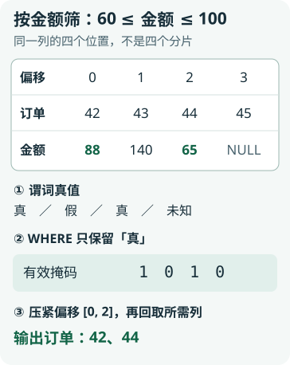
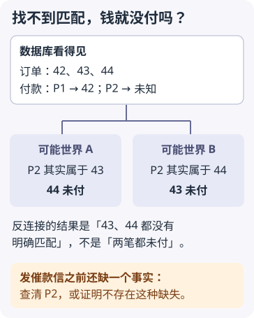

# 结果来得快，还得问它能证明什么

假设系统在 8 毫秒内就把订单 43、44 送入了催款队列。坏消息是，付款表里有一笔已经收到的钱，订单号却是 NULL。把查询再优化到 4 毫秒，客户就真的没付钱了吗？本讲的两个主角关心不同的问题：Pavlo 问**同一份结果怎样算得更快**；Libkin 问**这份结果到底说明什么**。订单和毫秒数是编者设例，不是实测。

读这讲可以带着三个不等号：**旧版本可读 ≠ 旧读据以写回仍然安全；已收到消息 ≠ 事务已经提交；无真匹配 ≠ 确定未付款**。下面先按录像定位，再用小例子拆开这三句话。

## 全片回看索引

每一行都是这条 1:25:43 录像的一段，切点依据英语 `en-orig` 字幕和课堂画面，取到近似整秒；结束时刻不是语音逐词对齐。重要实例另在正文标出。

| 区间 | 打开这段时，要找的答案 |
| --- | --- |
| 00:00–03:03 | 本届 P4、HW6、答疑和期末考试分别在哪天？手机能否联网？ |
| 03:03–05:39 | 期中以前的知识要了解多深？为什么页数、缓冲数会改变 join 的选择？ |
| 05:39–09:41 | 一批还是一行、push 还是 pull、横向拆工作还是纵向流水，是否是同一组维度？ |
| 09:41–12:57 | 冲突与视图可串行化怎么比较？为什么不能由隔离级别断言某次运行必有异常？ |
| 12:57–17:33 | strict 与 rigorous 何时放锁？OCC 验证哪些交集？MVCC 为何还要回收版本与索引？ |
| 17:33–21:32 | T2 何时能读 A0、何时能造 A2？一次等待会不会使旧读自动变新？ |
| 21:32–24:34 | 学生问加版本的代价、教材和考题的协议假设。最初远处问句有缺字。 |
| 24:34–27:27 | STEAL/NO-FORCE 为什么把工作留给 WAL？分布式部分要求的尺度是什么？ |
| 27:27–33:03 | 多数副本确认次序，能替拥有库存的分片同意扣库存吗？外键为何受放置影响？ |
| 33:03–36:01 | 哪些不考？物化视图怎样不同于结果缓存？三小时是不是必须坐满？ |
| 36:01–40:48 | 分支会猜错，复制也有代价，什么时候可用「先写，再决定位置」？ |
| 40:48–44:39 | 两个逐 lane 比较如何变成一列匹配偏移 `1,4,6`？ |
| 44:39–48:37 | 为什么一个哈希桶装几枚定宽指纹，但保留真键比较？ |
| 48:37–51:07 | 列批只剩一行，是传位图、传偏移，还是攒成密批？GPU 插话谈哪种限制？ |
| 51:07–56:45 | HIQUE、HyPer、Umbra 把哪些解释开销换成了何种编译和调试开销？ |
| 56:45–59:46 | 预编译原语怎样用一份位置表连接字符串和整数谓词？ |
| 59:46–1:01:01 | 课堂投票究竟选中了哪三家？哪些只在候选 slides 里？ |
| 1:01:01–1:06:12 | Photon 在哪里进入 C++？何谓表达式融合？Spark 的小分区什么时候合并？ |
| 1:06:12–1:09:08 | Yellowbrick 怎样在保留 SQL 前端时改写工作节点和网络路径？ |
| 1:09:08–1:12:24 | ClickHouse 为什么按键型和硬件准备多个实现？ |
| 1:12:24–1:16:20 | Libkin 接棒，介绍 Rel、SQL/Foundation 及国际标准形成过程。 |
| 1:16:20–1:17:51 | `EXCEPT`、`NOT IN`、`NOT EXISTS` 在一个空标记前何处分道扬镳？ |
| 1:17:51–1:20:30 | 重名输出放在派生表和 `EXISTS` 里，为什么表现还可能不一样？ |
| 1:20:30–1:23:01 | 丢失付款关联为什么会出现业务假阳性？嘉宾如何区分新闻例子与数据库实验？ |
| 1:23:01–1:24:19 | 跨实现比较的约 2% 指什么？嘉宾为何主张用小核心加库？ |
| 1:24:19–1:25:43 | DJ 的课堂奖项、拍照、考试提醒、制作卡与结尾音乐；无新增考点。 |

## 先把 2025 年的通知放回 2025 年

公开考试指南定的是 **12 月 11 日周四 13:00–16:00、McConomy Auditorium**，要带 CMU ID、铅笔、橡皮；一页 letter size 手写笔记可以双面。课堂说手机可当计算器，书面规则不许蜂窝/Wi-Fi 连接，也不许缩印 slides。窗口为三小时，不表示题量是期中的两倍。P4 与 HW6 都在 **12 月 7 日 23:59** 截止；台上只确认 **P4 可用 late days**，不要把这句擅自推广给 HW6。额外答疑为 12 月 6 日周六 15:00–17:00（GHC 5201）；Andy 自己考前答疑在 12 月 10 日 10:30–12:00、16:00–17:00（GHC 9019）。

**复习范围**是对应 L12–24 的 slides；指南列教材第 15、16、18、19 章及 §§20.4–20.7、第 21 章、§22.9、§§23.1–23.4。这是**期末范围**，不是 L25 指定教材阅读。连接成本、执行及优化、事务、恢复、分布式大概念是核心；此前的 SQL、缓冲池、索引等是解题前提，不要求背 BusTub 某行源码。嘉宾、seminar 与某产品特有的实现细节都不在本届考试范围。此处只用公开指南，没有获取练习卷或解答。

## 一笔订单怎样从「读得到」变成「可以改」？

**课堂例（17:33–24:34）。** 把一个逻辑行和它的物理版本分开摆：A0=123；T1 把 A 改为 456，建 A1。A1 虽然已在存储里，创建者 T1 仍是 active。T2 的时间戳较晚，但它读的是旧的已提交版本 A0，不是半成品 A1。T2 若也想更新 A，读者不阻挡写者的规则就帮不上忙了，它要等写者释放同一逻辑行的写锁。T1 自己倒能看到 A1。T1 提交后，教材式演示让 T2 建了 A2=789。**写锁串行化写动作，不会倒回时间替 T2 重新执行那次读。**

用订单 42 的数量做个编者反例。初始为 5，两位事务各先读 5，又各打算按「在所读值上加一」写 6。就算写动作先后排队，若两笔旧读都被无条件接受，最后也可以只有 6，而任一串行执行都会是 7。这里是**同一行上的旧读与竞争写**；标准快照隔离对同一项的并发写通常要拒绝其一。更典型的写偏斜是两事务都看「至少有人值班」这个条件，却分别改不同的人。讲者口头把投影片中的现象叫 write skew；做题先写冲突和依赖，不必替一个词辩护。

**回到复习范围。** 先明确协议给不给这次读取、写入或提交，再谈性能：strict 2PL 把排他锁持到事务结束；rigorous 连共享锁也留到最后；OCC 在私有写集发布前验证交错；MVCC 让旧快照还有版本可读，但回收、索引维护并没消失。在读未提交的系统里一次只跑一笔事务，实际历史仍可能完全串行。把「允许」写成「一定发生」是最容易失分的一步。

## 两张选票：到底谁能对库存说“不”？

**课堂追问（27:27–33:03）。** 2PC 里的一个分片说 NO，整体不能提交；Paxos/Raft 里多数副本定下来的是一条有序历史。二者的「票」来自不同集合。假设订单 42 的记录归 O，库存归 S，二者各有三个副本。O 的全体三个副本都写好了订单，并没有取得 S 对库存条件的同意。若 S 查出余额不足，O 的三个肯定票加在一起仍不能帮 S 签字。

判断系统走到哪一步，可以依次问：**发送端交出字节了吗？对端传输层收到了吗？数据库的约定日志已持久了吗？原子提交协议已经决定 COMMIT 了吗？** 前一个问题答「是」不自动回答后一个。若 S 持久记下 `PREPARED` 再投 YES，此后收不到决定，它也不能从自己的日志独力断定交易已提交或已撤销。把约束检查做在提议前是一种实现；在确定性状态机中按日志顺序验证命令是另一种。需要从多个分片观察事实的约束不会凭「多数」消除通信。

原片举 `student_id=123` 与选课记录同机的例子。想象两份表都按学生号分，局部外键查验可以留在同一分区；若另一张表按课程号分散放，光看本地缺少一条记录证明不了它在全库不存在。故要问**约束所需的数据实际在哪里**，而不是背「所有分布式系统都没有外键」。相邻课程入口见页底。

## 让筛选快起来：搬位置，还是搬整行？

**原讲（36:01–51:07）。** 单行 `if` 遇到难预测的数据，会把已推测执行的流水线工作浪费掉。无分支方案把每一项先写进 `out[i]`，只在符合时把 i 加一；没选中，下次就在同一格覆盖。关键不变量是 **`out[0:i]` 恰为目前已经匹配的前缀**，不是「凡写过的槽都是结果」。这要求输出有安全的试写空间，且额外写入足够便宜。若几乎都不匹配而行又很宽，省下的错预测可能远小于无谓复制，不能从课上的一条曲线推出普适阈值。

**编者推导。** 四行订单输入只看金额，闭区间是 `[60,100]`。WHERE 不返回 UNKNOWN，先把未知行从有效掩码剔掉；对照下图，从偏移 `[0,2]` 回取 ID，得到订单 42、44，**不是**订单 0、2。

图 1 · 编者自绘。课堂用字母和两道范围比较，例图改成带一个 NULL 的订单金额，特意将表主键、批内偏移与 SQL 真值分开。真实引擎可以用单独 validity bitmap，没必要把 UNKNOWN 当一种整数金额存进数据向量。

| 变换 | 省下什么 | 仍不能省的检查 |
| --- | --- | --- |
| 相同范围用 SIMD 的两张 mask 相与 | 一条指令作用于多个定宽 lane；批接口摊薄分派 | 比较符号、边界是否闭合、NULL 的有效位；batch 本身不等于 SIMD |
| 哈希桶先比定宽指纹 | 大多数不匹配的长字符串不必取全键，善用已载入的 cache line | 两个不同键可能有相同指纹；候选还得按原键判等 |
| 用 selection vector 或 bitmap 传行资格 | 下游可继续引用输入列；不急着组装宽行 | 偏移只对这批输入有效。稀批若总悬挂着整块内存，可能不如压紧后再传 |

**一笔纸算。** 有 1,024 个位置，位图不计头部占 128 字节；若偏移用 16 位，保留 k 项的紧凑位置表占 `2k` 字节。单按表示大小，k 小于 64 时位置表更小；这是本设例的字节账，不是引擎通用切换点。位图便于位运算，位置表适合稀疏遍历，预分配容量又不等于实际有效数据大小。

## 一次解释太贵，一次编译也太贵：时间花在哪里？

**51:07–59:46**。同一谓词能有三种成本构成：解释树为每行做分派和偏移计算；每查询生成代码，把类型、偏移、常量写死，付一次编译开销；预编译原语则在**构建引擎**时生成类型变体，在**运行查询**时按批选函数。前者便于快速启动，中者适合可摊薄编译时间的计划，后者保留日常调试工具。HIQUE 的 C/C++→共享对象、HyPer 的 LLVM IR、Umbra 先轻量生成再用后台优化版接手，说的是不同工程实现，不是每条查询必须依次经历的三个阶段。

估个量级：假设现编比普通路径多等 20 ms，每批能省 0.05 ms，忽略重叠和缓存时，至少超过 400 批总耗时才反超。若查询常只有 10 批，首包延迟更值得留意。若编译和执行并行，则要比较优化代码**就绪以后还剩多少批**，而不能拿全查询时长计算节省。这是说明摊销条件的算例，没有运行其中任何引擎。

**1:01:01–1:12:24，三家产品各把成本挪到哪儿？**

- **Databricks Photon：**Spark/DBR 的计划里，支持的片段通过 JNI 调用 C++ 引擎；列批、pull、预编译内核，遇到不支持的情况有格式转换与原路径。把 `x≥lo AND x≤hi` 识别成一个 BETWEEN 内核，是融合**表达式**，不是修改日期的闭区间语义。Behm 等的论文 §4.6 描述为批建立元数据来选可否略过 NULL 检查，不是随便猜全表永远无 NULL。课堂还用 Spark 的 shuffle 后合并小分区说明何时终于能看见真实数据分布。
- **Yellowbrick：**课上从分离的持久对象存储、计算侧缓存讲起；节点内外的内存安排和数据搬运占了大头。跨 worker 的可靠 UDP/DPDK 路径不是复制提交协议。论文 §§2、3 区分共享对象存储与分布在 worker 间执行的 MPP，描述自研用户态 NVMe 路径、查询转 C++ 后由编译服务交付，以及用户态网络与通用路径的取舍。课堂一句「不再找 OS」不是指操作系统不存在，也不是建议新系统先写驱动。
- **ClickHouse：**选择专门的哈希表与 SIMD 路径，是在利用字符串长度、数据类型、CPU 特性。图上的 join/group-by **微基准**不能推出全数据库在任何查询上都按相同比例提速。指令宽度更大也不自动获胜：受降频、内存延迟制约时，256 位路径可能较合适。关于 MergeTree 分片内的数据跳过，见同一学期 L22 的独立嘉宾段；不是这讲第四个厂商演讲。

## SQL 的反例：数据库给对了答案，人问错了问题

**原讲（1:16:20–1:17:51）。** 在集合输入 `R={1,NULL}`、`S={NULL}` 上逐条推理，比只背三种写法好：

| 写法 | 检查的对象 | 结果 |
| --- | --- | --- |
| `R EXCEPT S` | 集合差按不相异规则处理两侧同样的空标记；R 的 1 没在 S 出现 | `{1}` |
| `x NOT IN (SELECT a FROM S)` | 对 x=1 和 x=NULL，和唯一的 NULL 比较均得 UNKNOWN；取否仍是 UNKNOWN，WHERE 只留 TRUE | 空集 |
| `NOT EXISTS (SELECT … FROM S WHERE S.a=R.a)` | 对 R 的每一行，内层都找不到使等式为 TRUE 的行；因此 NOT EXISTS 为 TRUE | `{1,NULL}` |

这张表默认集合而非多重集，及该例中 S **非空且只有 NULL**。若 S 真是空表，`NOT IN` 判定又不同。`EXCEPT` 的重复消除也不能无条件拿来替换一个带重复行的筛选查询。

**第二道关（1:17:51–1:20:30）。** `SELECT A,A FROM R` 本身能返回两个值。作为派生表再用 `*` 输出重名列，某些实现接受、另一些会报错；在嘉宾所示 `EXISTS` 语境里，只需有一行，不需要把列名解析成外部结果，例子的结果又相同。做可移植查询时给列明确、互异的别名，区分「求一个结果表」与「判结果非空」。

**第三道关（1:20:30–1:23:01）。** 哪一句才是可信的运营结论？嘉宾用 ord1/ord2/ord3 和 pay1/pay2；下图保留其信息缺口、改用编者的一组订单编号。不要把 NULL 填成习惯用的默认值：画出两种都与现有记录相容的真实付款去向。

图 2 · 编者原创反例，不是嘉宾的幻灯截图。图中只需两种可能世界就能否证「43 和 44 都确定未付」，不声称列举了所有可能。SQL 反连接确实会挑出两者；错误是把**现在没有明确匹配**当作**在所有可能补全里都没有匹配**。实务上应把它们标成待对账，或用采集约束和可信导入流程保证每笔付款都带正确关联，再发确定性的催款通知。把 WHERE 的拼法改一下，丢掉的事实不会自己回来。

## 自测：能指出边界比会背名称有用

1．订单分片三个副本都刷出了自己的 PREPARED，库存分片说 NO。全局能提交吗？

不能。前一句给的是一个分片内部对一条准备记录的保障；后一句是另一个必需参与者拒绝。复制确认和全局决定回答不同的问题。

2．在 512 位寄存器里比较 32 位整数，一次理想情况下能比较多少个？这是否决定算子每批必须装多少行？

512÷32=16 个 lane。批大小可以远远大于 16；算子可以在同一批上分多轮 SIMD，也可能不用 SIMD。尾部还要处理不足一整个寄存器的有效位置。

3．两个字符串的 8 位指纹完全相同，能直接记一条匹配行吗？

不能。指纹相等只保留候选，必须比较完整键；反过来指纹不同才足以快速拒绝。

4．X 写完并释放锁，Y 现在拿到写锁。Y 之前读出的值会自动具备新鲜度吗？

不会。要看协议是否重读、重验、或拒绝有冲突的旧快照写入。排队解决「现在谁写」，不等于已经证明「用哪个旧值计算也对」。

5．给查询加速时，哪些检查不能被“融合”掉？

融合可以少做函数调用和中间数组，不能改过滤语义。对闭区间要保留上下界相等的行；可空列在 WHERE 比较得 UNKNOWN 不能选中。只有得到该批无 NULL 的依据才可派发不含 NULL 分支的专用内核。

6．付款表中存在未知订单号时，应如何改写“这两单肯定未付”的报告？

可说「在当前数据里，两单均没有一笔订单号明确匹配的付款；另有一笔未归属的付款待核对」。证明一定未付需要更多事实。即使改用 NOT IN 把两者都筛没，也没有找回丢失的关联。

## 出处、相邻阅读与限制

- **原讲与考试通知：**[CMU Fall 2025 课表，12 月 3 日](https://15445.courses.cs.cmu.edu/fall2025/schedule.html#dec-03-2025)、[Andy Pavlo，Final Review + Advanced Databases Speed-Run，2025](https://15445.courses.cs.cmu.edu/fall2025/slides/25-potpourri.pdf) 显示页 2–18、20–30、49–63、[同学期期末公开指南](https://15445.courses.cs.cmu.edu/fall2025/final-guide.html)。课表 L25 没有官方 notes，slides 的封面号 #24 是内部误标；这份笔记不是对缺失讲义的重建。
- **录像：**CMU Database Group，Andy Pavlo、Leonid Libkin，ID `qiVUf9X6ItM`；[嘉宾的学术主页](https://homepages.inf.ed.ac.uk/libkin/)。本条单独标记 Creative Commons Attribution；[平台许可说明](https://support.google.com/youtube/answer/2797468?hl=en)与 [CC BY 4.0](https://creativecommons.org/licenses/by/4.0/)。编者按段改写、校订并原创两图。2,379 个非空字幕事件已顺读；首缺 0.654 秒、内缺 58 处共 86.091 秒、整数片长尾缺 2.000 秒，不把无字幕等同于无声。完整远处原问不能重建处以讲者复述为限。
- **课堂点名、编者核对（非课表指定阅读）：**[Alexander Behm 等，*Photon: A Fast Query Engine for Lakehouse Systems*，SIGMOD 2022](https://people.eecs.berkeley.edu/~matei/papers/2022/sigmod_photon.pdf)，§§3.1–3.4、4.2、4.6、5.1–5.2（JNI、BETWEEN、批级元数据和回退）；[Mark Cusack 等，*Yellowbrick: An Elastic Data Warehouse on Kubernetes*，CIDR 2024](https://www.cidrdb.org/cidr2024/papers/p2-cusack.pdf)，§§2、3.1–3.3（对象存储、工作节点及用户态通信）。不以论文实验冒充本站实测。
- **嘉宾实例的编者补充：**[Paolo Guagliardo、Leonid Libkin，*A Formal Semantics of SQL Queries, Its Validation, and Applications*，PVLDB 11(1)，2017](https://www.vldb.org/pvldb/vol11/p27-guagliardo.pdf)，§1 例 1 和例 2，§3 对 EXISTS 下星号的处理；论文以另一顺序编号三条查询，概念相同。没有把相关标准、论文或第三方图片作为独立材料分发。
- **站内衔接：**[本课 L23：数据如何分片及放置](#/c/cmu-15-445-2025/lec/lec23?v=notes) → [L24：跨分片提交与副本一致](#/c/cmu-15-445-2025/lec/lec24?v=notes)；用 [MIT 6.824 L13 的准备承诺与恢复](#/c/mit-6.824-2021/lec/lec13?v=notes)和 [CS168 L12 的 TCP 累计 ACK](#/c/berkeley-cs168-2025/lec/lec12?v=notes)核对「收到了」究竟是哪一层。分析侧可回到 [L22 的 ClickHouse 课堂短讲](#/c/cmu-15-445-2025/lec/lec22?v=notes)，再读 [HW6 导读](#/c/cmu-15-445-2025/lab/hw06?v=guide)。阅读、纸算、自测都不代表已完成学生作业或 BusTub 项目。
