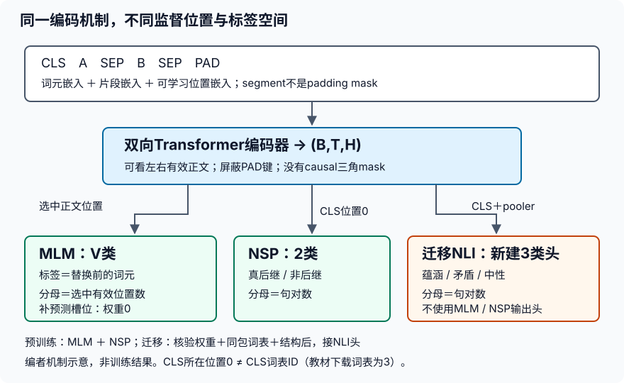

# BERT实验指导：从监督位置到真实迁移

## 先走通两条链路，再比较结果

阅读[实验要求](#/c/d2l-pytorch-2021/lab/bert-pretrain-finetune?v=zh)。这里不提供Dataset、完整模型或训练循环的拼装答案，而是把每个接口该证明的性质拆开。可沿[LEC69教材导读](#/c/d2l-pytorch-2021/lec/lec69)学习预训练，再沿[LEC70教材导读](#/c/d2l-pytorch-2021/lec/lec70)处理迁移；教材导读不等于课堂逐字稿。

第一条链路是`WikiText训练片段 → 自建训练词表 → 小BERT → MLM与NSP`；第二条是`教材既有权重＋同包词表 → SNLI → 三分类头`。两者可以使用相同机制，但不是同一份权重、同一份词表或同一配置。把两套配置分别命名和保存；不要用一个变量名`bert`抹掉来源差异。

### 四任务原身份

| 任务ID | 原任务 |
|---|---|
| `bert-pretrain-finetune-1` | 构造词元/片段/位置输入、MLM预测位置和NSP标签，核对padding不进入错误损失。 |
| `bert-pretrain-finetune-2` | 训练小型教材BERT，分别记录MLM/NSP损失；明确这是教学规模而非工业预训练复现。 |
| `bert-pretrain-finetune-3` | 按教材自然语言推断数据流程完成预训练权重加载/分类头微调，解释标签、训练验证划分与序列/词元级任务接口。 |
| `bert-pretrain-finetune-4` | 报告数据、词表和权重来源及限制，比较冻结编码器与微调的取舍，解释双向BERT不能直接当作因果生成模型。 |

## 第一步：任务1的数据样本必须可追溯

### 1. 一条样本至少有两种身份

**语义身份**回答“它来自哪篇文档哪两句话”；**张量身份**回答“它现在在哪些位置、哪些ID”。分开保留，不能在shuffle、截断、mask之后才尝试从token倒推出原句。

建议先用自拟符号例手工核对，不使用真实语料冒充机制证明。设A有两个普通词a、b，B有一个普通词c，数组总长8：

| 项 | 0 | 1 | 2 | 3 | 4 | 5 | 6 | 7 |
|---|---|---|---|---|---|---|---|---|
| 原输入 | CLS | a | b | SEP | c | SEP | PAD | PAD |
| segment | 0 | 0 | 0 | 0 | 1 | 1 | 0 | 0 |
| position | 0 | 1 | 2 | 3 | 4 | 5 | 6 | 7 |
| 有效键 | 1 | 1 | 1 | 1 | 1 | 1 | 0 | 0 |

有效长度为6；CLS的**位置**为0，不意味着CLS的**词表ID**为0。只有位置1、2、4是MLM候选。这个例子有3个候选，按15%取整后至少选1个；不应从8个数组槽位抽15%，更不应把PAD抽成预测目标。

先保存原始token标签，再改输入；选择位置后排序时，标签和分支必须跟着同一排列移动。检验时不要只比较数组长度，至少手工追踪一个保持不变分支和一个随机替换分支。

### 2. 15%与80/10/10分属两个条件层次

15%是候选中被监督的比例；80/10/10是在“已被选中”的条件下分配替换方式。不是80%的全文都要mask。一次采样可以只出现其中一个分支，不能为了看起来符合比例而伪造每batch固定配额。

本实验的候选排除所有特殊ID，随机替换也仅来自普通词表。随机替换可以偶然等于原词，分支仍算“随机”；未改输入的分支有监督，未选中的位置即使正文长得像`<mask>`也没有监督。最可靠的监督依据是保存的预测位置与权重，不是替换后文本。

教材14.9在Dataset构造时预先采样，训练多轮会看到固定遮蔽。若改为动态遮蔽，必须标明改动并保存数据随机状态；验证遮蔽和NSP样本应固定，才能比较同一道题的损失。不要将动态样本变化带来的噪声当作模型变差或变好。

### 3. 文档边界必须在切句以前确定

实际取得的是Salesforce非raw WikiText-2-v1 Parquet，仍以原发布split为边界。先识别顶层标题并建立docID，再对非空正文行建立paragraphID，之后按`" . "`切句。二级标题不是新文章，标题本身不作普通句子训练；文章首个标题之前的行应明确跳过或另记，不能随意归入下一篇。

正例要求A与其真后继来自同段落；负例B来自同split不同docID。只有paragraphID不同不足以证明跨文档。保留每个抽样的A身份、真后继身份、被选B身份、标签、长度过滤结果及负采样种子。为防文本重复导致的偶然“真负例”，核对负句不等于A或真后继的规范化文本；若不满足，记录排除。

**局部思考：** 如果你先从全语料取随机B，再把最终句对分train/validation，会发生什么？句子作为不同句对的一部分可能跨段出现，连验证句也可能进入训练负例池。正确边界是先固定发布split与文档身份，再在其内部生成任务。

## 第二步：任务1的张量接口先于训练



同一张图只表示机制，不包含任何实际训练结果。

### 1. 双向mask只屏蔽PAD，不屏蔽未来正文

对于句对，A与B之间可以相互注意，segment不是隔离墙。BERT没有decoder式causal mask；不要直接复制上一实验的三角mask。若修改右侧一个有效词，较早词的表示**允许改变**，这正是双向上下文；若修改右侧PAD，较早有效词的表示**不应改变**。

有效位置的注意力键范围为`[0, valid_len)`；CLS、SEP是有效键。批次维、头维和query维的广播要明确。`nn.MultiheadAttention`等API的布尔mask语义与手写keep-mask可能相反，先核对所用接口，不根据名字猜True的含义。

从CLS读出的表示可以非零；PAD表示也可以非零。关键是不把PAD键暴露给有效query，不把PAD表示用于CLS以外的无mask平均，不把PAD纳入监督分母。仅令PAD embedding为零并不成立，因为它还会收到position/segment embedding。

### 2. 一个批次，两套标签空间

| 字段 | 形状 | dtype/约束 |
|---|---|---|
| token/segment | `(B,T)` | 整数索引；segment仅0/1 |
| valid lengths | `(B,)` | 不超过T，含特殊边界符 |
| pred positions | `(B,P)` | 真实槽位不重复且小于有效长；补槽用合法哑索引 |
| MLM labels | `(B,P)` | 原token ID，不是替换后的ID |
| MLM weights | `(B,P)` | 真实槽位1，补槽0 |
| NSP labels | `(B,)` | 教材语义：真后继1，非后继0 |
| 编码结果 | `(B,T,H)` | H与头数、FFN、LayerNorm一致 |
| MLM/NSP logits | `(B,P,V)` / `(B,2)` | 传给CE的是logits，不预先softmax |

按每个batch行的预测位置收集表示；把所有行当作一条长序列后直接索引，会误取另一行的词。构造两行取值互不相同的符号表示，手算收集结果，容易发现batch offset错误。无需为了证明这个机制先训练BERT。

## 第三步：任务2先纠正目标，再训练小模型

### 1. 损失归约的三个问题

先问：**哪些项参与？每项权重是什么？除以什么？** MLM只包含选中的有效位置，NSP每句对一项。把MLM损失和权重都展平为`B*P`长度，再逐项相乘；任何广播出来的额外轴都是错误信号。

教材14.10的默认mean CE会把补槽也先平均进去，事后乘mask无法补救。将损失改成none后又保留权重列向量，则会意外构造外积。不要以“最终得到一个标量”作为正确性证明。

整段评估保留四个累计量：`MLM_NLL_sum、MLM_selected_count、NSP_NLL_sum、pair_count`。分别求比值再相加。改变batch边界或最后一个小batch的大小，不应改变固定样本、固定模型的整段评估指标（浮点微差除外）。训练日志的逐步优化目标与整段验证指标可以不同统计窗口，必须明确命名。

只给一个**局部思路**：把一条真实预测槽位复制成补槽且权重置0，loss应该不变；把补槽标签改成另一个合法词ID，loss也不变。然后检查补槽logits的梯度为0。若loss变化或PAD宽度影响loss，优先检查归约和广播，不先调学习率。

### 2. 可学习位置表不能借`.data`进入前向

固定14.8代码创建了Parameter，却经`.data`加入输入，因此注册为参数不代表参与反向。直接切片Parameter，保持计算图；检查其有效位置有梯度并在更新后变化。未用到的位置可以没有本次梯度，不能要求整个位置表每行都改变。

同样，LayerNorm要按H归一化，不将T纳入参数形状，否则改变padding长度就改变模型结构；MLM头与encoder都要保留真实维度，不把示例里的768硬编码到小模型。

### 3. 有限真实训练应该怎样记录

在真实WikiText子集上固定训练/验证选择，给出：发行revision、文件hash、原行索引、文章数/段落数、正负例数、被长度条件排除的数目、特殊符号策略、词表来源/hash、两种随机种子（样本构造与模型）。没有这些，别人无法判断损失差异来自模型还是换了题。

选择能在本机完成的有限预算：限制子集、序列长度、隐藏维、层数和更新步数；不要用完整BERT训练失败来代替小实验。任务2可以从随机权重开始，因为它本来就是预训练；任务3不能把这个随机状态叫作已预训练。

在运行报告里分别列训练起终点MLM/NSP、固定验证指标、实际更新数和参数梯度证据。只跑合成batch只能证明机制，不满足“真实小语料训练”；只打印初始损失也不满足训练；下载既有权重则根本不是本地预训练。本批实际运行单列于文末，不将它外推为全量预训练。

## 第四步：任务3先核配对，再加载

### 1. 可运行下载不等于开放授权

本次确实取得教材PyTorch `bert.small`包及两成员，并核对教材预期SHA-1。固定15.7公开提供了本地下载微调入口，本阶段按这一用途作有限教学实验；包内没有独立权重许可证，不能推导可再分发、商用或用于任何用途。词表也是独立资产，不能因为是JSON就自动归入教材代码许可。

读入外来权重先核官方URL与hash，再采用当前PyTorch支持的受限权重加载方式；主验收需实际记录能否加载、类型和key匹配。不要为绕过反序列化问题自动降级到任意pickle执行，不接受随意网盘的“同款模型”。如果安全加载失败，保留错误并核格式，不以随机权重假装继续迁移。

### 2. 本次核验到的静态身份

| 项目 | 值与边界 |
|---|---|
| 压缩包 | 75,336,931字节；教材预期SHA-1实际匹配 |
| 权重成员 | `pretrained.params`，128,412,829字节 |
| 词表成员 | `vocab.json`，656,877字节，60005项 |
| 特殊ID | unk0、pad1、mask2、cls3、sep4 |
| 配置依据 | 固定15.7 PyTorch loader，而非包内config（包内无该文件） |
| 配置 | H256、FFN512、4头、2层、位置表512；loader实际dropout0.2 |
| 分词 | 教材lowercase＋空白分词；非WordPiece |
| 未证实信息 | 完整预训练语料、训练步数/日志、独立权重/词表开放许可 |

预期token embedding形状是`(60005,256)`，segment embedding为`(2,256)`，位置表为`(1,512,256)`，pooler权重为`(256,256)`，NSP输出权重为`(2,256)`，MLM最终输出权重为`(60005,256)`。这些是由词表与固定代码得出的**结构预期**，不是本worker实际加载权重后的数值观测；主验收需分别核对。Dropout概率、激活、LayerNorm epsilon、分词器无法仅凭形状反推。

严格加载完整预训练模型后再提取encoder和pooler，保留加载报告。新NLI头为3类，允许随机初始化；旧MLM/NSP输出头不用加入NLI优化器。若选择直接加载子模块，则应按白名单精确解释省略的是哪几个预训练专用头，而不是用无条件`strict=False`吞掉所有不匹配。

### 3. 文本与词表ID不能各自“合理”却彼此错位

用同包词表的列表顺序重建`token_to_idx`。不要在SNLI上再次拟合词表或给词表排序，也不要切换为`[CLS]`、`[SEP]`、`[PAD]`等另一套字符串。教材采用的是小写尖括号形式；特殊ID应查词表，不由常见实现惯例硬猜。

任务2的预训练词表只对本地小模型有效。即使两个词表长度相等，只要顺序不同，embedding语义就错位；形状正确和程序不报错不能证明分词契合。缓存的预处理也要绑定词表hash与预处理版本，避免加载另一实验的ID文件。

## 第五步：任务3的SNLI评估必须守住顺序

### 1. 先按标签名称转换，再考虑数值

教材顺序是蕴涵0、矛盾1、中性2；Stanford HF发行版顺序是蕴涵0、中性1、矛盾2。最简单的防错方式是以语义名称写下输入/输出映射，单独追踪三种标签各一个样本。`-1`无共识标签不送入三分类CE。

本次采用发布者train与validation；原ZIP连接失败，所以不声称已对ZIP hash、原parse列或pairID完成核验。普通文本Parquet不含括号解析树，无需教材针对parse字段的删括号逻辑。记录split与row index，加完整文本hash防止变换后无法追溯；真实运行选哪些行由主验收记录，不能先选验证表现好看的样本。

### 2. 最长边截断与特殊位置

固定`max_len`后给CLS和两个SEP留3格；不断删较长的一边末词，相等时删hypothesis一边。记录原长、截后长度和两边被截词数。截断可能丢掉否定词或关键限定，因此应报告截断率并分析错误，不能将截后模型失败直接解释为逻辑推理能力不足。

NLI输入包含真实premise和hypothesis，这是任务定义，不是生成任务中的偷看未来；标签从不进入输入。分类的取值位置是CLS，不是第一个普通词。PAD变动测试只改变有效长度之外的ID，不修改有效正文或segment；应在eval下比较以免dropout掩盖不变量。

### 3. 训练证据与验证证据分别留存

记录严格加载结果、初始分类头、训练步数、loss聚合、验证CE和准确率；准确率按正确句对数除以句对数，不能平均不同大小batch的百分比。NLI的每句对loss也与MLM的每位置loss不同。

验证时设置eval和禁梯度，不更新模型/优化器/词表，不继续采样MLM。真实迁移最小证据包括：编码器确实来自已核验文件、实际下游梯度、至少一个预训练参数变化、固定validation评价。未运行SNLI只做随机张量前向，不能算迁移完成。没有效果提升也照实报告；小子集不等于SNLI榜单成绩。

## 第六步：任务4把冻结对照做公平

从同一预训练状态各自初始化两个独立模型，且分类头初值相同；不要先微调一个再拿其更新后的权重作另一个“冻结基线”。两方案使用相同样本、tokenizer、截断、batch顺序和预算，明示不同学习率是否属于实验变量。

- **冻结特征方案：** encoder和pooler不求梯度，参数不进入优化器；保持这些模块eval，只有新头训练。检查冻结权重在前后完全不变，新头发生更新。
- **全量微调方案：** encoder、pooler和新头均参与梯度与优化。位置表不能因为`.data`错误被意外排除。检查代表性预训练权重确实更新，不只看头的loss下降。
- **验证共同合同：** 关闭全部dropout；固定validation顺序；分别累计NLL和correct/count，不泄漏验证标签。

解释工程取舍时，冻结通常减少反向传播与优化器状态成本，但是否更快、更省内存需本机测量。全量微调有更大适应能力，也有小数据过拟合与遗忘风险；不能把“可训练参数更多”当成必胜结论。没有GPU运行就不给GPU吞吐和显存表。

### 为什么不能沿用上一实验的生成评估？

Transformer翻译decoder预测当前位置时只能看源句与自己已有历史；BERT的有效正文可以双向互看。给定完整句子再要求它“预测下一个词”，可能把答案本身送进上下文；普通MLM又只在被选位置训练，目标不同。

可以用自拟句子修改某个位置右侧的**有效**词，观察早期表示的变化，来检查双向通路；这属于机制实验，不证明模型理解。相反，“PAD不应影响有效输出”仍是必须满足的不变量。区分这两项，才不会把BERT的正确双向行为误判成decoder泄漏，或把decoder的真实泄漏辩解成双向编码。

## 排错顺序与自检问题

| 现象 | 先检查什么 |
|---|---|
| MLM loss随补槽数变化 | CE是否先mean；权重是否错广播；分母是否含补槽 |
| NSP精度异常高 | 负例是否总来自另一split/格式；长度或特殊符号是否泄漏标签 |
| position参数始终不变 | 是否通过`.data`或detach进入前向；是否进入优化器 |
| PAD变化影响CLS | mask方向/广播、有效长度、pooling、dropout状态 |
| 权重加载只有embedding报错 | 词表是否重建、文件是否为另一框架/另一模型版本 |
| SNLI矛盾与中性互换 | HF整数标签是否未经名称映射就直接使用 |
| 冻结模型验证每次不同 | 是否误开encoder dropout；是否验证数据还在动态变换 |
| loss下降但所谓迁移无证据 | 是否只训练了随机初始化模型；加载报告和参数身份是否缺失 |

1. MLM输入没变化的10%为什么仍要计算loss？因为监督集合由抽样决定，不由替换后token是否变化决定。
2. NSP负例能不能直接用SNLI的contradiction样本？不能；两者构造规则、标签语义与数据来源不同。
3. 为什么`eval()`不能证明encoder冻结？它主要改变dropout等模块行为，不阻止梯度和优化器更新。
4. 为什么词表大小相同仍可能加载错？每个ID对应的词不同会让相同行embedding代表不同语义。
5. 是否需要在本实验完成问答训练？不需要；任务3要求解释序列级/词元级接口，新增问答训练超出四任务范围。

这些简答只帮助定位不变量，不代替实现、真实训练和失败分析。页面通用xv6命令不适用，没有虚构通过阈值。

## 主验收：三类证据分别记账

环境为Python3.11.8、PyTorch2.5.1、Apple M2 Max、CPU单线程float32。Parquet由仓库外的Bun1.4.4／hyparquet1.33.0读取**上述同一批已核hash文件**，再交Python；不是换了一套语料。pyarrow下载多次因TLS中断而不完整，未安装、未放过校验失败的wheel。解码器的BigInt标签显式转换为整数；模型没有依赖d2l或Jupyter，未运行GPU/MPS或计时基准。

### 1. 合成机制不是训练效果

四讲纸面与局部形状检查另有记录。MLM忽略槽的直接logits梯度为0；合成两类logits夹具的正确有效损失为0.126928，先平均全部槽得到2.751397，错误列向量广播得到8.254192，二者都不是正确目标。真实小模型的可学习位置参数梯度范数为0.066053；固定eval夹具改变右侧有效词令早期表示最大变化0.160006，改变被屏蔽PAD身份的差为0。前者是正确双向性，后者才是padding不变量，均不证明语言理解。

### 2. 实际WikiText小预训练

从发布者train/validation各恢复顶层文章边界，扫描到629/60篇文档；在各split按原顺序取前64/16个相邻句对，每个配一个同split、不同文档的负例，得到128/32样本，正负各半。负句排除与A及真实后继完全相同的规范化文本。正例A集中在靠前文章，负例来自更广的文档；最终涉及59/12篇，**不是代表性均匀语料抽样**。原split、文档、行、句号位置及文本hash保留在日志，不发布原句。

只在选中的128训练句对、截断前词元上拟合词表，minfreq2、频数降序/Unicode同频排序，含五个特殊符号共708项。验证不补词。非raw发行版原有UNK与小词表OOV都映射UNK，并从MLM候选中排除；此运行未将两类UNK分别计数，不声称已统计其各自贡献。

为了有限CPU运行，句对按较长侧删尾词、等长删B，保留三枚边界符，最大长32；这是对教材预训练“超长跳过”的明确改动。训练114/128、验证29/32对发生截断，比例很高，可能丢掉关键上下文。MLM按有效普通候选选取，80/10/10在选中后抽分支；本次训练加验证共555个监督位置，实际MASK/随机普通词/不变分支为436/62/57，不要求小样本精确等于理论比例。遮蔽只生成一次，重复epoch不重新抽题。

模型为2层、H32、4头、FFN64、post-norm、ReLU、可学习位置、dropout0.1，共66,438参数；模型/shuffle种子2035/2036，负采样种子2031/2032，遮蔽种子2033/2034。Adam学习率0.003、B16、clip1、10轮80更新，初末均eval重评。

| 指标 | 初始训练 | 末轮训练 | 末轮验证 |
|---|---:|---:|---:|
| 有效MLM词元平均CE | 6.740114 | 4.152513 | 5.298478 |
| 句对平均NSP CE | 0.722930 | 0.175329 | 1.609197 |

MLM训练/验证分母为472/83，NSP分母为128/32。验证从B16改B7，MLM/NSP差约3.68e-7/8.94e-8，参数、buffer与已有梯度不变。NSP训练损失低、验证损失高，不能据此声称学好了句间关系；这是短样本目标拟合，不是原始BERT复现。

### 3. 另一路：真正的既有权重SNLI迁移

从教材包用`weights_only=True`受限加载，完整模型严格key匹配，所有初始张量逐项等于已核验文件；然后只取encoder和已有pooler，新建256→3分类头。采用H256、2层、4头、FFN512、位置容量512、实际dropout0.2，修正位置参数`.data`断梯度。这里没有把上面的随机起点小模型充作预训练权重。

SNLI保留发布者train/validation，按原顺序取前64/32条有共识标签的样本；全split缺标785/158条排除规则另记，测试未下载。标签按HF的0/1/2转换为教材0/2/1。所选训练蕴涵/矛盾/中性为22/20/22，验证为10/14/8；规范化前提交叠为0，仅证明这个所选子集。使用同包60005词表和lower＋空白分词，最大长32；训练/验证各有7对截断，实际输入OOV词元150/60个。没有用SNLI重建词表，也未核实下载权重全部预训练语料与SNLI的潜在重合。

两方案从完全相同的权重和新头初值开始，头种子2037、shuffle2038；Adam学习率0.0001、B8、2轮，各16更新。冻结方案同时固定encoder与pooler并设eval，只训练新头；全量微调训练三者。它们是有限对照，不是调参后的模型排名。

| 方案 | 可训练参数 | 初始→末轮训练CE | 验证CE | 验证正确 |
|---|---:|---:|---:|---:|
| 冻结encoder与pooler | 771 | 1.237757→1.170996 | 1.095402 | 13/32 |
| 全量微调 | 16,613,635 | 1.237757→1.012863 | 1.121991 | 14/32 |

冻结骨干/pooler最大参数差0，新头确有更新；全微调骨干/pooler最大差0.001516，末步位置参数梯度范数3.122834。两方案验证B8改B5后，CE差均小于6e-8且正确数相同，参数、buffer与已有梯度不变。全微调多对一条但CE更高，不能从32个样本宣称性能提升；固定首8条预测及真实标签原样保留在日志。

未执行完整WikiText/SNLI、测试集评分、工业BERT、全部学生变体、因果BERT生成或硬件性能测量。没有发布原语料、词表全文、原/派生权重或完整解答脚本，也未保存供下一批加载的BERT检查点。

## 来源、使用限制与执行范围

本指导按固定中文第二版的六节编写，非2021视频转录；教材原件、read ranges及SHA-256见以下本地审计目录：

```text
sources/p10-bert-pretrain-finetune/
  source-index.json
  asset-audit.json
  verification-contract.json
  manifest-fragment.json
```

[14.8](https://zh.d2l.ai/chapter_natural-language-processing-pretraining/bert.html)／[14.9](https://zh.d2l.ai/chapter_natural-language-processing-pretraining/bert-dataset.html)／[14.10](https://zh.d2l.ai/chapter_natural-language-processing-pretraining/bert-pretraining.html)／[15.4](https://zh.d2l.ai/chapter_natural-language-processing-applications/natural-language-inference-and-dataset.html)／[15.6](https://zh.d2l.ai/chapter_natural-language-processing-applications/finetuning-bert.html)／[15.7](https://zh.d2l.ai/chapter_natural-language-processing-applications/natural-language-inference-bert.html)。无需另加前置课或必读论文。

真实文件来自[Salesforce WikiText](https://huggingface.co/datasets/Salesforce/wikitext)和[Stanford SNLI](https://huggingface.co/datasets/stanfordnlp/snli)，各自固定revision与完整文件hash见[实验要求页底](#/c/d2l-pytorch-2021/lab/bert-pretrain-finetune?v=zh)。两者不是教材原ZIP的已核字节复现。WikiText卡片CC BY-SA版本冲突保留；SNLI卡片明确[CC BY-SA4.0](https://creativecommons.org/licenses/by-sa/4.0/)。署名、来源链接、许可链接及预处理修改说明不可省略；本页不发布原句库、语料摘录或模型参数。

权重和词表没有单独开放许可声明，公开教材下载入口仅支持本阶段的本地有限教学用途判断，不授权开放再分发。Worker原始记录只包括文件获取和身份审计；主agent执行范围以上述独立记录为准，不改写worker历史。数值与样本身份日志：

```text
sources/p10-shared/bert-smoke.json
sources/p10-shared/notes-smoke.json
sources/p10-shared/diagnostics.json
```
