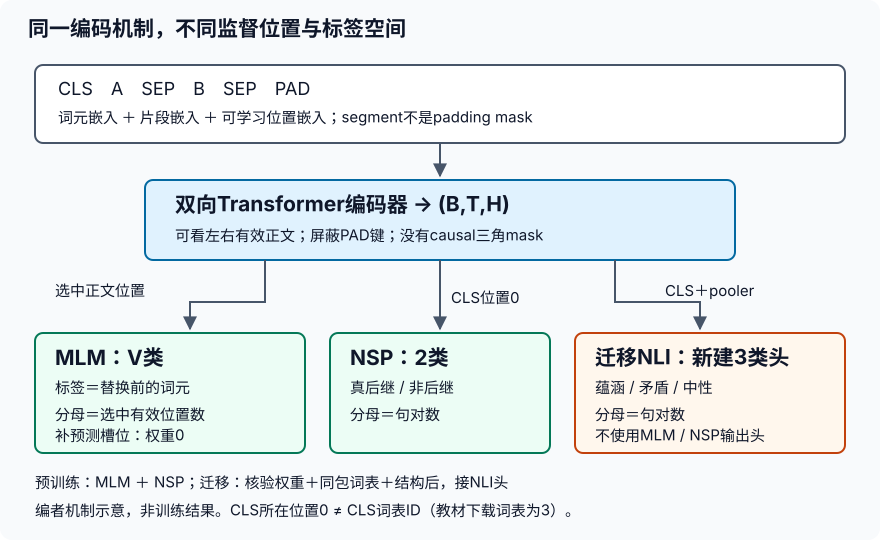

# BERT预训练与自然语言推断

## 学习问题：你迁移的是知识，还是一个同名随机网络？

本实验由你在本地用Python/PyTorch自行实现，程序、配置和学习记录仅供自己保存与自检；无需Git提交、推送、上交报告或上传本站，也不要求排行榜提交。个人学习与任务进度不作为教程完成条件，不由agent认证或追踪。

本实验打通两条不同的链路：在真实小语料上训练教学规模的双向编码器；加载教材提供的既有预训练模型，在自然语言推断（NLI）上训练分类头。两条链路的词表、维度与训练历史必须各自记账，不能把第一条的小模型悄悄叫作第二条的`bert.small`，也不能把“代码能前向”叫作“已完成迁移”。

先完成数据与损失合同，再按[实验指导](#/c/d2l-pytorch-2021/lab/bert-pretrain-finetune?v=guide)自行实现。本地使用Python/PyTorch练习。只给任务、接口与局部提示，不提供完整答案脚本。

### 四任务原身份

| 任务ID | 原任务 |
|---|---|
| `bert-pretrain-finetune-1` | 构造词元/片段/位置输入、MLM预测位置和NSP标签，核对padding不进入错误损失。 |
| `bert-pretrain-finetune-2` | 训练小型教材BERT，分别记录MLM/NSP损失；明确这是教学规模而非工业预训练复现。 |
| `bert-pretrain-finetune-3` | 按教材自然语言推断数据流程完成预训练权重加载/分类头微调，解释标签、训练验证划分与序列/词元级任务接口。 |
| `bert-pretrain-finetune-4` | 报告数据、词表和权重来源及限制，比较冻结编码器与微调的取舍，解释双向BERT不能直接当作因果生成模型。 |

## 任务1：输入与两种监督信号

### A. 句对不等于两条独立序列

对前后两段A、B，打包为`<cls> A <sep> B <sep>`。词元ID、segment ID和位置索引是三件不同的事：

| 数组 | 必须表达什么 |
|---|---|
| token IDs `(B,T)` | 由当前模型的固定词表映射，不能临时重排 |
| segment IDs `(B,T)` | `<cls>`、A、第一枚`<sep>`为0；B、最后一枚`<sep>`为1 |
| position indices | 全句对从0连续到有效末尾，进入B时不重新归零 |
| valid lengths `(B,)` | 包含CLS和SEP，不包含右侧PAD |
| 编码表示 `(B,T,H)` | 三种embedding相加后进入双向Transformer编码器 |

可学习位置表不是正弦位置编码。三个embedding的最后一维都为$H$，相加而非拼接。右侧PAD的segment可填0，但**segment=0并不是padding mask**。注意力必须屏蔽PAD键；PAD查询位置仍可能产生非零表示，只要它们不进入任务监督或错误的pooling即可。修改PAD的token值而保持有效长度不变，不应影响有效位置的表示。

图为编者机制示意，非训练结果。MLM使用被选位置；NSP和NLI使用位置0的CLS表示。位置0与词表ID0不同：已下载教材词表的`<cls>` ID为3，ID0是`<unk>`。

### B. MLM：先决定考哪些位置，再决定如何改输入

候选集合只来自有效正文词元，排除`<cls>`、`<sep>`、`<pad>`、`<mask>`、`<unk>`等保留符号；本实验也不将原语料里已有的`<unk>`当作普通词预测。令候选数为$C$：当$C>0$，无放回选取

$$
K=\min\{C,\max(1,\operatorname{round}(0.15C))\}
$$

采用Python `round`的取整语义并记录版本；$C=0$时丢弃样本并计数，不伪造一个CLS目标。对**已选中的**每个位置独立抽分支：80%替换为`<mask>`，10%替换为普通词表中的随机词，10%保持原词。随机池排除全部特殊ID，允许偶然抽到原词，因此“输入真正改变的比例”不等于分支概率。小batch不要求恰好80/10/10。

无论输入被如何处理，标签始终是**替换前**的原词ID；保持不变的10%也必须计算MLM损失。不要用`input == mask_id`找监督位置。保存原位置、原标签、分支与随机种子，抽样在划分后进行。

每条样本的真实预测槽位可以不足批次上限$P$：`pred_positions, mlm_labels, mlm_weights`均为`(B,P)`；填充槽位用合法哑位置（如0）并赋权重0。这个0仅为安全索引，不能让CLS变成MLM标签。真实槽位权重1且位置互异，均小于有效长度。将编码结果按各行位置收集成`(B,P,H)`，MLM头输出`(B,P,V)`。

**与固定教材实现的边界：** 14.9按含CLS/SEP的`len(tokens)`计算15%，只显式排除CLS/SEP，随机替换可以抽到特殊符号。本实验改用上述有效普通候选数和普通词替换池；这是明确的工程修正，不声称与原Notebook逐字等价。

### C. NSP：随机句子并不自动是假后继

正例是在**同文档、同段落**内相邻的两个非空句子；教材以`" . "`切句，仅作简化，不是可靠的自然语言句界识别。负例的第二句必须来自**同一数据划分中的另一文档**，不能从验证/测试借句，不能拿真后继冒充负例。

保留`split → document → paragraph → sentence`身份。WikiText顶层`= title =`标题可用于恢复文档；二级/三级标题不启动新文档。不要把每个文本行叫作独立文档，也不要将跨标题的句子拼成正例。若无法可靠恢复文档，必须降格报告为“跨段落负例”，不能声称已验证跨文档。

另外记录负句与A、真后继的规范化文本hash，排除完全相同的文本碰撞。无法找到合法负例时丢弃并计数，不能无限重抽或改标签蒙混。负例不是矛盾句；NSP的`is_next=1 / not_next=0`与NLI三分类标签无关。

从发布者train与validation分别构造样本；先划分、后抽样、后拟合训练词表，测试封存。教材的随机负例函数没有文档或真后继排除，这也是本实验显式收紧的合同。约一半概率选正例不保证长度过滤后类别仍恰好一半，应报告最终计数。

## 任务2：教学预训练与可解释的损失

### A. 规模可以缩小，目标不能偷换

教材14.10的教学模型为2层、隐藏维128、2头、FFN256；它不是原始BERT_BASE的12层/768维/12头，也不是本实验下载的256维`bert.small`。CPU小运行可进一步缩小层数、隐维、长度与步数，但需列明实际参数，不把它叫作工业预训练复现。隐藏维须可被头数整除；LayerNorm只归一化最后的隐藏维，FFN保持序列轴。

从发布者非raw WikiText-2-v1的训练片段拟合本次小实验词表，验证不更新词表。是否沿教材`min_freq=5`或改为更适合小样本的阈值，必须在运行配置中明确，不能隐式借用验证文本补词。语料里原有`<unk>`与新词表OOV不是同一来源，应分别说明。固定训练/验证子集的原始行号、文档身份、所取句对与词表hash。

教学预训练应真正完成前向、反向和参数更新，记录步数、batch、最大长度、优化器、学习率、随机种子与设备。先在机制检查通过后再训练。首尾训练损失下降只说明此样本目标被拟合，不保证语言理解；没有下降也应如实保留，不挑种子重写漂亮结果。

### B. 两个分母，不能混成一个平均数

令$\ell^{\mathrm{MLM}}_{bp}$为未归约的每槽位交叉熵，$w_{bp}\in\{0,1\}$为真实预测槽位权重。令$\ell^{\mathrm{NSP}}_b$为每句对二分类交叉熵：

$$
L_{\mathrm{MLM}}=
\frac{\sum_{b,p}w_{bp}\ell^{\mathrm{MLM}}_{bp}}
{\sum_{b,p}w_{bp}}
$$

$$
L_{\mathrm{NSP}}=\frac{\sum_b\ell^{\mathrm{NSP}}_b}{B},
\qquad L=L_{\mathrm{MLM}}+L_{\mathrm{NSP}}
$$

MLM分母是被选的有效预测位置数，不是总token数、PAD宽度或batch大小；NSP分母是句对数。空监督batch必须提前处理并记录，不能只加极小数把数据问题藏起来。报告整段验证指标时，分别累计两个任务的分子与分母，而非简单平均不同大小batch的均值。MLM类别数通常远大于NSP，不能仅因两个损失绝对值不同就判断训练失败。

**固定教材PyTorch版的两个陷阱：** 14.10先用默认`CrossEntropyLoss()`得到标量，再乘权重，已经无法删除不该计入的槽位；仅改成`reduction='none'`仍不够，`(B*P,)`与`(B*P,1)`相乘会广播为方阵。本实验要求损失与权重展平后**形状完全相同**，逐项相乘再求和。

另一个差异是14.8通过`pos_embedding.data`切片相加，会切断位置参数的梯度。实现应直接切片参数本身；检查有效位置参数有梯度且更新，不因“它在参数列表里”就断言学到了位置。

### C. 最小自检证据

- MLM真实位置的loss和梯度存在；补零权重槽位不改变loss，不产生该槽位logits的梯度。
- 关闭dropout后，PAD身份/右侧宽度变化不改变有效token表示和CLS分类结果。
- 词元、segment、位置参数及编码块在预训练时有正确梯度；没有把全部编码器误冻结。
- 训练日志同时给MLM、NSP以及各自分母；验证固定遮蔽与负样本随机状态，避免评估时题目不断变化。
- 保存环境、实际子集/词表/配置身份及未执行范围。不提交完整语料、参数或答案脚本。

以上是学习者的本地练习约定；主agent实际执行的有限子集、指标与未执行范围见[指导末节](#/c/d2l-pytorch-2021/lab/bert-pretrain-finetune?v=guide)，不把要求清单全部勾成已验。

## 任务3：加载既有权重，完成NLI迁移

### A. 加载的单位是“权重＋词表＋结构＋预处理”

教材提供的PyTorch包是`bert.small.torch.zip`，本次实取SHA-1与教材注册值相同。其成员仅有`pretrained.params`和`vocab.json`，**没有独立config或LICENSE**。词表60005项，`unk/pad/mask/cls/sep=0/1/2/3/4`。配置由固定15.7的PyTorch加载器确定：2层、隐藏维256、4头、FFN512、最大位置512；attention投影含bias，MLM使用ReLU，pooler为Linear加Tanh。

调用处传`dropout=0.1`，但固定加载器内部写死`0.2`，不能声称它实际采用0.1。自行实现时把实际dropout、LayerNorm参数与激活函数写入配置；不得仅靠张量形状猜模型所有行为。复用整个词表顺序，不能在SNLI上重新fit或按字典序重排。严格加载并报告missing/unexpected keys；不能靠`strict=False`静默留下随机编码块。

教材分词是lowercase后按空白分词，不是原始Google BERT的WordPiece。普通词看似相同，也不能换成别家的tokenizer、特殊ID或“bert-small”检查点。反过来，任务2的新词表小模型也不能直接加载此60005行embedding。

教材文字只给出预训练模型的教学来源，包内没有完整语料清单、训练步数与训练日志；不能据此断言下载模型恰是本轮WikiText小运行所得，也不能保证它与SNLI不存在未知预训练重合。只报告能核实的模型身份与限制。

### B. 标签和切分以语义核对

NLI判断的是**给定前提时假设的关系**，不是无条件判断现实真假。采用教材标签：`entailment=0, contradiction=1, neutral=2`。neutral是信息不足，不是“不相信”；交换前提和假设通常会改变问题。

本次原始Stanford ZIP未成功获取，使用Stanford发布者Hugging Face仓库的`plain_text`发行版，保留发布者train/validation，不下载test。它以`0=entailment, 1=neutral, 2=contradiction`编码，必须先按名称还原再映射到教材顺序，即`0/1/2 → 0/2/1`；排除无共识标签`-1`并计数。

这个Parquet发行版只含premise/hypothesis/label，不含原ZIP的binary parse、pairID字段，不能冒称逐字复现教材对括号解析列的读取。身份用发布revision、split、row index及文本hash记录；小写和空白分词明确记为预处理。不要再次给已是普通文本的字符串机械套用“删全部括号”的parse清洗。

固定训练与验证子集后报告标签分布、OOV和截断率。验证只做选择与评价，不加入训练或词表；测试不参与选模型。若检查到规范化句对或前提跨段重复，先记录并说明处理，不宣称已无泄漏。教材示例直接用test评估；本实验改用官方validation，不用测试集调参。

### C. 分类头与迁移证据

截断句对时为CLS和两枚SEP保留3个位置；按教材较长的一侧从尾部删词，相等时删B，直到正文总长不超过`max_len-3`。最大输入长度不能超出512位置表。NLI输入不做MLM随机替换，segment与PAD mask仍须正确。

将预训练编码器和pooler接入NLI分类器，只新增`H→3`输出层；不复用原NSP的二分类输出。任务所需的输出是`(B,3)`，每个句对一项交叉熵。加载前后参数身份与严格key匹配证明“加载发生”；再给实际参数变化、训练/验证记录，才证明“做过微调”。随机初始化的对照可标为对照，绝不能替代迁移结果。

| 应用 | 使用表示 | 监督单元 |
|---|---|---|
| 单句/句对分类 | CLS位置表示，通常经pooler | 每序列/句对一个标签 |
| 词元标注 | 每个有效正文位置的表示 | 每个有标注词元；排除PAD/无标签位置 |
| 抽取式问答 | 问题与段落的逐位置表示 | 段落内起止位置；约束起点不晚于终点 |

只要求解释后两类接口，不额外增加标注或问答训练任务。原预训练MLM/NSP专用输出头不参与本次NLI优化；不要把未被调用的头参数无梯度误诊为整个迁移失败。

## 任务4：冻结、微调与可见性边界

从同一已核验预训练状态、相同分类头初值、相同训练/验证样本出发，比较：

| 方案 | 更新对象 | 取舍与检查 |
|---|---|---|
| 冻结特征 | 仅新分类头；本实验同时冻结encoder与pooler | 更新量小；设冻结模块eval以关闭dropout，检查参数完全不变 |
| 全量微调 | encoder、位置/segment/token embedding、pooler、新头 | 更适应下游；优化器覆盖所有需要更新的参数，检查预训练参数确实变化 |

`eval()`不等于冻结，`requires_grad=False`也不等于关闭dropout。总模型调用`train()`可能重新打开子模块dropout，因此冻结方案要重新设置冻结模块模式；不要使两个方案差在随机特征而不是训练策略。记录两方案的可训练参数量、实际步数、验证CE/准确率和局限；有硬件计时才比较速度/显存，没有测量就只讨论理论取舍。有限样本上不保证全量微调更好。

BERT编码位置$t$可以读取左右两侧的有效词元；它没有因果下三角mask。MLM学的是给定双向上下文的被选词预测，不是直接优化从左到右的条件概率连乘。因此把整段真句输入后取第$t$个输出，不是合法的下一词生成评估；把mask迭代填词也不自动变成标准自回归语言模型。要用于因果生成需另定训练目标与可见性，不能只重命名输出层。

## 自检边界与本地记录

在本地保存简洁实验记录和自己实现的局部证据：四任务对应关系、数据四项审计、形状/掩码/梯度检查、实际小预训练的两个损失、既有权重严格加载与SNLI微调、冻结对照及失败分析。把“合成机制”“真实小数据训练”“已有预训练权重迁移”“硬件实测”分栏。未运行完整语料、工业BERT、大模型、GPU或测试集就明确写未运行；下载成功不填入训练成功栏。

本实验依据教材与已核来源编写，不生成课堂逐段整理、中文译稿或时间码；中文原课由学习者自行观看。牛仔竞赛认证文件与评分端仍有独立的访问/核验边界，不构成课堂补稿要求。

## 来源、文件身份与使用限制

教材为固定提交的当前中文第二版，不是2021课堂快照：[14.8 BERT](https://zh.d2l.ai/chapter_natural-language-processing-pretraining/bert.html)、[14.9 数据](https://zh.d2l.ai/chapter_natural-language-processing-pretraining/bert-dataset.html)、[14.10 训练](https://zh.d2l.ai/chapter_natural-language-processing-pretraining/bert-pretraining.html)、[15.4 SNLI](https://zh.d2l.ai/chapter_natural-language-processing-applications/natural-language-inference-and-dataset.html)、[15.6 任务接口](https://zh.d2l.ai/chapter_natural-language-processing-applications/finetuning-bert.html)、[15.7 NLI微调](https://zh.d2l.ai/chapter_natural-language-processing-applications/natural-language-inference-bert.html)。本文是编者任务合同，不重复翻译教材；未声称课堂覆盖所有段落。

四项资产分别审计，不能从教材Apache-2.0或代码许可推导语料、权重开放权利：

| 资产 | 实际取得与限制 |
|---|---|
| 预训练语料 | Salesforce发布的`wikitext-2-v1`非raw Parquet，train/validation已下载并核LFS hash；原教材ZIP未取得。卡片metadata写CC BY-SA3.0/GFDL，正文写CC BY-SA4.0，版本冲突保留。可作有来源的本地有限实验，不发布语料全文或声称冲突已解决。 |
| NLI数据 | Stanford发布的SNLI plain_text Parquet，train/validation已下载并核LFS hash；原ZIP因连接失败未核。卡片明确CC BY-SA4.0；保留Stanford NLP Group及Bowman、Angeli、Potts、Manning署名、来源/许可链接与清洗说明。 |
| 预训练权重 | 教材公开提供用于下载微调的`bert.small.torch.zip`；本地有限教学使用按教材入口进行。包内没有独立权重许可、训练日志；不授予开放再分发/商业部署权，不发布原权重或派生检查点。 |
| 词表与结构 | `vocab.json`与权重同包，必须精确配对；未提供独立词表许可/config文件。结构依据固定PyTorch加载器，不能将代码许可当作词表授权。 |

[WikiText发布页与卡片](https://huggingface.co/datasets/Salesforce/wikitext)、[SNLI发布页与卡片](https://huggingface.co/datasets/stanfordnlp/snli)、[SNLI原项目](https://nlp.stanford.edu/projects/snli/)、[CC BY-SA3.0](https://creativecommons.org/licenses/by-sa/3.0/)、[CC BY-SA4.0](https://creativecommons.org/licenses/by-sa/4.0/)。WikiText源于Wikipedia条目，署名应保留Merity、Xiong、Bradbury、Socher及Wikipedia贡献者；若公开摘录还需对应文章来源和修改说明。本页不展示真实语料句子，以免用笼统署名代替条目署名。

已取得文件的SHA-256（完整hash置于可横向滚动表中）：

| 文件 | SHA-256 |
|---|---|
| WikiText train Parquet | `dfc27e4360c639dc1fba1e403bfffd53af4a5c75d5363b5724d49bf12d07cce6` |
| WikiText validation Parquet | `717de9a0c1c0b0b1dfdd8f1e6ad8a30ece618bbde81f5da8207277547d324215` |
| SNLI train Parquet | `ef9a7b25d97390a62aeda7abe26aec8640600f50b818eaeb9107097d60ac6620` |
| SNLI validation Parquet | `00f5ed8deaed007fef3022f0215b287efbab815b1bb31ac3f3ff4f4129d41ffe` |
| bert.small.torch.zip | `02078e7899d7468f0c0c1e1af23922df0106bb92575058f14571f85cb1bac811` |
| pretrained.params | `6b50cf1eb763954014df9734e0ce539dae7a9e974c8986e6e3c8815e9754f958` |
| vocab.json | `72054eefdee98d1f83894df640f1bae9829b1398f8a2b77143a75798bc48ab22` |

完整获取记录、精确read ranges、固定教材原件、四项资产审计与未运行合同保存在`sources/p10-bert-pretrain-finetune/`；大文件仅在仓库外缓存，不随站点提交。
